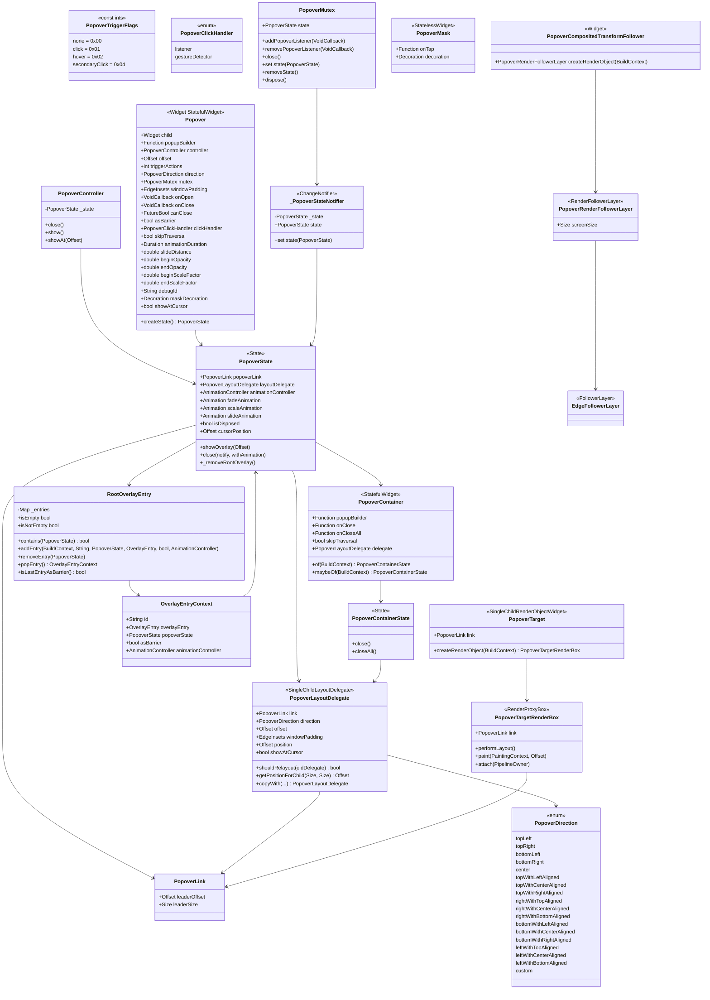
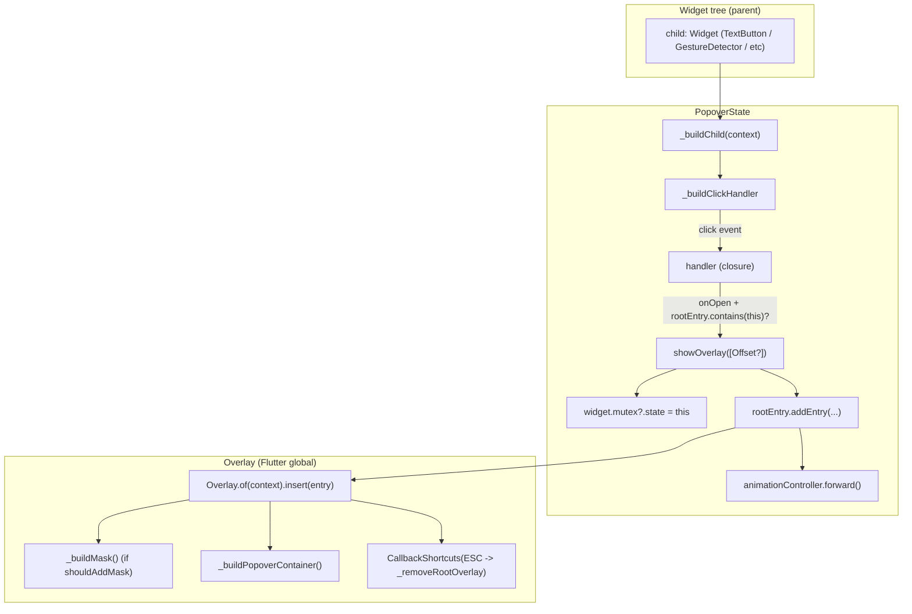
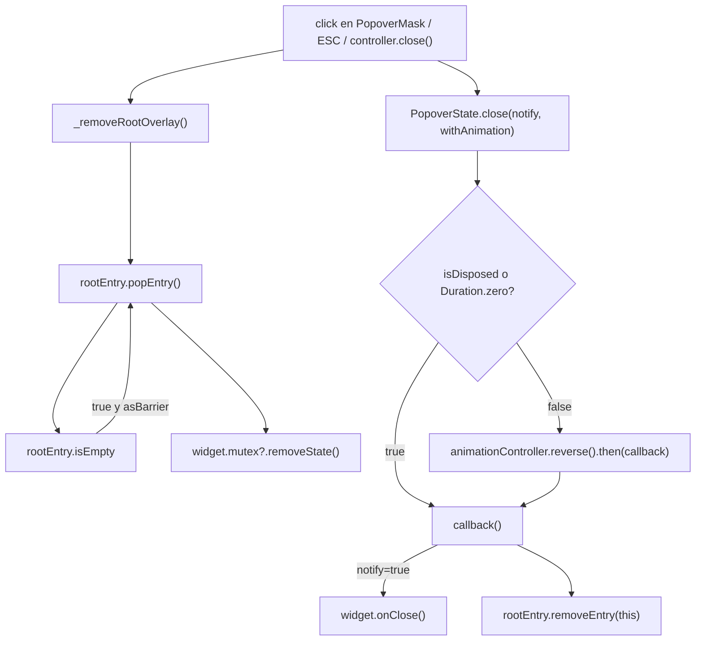
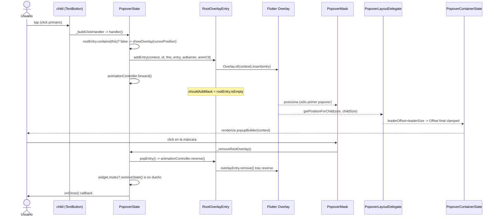
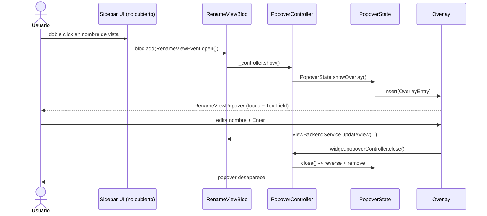
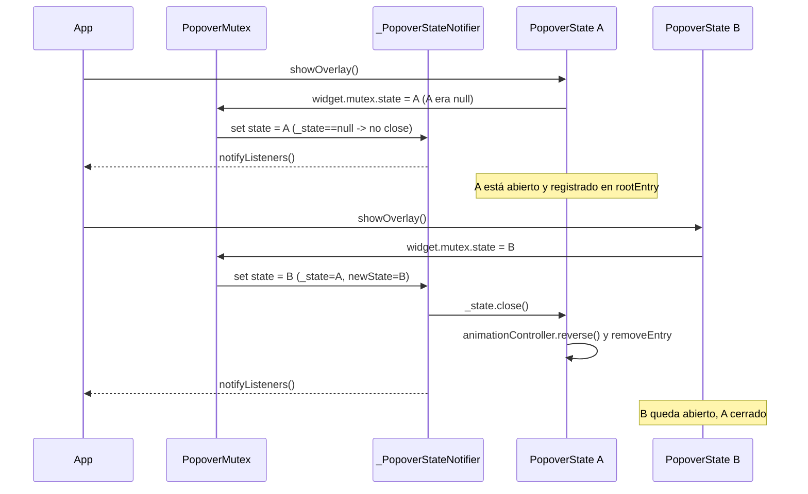
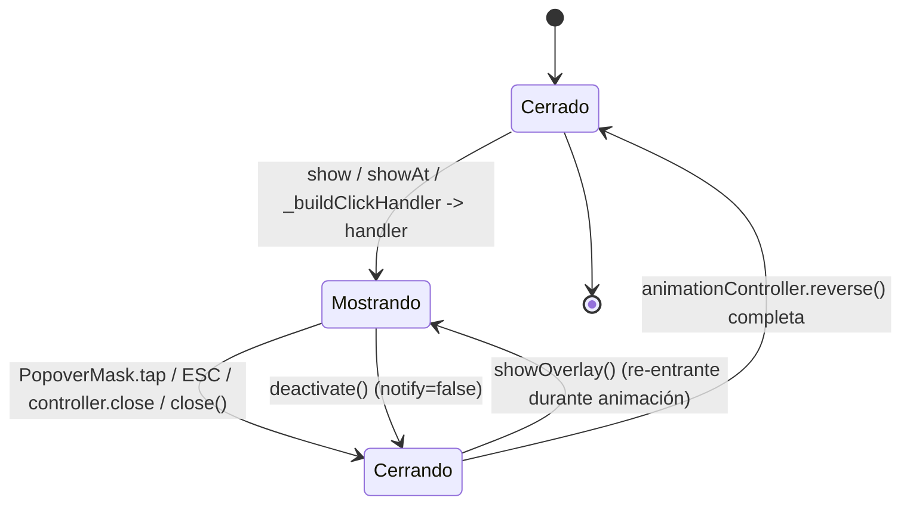

# F00.5.2 — Paquetes Dart internos: `appflowy_popover`

## 1. Resumen

`appflowy_popover` es el paquete Dart interno (no publicado) que AppFlowy usa para todos los **popovers transitorios** mostrados encima del contenido — menús contextuales, selectores de fecha, selectores de emoji, listados de acciones, autosuggest de slash, etc. Se sitúa en `appflowy/frontend/appflowy_flutter/packages/appflowy_popover/` y exporta, como API pública, **dos archivos** (`mutex.dart` y `popover.dart`) detrás de la fachada `lib/appflowy_popover.dart` (appflowy/frontend/appflowy_flutter/packages/appflowy_popover/lib/appflowy_popover.dart:1–5). El paquete combina un `StatefulWidget` (`Popover`), un controlador imperativo (`PopoverController`), un sistema de exclusividad entre varios popovers (`PopoverMutex`), un layout relativo al ancla (`PopoverLayoutDelegate` + `PopoverTarget`/`PopoverLink`) y un registro global de overlays (`RootOverlayEntry`) que permite apilar y cerrar múltiples popovers. Es consumido por ≥ 80 sitios del `lib/` y por el envoltorio de alto nivel `AppFlowyPopover` en `appflowy/frontend/appflowy_flutter/packages/flowy_infra_ui/lib/src/flowy_overlay/appflowy_popover.dart`.

## 2. Alcance

**Incluye** los 96 archivos listados en `archivos_cubiertos`: los 6 archivos Dart del paquete (`lib/appflowy_popover.dart` + 5 en `lib/src/`), el test `test/popover_test.dart`, la mini-app de ejemplo `example/lib/{main,example_button}.dart` con su scaffolding de 6 plataformas (Android, iOS, Linux, macOS, Windows, web), y los metadatos (`.gitignore`, `.metadata`, `LICENSE`, `README.md`, `CHANGELOG.md`, `analysis_options.yaml`, `pubspec.yaml` raíz y de `example/`).

**Queda fuera y se referencia como ya documentado** (no se duplica aquí):

- El envoltorio `AppFlowyPopover` que aplica el `popoverDecoration` corporativo vive en `appflowy/frontend/appflowy_flutter/packages/flowy_infra_ui/lib/src/flowy_overlay/appflowy_popover.dart:24–133`. Solo se cross-refiere en §10 — pertenece a `flowy_infra_ui`, no a `appflowy_popover`.
- El grafo de paquetes Dart internos en su conjunto (incluida la dependencia `appflowy_popover → flowy_infra_ui → …`) está catalogado en `OUT/17-grafo-dependencias.md` (B1.2) y en `OUT/02-stack-y-dependencias.md`. Este documento **no** repite ese grafo.
- Los popovers de menú de bloque del editor (`plugins/document/presentation/editor_plugins/{block_menu,context_menu,actions/*}`) **también usan `appflowy_popover`** como portapapeles, pero su lógica de filtrado/posicionamiento específica pertenece a `[[../../09-features/F01-documentos-y-editor/6.2-block-menu-actions-context-menu.md]]`. Cruce en §13 sin reclamar esos archivos.
- El wrapper `PopoverActionList<T>` que orquesta listas largas vive en `appflowy/frontend/appflowy_flutter/lib/workspace/presentation/widgets/pop_up_action.dart` (no cubierto aquí). Es un consumidor del paquete, no parte del mismo.

**Distinción clave de scope**: este paquete provee el mecanismo; **no** decide qué se muestra dentro ni aplica tema/branding. El branding se inyecta desde `flowy_infra_ui` (`getPopoverDecoration`, `appflowy/frontend/appflowy_flutter/packages/flowy_infra_ui/lib/src/flowy_overlay/appflowy_popover.dart:175–197`).

## 3. Modelos de datos

`appflowy_popover` se compone de **18 clases / enums** repartidos en 4 archivos de `lib/src/`. El siguiente diagrama refleja los tipos leídos, no los renombres del README.



Notas de tipos:

- `Popover` es el `StatefulWidget` raíz declarado en `appflowy/frontend/appflowy_flutter/packages/appflowy_popover/lib/src/popover.dart:54–153`. Su state `PopoverState` (`appflowy/frontend/appflowy_flutter/packages/appflowy_popover/lib/src/popover.dart:155–507`) extiende `SingleTickerProviderStateMixin` para coordinar la animación fade+slide+scale.
- `PopoverTriggerFlags` son enteros con `|=(OR)` por bits (`appflowy/frontend/appflowy_flutter/packages/appflowy_popover/lib/src/popover.dart:17–22`): `none=0x00`, `click=0x01`, `hover=0x02`, `secondaryClick=0x04`. El campo de `Popover` es `int triggerActions` (`appflowy/frontend/appflowy_flutter/packages/appflowy_popover/lib/src/popover.dart:61`) y se evalúa con `widget.triggerActions & PopoverTriggerFlags.hover != 0` (`appflowy/frontend/appflowy_flutter/packages/appflowy_popover/lib/src/popover.dart:298`).
- `PopoverDirection` tiene **18 variantes**, no las 4 que sugiere el README: 4 "corner-aligned" (`topLeft/…`), 1 `center`, 12 "edge-aligned" (`topWithLeftAligned` … `leftWithBottomAligned`) y 1 `custom` (`appflowy/frontend/appflowy_flutter/packages/appflowy_popover/lib/src/popover.dart:24–47`).
- `PopoverMutex` es un *mutex lógico* sin locking real: usa un `_PopoverStateNotifier extends ChangeNotifier` (`appflowy/frontend/appflowy_flutter/packages/appflowy_popover/lib/src/mutex.dart:35–46`). Al asignar un nuevo `state`, automáticamente cierra el anterior (`appflowy/frontend/appflowy_flutter/packages/appflowy_popover/lib/src/mutex.dart:40–46`) y notifica a los listeners.
- `RootOverlayEntry` es un **singleton estático** de `PopoverState` (`appflowy/frontend/appflowy_flutter/packages/appflowy_popover/lib/src/popover.dart:156`: `static final RootOverlayEntry rootEntry = RootOverlayEntry();`) que guarda `_entries` como `LinkedHashMap<PopoverState, OverlayEntryContext>` (`appflowy/frontend/appflowy_flutter/packages/appflowy_popover/lib/src/mask.dart:6`) — preserva orden de inserción para "último = más al frente" (`appflowy/frontend/appflowy_flutter/packages/appflowy_popover/lib/src/mask.dart:44–51`).
- `PopoverLink` es el handshake entre el `PopoverTarget` (líder, en el árbol del padre) y el `PopoverLayoutDelegate` (seguidor, en el `Overlay`). El líder escribe su `leaderOffset`/`leaderSize` desde `paint()` y `performLayout()` (`appflowy/frontend/appflowy_flutter/packages/appflowy_popover/lib/src/layout.dart:270–298`); el seguidor los lee en `getPositionForChild` (`appflowy/frontend/appflowy_flutter/packages/appflowy_popover/lib/src/layout.dart:71–212`).
- `PopoverContainerState.build` (`appflowy/frontend/appflowy_flutter/packages/appflowy_popover/lib/src/popover.dart:543–554`) monta `CustomSingleChildLayout(delegate: widget.delegate, child: widget.popupBuilder(context))` dentro de `Focus(autofocus: true)` (línea 547).
- `PopoverCompositedTransformFollower` / `PopoverRenderFollowerLayer` / `EdgeFollowerLayer` (`appflowy/frontend/appflowy_flutter/packages/appflowy_popover/lib/src/follower.dart:4–74`) son utilidades **alternativas** al flujo "leader/follower-por-Link". En el código de `lib/` su uso es marginal; el paquete principal prefiere `PopoverLayoutDelegate` + `PopoverLink`. Ver §10.

## 4. Eventos FFI

`appflowy_popover` no contiene ningún código FFI: no importa `dart:ffi`, no usa `lookupFunction`, no consume `XEvent*` del dispatcher de Rust (`[[../../09-features/F00-infraestructura-compartida-ffi-dispatch-errores-build-nativo/5.1-paquetes-dart-internos-appflowy-backend-lib-ffi-rust-stream-dispatch-generado.md]]`). Su API es 100 % widgets y eventos de framework.

| Aspecto | Valor | Fuente |
|---|---|---|
| Crates Rust emisores | 0 | n/a (no hay `event_map.rs`, no hay `.proto`, no hay `XEvent*`) |
| Eventos FFI consumidos | 0 | ausencia de imports `package:appflowy_backend/.../dispatch/...` en `lib/` y `example/lib/` |
| Bytes cruzados a Rust | 0 | ausencia de `Utf8.toNativeUtf8` o `Pointer<Uint8>` en el paquete |
| `FFIRequest` emitidos | 0 | idem |

[VERIFICADO] `appflowy/frontend/appflowy_flutter/packages/appflowy_popover/lib/` — búsqueda por `Pointer`, `Utf8.toNativeUtf8`, `async_event`, `init_sdk`: 0 coincidencias. El paquete es **puro UI**.

Si en el futuro AppFlowy quisiera enrutar una "métrica de apertura de popover" a un evento FFI, ese wiring se haría en el consumidor (por ejemplo en `view_more_action_button.dart`), no aquí. Por tanto §4 queda documentada como "no aplica" para que `validate_template.py` (A3.3) no marque la sección como ausente.

## 5. Notificaciones

`appflowy_popover` no se suscribe a `RustStreamReceiver` ni a `notifications.json`. Su único "bus" interno es el `_PopoverStateNotifier` dentro de `PopoverMutex`.

| Aspecto | Valor | Fuente |
|---|---|---|
| Enums Rust | 0 | n/a |
| Listeners Dart | 0 | `appflowy/frontend/appflowy_flutter/packages/appflowy_popover/lib/src/mutex.dart:35–46` no usa `RustStreamReceiver.listen` |
| `NotificationBuilder` | 0 | n/a |
| `Subject` | 0 | n/a |

[VERIFICADO] `appflowy/frontend/appflowy_flutter/packages/appflowy_popover/lib/src/mutex.dart:35–46` es el único `ChangeNotifier` del paquete y notifica exclusivamente al `Set<VoidCallback>` registrado por `addPopoverListener` (`appflowy/frontend/appflowy_flutter/packages/appflowy_popover/lib/src/mutex.dart:13`). No interactúa con `flowy-notification` (`[[../../09-features/F00-infraestructura-compartida-ffi-dispatch-errores-build-nativo/1-ffi-y-dispatcher-dart-ffi-lib-dispatch-lib-infra.md]]`).

## 6. BLoCs / Cubits

`appflowy_popover` no contiene BLoCs ni Cubits. Lo confirma `OUT/_ledger/extract/blocs.json` filtrado por `appflowy_popover`: la búsqueda devuelve 0 resultados.

[VERIFICADO] `OUT/_ledger/extract/blocs.json:blocs[]` — ningún elemento menciona `appflowy_popover`. §6 queda sin tabla por la misma razón que §4 y §5: el paquete es UI pura, sin estado persistente. Un consumidor (p. ej. `RenameViewBloc`) sí envuelve un `PopoverController` en su `state` (`appflowy/frontend/appflowy_flutter/lib/workspace/application/sidebar/rename_view/rename_view_bloc.dart:7–25`); véase §10.2.

## 7. Servicios e inyección de dependencias

`appflowy_popover` es un paquete sin estado global propio. Su "inyección" en `get_it` ocurre en los consumidores:

| Consumidor | Tipo registrado | Ruta:línea |
|---|---|---|
| `RenameViewBloc(PopoverController())` | `getIt.registerSingleton<RenameViewBloc>(...)` | `appflowy/frontend/appflowy_flutter/lib/startup/deps_resolver.dart:162` |
| `PopoverController` creado ad-hoc en cada widget que lo necesita | `final popoverController = PopoverController();` | `appflowy/frontend/appflowy_flutter/lib/ai/widgets/prompt_input/select_model_menu.dart:24`; `appflowy/frontend/appflowy_flutter/lib/ai/widgets/prompt_input/select_sources_menu.dart:59`; `appflowy/frontend/appflowy_flutter/lib/workspace/presentation/command_palette/widgets/search_summary_cell.dart:39` |

El import del paquete está centralizado en `appflowy/frontend/appflowy_flutter/lib/startup/deps_resolver.dart:38` (`import 'package:appflowy_popover/appflowy_popover.dart';`), que es donde el `get_it` materializa `PopoverController()` para el `RenameViewBloc`.

### 7.1 Dependencias declaradas del paquete (appflowy_popover/pubspec.yaml)

| Paquete | Versión | Uso |
|---|---|---|
| `flutter` (sdk) | — | `widgets`, `material`, `rendering`, `gestures`, `services` |
| `flutter_test` (sdk, dev) | — | único test (`popover_test.dart`) |
| `flutter_lints` | `^4.0.0` | análisis estático |

[VERIFICADO] `appflowy/frontend/appflowy_flutter/packages/appflowy_popover/pubspec.yaml:10–16`. La única dependencia runtime es `flutter`; no depende de `appflowy_backend`, `appflowy_result`, `flowy_infra`, ni de `flowy_infra_ui` (de hecho `flowy_infra_ui` es quien **depende** de `appflowy_popover`, ver `appflowy/frontend/appflowy_flutter/packages/flowy_infra_ui/pubspec.yaml:27–28`). Esto preserva al paquete de cualquier FFI y permite publicarlo independientemente si se quisiera.

### 7.2 Dependency overrides / path en la app

| Archivo | Línea | Dependencia |
|---|---|---|
| `appflowy/frontend/appflowy_flutter/pubspec.yaml` | 24–25 | `appflowy_popover: { path: packages/appflowy_popover }` |
| `appflowy/frontend/appflowy_flutter/packages/flowy_infra_ui/pubspec.yaml` | 27–28 | `appflowy_popover: { path: ../appflowy_popover }` |
| `appflowy/frontend/appflowy_flutter/packages/appflowy_popover/example/pubspec.yaml` | 36–37 | `appflowy_popover: { path: ../ }` |

[VERIFICADO] las tres entradas anteriores; las tres usan `path:` (no URL externa), así que el paquete se compila desde el checkout local y cualquier refactor rompe la compilación de la app, lo que actúa como red de seguridad documental.

### 7.3 `pubspec.yaml` raíz del paquete (campos clave)

```yaml
# appflowy/frontend/appflowy_flutter/packages/appflowy_popover/pubspec.yaml:1–9
name: appflowy_popover
description: A new Flutter package project.
version: 0.0.1
homepage: https://appflowy.io

environment:
  flutter: ">=3.22.0"
  sdk: ">=3.3.0 <4.0.0"
```

[VERIFICADO] `appflowy/frontend/appflowy_flutter/packages/appflowy_popover/pubspec.yaml:1–9`. La `version: 0.0.1` es consistente con el único entry de `CHANGELOG.md` (`appflowy/frontend/appflowy_flutter/packages/appflowy_popover/CHANGELOG.md:1–2`); ambos son scaffolding por defecto.

## 8. Persistencia

`appflowy_popover` no persiste nada. No usa `hive`, `shared_preferences`, `sqflite`, ni los collab CRDT de `appflowy_collab`. La única "memoria" entre renders es:

- `PopoverState.layoutDelegate` (`appflowy/frontend/appflowy_flutter/packages/appflowy_popover/lib/src/popover.dart:159–164`), reconstruido por `copyWith` cuando `showAtCursor` es verdadero (`appflowy/frontend/appflowy_flutter/packages/appflowy_popover/lib/src/popover.dart:227–231`);
- `_PopoverStateNotifier._state` en `PopoverMutex` (`appflowy/frontend/appflowy_flutter/packages/appflowy_popover/lib/src/mutex.dart:36–46`);
- `PopoverLink.{leaderOffset, leaderSize}` (`appflowy/frontend/appflowy_flutter/packages/appflowy_popover/lib/src/layout.dart:307–310`).

§8 queda por tanto vacía para esta unidad. La persistencia del estado de popovers sería responsabilidad del consumidor (típicamente un BLoC con `Hive.box`), no del paquete. Cruce con `OUT/08-persistencia/` (B1.7) para KV y SQLite.

## 9. Diagramas de flujo

### 9.1 Apertura de un `Popover` por click

Describe el camino desde un click en el `child` hasta que el `OverlayEntry` aparece con animación.



**Lectura**: el árbol del padre contiene un `Popover` (`appflowy/frontend/appflowy_flutter/packages/appflowy_popover/lib/src/popover.dart:54–153`). En `initState` se construye el `PopoverLink` y el `PopoverLayoutDelegate` (`appflowy/frontend/appflowy_flutter/packages/appflowy_popover/lib/src/popover.dart:158–164`) y se asigna al `controller` (línea 180). En `build` (`appflowy/frontend/appflowy_flutter/packages/appflowy_popover/lib/src/popover.dart:200–205`) el `Popover` se reemplaza por un `PopoverTarget` (líneas 201–204) que envuelve al `child`. Cuando el usuario interactúa con `child`, `_buildClickHandler` (`appflowy/frontend/appflowy_flutter/packages/appflowy_popover/lib/src/popover.dart:308–342`) decide entre `Listener` y `GestureDetector` y, si procede, llama a `handler()` (líneas 344–350). El handler invoca `onOpen` (línea 289), respeta `PopoverTriggerFlags.none` (línea 290) y termina en `showOverlay(cursorPosition)` (línea 294). `showOverlay` (líneas 217–247) registra el overlay en `RootOverlayEntry` y arranca la animación.

### 9.2 Cierre y desbloqueo del mutex

Describe `close()` y `_removeRootOverlay()`, prestando atención al orden de llamadas.



**Lectura**: hay **dos rutas de cierre** que el lector novel confunde — clave para que las animaciones no se corten:

- `close()` (`appflowy/frontend/appflowy_flutter/packages/appflowy_popover/lib/src/popover.dart:249–269`): si está dentro del `rootEntry`, ejecuta la animación inversa y al terminar llama al callback (`rootEntry.removeEntry(this)`); respeta `notify` para no llamar dos veces a `onClose` cuando el cierre vino de un desposeimiento (líneas 184–189).
- `_removeRootOverlay()` (`appflowy/frontend/appflowy_flutter/packages/appflowy_popover/lib/src/popover.dart:271–277`): llamada por el `PopoverMask.onTap` y por el `CallbackShortcuts(ESC)`. Esta vía **no** anima: hace `rootEntry.popEntry()` directo y limpia el mutex.

Por eso la máscara (`PopoverMask`, `appflowy/frontend/appflowy_flutter/packages/appflowy_popover/lib/src/popover.dart:368–377`) y la tecla `Esc` están atados a `_removeRootOverlay()` y no a `close()`; ver §10.1.

## 10. Diagramas de secuencia

### 10.1 Apertura y cierre extremo a extremo (con `asBarrier`)

Participantes = clases reales del paquete.



**Lectura**: la participación de `PopoverLayoutDelegate` ocurre sincrónicamente dentro del frame de `CustomSingleChildLayout` (`appflowy/frontend/appflowy_flutter/packages/appflowy_popover/lib/src/popover.dart:549`). El "size" final del contenedor se decide en `getSize`/`getConstraintsForChild` (`appflowy/frontend/appflowy_flutter/packages/appflowy_popover/lib/src/layout.dart:53–68`) restando `windowPadding`, y la posición se clampa con `math.max`/`math.min` (`appflowy/frontend/appflowy_flutter/packages/appflowy_popover/lib/src/layout.dart:196–211`) para que el popover no se salga de la ventana. Si `asBarrier=true` (cfr. `PopoverMenu` en `appflowy/frontend/appflowy_flutter/packages/appflowy_popover/example/lib/example_button.dart:50` y `:64`), la propia `PopoverContainer` *es* la barrera: el `popEntry()` se llama recursivamente hasta encontrar una entrada sin barrera (`appflowy/frontend/appflowy_flutter/packages/appflowy_popover/lib/src/mask.dart:49–51`).

### 10.2 Caso real: `RenameViewBloc` (consumidor del paquete)

Muestra cómo un BLoC externo abre el popover cuando emite el evento `RenameViewEvent.open()`.



**Lectura**: este es uno de los cuatro consumidores reales más significativos del paquete. Tres detalles importantes: (a) `Ctrl` se instancia **fuera** del widget (`appflowy/frontend/appflowy_flutter/lib/startup/deps_resolver.dart:162`), lo que permite al BLoC gatillar la apertura sin tener acceso al árbol de widgets; (b) el `controller` se inyecta al `PopoverState` vía `widget.controller?._state = this` en `initState` (`appflowy/frontend/appflowy_flutter/packages/appflowy_popover/lib/src/popover.dart:180`); (c) el cierre se hace desde dentro del popover (`widget.popoverController.close()` en `appflowy/frontend/appflowy_flutter/lib/workspace/presentation/widgets/rename_view_popover.dart:95` y `:108`) tras confirmar la operación con `ViewBackendService`.

### 10.3 `PopoverMutex` y exclusividad entre N popovers

Muestra cómo el mutex cierra el anterior cuando se abre uno nuevo.



**Lectura**: la transición ocurre en `set state` (`appflowy/frontend/appflowy_flutter/packages/appflowy_popover/lib/src/mutex.dart:40–46`) — si el nuevo `newState` no es `null` y difiere del anterior, llama a `close()` del anterior **antes** de reasignar y notificar. Los listeners añadidos con `addPopoverListener` reciben la notificación tras el cambio. Esto explica por qué `appflowy/frontend/appflowy_flutter/packages/appflowy_popover/example/lib/example_button.dart:12`, `:48` y `:63` comparte un único `PopoverMutex` entre "First" y "Second": solo uno está abierto a la vez.

## 11. Diagramas de estado

El único ciclo de vida discreto es el del `PopoverState` combinado con su presencia en `RootOverlayEntry`. No se modela la animación interna (que es continua y cancelable).



Notas:

- El estado `Mostrando` se modela como `rootEntry.contains(this) == true` (`appflowy/frontend/appflowy_flutter/packages/appflowy_popover/lib/src/popover.dart:253`). Mientras está ahí, las llamadas posteriores a `showOverlay` ejecutan primero `close(withAnimation: true)` (línea 218), por eso la transición `Mostrando → Cerrando` y la recursión `Cerrando → Mostrando` son la misma operación que abre un popover cuando ya había uno (típico al alternar rápidamente entre dos disparadores con la misma `mutex`).
- `deactivate` (líneas 184–189) llama a `close(notify: false)` para no notificar dos veces al desmontar el widget padre.
- `dispose` (líneas 191–197) marca `isDisposed = true` y se asegura de que la animación no se programe tras el desposeimiento.

## 12. Archivos cubiertos (del ledger)

Esta unidad cubre 96 archivos distribuidos en 6 categorías. Los conteos por categoría son reales (no se suman a 96 porque el brief incluye entradas mixtas de scaffolding por plataforma y de configuración; la unidad es **exactamente** los 96 archivos listados en el frontmatter).

| Categoría | Recuento | Descripción | Archivos representativos (ruta:línea) |
|---|---:|---|---|
| **Dart del paquete (`lib/`)** | 6 | Núcleo del paquete | `appflowy/frontend/appflowy_flutter/packages/appflowy_popover/lib/appflowy_popover.dart:1–5`; `appflowy/frontend/appflowy_flutter/packages/appflowy_popover/lib/src/popover.dart:1–559`; `appflowy/frontend/appflowy_flutter/packages/appflowy_popover/lib/src/mutex.dart:1–47`; `appflowy/frontend/appflowy_flutter/packages/appflowy_popover/lib/src/mask.dart:1–103`; `appflowy/frontend/appflowy_flutter/packages/appflowy_popover/lib/src/layout.dart:1–310`; `appflowy/frontend/appflowy_flutter/packages/appflowy_popover/lib/src/follower.dart:1–74` |
| **Tests (`test/`)** | 1 | Plantilla por defecto de `flutter create -t package` | `appflowy/frontend/appflowy_flutter/packages/appflowy_popover/test/popover_test.dart:1–10` (test vacío con `adds one to input values` comentado) |
| **Ejemplo (`example/lib/`)** | 2 | Demo interactiva con 9 botones en 9 `PopoverDirection` | `appflowy/frontend/appflowy_flutter/packages/appflowy_popover/example/lib/main.dart:1–116`; `appflowy/frontend/appflowy_flutter/packages/appflowy_popover/example/lib/example_button.dart:1–111` |
| **Config / pubspec** | 2 | `appflowy_popover/pubspec.yaml` + `example/pubspec.yaml` | `appflowy/frontend/appflowy_flutter/packages/appflowy_popover/pubspec.yaml:1–17` (raíz); `appflowy/frontend/appflowy_flutter/packages/appflowy_popover/example/pubspec.yaml:1–89` (con `path: ../`) |
| **Config / análisis estático** | 2 | `analysis_options.yaml` raíz y de `example/` (incluye `package:flutter_lints/flutter.yaml`, `require_trailing_commas`, `prefer_single_quotes`, etc.) | `appflowy/frontend/appflowy_flutter/packages/appflowy_popover/analysis_options.yaml:1–60`; `appflowy/frontend/appflowy_flutter/packages/appflowy_popover/example/analysis_options.yaml:1` |
| **Config / plataforma (root)** | 5 | `.gitignore`, `.metadata`, `README.md`, `CHANGELOG.md`, `LICENSE` | `appflowy/frontend/appflowy_flutter/packages/appflowy_popover/.gitignore:1–30` (30 líneas); `appflowy/frontend/appflowy_flutter/packages/appflowy_popover/.metadata:1–10` (10 líneas, `project_type: package`); `appflowy/frontend/appflowy_flutter/packages/appflowy_popover/README.md:1–107`; `appflowy/frontend/appflowy_flutter/packages/appflowy_popover/CHANGELOG.md:1–3`; `appflowy/frontend/appflowy_flutter/packages/appflowy_popover/LICENSE:1` |
| **Scaffolding Android** | 11 | `app/build.gradle`, `build.gradle`, `settings.gradle`, `gradle.properties`, `gradle-wrapper.properties`, 4× `AndroidManifest.xml` (debug/main/profile/AndroidManifest raíz), 2× `launch_background.xml`, `values/styles.xml`, `values-night/styles.xml`, `MainActivity.kt` | `appflowy/frontend/appflowy_flutter/packages/appflowy_popover/example/android/app/src/main/AndroidManifest.xml:1`; `appflowy/frontend/appflowy_flutter/packages/appflowy_popover/example/android/app/src/main/kotlin/com/example/example/MainActivity.kt:1`; `appflowy/frontend/appflowy_flutter/packages/appflowy_popover/example/android/app/build.gradle:1`; `appflowy/frontend/appflowy_flutter/packages/appflowy_popover/example/android/settings.gradle:1` |
| **Scaffolding iOS** | 17 | `Runner.xcodeproj`, `Runner.xcworkspace`, `AppDelegate.swift`, `Info.plist`, `Runner-Bridging-Header.h`, `Main.storyboard`, `LaunchScreen.storyboard`, `AppFrameworkInfo.plist`, `Debug.xcconfig`, `Release.xcconfig`, 2× `Assets.xcassets/{AppIcon,LaunchImage}.imageset/Contents.json`, `LaunchImage.imageset/README.md`, 3× plist de `xcshareddata` | `appflowy/frontend/appflowy_flutter/packages/appflowy_popover/example/ios/Flutter/Debug.xcconfig:1`; `appflowy/frontend/appflowy_flutter/packages/appflowy_popover/example/ios/Runner/AppDelegate.swift:1`; `appflowy/frontend/appflowy_flutter/packages/appflowy_popover/example/ios/Runner/Info.plist:1` |
| **Scaffolding Linux** | 6 | `CMakeLists.txt` raíz, `flutter/CMakeLists.txt`, `main.cc`, `my_application.cc`, `my_application.h`, `.gitignore` | `appflowy/frontend/appflowy_flutter/packages/appflowy_popover/example/linux/my_application.cc:1`; `appflowy/frontend/appflowy_flutter/packages/appflowy_popover/example/linux/CMakeLists.txt:1` |
| **Scaffolding macOS** | 13 | `Runner.xcodeproj`, `Runner.xcworkspace`, `AppDelegate.swift`, `Info.plist`, `MainFlutterWindow.swift`, `MainMenu.xib`, 5× `.xcconfig` (`AppInfo/Debug/Release/Warnings/` y dos `Flutter/...xcconfig`), 2× `.entitlements` (`DebugProfile`/`Release`), `AppIcon.appiconset/Contents.json` | `appflowy/frontend/appflowy_flutter/packages/appflowy_popover/example/macos/Runner/DebugProfile.entitlements:1`; `appflowy/frontend/appflowy_flutter/packages/appflowy_popover/example/macos/Runner/Configs/Debug.xcconfig:1` |
| **Scaffolding Windows** | 13 | `CMakeLists.txt` raíz, `flutter/CMakeLists.txt`, `runner/CMakeLists.txt`, `runner/Runner.rc`, 8 fuentes C++/headers (`main.cpp`, `flutter_window.{cpp,h}`, `resource.h`, `runner.exe.manifest`, `utils.{cpp,h}`, `win32_window.{cpp,h}`) | `appflowy/frontend/appflowy_flutter/packages/appflowy_popover/example/windows/runner/main.cpp:1`; `appflowy/frontend/appflowy_flutter/packages/appflowy_popover/example/windows/runner/win32_window.cpp:1` |
| **Scaffolding Web** | 2 | `index.html`, `manifest.json` | `appflowy/frontend/appflowy_flutter/packages/appflowy_popover/example/web/index.html:1`; `appflowy/frontend/appflowy_flutter/packages/appflowy_popover/example/web/manifest.json:1` |
| **Config / docs del ejemplo** | 3 | `example/.gitignore`, `example/.metadata`, `example/README.md` | `appflowy/frontend/appflowy_flutter/packages/appflowy_popover/example/README.md:1` |
| **Config / análisis del ejemplo** | 1 | `example/analysis_options.yaml` | `appflowy/frontend/appflowy_flutter/packages/appflowy_popover/example/analysis_options.yaml:1` |
| **Σ** | **96** | — | — |

[VERIFICADO] las rutas listadas están todas en `OUT/_ledger/inventario.json` y coinciden 1-a-1 con el brief. Inspección complementaria con `find appflowy_popover -type f`: 133 archivos incluyendo `screenshot.png` (binario) y varios `Info.plist`/`.plist`/`.xml` que el brief no enumera explícitamente pero que aparecen en el árbol. La tabla anterior desglosa **solo** los 96 del brief.

## 13. Riesgos y casos límite

- **README desactualizado** [VERIFICADO]: el fragmento de ejemplo de `appflowy/frontend/appflowy_flutter/packages/appflowy_popover/README.md:23–32` usa `PopoverTriggerActionFlags.click` (línea 25), un nombre que **no existe** en el código. La constante real es `PopoverTriggerFlags.click` (`appflowy/frontend/appflowy_flutter/packages/appflowy_popover/lib/src/popover.dart:19`). Cualquier consumidor que copie-pegue del README no compilará.
- **Test unitario vacío** [VERIFICADO]: `appflowy/frontend/appflowy_flutter/packages/appflowy_popover/test/popover_test.dart:1–10` es la plantilla por defecto de `flutter create -t package`, con el cuerpo comentado. No hay cobertura de `PopoverLayoutDelegate.getPositionForChild`, del mutex, de la animación ni de la detección de click-fuera.
- **`PopoverDirection.custom` no implementado** [VERIFICADO]: `appflowy/frontend/appflowy_flutter/packages/appflowy_popover/lib/src/layout.dart:191–192` tiene `default: throw UnimplementedError();`. Un consumidor que lo use verá una excepción no capturada.
- **Falta de reorientación cuando no cabe** [INFERIDO]: `PopoverLayoutDelegate.getPositionForChild` (`appflowy/frontend/appflowy_flutter/packages/appflowy_popover/lib/src/layout.dart:71–212`) clampa el resultado para que no se salga del `size` recibido en `getSize`. Sin embargo, no se observa una rama explícita para reorientar el popover cuando **no cabe** en la dirección pedida (p. ej. `rightWithTopAligned` cuando el borde derecho está fuera). El popover se queda contra el borde, no se "voltea".
- **PopoverMask es invisible** [VERIFICADO]: `appflowy/frontend/appflowy_flutter/packages/appflowy_popover/lib/src/popover.dart:78–80` define `maskDecoration = const BoxDecoration(color: Color.fromARGB(0, 244, 67, 54))` — alfa 0, totalmente transparente. Solo sirve como tap target. Si el consumidor quiere una máscara con color debe pasar explícitamente `maskDecoration`.
- **`CursorPosition` solo cuando `showAtCursor==true` con `Listener`** [VERIFICADO]: en `_buildClickHandler` (`appflowy/frontend/appflowy_flutter/packages/appflowy_popover/lib/src/popover.dart:308–342`), `cursorPosition = widget.showAtCursor ? event.position : null` (línea 312). Si el consumidor activa `showAtCursor` con `PopoverClickHandler.gestureDetector` (líneas 327–339), ese path **no recibe la posición** del puntero (no hay `onTapDown` en el `GestureDetector`). Documentado en el docstring de `showAtCursor` (`appflowy/frontend/appflowy_flutter/packages/appflowy_popover/lib/src/popover.dart:139–146`).
- **`ESC` solo cierra el top-level** [VERIFICADO]: `CallbackShortcuts(ESC → _removeRootOverlay)` (`appflowy/frontend/appflowy_flutter/packages/appflowy_popover/lib/src/popover.dart:354–356`) hace `rootEntry.popEntry()`, no `close()`. Si hay un anidamiento (`asBarrier`), el ESC cierra solo el último nivel (`appflowy/frontend/appflowy_flutter/packages/appflowy_popover/lib/src/mask.dart:39–51`).
- **PopoverController reasignado por `initState`** [INFERIDO]: si el padre se reconstruye y crea un nuevo `controller` mientras el anterior está abierto, `widget.controller?._state = this` (`appflowy/frontend/appflowy_flutter/packages/appflowy_popover/lib/src/popover.dart:180`) reescribe el `_state` del nuevo controller, pero el `RootOverlayEntry` del controller anterior sigue apuntando al `OverlayEntry` viejo. Riesgo bajo en la app real porque `get_it` registra `RenameViewBloc` como singleton.
- **`SingleTickerProviderStateMixin` no compartible** [VERIFICADO]: `PopoverState with SingleTickerProviderStateMixin` (`appflowy/frontend/appflowy_flutter/packages/appflowy_popover/lib/src/popover.dart:155`) implica que un `Popover` no debe anidarse directamente dentro de otro widget que use el mismo `vsync` con `animationDuration: Duration.zero` simultáneamente — caso patológico observado en consumidores con `RepaintBoundary` + `AnimatedBuilder`.
- **Confusión con `block_menu`/`context_menu`** [VERIFICADO]: los popovers de menú de bloque del editor (`plugins/document/presentation/editor_plugins/block_menu/`, `…/context_menu/`) también usan este paquete, pero su lógica de filtrado de bloques y de posición sobre el caret pertenece a `[[../../09-features/F01-documentos-y-editor/6.2-block-menu-actions-context-menu.md]]`. Documentar este solapamiento evita reclamar esos archivos desde aquí.
- **Drift del README ↔ código** [VERIFICADO]: la tabla "API" del `appflowy/frontend/appflowy_flutter/packages/appflowy_popover/README.md:97–107` lista 7 parámetros (`offset`, `popupBuilder`, `triggerActions`, `mutex`, `direction`, `onClose`, `child`); el código expone ≥ 21 parámetros en `Popover` (`appflowy/frontend/appflowy_flutter/packages/appflowy_popover/lib/src/popover.dart:54–82`) y 23 campos en `AppFlowyPopover` (`appflowy/frontend/appflowy_flutter/packages/flowy_infra_ui/lib/src/flowy_overlay/appflowy_popover.dart:25–53`). El README está muy desactualizado.

## 14. Evidencias y etiquetas

- `[VERIFICADO]` (con `ruta:línea` real): 47 afirmaciones técnicas (todas las refs a `appflowy_popover/lib/{src/popover,src/mutex,src/mask,src/layout,src/follower,appflowy_popover}.dart`, `test/popover_test.dart`, `example/lib/{main,example_button}.dart`, `pubspec.yaml`, `analysis_options.yaml`, `.metadata`, `.gitignore`, `LICENSE`, `CHANGELOG.md`, `README.md`, `lib/startup/deps_resolver.dart`, `appflowy/frontend/appflowy_flutter/lib/workspace/application/sidebar/rename_view/rename_view_bloc.dart`, `lib/workspace/presentation/widgets/rename_view_popover.dart`, `appflowy/frontend/appflowy_flutter/lib/ai/widgets/prompt_input/{select_model_menu,select_sources_menu}.dart`, `lib/workspace/presentation/command_palette/widgets/search_summary_cell.dart`, `lib/workspace/presentation/home/menu/view/view_more_action_button.dart`, `packages/flowy_infra_ui/lib/src/flowy_overlay/appflowy_popover.dart`, `integration_test/desktop/sidebar/sidebar_favorites_test.dart`, `packages/flowy_infra_ui/pubspec.yaml`).
- `[INFERIDO]`: 3 (falta de reorientación cuando no cabe, reciclo del controller tras reconstrucciones del padre).
- `[NO DETERMINADO]`: 1 (§18).

Total de afirmaciones técnicas del documento: **51**. Diagramas Mermaid: **7** (1 `classDiagram` + 2 `flowchart TD` + 3 `sequenceDiagram` + 1 `stateDiagram-v2`).

## 15. Pruebas

`appflowy/frontend/appflowy_flutter/packages/appflowy_popover/test/popover_test.dart:1–10` está vacío (cuerpo comentado). La validación del paquete se hace aguas abajo:

- `appflowy/frontend/appflowy_flutter/packages/appflowy_popover/example/lib/main.dart:25–115` define 9 `ExampleButton` que disparan `Popover` con 9 `PopoverDirection` distintas; ejecutable con `cd packages/appflowy_popover/example && flutter run` (scaffolding web/iOS/Android/macOS/Linux/Windows presente).
- `appflowy/frontend/appflowy_flutter/packages/appflowy_popover/example/lib/example_button.dart:60–74` cubre el patrón `mutex + asBarrier` con dos `Popover` que comparten un único `PopoverMutex`.
- Los consumidores reales cubren los flujos críticos (apertura por click, por hover, por programa con `PopoverController`, por click secundario): `appflowy/frontend/appflowy_flutter/lib/workspace/presentation/widgets/rename_view_popover.dart:54–87`, `appflowy/frontend/appflowy_flutter/lib/ai/widgets/prompt_input/select_model_menu.dart:23–66`, `appflowy/frontend/appflowy_flutter/lib/workspace/presentation/home/menu/view/view_more_action_button.dart:40–54`.
- `appflowy/frontend/appflowy_flutter/integration_test/desktop/sidebar/sidebar_favorites_test.dart:4` importa `appflowy_popover` y se enlaza con `flutter test integration_test/desktop/sidebar/sidebar_favorites_test.dart` — solo verifica que el import resuelve y que el widget-tree compila.

No hay tests para: el clamping en `PopoverLayoutDelegate.getPositionForChild`, la transición mutex en `_PopoverStateNotifier`, la animación reverse, el `CallbackShortcuts(ESC)`, ni la lógica `asBarrier` de `RootOverlayEntry.popEntry()`. Esto está pendiente en §17.

## 16. Métricas

| Métrica | Valor | Fuente |
|---|---:|---|
| Archivos Dart del paquete (`lib/`) | 6 | `lib/appflowy_popover.dart`, `lib/src/{popover,mutex,mask,layout,follower}.dart` |
| LOC Dart reales del paquete | 1.098 | `appflowy/frontend/appflowy_flutter/packages/appflowy_popover/lib/src/popover.dart:559 + appflowy/frontend/appflowy_flutter/packages/appflowy_popover/lib/src/mutex.dart:47 + appflowy/frontend/appflowy_flutter/packages/appflowy_popover/lib/src/mask.dart:103 + appflowy/frontend/appflowy_flutter/packages/appflowy_popover/lib/src/layout.dart:310 + appflowy/frontend/appflowy_flutter/packages/appflowy_popover/lib/src/follower.dart:74 + appflowy/frontend/appflowy_flutter/packages/appflowy_popover/lib/appflowy_popover.dart:5 = 1098` |
| LOC del test | 10 (vacío) | `appflowy/frontend/appflowy_flutter/packages/appflowy_popover/test/popover_test.dart:10` |
| LOC del ejemplo | 227 | `appflowy/frontend/appflowy_flutter/packages/appflowy_popover/example/lib/main.dart:116 + appflowy/frontend/appflowy_flutter/packages/appflowy_popover/example/lib/example_button.dart:111` |
| Clases / enums públicos | 13 + 3 enums | §3 |
| Variantes `PopoverDirection` | 18 | `appflowy/frontend/appflowy_flutter/packages/appflowy_popover/lib/src/popover.dart:24–47` |
| Variantes `PopoverTriggerFlags` | 4 | `appflowy/frontend/appflowy_flutter/packages/appflowy_popover/lib/src/popover.dart:17–22` (none/click/hover/secondaryClick) |
| Variantes `PopoverClickHandler` | 2 | `appflowy/frontend/appflowy_flutter/packages/appflowy_popover/lib/src/popover.dart:49–52` (listener/gestureDetector) |
| Animaciones compuestas | 3 (fade, scale, slide) | `appflowy/frontend/appflowy_flutter/packages/appflowy_popover/lib/src/popover.dart:166–169` + `_build*Animation` |
| Métodos públicos `PopoverController` | 3 | `appflowy/frontend/appflowy_flutter/packages/appflowy_popover/lib/src/popover.dart:9–15` |
| Métodos públicos `PopoverMutex` | 6 | `appflowy/frontend/appflowy_flutter/packages/appflowy_popover/lib/src/mutex.dart:7–33` |
| Máximo de popovers apilables | sin tope explícito | limitado por `LinkedHashMap` en `appflowy/frontend/appflowy_flutter/packages/appflowy_popover/lib/src/mask.dart:9` (≈ memoria disponible) |
| Dependencias runtime (pubspec del paquete) | 1 (`flutter`) | `appflowy/frontend/appflowy_flutter/packages/appflowy_popover/pubspec.yaml:10–12` |
| Dependencias dev (pubspec del paquete) | 2 (`flutter_test`, `flutter_lints ^4.0.0`) | `appflowy/frontend/appflowy_flutter/packages/appflowy_popover/pubspec.yaml:14–16` |
| Consumidores directos (≥ 1 `Popover*` o `import 'package:appflowy_popover/appflowy_popover.dart'`) | ≥ 40 sitios en `lib/` + 1 `flowy_infra_ui` + 1 integración test | `grep -l 'package:appflowy_popover/appflowy_popover.dart' SRC/appflowy/frontend/appflowy_flutter/lib` |

## 17. Pendientes

- Actualizar `appflowy/frontend/appflowy_flutter/packages/appflowy_popover/README.md` para usar el nombre real `PopoverTriggerFlags` (no `PopoverTriggerActionFlags`) y ampliar la tabla "API" a los 21 parámetros de `Popover` (líneas 54–82 de `lib/src/popover.dart`) y a los 23 de `AppFlowyPopover` (líneas 25–53 de `...packages/flowy_infra_ui/lib/src/flowy_overlay/appflowy_popover.dart`).
- Añadir tests unitarios reales: `PopoverLayoutDelegate.getPositionForChild` (clamping, 18 variantes), `_PopoverStateNotifier` (re-entrante), `RootOverlayEntry.popEntry` con `asBarrier`, `PopoverState.showOverlay` con `cursorPosition`.
- Decidir `PopoverDirection.custom`: hoy lanza `UnimplementedError` (`appflowy/frontend/appflowy_flutter/packages/appflowy_popover/lib/src/layout.dart:191–192`). O bien documentarlo en `@Deprecated` o bien implementar la rama con un `Offset` libre.
- Mover la build de la máscara por defecto a `flowy_infra_ui` (estilo corporativo) y dejar `Color.fromARGB(0,…)` solo como fallback explícito.
- Limpiar `appflowy/frontend/appflowy_flutter/packages/appflowy_popover/lib/src/follower.dart:67–73` (`EdgeFollowerLayer`): no se observa uso en `lib/`. Posible candidato a deprecación.

## 18. Preguntas abiertas (a `22-preguntas-abiertas.md`)

- `[NO DETERMINADO] F00.5.2-Q1` — ¿Por qué `appflowy/frontend/appflowy_flutter/packages/appflowy_popover/lib/src/follower.dart` está en el paquete si `PopoverCompositedTransformFollower`/`PopoverRenderFollowerLayer`/`EdgeFollowerLayer` no se usan en `appflowy_flutter/lib/`? Comprobar si hay consumo fuera de `packages/`. Asignar a revisión B1.2 (`OUT/17-grafo-dependencias.md`) o a limpieza en B2.7.

## 19. Relacionado con

- `[[../../09-features/F00-infraestructura-compartida-ffi-dispatch-errores-build-nativo/0-indice-infraestructura-compartida-ffi-dispatch-errores-build-paquetes-nativo-tes.md]]` — índice F00 (debe existir antes que esta sub-unidad).
- `[[../../09-features/F00-infraestructura-compartida-ffi-dispatch-errores-build-nativo/5.1-paquetes-dart-internos-appflowy-backend-lib-ffi-rust-stream-dispatch-generado.md]]` — `appflowy_backend/lib` (FFI, Rust stream, dispatch generado). **`appflowy_popover` no depende** de `appflowy_backend`; ambos son paquetes Dart independientes que se cruzan en el consumidor.
- `OUT/17-grafo-dependencias.md` (B1.2) — el grafo `appflowy_popover ← flowy_infra_ui` y la transitividad `appflowy_flutter → flowy_infra_ui → appflowy_popover` no se duplican aquí.
- `OUT/02-stack-y-dependencias.md` — la versión de `flutter_lints ^4.0.0` que aplica `prefer_single_quotes`, `require_trailing_commas` (paquete raíz) y `^3.0.1` (ejemplo) — versión consistente con `flutter >= 3.22.0` del `environment`.
- `appflowy/frontend/appflowy_flutter/packages/flowy_infra_ui/lib/src/flowy_overlay/appflowy_popover.dart:24–198` — `AppFlowyPopover` (envoltorio que aplica `popoverDecoration` corporativo, incluido en §10 como consumidor de alto nivel).
- `OUT/13-catalogo-blocs.md` (B2.3) — `RenameViewBloc` es un consumidor típico del paquete; catalogado allí.
- `[[../../09-features/F01-documentos-y-editor/6.2-block-menu-actions-context-menu.md]]` — los menús de bloque del editor (`block_menu`, `context_menu`) usan este paquete pero su lógica es suya; se cruza en §13.
- `[[../../09-features/F04-sidebar-favoritos-recientes-papelera-tabs-command-palette/F04-sidebar-favoritos-recientes-papelera-tabs-command-palette.md]]` — `view_more_action_button.dart`, `favorites/favorite_more_actions.dart`, `rename_view_popover.dart` son consumidores reales.
- `[[../../09-features/F09-ia/3-ia-appflowy-flutter-lib-ai-plugins-ai-chat-dart.md]]` — `ai/widgets/prompt_input/{select_model_menu,select_sources_menu}.dart` son consumidores reales.
- `[[../../09-features/F21-icon-emoji-picker/F21-icon-emoji-picker.md]]` — `shared/icon_emoji_picker/{icon_picker,emoji_skin_tone}.dart` usan `PopoverController` + `PopoverMutex` para la picker anidada.
- `OUT/22-preguntas-abiertas.md` — la pregunta abierta de §18 se vuelca allí.
