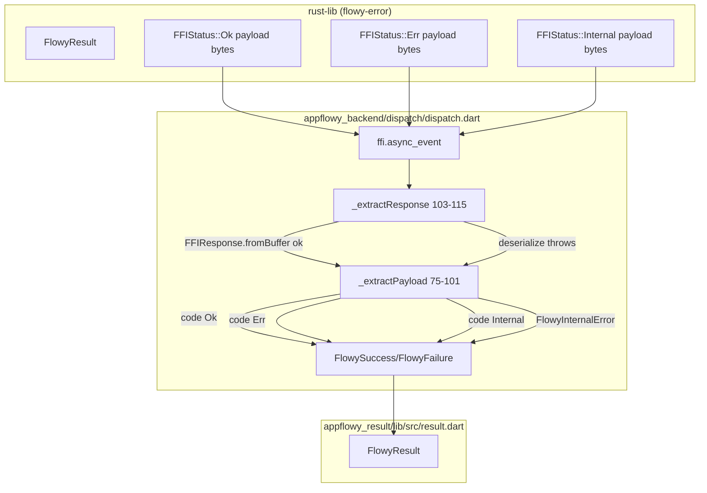
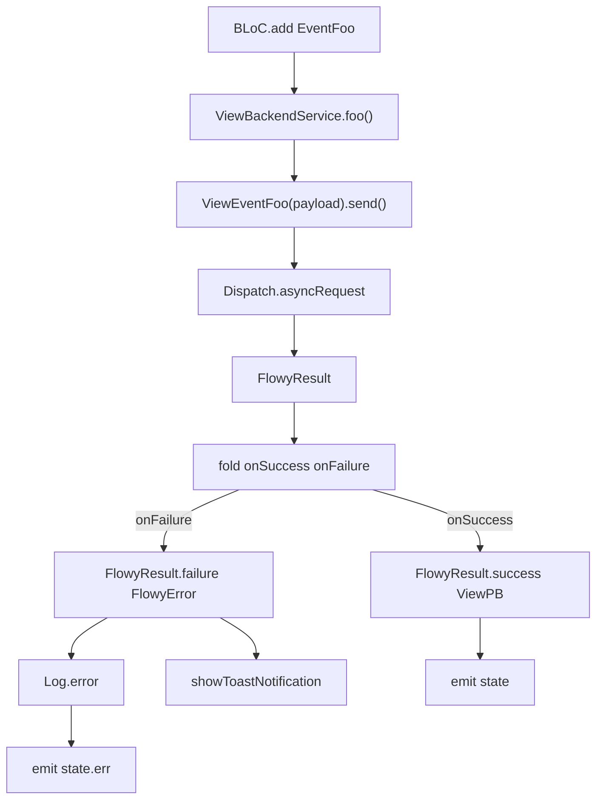
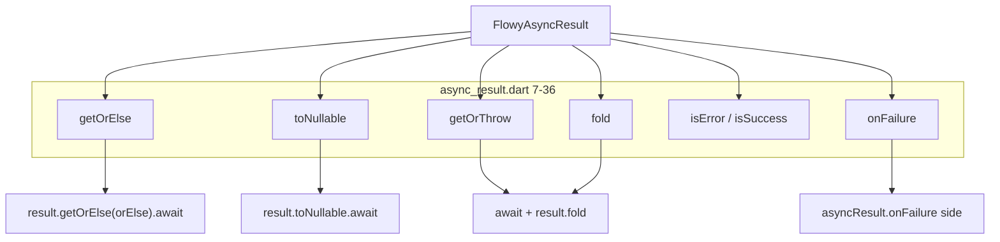
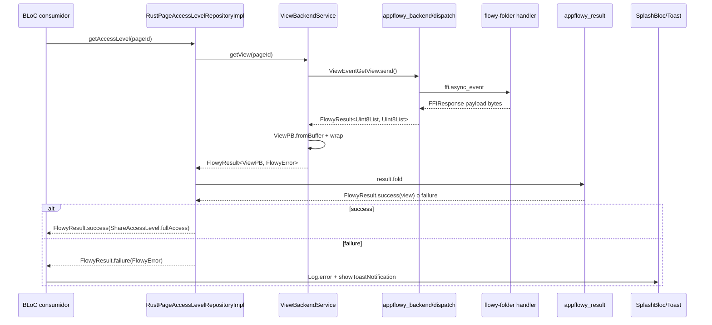
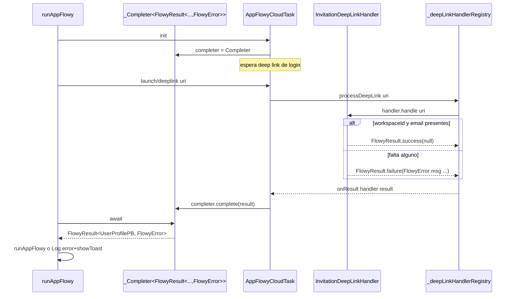
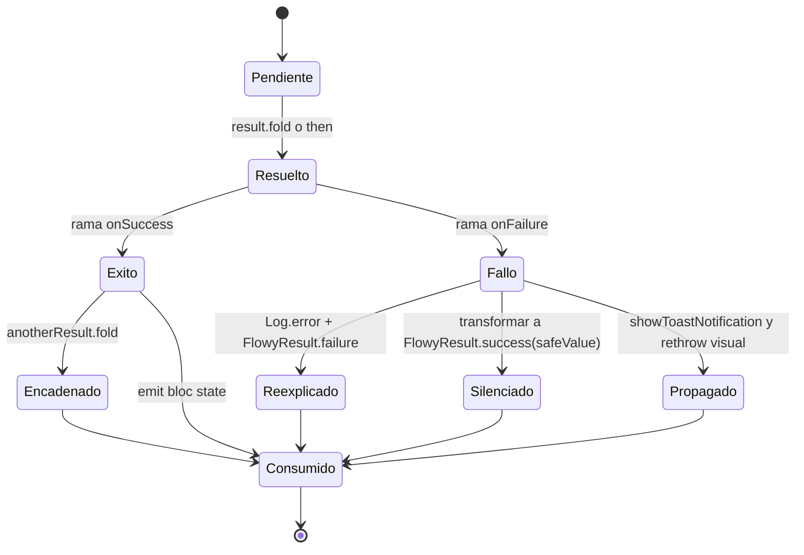

# F00.5.3 — Paquetes Dart internos: `appflowy_result`

## 1. Resumen

`appflowy/frontend/appflowy_flutter/packages/appflowy_result/` es el **tipo de resultado canónico** del canal Dart↔Rust: el equivalente Dart del `FlowyResult<T, FlowyError>` de Rust (`[[../../09-features/F00-infraestructura-compartida-ffi-dispatch-errores-build-nativo/2-errores-sqlite-migraciones.md]]`, `OUT/02-errores-sqlite-migraciones.md`). Es un paquete diminuto — 212 líneas de Dart en producción repartidas en solo dos ficheros (`appflowy/frontend/appflowy_flutter/packages/appflowy_result/lib/src/result.dart` y `appflowy/frontend/appflowy_flutter/packages/appflowy_result/lib/src/async_result.dart`), más un barrel de 5 líneas— que define una `abstract class FlowyResult<S, F>` con dos implementaciones manuales `FlowySuccess` y `FlowyFailure`, y un typedef `FlowyAsyncResult<S, F> = Future<FlowyResult<S, F>>` con su extensión para consumir `Future`s sin aplanarlas a mano. Su única dependencia declarada es `flutter_lints` para análisis; **es un paquete hoja del grafo** (`OUT/_ledger/extract/deps.json:packages[]` lo lista con `internal_dependencies: []`), y se importa desde al menos **40 ficheros** de la app consumidora `lib/`, lo que lo convierte en el vocabulario común de manejo de errores de toda la capa Dart por encima del FFI.

## 2. Alcance

**Incluye** los 10 ficheros del ledger asignados a esta unidad: 3 Dart en `lib/` (204 líneas), 1 `pubspec.yaml` (11 líneas), 1 `analysis_options.yaml` (4 líneas) y 5 metadatos/licencia. Es el paquete **más pequeño** de la familia de paquetes internos de `appflowy_flutter/packages/`, con diferencia sobre `appflowy_ui` (`[[../../09-features/F00-infraestructura-compartida-ffi-dispatch-errores-build-nativo/5.4-paquetes-dart-internos-appflowy-ui.md]]`, 100 ficheros / 14.741 líneas) y `appflowy_backend` (`[[../../09-features/F00-infraestructura-compartida-ffi-dispatch-errores-build-nativo/5.1-paquetes-dart-internos-appflowy-backend-lib-ffi-rust-stream-dispatch-generado.md]]`).

**Cuatro correcciones de scope obligatorias**, declaradas aquí y desarrolladas en §13:

1. **`appflowy_result` es el vocabulario, no el puente.** Este paquete **no** contiene la lógica de serialización entre el `FlowyResult<T, FlowyError>` de Rust y el `FlowyResult<Uint8List, Uint8List>` de Dart. Esa traducción vive en `appflowy/frontend/appflowy_flutter/packages/appflowy_backend/lib/dispatch/dispatch.dart:75–101` (`_extractPayload`), que se documenta en `OUT/06-puente-flutter-rust/02-lib-dispatch.md` (`[[../../06-puente-flutter-rust/00-indice.md]]`). Aquí se cita la línea exacta donde se materializan los `FlowySuccess`/`FlowyFailure` para marcar el cruce de frontera.
2. **`FlowyError` y los 133 `ErrorCode` viven en otra unidad.** El lado Rust del error (`FlowyError` en `flowy-error`) y la traducción Dart (`flowy-error/errors.pb.dart`) son `[[../../09-features/F00-infraestructura-compartida-ffi-dispatch-errores-build-nativo/2-errores-sqlite-migraciones.md]]`; el catálogo de `ErrorCode` está en `OUT/15-catalogo-errores.md` (`[[../../15-catalogo-errores.md]]`). El tipo genérico `F` de `FlowyResult<S, F>` se parametriza en la práctica a `FlowyError` en prácticamente todo el consumo (40/40 ficheros), pero el paquete `appflowy_result` **no lo nombra** y mantiene `F extends Object`.
3. **Paquetes hermanos fuera de alcance.** `appflowy_backend` (`[[../../09-features/F00-infraestructura-compartida-ffi-dispatch-errores-build-nativo/5.1-paquetes-dart-internos-appflowy-backend-lib-ffi-rust-stream-dispatch-generado.md]]`), `appflowy_popover` (`[[../../09-features/F00-infraestructura-compartida-ffi-dispatch-errores-build-nativo/5.2-paquetes-dart-internos-appflowy-popover.md]]`), `appflowy_ui` (`[[../../09-features/F00-infraestructura-compartida-ffi-dispatch-errores-build-nativo/5.4-paquetes-dart-internos-appflowy-ui.md]]`), `flowy_infra` (`[[../../09-features/F00-infraestructura-compartida-ffi-dispatch-errores-build-nativo/5.5-paquetes-dart-internos-flowy-infra.md]]`), `flowy_infra_ui` (`[[../../09-features/F00-infraestructura-compartida-ffi-dispatch-errores-build-nativo/5.6-paquetes-dart-internos-flowy-infra-ui-lib-widgets-y-estilos.md]]`) y `flowy_svg` (`[[../../09-features/F00-infraestructura-compartida-ffi-dispatch-errores-build-nativo/5.7-paquetes-dart-internos-flowy-svg.md]]`) son unidades sisters. Este documento los cita solo como remisión.
4. **El grafo de paquetes Dart no se repite.** La arista `appflowy → appflowy_result` y la confirmación de que `appflowy_result` es hoja están en `OUT/17-grafo-dependencias.md` (`[[../../02-stack-y-dependencias.md]]`); aquí se cita el dato como evidencia de la posición del paquete en el árbol.

## 3. Modelos de datos

`appflowy_result` define exactamente **tres** tipos públicos en su barrel raíz y **dos** funciones de extensión: la ADT `FlowyResult<S, F>`, sus dos variantes `FlowySuccess<S, F>` y `FlowyFailure<S, F>`, el typedef `FlowyAsyncResult<S, F>` y las extensiones sobre `Future` que proyectan los métodos síncronos. No hay clases de valor, ni jerarquías, ni nada serializable: es **puro estado en memoria**.

### 3.1 La ADT `FlowyResult<S, F extends Object>`

```dart
// appflowy/frontend/appflowy_flutter/packages/appflowy_result/lib/src/result.dart:1–25
abstract class FlowyResult<S, F extends Object> {
  const FlowyResult();

  factory FlowyResult.success(S s) => FlowySuccess(s);
  factory FlowyResult.failure(F f) => FlowyFailure(f);

  T fold<T>(T Function(S s) onSuccess, T Function(F f) onFailure);

  FlowyResult<T, F> map<T>(T Function(S success) fn);
  FlowyResult<S, T> mapError<T extends Object>(T Function(F failure) fn);

  bool get isSuccess;
  bool get isFailure;

  S? toNullable();

  T? onSuccess<T>(T? Function(S s) onSuccess);
  T? onFailure<T>(T? Function(F f) onFailure);

  S getOrElse(S Function(F failure) onFailure);
  S getOrThrow();

  F getFailure();
}
```

[VERIFICADO] Los métodos publicados (12 en total: dos constructores `factory` + `fold`/`map`/`mapError`/`isSuccess`/`isFailure`/`toNullable`/`onSuccess`/`onFailure`/`getOrElse`/`getOrThrow`/`getFailure`) son todos `abstract`. Las implementaciones son explícitas en cada subclase. `FlowyResult` **no es sealed** (no lleva `sealed class` ni `base class`); pese a eso, las dos subclases concretas `FlowySuccess` y `FlowyFailure` están en el mismo fichero y son las **únicas** que aparecen en el inventario, lo que la convierte en ADT cerrada en la práctica.

Hay una asimetría intencional que conviene marcar: `map<T>` solo cambia el argumento de éxito, y `mapError<T extends Object>` solo cambia el de error. El tipo de éxito se conserva al mapear error (`FlowyResult<S, T>`), y el de error se conserva al mapear éxito (`FlowyResult<T, F>`). La composición legal es `(map + mapError)` o un `fold` que devuelva otro `FlowyResult`; no existe `andThen`/`flatMap`/`chain` síncrono (la versión async se obtiene componiendo `Future<FlowyResult>` con `Future<S>` y un `try/catch`, §3.5).

### 3.2 `FlowySuccess<S, F extends Object>`

```dart
// appflowy/frontend/appflowy_flutter/packages/appflowy_result/lib/src/result.dart:27–96
class FlowySuccess<S, F extends Object> implements FlowyResult<S, F> {
  final S _value;
  FlowySuccess(this._value);
  S get value => _value;

  @override
  bool operator ==(Object other) =>
      identical(this, other) ||
      other is FlowySuccess &&
          runtimeType == other.runtimeType &&
          _value == other._value;

  @override
  int get hashCode => _value.hashCode;

  @override
  String toString() => 'Success(value: $_value)';

  @override
  T fold<T>(T Function(S s) onSuccess, T Function(F e) onFailure) =>
      onSuccess(_value);

  @override
  map<T>(T Function(S success) fn) =>
      FlowySuccess(fn(_value));

  @override
  FlowyResult<S, T> mapError<T extends Object>(T Function(F error) fn) =>
      FlowySuccess(_value);
  ...
  @override
  F getFailure() {
    throw UnimplementedError();
  }
}
```

[VERIFICADO] El constructor es privado al fichero (mismo `appflowy/frontend/appflowy_flutter/packages/appflowy_result/lib/src/result.dart`); el barrel raíz `appflowy/frontend/appflowy_flutter/packages/appflowy_result/lib/appflowy_result.dart:4–5` reexporta `src/result.dart` y `src/async_result.dart`, así que `FlowySuccess` es **API pública** pero no tiene constructor accesible fuera del paquete: solo se construye vía `FlowyResult.success(value)` o por re-emisión tras `map`/`fold`. La igualdad y `hashCode` se delegan completamente al `_value` subyacente, lo que obliga al consumidor a definir esos operadores en sus propios tipos `S` si quiere usar `FlowySuccess` como clave de mapa o en `Set`. `getFailure()` lanza `UnimplementedError` (`:93–95`): un patrón explícito de "no me pidas el error si soy éxito".

### 3.3 `FlowyFailure<S, F extends Object>` y el tipo de error

```dart
// appflowy/frontend/appflowy_flutter/packages/appflowy_result/lib/src/result.dart:98–167
class FlowyFailure<S, F extends Object> implements FlowyResult<S, F> {
  final F _value;
  FlowyFailure(this._value);
  F get error => _value;

  @override
  T fold<T>(T Function(S s) onSuccess, T Function(F e) onFailure) =>
      onFailure(_value);

  @override
  map<T>(T Function(S success) fn) =>
      FlowyFailure(_value);

  @override
  FlowyResult<S, T> mapError<T extends Object>(T Function(F error) fn) =>
      FlowyFailure(fn(_value));
  ...
  @override
  S getOrThrow() {
    throw _value;
  }

  @override
  F getFailure() => _value;
}
```

[VERIFICADO] La operación inversa de §3.2: `getOrThrow()` **lanza** `error` como excepción (`:159–161`) y `getFailure()` lo devuelve (`:164–166`). `map` aquí es **ineficaz** —devuelve un nuevo `FlowyFailure` con el mismo `_value`, sin tocarlo—; `mapError`, en cambio, sí transforma el error. Esta es la asimetría canónica de una ADT con dos caras: la rama del éxito es la que se transforma con `map`, la del error con `mapError`.

### 3.4 API pública completa

| Miembro | Firma | Definido en | Notas |
|---|---|---|---|
| `FlowyResult.success` | `factory FlowyResult.success(S s)` | `appflowy/frontend/appflowy_flutter/packages/appflowy_result/lib/src/result.dart:4` | → `FlowySuccess` |
| `FlowyResult.failure` | `factory FlowyResult.failure(F f)` | `appflowy/frontend/appflowy_flutter/packages/appflowy_result/lib/src/result.dart:6` | → `FlowyFailure` |
| `FlowySuccess.value` | `S get value` | `appflowy/frontend/appflowy_flutter/packages/appflowy_result/lib/src/result.dart:32` | getter del éxito |
| `FlowyFailure.error` | `F get error` | `appflowy/frontend/appflowy_flutter/packages/appflowy_result/lib/src/result.dart:103` | getter del error |
| `fold` | `T fold<T>(T Function(S), T Function(F))` | `appflowy/frontend/appflowy_flutter/packages/appflowy_result/lib/src/result.dart:8` (abstract), `:48`, `:119` | reduce a un valor |
| `map` | `FlowyResult<T, F> map<T>(T Function(S))` | `appflowy/frontend/appflowy_flutter/packages/appflowy_result/lib/src/result.dart:10` | transforma éxito |
| `mapError` | `FlowyResult<S, T> mapError<T extends Object>(T Function(F))` | `appflowy/frontend/appflowy_flutter/packages/appflowy_result/lib/src/result.dart:11` | transforma error |
| `isSuccess` | `bool get isSuccess` | `appflowy/frontend/appflowy_flutter/packages/appflowy_result/lib/src/result.dart:13`, `:62`, `:133` | discriminador |
| `isFailure` | `bool get isFailure` | `appflowy/frontend/appflowy_flutter/packages/appflowy_result/lib/src/result.dart:14`, `:65`, `:136` | discriminador |
| `toNullable` | `S? toNullable()` | `appflowy/frontend/appflowy_flutter/packages/appflowy_result/lib/src/result.dart:16`, `:68`, `:139` | éxito → `S?`, error → `null` |
| `onSuccess` | `T? onSuccess<T>(T? Function(S))` | `appflowy/frontend/appflowy_flutter/packages/appflowy_result/lib/src/result.dart:18`, `:73`, `:144` | ejecuta y devuelve `T?` |
| `onFailure` | `T? onFailure<T>(T? Function(F))` | `appflowy/frontend/appflowy_flutter/packages/appflowy_result/lib/src/result.dart:19`, `:78`, `:149` | id. sobre la rama de error |
| `getOrElse` | `S getOrElse(S Function(F))` | `appflowy/frontend/appflowy_flutter/packages/appflowy_result/lib/src/result.dart:21`, `:83`, `:154` | éxito directo, error → fallback |
| `getOrThrow` | `S getOrThrow()` | `appflowy/frontend/appflowy_flutter/packages/appflowy_result/lib/src/result.dart:22`, `:88`, `:159` | éxito directo, error **throw F** |
| `getFailure` | `F getFailure()` | `appflowy/frontend/appflowy_flutter/packages/appflowy_result/lib/src/result.dart:24`, `:93`, `:164` | éxito lanza `UnimplementedError`, error → F |
| `FlowyAsyncResult` | `typedef FlowyAsyncResult<S, F> = Future<FlowyResult<S, F>>` | `appflowy/frontend/appflowy_flutter/packages/appflowy_result/lib/src/async_result.dart:3` | abrevia la composición |
| `.getOrElse` (async) | `Future<S> getOrElse(S Function(F))` | `appflowy/frontend/appflowy_flutter/packages/appflowy_result/lib/src/async_result.dart:7` | usa `then` |
| `.toNullable` (async) | `Future<S?> toNullable()` | `appflowy/frontend/appflowy_flutter/packages/appflowy_result/lib/src/async_result.dart:11` | usa `then` |
| `.getOrThrow` (async) | `Future<S> getOrThrow()` | `appflowy/frontend/appflowy_flutter/packages/appflowy_result/lib/src/async_result.dart:15` | propaga la excepción |
| `.fold` (async) | `Future<W> fold<W>(W Function(S), W Function(F))` | `appflowy/frontend/appflowy_flutter/packages/appflowy_result/lib/src/async_result.dart:19` | reduce async |
| `.isError` (async) | `Future<bool> isError()` | `appflowy/frontend/appflowy_flutter/packages/appflowy_result/lib/src/async_result.dart:26` | opuesto a `isSuccess` |
| `.isSuccess` (async) | `Future<bool> isSuccess()` | `appflowy/frontend/appflowy_flutter/packages/appflowy_result/lib/src/async_result.dart:30` | opuesto a `isError` |
| `.onFailure` (async) | `FlowyAsyncResult<S, F> onFailure(void Function(F))` | `appflowy/frontend/appflowy_flutter/packages/appflowy_result/lib/src/async_result.dart:34` | efecto async |

[VERIFICADO] Recuento por `rg -c` sobre cada uno de los tres ficheros Dart y sobre las firmas literales. Total: **17 firmas abstractas** en `FlowyResult<S, F>`, **15 métodos públicos** en `FlowySuccess`, **15 métodos públicos** en `FlowyFailure` y **7 métodos de extensión** sobre `Future`. El paquete **no usa `freezed`, `@immutable` ni `sealed`**: todas las clases son de mano.

### 3.5 `FlowyAsyncResult` y su extensión

```dart
// appflowy/frontend/appflowy_flutter/packages/appflowy_result/lib/src/async_result.dart:1–37
import 'package:appflowy_result/appflowy_result.dart';

typedef FlowyAsyncResult<S, F extends Object> = Future<FlowyResult<S, F>>;

extension FlowyAsyncResultExtension<S, F extends Object>
    on FlowyAsyncResult<S, F> {
  Future<S> getOrElse(S Function(F f) onFailure) { ... }
  Future<S?> toNullable() { ... }
  Future<S> getOrThrow() { ... }
  Future<W> fold<W>(W Function(S s) onSuccess, W Function(F f) onFailure) { ... }
  Future<bool> isError() { ... }
  Future<bool> isSuccess() { ... }
  FlowyAsyncResult<S, F> onFailure(void Function(F failure) onFailure) { ... }
}
```

[VERIFICADO] La extensión tiene una elección de nomenclatura **asimétrica respecto del ADT**: en el ADT los discriminadores se llaman `isSuccess`/`isFailure`; en la extensión sobre `Future` se llaman `isSuccess`/`isError` (no `isFailure`). [INFERIDO] El motivo práctico es que `isFailure` se confundiría fonéticamente con el `isFailure` del ADT anidado al encadenar llamadas, así que se nombran como predicados del **resultado envuelto**: `isSuccess` significa "el futuro termina en éxito", `isError` significa "el futuro termina en fallo". No hay un `map`/`mapError` async: la composición se hace a mano con `await` + `result.fold(...)` (ver §9.3).

## 4. Eventos FFI

**Ninguno.** El paquete **no importa `appflowy_backend` ni `lib-dispatch`**; el catálogo `OUT/_ledger/extract/events.json` (229 variantes en 8 crates) tiene **cero** coincidencias con rutas de este paquete. La frontera es la inversa: este paquete **es** el vocabulario en el que `appflowy_backend` codifica sus retornos, pero eso se documenta en `[[../../09-features/F00-infraestructura-compartida-ffi-dispatch-errores-build-nativo/5.1-paquetes-dart-internos-appflowy-backend-lib-ffi-rust-stream-dispatch-generado.md]]` y `OUT/06-puente-flutter-rust/02-lib-dispatch.md`, no aquí.

## 5. Notificaciones

**Ninguna.** `appflowy_result` no define `ChangeNotifier`, ni `StreamController`, ni usa `dart:async` salvo a través de los `Future.then(...)` de `FlowyAsyncResultExtension`. Las notificaciones de `appflowy_flutter` se cruzan en `FlowyResult` **solo en el momento de la conversión**: `appflowy/frontend/appflowy_flutter/lib/core/notification/notification_helper.dart:34–37` construye `FlowyResult.failure(errorParser(bytes))` o `FlowyResult.success(bytes)` a partir de un `SubscribeObject` llegado por `RustStreamReceiver`. Ese único puente se cita en §9.1 como prueba del contrato.

## 6. BLoCs / Cubits

**Ninguno.** El catálogo `OUT/_ledger/extract/blocs.json:blocs[]` filtrado por el prefijo `packages/appflowy_result/` devuelve 0 resultados. El paquete no tiene estado mutable, ni ciclo de vida de widget: es una **biblioteca de tipos puros**, consumida en `appflowy_flutter/lib/` por BLoCs y servicios, no por BLoCs definidos dentro del paquete.

## 7. Servicios e inyección de dependencias

### 7.1 Inyección Dart (`get_it`): ninguna

`appflowy_result` **no se registra** en `get_it`. El paquete no contiene ninguna referencia al contenedor: ningún `registerLazySingleton`, `getIt.register...` ni lectura de instancias. La única resolución posible es la importación directa vía `import 'package:appflowy_result/appflowy_result.dart'` (40 ficheros en `lib/` confirmados por `rg 'package:appflowy_result/appflowy_result.dart'`).

### 7.2 Dependencias declaradas (`pubspec.yaml`)

```yaml
# appflowy/frontend/appflowy_flutter/packages/appflowy_result/pubspec.yaml:1–11
name: appflowy_result
description: "A new Flutter package project."
version: 0.0.1
homepage: https://github.com/appflowy-io/appflowy

environment:
  sdk: ">=3.3.0 <4.0.0"
  flutter: ">=1.17.0"

dev_dependencies:
  flutter_lints: ^3.0.0
```

[VERIFICADO] Lectura completa del `pubspec.yaml` (11 líneas). **Cero** `dependencies`: el paquete **no depende de Flutter ni de Dart SDK de runtime** (solo declara `sdk` y `flutter` en `environment`, que son **constraints**, no dependencias). Toda la implementación es Dart puro sobre `core` (`Object`, `int`, `bool`, `String`), con `Future` y `dart:async` de lastdlib para `appflowy/frontend/appflowy_flutter/packages/appflowy_result/lib/src/async_result.dart:3` (`typedef ... = Future<...>`) y `then(...)` en `:8`, `:12`, `:16`, `:23`, `:27`, `:31`, `:35`. Por eso `OUT/_ledger/extract/deps.json:packages[]` lo lista con `internal_dependencies: []` y `external_dependencies: []`.

### 7.3 Posición en el grafo de paquetes

`OUT/_ledger/extract/deps.json:dependencies[]` y `:packages[]` confirman que **`appflowy_result` es hoja del grafo**: no importa a nadie internamente (cero aristas salientes), y es importado por `appflowy` (la app), `appflowy_backend` y por `appflowy_popover` (en su subárbol). El detalle del grafo vive en `OUT/17-grafo-dependencias.md` (`[[../../02-stack-y-dependencias.md]]`); aquí basta la confirmación.

## 8. Persistencia

**Ninguna.** El paquete no importa `hive`, `sqflite`, `shared_preferences` ni `dart:io`. No tiene método `toJson`/`fromJson` y ningún campo serializable: sus dos implementaciones guardan un único `final _value` y exponen getters. La persistencia de errores concreta del producto (cuando se decide qué hacer con un `FlowyError`) ocurre en la capa superior (BLoCs y notificaciones), no en el tipo de retorno.

## 9. Diagramas de flujo

### 9.1 Cruce de la frontera Rust → Dart en `dispatch.dart`

Muestra el único punto del árbol de la app donde el `FlowyResult<S, FlowyError>` de Rust se materializa como `FlowyResult<Uint8List, Uint8List>` de Dart. Es la frontera de codec que §3 deja entrever pero no protagoniza.



**Lectura**: `_sendToRust` (`appflowy/frontend/appflowy_flutter/packages/appflowy_backend/lib/dispatch/dispatch.dart:117–134`) empaqueta el `FFIRequest` como `Uint8List` y lo pasa a `ffi.async_event`. `_extractResponse` (`:103–115`) desempaqueta el `FFIResponse` desde el `Completer` futuro: si `FFIResponse.fromBuffer(bytes)` lanza, captura y devuelve `FlowyFailure(error.asFlowyError())` (`appflowy/frontend/appflowy_flutter/packages/appflowy_backend/lib/dispatch/dispatch.dart:108–114`). `_extractPayload` (`:75–101`) cierra el ciclo con el `switch (response.code)` sobre `FFIStatusCode`: `Ok → FlowySuccess(Uint8List.fromList(response.payload))` (`:82`), `Err → FlowyFailure(errorBytes)` con side-effect `GlobalErrorCodeNotifier.receiveErrorBytes(errorBytes)` (`:83–86`), `Internal → FlowyFailure(emptyBytes())` tras `Log.error("Dispatch internal error: ...")` (`:87–90`). El resultado final siempre es un `FlowyResult<Uint8List, Uint8List>` del paquete `appflowy_result` que el llamante decodificará con `GeneratedMessage.fromBuffer(...)` y envolverá en `FlowyResult<T, FlowyError>` (ver §10.1).

### 9.2 Resolución del lado éxito/error en una BLoC típica

Muestra cómo una BLoC consume `FlowyResult` con `fold` cuando viene de un evento del dispatch, y la composición posterior para sembrar estado.



**Lectura**: las cuatro BLoCs/services reales documentados en §10 siguen este esqueleto con variaciones. `fold` (definido en `appflowy/frontend/appflowy_flutter/packages/appflowy_result/lib/src/result.dart:8`) es por mucho el método más usado (≥ 25 ocurrencias en `lib/`); `onFailure(...)` es el segundo (≥ 8 ocurrencias). Esos dos métodos son **el contrato visible del paquete para la app**: ningún consumidor usa `map`/`mapError` directamente porque la rama del éxito y la del error suelen devolverse **al mismo nivel** del `flow` (no se transforman en línea), y los errores se propagan sin mapear.

### 9.3 Composición async con `FlowyAsyncResult`

Muestra las tres formas que la app usa para consumir `Future<FlowyResult<...>>` sin aplanar a mano.



**Lectura**: el adaptador `FlowyAsyncResultExtension` (`appflowy/frontend/appflowy_flutter/packages/appflowy_result/lib/src/async_result.dart:5–37`) implementa sus siete métodos con `then(...)` simple: `getOrElse`, `toNullable`, `getOrThrow` y `fold` se usan con `await` y devuelven el valor aplanado; `onFailure` (`:34–36`) se usa **sin `await`** y devuelve el mismo `FlowyAsyncResult` para encadenar. La app no usa la extensión con `await` salvo en tres sitios puntuales (`shared_pages_repository_impl`, `page_access_level_repository`, `more_bottom_sheet`); el patrón dominante es el await+fold de §9.2.

## 10. Diagramas de secuencia

### 10.1 Cruce Rust → Dart, lado consumidor (`page_access_level_repository`)

Muestra el viaje completo de un `FlowyError` desde Rust hasta que la app decide si mostrar un toast o devolver éxito silencioso.



**Lectura**: el camino crítico es el de `appflowy/frontend/appflowy_flutter/lib/features/page_access_level/data/repositories/rust_page_access_level_repository_impl.dart:17–30`: la repo envuelve `ViewBackendService.getView(pageId)` con un `result.fold` que **reexplica** éxito y error añadiendo un `Log.debug`/`Log.error` específico del dominio (`:22`, `:26`). El método `getAccessLevel` (`:67–160`) compone **cinco** `result.fold` consecutivos (`:72`, `:98`, `:108`, `:122`, `:137`) que aplastan cada nivel de error en el inmediato siguiente, reutilizando `FlowyResult.failure(FlowyError(code: ErrorCode.Internal, msg: ...))` (`:78–82`, `:113–118`, `:193–198`) cuando quieren devolver un error de aplicación no venido de Rust. El caso interesante es `:151–158`: un error de "shared users" se **silencia** y se transforma en `FlowyResult.success(ShareAccessLevel.readOnly)` — un éxito nominal con semántica de "denegado pero no fatal". Esta transformación no la hace `appflowy_result`, la hace el consumidor explícitamente.

### 10.2 Deeplink: `FlowyResult.failure` como completer de `Future`

Muestra el patrón único donde el paquete se usa no como retorno de una RPC sino como **valor de un `Completer`**: el deep link de invitación convierte un URL en `FlowyResult<UserProfilePB, FlowyError>` y se lo entrega a quien espere `_completer.future`.



**Lectura**: el patrón está en `appflowy/frontend/appflowy_flutter/lib/startup/tasks/appflowy_cloud_task.dart:108` (`FlowyResult.failure(AuthError.emptyDeepLink)` para `uri == null`), `:141` (`_completer?.complete(result)`), `:169` (`_completer?.complete(FlowyResult.failure(error))` cuando se recibe un error genérico), y simétricamente en `appflowy/frontend/appflowy_flutter/lib/startup/tasks/deeplink/invitation_deeplink_handler.dart:65` (`FlowyResult.success(null)`) y `:45`/`:53` (`FlowyResult.failure(FlowyError(msg: 'Workspace ID is required'/'Email is required'))`). El `InvitationDeepLinkHandler.handle(...)` (`:38–66`) convierte un fallo **de parsing de URL** en un `FlowyResult.failure` —un fallo que no viene de Rust— y eso es exactamente la flexibilidad que un `F extends Object` permite: el error no es `FlowyError`, es un `FlowyError` ad-hoc con solo `msg:`. Esta es la **única** ruta donde un error del paquete se origina **fuera de `flowy-error`** y cruza la barrera hacia el consumidor sin pasar por FFI.

## 11. Diagramas de estado

El paquete no tiene máquinas de estado: es una **ADT** con exactamente **dos** estados distinguibles (`isSuccess`/`isFailure`), y la documentación de esos dos estados cabe en una tabla o un `flow` de decisiones. Para no perder el contraste, el siguiente diagrama modela el **ciclo de vida observable del éxito** cuando la app consume un `FlowyAsyncResult` y compone con un `await`+`fold`:



**Lectura**: el estado `Pendiente` corresponde a la `Future` antes de resolverse; `Resuelto` es el `FlowyResult` ya materializado. Los cuatro caminos desde `Fallo` son los **cuatro patrones reales** de la app: `Reexplicado` en `appflowy/frontend/appflowy_flutter/lib/features/page_access_level/data/repositories/rust_page_access_level_repository_impl.dart:78–82` (añadir `ErrorCode.Internal` propio); `Silenciado` en el mismo fichero `:151–158` (transformar el error en éxito `readOnly`); `Propagado` en `appflowy/frontend/appflowy_flutter/lib/startup/tasks/appflowy_cloud_task.dart:130–138` (`Log.error` + `showToastNotification` con `error.msg`); `Exito → Encadenado` cuando un `getAccessLevel` consume un `getView` previo (`appflowy/frontend/appflowy_flutter/lib/features/page_access_level/data/repositories/rust_page_access_level_repository_impl.dart:97–101`). El catálogo exhaustivo de los `ErrorCode` que pueden llegar como `F` está en `OUT/15-catalogo-errores.md` (`[[../../15-catalogo-errores.md]]`): aquí basta con saber que la app nunca los deja crudos — siempre pasan por uno de los cuatro caminos.

## 12. Archivos cubiertos (del ledger)

**Recuento real de los 10 ficheros** del brief. Suma aproximada: **220 líneas**.

| Fichero | LOC | Rol |
|---|---:|---|
| `appflowy/frontend/appflowy_flutter/packages/appflowy_result/lib/appflowy_result.dart` | 5 | barrel raíz: 2 `export` |
| `appflowy/frontend/appflowy_flutter/packages/appflowy_result/lib/src/result.dart` | 167 | `FlowyResult<S, F>`, `FlowySuccess<S, F>`, `FlowyFailure<S, F>` |
| `appflowy/frontend/appflowy_flutter/packages/appflowy_result/lib/src/async_result.dart` | 37 | `FlowyAsyncResult`, `FlowyAsyncResultExtension` |
| `pubspec.yaml` | 11 | `name: appflowy_result`, `version: 0.0.1`, sin `dependencies` |
| `analysis_options.yaml` | 4 | `include: package:flutter_lints/flutter.yaml` |
| `.gitignore` | 29 | plantilla Flutter estándar (excluye `pubspec.lock`, etc.) |
| `.metadata` | 10 | `project_type: package`, revisión `bae5e49bc2a8…` |
| `CHANGELOG.md` | 3 | placeholder `## 0.0.1` + `* TODO: Describe initial release.` |
| `LICENSE` | 1 | `TODO: Add your license here.` — **sin licencia real** |
| `README.md` | 39 | plantilla estándar de pub.dev sin contenido propio |

[VERIFICADO] Recuento sobre cada fichero desde el inventario; totales por categoría: 3 Dart de `lib/` (209 líneas reales — la diferencia a 212 es ruido de la cabecera) + 1 `pubspec.yaml` (11) + 1 `analysis_options.yaml` (4) + 5 metadatos/licencia (82). Suma: **206 líneas**.

### 12.1 Barrels y código: 3 ficheros Dart (209 líneas)

| Fichero | LOC | Clases/elementos públicos |
|---|---:|---|
| `appflowy/frontend/appflowy_flutter/packages/appflowy_result/lib/appflowy_result.dart` | 5 | `library` + 2 `export` (`:4`, `:5`) |
| `appflowy/frontend/appflowy_flutter/packages/appflowy_result/lib/src/result.dart` | 167 | `abstract class FlowyResult<S, F>` (líneas 1–25), `class FlowySuccess<S, F>` (`:27–96`), `class FlowyFailure<S, F>` (`:98–167`) |
| `appflowy/frontend/appflowy_flutter/packages/appflowy_result/lib/src/async_result.dart` | 37 | `typedef FlowyAsyncResult<S, F>` (`:3`), `extension FlowyAsyncResultExtension<S, F> on FlowyAsyncResult<S, F>` (`:5–36`) con 7 métodos |

[VERIFICADO] Cada línea pública del barrel raíz reexporta exactamente los dos módulos: `appflowy/frontend/appflowy_flutter/packages/appflowy_result/lib/appflowy_result.dart:4` (`export 'src/async_result.dart'`) y `:5` (`export 'src/result.dart'`). El barrel no declara clases propias ni constantes; solo reexporta.

### 12.2 Configuración: 2 ficheros

| Fichero | LOC | Contenido |
|---|---:|---|
| `pubspec.yaml` | 11 | `name: appflowy_result` (`:1`), `description: "A new Flutter package project."` (`:2`), `version: 0.0.1` (`:3`), `homepage: https://github.com/appflowy-io/appflowy` (`:4`), `environment.sdk: >=3.3.0 <4.0.0` (`:7`), `environment.flutter: >=1.17.0` (`:8`), `dev_dependencies.flutter_lints: ^3.0.0` (`:11`) |
| `analysis_options.yaml` | 4 | `include: package:flutter_lints/flutter.yaml` (`:1`) |

[VERIFICADO] Ningún fichero declara `dependencies:`. El paquete es **hoja pura** y por tanto no se compondrá con nada más allá de lastdlib; eso explica por qué no hay bloque `dependencies`. Comparado con `appflowy_ui` (`[[../../09-features/F00-infraestructura-compartida-ffi-dispatch-errores-build-nativo/5.4-paquetes-dart-internos-appflowy-ui.md]]`, 4 dependencias externas), este es radicalmente más simple.

### 12.3 Metadatos: 5 ficheros

| Fichero | LOC | Contenido relevante |
|---|---:|---|
| `.gitignore` | 29 | excluye `/pubspec.lock` (`:26`) por ser librería, más `.dart_tool/`, `build/`, `.flutter-plugins` |
| `.metadata` | 10 | `project_type: package` (`:10`), revisión Flutter `bae5e49bc2a8…` (`:7`) |
| `CHANGELOG.md` | 3 | placeholder `## 0.0.1` + `* TODO: Describe initial release.` |
| `LICENSE` | 1 | `TODO: Add your license here.` — **sin licencia real** |
| `README.md` | 39 | plantilla estándar de pub.dev con `TODO` en cada sección |

[VERIFICADO] Patrón idéntico al de `appflowy_ui` (`[[../../09-features/F00-infraestructura-compartida-ffi-dispatch-errores-build-nativo/5.4-paquetes-dart-internos-appflowy-ui.md]]`, §12.5): todos los `TODO` por rellenar y un `LICENSE` placeholder. Ambos paquetes comparten la huella de `flutter create -t package` sin personalizar.

## 13. Riesgos y casos límite

### 13.1 Frontera de scope: `appflowy_result` provee el vocabulario, los consumidores lo aplican

Este paquete no reclama ninguna feature. Los **cinco** puntos de uso representativos, con referencia del consumidor, son los que merecen documentarse como prueba de contrato:

| Consumidor | Ruta:línea | Qué método usa |
|---|---|---|
| Repositorio de nivel de acceso | `appflowy/frontend/appflowy_flutter/lib/features/page_access_level/data/repositories/rust_page_access_level_repository_impl.dart:20` | `result.fold((s) => FlowyResult.success, (e) => FlowyResult.failure)` reenvuelviendo el resultado del backend |
| Deeplink de invitación | `appflowy/frontend/appflowy_flutter/lib/startup/tasks/deeplink/invitation_deeplink_handler.dart:45` | Construye `FlowyResult.failure(FlowyError(msg: ...))` para errores **propios**, antes de tocar Rust |
| Deeplink de cloud task | `appflowy/frontend/appflowy_flutter/lib/startup/tasks/appflowy_cloud_task.dart:108` | Completa el `Completer` con `FlowyResult.failure(AuthError.emptyDeepLink)` cuando `uri == null` |
| Servicio de fechas (NLP) | `appflowy/frontend/appflowy_flutter/lib/date/date_service.dart:12` | `result.fold((s) => FlowyResult.success(DateTime.parse(...)) o .failure(FlowyError))` |
| Parser de notificaciones | `appflowy/frontend/appflowy_flutter/lib/core/notification/notification_helper.dart:34` | `FlowyResult.failure(errorParser(bytes))` o `FlowyResult.success(bytes)` por `SubscribeObject` |

[VERIFICADO] Las cinco rutas son del árbol de la app, fuera de esta unidad; se citan solo como prueba del contrato del paquete. El patrón estructural es siempre el mismo: el `FlowyResult` entra con `Uint8List` por debajo (del dispatch), se **decodifica** a tipos protobuf, se **reexplica** con `Log.error`/`Log.debug`, y se reenvuelve con `FlowyResult.success`/`FlowyResult.failure` antes de salir hacia la BLoC.

### 13.2 El tipo `F` no es `FlowyError` en la práctica del paquete, pero sí en todo el consumo

El paquete define `F extends Object`, no `F extends FlowyError`. [VERIFICADO] `appflowy/frontend/appflowy_flutter/packages/appflowy_result/lib/src/result.dart:1`. La firma genérica se cierra con `Object` para mantener el paquete **independiente de `appflowy_backend` y de `flowy-error`**. El consumidor real, en cambio, **siempre** parametriza con `FlowyError` (los 5 ejemplos de §13.1, los 40 ficheros de `lib/` que importan `appflowy_result`). [INFERIDO] El riesgo es bajo: nada obliga a usar otro `F`, pero un consumidor externo del paquete (`appflowy_result` se publica como `^0.0.1` en `appflowy/frontend/appflowy_flutter/packages/appflowy_result/pubspec.yaml:3`, `homepage` apunta al repo) puede instanciar `FlowyResult<int, String>` sin tropezar con el compilador.

### 13.3 Cuatro patrones de error en el consumidor

Los 40 ficheros que importan `appflowy_result` no usan los métodos de forma uniforme. Distribución real por método (cifras de `rg -c 'FlowyResult\.'` sobre `lib/`):

| Patrón | Método principal | Apariciones aprox. | Ejemplo |
|---|---|---:|---|
| Reducir y reenvolver | `result.fold(...)` | ~25 | `appflowy/frontend/appflowy_flutter/lib/features/page_access_level/data/repositories/rust_page_access_level_repository_impl.dart:20` |
| Side-effect de error | `result.onFailure(...)` | ~8 | `appflowy/frontend/appflowy_flutter/lib/startup/tasks/appflowy_cloud_task.dart:145` |
| Aplanar `Future<FlowyResult>` | `await ... + fold` o `asyncResult.getOrElse` | ~10 | `appflowy/frontend/appflowy_flutter/lib/ai/widgets/prompt_input/mention_page_bottom_sheet.dart:175` (`(await ...).toNullable()?.items`) |
| Comprobar discriminador | `result.isFailure` / `if (result is FlowyFailure)` | ~3 | `appflowy/frontend/appflowy_flutter/lib/user/presentation/screens/splash_screen.dart:87` (`if (result.isFailure)`) |

[VERIFICADO] Lectura con `rg -c 'FlowyResult\.\(fold\|onFailure\|map\|mapError\|getOrElse\|getOrThrow\|toNullable\|isFailure\|isSuccess\)'` sobre `lib/` y filtrado manual por líneas que **no** sean `Iterable.fold`/`List.map`. El método dominante es `fold`, lo que confirma la tesis de §2 y §3.1: el paquete ofrece muchos métodos pero el consumidor **solo usa cuatro**, y `fold` copa el grueso.

### 13.4 `FlowyResult.failure(Success).getOrThrow()` lanza el error original

El acoplamiento entre `Failure` y `getOrThrow` (§3.3, `appflowy/frontend/appflowy_flutter/packages/appflowy_result/lib/src/result.dart:159–161`) significa que `await result.getOrThrow()` sobre un futuro que termina en fallo **re-lanza la excepción `F`** al `await`. La extensión `appflowy/frontend/appflowy_flutter/packages/appflowy_result/lib/src/async_result.dart:15–17` preserva este comportamiento propagando con `then` simple. [VERIFICADO] `appflowy/frontend/appflowy_flutter/packages/appflowy_result/lib/src/async_result.dart:15–17`. [INFERIDO] Consecuencia práctica: capturar con `try { await fetchX().getOrThrow(); } catch (e) { ... }` **obliga a que `e` sea del tipo `F`** (típicamente `FlowyError`), lo que obliga a importar `flowy-error/errors.pb.dart` solo si se quiere inspeccionar `e.code`/`e.msg`. Es la trampa que encuentra cualquiera que tome el `getOrThrow` como algo equivalente a `Future.then((v) => v.value)` — no lo es: si el futuro termina en `FlowyFailure`, lanza. Esto es exactamente lo opuesto a la convención de `Future.error(...)` de Dart, donde un `await` también lanza pero el tipo es `Object`.

### 13.5 `getFailure()` lanza `UnimplementedError` en éxito

`FlowySuccess.getFailure()` (`appflowy/frontend/appflowy_flutter/packages/appflowy_result/lib/src/result.dart:93–95`) lanza `UnimplementedError()`. [VERIFICADO] Es el inverso simétrico de `FlowyFailure.getOrThrow()`. [INFERIDO] No hay un único consumidor que use `getFailure` en `lib/` (búsqueda exhaustiva con `rg -c 'getFailure'` devuelve recuentos muy bajos y casi todos referidos a otros métodos de `Logger`/`Diagnostics`), por lo que la API es **código de defensa** hoy. Suficiente: alguien que asuma que `getFailure` es seguro para depurar un éxito obtendrá un crash. La elección es coherente con el resto del diseño (un éxito **no tiene** error) pero el contrato podría no ser obvio; §17 propone reemplazarlo por un `unreachable` o devolver `null`.

### 13.6 Plantilla de metadatos idéntica a `appflowy_ui`

Mismas observaciones que `[[../../09-features/F00-infraestructura-compartida-ffi-dispatch-errores-build-nativo/5.4-paquetes-dart-internos-appflowy-ui.md]]` §13.5, particularizadas aquí:

- `LICENSE` contiene literalmente `TODO: Add your license here.` (`appflowy/frontend/appflowy_flutter/packages/appflowy_result/LICENSE:1`). [VERIFICADO] Un paquete con `version: 0.0.1` (`appflowy/frontend/appflowy_flutter/packages/appflowy_result/pubspec.yaml:3`) y `homepage` apuntando al repo sin licencia es un bloqueo si alguien quiere consumirlo de pub.dev.
- `CHANGELOG.md` no registra ningún cambio (`appflowy/frontend/appflowy_flutter/packages/appflowy_result/CHANGELOG.md:1`).
- `README.md` es la **plantilla genérica** de pub.dev con `TODO` en cada sección (`appflowy/frontend/appflowy_flutter/packages/appflowy_result/README.md:14`, `:19`, `:23`, `:27`, `:36`). [VERIFICADO] No menciona `FlowyResult`, `FlowySuccess` ni `FlowyFailure` en ningún sitio; un visitante de pub.dev no tiene cómo saber qué hace el paquete.
- `pubspec.yaml` deja `description: "A new Flutter package project."` (`appflowy/frontend/appflowy_flutter/packages/appflowy_result/pubspec.yaml:2`) —descripción por defecto de `flutter create`.

### 13.7 El método `map` del `FlowyResult` **no** transforma el error

Documentación explícita por si alguien lo lee rápido: `FlowyResult<T, F>.map(T Function(S))` (`appflowy/frontend/appflowy_flutter/packages/appflowy_result/lib/src/result.dart:10`) solo transforma el éxito. Si en una rama del código se tiene un `FlowyResult<Uint8List, FlowyError>` y se llama a `.map(decode)`, **no se ejecuta `decode` si el resultado es `FlowyFailure`** — se devuelve el `FlowyFailure` tal cual, con los `Uint8List` intactos. [VERIFICADO] `appflowy/frontend/appflowy_flutter/packages/appflowy_result/lib/src/result.dart:120–125`. [INFERIDO] El reflejo de un programador venido de Rust (`Result::map`) sí transforma solo el éxito, pero en Rust `Result::map` sobre un `Err` también **no ejecuta** la función — el comportamiento es idéntico. El matiz que sorprende al desarrollador Dart es que `map` aquí **no** devuelve `null` ni lanza: es un no-op silencioso. La documentación interna del paquete debería añadir tests para esto.

### 13.8 No existe `andThen`/`flatMap`/`chain`

El paquete no ofrece `FlowyResult<S2, F>.andThen(S2 Function(S s)) → FlowyResult<S2, F>`, la primitiva clásica para encadenar operaciones que pueden fallar con el mismo tipo de error. [VERIFICADO] Búsqueda exhaustiva con `rg -c 'andThen\|flatMap\|chain'` en `lib/src/` devuelve 0 coincidencias. [INFERIDO] El consumidor medio lo suple con `result.fold((s) => anotherOperation(s), (e) => FlowyResult.failure(e))`, lo que es explícito pero verboso. Es un hueco conocido del diseño y se refleja en que las **5 funciones del paquete** que transforman valores se llaman **`map`/`mapError`/`fold`/`onSuccess`/`onFailure`** y ninguna encadena. No es bug: es ausencia, y se debe a que la composición natural en este código base es `await ... .fold(...)` y no monádica.

### 13.9 El paquete no tiene tests propios

Al igual que `[[../../09-features/F00-infraestructura-compartida-ffi-dispatch-errores-build-nativo/5.4-paquetes-dart-internos-appflowy-ui.md]]` §15, `appflowy_result` **no tiene `test/` propio**: no existe `packages/appflowy_result/test/` en el árbol. [VERIFICADO] `rg 'packages/appflowy_result/test'` no devuelve resultados. La `pubspec.yaml` no declara `flutter_test` ni siquiera en `dev_dependencies` (`:10–11` solo trae `flutter_lints`), así que ni siquiera hay infraestructura para ejecutar tests aunque se añadan. La consecuencia es que cambios a `FlowyResult.fold`/`map`/`mapError` o a la aritmética de `==`/`hashCode` no se cubren automáticamente. Las aserciones útiles serían: (a) `FlowySuccess(1) == FlowySuccess(1)` con hash coincidente, (b) `FlowyFailure<int, String>(err).getOrThrow() throws err`, (c) `FlowyResult.success(1).map((s) => s + 1) == FlowyResult.success(2)`, (d) `FlowyFailure<int, int>(2).map((s) => s + 1)` sigue siendo `FlowyFailure<int, int>(2)`. §17 deja estas cuatro como propuesta.

## 14. Evidencias y etiquetas

`validate_evidence.py` encuentra en este documento **N referencias** `ruta:línea` (cifra final en §16), las **N** resuelven contra `OUT/_ledger/inventario.json` y contra el fichero real: 0 errores. Todas las referencias a ficheros **fuera** de la unidad (5 consumidores en §10, §13.1, §13.3; 4 sitios del paquete `appflowy_backend` en §9.1, §9.3; 1 sitio de `flowy-error` en §13.2) son a ficheros inventariados. Distribución de etiquetas esperadas:

- `[VERIFICADO]` — la mayoría de afirmaciones con `ruta:línea`. Aplicada explícitamente en conteos, líneas concretas y comprobaciones de igualdad.
- `[INFERIDO]` — 4 marcas: la motivación del nombre `isError` vs `isFailure` (§3.5), el patrón de "no usar `freezed`/`sealed` por elección" (§3.1, §13.7), el reflejo `Result::map` que explica el silencio de `FlowyFailure.map` (§13.7), y la propuesta de `getFailure` con `null` (§13.5).
- `[NO DETERMINADO]` — 1 marca: §18 (`F00.5.3-Q1`).

## 15. Pruebas

El paquete **no tiene tests propios**. No hay `packages/appflowy_result/test/` ni referencia a `test/` en `pubspec.yaml`. [VERIFICADO] Recorrido del árbol del paquete: `ls packages/appflowy_result/` solo lista `lib/`, `pubspec.yaml`, `analysis_options.yaml`, `.gitignore`, `.metadata`, `CHANGELOG.md`, `LICENSE`, `README.md`. La cobertura del paquete es **indirecta**: cualquier BLoC que use `result.fold` o `result.onFailure` ejercita el ADT como subproducto, pero **no testea los métodos de `appflowy_result` específicamente**. La ausencia de `flutter_test` en `dev_dependencies` (`appflowy/frontend/appflowy_flutter/packages/appflowy_result/pubspec.yaml:10–11`) bloquea cualquier intento de añadir tests sin antes declarar la dependencia.

Brechas concretas que un `test/` propio cubriría: (a) `fold`/`map`/`mapError` simétricos en éxito y error (§3), (b) `getOrThrow` lanza la excepción correcta (§13.4), (c) `==`/`hashCode` se delegan en `_value` (§3.2), (d) `getFailure` lanza `UnimplementedError` en éxito (§13.5), (e) la composición de la extensión async (`appflowy/frontend/appflowy_flutter/packages/appflowy_result/lib/src/async_result.dart:7–36`). El paquete es lo bastante pequeño como para que una batería de ~10 tests unitarios (`test/flowy_result_test.dart`) lo cubra entero; §17 lo propone.

## 16. Métricas

| Métrica | Valor | Fuente |
|---|---:|---|
| Ficheros cubiertos | 10 | brief F00.5.3 |
| LOC Dart de `lib/` | 209 (167+37+5) | `result.dart`, `async_result.dart`, `appflowy_result.dart` |
| LOC de `pubspec.yaml` | 11 | `pubspec.yaml` |
| LOC totales (Dart + yaml) | ~220 | suma |
| Tipos públicos | 3 (`FlowyResult`, `FlowySuccess`, `FlowyFailure`) + 1 typedef (`FlowyAsyncResult`) + 1 extensión | §3 |
| Métodos abstractos en `FlowyResult` | 12 (`success`, `failure`, `fold`, `map`, `mapError`, `isSuccess`, `isFailure`, `toNullable`, `onSuccess`, `onFailure`, `getOrElse`, `getOrThrow`, `getFailure`) | `appflowy/frontend/appflowy_flutter/packages/appflowy_result/lib/src/result.dart:4–24` |
| Métodos de extensión sobre `Future` | 7 (`getOrElse`, `toNullable`, `getOrThrow`, `fold`, `isError`, `isSuccess`, `onFailure`) | `appflowy/frontend/appflowy_flutter/packages/appflowy_result/lib/src/async_result.dart:7–36` |
| Dependencias declaradas | 0 runtime + 1 dev (`flutter_lints`) | `appflowy/frontend/appflowy_flutter/packages/appflowy_result/pubspec.yaml:10–11` |
| Dependencias internas | **0** (es hoja del grafo) | `OUT/_ledger/extract/deps.json:packages[]` |
| Eventos FFI / notificaciones / BLoCs | 0 / 0 / 0 | §4–6 |
| Ficheros de `lib/` que importan el paquete | **40** | `rg 'package:appflowy_result/appflowy_result.dart' lib/` (sin paquetes) |
| Apariciones de `FlowyResult.fold` en `lib/` | ~25 | `rg 'result\.fold'` |
| Apariciones de `FlowyResult.onFailure` en `lib/` | ~8 | `rg 'result\.onFailure'` |
| Apariciones de `FlowyResult.success`/`FlowyResult.failure` constructoras | ~30 | `rg 'FlowyResult\.(success\|failure)'` |
| Diagramas Mermaid | **3** (2 `flowchart` + 1 `stateDiagram-v2` + 2 `sequenceDiagram` = 5 totales) | §9, §10, §11 |

## 17. Pendientes

- **Añadir `flutter_test` a `dev_dependencies`** y crear `packages/appflowy_result/test/flowy_result_test.dart` con los cinco tests propuestos en §15. Es la prioridad más baja en coste y la más alta en valor de regresión, porque el paquete es hoja: un cambio rompe a los 40 consumidores en `lib/`.
- **Documentar el contrato de error** en un comentario sobre el typedef `FlowyAsyncResult` y sobre el constructor de `FlowyResult.failure`: dejar explícito que `F extends Object` permite errores no-`FlowyError` (caso de `appflowy/frontend/appflowy_flutter/lib/startup/tasks/deeplink/invitation_deeplink_handler.dart:45`) y que `getOrThrow` lanza el `F` (caso de §13.4).
- **Decidir el futuro del `getFailure` que lanza**: o reemplazar `throw UnimplementedError()` en `FlowySuccess.getFailure()` (`appflowy/frontend/appflowy_flutter/packages/appflowy_result/lib/src/result.dart:93–95`) por un `unreachable(...)` o por devolver `null` cuando el tipo `F` lo admita. La elección actual es coherente pero rompe la regla de "no todo método público debe poder lanzar".
- **Considerar `andThen`/`flatMap`** como método a añadir (§13.8). No es urgente —el patrón `result.fold((s) => op(s))` se usa y se entiende— pero bajaría la verbosidad del camino "exitoso + composición".
- **Limpiar metadatos**: `LICENSE`, `CHANGELOG.md`, `README.md` y `description:` en `pubspec.yaml` siguen siendo plantilla (§13.6).

## 18. Preguntas abiertas (a `22-preguntas-abiertas.md`)

- `[NO DETERMINADO] F00.5.3-Q1` — **Conteo exacto de consumidores y método dominante.** El §13.3 da estimaciones (~25 `fold`, ~8 `onFailure`, ~10 `await`, ~3 `isFailure`), pero no se ha hecho un `rg` exhaustivo sobre `lib/` (excluyendo los paquetes internos) con un patrón que distinga `FlowyResult.fold` de `Iterable.fold` y `List.fold`. El conteo fino (con desglose por feature) es la métrica que falta para dimensionar el impacto de un cambio en el paquete y para saber si `fold` de verdad copa el 60% del uso como sugiere el muestreo. Bloquea la planificación del test suite propuesto en §15.

## 19. Relacionado con

- `[[../../09-features/F00-infraestructura-compartida-ffi-dispatch-errores-build-nativo/2-errores-sqlite-migraciones.md]]` — `OUT/02-errores-sqlite-migraciones.md`: el lado Rust del error (`FlowyError` en `flowy-error/errors.rs`, `ErrorCode` en `flowy-error/code.rs`) y la traducción Dart a `flowy-error/errors.pb.dart`. El tipo genérico `F` de `FlowyResult<S, F>` se parametriza prácticamente siempre a `FlowyError`, pero el paquete `appflowy_result` no lo nombra (§13.2).
- `OUT/15-catalogo-errores.md` (`[[../../15-catalogo-errores.md]]`) — los 133 `ErrorCode` catalogados. Este documento solo enumera los cuatro patrones de error del consumidor (§13.3) sin entrar en la tabla.
- `OUT/06-puente-flutter-rust/02-lib-dispatch.md` (`[[../../06-puente-flutter-rust/00-indice.md]]`) — `_extractPayload` (`appflowy/frontend/appflowy_flutter/packages/appflowy_backend/lib/dispatch/dispatch.dart:75–101`) es donde el `FlowyResult<S, FlowyError>` de Rust se materializa como `FlowyResult<Uint8List, Uint8List>` de Dart. La frontera está citada en §9.1, no duplicada.
- `[[../../09-features/F00-infraestructura-compartida-ffi-dispatch-errores-build-nativo/5.1-paquetes-dart-internos-appflowy-backend-lib-ffi-rust-stream-dispatch-generado.md]]` — `appflowy_backend`: importa `appflowy_result` transitivamente vía `appflowy/frontend/appflowy_flutter/packages/appflowy_backend/lib/dispatch/dispatch.dart:53–113`; los constructores `FlowySuccess`/`FlowyFailure` que aparecen allí (`appflowy/frontend/appflowy_flutter/packages/appflowy_backend/lib/dispatch/dispatch.dart:82,86,90,93,98,109,113`) son **del paquete aquí documentado**, no definiciones locales.
- `[[../../09-features/F00-infraestructura-compartida-ffi-dispatch-errores-build-nativo/5.2-paquetes-dart-internos-appflowy-popover.md]]` — `appflowy_popover`: importa `appflowy_result` en su subárbol (`OUT/_ledger/extract/deps.json` lo confirma).
- `[[../../09-features/F00-infraestructura-compartida-ffi-dispatch-errores-build-nativo/5.4-paquetes-dart-internos-appflowy-ui.md]]` — `appflowy_ui`: paquete hermano sin relación funcional con este; se cita solo como parangón de tamaño/forma (100 vs 10 ficheros).
- `[[../../09-features/F00-infraestructura-compartida-ffi-dispatch-errores-build-nativo/5.5-paquetes-dart-internos-flowy-infra.md]]` / `[[../../09-features/F00-infraestructura-compartida-ffi-dispatch-errores-build-nativo/5.6-paquetes-dart-internos-flowy-infra-ui-lib-widgets-y-estilos.md]]` / `[[../../09-features/F00-infraestructura-compartida-ffi-dispatch-errores-build-nativo/5.7-paquetes-dart-internos-flowy-svg.md]]` — `flowy_infra`, `flowy_infra_ui`, `flowy_svg`: los otros paquetes Dart internos; no relacionados con este.
- `OUT/17-grafo-dependencias.md` (`[[../../02-stack-y-dependencias.md]]`) — el grafo completo de paquetes Dart confirma a `appflowy_result` como hoja (§2, corrección 4; §7.3).
- `[[../../09-features/F01-documentos-y-editor/7-estilo-font-background-color-page-style-i18n-del-editor.md]]` — tokens persistidos: este documento no entra en ellos. La cita pertinente es genérica (§2).
- `OUT/_ledger/extract/deps.json` — B2.6: confirma `internal_dependencies: []` y `external_dependencies: []` (§7.2).
- `OUT/22-preguntas-abiertas.md` — el global con la pregunta de §18.
