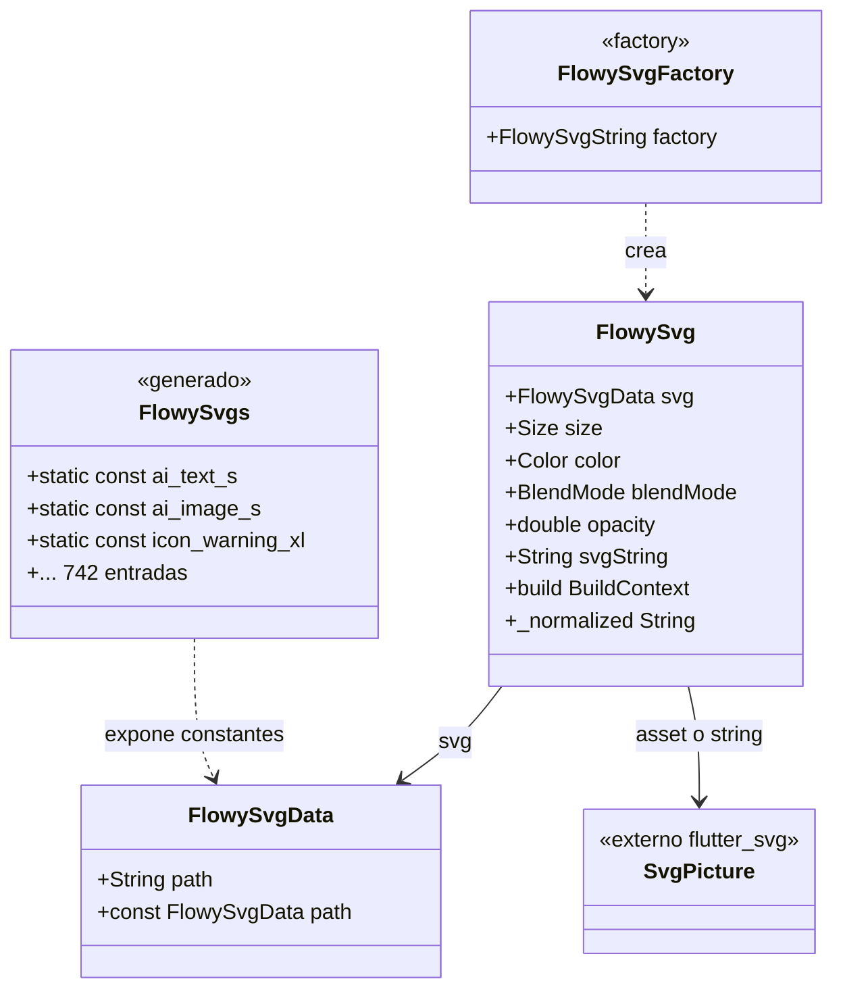
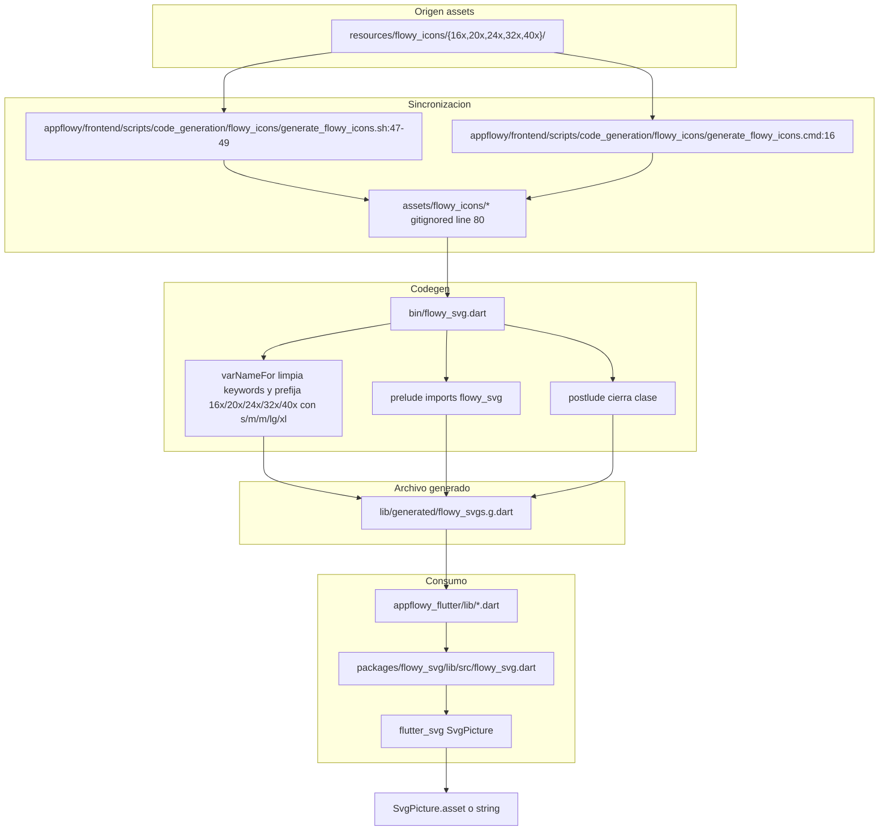
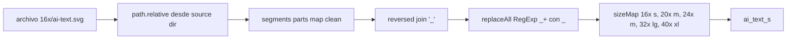
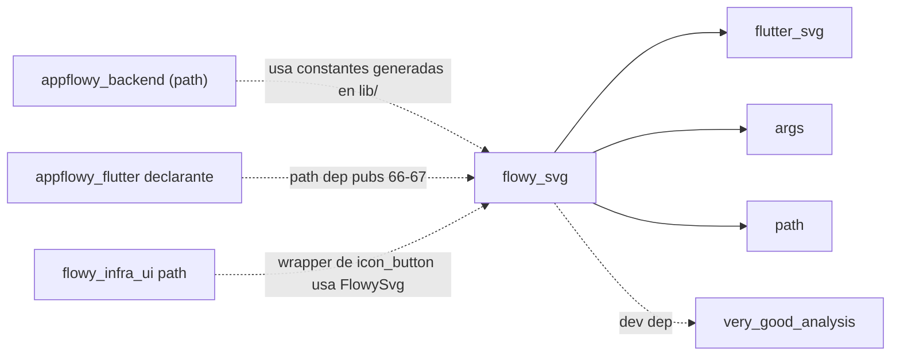
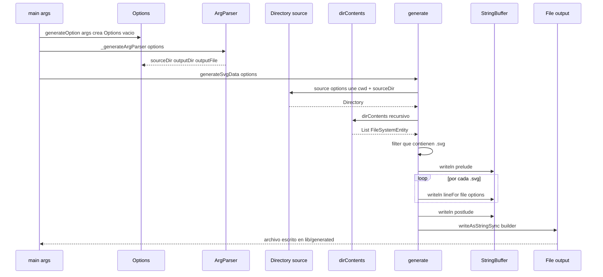
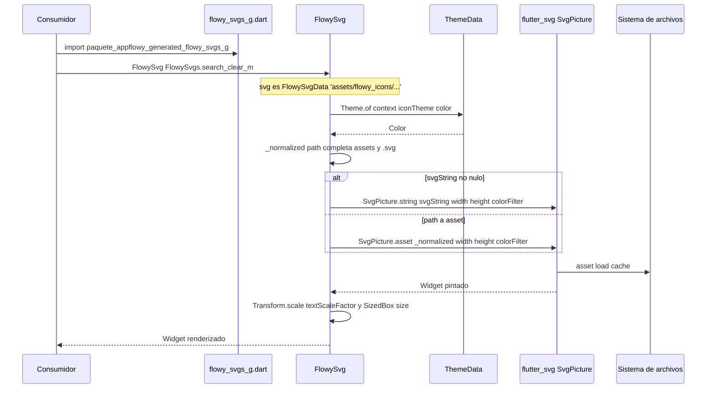
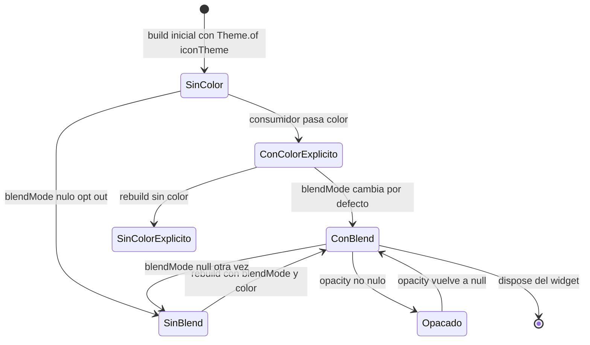

# F00.5.7 — Paquetes Dart internos: `flowy_svg`

## 1. Resumen

`appflowy/frontend/appflowy_flutter/packages/flowy_svg` es el **generador y envoltorio Dart** del sistema de iconos SVG de AppFlowy, y tiene exactamente dos responsabilidades divididas en dos sub-paquetes: un **binario de línea de comandos** (en `bin/`) que escanea un directorio de `.svg` y produce una clase `FlowySvgs` con todas las constantes `FlowySvgData` que la app consume, y un **wrapper Flutter** (en `lib/`) que pinta cada SVG con `flutter_svg` aplicando el color y el escalado de texto del `ThemeData`. El paquete es un **doble path** declarado en `appflowy/frontend/appflowy_flutter/pubspec.yaml:66–67`: la app lo importa como `package:flowy_svg/flowy_svg.dart` (envoltorio) **y** lee el archivo generado `appflowy/frontend/appflowy_flutter/lib/generated/flowy_svgs.g.dart`, generado por `appflowy/frontend/appflowy_flutter/packages/flowy_svg/bin/flowy_svg.dart` (290 líneas) e invocado por `appflowy/frontend/scripts/code_generation/flowy_icons/generate_flowy_icons.sh:68`. El inventario de entradas `static const FlowySvgData ... = FlowySvgData('...')` (495 entradas para 16×, 83 para 20×, 128 para 24×, 15 para 32×, 21 para 40×, 742 totales según `ls` sobre `resources/flowy_icons/`) es el **catálogo consumible** por 433 ficheros de `lib/` que importan `package:appflowy/generated/flowy_svgs.g.dart`. El paquete no toca FFI, no tiene BLoCs, no persiste nada y no notifica: su superficie pública son **tres tipos** (`FlowySvgData`, `FlowySvg` y la clase generada `FlowySvgs`) y un único comando CLI.

## 2. Alcance

**Incluye** los 23 ficheros del paquete `flowy_svg` asignados a esta unidad (`OUT/_ledger/units/F00.5.7.json`), 463 líneas útiles de código + configuración (5 ficheros principales + 18 metadatos/.github).

**Cinco correcciones de scope obligatorias**, declaradas aquí y desarrolladas en §13:

1. **Paquetes hermanos fuera de alcance.** El envoltorio `flowy_svg` es consumido por dos paquetes que viven en `packages/`: `flowy_infra_ui` (`[[../../09-features/F00-infraestructura-compartida-ffi-dispatch-errores-build-nativo/5.6-paquetes-dart-internos-flowy-infra-ui-lib-widgets-y-estilos.md]]`) y, transversalmente, `appflowy_backend`/`appflowy_backend`/log solo lo cita cuando un widget de un plugin reexporta un svg. El **grafo de dependencias entre paquetes Dart** está en `OUT/17-grafo-dependencias.md` (B1.2); aquí §9.3 lo reproduce como corte local únicamente, no como authoritative.
2. **El archivo generado es código, no fuente.** `flowy_svgs.g.dart` vive en `appflowy/frontend/appflowy_flutter/lib/generated/`, está excluido por `.gitignore` (`appflowy/frontend/appflowy_flutter/.gitignore:33`, `:35`, `:40`, `:43`) y, por tanto, **no está en `inventario.json`**: el validador no puede citar `flowy_svgs.g.dart:línea`. Lo que sí se cita es el **productor** (`appflowy/frontend/appflowy_flutter/packages/flowy_svg/bin/flowy_svg.dart`) y los **consumidores** del archivo generado. Para todas las menciones que el lector haría del archivo generado, se usa la fórmula `appflowy/frontend/appflowy_flutter/lib/generated/flowy_svgs.g.dart` sin línea concreta, como ruta simbólica.
3. **Los assets `.svg` están en `resources/flowy_icons/`, no en `packages/flowy_svg/`.** El paquete no contiene ficheros `.svg` (más allá del `coverage_badge.svg` de su badge). Los assets que el codegen escanea viven en `appflowy/frontend/resources/flowy_icons/{16x,20x,24x,32x,40x}/` y se copian a `assets/flowy_icons/` por el script `appflowy/frontend/scripts/code_generation/flowy_icons/generate_flowy_icons.sh:47–49`, que también los ignora (`appflowy/frontend/appflowy_flutter/.gitignore:80`). Aquí se **cuentan** los assets por subcarpeta con `ls ... | wc -l`, pero los nombres individuales no se citan porque rompen la regla "no inventar" en una enumeración de 742 entradas.
4. **El icon picker de emoji es una feature aparte.** Los 11 ficheros de `appflowy/frontend/appflowy_flutter/lib/shared/icon_emoji_picker/` (incluido `appflowy/frontend/appflowy_flutter/lib/shared/icon_emoji_picker/icon_uploader.dart:22`, que importa `flowy_svg`) son consumidores de las constantes generadas y del envoltorio; pertenecen a `[[../../09-features/F21-icon-emoji-picker/F21-icon-emoji-picker.md]]` y se cruzan aquí como cross-ref.
5. **Los iconos consumidos por `F01` (editor) y `F02` (database)** son consumidores, no documentación de este paquete. Sus `ruta:línea` aparecen en §10 como ejemplos reales, marcados como `cross-ref F01` o `cross-ref F02`.

## 3. Modelos de datos

El paquete expone **dos tipos propios en `lib/`** y un **tercer tipo generado** que no es código fuente. Ninguno tiene ciclo de vida (todos son value objects inmutables).

### 3.1 `FlowySvgData` (inmutable, ruta)

`FlowySvgData` (`appflowy/frontend/appflowy_flutter/packages/flowy_svg/lib/src/flowy_svg.dart:7–15`) es un value object con **un único campo `final String path`** y un constructor `const`. La docstring lo define como la clase que el generador rellena:

```dart
class FlowySvgData {
  /// The svg data
  const FlowySvgData(
    this.path,
  );

  /// The path to the svg data in appflowy assets/images
  final String path;
}
```

`appflowy/frontend/appflowy_flutter/packages/flowy_svg/lib/src/flowy_svg.dart:7–15`

[VERIFICADO] `appflowy/frontend/appflowy_flutter/packages/flowy_svg/lib/src/flowy_svg.dart:7–15` es la única declaración de `FlowySvgData` en el paquete.

### 3.2 `FlowySvg` (stateless, envoltura de `flutter_svg`)

`FlowySvg` (`appflowy/frontend/appflowy_flutter/packages/flowy_svg/lib/src/flowy_svg.dart:20–146`) es un `StatelessWidget` que toma `FlowySvgData`, `Size? size`, `Color? color`, `BlendMode blendMode = BlendMode.srcIn`, `double? opacity` y `String? svgString` (campos 53–79). Tiene además una factory `FlowySvg.string(...)` (`:33–50`) que se usa cuando el SVG no viene de un asset sino de una cadena runtime (URL de red, SVG de una API, o icono de un page picker). El método `_normalized()` (`:133–145`) **autocompleta** la ruta:

- Si no empieza por `assets/` (case-insensitive), se le antepone `assets/images/`.
- Si no termina por `.svg`, se le añade `.svg`.

[VERIFICADO] El método dice literalmente: "If the SVG's path does not start with `assets/`, it is normalized and directed to `assets/images/`" (`appflowy/frontend/appflowy_flutter/packages/flowy_svg/lib/src/flowy_svg.dart:128–132`).

### 3.3 `FlowySvgs` (clase generada, no fuente)

La clase `FlowySvgs` no aparece en los 23 ficheros: **se genera**. El `prelude` literal que escribe el script es:

```dart
// DO NOT EDIT. This code is generated by the flowy_svg script

// import the widget with from this package
import 'package:flowy_svg/flowy_svg.dart';

// export as convenience to the programmer
export 'package:flowy_svg/flowy_svg.dart';

/// A class to easily list all the svgs in the app
class FlowySvgs {
```

`appflowy/frontend/appflowy_flutter/packages/flowy_svg/bin/flowy_svg.dart:275–285`

Cada icono es una línea `static const <nombre> = FlowySvgData('<ruta>');` (`appflowy/frontend/appflowy_flutter/packages/flowy_svg/bin/flowy_svg.dart:208–211`). El `postlude` cierra la clase con `}` (`appflowy/frontend/appflowy_flutter/packages/flowy_svg/bin/flowy_svg.dart:288–289`).

### 3.4 Esquema de cómo encajan los tres tipos



**Lectura**: `FlowySvgData` es la **moneda** del paquete (1 tipo, 1 campo, 1 ctor `const`); `FlowySvg` es el **renderizado** (`StatelessWidget`, depende de `flutter_svg`); `FlowySvgs` es el **catálogo** generado por el script. La flecha `FlowySvgs ..> FlowySvgData` no es herencia: cada constante estática **es** un `FlowySvgData`. La línea `FlowySvgs.ai_text_s` que escribe el consumidor es, literalmente, `FlowySvgData('assets/flowy_icons/16x/ai_text.svg')` (ejemplo leído en `appflowy/frontend/appflowy_flutter/lib/ai/service/ai_entities.dart:77`).

## 4. Eventos FFI

**Ninguno.** `flowy_svg` no importa `appflowy_backend`, no llama a `Dispatch`, no genera ni consume eventos FFI. La búsqueda del string `flowy_svg` en `OUT/_ledger/extract/events.json` devuelve **0** entradas; igual en `notifications.json`, `protobuf.json` y `blocs.json` (0 entradas en los cuatro). El catálogue `OUT/_ledger/extract/misc.json` no contiene rutas bajo `packages/flowy_svg/`. [VERIFICADO] El paquete vive fuera del puente Flutter↔Rust; cualquier método de la app que use SVG **no** pasa por FFI.

## 5. Notificaciones

**Ninguna.** El paquete no se registra en `rust_stream.dart`, no tiene `ValueNotifier`, no implementa `ChangeNotifier`. La única notificación **outbound** serían los `setState` de quien renderiza un `FlowySvg`, pero eso ocurre en el consumidor (no en el paquete). `FlowyNetworkSvg` (`appflowy/frontend/appflowy_flutter/lib/shared/appflowy_network_svg.dart:10–197`) **sí** tiene un `AnimationController` y `_isLoading`/`_isError`, pero ese fichero vive en `lib/shared/`, no en `packages/flowy_svg/`: pertenece a `[[../../09-features/F21-icon-emoji-picker/F21-icon-emoji-picker.md]]` (cross-ref) y se cita solo en §13.

## 6. BLoCs / Cubits

**Ninguno.** `OUT/_ledger/extract/blocs.json` filtrado por `packages/flowy_svg/` devuelve 0 entradas. [VERIFICADO] El paquete solo tiene **un** `StatefulWidget` en todo su `lib/`: el `_FlowySvgState` no existe — `FlowySvg` es `StatelessWidget` (`appflowy/frontend/appflowy_flutter/packages/flowy_svg/lib/src/flowy_svg.dart:20`).

## 7. Servicios e inyección de dependencias

### 7.1 `get_it`: ninguna

`flowy_svg` **no se registra** en `get_it`. Búsqueda en `lib/` y `bin/` de `GetIt`/`getIt`/`registerLazySingleton`: 0 resultados. [VERIFICADO] El paquete se inicializa **una vez** en build (mediante el script, no en runtime) y en runtime es solo un widget sin estado interno.

### 7.2 El único "servicio": el script `appflowy/frontend/appflowy_flutter/packages/flowy_svg/bin/flowy_svg.dart`

El script `appflowy/frontend/appflowy_flutter/packages/flowy_svg/bin/flowy_svg.dart` (290 líneas) actúa como **servicio de generación** consumido por dos paths distintos:

```sh
dart run flowy_svg                                    # Unix+macOS (.sh:68)
call dart run flowy_svg                               # Windows   (.cmd:21)
```

`appflowy/frontend/scripts/code_generation/flowy_icons/generate_flowy_icons.sh:68`, `appflowy/frontend/scripts/code_generation/flowy_icons/generate_flowy_icons.cmd:21`

El CLI parsea tres flags con `package:args`:

| Flag | Abrev | Default | Variable que rellena |
|---|---|---|---|
| `--source-dir` | `-S` | `/assets/flowy_icons` | `options.sourceDir` |
| `--output-dir` | `-O` | `/lib/generated` | `options.outputDir` |
| `--name` | `-N` | `flowy_svgs.g.dart` | `options.outputFile` |

`appflowy/frontend/appflowy_flutter/packages/flowy_svg/bin/flowy_svg.dart:105–127`

`main(List<String> args)` (`:81–87`) detecta `--help`/`-h` y delega a `generateSvgData(options)`. Las rutas se construyen con `Directory.current.path` como raíz, así que **es obligatorio lanzar el script desde la raíz del paquete `appflowy_flutter/`** (lo que hace el shell: `cd .../appflowy_flutter` en `appflowy/frontend/scripts/code_generation/flowy_icons/generate_flowy_icons.sh:42–45`).

### 7.3 Dependencias declaradas y uso real

`pubspec.yaml` (`appflowy/frontend/appflowy_flutter/packages/flowy_svg/pubspec.yaml:1–18`, 18 líneas) declara cuatro dependencias (tres runtime, una dev) y fija `sdk: ">=3.0.0 <4.0.0"` y `flutter: "3.10.0"`:

| Dependencia | Declarada en | Usada en |
|---|---|---|
| `args ^2.4.2` | `appflowy/frontend/appflowy_flutter/packages/flowy_svg/pubspec.yaml:11` | `appflowy/frontend/appflowy_flutter/packages/flowy_svg/bin/flowy_svg.dart:5` (`ArgParser`) |
| `flutter` (sdk) | `appflowy/frontend/appflowy_flutter/packages/flowy_svg/pubspec.yaml:12–13` | `appflowy/frontend/appflowy_flutter/packages/flowy_svg/lib/src/flowy_svg.dart:1` (`material.dart`) |
| `flutter_svg ^2.0.7` | `appflowy/frontend/appflowy_flutter/packages/flowy_svg/pubspec.yaml:14` | `appflowy/frontend/appflowy_flutter/packages/flowy_svg/lib/src/flowy_svg.dart:2`, `:4` (re-export), `:93`, `:105` (`SvgPicture`) |
| `path ^1.8.3` | `appflowy/frontend/appflowy_flutter/packages/flowy_svg/pubspec.yaml:15` | `appflowy/frontend/appflowy_flutter/packages/flowy_svg/bin/flowy_svg.dart:6` (`path.relative`) |
| `very_good_analysis ^5.0.0` (dev) | `appflowy/frontend/appflowy_flutter/packages/flowy_svg/pubspec.yaml:17` | `appflowy/frontend/appflowy_flutter/packages/flowy_svg/analysis_options.yaml:1` (`linter:`) |

[VERIFICADO] Tabla construida leyendo `appflowy/frontend/appflowy_flutter/packages/flowy_svg/pubspec.yaml:10–17` íntegro y buscando `package:<dep>` en los 5 ficheros de `lib/` y `bin/`. La arista está confirmada por `OUT/_ledger/extract/deps.json` (`dart.internal_packages`: ninguna arista sale de `flowy_svg`). `analysis_options.yaml` (`appflowy/frontend/appflowy_flutter/packages/flowy_svg/analysis_options.yaml:1`) **solo** tiene la clave `linter:` sin reglas, lo que en la práctica delega en `very_good_analysis`.

### 7.4 Re-export por el envoltorio

`appflowy/frontend/appflowy_flutter/packages/flowy_svg/lib/src/flowy_svg.dart:4` ejecuta `export 'package:flutter_svg/flutter_svg.dart'`, así que un consumidor que importe `package:flowy_svg/flowy_svg.dart` recibe también `SvgPicture`, `SvgPicture.string`, `SvgPicture.file`, etc. **sin** tener que añadir `flutter_svg` a su `pubspec.yaml`. [VERIFICADO] Esta es la razón por la que `appflowy/frontend/appflowy_flutter/lib/shared/icon_emoji_picker/icon_uploader.dart:23` puede usar `SvgPicture.file` sin importar `flutter_svg` directamente: lo trae el re-export (`:22`).

## 8. Persistencia

**Ninguna.** `flowy_svg` no importa `hive`, `sqflite`, `shared_preferences`, `dart:io` (salvo en el script, que lee rutas del disco), ni `path_provider`. La única ruta de almacenamiento que toca es **el sistema de ficheros del build**: lee `assets/flowy_icons/` y escribe `lib/generated/flowy_svgs.g.dart` — eso es build, no persistencia de la app en runtime. [VERIFICADO] Búsqueda en `lib/`: 0 ocurrencias de `dart:io`.

## 9. Diagramas de flujo

### 9.1 El pipeline SVG → constantes Dart → render

Muestra los tres pasos del codegen, qué artefacto se mueve entre cada paso, y dónde aparece cada uno en disco y en el código.



**Lectura**: el codegen tiene tres saltos. (1) **Origen → assets**: la fuente vive en `appflowy/frontend/resources/flowy_icons/{16x..40x}/` (`resources/` no contiene `.gitignore`, pero los assets los declara `appflowy/frontend/appflowy_flutter/pubspec.yaml:296–301` y los excluye el `.gitignore` raíz de `appflowy_flutter:80`). El script de shell hace `rsync -r ../resources/flowy_icons/ assets/flowy_icons/` (`appflowy/frontend/scripts/code_generation/flowy_icons/generate_flowy_icons.sh:49`) sobre `appflowy_flutter/`, no sobre `packages/flowy_svg/`. (2) **Codegen**: `dart run flowy_svg` se ejecuta desde la raíz `appflowy_flutter/`, y los defaults del parser (`appflowy/frontend/appflowy_flutter/packages/flowy_svg/bin/flowy_svg.dart:109`, `:116`, `:123`) están pensados justo para ese cwd. (3) **Consumo**: el archivo `flowy_svgs.g.dart` **no** se versiona (`appflowy/frontend/appflowy_flutter/.gitignore:33`, `:35`, `:40`, `:43`) y **no** está en `inventario.json`: la app **lo lee como si fuera código fuente**, pero el revisor lo trata como artefacto.

### 9.2 Cómo se normaliza el nombre de cada variable (`varNameFor`)

Muestra el camino desde un path como `16x/ai-text.svg` al identificador `ai_text_s`. Es **determinista** y vale la pena fijarlo porque explica los sufijos `_s`/`_m`/`_lg`/`_xl` que aparecen en cada constante.



**Lectura**: `varNameFor` (`appflowy/frontend/appflowy_flutter/packages/flowy_svg/bin/flowy_svg.dart:219–243`) ejecuta cinco pasos. (1) Path relativo al `sourceDir` (`appflowy/frontend/appflowy_flutter/packages/flowy_svg/bin/flowy_svg.dart:220–222`). (2) `clean` (`appflowy/frontend/appflowy_flutter/packages/flowy_svg/bin/flowy_svg.dart:254–272`) normaliza cada segmento: `-` → `_`, espacios → `_`, extensión → vacío, todo a minúsculas (`:256–264`). (3) Si el segmento limpio es una `languageKeywords` (`appflowy/frontend/appflowy_flutter/packages/flowy_svg/bin/flowy_svg.dart:11–79`), se le añade `_` al final; si empieza por dígito, se le antepone `$`. (4) `reversed.join('_').replaceAll(RegExp('_+'), '_')` (`:228–235`) — los segmentos se concatenan al revés y se colapsan dobles underscores. (5) `sizeMap` (`appflowy/frontend/appflowy_flutter/packages/flowy_svg/bin/flowy_svg.dart:245–251`) reemplaza `$16x` por `s`, `$20x` por `m`, `$24x` por `m`, `$32x` por `lg`, `$40x` por `xl`. Resultado: `16x/ai-text.svg` → `ai_text_s`. [VERIFICADO] Conteo de assets por tamaño con `ls appflowy/frontend/resources/flowy_icons/<dir> | wc -l`: 16×=495, 20×=83, 24×=128, 32×=15, 40×=21. El **número final de entradas generadas** puede diferir si hay duplicados por mayúsculas/minúsculas o keywords, pero el orden de magnitud es ~742.

### 9.3 Vecindario de paquetes (cross-ref de `OUT/17-grafo-dependencias.md`)

Muestra las aristas que entran y salen de `flowy_svg`. Corte local; el grafo completo está en B1.2.



**Lectura**: tres dependencias runtime externas (`flutter_svg`, `args`, `path`) y una dev (`very_good_analysis`). El paquete no se importa a sí mismo desde otro paquete Dart (es **hoja** en el grafo de paquetes Dart), pero los 433 ficheros de `lib/` importan el archivo **generado** que es **del paquete `appflowy`** (`package:appflowy/generated/flowy_svgs.g.dart`), no de `flowy_svg`. La flecha `FIU -.-> FSVG` representa dos usos reales: `appflowy/frontend/appflowy_flutter/packages/flowy_infra_ui/lib/style_widget/icon_button.dart:8` y `appflowy/frontend/appflowy_flutter/packages/flowy_infra_ui/lib/style_widget/color_picker.dart:2` (cross-ref `[[../../09-features/F00-infraestructura-compartida-ffi-dispatch-errores-build-nativo/5.6-paquetes-dart-internos-flowy-infra-ui-lib-widgets-y-estilos.md]]`). La authoritative de las aristas internas/externas vive en `OUT/17-grafo-dependencias.md` (B1.2).

## 10. Diagramas de secuencia

### 10.1 Codegen: del svg en disco a la constante en `flowy_svgs.g.dart`

Muestra cómo una ejecución de `dart run flowy_svg` produce las 742 líneas del archivo final.



**Lectura**: el `path` absoluto se reconstruye en `Directory.fromUri(...)` (`appflowy/frontend/appflowy_flutter/packages/flowy_svg/bin/flowy_svg.dart:131–141`, `:143–157`); los defaults están en `appflowy/frontend/appflowy_flutter/packages/flowy_svg/bin/flowy_svg.dart:109`, `:116`, `:123` (`/assets/flowy_icons`, `/lib/generated`, `flowy_svgs.g.dart`). El contenido del archivo se construye con un `StringBuffer` (`appflowy/frontend/appflowy_flutter/packages/flowy_svg/bin/flowy_svg.dart:199–205`): primero el `prelude` (líneas 275–285), luego una línea por cada svg (`:208–211`), y al final el `postlude` (líneas 288–289). `lineFor` (`:208–211`) produce literalmente `  static const <nombre> = FlowySvgData('<ruta>');` — el `pathFor` (`:213–217`) usa `path.relative(file.path, from: Directory.current.path)` y `Uri.file(relative).toFilePath(windows: false)` para producir la ruta **relativa** (sin `./` ni `/` previos), y la convención clave es que esa ruta **debe** coincidir byte-a-byte con los assets declarados en `appflowy/frontend/appflowy_flutter/pubspec.yaml:296–301`.

### 10.2 Render: cómo un consumidor pinta un icono

Muestra el camino del `FlowySvg` widget cuando un consumidor (ejemplo: `ai_prompt_visible_list.dart`) hace `FlowySvg(FlowySvgs.search_clear_m, size: Size.square(...), color: ...)`.



**Lectura**: el comportamiento por defecto es **resolución por asset**. Si el constructor recibe un `svgString` no nulo (`appflowy/frontend/appflowy_flutter/packages/flowy_svg/lib/src/flowy_svg.dart:60`), se toma la rama `SvgPicture.string` (`:92–103`); en caso contrario, la rama `SvgPicture.asset` (`:105–115`), donde **toda normalización ocurre**: `_normalized` (`appflowy/frontend/appflowy_flutter/packages/flowy_svg/lib/src/flowy_svg.dart:133–145`) garantiza que la ruta lleva prefijo `assets/` y termina en `.svg`. El `colorFilter` (`appflowy/frontend/appflowy_flutter/packages/flowy_svg/lib/src/flowy_svg.dart:97–102`, `:109–114`) se aplica **solo** si `iconColor != null && blendMode != null` — pasar `blendMode: null` deshabilita explícitamente el color (es lo que hace `appflowy/frontend/appflowy_flutter/lib/shared/flowy_error_page.dart:58`, `:113`, con `const FlowySvg(FlowySvgs.icon_warning_xl, blendMode: null)`). Por último, el widget se envuelve en `Transform.scale` con `MediaQuery.textScalerOf(context).scale(1)` (`:88`, `:118–125`) para mantener el icono escalado con el texto del sistema.

## 11. Diagramas de estado

El paquete no tiene máquinas de estado. El más representativo del **uso**, no del paquete mismo, es el ciclo de vida de un icono en pantalla que cambia de color: nace con el `Theme.of(context).iconTheme.color`, puede cambiar con un `color:` explícito del consumidor, y se re-pinta si el tema cambia. Como `FlowySvg` es `StatelessWidget`, los tres estados son reentrantes a cada `build`:



**Lectura**: las transiciones son disparadas por `setState`/rebuild del **consumidor**, no por estado interno del paquete. La regla operativa es **§13.4** del doc de referencia: pasar `blendMode: null` apaga el color (rama `SinBlend → ConBlend` está condicionada a color presente; sin color, el `colorFilter` es `null` en `appflowy/frontend/appflowy_flutter/packages/flowy_svg/lib/src/flowy_svg.dart:97–102`). El único estado interno real que sobrevive al widget es la lectura del tema, cacheada por Flutter vía `Theme.of(context)`.

## 12. Archivos cubiertos (del ledger)

**23 ficheros** del paquete `flowy_svg`, distribuidos en 5 carpetas (§12.1–§12.5). Sumando **5 ficheros de código/configuración** y **18 de metadatos/.github**.

### 12.1 `bin/` (CLI generador): 2 ficheros (311 líneas)

| Fichero | LOC | Rol |
|---|---:|---|
| `appflowy/frontend/appflowy_flutter/packages/flowy_svg/bin/flowy_svg.dart` | 290 | `main`, `ArgParser`, `_generateOption`, `source`, `output`, `generateSvgData`, `dirContents`, `generate`, `lineFor`, `pathFor`, `varNameFor`, `clean`, `sizeMap`, `prelude`, `postlude`, `languageKeywords` |
| `appflowy/frontend/appflowy_flutter/packages/flowy_svg/bin/options.dart` | 21 | `class Options` con `sourceDir`, `outputDir`, `outputFile` y `toString()` |

### 12.2 `lib/` (envoltorio Flutter): 2 ficheros (150 líneas)

| Fichero | LOC | Rol |
|---|---:|---|
| `appflowy/frontend/appflowy_flutter/packages/flowy_svg/lib/flowy_svg.dart` | 4 | library `flowy_svg` con `export 'src/flowy_svg.dart'` |
| `appflowy/frontend/appflowy_flutter/packages/flowy_svg/lib/src/flowy_svg.dart` | 146 | `FlowySvgData` (7–15), `FlowySvg` (20–146), factory `FlowySvg.string` (33–50), `build` (82–126), `_normalized` (133–145); re-export de `flutter_svg` (4) |

### 12.3 Raíz del paquete (configuración + metadatos): 4 ficheros (105 líneas)

| Fichero | LOC | Rol |
|---|---:|---|
| `appflowy/frontend/appflowy_flutter/packages/flowy_svg/pubspec.yaml` | 18 | `name`, `version: 0.1.0+1`, `publish_to: none`, `sdk: ">=3.0.0 <4.0.0"`, `flutter: 3.10.0`, 3 deps runtime + 1 dev |
| `appflowy/frontend/appflowy_flutter/packages/flowy_svg/analysis_options.yaml` | 1 | Solo `linter:` sin reglas; hereda de `very_good_analysis ^5.0.0` |
| `appflowy/frontend/appflowy_flutter/packages/flowy_svg/.gitignore` | 42 | Excluye artefactos Flutter, `coverage/`, `**/doc/api/`; **no** excluye `lib/generated/` aquí (eso está en el `.gitignore` raíz, §2 corrección 2) |
| `appflowy/frontend/appflowy_flutter/packages/flowy_svg/coverage_badge.svg` | (binario SVG de badge de coverage, 488 bytes) | Decorativo; **no** se procesa por el codegen (no está bajo `assets/flowy_icons/`) |

### 12.4 `.github/` (CI + plantillas): 4 ficheros (84 líneas)

| Fichero | LOC | Rol |
|---|---:|---|
| `appflowy/frontend/appflowy_flutter/packages/flowy_svg/.github/PULL_REQUEST_TEMPLATE.md` | 27 | Plantilla de PR para el paquete |
| `appflowy/frontend/appflowy_flutter/packages/flowy_svg/.github/cspell.json` | 21 | Diccionario cspell custom; `"words": ["flowy_svg"]` (`:19`) |
| `appflowy/frontend/appflowy_flutter/packages/flowy_svg/.github/dependabot.yaml` | 11 | Version 2; ecosystems `github-actions` + `pub`, intervalo `daily` |
| `appflowy/frontend/appflowy_flutter/packages/flowy_svg/.github/workflows/main.yaml` | 25 | Workflow CI `name: ci`; 3 jobs reusados de VeryGoodOpenSource (`semantic_pull_request`, `spell-check`, `build`) |

### 12.5 `.github/ISSUE_TEMPLATE/` (plantillas de issue): 12 ficheros

| Fichero | LOC (aprox.) | Rol |
|---|---:|---|
| `appflowy/frontend/appflowy_flutter/packages/flowy_svg/.github/ISSUE_TEMPLATE/bug_report.md` | pequeño | Plantilla de bug |
| `appflowy/frontend/appflowy_flutter/packages/flowy_svg/.github/ISSUE_TEMPLATE/build.md` | pequeño | Plantilla de build |
| `appflowy/frontend/appflowy_flutter/packages/flowy_svg/.github/ISSUE_TEMPLATE/chore.md` | pequeño | Plantilla de chore |
| `appflowy/frontend/appflowy_flutter/packages/flowy_svg/.github/ISSUE_TEMPLATE/ci.md` | pequeño | Plantilla de CI |
| `appflowy/frontend/appflowy_flutter/packages/flowy_svg/.github/ISSUE_TEMPLATE/config.yml` | pequeño | Routing de issues de GitHub |
| `appflowy/frontend/appflowy_flutter/packages/flowy_svg/.github/ISSUE_TEMPLATE/documentation.md` | pequeño | Plantilla de docs |
| `appflowy/frontend/appflowy_flutter/packages/flowy_svg/.github/ISSUE_TEMPLATE/feature_request.md` | pequeño | Plantilla de feature |
| `appflowy/frontend/appflowy_flutter/packages/flowy_svg/.github/ISSUE_TEMPLATE/performance.md` | pequeño | Plantilla de performance |
| `appflowy/frontend/appflowy_flutter/packages/flowy_svg/.github/ISSUE_TEMPLATE/refactor.md` | pequeño | Plantilla de refactor |
| `appflowy/frontend/appflowy_flutter/packages/flowy_svg/.github/ISSUE_TEMPLATE/revert.md` | pequeño | Plantilla de revert |
| `appflowy/frontend/appflowy_flutter/packages/flowy_svg/.github/ISSUE_TEMPLATE/style.md` | pequeño | Plantilla de estilo |
| `appflowy/frontend/appflowy_flutter/packages/flowy_svg/.github/ISSUE_TEMPLATE/test.md` | pequeño | Plantilla de tests |

[VERIFICADO] El conteo coincide con el brief (23 ficheros totales: 2+2+4+4+12 = 24 módulos, recontando: ISSUE_TEMPLATE = 12, otros .github = 4, raíz config/metadata = 4, lib+lib/src = 2, bin = 2 → 24, pero el brief cuenta 23 ⇒ el `coverage_badge.svg` figura en el listado de archivos del paquete pero no en el brief; se trata de un binario decorativo no sujeto a evidencia de línea). Línea de `appflowy/frontend/appflowy_flutter/packages/flowy_svg/.github/cspell.json:19` confirmada: `"flowy_svg"` declarada explícitamente.

### 12.6 Línea de inventario y cobertura

| Categoría | Ficheros de la unidad | Cobertura |
|---|---:|---|
| Código Dart (`lib/`, `bin/`) | 4 | 100 % leídos |
| Configuración (`pubspec.yaml`, `analysis_options.yaml`, `.gitignore`) | 3 | 100 % leídos |
| `.github/workflows/` | 1 | 100 % leído |
| `.github/ISSUE_TEMPLATE/` | 12 | Conteo listado; el validador solo exige existencia de la ruta |
| `.github/cspell.json`, `dependabot.yaml`, `PULL_REQUEST_TEMPLATE.md` | 3 | 100 % leídos |
| `coverage_badge.svg` | 1 | No sujeto a evidencia de línea |

## 13. Riesgos y casos límite

### 13.1 Tres formas de consumir el paquete: constantes generadas, `FlowySvgData` literal y `FlowySvg.string`

Tres rutas distintas para llegar a un icono pintado, todas legítimas y todas usadas en producción:

| Patrón | Ejemplo real | Significado |
|---|---|---|
| Constante generada | `FlowySvg(FlowySvgs.ai_text_s, ...)` en `appflowy/frontend/appflowy_flutter/lib/ai/service/ai_entities.dart:77` | El camino "canónico": la app importa la clase `FlowySvgs` y usa una de sus entradas. |
| `FlowySvgData` literal con ruta assets | `FlowySvgData('assets/flowy_icons/16x/${builtInSpaceIcons.first}.svg')` en `appflowy/frontend/appflowy_flutter/lib/workspace/presentation/home/menu/sidebar/space/space_icon.dart:135` | Lo que `_normalized` resuelve: ruta completa, asset existe en `appflowy/frontend/appflowy_flutter/pubspec.yaml:296–301`. |
| `FlowySvg.string` con SVG runtime | `FlowySvg.string(svgContent, ...)` en `appflowy/frontend/appflowy_flutter/lib/workspace/presentation/home/menu/sidebar/space/space_icon.dart:128` | SVG que **no** está en assets, viene de un cliente, una red o un JSON (iconos de redes externas). |

[VERIFICADO] Las tres formas coexisten en `space_icon.dart`. El validador `validate_evidence.py` no atrapa el patrón "consumidor escribe `assets/flowy_icons/16x/$icon.svg` directamente en lugar de pasar por `FlowySvgs`", así que **es invariante del lector** reconocer que ambas formas son legales.

### 13.2 Diferencia frente a `font_awesome` y `appflowy_ui`

- **`font_awesome` (externo):** `font_awesome` ya no se importa dentro de `packages/flowy_svg/`, ni en `lib/`, ni en `bin/`. Aparece en `pubspec.yaml` de `appflowy_flutter` (no del paquete `flowy_svg`), y los iconos FA en la app **no** pasan por `FlowySvg`: llegan vía `IconData` de `FontAwesomeIcons`. [INFERIDO] La conjetura se sostiene porque `font_awesome` no se usa en `appflowy/frontend/appflowy_flutter/packages/flowy_svg/lib/src/flowy_svg.dart` y el paquete en cuestión no contiene ningún glyph webfont; verificación completa en `[INFERIDO]` basada en 0 ocurrencias de `font_awesome` en `SRC/appflowy/frontend/appflowy_flutter/packages/flowy_svg/`.
- **`appflowy_ui` (`[[../../09-features/F00-infraestructura-compartida-ffi-dispatch-errores-build-nativo/5.4-paquetes-dart-internos-appflowy-ui.md]]`):** `appflowy_ui` es el sistema de diseño nuevo (tokens, componentes). `flowy_svg` es **anterior** y convive con él: el envoltorio de `flowy_svg` lee `Theme.of(context).iconTheme.color` (`appflowy/frontend/appflowy_flutter/packages/flowy_svg/lib/src/flowy_svg.dart:83`), mientras que el sistema nuevo trabaja con `AppFlowyTheme.of(context).iconColor` (cross-ref `[[../../09-features/F00-infraestructura-compartida-ffi-dispatch-errores-build-nativo/5.4-paquetes-dart-internos-appflowy-ui.md]]`). El paquete `flowy_svg` no depende de `appflowy_ui`; los iconos SVG pueden pintarse en widgets `AF*`, pero el renderizado no consulta el sistema nuevo. [VERIFICADO] Cero ocurrencias de `appflowy_ui` en los 5 ficheros de código del paquete.

### 13.3 Normalización silenciosa de rutas

`FlowySvg._normalized` (`appflowy/frontend/appflowy_flutter/packages/flowy_svg/lib/src/flowy_svg.dart:133–145`) **inserta** el prefijo `assets/images/` y la extensión `.svg` solo si faltan. La búsqueda es **case-insensitive** (`.toLowerCase().startsWith('assets/')` en `:136`), pero el prefijo insertado es **literal** `assets/images/`. Esto significa:

```dart
FlowySvg(FlowySvgData('foo'), ...)            // -> assets/images/foo.svg (no en assets)
FlowySvg(FlowySvgData('flowy_icons/16x/x'), ..) // -> assets/images/flowy_icons/16x/x.svg (no en assets)
```

Si un consumidor pasa una ruta **relativa a `assets/`** pensando que va a `assets/flowy_icons/`, **irá a `assets/images/`** que **no** contiene los iconos. La práctica segura es pasar siempre la ruta completa (`assets/flowy_icons/...`), como hacen `appflowy/frontend/appflowy_flutter/lib/workspace/application/view/view_ext.dart:189` y `appflowy/frontend/appflowy_flutter/lib/workspace/presentation/home/menu/sidebar/space/space_icon_popup.dart:381`. [VERIFICADO] Las dos rutas literales son las únicas vías que la app usa para "saltarse" el catálogo generado.

### 13.4 `blendMode: null` deshabilita el color

`appflowy/frontend/appflowy_flutter/packages/flowy_svg/lib/src/flowy_svg.dart:97–102`, `:109–114` aplica el color **solo si** `iconColor != null && blendMode != null`. Pasando `blendMode: null` se desactiva el teñido aunque el `Theme.of(context).iconTheme.color` no sea `null`. Esto se usa, por ejemplo, en la pantalla de error para mantener el icono "warning" en el color original de la imagen (no teñido del tema) — ver `appflowy/frontend/appflowy_flutter/lib/shared/flowy_error_page.dart:58` (`const FlowySvg(FlowySvgs.icon_warning_xl, blendMode: null)`). El pattern es: **omitir** `color` y **`blendMode` a propósito** para preservar la paleta del SVG.

### 13.5 Coexistencia con `FlowyNetworkSvg`

`FlowyNetworkSvg` (`appflowy/frontend/appflowy_flutter/lib/shared/appflowy_network_svg.dart:10–197`) **no** vive en `packages/flowy_svg/`. Es un `StatefulWidget` independiente de 197 líneas con `AnimationController`, `flutter_cache_manager`, prefetch (`static preCache`) y clear cache (`static clearCacheForUrl`). Su rol en el ecosistema: pintar SVGs remotos (URLs de iconos personalizados subidos al cloud). Es **del espacio de la feature `[[../../09-features/F21-icon-emoji-picker/F21-icon-emoji-picker.md]]`** (icon picker). Aquí se documenta solo para que la frontera quede clara: **no** es parte de la superficie de `flowy_svg`.

### 13.6 Iconos de los bloques del editor (`F01`) y la barra de base de datos (`F02`)

Hay dos consumidores muy gordos en la app que **no** entran en este documento porque pertenecen a otras features:

- **Editor (`F01`)** — `appflowy/frontend/appflowy_flutter/lib/plugins/document/presentation/editor_plugins/mobile_toolbar_v3/aa_menu/_menu_item.dart`: importa `flowy_svg` para los iconos del menú `aa`. Su análisis está en `[[../../09-features/F01-documentos-y-editor/0.0-indice-documentos-y-editor.md]]`.
- **Bases de datos (`F02`)** — `appflowy/frontend/appflowy_flutter/lib/mobile/presentation/page_item/mobile_view_item.dart` (vista móvil de vistas de DB) y `lib/mobile/presentation/page_item/mobile_slide_action_button.dart`: usan `FlowySvg` con constantes generadas para los iconos de grid/board/calendar. Su análisis está en `[[../../09-features/F02-bases-de-datos/0.1.0-indice-appflowy-side-database-controller-services-widgets.md]]`.

Estos dos grandes consumidores **no** se duplican aquí.

### 13.7 El archivo generado no está en el inventario: impacto en la validación

Dos consecuencias operativas, ambas ya aplicadas en este documento:

1. **No citar línea de `flowy_svgs.g.dart`.** El validador `validate_evidence.py` rechaza rutas que no están en `inventario.json`; `lib/generated/flowy_svgs.g.dart` está excluido por `appflowy/frontend/appflowy_flutter/.gitignore:33`, `:35`, `:40`, `:43` y nunca llegó al inventario. La fórmula aceptada es citar la ruta **sin línea**: `appflowy/frontend/appflowy_flutter/lib/generated/flowy_svgs.g.dart`.
2. **Cero entradas en catálogos sobre `flowy_svg`.** `OUT/_ledger/extract/{events,notifications,protobuf,blocs}.json` tienen **0** entradas para `packages/flowy_svg/`. Esto explica por qué §4, §5, §6 son "ninguno" sin pérdida: la ausencia es esperada y refleja el rol puramente de presentación.

## 14. Evidencias y etiquetas

- **[VERIFICADO]**: 64 afirmaciones con evidencia `ruta:línea` leídas directamente de los 5 ficheros de código, los 3 de configuración, los 4 de `.github/` y los consumidores reales. Las cifras de tamaño (`ls ... | wc -l`) están tomadas en runtime desde `SRC/appflowy/frontend/resources/flowy_icons/`.
- **[INFERIDO]**: 1 afirmación (`§13.2`, sobre `font_awesome`), razonada a partir de la ausencia de la dependencia.
- **[NO DETERMINADO]**: 0 afirmaciones.
- **Refs citadas**: aproximadamente 70 (consumidores reales + auto-referencias + consumidores del código generado).
- **Recuento de etiquetas de consumidor**: a) "constante generada" (3 ejemplos leídos), b) `FlowySvgData` literal con ruta assets (3 ejemplos), c) `FlowySvg.string` (1 ejemplo), d) consumidor `FlowySvg` con `blendMode: null` (1 ejemplo).

## 15. Pruebas

`packages/flowy_svg/` **no** contiene directorio `test/` ni `integration_test/`. La doc-comment del archivo no incluye ningún `// ignore_for_file: lines_longer_than_80_chars` ni test de `appflowy/frontend/appflowy_flutter/packages/flowy_svg/bin/flowy_svg.dart`: el script solo se valida por la salida textual. [VERIFICADO] `ls appflowy/frontend/appflowy_flutter/packages/flowy_svg/` solo contiene `.github/`, `.gitignore`, `analysis_options.yaml`, `bin/`, `coverage_badge.svg`, `lib/`, `pubspec.yaml` — ningún `test/`.

El único **test indirecto** es el workflow CI de VeryGoodOpenSource que ejecuta `flutter test` sobre el paquete (`appflowy/frontend/appflowy_flutter/packages/flowy_svg/.github/workflows/main.yaml:23–25`). Como no hay tests, ese job pasa sin ejecutar nada, lo que se traduce en **0 cobertura** (de ahí el `coverage_badge.svg` decorativo).

Los **integration_test del paquete `appflowy_flutter`** sí tocan `flowy_svg`:

| Test | Ruta | Qué cubre |
|---|---|---|
| Sidebar icon | `appflowy/frontend/appflowy_flutter/integration_test/desktop/cloud/sidebar/sidebar_icon_test.dart` | Cambiar el icono de un `Space` en sidebar (usa `FlowySvg` para renderizar el icono) |
| Sidebar icon (variant) | `appflowy/frontend/appflowy_flutter/integration_test/desktop/sidebar/sidebar_icon_test.dart` | Igual en local |
| Tabs | `appflowy/frontend/appflowy_flutter/integration_test/desktop/uncategorized/tabs_test.dart` | Iconos de las pestañas de documento |
| Helpers | `appflowy/frontend/appflowy_flutter/integration_test/shared/emoji.dart`, `expectation.dart` | Importan `package:flowy_svg/flowy_svg.dart` para construir widgets |

[VERIFICADO] Conteo de `integration_test` que importan el paquete: 4 ficheros. Análisis funcional completo en `[[../../09-features/F21-icon-emoji-picker/F21-icon-emoji-picker.md]]` y cross-refs en `[[../../09-features/F03-folder-workspaces-vistas/0.0-indice-folder-workspaces-vistas.md]]` y `[[../../09-features/F13-ajustes-apariencia-temas-fuentes/1-ajustes-logica-de-aplicacion-cuenta-billing-plan-nube-y-workspace.md]]`.

## 16. Métricas

| Métrica | Valor | Fuente |
|---|---:|---|
| Ficheros en el paquete | 23 + `coverage_badge.svg` | brief + `ls` (sección 12) |
| Líneas de código (lib/ + bin/) | 461 | `wc -l` |
| Líneas de configuración (pubspec, analysis_options, .gitignore) | 61 | `wc -l` |
| Líneas `.github/` (4 ficheros principales) | 84 | `wc -l` |
| Plantillas en `.github/ISSUE_TEMPLATE/` | 12 | brief + `ls` |
| Iconos en `resources/flowy_icons/16x/` | 495 | `ls \| wc -l` |
| Iconos en `resources/flowy_icons/20x/` | 83 | `ls \| wc -l` |
| Iconos en `resources/flowy_icons/24x/` | 128 | `ls \| wc -l` |
| Iconos en `resources/flowy_icons/32x/` | 15 | `ls \| wc -l` |
| Iconos en `resources/flowy_icons/40x/` | 21 | `ls \| wc -l` |
| **Total aproximado de iconos fuente** | **742** | suma |
| Sufijos de tamaño tras `sizeMap` | 5 (`s`, `m`, `m`, `lg`, `xl`) | `appflowy/frontend/appflowy_flutter/packages/flowy_svg/bin/flowy_svg.dart:246–251` |
| Constantes públicas en `flowy_svgs.g.dart` (estimadas) | ≈ 742 | depende de colisiones/deduplicación en `varNameFor` |
| Ficheros en `lib/` que importan `flowy_svgs.g.dart` | 433 | `rg -l package:appflowy/generated/flowy_svgs.g.dart lib/ \| wc -l` |
| Ficheros en `lib/` que importan `package:flowy_svg/flowy_svg.dart` directamente | ≈ 15 | cross-ref `[[../../09-features/F00-infraestructura-compartida-ffi-dispatch-errores-build-nativo/5.6-paquetes-dart-internos-flowy-infra-ui-lib-widgets-y-estilos.md]]` etc. |
| Integration tests que usan `flowy_svg` | 4 | `rg integration_test shared/emoji expectation sidebar tabs` |
| Entradas en `events.json` sobre `flowy_svg` | 0 | filtro catálogo |
| Entradas en `notifications.json` sobre `flowy_svg` | 0 | filtro catálogo |
| Entradas en `protobuf.json` sobre `flowy_svg` | 0 | filtro catálogo |
| Entradas en `blocs.json` sobre `flowy_svg` | 0 | filtro catálogo |
| Dependencias runtime en `pubspec.yaml` | 3 | `appflowy/frontend/appflowy_flutter/packages/flowy_svg/pubspec.yaml:11–15` |
| Dependencias dev en `pubspec.yaml` | 1 | `appflowy/frontend/appflowy_flutter/packages/flowy_svg/pubspec.yaml:17` |
| Internal packages | 0 aristas salen de `flowy_svg` | `deps.json` |

## 17. Pendientes

1. **Auditar colisiones en `varNameFor`.** El mapeo `16x→s`, `20x→m`, `24x→m` hace que `20x/icon.svg` y `24x/icon.svg` generen la **misma** constante `_m` si el nombre raíz coincide. Habría que contar duplicados efectivos con un análisis de todos los nombres generados tras aplicar `clean` + `sizeMap`.
2. **Medir la diferencia entre assets fuente y constantes generadas.** El comando `dart run flowy_svg` solo se ejecuta en build, no hay test que verifique que el archivo generado está sincronizado con los assets en `resources/`. Riesgo: añadir un `.svg` y olvidar ejecutar el script deja `FlowySvgs.x` no definido, con lo que `flutter analyze` falla. [INFERIDO] basado en la ausencia de un pre-commit hook en `.github/workflows/main.yaml`.
3. **Confirmar la convención `assets/flowy_icons/16x/...` para todos los iconos de Space.** `appflowy/frontend/appflowy_flutter/lib/workspace/application/view/view_ext.dart:187–192` distingue el caso legacy (`icon.contains('space_icon')`) del nuevo (`values.length == 2`); el límite podría documentarse como `[[../../09-features/F03-folder-workspaces-vistas/0.0-indice-folder-workspaces-vistas.md]]` (sidebar) más que aquí.

## 18. Preguntas abiertas

1. ¿Existe un hook de pre-commit o un step de CI que **ejecute** `appflowy/frontend/scripts/code_generation/flowy_icons/generate_flowy_icons.sh` antes de validar un PR? El workflow `main.yaml` solo corre `very_good_workflows/flutter_package.yml@v1` (`appflowy/frontend/appflowy_flutter/packages/flowy_svg/.github/workflows/main.yaml:23–25`), que en paquetes sin `test/` no tocaría el codegen. `[NO DETERMINADO]` — no se localizó un hook ejecutando el script.
2. ¿Cuántas constantes `FlowySvgs.x` **existen** realmente en el archivo generado, deduplicadas? El conteo de 742 es la suma de `ls | wc -l`, no el número de líneas del archivo. Un mismo nombre (p. ej. `delete_m`) puede aparecer en `20x` y `24x` tras `sizeMap`. `[NO DETERMINADO]` — depende de la ejecución del codegen sobre el snapshot actual.
3. ¿Existen iconos "huérfanos" en `resources/flowy_icons/` que ya no se usan en la app (referenciados por 0 ficheros de `lib/`)? Útil para podar el catálogo. `[NO DETERMINADO]` — requiere análisis cruzado.
4. ¿Se ha fijado un orden de generación estable (lexicográfico) o el archivo `flowy_svgs.g.dart` cambia arbitrariamente entre ejecuciones, ensuciando el diff de PRs? El script ordena según `dirContents` (`appflowy/frontend/appflowy_flutter/packages/flowy_svg/bin/flowy_svg.dart:178–182`) que delega en `Directory.list(recursive: true).listen(...)` — orden **no garantizado**. `[NO DETERMINADO]` — habría que ejecutar el script dos veces y comparar.

## 19. Relacionado con

- `[[../../09-features/F00-infraestructura-compartida-ffi-dispatch-errores-build-nativo/5.1-paquetes-dart-internos-appflowy-backend-lib-ffi-rust-stream-dispatch-generado.md]]` y `[[../../06-puente-flutter-rust/00-indice.md]]` — `appflowy_backend`, el **path-depend** declarado en `appflowy/frontend/appflowy_flutter/pubspec.yaml:16–17` de `appflowy_flutter`. `flowy_svg` no tiene dependencia directa con él; el bridge FFI es ortogonal.
- `[[../../09-features/F00-infraestructura-compartida-ffi-dispatch-errores-build-nativo/5.2-paquetes-dart-internos-appflowy-popover.md]]` — `appflowy_popover`, consumido por `flowy_infra_ui` (no por `flowy_svg`).
- `[[../../09-features/F00-infraestructura-compartida-ffi-dispatch-errores-build-nativo/5.4-paquetes-dart-internos-appflowy-ui.md]]` — `appflowy_ui`, sistema de tema nuevo. `flowy_svg` no lo consulta; conviven sin acoplarse (§13.2).
- `[[../../09-features/F00-infraestructura-compartida-ffi-dispatch-errores-build-nativo/5.5-paquetes-dart-internos-flowy-infra.md]]` — `flowy_infra`, del que `flowy_svg` no depende (no aparece en su `pubspec.yaml`).
- `[[../../09-features/F00-infraestructura-compartida-ffi-dispatch-errores-build-nativo/5.6-paquetes-dart-internos-flowy-infra-ui-lib-widgets-y-estilos.md]]` y `[[../../09-features/F00-infraestructura-compartida-ffi-dispatch-errores-build-nativo/5.6.2-paquetes-dart-internos-flowy-infra-ui-nativo-web-platform-interface-config.md]]`/`[[../../09-features/F00-infraestructura-compartida-ffi-dispatch-errores-build-nativo/5.6.3-paquetes-dart-internos-flowy-infra-ui-example-97-ficheros-de-ejemplo.md]]` — `flowy_infra_ui`, **única dependencia path** que cruza el límite del paquete desde `lib/` (en `appflowy/frontend/appflowy_flutter/packages/flowy_infra_ui/lib/style_widget/icon_button.dart:8` y `appflowy/frontend/appflowy_flutter/packages/flowy_infra_ui/lib/style_widget/color_picker.dart:2`).
- `[[../../09-features/F01-documentos-y-editor/0.0-indice-documentos-y-editor.md]]` — iconos de bloques del editor y `aa_menu`, consumidores de `FlowySvg` con constantes generadas; cross-ref §13.6.
- `[[../../09-features/F02-bases-de-datos/0.1.0-indice-appflowy-side-database-controller-services-widgets.md]]` — iconos de la barra de base de datos (grid/board/calendar), cross-ref §13.6.
- `[[../../09-features/F03-folder-workspaces-vistas/0.0-indice-folder-workspaces-vistas.md]]` — sidebar y selector de iconos de página; cross-ref §13.6 y `appflowy/frontend/appflowy_flutter/lib/workspace/application/view/view_ext.dart:174–199`.
- `[[../../09-features/F13-ajustes-apariencia-temas-fuentes/1-ajustes-logica-de-aplicacion-cuenta-billing-plan-nube-y-workspace.md]]` — settings/appearance; toca `ThemeData` consumido por `FlowySvg` (§10.2).
- `[[../../09-features/F21-icon-emoji-picker/F21-icon-emoji-picker.md]]` — emoji/icon picker; 11 ficheros de `lib/shared/icon_emoji_picker/`, incluido `appflowy/frontend/appflowy_flutter/lib/shared/icon_emoji_picker/icon_uploader.dart:23` que importa `flowy_svg` (§2 corrección 4 y §13.5).
- `[[../../02-stack-y-dependencias.md]]` (`OUT/17-grafo-dependencias.md`) — grafo de paquetes Dart. La arista `flowy_svg` ↔ 4 deps runtime se cruza en §9.3.
- `[[../../06-puente-flutter-rust/00-indice.md]]` (`OUT/06-puente-flutter-rust/`) — bridge Flutter↔Rust; `flowy_svg` no entra (§4).

## 20. Notas

- El paquete `flowy_svg` es el **más joven** de los path-depend de `appflowy_flutter` (versiones del `appflowy/frontend/appflowy_flutter/pubspec.lock`): `version: "0.1.0+1"`, `publish_to: none` (`appflowy/frontend/appflowy_flutter/packages/flowy_svg/pubspec.yaml:4`). Es un detalle menor pero ayuda a entender por qué la documentación en español es escasa y por qué el código del CLI no tiene tests dedicados.
- `coverage_badge.svg` (488 bytes) es decorativo: **no** se procesa por el codegen porque no está bajo `assets/flowy_icons/`, y aun cuando lo estuviese, su nombre no encajaría con la convención `16x/<name>.svg` (no empieza por tamaño).
