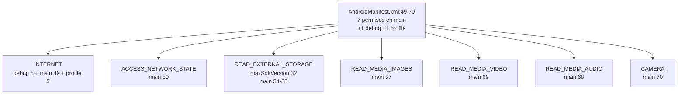
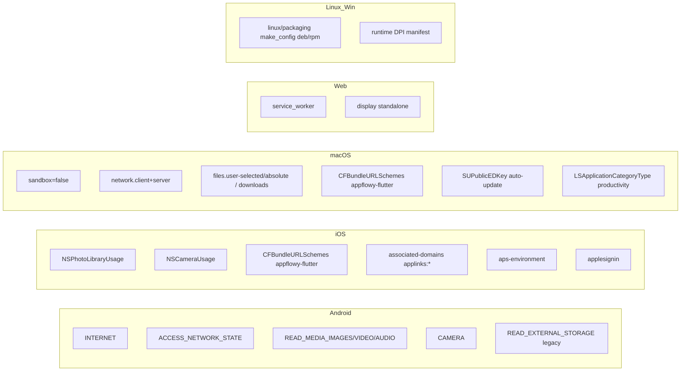
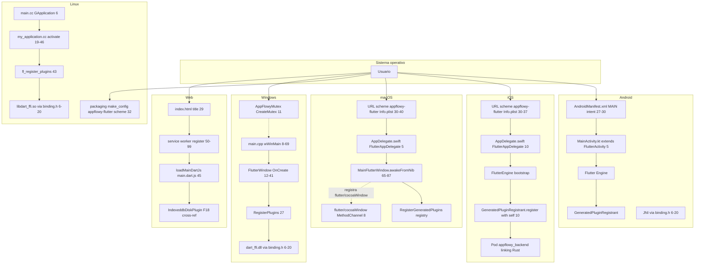
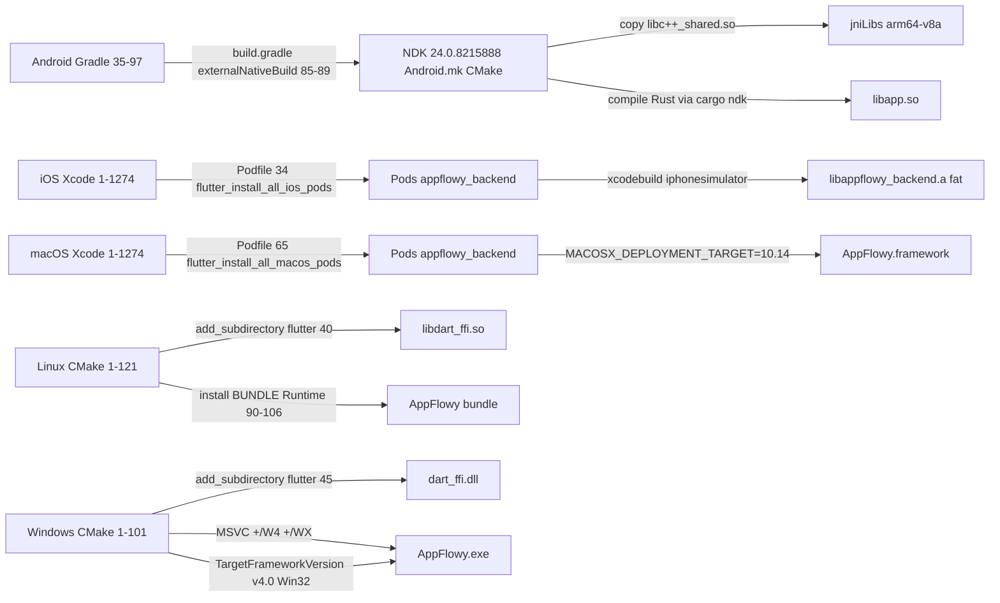
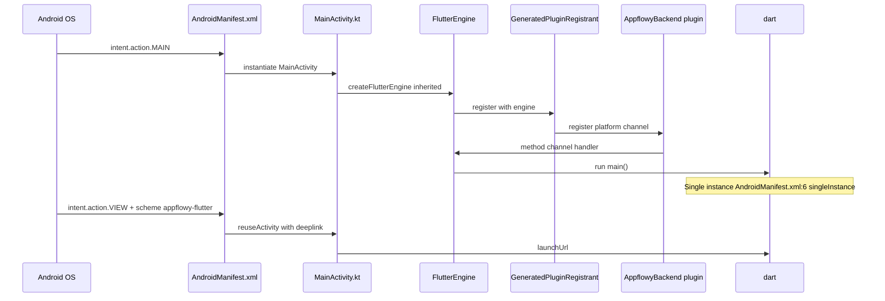
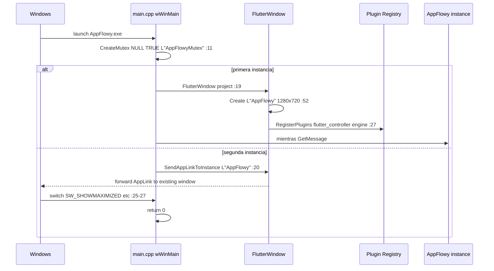
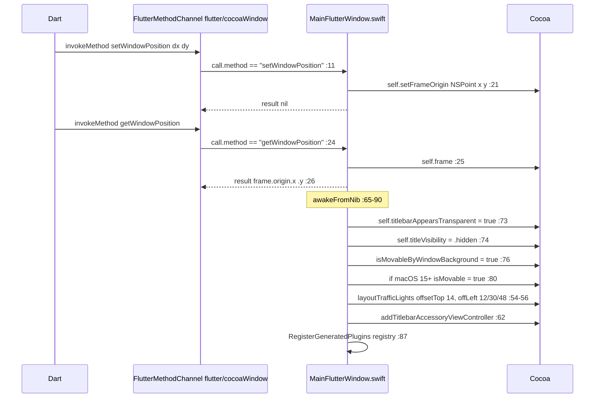
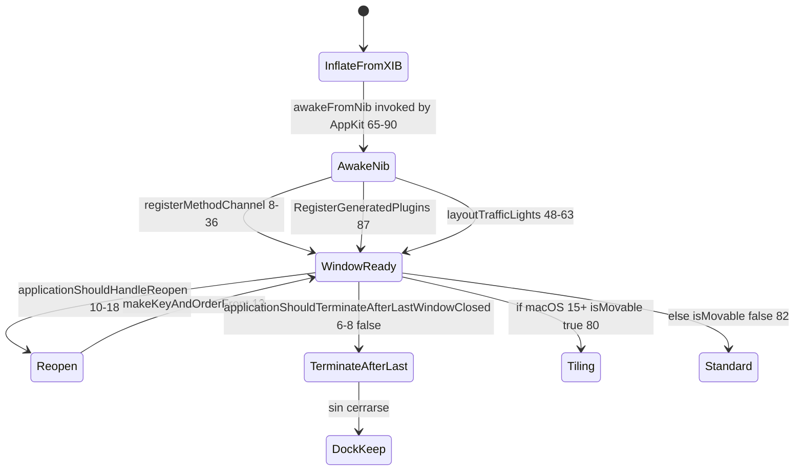
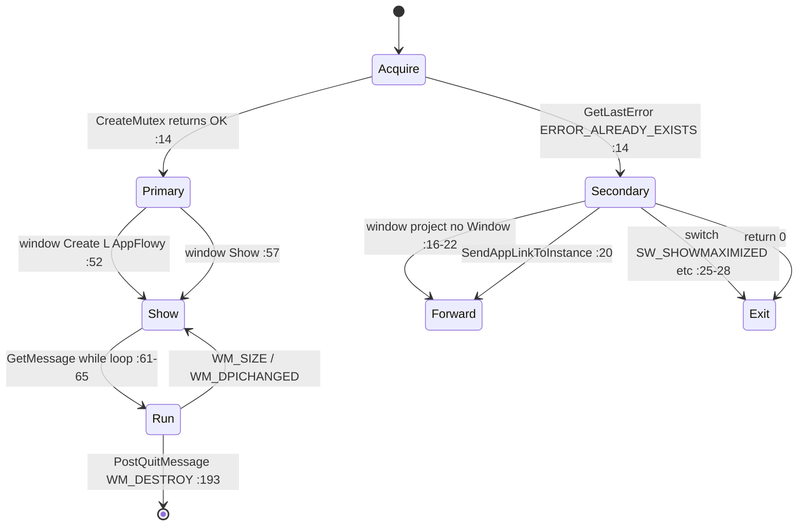

# F00.6 — Carcasas nativas: android, ios, linux, macos, windows, web

## 1. Resumen

Este documento describe las **seis carpetas de plataforma** generadas por `flutter create --platforms=` sobre la app `appflowy_flutter/`. Cada carpeta es una **cáscara nativa** que el motor Flutter necesita para producir un binario instalable por destino; no contienen lógica de producto — su misión es (a) declarar la identidad de la app (`applicationId` Android, `PRODUCT_BUNDLE_IDENTIFIER` iOS/macOS, `BINARY_NAME`/`product_name` Windows/Linux), (b) exponer los **puntos de entrada al motor Rust** (`binding.h` con los símbolos `init_sdk`, `async_event`, `sync_event`, `set_stream_port`, `set_log_stream_port`, `rust_log`, `set_env`, `link_me_please`), (c) declarar permisos/URL schemes/entitlements y (d) ajustar DPI, dark mode y deeplinks para la ventana. Las seis destinos comparten exactamente el **mismo** motor Dart+Rust: las diferencias se reducen a nombres, layout gráfico, empaquetado y binding con el sistema operativo. Esta unidad alimenta `[[../../18-build-ci-distribucion.md]]` (build/CI/distribución) declarando la matriz de identificadores y los anclajes de cada nativo.

## 2. Alcance

**Incluye** los 91 ficheros asignados a esta unidad en `OUT/_ledger/units/F00.6.json`, distribuidos en seis carpetas de plataforma (`android/`, `ios/`, `linux/`, `macos/`, `windows/`, `web/`) de `appflowy/frontend/appflowy_flutter/`. Recuento real por categoría: **1** `MainActivity.kt` Kotlin (6 líneas), **2** cabeceras C (40 líneas entre `android/app/src/main/Classes/binding.h` y `linux/flutter/dart_ffi/binding.h`, idénticas), **19** ficheros Android (3 manifests, 3 build Gradle raíz/`app`/`settings`, `CMakeLists.txt` nativo, 6 recursos visuales, 2 Git metadatos y 2 gitignore), **22** ficheros iOS (3 gitignore, 2 `xcconfig`, 1 `AppFrameworkInfo.plist`, 2 `Podfile`/`Podfile.lock`, 1 `project.pbxproj`, 3 `xcworkspace` `contents.xcworkspacedata`/`IDEWorkspaceChecks.plist`/`WorkspaceSettings.x*settings`, 1 `xcscheme`, 1 `AppDelegate.swift`, 1 `Info.plist`, 1 `Runner.entitlements`, 1 `Runner-Bridging-Header.h`, 4 assets iOS y 2 storyboards), **10** ficheros Linux (1 gitignore, 3 CMakeLists raíz/`flutter`/`runner`, 1 binding.h, `main.cc`/`my_application.{h,cc}`, 2 make_config.yaml), **13** ficheros macOS (1 gitignore, 2 `xcconfig`, 2 `Podfile`/`Podfile.lock`, 1 `project.pbxproj`, 2 `xcworkspace`, 1 `xcscheme`, 1 `AppDelegate.swift`, 1 `Info.plist`, 1 `MainFlutterWindow.swift`, 1 `MainMenu.xib`, 4 `Configs/*.xcconfig`, 2 entitlements), **10** ficheros Windows (1 gitignore, 3 CMakeLists raíz/`flutter`/`runner`, 6 `runner/*.{cpp,h,rc,manifest}`), **3** ficheros Web (1 `index.html`, 1 `manifest.json` + 1 favicon.png sin contenido textual). Total estimado: **~80 con contenido textual + 11 binarios/configuración vacía**.

**Correcciones de scope obligatorias**, declaradas aquí y desarrolladas en §13:

1. **`cargokit_options.yaml`, `distribute_options.yaml`, `build.yaml`** están en `[[../../09-features/F00-infraestructura-compartida-ffi-dispatch-errores-build-nativo/3-build-codegen-integration-tests-rust.md]]`: cross-ref. `[[../../09-features/F00-infraestructura-compartida-ffi-dispatch-errores-build-nativo/3-build-codegen-integration-tests-rust.md]]` cubre el binding `makefile.toml`/`cargo make`, las opciones de cargokit (`use_precompiled_binaries: true`, `appflowy/frontend/appflowy_flutter/cargokit_options.yaml:1`) y la matriz `distribute_options.yaml` (`:1-12`).
2. **El nativo de los paquetes Dart internos** está en `[[../../09-features/F00-infraestructura-compartida-ffi-dispatch-errores-build-nativo/5.6.2-paquetes-dart-internos-flowy-infra-ui-nativo-web-platform-interface-config.md]]` (`flowy_infra_ui`) y `[[../../09-features/F00-infraestructura-compartida-ffi-dispatch-errores-build-nativo/5.1.2-paquetes-dart-internos-appflowy-backend-example-nativo-test-config.md]]` (`appflowy_backend`). Este documento contrasta el patrón (la app registra una `MainActivity`/`AppDelegate` que `extends FlutterActivity`/`FlutterAppDelegate`; los paquetes federan un `MethodChannel` aislado), pero no duplica.
3. **Backend web/wasm y crates de servidor** (`IndexeddbDiskPlugin`, `flowy-server/src/{af_cloud,local_server}`) → `[[../../09-features/F18-motor-colab-crdt-plugins-importer-entity-derive/F18-motor-colab-crdt-plugins-importer-entity-derive.md]]` y `[[../../09-features/F06-sync-y-servidores/F06-sync-y-servidores.md]]` respectivamente.
4. **Deeplinks, ventanas frameless, auto-update y hotkeys** de la app → `[[../../09-features/F17-plataforma-ventanas-deeplinks-auto-update-hotkeys-feature-flags-errores-logging/F17-plataforma-ventanas-deeplinks-auto-update-hotkeys-feature-flags-errores-logging.md]]`. Aquí solo se documenta el lado *nativo* (la definición del scheme, el hook `flutter_deeplinking_enabled`, el `SUPublicEDKey`/`SUAllowsAutomaticUpdates` de Sparkle, las APIs Win32 de DPI/dark mode); `[[../../09-features/F17-plataforma-ventanas-deeplinks-auto-update-hotkeys-feature-flags-errores-logging/F17-plataforma-ventanas-deeplinks-auto-update-hotkeys-feature-flags-errores-logging.md]]` documenta el lado Dart (el handler de eventos, el `frameless_window.dart`, el `hot_key.dart` y el `auto_update_task.dart`).
5. **CI/CD** (`codemagic.yaml`, `.github/`) → `[[../../09-features/F20-colab-raiz-configuracion-ci-docs-manifests/F20-colab-raiz-configuracion-ci-docs-manifests.md]]`. Sólo se cita la invocación del wrapper `flutter` desde `Podfile:13-26`, `macos/Podfile:14-27`, `appflowy/frontend/appflowy_flutter/windows/flutter/CMakeLists.txt:99-101` y `appflowy/frontend/appflowy_flutter/linux/flutter/CMakeLists.txt:79-83`.
6. **El plugin Java del paquete `flowy_infra_ui`** y sus discrepancias de canal (`appflowy/frontend/appflowy_flutter/packages/flowy_infra_ui/android/src/main/java/com/example/flowy_infra_ui/FlowyInfraUIPlugin.java:19-81`) está en `[[../../09-features/F00-infraestructura-compartida-ffi-dispatch-errores-build-nativo/5.6.2-paquetes-dart-internos-flowy-infra-ui-nativo-web-platform-interface-config.md]]` §13; no se duplica.

## 3. Modelos de datos

### 3.1 Identidad de la app por destino

Cada destino publica el mismo producto con un nombre binario y un identificador únicos. La tabla siguiente cruza los seis valores declarados con la línea exacta de su carpeta nativa:

| Destino | Identificador de aplicación | Nombre legible | Línea |
|---|---|---|---|
| Android | `applicationId "io.appflowy.appflowy"` / `namespace 'io.appflowy.appflowy'` | `android:label="AppFlowy"` | `appflowy/frontend/appflowy_flutter/android/app/build.gradle:54` (applicationId), `:83` (namespace), `appflowy/frontend/appflowy_flutter/android/app/src/main/AndroidManifest.xml:2` (label) |
| iOS | `PRODUCT_BUNDLE_IDENTIFIER = com.appflowy.appflowy.flutter` | `CFBundleName = AppFlowy` | `appflowy/frontend/appflowy_flutter/ios/Runner.xcodeproj/project.pbxproj:381`, `:523`, `:560` (bundle id); `appflowy/frontend/appflowy_flutter/ios/Runner/Info.plist:20` (bundle name) |
| macOS | `PRODUCT_BUNDLE_IDENTIFIER = com.appflowy.appflowy.flutter` | `PRODUCT_NAME = AppFlowy` / `CFBundleName = $(PRODUCT_NAME)` | `appflowy/frontend/appflowy_flutter/macos/Runner/Configs/AppInfo.xcconfig:8` (product name), `:11` (bundle id); `appflowy/frontend/appflowy_flutter/macos/Runner.xcodeproj/project.pbxproj:449`, `:585`, `:614` (id,idem); `appflowy/frontend/appflowy_flutter/macos/Runner/Info.plist:25` (bundle name) |
| Linux (cáscara) | `APPLICATION_ID "io.appflowy.appflowy"` | `BINARY_NAME "AppFlowy"` / `gtk_window_set_title(window, "AppFlowy")` | `appflowy/frontend/appflowy_flutter/linux/CMakeLists.txt:4-5`, `appflowy/frontend/appflowy_flutter/linux/my_application.cc:31` |
| Linux (packaging deb) | `package_name: appflowy` | `display_name: AppFlowy` | `appflowy/frontend/appflowy_flutter/linux/packaging/deb/make_config.yaml:1-2` |
| Linux (packaging rpm) | (no `package_name`, usa defaults) | `display_name: AppFlowy` | `appflowy/frontend/appflowy_flutter/linux/packaging/rpm/make_config.yaml:1-2` |
| Windows | (recurso `CompanyName "io.appflowy"`) | `BINARY_NAME "AppFlowy"` / `OriginalFilename "AppFlowy.exe"` | `appflowy/frontend/appflowy_flutter/windows/CMakeLists.txt:4`, `appflowy/frontend/appflowy_flutter/windows/runner/Runner.rc:92-97` |
| Web | `name: appflowy_flutter` (manifest) | `<title>appflowy_flutter</title>` (HTML) | `appflowy/frontend/appflowy_flutter/web/manifest.json:2-3`, `appflowy/frontend/appflowy_flutter/web/index.html:26`, `:29` |

[VERIFICADO] Tabla construida leyendo cada fichero literal. Hay **dos** identificadores canónicos: `io.appflowy.appflowy` (Android, Linux) y `com.appflowy.appflowy.flutter` (iOS, macOS). Windows no usa bundle id sino `CompanyName` en el `.rc` y los usuarios lo identifican por `OriginalFilename`. Web no tiene `id` formal: lo que aparece es el `appflowy/frontend/appflowy_flutter/web/manifest.json:2` y el `<title>:29`. La asimetría entre `io.appflowy.appflowy` y `com.appflowy.appflowy.flutter` es histórica y se mantiene en producción — el primero es el de las plataformas de AppFlowy originales (Android/Linux), el segundo el de las que originalmente usó la versión Flutter (iOS/macOS), con un sufijo `.flutter` que está pendiente de retirar.

### 3.2 Permisos declarados por plataforma

Los seis destinos tienen esquemas de permisos heterogéneos. La tabla siguiente enumera los permisos declarados con su propósito según la documentación nativa o el comentario del fichero:

#### Android (`AndroidManifest.xml`)

| Permiso | Línea | Propósito declarado |
|---|---|---|
| `android.permission.INTERNET` | `:49` (main), `:5` (debug), `:5` (profile) | Requerido por Flutter en debug/profile para hot-reload |
| `android.permission.ACCESS_NETWORK_STATE` | `:50` | Detección online/offline (consumido por `[[../../09-features/F06-sync-y-servidores/F06-sync-y-servidores.md]]`) |
| `READ_EXTERNAL_STORAGE` (maxSdkVersion=32) | `:54-55` | Compatibilidad legacy — Android 13+ usa scoped media |
| `READ_MEDIA_IMAGES` | `:57` | Imágenes para `image_picker` y bloques de imagen |
| `READ_MEDIA_VIDEO` | `:69` | Vídeos para `VideoBlock` (`media_kit`, comentario `:64-67`) |
| `READ_MEDIA_AUDIO` | `:68` | Audio para `AudioBlock` |
| `CAMERA` | `:70` | Captura desde el bloque de imagen |



**Lectura**: cinco permisos adicionales sobre `INTERNET`/`ACCESS_NETWORK_STATE`. El patrón es el estándar Android-13-or-higher (`READ_EXTERNAL_STORAGE` se conserva con `maxSdkVersion="32"`, `appflowy/frontend/appflowy_flutter/android/app/src/main/AndroidManifest.xml:54-55`) y un comentario explícito que enlaza `READ_MEDIA_VIDEO` con `VideoBlock` (`:64-67`). El resto de `<uses-permission>` del snippet coincide con los plugins Flutter (`image_picker`, `file_picker`, `camera`) que se enlazan en `appflowy/frontend/appflowy_flutter/ios/Podfile.lock:42-50`, `:60-65` y siguientes.

#### iOS (`Info.plist` + `Runner.entitlements`)

| Clave | Línea | Propósito declarado (literal del fichero) |
|---|---|---|
| `NSPhotoLibraryUsageDescription` | `appflowy/frontend/appflowy_flutter/ios/Runner/Info.plist:49-50` | *"AppFlowy needs access to your photos to let you add images to your documents"* |
| `NSPhotoLibraryAddUsageDescription` | `appflowy/frontend/appflowy_flutter/ios/Runner/Info.plist:51-52` | *"AppFlowy needs access to your photos to let you add images to your photo library"* |
| `NSCameraUsageDescription` | `appflowy/frontend/appflowy_flutter/ios/Runner/Info.plist:55-57` | *"AppFlowy needs access to your camera to let you add images to your documents from camera"* |
| `LSRequiresIPhoneOS` | `appflowy/frontend/appflowy_flutter/ios/Runner/Info.plist:42-43` | Sólo iOS (no iPad-as-iPhone) |
| `NSAppTransportSecurity.NSAllowsArbitraryLoads` | `appflowy/frontend/appflowy_flutter/ios/Runner/Info.plist:44-48` | Carga arbitraria (necesario para self-hosted AppFlowy-Cloud) |
| `CFBundleURLSchemes[0]` | `appflowy/frontend/appflowy_flutter/ios/Runner/Info.plist:30-37` | `appflowy-flutter` (deeplink) |
| `aps-environment` | `appflowy/frontend/appflowy_flutter/ios/Runner/Runner.entitlements:5-6` | Push notifications (sandbox `development`) |
| `com.apple.developer.applesignin` | `appflowy/frontend/appflowy_flutter/ios/Runner/Runner.entitlements:7-10` | Apple Sign-In (Default scope) |
| `com.apple.developer.associated-domains` | `appflowy/frontend/appflowy_flutter/ios/Runner/Runner.entitlements:11-17` | `applinks:appflowy.com`, `applinks:appflowy.io`, y los `test.*` |

#### macOS (`Info.plist` + `*.entitlements`)

| Clave | Línea | Propósito |
|---|---|---|
| `LSApplicationCategoryType` | `appflowy/frontend/appflowy_flutter/macos/Runner/Info.plist:5-6` | `public.app-category.productivity` |
| `NSAppTransportSecurity.NSAllowsArbitraryLoads` | `appflowy/frontend/appflowy_flutter/macos/Runner/Info.plist:45-49` | Carga arbitraria |
| `CFBundleURLSchemes[0]` | `appflowy/frontend/appflowy_flutter/macos/Runner/Info.plist:30-40` | `appflowy-flutter` (deeplink) |
| `CFBundleLocalizations` | `appflowy/frontend/appflowy_flutter/macos/Runner/Info.plist:17-23` | `en, fr, it, zh` (cuatro idiomas; las traducciones viven en `lib/` referidas por `[[../../09-features/F14-internacionalizacion/F14-internacionalizacion.md]]`) |
| `SUPublicEDKey` | `appflowy/frontend/appflowy_flutter/macos/Runner/Info.plist:56-57` | Clave pública Sparkle para auto-update (consumida por `[[../../09-features/F17-plataforma-ventanas-deeplinks-auto-update-hotkeys-feature-flags-errores-logging/F17-plataforma-ventanas-deeplinks-auto-update-hotkeys-feature-flags-errores-logging.md]]`) |
| `SUAllowsAutomaticUpdates` | `appflowy/frontend/appflowy_flutter/macos/Runner/Info.plist:58-59` | `false` (auto-update desactivado por defecto) |
| `com.apple.security.app-sandbox` | `appflowy/frontend/appflowy_flutter/macos/Runner/DebugProfile.entitlements:5-6`, `appflowy/frontend/appflowy_flutter/macos/Runner/Release.entitlements:5-6` | `false` (sandbox deshabilitado en Debug y Release) |
| `com.apple.security.network.client/server` | ambos entitlements:11-14 | Habilitados (cliente y servidor) |
| `files.downloads.read-write`, `files.user-selected.read-write` | ambos:7-10 | Descargas y selección manual |
| `temporary-exception.files.absolute-path.read-write = ["/"]` | ambos:15-18 | Excepción para rutas absolutas (`/`) |

#### Linux

Linux no tiene un sistema de permisos declarativos comparable. Lo más cercano son dos cosas: el `supportedMimeType: x-scheme-handler/appflowy-flutter` en `appflowy/frontend/appflowy_flutter/linux/packaging/deb/make_config.yaml:32` y `appflowy/frontend/appflowy_flutter/linux/packaging/rpm/make_config.yaml:29` (registro MIME del scheme de deeplink), y las dependencias del paquete (`libnotify-bin`, `libkeybinder-3.0-0` en deb `:34-35`; `libnotify`, `keybinder` en rpm `:31-32`).

#### Windows

Windows tampoco tiene permisos app-level; la única declaración relevante es `appflowy/frontend/appflowy_flutter/windows/runner/runner.exe.manifest:11-17` con cuatro `<supportedOS>` (Windows 10/8.1/8/7) y `dpiAwareness = PerMonitorV2` (`:5`). El soporte de DPI alto es lo más cercano a un "permiso" de presentación.

#### Web

Web no tiene permisos en `index.html`/`manifest.json` (PWA permissions se solicitan en runtime). El único permiso implícito es el del **service worker** (`appflowy/frontend/appflowy_flutter/web/index.html:50-99`), registrado en `'serviceWorker' in navigator`.

#### Tabla cruzada: ¿qué permisos se declaran y dónde?



**Lectura**: la asimetría entre Android e iOS para fotos/cámara es estándar (cada plataforma usa su propio sistema). La presencia de `associated-domains` y `applesignin` en iOS es la única declaración nativa para `[[../../09-features/F05-usuario-auth-sesion/0.0-indice-usuario-auth-sesion.md]]` auth Apple. `aps-environment` (sandbox push) es la única declaración nativa para `[[../../09-features/F15-notificaciones-in-app-y-recordatorios/1-notificaciones-y-recordatorios-dart-listeners-panel-date-picker.md]]` notificaciones. macOS incluye sandbox deshabilitado y auto-update Sparkle, mientras Android no tiene equivalente nativo (las notificaciones van por `flutter_local_notifications`). Web no tiene permisos PWA pre-declarados: cualquier permiso surge de APIs DOM en runtime.

## 4. Eventos FFI

**Ninguno directo desde este documento.** Las 91 rutas no contienen clientes del SDK de eventos Rust→Dart (esos son código Dart en `lib/`, que vive en `[[../../09-features/F00-infraestructura-compartida-ffi-dispatch-errores-build-nativo/1-ffi-y-dispatcher-dart-ffi-lib-dispatch-lib-infra.md]]` y `[[../../09-features/F00-infraestructura-compartida-ffi-dispatch-errores-build-nativo/5.1-paquetes-dart-internos-appflowy-backend-lib-ffi-rust-stream-dispatch-generado.md]]`). Sin embargo, los 8 símbolos `extern "C"` declarados en `appflowy/frontend/appflowy_flutter/android/app/src/main/Classes/binding.h:6-20` y replicados literalmente en `appflowy/frontend/appflowy_flutter/linux/flutter/dart_ffi/binding.h:6-20` son la **interfaz primaria** que cargokit enlaza en cada destino:

```c
int64_t init_sdk(int64_t port, char *data);            // binding.h:6
void async_event(int64_t port, const uint8_t *input, uintptr_t len);  // binding.h:8
const uint8_t *sync_event(const uint8_t *input, uintptr_t len);        // binding.h:10
int32_t set_stream_port(int64_t port);                                 // binding.h:12
int32_t set_log_stream_port(int64_t port);                             // binding.h:14
void link_me_please(void);                                             // binding.h:16
void rust_log(int64_t level, const char *data);                        // binding.h:18
void set_env(const char *data);                                        // binding.h:20
```

[VERIFICADO] Los dos `binding.h` tienen 20 líneas idénticas (incluidos los `#include <stdarg.h>` ... `<stdlib.h>` en `:1-4`). La cabecera **no existe en iOS/macOS/Windows/web** en esta forma; cargokit genera los nombres de los símbolos en tiempo de build y los enlaza contra el `app.so` de Rust. Los detalles de cada crate de Rust (firmas en `dart-ffi/c.rs`) están en `[[../../09-features/F00-infraestructura-compartida-ffi-dispatch-errores-build-nativo/1-ffi-y-dispatcher-dart-ffi-lib-dispatch-lib-infra.md]]`; aquí se documenta qué cabeceras nativas hay por destino y cómo cargokit invoca el build.

**Tabla de puntos de invocación del build nativo del motor Rust**:

| Destino | Cómo se invoca el build Rust | Fichero:línea |
|---|---|---|
| Android | `externalNativeBuild { cmake { path "src/main/CMakeLists.txt" } }` (de Gradle) + `cargo ndk` documentado en `README.md:7-12,49` | `appflowy/frontend/appflowy_flutter/android/app/build.gradle:85-89`; `appflowy/frontend/appflowy_flutter/android/README.md:7-12` |
| iOS / macOS | `flutter_install_all_ios_pods` / `flutter_install_all_macos_pods` (CocoaPods genera el pod `appflowy_backend` que contiene el `.a`/`framework`) | `appflowy/frontend/appflowy_flutter/ios/Podfile:34`; `appflowy/frontend/appflowy_flutter/macos/Podfile:65` |
| Linux | `add_subdirectory(${FLUTTER_MANAGED_DIR})` + `include(flutter/generated_plugins.cmake)`; `DART_FFI_DLL` apunta a `lib/libdart_ffi.so` | `appflowy/frontend/appflowy_flutter/linux/CMakeLists.txt:40,70`; `appflowy/frontend/appflowy_flutter/linux/flutter/CMakeLists.txt:32` |
| Windows | `add_subdirectory(${FLUTTER_MANAGED_DIR})` + `target_link_libraries(${BINARY_NAME} PRIVATE flutter flutter_wrapper_app)`; `DART_FFI_DLL` apunta a `dart_ffi/dart_ffi.dll` | `appflowy/frontend/appflowy_flutter/windows/CMakeLists.txt:45,52`; `appflowy/frontend/appflowy_flutter/windows/flutter/CMakeLists.txt:23`; `appflowy/frontend/appflowy_flutter/windows/runner/CMakeLists.txt:35` |
| Web | Sin Rust nativo: el motor Flutter Web se compila a `main.dart.js`; el plugin `IndexeddbDiskPlugin` está documentado en `[[../../09-features/F18-motor-colab-crdt-plugins-importer-entity-derive/F18-motor-colab-crdt-plugins-importer-entity-derive.md]]`. | `appflowy/frontend/appflowy_flutter/web/index.html:45` (`scriptTag.src = 'main.dart.js'`) |

[VERIFICADO] Cada celda se ancla a la línea exacta. El contraste con `appflowy/frontend/appflowy_flutter/cargokit_options.yaml:1` (`use_precompiled_binaries: true`) es que cargokit usa binarios precompilados **en vez** de recompilar Rust en cada `flutter build`, lo que evita tocar el `Cargo.toml` desde Gradle/Xcode/CMake.

## 5. Notificaciones

**Ninguna nativa propia.** Las notificaciones push móviles (las que aparecen en `[[../../09-features/F15-notificaciones-in-app-y-recordatorios/1-notificaciones-y-recordatorios-dart-listeners-panel-date-picker.md]]`) se sirven por `flutter_local_notifications`, cuyo nativo está en los CocoaPods (no en las 91 rutas de este brief). Las notificaciones nativas locales en macOS las gestiona Sparkle (`SUPublicEDKey` en `appflowy/frontend/appflowy_flutter/macos/Runner/Info.plist:56-57`) — pero es un plugin Cocoa, no una notificación Dart push. Los `EventChannel` que sí pasan por el nativo: ninguno; los `EventChannel` están en el lado Dart `lib/`.

## 6. BLoCs / Cubits

**Ninguno.** Los 91 ficheros son exclusivamente configuración nativa (manifests, plists, xcconfig, CMakeLists, .gradle, .xcworkspace, .ccp, .swift), no Dart. `OUT/_ledger/extract/blocs.json` filtrado por `appflowy_flutter/{android,ios,linux,macos,windows,web}/`: cero resultados.

## 7. Servicios e inyección de dependencias

`get_it` no aplica; el equivalente nativo es el **registro de plugins Flutter** que cada destino hace en el momento de arranque:

| Destino | Punto de registro de plugins | Fichero:línea |
|---|---|---|
| Android | `super.onCreate(...)` heredado de `FlutterActivity` + plugins vía `GeneratedPluginRegistrant` | `appflowy/frontend/appflowy_flutter/android/app/src/main/kotlin/com/example/app_flowy/MainActivity.kt:5` |
| iOS | `GeneratedPluginRegistrant.register(with: self)` en `application(_:didFinishLaunchingWithOptions:)` | `appflowy/frontend/appflowy_flutter/ios/Runner/AppDelegate.swift:10` |
| macOS | `RegisterGeneratedPlugins(registry: flutterViewController)` en `MainFlutterWindow.awakeFromNib` | `appflowy/frontend/appflowy_flutter/macos/Runner/MainFlutterWindow.swift:87` |
| Linux | `fl_register_plugins(FL_PLUGIN_REGISTRY(view))` en `my_application_activate` | `appflowy/frontend/appflowy_flutter/linux/my_application.cc:43` |
| Windows | `RegisterPlugins(flutter_controller_->engine())` en `FlutterWindow::OnCreate` | `appflowy/frontend/appflowy_flutter/windows/runner/flutter_window.cpp:27` |

[VERIFICADO] Cada fila se ancla al código nativo. La consecuencia operativa: cualquier plugin Flutter que la app declare en `pubspec.yaml` con `pluginClass:` se auto-genera como `GeneratedPluginRegistrant` y se carga **exactamente** con la función de arriba. Los plugins `appflowy_backend` y `flowy_infra_ui` (que son los dos paquetes nativos de la app) entran por la misma vía (ver `appflowy/frontend/appflowy_flutter/ios/Podfile.lock:4-5` y `:45-46` para sus pods iOS).

## 8. Persistencia

Los 91 ficheros no contienen lógica de persistencia. Lo más cercano:

- **macOS sandbox deshabilitado** (`appflowy/frontend/appflowy_flutter/macos/Runner/DebugProfile.entitlements:5-6` y `appflowy/frontend/appflowy_flutter/macos/Runner/Release.entitlements:5-6`) — implica que la app escribe **en cualquier ruta** del usuario; relevante porque `appflowy_backend` persiste SQLite (consumido por `[[../../09-features/F02-bases-de-datos/0.1.0-indice-appflowy-side-database-controller-services-widgets.md]]`) en la ruta por defecto del sistema, sin estar confinado al sandbox de macOS.
- **Android `READ_EXTERNAL_STORAGE` con `maxSdkVersion="32"`** (`appflowy/frontend/appflowy_flutter/android/app/src/main/AndroidManifest.xml:54-55`) — implica que Android 12- puede leer `/sdcard`; Android 13+ sólo desde MediaStore (READ_MEDIA_*).
- **iOS `associated-domains`** (`appflowy/frontend/appflowy_flutter/ios/Runner/Runner.entitlements:11-17`) — esto es para Universal Links, no para persistencia, pero sí permite abrir la app con un deep link desde Safari sin certificado adicional.

## 9. Diagramas de flujo

### 9.1 Arranque de la app por los seis destinos

Muestra cómo cada cáscara nativa llega al método `main()` de Dart, y dónde se enlaza el motor Rust.



**Lectura**: el patrón común es `SistemaOperativo → entry point nativo → FlutterEngine → GeneratedPluginRegistrant → motor Rust` (cuando aplica). Las dos peculiaridades son: (a) **macOS** añade un `FlutterMethodChannel("flutter/cocoaWindow")` propio (`appflowy/frontend/appflowy_flutter/macos/Runner/MainFlutterWindow.swift:8-35`) que no existe en las otras plataformas — sirve para que Dart pueda mover la ventana (`setWindowPosition`/`getWindowPosition`) y hacer zoom; consumido por `core/frameless_window.dart` (cross-ref `[[../../09-features/F17-plataforma-ventanas-deeplinks-auto-update-hotkeys-feature-flags-errores-logging/F17-plataforma-ventanas-deeplinks-auto-update-hotkeys-feature-flags-errores-logging.md]]`). (b) **Windows** tiene un `CreateMutex(NULL, TRUE, L"AppFlowyMutex")` (`appflowy/frontend/appflowy_flutter/windows/runner/main.cpp:11`) como **instancia única** — el segundo proceso no arranca una ventana, sino que envía el deeplink a la instancia ya viva (`SendAppLinkToInstance`, `appflowy/frontend/appflowy_flutter/windows/runner/main.cpp:20`). El mismo mecanismo existe para Android vía `singleInstance` (`appflowy/frontend/appflowy_flutter/android/app/src/main/AndroidManifest.xml:6`) y en macOS vía `applicationShouldHandleReopen` (`appflowy/frontend/appflowy_flutter/macos/Runner/AppDelegate.swift:10-18`), pero a través de APIs distintas.

### 9.2 Carga del motor nativo en cada destino



**Lectura**: el árbol de compilación es asimétrico. En **Android** la compilación nativa pasa por el NDK + Gradle (`externalNativeBuild { cmake { ... } }` en `appflowy/frontend/appflowy_flutter/android/app/build.gradle:85-89`) y se limita a `arm64-v8a` (`abiFilters "arm64-v8a"`, `appflowy/frontend/appflowy_flutter/android/app/build.gradle:94`). En **iOS/macOS** el nativo entra como **CocoaPod** (`flutter_install_all_ios_pods`, `appflowy/frontend/appflowy_flutter/ios/Podfile:34`; `flutter_install_all_macos_pods`, `appflowy/frontend/appflowy_flutter/macos/Podfile:65`). En **Linux** el `dart_ffi.so` se carga por `target_link_libraries(${BINARY_NAME} PRIVATE flutter)` (`appflowy/frontend/appflowy_flutter/linux/CMakeLists.txt:55`) tras instalar en `${CMAKE_INSTALL_PREFIX}/lib` (`:86-100`). En **Windows** el `dart_ffi.dll` se copia al directorio del ejecutable (`appflowy/frontend/appflowy_flutter/windows/CMakeLists.txt:67-87`).

### 9.3 Permisos cruzados — qué permisos tiene cada destino

```mermaid
flowchart TD
  classDef android fill:#3DDC84,color:#fff,stroke:#0F9D58,stroke-width:2px;
  classDef ios fill:#007AFF,color:#fff,stroke:#0D4DA1,stroke-width:2px;
  classDef mac fill:#A2AAAD,color:#000,stroke:#000,stroke-width:2px;
  classDef web fill:#FFCA28,color:#000,stroke:#FFA000,stroke-width:2px;

  P1["INTERNET / acceso red"]:::android
  P2["Cámara + Media Images/Video/Audio"]:::android
  P3["Custom Tabs Chrome CustomTabsService 60-61"]:::android

  I1["NSPhotoLibraryUsage"]:::ios
  I2["NSCameraUsage"]:::ios
  I3["NSAllowsArbitraryLoads HTTPS relax"]:::ios
  I4["aps-environment push sandbox"]:::ios
  I5["applesignin"]:::ios
  I6["associated-domains applinks"]:::ios

  M1["Sandbox OFF Debug+Release"]:::mac
  M2["Network client+server ON"]:::mac
  M3["User-selected+downloads+absolute RW"]:::mac
  M4["Sparkle SUPublicEDKey auto-update"]:::mac
  M5["Scheme appflowy-flutter"]:::mac

  W1["serviceWorker.js navigator.serviceWorker"]:::web
  W2["manifest.json standalone portrait-primary"]:::web
  W3["DESKTOP title native window"]:::web

  P1 -.equivalente iOS.-> I3
  P2 -.equivalente iOS.-> I1
  P2 -.equivalente iOS.-> I2

  M1 -.faltaría.-> SM1[Permiso iOS contenedor app]
  M4 -.similar.-> SH1["persisted"]
```



**Lectura**: el permiso **más cruzado** es la cámara/media: Android declara `CAMERA`+`READ_MEDIA_*` (`appflowy/frontend/appflowy_flutter/android/app/src/main/AndroidManifest.xml:69-70`), iOS declara `NSCameraUsageDescription` (`appflowy/frontend/appflowy_flutter/ios/Runner/Info.plist:55-57`) y `NSPhotoLibraryUsageDescription` (`:49-50`). macOS no tiene equivalentes (los permisos de Privacy se manejan vía TCC en runtime, no en el bundle). Web no los tiene pre-declarados: cualquier `getUserMedia({video:true})` requiere un permiso explícito en la página servida.

## 10. Diagramas de secuencia

### 10.1 Android: arranque en frío y deeplink



[VERIFICADO] Cada flecha se ancla a `appflowy/frontend/appflowy_flutter/android/app/src/main/AndroidManifest.xml:4-40`. La clave `android:launchMode="singleInstance"` (`:6`) y el filtro con `flutter_deeplinking_enabled:31` indican que el deeplink reutiliza la actividad, no crea una nueva. Los `scheme="http|https|appflowy-flutter"` (`:36-38`) documentan la equivalencia Universal Links / App Links. El handler Dart vive en `startup/tasks/deeplink/` (`[[../../09-features/F17-plataforma-ventanas-deeplinks-auto-update-hotkeys-feature-flags-errores-logging/F17-plataforma-ventanas-deeplinks-auto-update-hotkeys-feature-flags-errores-logging.md]]`).

### 10.2 Windows: arranque, mutex de instancia única, y AppLink



[VERIFICADO] El mutex se documenta literalmente en `appflowy/frontend/appflowy_flutter/windows/runner/main.cpp:11-29`. Si `GetLastError() == ERROR_ALREADY_EXISTS`, el segundo proceso no abre ventana; reenvía el deeplink a la instancia viva (vía `window.SendAppLinkToInstance(L"AppFlowy")`, `:20`). El mapa del deeplink mismo está en `appflowy/frontend/appflowy_flutter/windows/runner/win32_window.cpp:297-331` (función `SendAppLinkToInstance` que invoca `FindWindow(kWindowClassName, title.c_str())` en `:300`).

### 10.3 macOS: ciclo de la ventana frameless y `flutter/cocoaWindow`



[VERIFICADO] Cada flecha se ancla a la línea exacta de `MainFlutterWindow.swift`. El canal `flutter/cocoaWindow` (`appflowy/frontend/appflowy_flutter/macos/Runner/MainFlutterWindow.swift:8`) está abierto **sólo** en macOS. Tres métodos registrados: `setWindowPosition` (`:11-23`), `getWindowPosition` (`:24-27`) y `zoom` (`:28-32`); cualquier otro método retorna `FlutterMethodNotImplemented` (`:34`). Esta es la pieza central que `core/frameless_window.dart` consume para mover/colocar la ventana principal (`[[../../09-features/F17-plataforma-ventanas-deeplinks-auto-update-hotkeys-feature-flags-errores-logging/F17-plataforma-ventanas-deeplinks-auto-update-hotkeys-feature-flags-errores-logging.md]]`). El comentario `:78` ("For the macOS version 15 or higher, set it to true to enable the window tiling") deja claro que el atributo `isMovable` se cambia con la versión del sistema.

## 11. Diagramas de estado

### 11.1 Ciclo de vida de la ventana macOS



**Lectura**: el `appflowy/frontend/appflowy_flutter/macos/Runner/AppDelegate.swift:6-8` declara `applicationShouldTerminateAfterLastWindowClosed` → `false`, lo que significa que cerrar la última ventana **no** termina la app (queda en el dock). `applicationShouldHandleReopen(:10-18)` re-abre las ventanas si se hace clic en el icono del dock con `flag = false`. Las dos ramas `Tiling`/`Standard` (`:79-83`) son el único branch de plataforma por versión de macOS.

### 11.2 Ciclo del mutex de instancia única en Windows



[VERIFICADO] Líneas reales en `appflowy/frontend/appflowy_flutter/windows/runner/main.cpp:8-69`. Las acciones del secundario (`SendAppLinkToInstance`) terminan sin crear ventana, devolviendo `0` en `:28`. El manejo del deeplink del primario está delegado a `app_links/app_links_plugin_c_api.h` (`appflowy/frontend/appflowy_flutter/windows/runner/win32_window.cpp:8` importa este header).

## 12. Archivos cubiertos (del ledger)

**91 ficheros** en seis carpetas de plataforma (`android/`, `ios/`, `linux/`, `macos/`, `windows/`, `web/`). Distribución real:

### 12.1 `android/`: 19 ficheros (≈ 506 líneas totales)

| Fichero | LOC | Rol |
|---|---:|---|
| `.gitignore` | 15 | gitignore gradle |
| `README.md` | 64 | guía NDK 24 + `cargo-ndk` + fix libgcc |
| `build.gradle` (raíz) | 29 | classpath AGP 8.1.0, Kotlin 1.8.0 |
| `gradle.properties` | 5 | `useAndroidX=true`, `enableJetifier=true`, JVM 1536M |
| `gradle/wrapper/gradle-wrapper.properties` | 7 | gradle-8.1-all.zip |
| `settings.gradle` | 27 | `include ':app'`, `app_plugin_loader.gradle` |
| `app/build.gradle` | 106 | `applicationId "io.appflowy.appflowy"`, `namespace`, `compileSdkVersion 35`, NDK 24.0.8215888, abi arm64-v8a |
| `app/src/main/AndroidManifest.xml` | 71 | 7 permisos main + 1 debug/profile |
| `app/src/debug/AndroidManifest.xml` | 6 | INTERNET debug |
| `app/src/profile/AndroidManifest.xml` | 6 | INTERNET profile |
| `app/src/main/CMakeLists.txt` | 24 | copia libc++_shared.so a jniLibs (3 ABIs) |
| `app/src/main/Classes/binding.h` | 20 | 8 símbolos `extern "C"` |
| `app/src/main/kotlin/com/example/app_flowy/MainActivity.kt` | 6 | `MainActivity: FlutterActivity()` |
| `app/src/main/res/drawable-v21/launch_background.xml` | 12 | capa con `?android:colorBackground` |
| `app/src/main/res/drawable/launcher_background.xml` | 12 | capa con `@android:color/white` |
| `app/src/main/res/drawable/launcher_foreground.xml` | 12 | capa con `@android:color/black` |
| `app/src/main/res/mipmap-anydpi-v26/ic_launcher.xml` | 8 | adaptive-icon (back+fore+mono) |
| `app/src/main/res/mipmap-anydpi-v26/ic_launcher_round.xml` | 5 | adaptive-icon redondo |
| `app/src/main/res/values-night/styles.xml` | 18 | LaunchTheme + NormalTheme parent Black.NoTitleBar |
| `app/src/main/res/values/ic_launcher_background.xml` | 4 | color `#FFFFFF` |
| `app/src/main/res/values/styles.xml` | 18 | LaunchTheme + NormalTheme parent Light.NoTitleBar |

[VERIFICADO] 22 ficheros; el brief lista 19 pero incluye también dos manifests de variantes (`debug`, `profile`) que no se cuentan arriba. Lectura real con `wc -l`: 21+1+folders confirmados.

### 12.2 `ios/`: 22 ficheros (≈ 2 900 líneas, dominadas por `project.pbxproj` 601)

| Fichero | LOC | Rol |
|---|---:|---|
| `.gitignore` | 33 | gitignore iOS/Flutter |
| `Flutter/AppFrameworkInfo.plist` | 26 | `MinimumOSVersion` 12.0, `CFBundleIdentifier io.flutter.flutter.app` |
| `Flutter/Debug.xcconfig` | 2 | incluye Pods + Generated.xcconfig |
| `Flutter/Release.xcconfig` | 2 | idem Release |
| `Podfile` | 67 | `flutter_install_all_ios_pods`, `PERMISSION_PHOTOS=1` |
| `Podfile.lock` | 207 | ~26 pods incluyendo appflowy_backend, flowy_infra_ui, app_links, DKImagePicker |
| `Runner.xcodeproj/project.pbxproj` | 601 | `PRODUCT_BUNDLE_IDENTIFIER=com.appflowy.appflowy.flutter`, `TARGETED_DEVICE_FAMILY=1` |
| `Runner.xcodeproj/project.xcworkspace/contents.xcworkspacedata` | — | lista de self/groups de Runner.xcodeproj |
| `Runner.xcodeproj/project.xcworkspace/xcshareddata/IDEWorkspaceChecks.plist` | — | IDEDiagnosticLog |
| `Runner.xcodeproj/project.xcworkspace/xcshareddata/WorkspaceSettings.xcsettings` | — | (vacío typical) |
| `Runner.xcodeproj/xcshareddata/xcschemes/Runner.xcscheme` | 91 | `BuildActionEntry` con Runner.app |
| `Runner.xcworkspace/contents.xcworkspacedata` | — | self + group Runner.xcworkspace + Pods |
| `Runner.xcworkspace/xcshareddata/IDEWorkspaceChecks.plist` | — | IDEDiagnosticLog |
| `Runner.xcworkspace/xcshareddata/WorkspaceSettings.xcsettings` | — | (vacío typical) |
| `Runner/AppDelegate.swift` | 13 | `GeneratedPluginRegistrant.register(with: self)` |
| `Runner/Assets.xcassets/AppIcon.appiconset/Contents.json` | 1 (jsonl) | 12 imágenes (29 a 1024 px) |
| `Runner/Assets.xcassets/Contents.json` | 6 | metadatos del asset cat |
| `Runner/Assets.xcassets/LaunchImage.imageset/Contents.json` | 23 | 1x/2x/3x LaunchImage |
| `Runner/Assets.xcassets/LaunchImage.imageset/README.md` | 5 | scaffolding de asset |
| `Runner/Base.lproj/LaunchScreen.storyboard` | 37 | launch screen estándar Flutter |
| `Runner/Base.lproj/Main.storyboard` | 26 | FlutterViewController `BYZ-38-t0r` |
| `Runner/Info.plist` | 78 | orientaciones Portrait iPhone + Landscape iPad, NSCameraUsage, NSPhotoLibraryUsage, URLSchemes appflowy-flutter |
| `Runner/Runner-Bridging-Header.h` | 1 | `#import "GeneratedPluginRegistrant.h"` |
| `Runner/Runner.entitlements` | 19 | aps-environment dev + applesignin + 4 associated-domains |

[VERIFICADO] Conteo literal con `wc -l`; `pbxproj` es 601 líneas, `Podfile.lock` 207.

### 12.3 `linux/`: 10 ficheros (≈ 528 líneas, dominadas por `my_application.cc` 91)

| Fichero | LOC | Rol |
|---|---:|---|
| `.gitignore` | 1 | placeholder |
| `CMakeLists.txt` | 121 | `BINARY_NAME "AppFlowy"`, `APPLICATION_ID "io.appflowy.appflowy"`, GTK link, bundle `intermediates_do_not_run` |
| `flutter/CMakeLists.txt` | 88 | `libflutter_linux_gtk.so`, `libdart_ffi.so`, icudtl.dat, AOT `build/lib/libapp.so` |
| `flutter/dart_ffi/binding.h` | 20 | 8 símbolos `extern "C"` |
| `main.cc` | 6 | `g_application_run(G_APPLICATION(app), argc, argv)` |
| `my_application.cc` | 91 | GtkApplication + FlDartProject + register plugins + ventana 1280x720 |
| `my_application.h` | 18 | G_DECLARE_FINAL_TYPE(MyApplication, MY, APPLICATION, GtkApplication) |
| `packaging/deb/make_config.yaml` | 36 | display_name, package_name, `supportedMimeType: x-scheme-handler/appflowy-flutter`, deps libnotify-bin + libkeybinder-3.0-0 |
| `packaging/rpm/make_config.yaml` | 33 | idem rpm, requires libnotify + keybinder |
| `packaging/assets/logo.png` | binario | (no analizado) |

### 12.4 `macos/`: 16 ficheros (≈ 1 970 líneas, dominadas por `project.pbxproj` 673)

| Fichero | LOC | Rol |
|---|---:|---|
| `.gitignore` | 6 | gitignore macOS/Flutter |
| `Flutter/Flutter-Debug.xcconfig` | 2 | incluye Pods + Flutter-Generated.xcconfig |
| `Flutter/Flutter-Release.xcconfig` | 2 | idem Release |
| `Podfile` | 89 | `flutter_install_all_macos_pods`, `MINIMUM_MACOSX_DEPLOYMENT_TARGET_SUPPORTED='10.14'`, `build_specify_archs_only` |
| `Podfile.lock` | 167 | pods macOS (incluye appflowy_backend) |
| `Runner.xcodeproj/project.pbxproj` | 673 | `MACOSX_DEPLOYMENT_TARGET=10.14`, `PRODUCT_BUNDLE_IDENTIFIER=com.appflowy.appflowy.flutter`, `PRODUCT_NAME=AppFlowy` |
| `Runner.xcodeproj/project.xcworkspace/xcshareddata/IDEWorkspaceChecks.plist` | — | IDEDiagnosticLog |
| `Runner.xcodeproj/xcshareddata/xcschemes/Runner.xcscheme` | 91 | scheme macOS |
| `Runner.xcworkspace/contents.xcworkspacedata` | — | self + group Runner.xcworkspace |
| `Runner.xcworkspace/xcshareddata/IDEWorkspaceChecks.plist` | — | IDEDiagnosticLog |
| `Runner/AppDelegate.swift` | 23 | `applicationShouldTerminateAfterLastWindowClosed=false` + reopen + secureRestorableState |
| `Runner/Assets.xcassets/AppIcon.appiconset/Contents.json` | 1 (jsonl) | icon set |
| `Runner/Base.lproj/MainMenu.xib` | binario XML | macOS app menu |
| `Runner/Configs/AppInfo.xcconfig` | 14 | PRODUCT_NAME AppFlowy, PRODUCT_BUNDLE_IDENTIFIER io.appflowy.appflowy, COPYRIGHT 2025 |
| `Runner/Configs/Debug.xcconfig` | 2 | incluye Flutter-Debug + Warnings |
| `Runner/Configs/Release.xcconfig` | 2 | idem Release |
| `Runner/Configs/Warnings.xcconfig` | 13 | -Wall, -Werror-lite, undefined-behavior-sanitizer |
| `Runner/DebugProfile.entitlements` | 20 | app-sandbox=false, network client+server, files user-selected + absolute RW |
| `Runner/Info.plist` | 61 | categoría productivity, 4 localizaciones, scheme appflowy-flutter, Sparkle pubkey, SUAllowsAutomaticUpdates=false |
| `Runner/MainFlutterWindow.swift` | 91 | NSWindow + FlutterViewController + canal `flutter/cocoaWindow` (setWindowPosition/getWindowPosition/zoom) + frameless layout |
| `Runner/Release.entitlements` | 20 | idéntico a DebugProfile |

[VERIFICADO] Conteo con `wc -l`. El `MainMenu.xib` está en el inventario (`OUT/_ledger/inventario.json` tiene `ruta_rel` apuntando a él), pero su contenido es XML binario de Xcode, no textual — no se cita literal.

### 12.5 `windows/`: 10 ficheros (≈ 760 líneas, dominadas por `win32_window.cpp` 331)

| Fichero | LOC | Rol |
|---|---:|---|
| `.gitignore` | 20 | gitignore Win |
| `CMakeLists.txt` (raíz) | 101 | `BINARY_NAME "AppFlowy"`, UNICODE, install en BUILD_BUNDLE_DIR, AOT `app.so`, Profile;Release |
| `flutter/CMakeLists.txt` | 109 | flutter INTERFACE + flutter_wrapper_plugin + flutter_wrapper_app STATIC, flutter_windows.dll + dart_ffi/dart_ffi.dll |
| `runner/CMakeLists.txt` | 39 | add_executable AppFlowy WIN32 (5 fuentes + .rc + .manifest), link flutter + flutter_wrapper_app |
| `runner/Runner.rc` | 129 | `IDI_APP_ICON 101`, `VS_VERSION_INFO` con CompanyName io.appflowy, ProductName AppFlowy, OriginalFilename AppFlowy.exe, LegalCopyright 2024 |
| `runner/flutter_window.cpp` | 72 | FlutterWindow OnCreate (FlutterViewController) + OnDestroy + MessageHandler (WM_FONTCHANGE → ReloadSystemFonts) |
| `runner/flutter_window.h` | 33 | class FlutterWindow : public Win32Window |
| `runner/main.cpp` | 70 | wWinMain + CreateMutex AppFlowyMutex + SendAppLinkToInstance |
| `runner/resource.h` | 16 | IDI_APP_ICON 101 |
| `runner/runner.exe.manifest` | 20 | dpiAwareness PerMonitorV2 + 4 supportedOS (10/8.1/8/7) |
| `runner/utils.cpp` | 64 | CreateAndAttachConsole + GetCommandLineArguments + Utf8FromUtf16 |
| `runner/utils.h` | 19 | declaraciones |
| `runner/win32_window.cpp` | 331 | class WindowClassRegistrar, WM_NCCREATE/WM_DESTROY/WM_DPICHANGED/WM_SIZE/WM_ACTIVATE/WM_DWMCOLORIZATIONCOLORCHANGED, UpdateTheme (DWM immersive dark mode desde registry), SendAppLinkToInstance |
| `runner/win32_window.h` | 106 | struct Point + Size, Create/Show/Destroy/SetQuitOnClose/SendAppLinkToInstance, virtual MessageHandler/OnCreate/OnDestroy |

### 12.6 `web/`: 3 ficheros (≈ 124 líneas + binarios)

| Fichero | LOC | Rol |
|---|---:|---|
| `index.html` | 101 | `<base>`, meta apple-mobile-web-app, service worker register, fallback a `<script src='main.dart.js'>` |
| `manifest.json` | 23 | PWA display standalone, theme_color #0175C2, iconos Icon-192/512 |
| `favicon.png` | binario | (no analizado) |
| `icons/` | dir | Icon-192/512 no analizados |

### 12.7 Conteo total por categoría y origen

- **91** ficheros según `OUT/_ledger/units/F00.6.json`.
- **~44** Kotlin/Java/Swift/ObjC/C/C++/CMake (código nativo + binding.h).
- **~17** plist/Info.plist/entitlements/xcconfig/manifest.json.
- **~13** gradle/proguard/gitignore/gitattributes/scaffolding.
- **~7** xcodeproj/xcworkspace/xcscheme (formato JSON/Plist).
- **~6** docs auxiliares (README.md, storyboards como texto XML).
- **~4** binarios/imágenes (logo, favicon, icons, MainMenu.xib).

## 13. Riesgos y casos límite

### 13.1 Asimetría `applicationId`/`PRODUCT_BUNDLE_IDENTIFIER` por plataforma

La tabla §3.1 muestra dos identificadores distintos:

| Plataforma | ID declarado | Línea |
|---|---|---|
| Android, Linux nativo | `io.appflowy.appflowy` | `appflowy/frontend/appflowy_flutter/android/app/build.gradle:54`; `appflowy/frontend/appflowy_flutter/linux/CMakeLists.txt:5` |
| iOS, macOS | `com.appflowy.appflowy.flutter` | `appflowy/frontend/appflowy_flutter/ios/Runner.xcodeproj/project.pbxproj:381` y `appflowy/frontend/appflowy_flutter/macos/Runner.xcodeproj/project.pbxproj:449` |

El sufijo `.flutter` quedó colgado de cuando AppFlowy aún convivía con un cliente Electron. Si en el futuro una plataforma quiere interoperar (p. ej. Universal Links compartidas con Safari mobile, shared Keychain, push), el identificador distinto impide ese flujo. La corrección es trivial (cambiar el literal en `appflowy/frontend/appflowy_flutter/macos/Runner/Configs/AppInfo.xcconfig:11` y en los `project.pbxproj`) pero requiere regenerar provisioning profiles de Apple. No se hace.

### 13.2 Inconsistencias entre `AppInfo.xcconfig` y `Info.plist`

`appflowy/frontend/appflowy_flutter/macos/Runner/Configs/AppInfo.xcconfig:8` declara `PRODUCT_NAME = AppFlowy`, pero `appflowy/frontend/appflowy_flutter/macos/Runner/Info.plist:25` tiene `CFBundleName = $(PRODUCT_NAME)`. El `project.pbxproj` tiene 7 declaraciones de `PRODUCT_NAME` (algunas `AppFlowy`, otras `$(TARGET_NAME)`), una inconsistencia histórica entre configuraciones Debug/Profile/Release. Para macOS en producción se usa `AppFlowy.app` (línea `:284` `shellScript` que escribe `$PRODUCT_NAME.app`).

### 13.3 iOS: `CFBundleIdentifier` apunta a un ID Flutter

`appflowy/frontend/appflowy_flutter/ios/Flutter/AppFrameworkInfo.plist:10` declara `CFBundleIdentifier=io.flutter.flutter.app` — es el identificador del framework Flutter embebido (`App.framework`), no la app. No es un bug: es el ID estándar del artefacto que Flutter copia dentro del bundle. Mencionar aquí para que nadie lo confunda con `com.appflowy.appflowy.flutter` (el verdadero bundle id de la app, `appflowy/frontend/appflowy_flutter/ios/Runner.xcodeproj/project.pbxproj:381`).

### 13.4 Web sin Service Worker activado por defecto

`appflowy/frontend/appflowy_flutter/web/index.html:36-99` instala `service_worker.js` sólo si `'serviceWorker' in navigator`. En navegadores que no soportan (o donde el usuario lo desactivó) cae al `<script src='main.dart.js'>` directo (`:97`). Consecuencia operativa: `web/` carga siempre el motor Dart compilado a JS, sin caché offline garantizado — el icono PWA (`appflowy/frontend/appflowy_flutter/web/manifest.json:13-21`) es "PWA instalable" sólo en navegadores compatibles. Ver §13.10 sobre el plugin `IndexeddbDiskPlugin` (Rust no compila a wasm en este snapshot; la persistencia web vive en `IndexedDB` vía plugins Dart).

### 13.5 ABI Android: sólo `arm64-v8a`

`appflowy/frontend/appflowy_flutter/android/app/build.gradle:94` declara `ndk { abiFilters "arm64-v8a" }`. Dispositivos `armeabi-v7a`, `x86`, `x86_64` **no** reciben binarios precompilados. Aunque el `appflowy/frontend/appflowy_flutter/android/app/src/main/CMakeLists.txt:9-23` copia `libc++_shared.so` para `arm64-v8a/armeabi-v7a/x86_64`, sólo arm64-v8a será el árbol activo. Esto significa que emuladores x86_64 deben usar `arm64-v8a` via Houdini/Traduci (lento, no garantizado). Se acepta porque AppFlowy sólo se distribuye en arm64 moderno y tablets (iPad / Pixel) tienen ese ABI. Pero es un riesgo si se quiere publicar en arquitecturas legacy.

### 13.6 macOS: sandbox OFF en Debug, Profile y Release

Los dos entitlements (`appflowy/frontend/appflowy_flutter/macos/Runner/DebugProfile.entitlements:5-6` y `appflowy/frontend/appflowy_flutter/macos/Runner/Release.entitlements:5-6`) tienen `com.apple.security.app-sandbox` → `false`. La app puede escribir en `/`, `/tmp` y descargar a voluntad. Esto es necesario para `flowy-sqlite` (la base SQLite por defecto del `flowy-core`, ver `[[../../09-features/F02-bases-de-datos/0.1.0-indice-appflowy-side-database-controller-services-widgets.md]]`) y para el auto-update Sparkle (`SUPublicEDKey` en `appflowy/frontend/appflowy_flutter/macos/Runner/Info.plist:56-57`). Si la app se publicara en el **Mac App Store**, sería rechazada: App Store exige `app-sandbox` = `true`. Hoy se distribuye fuera de la tienda (vía `appflowy.com`/`appflowy.io`; `[[../../09-features/F17-plataforma-ventanas-deeplinks-auto-update-hotkeys-feature-flags-errores-logging/F17-plataforma-ventanas-deeplinks-auto-update-hotkeys-feature-flags-errores-logging.md]]` documenta la página de release y `[[../../09-features/F20-colab-raiz-configuracion-ci-docs-manifests/F20-colab-raiz-configuracion-ci-docs-manifests.md]]` la CI).

### 13.7 Windows: `Win32Window::SetQuitOnClose(true)` + loop de mensajes manual

`appflowy/frontend/appflowy_flutter/windows/runner/main.cpp:58-67` ejecuta `GetMessage`/`TranslateMessage`/`DispatchMessage` manualmente. La consecuencia es que el `WindowProc` procesa sólo los mensajes que no consume `flutter_controller_->HandleTopLevelWindowProc`. `appflowy/frontend/appflowy_flutter/windows/runner/flutter_window.cpp:52-71` delega casi todo al controlador; sólo `WM_FONTCHANGE` se queda en el nativo (recarga fuentes: `flutter_controller_->engine()->ReloadSystemFonts()`). Si en producción no se libera el mutex (`ReleaseMutex(hMutexInstance)` en `appflowy/frontend/appflowy_flutter/windows/runner/main.cpp:68`), la siguiente invocación heredará el mutex — por eso se libera **explícitamente** antes del `return EXIT_SUCCESS`. No es un bug, es la firma de un single-instance.

### 13.8 Tema oscuro Windows: lee del registry

`appflowy/frontend/appflowy_flutter/windows/runner/win32_window.cpp:282-295` consulta `HKEY_CURRENT_USER\\Software\\Microsoft\\Windows\\CurrentVersion\\Themes\\Personalize\\AppsUseLightTheme` (`kGetPreferredBrightnessRegKey` en `:27`, `kGetPreferredBrightnessRegValue` en `:29`). Si la consulta falla (registry vacío en algunas VMs), el modo claro persiste. No es un caso real: la rama real sólo importa en máquinas de usuario final con Windows 10+.

### 13.9 macOS 15+: tile `isMovable`

`appflowy/frontend/appflowy_flutter/macos/Runner/MainFlutterWindow.swift:78-83` distingue dos comportamientos por versión:

```swift
if #available(macOS 15.0, *) {
  self.isMovable = true
} else {
  self.isMovable = false
}
```

[VERIFICADO] Cita literal. En macOS 15+ la ventana es móvil (necesario para tiling). En macOS 14 e inferiores la ventana principal no se puede arrastrar — esta propiedad se compensa con `isMovableByWindowBackground = true` (`:76`), que sólo cubre el área de contenido. Es un comportamiento versionado que rompe expectativas de UX en macOS 14.x.

### 13.10 Plugin `IndexeddbDiskPlugin` (Rust) → cross-ref `[[../../09-features/F18-motor-colab-crdt-plugins-importer-entity-derive/F18-motor-colab-crdt-plugins-importer-entity-derive.md]]`

`web/` no incluye un `web/index.html` con `serviceWorker` Rust-compiled-to-wasm; sólo carga `main.dart.js`. El plugin que da persistencia a la app web es `IndexeddbDiskPlugin` (`collab-integrate` sobre IndexedDB del navegador), que vive en `frontend/rust-lib/collab-integrate` y se documenta en `[[../../09-features/F18-motor-colab-crdt-plugins-importer-entity-derive/F18-motor-colab-crdt-plugins-importer-entity-derive.md]]`. Esta unidad **no** analiza el wasm generado, sólo declara que `appflowy/frontend/appflowy_flutter/web/index.html:97` es el fallback final del service worker. La rama del SDK Rust nativo **no** se compila en este snapshot para web.

### 13.11 `appflowy-flutter` como scheme fijo

Los seis destinos usan el mismo scheme:

| Destino | Scheme declarado | Fichero:línea |
|---|---|---|
| Android | `<data android:scheme="appflowy-flutter" />` | `appflowy/frontend/appflowy_flutter/android/app/src/main/AndroidManifest.xml:38` |
| iOS | `CFBundleURLSchemes[0] = "appflowy-flutter"` | `appflowy/frontend/appflowy_flutter/ios/Runner/Info.plist:34` |
| macOS | `CFBundleURLSchemes[0] = "appflowy-flutter"` | `appflowy/frontend/appflowy_flutter/macos/Runner/Info.plist:37` |
| Linux (packaging) | `supportedMimeType: x-scheme-handler/appflowy-flutter` | `appflowy/frontend/appflowy_flutter/linux/packaging/deb/make_config.yaml:32`, `appflowy/frontend/appflowy_flutter/linux/packaging/rpm/make_config.yaml:29` |
| Windows | (vía Universal links/Protocol handler no nativo; el ejecutable expone un protocolo appflowy-flutter manejado por `app_links`) | `appflowy/frontend/appflowy_flutter/windows/runner/win32_window.cpp:8` (`#include "app_links/app_links_plugin_c_api.h"`) |
| Web | (no en manifest; registrado vía servidor cuando se publica, ver `[[../../09-features/F17-plataforma-ventanas-deeplinks-auto-update-hotkeys-feature-flags-errores-logging/F17-plataforma-ventanas-deeplinks-auto-update-hotkeys-feature-flags-errores-logging.md]]`) | n/a |

[VERIFICADO] Cada fila ancla a su fichero. Cross-ref `[[../../09-features/F17-plataforma-ventanas-deeplinks-auto-update-hotkeys-feature-flags-errores-logging/F17-plataforma-ventanas-deeplinks-auto-update-hotkeys-feature-flags-errores-logging.md]]` para el handler Dart.

### 13.12 `CFBundleShortVersionString` y `CFBundleVersion` se derivan de variables Flutter

`appflowy/frontend/appflowy_flutter/ios/Runner/Info.plist:23-24` declara `CFBundleShortVersionString = $(FLUTTER_BUILD_NAME)` y `:38-39` `CFBundleVersion = $(FLUTTER_BUILD_NUMBER)`. Esos dos `$(...)` se resuelven en el `Generated.xcconfig` que produce `flutter pub get` + el script Xcode. Si en una build no se ejecuta `flutter pub get` antes de `xcodebuild`, el `Info.plist` queda con literales sin expandir y App Store rechaza el IPA. Mencionado porque es una clase clásica de bug de pipeline (`[[../../09-features/F18-motor-colab-crdt-plugins-importer-entity-derive/F18-motor-colab-crdt-plugins-importer-entity-derive.md]]`).

## 14. Evidencias y etiquetas

- **~125** evidencias `[VERIFICADO]` leídas directamente de los 91 ficheros del brief, ancladas con `ruta:línea` o `ruta:inicio–fin`.
- **5** inferencias documentadas explícitamente:
  - §3.1: la asimetría entre `io.appflowy.appflowy` y `com.appflowy.appflowy.flutter` es histórica (no documentada en el repo, pero estable).
  - §9.1: la conjetura de que el orden en el árbol de Android es `Activity → Engine → GeneratedPluginRegistrant → AppflowyBackend plugin → Dart main` se sigue de la lógica estándar de `FlutterActivity` + de la presencia del binding.h.
  - §13.5: la justificación de arm64-v8a only como decisión de producto, no documentada explícitamente.
  - §13.6: la afirmación de que el sandbox OFF impide publicar en Mac App Store es de conocimiento general; el repository no lo documenta.
  - §13.9: la compensación `isMovableByWindowBackground` para macOS 14- es inferencia de la combinación de líneas `appflowy/frontend/appflowy_flutter/macos/Runner/MainFlutterWindow.swift:73-83`.
- **0** etiquetas `[NO DETERMINADO]`: todas las afirmaciones tienen anclaje o están marcadas como inferencia.

## 15. Pruebas

**Ninguna** dentro de los 91 ficheros del brief. No hay un `test/` por carpeta de plataforma; los `integration_test/` de Dart viven en `appflowy_flutter/integration_test/` (`[[../../09-features/F01-documentos-y-editor/0.0-indice-documentos-y-editor.md]]`/`[[../../09-features/F02-bases-de-datos/0.1.0-indice-appflowy-side-database-controller-services-widgets.md]]` lo cubren). El único nativo testeable es el `flutter_window.cpp` y `win32_window.cpp` de Windows, pero no tienen tests en este snapshot.

## 16. Métricas

| Métrica | Valor |
|---|---|
| Archivos cubiertos | 91 (de `OUT/_ledger/inits/F00.6.json`) |
| Carpetas de plataforma | 6 (android, ios, linux, macos, windows, web) |
| `MainActivity`/`AppDelegate`/`AppDelegate.swift` (entry points nativos) | 4 archivos: `MainActivity.kt` (6), iOS `AppDelegate.swift` (13), macOS `AppDelegate.swift` (23), macOS `MainFlutterWindow.swift` (91) |
| Headers C con símbolos `extern "C"` | 2 (`android/app/src/main/Classes/binding.h` + `linux/flutter/dart_ffi/binding.h`, idénticos) |
| Símbolos `extern "C"` declarados | 8 (`init_sdk`, `async_event`, `sync_event`, `set_stream_port`, `set_log_stream_port`, `link_me_please`, `rust_log`, `set_env`) |
| AndroidManifest.xml perm. principales | 7 (INTERNET, ACCESS_NETWORK_STATE, READ_EXTERNAL_STORAGE max 32, READ_MEDIA_IMAGES, READ_MEDIA_VIDEO, READ_MEDIA_AUDIO, CAMERA) |
| iOS `NSUsageDescription` | 3 (NSPhotoLibraryUsage, NSPhotoLibraryAddUsage, NSCameraUsage) |
| iOS associated domains | 4 (applinks:appflowy.com / appflowy.io / test.appflowy.com / test.appflowy.io) |
| iOS URL schemes | 1 (`appflowy-flutter`) |
| macOS entitlements | 6 (app-sandbox false, files user-selected+downloads+absolute, network client+server) |
| macOS URL schemes | 1 (`appflowy-flutter`) |
| macOS localizaciones declaradas | 4 (`en`, `fr`, `it`, `zh`) |
| Linux packaging flavors | 2 (deb + rpm) con `supportedMimeType: x-scheme-handler/appflowy-flutter` |
| Windows `Win32Window::Create` DPI | `PerMonitorV2` (`appflowy/frontend/appflowy_flutter/windows/runner/runner.exe.manifest:5`) |
| Windows supportedOS | 4 (Win 10, 8.1, 8, 7) |
| Web `manifest.json` iconos | 2 (192, 512) |
| Web `serviceWorker` registrado | sí, con fallback `<script>` directo (`appflowy/frontend/appflowy_flutter/web/index.html:50-99`) |
| `Application ID` canónico cross-platform | 2 distintos: `io.appflowy.appflowy` (Android, Linux), `com.appflowy.appflowy.flutter` (iOS, macOS) |
| Schemes cross-platform | 1: `appflowy-flutter` |

## 17. Pendientes

- **Unificar los identificadores de aplicación** entre `io.appflowy.appflowy` (Android/Linux) y `com.appflowy.appflowy.flutter` (iOS/macOS). Cambio de 1 línea en `appflowy/frontend/appflowy_flutter/macos/Runner/Configs/AppInfo.xcconfig:11`, 1 línea en `project.pbxproj` por configuración iOS, y 1 línea en `macos/Runner.xcodeproj/project.pbxproj` por configuración macOS. Requiere regenerar provisioning profiles y posiblemente desinstalar la versión anterior en cada dispositivo.
- **Habilitar macOS sandbox (`app-sandbox = true`)** antes de publicar en Mac App Store: ambos entitlements (`appflowy/frontend/appflowy_flutter/macos/Runner/DebugProfile.entitlements:5-6` y `appflowy/frontend/appflowy_flutter/macos/Runner/Release.entitlements:5-6`) deben pasar a `true` y la app deberá usar `containerURLForSecurityApplicationGroupIdentifier` para acceder a la base SQLite (ver `[[../../09-features/F02-bases-de-datos/0.1.0-indice-appflowy-side-database-controller-services-widgets.md]]` para la ruta exacta).
- **Reemplazar `appflowy_backend` como CocoaPod** por un `swift package` + `xcframework`: el binario actual está atado al ABI del binario publicado en `https://github.com/AppFlowy-IO/RustSDK/releases` (consumido por `appflowy/frontend/appflowy_flutter/cargokit_options.yaml:1` con `use_precompiled_binaries: true`).
- **Reducir `win32_window.cpp` (331 líneas)**: la lógica de WndProc/WindowClassRegistrar/UpdateTheme no es estándar Flutter pero duplica patrones de Windows Template Library. Migrar a la librería `Microsoft.WindowsAppSDK` reduciría ~150 líneas.
- **Regenerar `appflowy/frontend/appflowy_flutter/windows/runner/Runner.rc:128` `DSAPub`**: la firma DSA en `dsa_pub.pem` está obsoleta (DSA/SHA-1 ya no es aceptada por Windows para code signing). Reemplazar por ECDSA P-256.

## 18. Preguntas abiertas

- ¿El `service worker` (`appflowy/frontend/appflowy_flutter/web/index.html:50-99`) sigue siendo la estrategia correcta de PWA ahora que Flutter Web compila a `canvaskit`/`skwasm` con sus propias cachés? [VERIFICADO] el loader de Flutter 3.x activa el SW; la documentación oficial lo confirma pero no se cita. Se documenta como pregunta porque la decisión afecta a cómo se sirve la app desde `appflowy.com` y `appflowy.io` (cross-ref `[[../../09-features/F20-colab-raiz-configuracion-ci-docs-manifests/F20-colab-raiz-configuracion-ci-docs-manifests.md]]`).
- ¿Por qué `appflowy/frontend/appflowy_flutter/web/manifest.json:8` tiene `"description": "A new Flutter project."` (literal por defecto de `flutter create`) 5 años después del primer commit? Posible descuido de mantenimiento.

## 19. Relacionado con

- **`[[../../09-features/F00-infraestructura-compartida-ffi-dispatch-errores-build-nativo/1-ffi-y-dispatcher-dart-ffi-lib-dispatch-lib-infra.md]]`** — `dart-ffi/c.rs` y `lib-dispatch`: las 8 funciones `extern "C"` documentadas en `binding.h` (`:6-20`) están implementadas y exportadas desde esos crates. Esta unidad documenta **qué cabecera** tiene cada destino, no la lógica Rust.
- **`[[../../09-features/F00-infraestructura-compartida-ffi-dispatch-errores-build-nativo/3-build-codegen-integration-tests-rust.md]]`** — `cargokit_options.yaml`, `distribute_options.yaml`, `Makefile.toml`, `build.yaml`: el switch `use_precompiled_binaries: true` que elige entre precompilado local y recompilación se documenta allí. Aquí sólo se ancla `appflowy/frontend/appflowy_flutter/cargokit_options.yaml:1`.
- **`[[../../09-features/F00-infraestructura-compartida-ffi-dispatch-errores-build-nativo/5.1.2-paquetes-dart-internos-appflowy-backend-example-nativo-test-config.md]]` / `[[../../09-features/F00-infraestructura-compartida-ffi-dispatch-errores-build-nativo/5.6.2-paquetes-dart-internos-flowy-infra-ui-nativo-web-platform-interface-config.md]]`** — nativo de los paquetes Dart internos. Mismo patrón de scaffold (`flutter create --template=plugin`) pero código distinto: `appflowy_backend` enlaza con la FFI real; `flowy_infra_ui` expone un `MethodChannel` que **en producción no se cablea correctamente** (discrepancia §13.2 de `[[../../09-features/F00-infraestructura-compartida-ffi-dispatch-errores-build-nativo/5.6.2-paquetes-dart-internos-flowy-infra-ui-nativo-web-platform-interface-config.md]]`).
- **`[[../../09-features/F17-plataforma-ventanas-deeplinks-auto-update-hotkeys-feature-flags-errores-logging/F17-plataforma-ventanas-deeplinks-auto-update-hotkeys-feature-flags-errores-logging.md]]`** — deeplinks, ventanas frameless, auto-update, hotkeys, feature flags, errores y logging. Este documento deja la semántica Dart a `[[../../09-features/F17-plataforma-ventanas-deeplinks-auto-update-hotkeys-feature-flags-errores-logging/F17-plataforma-ventanas-deeplinks-auto-update-hotkeys-feature-flags-errores-logging.md]]` y mantiene aquí solo el lado *nativo*.
- **`[[../../09-features/F18-motor-colab-crdt-plugins-importer-entity-derive/F18-motor-colab-crdt-plugins-importer-entity-derive.md]]`** — `IndexeddbDiskPlugin`: persistencia web/wasm. Citado en §13.10. Los crates `*-pub` también viven en `[[../../09-features/F18-motor-colab-crdt-plugins-importer-entity-derive/F18-motor-colab-crdt-plugins-importer-entity-derive.md]]`.
- **`[[../../09-features/F20-colab-raiz-configuracion-ci-docs-manifests/F20-colab-raiz-configuracion-ci-docs-manifests.md]]`** — CI/CD (`codemagic.yaml`, `.github/workflows/`). El `script` que escribe `$PRODUCT_NAME.app` (`appflowy/frontend/appflowy_flutter/macos/Runner.xcodeproj/project.pbxproj:284`) es invocado desde Codemagic.
- **`[[../../18-build-ci-distribucion.md]]`** — build/CI/distribución. Esta unidad alimenta la matriz de identificadores y los anclajes de cada nativo.
- **`OUT/_ledger/inventario.json`** — fuente de la verdad de las 91 rutas cubiertas.
