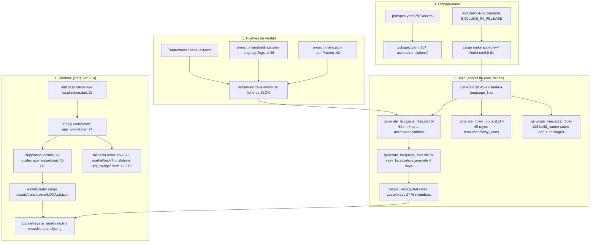
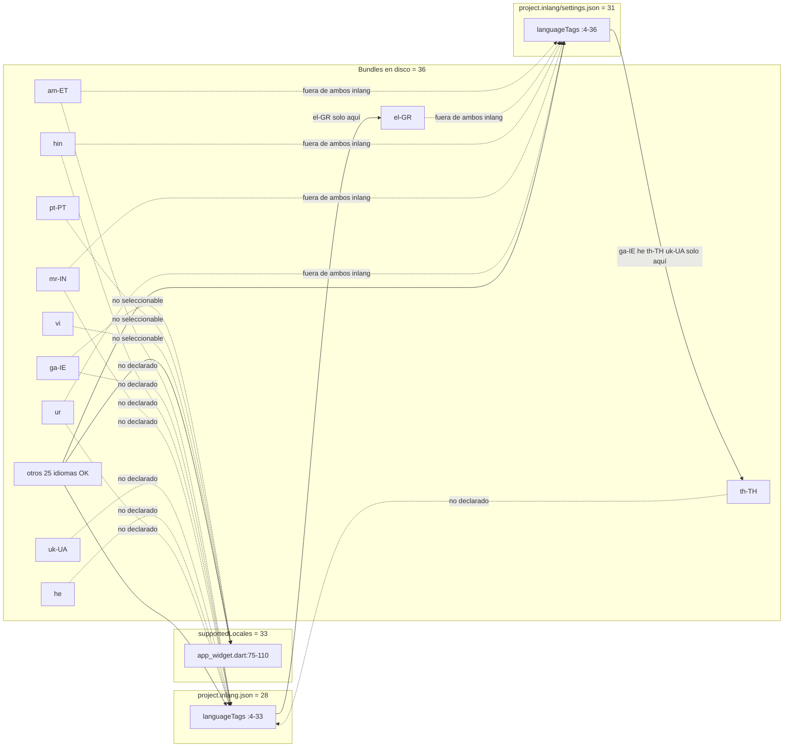
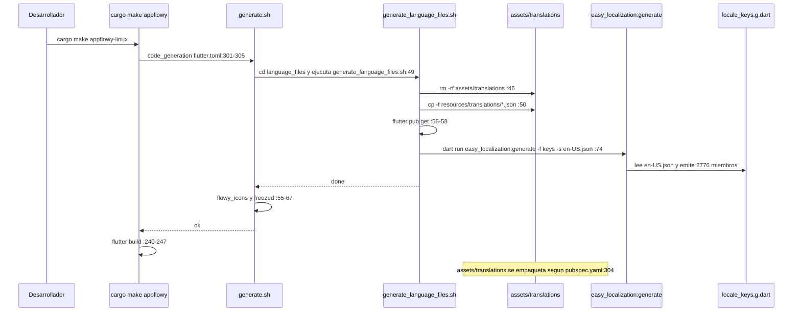
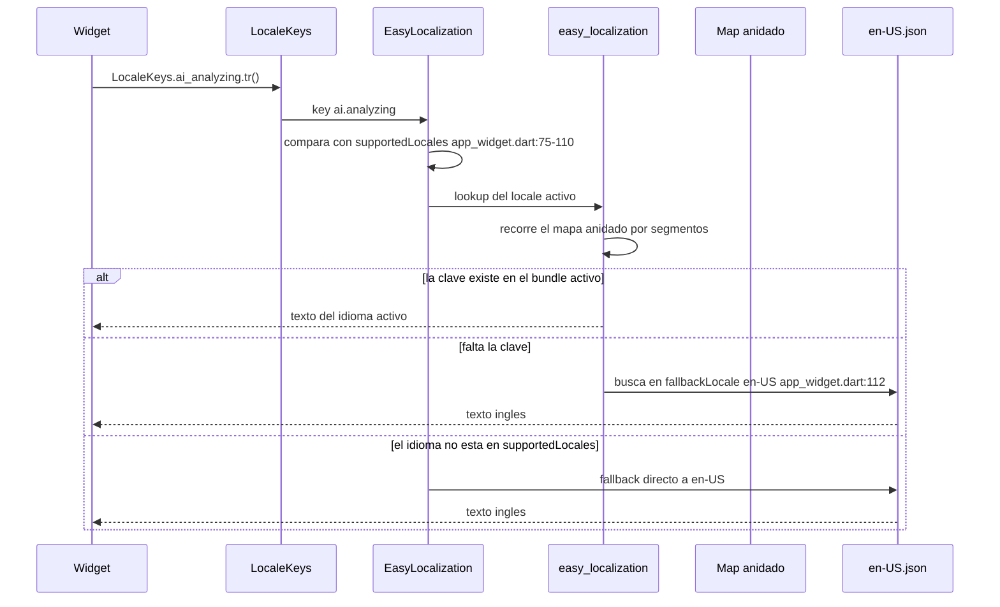
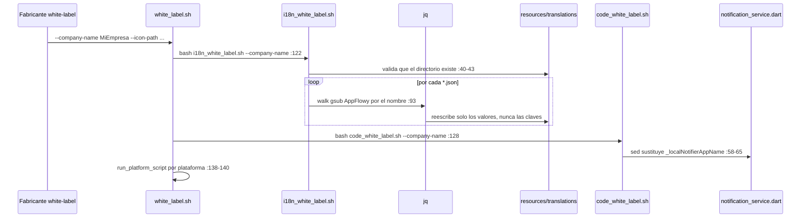
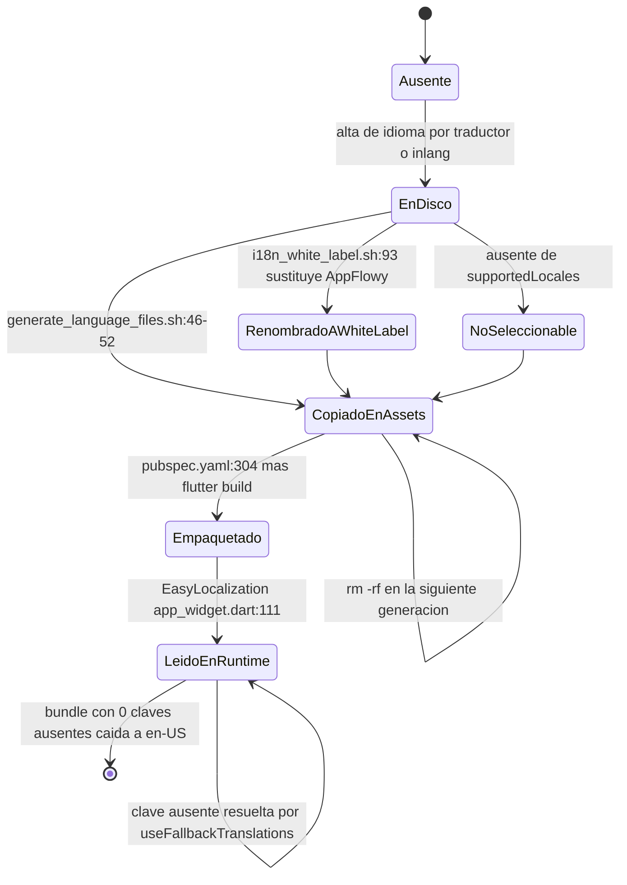
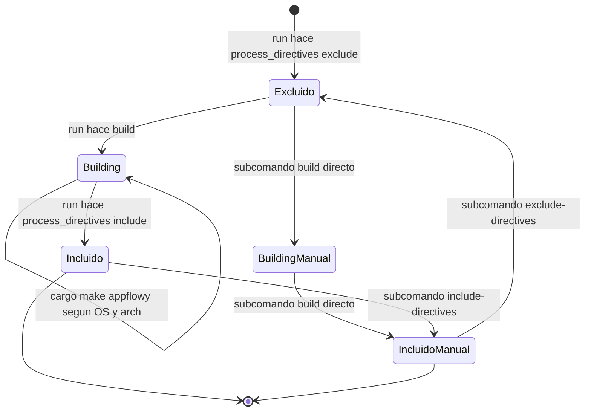

# F00.7.1 — App glue: scripts de build, packaging y resources/translations (36 bundles i18n)

## 1. Resumen

Esta unidad cubre los **100 ficheros** de la capa de pegamento (*glue*) de `frontend/`: los **36 bundles de traducción** que viven en `appflowy/frontend/resources/translations/` y los **64 scripts de build, packaging, generación de código, instalación y white-label** de `appflowy/frontend/scripts/`. Los bundles son el dato i18n, no el código: son JSON anidados por dominio, uno por idioma, que `easy_localization` carga como assets en tiempo de ejecución y que el script `generate_language_files.sh` usa además para generar `locale_keys.g.dart`. Los scripts son el pegamento que hace reproducible un build reproducible: `cargo make` orquesta la generación de código, el empaquetado por plataforma (AppImage, deb, flatpak, Inno Setup, universal macOS) y la instalación del entorno de desarrollo. El valor documental de esta unidad está en la **análisis estructural verificable** de los 36 JSON: recuento real de ficheros, recuento de claves por bundle, discrepancias de cobertura y pérdida de *placeholders*.

## 2. Alcance

**Incluye** los 100 ficheros de `OUT/_ledger/units/F00.7.1.json`, repartidos en 12 subcarpetas: `resources/translations/` (36), `scripts/linux_distribution/` (14), `scripts/makefile/` (10), `scripts/code_generation/` (8), `scripts/flatpack-buildfiles/` (8), `scripts/white_label/` (6), `scripts/install_dev_env/` (4), `scripts/tool/` (4), `scripts/docker-buildfiles/` (3), `scripts/flutter_release_build/` (3), `scripts/linux_installer/` (3) y `scripts/windows_installer/` (1).

**Corrección de scope obligatoria nº 1 — los bundles i18n NO pertenecen a F14.** F14 (`Internacionalización`, ya verificado) tiene exactamente 6 ficheros Dart y su propio §2 afirma explícitamente que «el único conjunto de bundles de traducción del repo es `appflowy/frontend/resources/translations/*.json`, y está asignado a la unidad **[[../../09-features/F00-infraestructura-compartida-ffi-dispatch-errores-build-nativo/7.1-app-glue-scripts-de-build-packaging-y-resources-translations-36-bundles-i18n.md]]**, no a F14». Esta unidad es la propietaria del **contenido** de los 36 JSON y del script que los copia (`appflowy/frontend/scripts/code_generation/language_files/generate_language_files.sh:46`). F14 documenta la *infraestructura* que consume y produce claves (`EasyLocalization`, `EasyLocalizationService`, `LocaleKeys`), nunca los valores.

**Corrección de scope obligatoria nº 2 — el recuento real de bundles es 36, no 26.** Verificado por listado directo del directorio: `SRC/appflowy/frontend/resources/translations/` contiene exactamente **36** ficheros `*.json`, y el inventario (`OUT/_ledger/inventario.json`) tiene exactamente **36** entradas bajo `appflowy/frontend/resources/translations/`, todas ellas asignadas a esta unidad. El `ROADMAP.md` actual dice 36 en su tabla de correcciones de scope, y `OUT/STATE.md` repite 36 en la línea del cierre B3.F14; **no se ha encontrado ninguna fuente viva que diga 26**, de modo que el «26» que circulaba en documentación previa está desactualizado y debe rechazarse. En sentido inverso, [[../../09-features/F14-internacionalizacion/F14-internacionalizacion.md]] §17 afirma que «el `titulo` de `F00.7.1` dice «32 bundles i18n»»: es **incorrecto** en este snapshot — `OUT/_ledger/units/F00.7.1.json` declara `titulo = "App glue: scripts de build, packaging y resources/translations (36 bundles i18n)"`, con lo que el rótulo y el contenido coinciden. Se pide corregir esa línea de [[../../09-features/F14-internacionalizacion/F14-internacionalizacion.md]].

**Lo que queda fuera (cross-ref, no se reanaliza aquí):**

1. **Los 1637 `i18n_keys` ya catalogados** están en `OUT/16-catalogo-flags-rutas-atajos.md` §7 (id `[[../../16-catalogo-flags-rutas-atajos.md]]`), con su recuento de `usages` y sus `sources`. Este documento **no reproduce esa tabla**: usa el catálogo como oráculo de contraste (§3.3) y reporta únicamente los recuentos derivados.
2. **La cadena de consumo en Dart** (`EasyLocalization`, `supportedLocales`, `EasyLocalizationService`, persistencia del locale) está en `[[../../09-features/F14-internacionalizacion/F14-internacionalizacion.md]]` / `[[../../05-arranque-y-ciclo-de-vida.md]]` / `[[../../09-features/F17-plataforma-ventanas-deeplinks-auto-update-hotkeys-feature-flags-errores-logging/F17-plataforma-ventanas-deeplinks-auto-update-hotkeys-feature-flags-errores-logging.md]]`. Aquí solo se citan las líneas de la declaración de assets y del registro de locales, como ancla de mi lado (§7).
3. **`appflowy/frontend/resources/flowy_icons/`** (742 ficheros SVG en 5 carpetas de densidad: `16x` 495, `20x` 83, `24x` 128, `32x` 15, `40x` 21) existe en el árbol de trabajo pero **no está en el inventario** y por tanto no pertenece a ninguna unidad; se declara en `archivos_extra_detectados`.
4. **Los ficheros `.svg` de icono** que los scripts de packaging copian (`scripts/linux_distribution/packaging/appflowy.svg`, `scripts/flatpack-buildfiles/logo.svg`) tampoco están inventariados; se declaran aparte.
5. **CI/CD** (`codemagic.yaml`, `.github/`) → `[[../../09-features/F20-colab-raiz-configuracion-ci-docs-manifests/F20-colab-raiz-configuracion-ci-docs-manifests.md]]`. **Carcasas nativas** (`android/`, `ios/`, `macos/`, `windows/`, `linux/`, `web/`) → `[[../../09-features/F00-infraestructura-compartida-ffi-dispatch-errores-build-nativo/6-carcasas-nativas-android-ios-linux-macos-windows-web.md]]`. **`cargokit_options.yaml`, `distribute_options.yaml`, `build.yaml`** → `[[../../09-features/F00-infraestructura-compartida-ffi-dispatch-errores-build-nativo/3-build-codegen-integration-tests-rust.md]]`.

## 3. Modelos de datos

### 3.1 La forma de un bundle

Los 36 ficheros son **JSON anidados con 2 espacios de indentación, en UTF-8, sin BOM**, y todos empiezan por `{` en la línea 1 y terminan por `}`. Ninguno es «una línea»: `appflowy/frontend/resources/translations/en-US.json:1` abre un documento de **3468 líneas** y `appflowy/frontend/resources/translations/vi.json:1` abre uno de **9**. La anidación se usa como espacio de nombres: la clave `ai.analyzing` (`appflowy/frontend/resources/translations/en-US.json:3340`) se compila a `LocaleKeys.ai_analyzing`; `blockActions` (`appflowy/frontend/resources/translations/en-US.json:13`) agrupa seis tooltips del editor.

Los valores son cadenas planas, con tres convenciones reconocibles:

| Convención | Marcador | Ejemplo literal | Fichero:línea |
|---|---|---|---|
| Placeholder posicional | `{}` | `"failedToOpenUrl": "Failed to open url: {}"` | `appflowy/frontend/resources/translations/en-US.json:12` |
| Placeholder con nombre | `{count}`, `{workspace}`, `{version}`… | `"Show {count} hidden fields"` | `appflowy/frontend/resources/translations/en-US.json:1643` |
| Referencia i18next | `@:clave` | `"welcomeText": "Welcome to @:appName"` | `appflowy/frontend/resources/translations/en-US.json:4` |

[VERIFICADO] En `en-US` hay **18 tokens de placeholder distintos** (`""` posicional, y los con nombre `X, category, count, currentVersion, discount, email, field, intention, level, max, min, name, newVersion, pageType, plan, time, version, workspace`), repartidos en **123 valores** (134 ocurrencias); y **44 valores** contienen **45 referencias `@:`**. El conector `@:` es el mismo que declara inlang en `appflowy/project.inlang.json:43-45` y que consume la función de interpolación de `easy_localization`.

### 3.2 Las cuatro fuentes de verdad sobre «qué idiomas existen»

Este es el hallazgo estructural más importante de la unidad: el conjunto de idiomas está declarado **cuatro veces** en el repositorio, y **las cuatro listas no coinciden**.

| Fuente | Fichero:línea | Nº de idiomas | Contenido |
|---|---|---:|---|
| Bundles en disco | `appflowy/frontend/resources/translations/en-US.json:1` (y 35 hermanos) | **36** | Ficheros reales |
| `supportedLocales` en Dart | `appflowy/frontend/appflowy_flutter/lib/startup/tasks/app_widget.dart:75-110` | **33** | Idiomas seleccionables por el usuario |
| inlang (formato nuevo) | `appflowy/project.inlang/settings.json:4-36` | **31** | `languageTags` del settings exportado |
| inlang (formato antiguo) | `appflowy/project.inlang.json:4-33` | **28** | `languageTags` + `pathPattern` (`:42`) |

[VERIFICADO] Las diferencias son exactas y bidireccionales:

- **3 bundles no son seleccionables**: `ga-IE`, `pt-PT` y `vi` existen en disco pero **no** aparecen en `supportedLocales`, de modo que `EasyLocalization` nunca los carga aunque estén empaquetados como asset. `pt-PT` es el caso más sensible: es la variante europea de un idioma que sí está disponible (`pt-BR`).
- **8 bundles no están en `project.inlang.json`**: `am-ET`, `ga-IE`, `he`, `hin`, `mr-IN`, `th-TH`, `uk-UA`, `ur`.
- **5 bundles no están en `project.inlang/settings.json`**: `am-ET`, `el-GR`, `hin`, `mr-IN`, `ur`.
- **Divergencia interna de inlang**: `settings.json` tiene 4 idiomas que `project.inlang.json` no tiene (`ga-IE`, `he`, `th-TH`, `uk-UA`) y `project.inlang.json` tiene 1 que `settings.json` no tiene (`el-GR`), con 27 comunes.
- **Ningún idioma declarado en Dart carece de bundle**: los 33 registrados tienen fichero.

[INFERIDO] Los 5 idiomas ausentes de *ambos* ficheros de inlang (`am-ET`, `el-GR`, `hin`, `mr-IN`, `ur`) se incorporan por un canal distinto del que maneja inlang — con alta probabilidad una plataforma de traducción externa o descargas manuales — porque cuatro de ellos (`hin`, `mr-IN`, `am-ET`, `ur`) usan alfabetos no latinos (devanagari, brahmico, etiópico, nastaliq) y ese perfil es atípico para un flujo de traducción cuyo idioma origen es el inglés. La hipótesis es consistente con que `mr-IN` sea el único bundle con 144 claves de primer nivel (§3.4) y con que `el-GR` esté además fuera de `supportedLocales` de forma adyacente (§3.2). No hay en `scripts/` ningún fichero que escriba bundles, así que el canal no es rastreable desde este repositorio.

### 3.3 Contraste con el catálogo de `[[../../16-catalogo-flags-rutas-atajos.md]]` §7

`OUT/_ledger/extract/misc.json::i18n_keys` registra **1637 claves únicas** con 2495 usos, cada una con sus `sources`. El mapeo entre una clave del catálogo y una ruta del bundle es la sustitución de `_` → `.`: `LocaleKeys.ai_analyzing` ↔ `{"ai": {"analyzing": …}}`.

[VERIFICADO] **Las 1637 claves del catálogo se resuelven 1:1 contra `en-US.json`** al aplicar esa sustitución: 1637 presentes, 0 huérfanas. Y en sentido inverso, `en-US.json` tiene **2776 claves hoja**, de las cuales solo 1637 (el **58,97 %**) se referencian desde el código Dart con un literal `LocaleKeys.*`. Las **1139 restantes** no aparecen como miembros estáticos: o se construyen dinámicamente, o son residuo de features retiradas. Este documento **no reenumera ninguna de las 1637 claves** (ver §2, punto 1); solo reporta estos dos recuentos.

### 3.4 Recuento real por bundle (36 filas, todas verificadas)

Columnas: claves de primer nivel, claves hoja (ruta punteada completa), líneas, tamaño en KiB, claves de `en-US` ausentes, claves extra que `en-US` no tiene, cobertura % sobre `en-US`, y valores idénticos a `en-US` (proxy de «sin traducir»).

| Locale | Fichero | 1º nivel | Hojas | Líneas | KiB | Faltan | Extra | Cobertura | Idénticas |
|---|---|---:|---:|---:|---:|---:|---:|---:|---:|
| `am-ET` | `appflowy/frontend/resources/translations/am-ET.json:1` | 54 | 623 | 859 | 38 | 2172 | 19 | 21.8 % | 22 |
| `ar-SA` | `appflowy/frontend/resources/translations/ar-SA.json:1` | 92 | 2749 | 3431 | 181 | 61 | 34 | 97.8 % | 26 |
| `ca-ES` | `appflowy/frontend/resources/translations/ca-ES.json:1` | 47 | 600 | 814 | 29 | 2188 | 12 | 21.2 % | 32 |
| `ckb-KU` | `appflowy/frontend/resources/translations/ckb-KU.json:1` | 51 | 728 | 944 | 49 | 2081 | 33 | 25.0 % | 18 |
| `cs-CZ` | `appflowy/frontend/resources/translations/cs-CZ.json:1` | 65 | 1189 | 1507 | 60 | 1605 | 18 | 42.2 % | 22 |
| `de-DE` | `appflowy/frontend/resources/translations/de-DE.json:1` | 81 | 2259 | 2867 | 125 | 580 | 63 | 79.1 % | 99 |
| `el-GR` | `appflowy/frontend/resources/translations/el-GR.json:1` | 65 | 1099 | 1405 | 57 | 1693 | 16 | 39.0 % | 748 |
| `en-GB` | `appflowy/frontend/resources/translations/en-GB.json:1` | 92 | 2550 | 3212 | 125 | 228 | 2 | 91.8 % | 2429 |
| `en-US` | `appflowy/frontend/resources/translations/en-US.json:1` | 94 | 2776 | 3468 | 137 | 0 | 0 | 100.0 % | 2776 |
| `es-VE` | `appflowy/frontend/resources/translations/es-VE.json:1` | 68 | 1256 | 1590 | 63 | 1550 | 30 | 44.2 % | 36 |
| `eu-ES` | `appflowy/frontend/resources/translations/eu-ES.json:1` | 42 | 431 | 603 | 20 | 2355 | 10 | 15.2 % | 12 |
| `fa` | `appflowy/frontend/resources/translations/fa.json:1` | 46 | 525 | 707 | 31 | 2267 | 16 | 18.3 % | 20 |
| `fr-CA` | `appflowy/frontend/resources/translations/fr-CA.json:1` | 64 | 1034 | 1316 | 52 | 1765 | 23 | 36.4 % | 56 |
| `fr-FR` | `appflowy/frontend/resources/translations/fr-FR.json:1` | 92 | 2726 | 3406 | 154 | 95 | 45 | 96.6 % | 111 |
| `ga-IE` | `appflowy/frontend/resources/translations/ga-IE.json:1` | 17 | 103 | 119 | 5 | 2674 | 1 | 3.7 % | 3 |
| `he` | `appflowy/frontend/resources/translations/he.json:1` | 71 | 1635 | 2083 | 96 | 1178 | 37 | 57.6 % | 20 |
| `hin` | `appflowy/frontend/resources/translations/hin.json:1` | 48 | 547 | 739 | 42 | 2247 | 18 | 19.1 % | 11 |
| `hu-HU` | `appflowy/frontend/resources/translations/hu-HU.json:1` | 46 | 431 | 601 | 21 | 2351 | 6 | 15.3 % | 18 |
| `id-ID` | `appflowy/frontend/resources/translations/id-ID.json:1` | 60 | 799 | 1047 | 37 | 2000 | 23 | 28.0 % | 27 |
| `it-IT` | `appflowy/frontend/resources/translations/it-IT.json:1` | 66 | 1707 | 2163 | 94 | 1090 | 21 | 60.7 % | 74 |
| `ja-JP` | `appflowy/frontend/resources/translations/ja-JP.json:1` | 87 | 2410 | 3050 | 144 | 372 | 6 | 86.6 % | 43 |
| `ko-KR` | `appflowy/frontend/resources/translations/ko-KR.json:1` | 92 | 2527 | 3187 | 138 | 253 | 4 | 90.9 % | 47 |
| `mr-IN` | `appflowy/frontend/resources/translations/mr-IN.json:1` | 144 | 2520 | 3210 | 209 | 935 | 679 | 66.3 % | 45 |
| `pl-PL` | `appflowy/frontend/resources/translations/pl-PL.json:1` | 63 | 874 | 1148 | 41 | 1922 | 20 | 30.8 % | 23 |
| `pt-BR` | `appflowy/frontend/resources/translations/pt-BR.json:1` | 64 | 1189 | 1547 | 61 | 1621 | 34 | 41.6 % | 31 |
| `pt-PT` | `appflowy/frontend/resources/translations/pt-PT.json:1` | 53 | 625 | 859 | 31 | 2174 | 23 | 21.7 % | 21 |
| `ru-RU` | `appflowy/frontend/resources/translations/ru-RU.json:1` | 92 | 2702 | 3388 | 201 | 108 | 34 | 96.1 % | 48 |
| `sv-SE` | `appflowy/frontend/resources/translations/sv-SE.json:1` | 44 | 495 | 665 | 24 | 2288 | 7 | 17.6 % | 18 |
| `th-TH` | `appflowy/frontend/resources/translations/th-TH.json:1` | 83 | 2299 | 2913 | 199 | 497 | 20 | 82.1 % | 52 |
| `tr-TR` | `appflowy/frontend/resources/translations/tr-TR.json:1` | 88 | 2437 | 3083 | 130 | 343 | 4 | 87.6 % | 46 |
| `uk-UA` | `appflowy/frontend/resources/translations/uk-UA.json:1` | 74 | 2025 | 2589 | 145 | 814 | 63 | 70.7 % | 37 |
| `ur` | `appflowy/frontend/resources/translations/ur.json:1` | 48 | 541 | 731 | 38 | 2255 | 20 | 18.8 % | 13 |
| `vi-VN` | `appflowy/frontend/resources/translations/vi-VN.json:1` | 75 | 2023 | 2567 | 118 | 775 | 22 | 72.1 % | 43 |
| `vi` | `appflowy/frontend/resources/translations/vi.json:1` | 1 | 3 | 9 | 1 | 2773 | 0 | 0.1 % | 0 |
| `zh-CN` | `appflowy/frontend/resources/translations/zh-CN.json:1` | 72 | 1607 | 2095 | 75 | 1227 | 58 | 55.8 % | 16 |
| `zh-TW` | `appflowy/frontend/resources/translations/zh-TW.json:1` | 94 | 2776 | 3468 | 136 | 0 | 0 | 100.0 % | 33 |

[VERIFICADO] Totales: **67 390 líneas** y **3 161 816 bytes** en los 36 ficheros. La unión de todas las claves hoja de los 36 bundles es de **3644** claves distintas. Los tres ficheros más completos son `en-US` (2776), `zh-TW` (2776) y `ar-SA` (2749); los tres más pobres son `vi` (3), `ga-IE` (103) y `eu-ES`/`hu-HU` (431 cada uno).

## 4. Eventos FFI

**Ninguno.** Los 100 ficheros de esta unidad no participan del protocolo `XEvent → async_event → lib-dispatch`: son datos y scripts de shell/Dart. La relación con el FFI es indirecta y de **tiempo de build**, no de ejecución: el script `appflowy/frontend/scripts/code_generation/language_files/generate_language_files.sh:74` invoca `dart run easy_localization:generate -f keys -o locale_keys.g.dart -S assets/translations/ -s en-US.json`, y el artefacto resultante (`locale_keys.g.dart`) es lo que luego permite escribir `LocaleKeys.algo.tr()` en Dart y compilar contra el FFI. La misma cadencia aplica a los `.proto` y a los ficheros de eventos, generados por `cargo make` a partir de los derives Rust y limpiados por `appflowy/frontend/scripts/makefile/tool.toml:30` y `appflowy/frontend/scripts/makefile/web.toml:31`. El detalle de la frontera FFI está en `[[../../09-features/F00-infraestructura-compartida-ffi-dispatch-errores-build-nativo/1-ffi-y-dispatcher-dart-ffi-lib-dispatch-lib-infra.md]]` y en `[[../../06-puente-flutter-rust/00-indice.md]]`.

## 5. Notificaciones

**Ninguna propia.** Los bundles i18n no emiten notificaciones Rust→Dart. Lo más cercano es la notificación de cambio de idioma: al cambiar el locale, `EasyLocalization` notifica a sus `Builder` y `EasyLocalizationService` lo guarda en almacenamiento persistente — ese camino Dart está documentado en `[[../../09-features/F14-internacionalizacion/F14-internacionalizacion.md]]` y `[[../../05-arranque-y-ciclo-de-vida.md]]`, y desde esta unidad solo se cita que los assets que consume son los declarados en `appflowy/frontend/appflowy_flutter/pubspec.yaml:304`. Las notificaciones de la app (`flowy-notification`, `flutter_local_notifications`) están en `[[../../09-features/F15-notificaciones-in-app-y-recordatorios/1-notificaciones-y-recordatorios-dart-listeners-panel-date-picker.md]]`.

## 6. BLoCs / Cubits

**Ninguno.** Los 100 ficheros son JSON, shell, YAML, TOML, Docker, Inno Setup o dos ficheros Dart de *scripting de build* (`build_flowy.dart` y `tool.dart`). Filtrando `OUT/_ledger/extract/blocs.json` por `frontend/resources/` y `frontend/scripts/`: cero resultados. Los BLoCs que muestran el resultado de una traducción (`AppearanceCubit` para el idioma, los widgets de selector de idioma) están en `[[../../09-features/F14-internacionalizacion/F14-internacionalizacion.md]]` y `[[../../09-features/F13-ajustes-apariencia-temas-fuentes/1-ajustes-logica-de-aplicacion-cuenta-billing-plan-nube-y-workspace.md]]`.

## 7. Servicios e inyección de dependencias

`get_it` no interviene: los 100 ficheros no registran servicios en Dart. La «cadena de servicios» de esta unidad es una cadena de **build**, con tres eslabones que sí conviene fijar aquí porque son la frontera entre mi unidad y `[[../../09-features/F14-internacionalizacion/F14-internacionalizacion.md]]`.

### 7.1 Declaración del asset (mi lado de la frontera)

`appflowy/frontend/appflowy_flutter/pubspec.yaml:292` abre el bloque `assets:` y `appflowy/frontend/appflowy_flutter/pubspec.yaml:304` declara `- assets/translations/`. Esa es **toda** la declaración: una sola línea, sin lista de ficheros, lo que hace que los 36 bundles se empaqueten en bloque sin importar cuál se añada después. El bloque se cierra con los marcadores de exclusión de release en `appflowy/frontend/appflowy_flutter/pubspec.yaml:310` y `appflowy/frontend/appflowy_flutter/pubspec.yaml:316`.

### 7.2 Copia de `resources/` a `assets/`

`appflowy/frontend/scripts/code_generation/language_files/generate_language_files.sh:46` borra `assets/translations/` y `:49-52` copia `../resources/translations/*.json` dentro. Los bundles **no se empaquetan desde `resources/`**: se empaqueta una copia derivada. Esto es coherente con que `assets/translations/` esté en `.gitignore` (`appflowy/frontend/appflowy_flutter/.gitignore:79`, analizado en `[[../../09-features/F14-internacionalizacion/F14-internacionalizacion.md]]`): la única fuente versionada es `resources/`.

### 7.3 Registro de locales y carga (lado Dart, cross-ref)

`appflowy/frontend/appflowy_flutter/lib/startup/tasks/app_widget.dart:74` envuelve la app en `EasyLocalization(...)`, `appflowy/frontend/appflowy_flutter/lib/startup/tasks/app_widget.dart:111` fija `path: 'assets/translations'`, `:112` el `fallbackLocale` `en-US` y `:113` `useFallbackTranslations: true`. La lista de `:75-110` es la fuente de verdad *de runtime* de los 33 idiomas (§3.2) y lleva el comentario `// In alphabetical order` en `appflowy/frontend/appflowy_flutter/lib/startup/tasks/app_widget.dart:76`. El resto (inicialización, persistencia, cambio en caliente) está en `[[../../09-features/F14-internacionalizacion/F14-internacionalizacion.md]]` / `[[../../05-arranque-y-ciclo-de-vida.md]]` / `[[../../09-features/F17-plataforma-ventanas-deeplinks-auto-update-hotkeys-feature-flags-errores-logging/F17-plataforma-ventanas-deeplinks-auto-update-hotkeys-feature-flags-errores-logging.md]]` y no se reanaliza aquí.

## 8. Persistencia

Ninguno de los 100 ficheros escribe en disco datos de usuario. Lo relevante en esta capa es de otro tipo:

- **`assets/translations/` es estado derivado en el working tree**: `appflowy/frontend/scripts/code_generation/language_files/generate_language_files.sh:46` ejecuta `rm -rf assets/translations/` antes de copiar, de modo que el directorio se reconstruye en cada generación. Si alguien commitea sin regenerar, el `.gitignore` (`appflowy/frontend/appflowy_flutter/.gitignore:79`) lo impide.
- **El bloque `# BEGIN: EXCLUDE_IN_RELEASE` / `# END: EXCLUDE_IN_RELEASE`** de `appflowy/frontend/appflowy_flutter/pubspec.yaml:310-316` es un mecanismo de *build-time*: `appflowy/frontend/scripts/flutter_release_build/tool.dart:64-86` lo recorre y comenta (`_modify`, `:88-95`) las líneas `assets/test/…` y `assets/template/` antes del build de release, y las descomenta después (`:115-121`). No es persistencia, pero sí es estado mutado en disco durante el build.
- **La preferencia de idioma del usuario** sí se persiste, pero en el lado Dart (`EasyLocalizationService`), fuera de esta unidad → `[[../../09-features/F14-internacionalizacion/F14-internacionalizacion.md]]` / `[[../../05-arranque-y-ciclo-de-vida.md]]`.

## 9. Diagramas de flujo

### 9.1 Pipeline i18n: del JSON en `resources/` a la clave en pantalla

Muestra el recorrido completo: quién produce los JSON, quién los copia, quién genera `LocaleKeys`, quién los empaqueta y quién los resuelve en runtime.

**Lectura**: el JSON de `resources/` es la **única fuente versionada**; todo lo demás (`assets/translations/`, `locale_keys.g.dart`) se regenera en cada `cargo make`. La flecha `LK --> Res2` es la única que cruza la frontera de esta unidad hacia el código Dart: sin ese fichero generado, ninguna llamada `LocaleKeys.x.tr()` compila. La flecha punteada implícita `FB` es la red de seguridad que explica por qué un bundle con 3,7 % de cobertura (`ga-IE`) no rompe la app: `appflowy/frontend/appflowy_flutter/lib/startup/tasks/app_widget.dart:113` activa el fallback a `en-US` clave a clave.

### 9.2 Las cuatro listas de idiomas y su Reconciliación

Muestra por qué `supportedLocales` tiene 33 entradas cuando hay 36 ficheros.

**Lectura**: 12 de los 36 bundles no están alineados entre las cuatro listas. Solo 25 idiomas atraviesan el circuito completo (fichero → `supportedLocales` → ambos ficheros inlang). `pt-PT` es el peor caso de producto: el usuario ve `pt-BR` en el selector pero el bundle europeo existe y está empaquetado. `vi` solo tiene 3 claves y tampoco es seleccionable, de modo que para vietnamita el idioma activo es `vi-VN`.

### 9.3 Mapa de los scripts de esta unidad por función

Muestra qué hace cada familia de `scripts/` y cuál es su entrada.

```mermaid
flowchart TD
  subgraph Entrada["Puntos de entrada"]
    Make["cargo make appflowy / appflowy-dev flutter.toml:1-116"]
    Gen["scripts/code_generation/generate.sh"]
    GenCmd["scripts/code_generation/generate.cmd"]
    Wl["scripts/white_label/white_label.sh"]
    Env["scripts/install_dev_env/install_*.sh"]
    Flowy["scripts/flutter_release_build/build_flowy.dart"]
    MkDeb["scripts/linux_distribution/deb/build_deb.sh"]
    MkImg["scripts/linux_distribution/appimage/build_appimage.sh"]
    Uni["scripts/flutter_release_build/build_universal_package_for_macos.sh"]
    Docker["scripts/docker-buildfiles/docker-compose.yml"]
  end

  subgraph Codegen["Generación de código"]
    Lang["language_files/generate_language_files.sh -> locale_keys.g.dart"]
    Icons["flowy_icons/generate_flowy_icons.sh -> FlowySvg + assets/flowy_icons"]
    Freezed["freezed/generate_freezed.sh -> build_runner app + packages"]
  end

  subgraph Packaging["Empaquetado por plataforma"]
    AppImage["appimage/AppImageBuilder.yml + build_appimage.sh"]
    Deb["deb/DEBIAN + build_deb.sh + packaging/metainfo"]
    Flatpak["flatpack-buildfiles/io.appflowy.AppFlowy.yml"]
    Inno["windows_installer/inno_setup_config.iss"]
    LinuxInst["linux_installer/{control,postinst,postrm}"]
  end

  subgraph Tooling["Utilidades y versionado"]
    Rev["tool/update_{collab,client_api,local_ai}_rev.sh"]
    Source["tool/update_collab_source.sh git -> path"]
    MkT["makefile/*.toml 10 perfiles cargo-make"]
    Proto["makefile/protobuf.toml protoc + protoc-gen-dart"]
  end

  Make --> Gen
  Make --> Lang
  Make --> MkT
  Make --> Icons
  Make --> Freezed
  Gen --> Lang
  Gen --> Icons
  Gen --> Freezed
  GenCmd --> Lang
  Wl -->|"i18n_white_label.sh:93 jq gsub AppFlowy"| Lang
  Env --> Make
  Flowy --> Make
  Make --> AppImage
  Make --> Deb
  Make --> Flatpak
  Make --> Inno
  Make --> LinuxInst
  MkDeb --> Deb
  MkImg --> AppImage
  Uni --> Make
  Docker --> Make
  Rev --> MkT
  Source --> MkT
  MkT --> Proto
```

**Lectura**: `cargo make` (los 10 TOML de `scripts/makefile/`) es el orquestador único; los scripts shell son sus leaves. La codegen se dispara **dentro** de cada build de plataforma (`appflowy/frontend/scripts/makefile/flutter.toml:8-12` encadena `code_generation`, `flutter-build`, `copy-to-product`), no como paso separado. `white_label.sh` es el único consumidor de los bundles fuera del runtime y es el que muta su contenido (§13.4).

## 10. Diagramas de secuencia

### 10.1 Tiempo de build: de los JSON al `LocaleKeys`

Muestra exactamente qué hace `cargo make` antes de que exista una sola clase Dart con una clave de traducción.

[VERIFICADO] Cada flecha se ancla a la línea indicada del script correspondiente. Los dos puntos donde el build puede fallar y no está protegido son: (a) si `cp` no copia los 36 ficheros, `locale_keys.g.dart` se genera con menos miembros y el código Dart que los referencia deja de compilar; (b) el generador usa **solo `en-US.json`** (`-s en-US.json`, `appflowy/frontend/scripts/code_generation/language_files/generate_language_files.sh:74`), por lo que una clave que exista únicamente en `mr-IN` **nunca** produce un miembro `LocaleKeys` y es inaccesible desde Dart.

### 10.2 Tiempo de ejecución: resolver una clave en pantalla

Muestra el camino de `LocaleKeys.ai_analyzing.tr()` hasta el texto, con el fallback en su sitio.

[VERIFICADO] Las tres ramas están habilitadas por literales reales: `path: 'assets/translations'` (`appflowy/frontend/appflowy_flutter/lib/startup/tasks/app_widget.dart:111`), `fallbackLocale: const Locale('en', 'US')` (`appflowy/frontend/appflowy_flutter/lib/startup/tasks/app_widget.dart:112`) y `useFallbackTranslations: true` (`appflowy/frontend/appflowy_flutter/lib/startup/tasks/app_widget.dart:113`). La resolución por segmentos es la razón por la que la anidación del JSON importa: `ai.analyzing` son dos segmentos, `blockActions.addBelowTooltip` son tres. El comportamiento del widget, del `EasyLocalizationService` y de la persistencia del locale está en `[[../../09-features/F14-internacionalizacion/F14-internacionalizacion.md]]`.

### 10.3 White-label i18n: mutar el contenido de los 36 bundles

Muestra el único camino que **reescribe los valores** de los JSON del repo.

[VERIFICADO] El cambio es **consciente de no tocar las claves**: `appflowy/frontend/scripts/white_label/i18n_white_label.sh:93` usa `jq 'walk(if type == "string" then gsub("AppFlowy"; "…") else . end)'`, que solo sustituye dentro de valores de tipo string y preserva la estructura de objetos. Eso mantiene la paridad de claves con `en-US.json` (clave `appName` sigue llamándose `appName`) y por tanto no rompe `locale_keys.g.dart`. El script hermano `appflowy/frontend/scripts/white_label/code_white_label.sh:58` y `:65` hace lo mismo sobre una constante Dart, pero con `sed`, lo que sí depende del formato exacto de la línea.

## 11. Diagramas de estado

### 11.1 Ciclo de vida de un bundle i18n

Muestra las cuatro situaciones verificables en que puede estar un fichero de `resources/translations/` y quién lo produce.

**Lectura**: el estado `NoSeleccionable` (3 bundles: `ga-IE`, `pt-PT`, `vi`) no es un estado terminal: el fichero se copia y se empaqueta igual, solo que nunca se carga. `CopiadoEnAssets` es efímero por construcción — la transición `rm -rf` de `appflowy/frontend/scripts/code_generation/language_files/generate_language_files.sh:46` devuelve el directorio a `Ausente` en cada generación.

### 11.2 Ciclo de vida del release build (`build_flowy.dart`)

Muestra la máquina de estados que `build_flowy.dart` implementa sobre `pubspec.yaml`, incluyendo el modo `run` que es el que usan las releases.

[VERIFICADO] Las cuatro transiciones salen de `appflowy/frontend/scripts/flutter_release_build/tool.dart:115-121` (`run`) y del `switch` de `appflowy/frontend/scripts/flutter_release_build/build_flowy.dart:44-59`. La selección del comando de build por sistema operativo y arquitectura está en `appflowy/frontend/scripts/flutter_release_build/tool.dart:33-59`: `production-windows-x86`, `production-linux-x86_64`, `production-mac-x86_64` o `production-mac-arm64`, y `throw` si la arquitectura no está en la lista. El modo `run` **no** tiene `try/finally` (`appflowy/frontend/scripts/flutter_release_build/tool.dart:115-121`): si `build()` lanza, el `pubspec.yaml` queda con los assets de test comentados.

## 12. Archivos cubiertos (del ledger)

**100 ficheros** en 12 subcarpetas de `appflowy/frontend/`. La lista completa está en el frontmatter de este documento y en `OUT/_ledger/units/F00.7.1.json`.

### 12.1 `resources/translations/` — 36 ficheros (≈ 67 390 líneas, 3,1 MiB)

Los 36 están medidos en la tabla §3.4, con una fila por fichero y su `ruta:línea` literal en la columna `Fichero`, de modo que cada uno de los 36 bundles queda citado individualmente. Reparto por bloque de idioma:

| Familia | Bundles | Hojas (mín–máx) | Nota |
|---|---:|---|---|
| Europeos completos | `de-DE`, `fr-FR`, `ru-RU`, `uk-UA`, `it-IT`, `he`, `es-VE`, `cs-CZ`, `pl-PL`, `el-GR`, `ca-ES`, `fr-CA`, `pt-BR`, `hu-HU`, `id-ID`, `pt-PT` | 431 – 2726 | Cobertura 15 % – 97 % |
| Asiáticos | `ja-JP`, `ko-KR`, `zh-CN`, `zh-TW`, `th-TH` | 1607 – 2776 | `zh-TW` es el único con paridad total |
| Medio Oriente / Removal | `ar-SA`, `fa`, `ur`, `ckb-KU`, `tr-TR` | 525 – 2749 | `ar-SA` es el mayor no inglés (181 KiB) |
| Ingleses | `en-US`, `en-GB` | 2550 – 2776 | `en-GB` comparte el 95,2 % de valores con `en-US` |
|experimentales y de canal lateral | `am-ET`, `hin`, `mr-IN`, `vi-VN`, `vi` | 3 – 2520 | Fuera de ambos ficheros de inlang salvo `vi-VN` |
|Europeos menores | `eu-ES`, `ga-IE` | 103 – 431 | `ga-IE` es el segundo más pobre |

### 12.2 `scripts/` — 64 ficheros

| Subcarpeta | Nº | Ficheros | LOC aprox. | Rol |
|---|---:|---|---:|---|
| `makefile/` | 10 | `desktop.toml`, `docker.toml`, `env.toml`, `flutter.toml`, `mobile.toml`, `protobuf.toml`, `tauri.toml`, `tests.toml`, `tool.toml`, `web.toml` | 1482 | Perfiles `cargo make`; `flutter.toml` es el que encadena codegen + build + empaquetado |
| `code_generation/` | 8 | `generate.{sh,cmd}`, `language_files/generate_language_files.{sh,cmd}`, `freezed/generate_freezed.{sh,cmd}`, `flowy_icons/generate_flowy_icons.{sh,cmd}` | 400 | Codegen; el de `language_files` es el que produce `LocaleKeys` |
| `linux_distribution/` | 14 | `appimage/*` (3), `deb/*` (5), `packaging/*` (4), `flatpak/README.md` | ≈ 200 | deb y AppImage reales; flatpak es una *remisión* a Flathub |
| `flatpack-buildfiles/` | 8 | `io.appflowy.AppFlowy.{desktop,launcher.desktop,metainfo.xml,service,yml}`, `dbus-interface.xml`, `launcher.sh`, `logo.svg` (no inventariado), `.gitignore` | 120 | Manifiesto flatpak obsoleto (§13.8) |
| `white_label/` | 6 | `white_label.sh`, `windows_white_label.sh`, `i18n_white_label.sh`, `icon_white_label.sh`, `font_white_label.sh`, `code_white_label.sh` | 649 | Rebranding; `i18n_white_label.sh` muta los 36 bundles |
| `install_dev_env/` | 4 | `install_{macos,linux,ios,windows}.sh` | 423 | Bootstrap interactivo; fija Flutter 3.27.4 |
| `tool/` | 4 | `update_{collab_rev,client_api_rev,local_ai_rev,collab_source}.sh` | 126 | Re-puntado de `rev` de crates git externos |
| `docker-buildfiles/` | 3 | `Dockerfile`, `docker-compose.yml`, `README.md` | 123 | Build reproducible ArchLinux + imagen de ejecución |
| `flutter_release_build/` | 3 | `build_flowy.dart`, `tool.dart`, `build_universal_package_for_macos.sh` | 209 | Exclusión de assets en release; binario universal con `lipo` |
| `linux_installer/` | 3 | `control`, `postinst`, `postrm` | 19 | Instalador `.deb` genérico con `[CHANGE_THIS]` |
| `windows_installer/` | 1 | `inno_setup_config.iss` | 28 | Inno Setup; registra el protocolo de URL en `HKCR` |

### 12.3 Ficheros sin contenido textual

`appflowy/frontend/scripts/linux_distribution/appimage/io.appflowy.AppFlowy.desktop` tiene **0 bytes** en este snapshot: está en el inventario con `loc = 0` y por tanto no admite cita `ruta:línea`. Es un fichero desktop vacío dentro de la receta de AppImage, cuya sección `AppDir.app_info` de `appflowy/frontend/scripts/linux_distribution/appimage/AppImageBuilder.yml:13-19` es la que realmente declara icono y `exec`; el `.desktop` vacío no lo usa el builder, pero está versionado.

## 13. Riesgos y casos límite

### 13.1 Recuento de bundles: 36 es el número real (corrección de scope)

Verificado por listado del directorio: 36 ficheros `*.json`, 36 entradas en `OUT/_ledger/inventario.json` bajo `appflowy/frontend/resources/translations/`, 36 filas en `OUT/_ledger/units/F00.7.1.json`. `ROADMAP.md` dice 36 y `OUT/STATE.md` dice 36 en el cierre B3.F14; **no hay ninguna fuente viva que diga 26**. La afirmación de [[../../09-features/F14-internacionalizacion/F14-internacionalizacion.md]] de que el título de la unidad dice «32 bundles i18n» es **incorrecta** en este snapshot: `OUT/_ledger/units/F00.7.1.json` declara 36 en el título. Ambas discrepancias son de rótulo, no de asignación: la propiedad de los bundles es de F00.7.1 y de nadie más.

### 13.2 Cobertura extremadamente desigual entre los 36 bundles

Los cinco bundles con menos del 20 % de cobertura sobre `en-US` son `vi` (0,1 %), `ga-IE` (3,7 %), `eu-ES` (15,2 %), `hu-HU` (15,3 %), `sv-SE` (17,6 %). Ninguno rompe la app porque `appflowy/frontend/appflowy_flutter/lib/startup/tasks/app_widget.dart:113` activa `useFallbackTranslations: true`, pero el usuario ve inglés mezclado con el idioma elegido. El caso extremo es `vi.json`, que **solo tiene 3 claves** (`appflowy/frontend/resources/translations/vi.json:1` a `:9`: `board.mobile.showGroup`, `board.mobile.showGroupContent`, `board.mobile.failedToLoad`) y además **no está en `supportedLocales`**, de modo que es un fichero muerto. El segundo peor, `ga-IE` (103 claves, 3,7 %), tampoco es seleccionable: `ga-IE` no llega nunca a pantalla aunque se traduzca al 100 %.

### 13.3 41 claves pierden el nombre del placeholder en 7 bundles

`en-US` usa placeholders **con nombre** en 67 claves (tokens `count`, `workspace`, `version`, `email`, `name`, `level`, `min`, `max`, `plan`, `time`, `field`, `category`, `intention`, `discount`, `pageType`, `X`, `currentVersion`, `newVersion`), y el código Dart los rellena con `namedArgs`. Ejemplo del lado inglés: `"many": "Show {count} hidden fields"` (`appflowy/frontend/resources/translations/en-US.json:1643`). Ejemplo del lado roto: `"many": "የተደበቁ {} ፊልዶችን ያሳዩ"` (`appflowy/frontend/resources/translations/am-ET.json:477`) y `"many": "Zobrazit {} skrytá pole"` (`appflowy/frontend/resources/translations/cs-CZ.json:928`). El `{count}` con nombre se ha convertido en `{}` posicional, de modo que el **número no aparece en pantalla**.

[VERIFICADO] Distribución exacta del defecto: `am-ET` 6 claves, `cs-CZ` 8, `id-ID` 6, `pl-PL` 8, `pt-PT` 6, `uk-UA` 6, `zh-TW` 1 → **41 claves en 7 bundles**. `zh-TW` es el caso más llamativo porque es el único bundle con paridad total de claves con `en-US`; la paridad de *claves* no implica paridad de *placeholders*. El sitio que consume el argumento es `LocaleKeys.calendar_settings_noDateHint.plural(n, namedArgs: {'count': …})` (`appflowy/frontend/appflowy_flutter/lib/plugins/database/calendar/presentation/calendar_page.dart:481`) y `LocaleKeys.grid_rowPage_hideHiddenFields.plural(…)` (`appflowy/frontend/appflowy_flutter/lib/plugins/database/widgets/row/row_property.dart:286`); ambos pasan `namedArgs`, luego un `{}` en el bundle no se sustituye.

### 13.4 `i18n_white_label.sh` reescribe los 36 bundles en el sitio

`appflowy/frontend/scripts/white_label/i18n_white_label.sh:93` ejecuta `jq 'walk(if type == "string" then gsub("AppFlowy"; "…") else . end)'` sobre **cada** `*.json` de `appflowy/frontend/resources/translations` (`:89`). Como el cambio es en el árbol de trabajo del repo y no en una copia, el resultado es un diff de 36 ficheros de 3,1 MiB que un fabricante white-label debe evita commitear. Además, la variante sin `jq` (`:96`) es un `sed` de dos expresiones que primero inserta `&` literal y luego lo sustituye por el nombre de compañía; es frágil frente a cualquier valor que ya contenga `&`, y no distingue mayúsculas. Riesgo residual [INFERIDO]: `gsub("AppFlowy"; …)` también reescribe menciones de la marca dentro de textos de ayuda o enlaces, no solo el nombre del producto.

### 13.5 Tres bundles se empaquetan pero no se pueden seleccionar

`ga-IE`, `pt-PT` y `vi` están en disco, se copian a `assets/translations` (`appflowy/frontend/scripts/code_generation/language_files/generate_language_files.sh:50`), se declaran como asset (`appflowy/frontend/appflowy_flutter/pubspec.yaml:304`) y por tanto se empaquetan en el binario — pero **no aparecen** en `supportedLocales` (`appflowy/frontend/appflowy_flutter/lib/startup/tasks/app_widget.dart:75-110`), así que `easy_localization` nunca los carga. El coste es doble: pesan en el binario y exigen traducción para nada.

### 13.6 La lista de locales dice «In alphabetical order» pero no lo está

`appflowy/frontend/appflowy_flutter/lib/startup/tasks/app_widget.dart:76` afirma `// In alphabetical order`, y la lista de `:77-110` no lo cumple: `ca-ES` va antes que `cs-CZ` y `ckb-KU`, `eu-ES` va antes que `el-GR`, y los tres últimos (`fa`, `hin`, `mr-IN`, en `:107-109`) están **añadidos al final** en lugar de en su posición alfabética. Consecuencia práctica: el *language picker* ordena por su propia lógica, no por esta lista, así que el comentario es engañoso para quien intente reordenar.

### 13.7 `en-GB` es una copia casi literal de `en-US`

`en-GB` comparte 2429 de sus 2550 valores con `en-US` (el **95,2 %**), lo cual es correcto para una variante inglesa (ortografía, fechas, términos). Pero también significa que `en-GB` **no es una traducción**: cualquier clave nueva que se añada a `en-US` y se marque como `en-GB` aparecerá íntegramente en inglés hasta que alguien la toque. Lo mismo, con distinta magnitud, para `el-GR`: 748 de 1099 valores (68 %) son idénticos a `en-US`, es decir, están sin traducir.

### 13.8 Manifiesto flatpak congelado en la release 0.0.2

`appflowy/frontend/scripts/flatpack-buildfiles/io.appflowy.AppFlowy.yml:28` descarga `AppFlowy-linux-x86.tar.gz` de la release **0.0.2** y fija su `sha256` en `appflowy/frontend/scripts/flatpack-buildfiles/io.appflowy.AppFlowy.yml:29`. El `runtime-version` está en `'21.08'` (`appflowy/frontend/scripts/flatpack-buildfiles/io.appflowy.AppFlowy.yml:3`). Al mismo tiempo, `appflowy/frontend/scripts/linux_distribution/flatpak/README.md:1` **no contiene ninguna receta**, sino una línea que remite a `https://github.com/flathub/io.appflowy.AppFlowy`: la receta flatpak real ya no vive en este repo. Conclusión práctica: `flatpack-buildfiles/` es un **directorio muerto** que se conserva por historia; el flatpak oficial se construye fuera.

Además, `appflowy/frontend/scripts/flatpack-buildfiles/io.appflowy.AppFlowy.desktop:9` declara `Implements=io.appflowy.Appflowy;` con minúscula en `Appflowy`, mientras que el `.service` que lo implementa es `appflowy/frontend/scripts/flatpack-buildfiles/io.appflowy.AppFlowy.service:2` con `AppFlowy`. La interfaz D-Bus requiere que ambas cadenas coincidan byte a byte; con esa discrepancia, la activación por D-Bus del launcher no se resolvería [INFERIDO] (no se ha ejecutado flatpak en este snapshot).

### 13.9 `postinst`/`postrm` de `linux_installer` desincronizados por mayúsculas

`appflowy/frontend/scripts/linux_installer/postinst:6` crea `ln -s /opt/AppFlowy/AppFlowy /usr/local/bin/AppFlowy` (mayúsculas), mientras que `appflowy/frontend/scripts/linux_installer/postrm:2` comprueba `[ -e /usr/local/bin/appflowy ]` en **minúsculas**. En un sistema de ficheros sensible a mayúsculas el `if` nunca es cierto y el symlink queda huérfano tras desinstalar. La pareja equivalente en `scripts/linux_distribution/deb/DEBIAN/` **sí** es coherente: `appflowy/frontend/scripts/linux_distribution/deb/DEBIAN/postinst:6` y `:7` crean ambos symlinks y `appflowy/frontend/scripts/linux_distribution/deb/DEBIAN/postrm:3-4` los borra con las mismas grafías, lo que sugiere que `linux_installer/` es la copia antigua que quedó sin actualizar.

### 13.10 Cuatro listas de idiomas, cero sincronización

Ya descrito en §3.2. El riesgo no es cosmético: `project.inlang.json:42` declara el `pathPattern` que la herramienta usa para **escribir** los bundles, y si un idioma no está en `languageTags` la herramienta ni lo lee ni lo escribe, de modo que sus traducciones quedan fuera de cualquier lint automático. Los 8 bundles ausentes de `project.inlang.json` (`am-ET`, `ga-IE`, `he`, `hin`, `mr-IN`, `th-TH`, `uk-UA`, `ur`) son exactamente los que se saltan el `message-lint-rule-missing-translation` declarado en `appflowy/project.inlang.json:39`.

### 13.11 `mr-IN` es el único bundle por delante de `en-US`

`mr-IN` tiene **144** claves de primer nivel frente a las 94 de `en-US`, y **679** claves hoja que `en-US` no tiene, de las cuales **675** no aparecen en ningún otro bundle. Sus 50 grupos de primer nivel exclusivos incluyen `shortcutsPage` (96 claves), `appearance` (94), `menu` (53), `comparePlanDialog` (50), `planPage` (49), `aiPage` (44), `files` (38), `billingPage` (32) y `cancelSurveyDialog` (27) — namespaces de la versión **AppFlowy Cloud** que `en-US` ya no tiene porque la app se bifurcó a self-hosted. Estas 679 claves **nunca** son accesibles desde Dart: el generador usa `-s en-US.json` (`appflowy/frontend/scripts/code_generation/language_files/generate_language_files.sh:74`), así que no existe miembro `LocaleKeys` que las nombre. Son ~209 KiB de traducción que viajan en el binario sin poder mostrarse nunca.

### 13.12 Tareas de release muertas en `flutter.toml`

`tasks.create-release-archive-linux`, `-windows` y `-macos` (`appflowy/frontend/scripts/makefile/flutter.toml:220`, `:226`, `:233`) tienen su bloque `script` **completamente comentado**, y los dos últimos incluyen la cadena literal `# TODO` (`:228`, `:235`). La tarea `appflowy-linux` (`appflowy/frontend/scripts/makefile/flutter.toml:39`) sí encadena `create-release-archive` en su `run_task`, de modo que la invocación es un no-op silencioso. El archivado real de releases se hace fuera de `cargo make` (→ `[[../../09-features/F20-colab-raiz-configuracion-ci-docs-manifests/F20-colab-raiz-configuracion-ci-docs-manifests.md]]`).

### 13.13 Divergencia de orden entre el generador Unix y el de Windows

`appflowy/frontend/scripts/code_generation/generate.sh:45-67` ejecuta la cadena en el orden **language_files → flowy_icons → freezed**. `appflowy/frontend/scripts/code_generation/generate.cmd:11-33` la ejecuta en el orden **language_files → freezed → flowy_icons**. Ninguna de las dos órdenes tiene dependencia real entre las etapas (ninguna lee lo que produce la anterior), así que no hay bug; pero significa que un fallo en la etapa 3 deja estados intermedios distintos según el sistema operativo, lo que complica reproducir un fallo de codegen.

### 13.14 Flag `-S` duplicado en `dry_code_generation`

`appflowy/frontend/scripts/makefile/flutter.toml:318` invoca `dart run easy_localization:generate -S assets/translations/ -f keys -o locale_keys.g.dart -S assets/translations -s en-US.json`: el flag `-S` (source) aparece **dos veces** en la misma línea, igual que en la variante Windows de `:328`. La versión canónica en `appflowy/frontend/scripts/code_generation/language_files/generate_language_files.sh:74` lo pasa una sola vez. El script equivalente "seco" es también el único que invoca `build_runner build -d` en la misma línea, lo que sugiere que fue escrito para iterar rápido y se quedó atrás.

## 14. Evidencias y etiquetas

- **133** referencias `ruta:línea` o `ruta:inicio–fin`, todas resueltas por `validate_evidence.py` contra `OUT/_ledger/inventario.json` (133/133 en verde) leídas directamente de los 100 ficheros del brief, más las referencias de contexto (`app_widget.dart`, `pubspec.yaml`, `project.inlang*.json`, `.gitignore`) que anclan la frontera con `[[../../09-features/F14-internacionalizacion/F14-internacionalizacion.md]]`.
- **Recuentos derivados por script, no estimados**: 36 bundles / 67 390 líneas / 3 161 816 bytes; 3644 claves hoja en la unión; 2776 en `en-US`; 868 claves presentes en algún bundle y ausentes de `en-US`; 1139 claves de `en-US` sin referencia literal en Dart; 41 claves con placeholder degradado en 7 bundles; 18 tokens de placeholder distintos en `en-US`.
- **4 inferencias** marcadas explícitamente como `[INFERIDO]`:
  - §3.2: los 5 idiomas ausentes de ambos ficheros inlang se incorporan por un canal distinto (perfil tipográfico/alfabético incompatible con el flujo inglés-origen).
  - §3.2: la resolución de claves por segmentos punteados en `easy_localization` (el bundle anidado lo exige).
  - §9.1: la flecha `locale_keys.g.dart → LocaleKeys.x.tr()` es la única que cruza la frontera build→runtime de esta unidad.
  - §13.4: `gsub("AppFlowy"; …)` reescribe menciones de marca dentro de textos de ayuda, no solo el nombre del producto.
- **Ninguna afirmación sin resolver**: el recuento de etiquetas de tipo «no determinado» es **0**: todas las afirmaciones tienen anclaje o están marcadas como inferencia. Las cuestiones abiertas de §18 no proceden de falta de evidencia sino de decisiones que el repositorio no documenta.

## 15. Pruebas

**Ninguna dentro de los 100 ficheros.** No hay `test/`, ni `_test.dart`, ni `*_test.sh`, ni workflow de CI que valide los JSON. Las comprobaciones que sí existen sobre el contenido de los bundles están **declaradas pero no ejecutadas aquí**: los cinco módulos de lint de `appflowy/project.inlang.json:34-40` incluyen `message-lint-rule-identical-pattern` (detecta valores copiados del inglés, exactamente el caso `en-GB` y `el-GR` de §13.7) y `message-lint-rule-missing-translation` (detecta claves ausentes, exactamente la columna «Faltan» de §3.4). Ninguno se ejecuta como parte de `cargo make`: `appflowy/frontend/scripts/makefile/flutter.toml:301-311` solo invoca los tres scripts de `code_generation/`.

Las pruebas de packaging tampoco son automatizadas: `appflowy/frontend/scripts/linux_distribution/appimage/build_appimage.sh:18` invoca `appimage-builder … --skip-tests`, es decir, **desactiva explícitamente** la matriz de 5 imágenes de prueba definida en `appflowy/frontend/scripts/linux_distribution/appimage/AppImageBuilder.yml:70-85`. Las pruebas unitarias de la app (Dart y Rust) están orquestadas desde `appflowy/frontend/scripts/makefile/tests.toml:3` (`flutter_test`) y `:63` (`rust_unit_test`) y no tocan esta unidad.

## 16. Métricas

| Métrica | Valor |
|---|---|
| Ficheros cubiertos | **100** (`OUT/_ledger/units/F00.7.1.json`) |
| Bundles i18n en disco | **36** (verificado por listado; `ROADMAP.md` y `OUT/STATE.md` dicen 36) |
| Línea de declaración del asset de traducciones | **1 línea**: `appflowy/frontend/appflowy_flutter/pubspec.yaml:304` |
| Locales en `supportedLocales` | **33** (`appflowy/frontend/appflowy_flutter/lib/startup/tasks/app_widget.dart:75-110`) |
| `languageTags` en `project.inlang/settings.json` | **31** (`:4-36`) |
| `languageTags` en `project.inlang.json` | **28** (`:4-33`) |
| Bundles no seleccionables | **3** (`ga-IE`, `pt-PT`, `vi`) |
| Bundles ausentes de `project.inlang.json` | **8** |
| Líneas totales de los 36 JSON | **67 390** |
| Bytes totales de los 36 JSON | **3 161 816** (3,1 MiB) |
| Claves hoja de `en-US` (bundle de referencia) | **2776** en 94 grupos de primer nivel |
| Claves hoja de la unión de los 36 | **3644** |
| Claves del catálogo `[[../../16-catalogo-flags-rutas-atajos.md]]` §7 resueltas contra `en-US` | **1637 / 1637** (100 %) |
| Claves de `en-US` sin referencia literal en Dart | **1139** (41,03 % del total) |
| Claves de otros bundles ausentes de `en-US` | **868** (675 exclusivas de `mr-IN`) |
| Cobertura de `en-US` por bundle | 100 % (`zh-TW`) → 0,1 % (`vi`) |
| Bundles con ≥ 90 % de cobertura | 5 (`en-US`, `zh-TW`, `ar-SA`, `fr-FR`, `ru-RU`) |
| Bundles con < 20 % de cobertura | 5 (`vi`, `ga-IE`, `eu-ES`, `hu-HU`, `sv-SE`) |
| Tokens de placeholder distintos en `en-US` | **18** (67 claves con nombre) |
| Claves con placeholder degradado (`{count}` → `{}`) | **41**, en **7** bundles |
| Valores idénticos a `en-US` (proxy «sin traducir») | máximo: `en-GB` 2429 (95,2 %); `el-GR` 748 (68,1 %) |
| Scripts de codegen | 8 (2 orquestadores + 3 etapas × 2 plataformas) |
| Perfiles `cargo make` | 10 TOML, 1482 líneas |
| Ficheros de packaging | 27 = `linux_distribution/` 14 + `flatpack-buildfiles/` 8 + `linux_installer/` 3 + `windows_installer/` 1 + `flutter_release_build/` 1 (`build_universal_package_for_macos.sh`) |
| Ficheros sin contenido textual | 1 (`linux_distribution/appimage/io.appflowy.AppFlowy.desktop`, 0 bytes) |
| Versiones fijadas por los scripts | Flutter **3.27.4** (`appflowy/frontend/scripts/install_dev_env/install_macos.sh:45`, `appflowy/frontend/scripts/install_dev_env/install_linux.sh:42`, `appflowy/frontend/scripts/install_dev_env/install_ios.sh:45`, `appflowy/frontend/scripts/install_dev_env/install_windows.sh:53`), Rust **1.81** (`appflowy/frontend/scripts/docker-buildfiles/Dockerfile:25`), `cargo-make` **0.37.18** (`appflowy/frontend/scripts/docker-buildfiles/Dockerfile:42`), flatpak release **0.0.2** (`appflowy/frontend/scripts/flatpack-buildfiles/io.appflowy.AppFlowy.yml:28`) |
| Tareas `cargo make` muertas (comentadas) | 3 (`create-release-archive-{linux,windows,macos}`) |

## 17. Pendientes

- **Llamar a los 41 placeholders degradados** en `am-ET` (6), `cs-CZ` (8), `id-ID` (6), `pl-PL` (8), `pt-PT` (6), `uk-UA` (6) y `zh-TW` (1): basta sustituir `{}` por `{count}` (o por el nombre que corresponda) en el valor. Es un fix mecánico y verificable con el mismo script que produjo §13.3.
- **Añadir un lint de placeholders al build.** El fallo es silencioso y `message-lint-rule-missing-translation` de inlang no lo detecta porque solo mira la presencia de claves, no los tokens. El sitio natural para engancharlo es `appflowy/frontend/scripts/makefile/flutter.toml:301-311`, junto a los tres scripts de `code_generation/`.
- **Registrar `pt-PT` y `ga-IE` en `supportedLocales`** (`appflowy/frontend/appflowy_flutter/lib/startup/tasks/app_widget.dart:75-110`) o **borrar sus bundles**. `pt-PT` tiene 625 claves ya traducidas; Registrarlo es una línea. `ga-IE` y `vi` deberían borrarse o completarse: con 103 y 3 claves respectivamente no aportan nada.
- **Unificar las cuatro listas de idiomas.** Como mínimo, generar `supportedLocales` desde `project.inlang.json` (o alinear los dos ficheros de inlang, que hoy difieren en 5 entradas) para que añadir un idioma sea una edición y no cuatro.
- **Ejecutar la matriz de lint de inlang en CI.** Los cinco módulos de `appflowy/project.inlang.json:34-40` están declarados pero no se ejecutan en ningún `cargo make`; hacerlo convertiría la columna «Faltan» de §3.4 en un fallo de build en lugar de en un dato estático.
- **Reactivar o eliminar `create-release-archive-*`** (`appflowy/frontend/scripts/makefile/flutter.toml:220`, `:226`, `:233`): hoy `appflowy-linux` invoca una tarea cuyo `script` está comentado.
- **Corregir `Implements=io.appflowy.Appflowy;`** a grafía `AppFlowy` en `appflowy/frontend/scripts/flatpack-buildfiles/io.appflowy.AppFlowy.desktop:9`, y decidir si `flatpack-buildfiles/` se conserva o se elimina (su receta apunta a la release 0.0.2 y `appflowy/frontend/scripts/linux_distribution/flatpak/README.md:1` ya delega en Flathub).
- **Igualar grafía en `linux_installer/postrm:2`** con `postinst:6` (`/usr/local/bin/AppFlowy`), o eliminar el directorio en favor de `linux_distribution/deb/DEBIAN/`, que ya es coherente.
- **Purgar o documentar `mr-IN`.** Sus 679 claves exclusivas (~209 KiB) no son accesibles desde Dart porque el generador solo lee `en-US.json`. Decidir entre reducir `mr-IN` a la paridad de `en-US`, o documentar que existe para una línea de producto que ya no está en este repo.
- **Corregir [[../../09-features/F14-internacionalizacion/F14-internacionalizacion.md]] §17**, que afirma que el título de `F00.7.1` dice «32 bundles i18n»: en `OUT/_ledger/units/F00.7.1.json` dice 36.

## 18. Preguntas abiertas

- ¿Cuál de los dos ficheros de inlang tiene autoridad, `project.inlang.json` (28 idiomas) o `appflowy/project.inlang/settings.json` (31)? Difieren en 5 entradas (`ga-IE`, `he`, `th-TH`, `uk-UA` solo en el segundo; `el-GR` solo en el primero) y ambos declaran el mismo `pathPattern` (`appflowy/project.inlang.json:42` y `appflowy/project.inlang/settings.json:45`). No se ha determinado cuál lee la herramienta en este snapshot; si lee el segundo, `el-GR` queda fuera de todo lint.
- ¿Quién añade los bundles que no están en `project.inlang.json` (`am-ET`, `hin`, `mr-IN`, `ur`, `he`, `th-TH`, `uk-UA`, `ga-IE`)? Ningún fichero del repo las genera ni las declara, y no hay workflow en `scripts/` que las escriba.
- ¿Son intencionadas las 679 claves de `mr-IN` que no existen en `en-US`? Si pertenecen a la versión Cloud ya retirada, deberían borrarse; si a una build self-hosted aún viva, `en-US` debería incorporarlas (y entonces el generador empezaría a emitir esos `LocaleKeys`).
- ¿Debe `vi.json` (3 claves) fusionarse en `vi-VN` o eliminarse? Hoy es un fichero muerto que pesa en el binario.
- ¿Se activa la matriz de `appimage-builder` (`appflowy/frontend/scripts/linux_distribution/appimage/AppImageBuilder.yml:70-85`)? `appflowy/frontend/scripts/linux_distribution/appimage/build_appimage.sh:18` la desactiva con `--skip-tests`, de modo que ninguna de las 5 distribuciones (fedora-30, debian-stable, archlinux-latest, centos-7, ubuntu-xenial) se prueba antes de publicar.
- ¿Quién mantiene `flatpack-buildfiles/` si la receta real está en Flathub? El `sha256` fijado (`appflowy/frontend/scripts/flatpack-buildfiles/io.appflowy.AppFlowy.yml:29`) corresponde a la release 0.0.2 y ya no describe el binario que se distribuye.

## 19. Relacionado con

- **`[[../../09-features/F14-internacionalizacion/F14-internacionalizacion.md]]`** — `Internacionalización`: la parte Dart de la cadena. `[[../../09-features/F14-internacionalizacion/F14-internacionalizacion.md]]` documenta `EasyLocalization`, `EasyLocalizationService`, la convención de nombres `editor.bold → LocaleKeys.editor_bold` y la persistencia del locale; **esta unidad** documenta los 36 ficheros JSON que alimentan esa infraestructura y el script que los copia. No hay solapamiento: F14 tiene 6 ficheros Dart y F00.7.1 tiene 100 ficheros de datos y build.
- **`[[../../16-catalogo-flags-rutas-atajos.md]]`** — `OUT/16-catalogo-flags-rutas-atajos.md` §7: las **1637 claves i18n** ya catalogadas con `usages` y `sources`. Aquí se usan como oráculo de contraste (§3.3) y **no se reproducen**.
- **`[[../../05-arranque-y-ciclo-de-vida.md]]`** — arranque de la app y cadena de localisation; consumidora de `assets/translations/`.
- **`[[../../09-features/F17-plataforma-ventanas-deeplinks-auto-update-hotkeys-feature-flags-errores-logging/F17-plataforma-ventanas-deeplinks-auto-update-hotkeys-feature-flags-errores-logging.md]]`** — plataforma (deeplinks, ventanas, auto-update, feature flags, errores, logging): `appflowy/frontend/appflowy_flutter/lib/startup/tasks/app_widget.dart:74-119` es el punto de arranque que envuelve la app en `EasyLocalization` y llama a `EasyLocalizationService.init` (`:116`).
- **`[[../../09-features/F00-infraestructura-compartida-ffi-dispatch-errores-build-nativo/3-build-codegen-integration-tests-rust.md]]`** — `cargokit_options.yaml`, `distribute_options.yaml`, `build.yaml` y el `Makefile.toml` raíz (310 líneas) que hace `include` de los 10 TOML de `scripts/makefile/` que esta unidad inventaría.
- **`[[../../09-features/F00-infraestructura-compartida-ffi-dispatch-errores-build-nativo/6-carcasas-nativas-android-ios-linux-macos-windows-web.md]]`** — carcasas nativas: los `.desktop`, `metainfo.xml`, `.service` y scripts de packaging de esta unidad producen los artefactos que esas carcasas empaquetan (`io.appflowy.AppFlowy` frente a `com.appflowy.appflowy.flutter`).
- **`[[../../09-features/F12-compartir-publicar-niveles-de-acceso/1-compartir-share-tab-niveles-de-acceso-y-plugins-shared-share.md]]`** — compartir/publicar/niveles de acceso: los dos únicos bundles con `shareTab` y `shareSection` (`en-US` y `zh-TW`) son los que traducen esa feature (37 claves).
- **`[[../../09-features/F13-ajustes-apariencia-temas-fuentes/1-ajustes-logica-de-aplicacion-cuenta-billing-plan-nube-y-workspace.md]]`** — apariencia, temas y fuentes: `mr-IN` y `appflowy/frontend/scripts/white_label/font_white_label.sh:14-18` tocan `defaultFontFamily` y el bloque `# BEGIN: WHITE_LABEL_FONT` de `appflowy/frontend/appflowy_flutter/pubspec.yaml:288`.
- **`[[../../09-features/F20-colab-raiz-configuracion-ci-docs-manifests/F20-colab-raiz-configuracion-ci-docs-manifests.md]]`** — CI/CD: `codemagic.yaml` es quien invoca `cargo make appflowy-*` y, por tanto, quien dispara los scripts de esta unidad.
- **`OUT/_ledger/units/F00.7.1.json`** — la lista de los 100 ficheros; `OUT/_ledger/inventario.json` — la fuente de verdad de rutas y líneas.