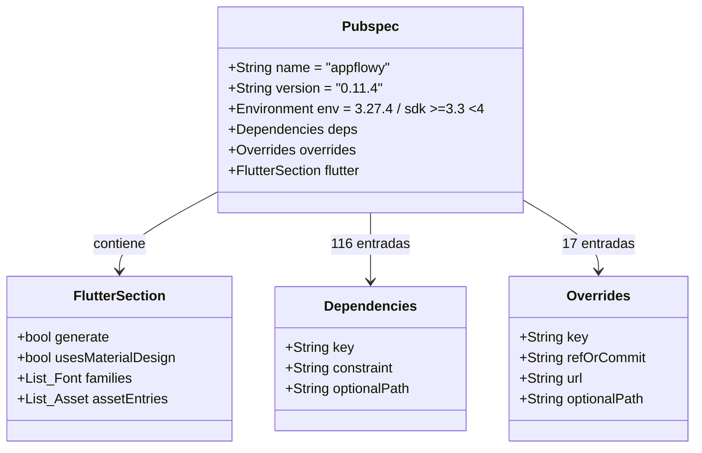
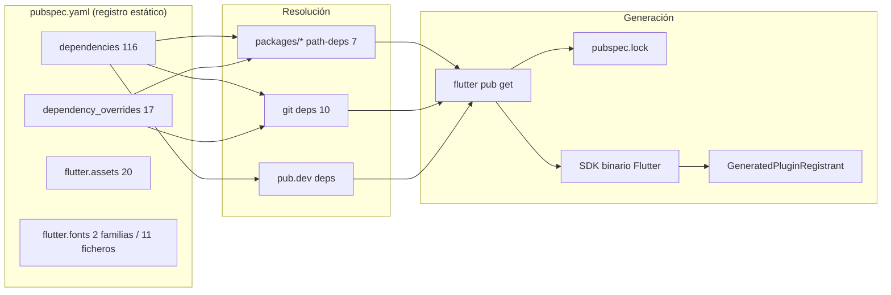
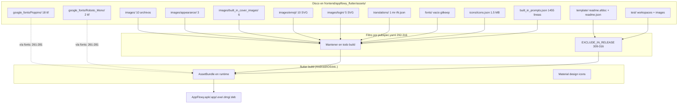
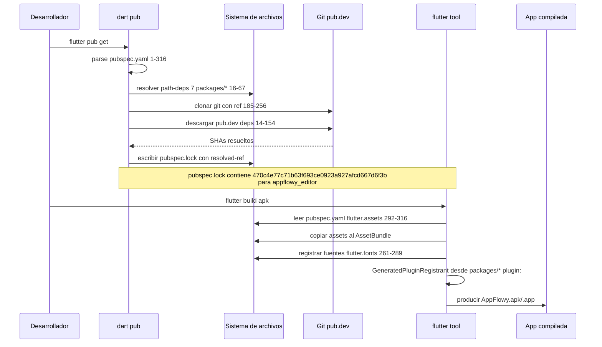
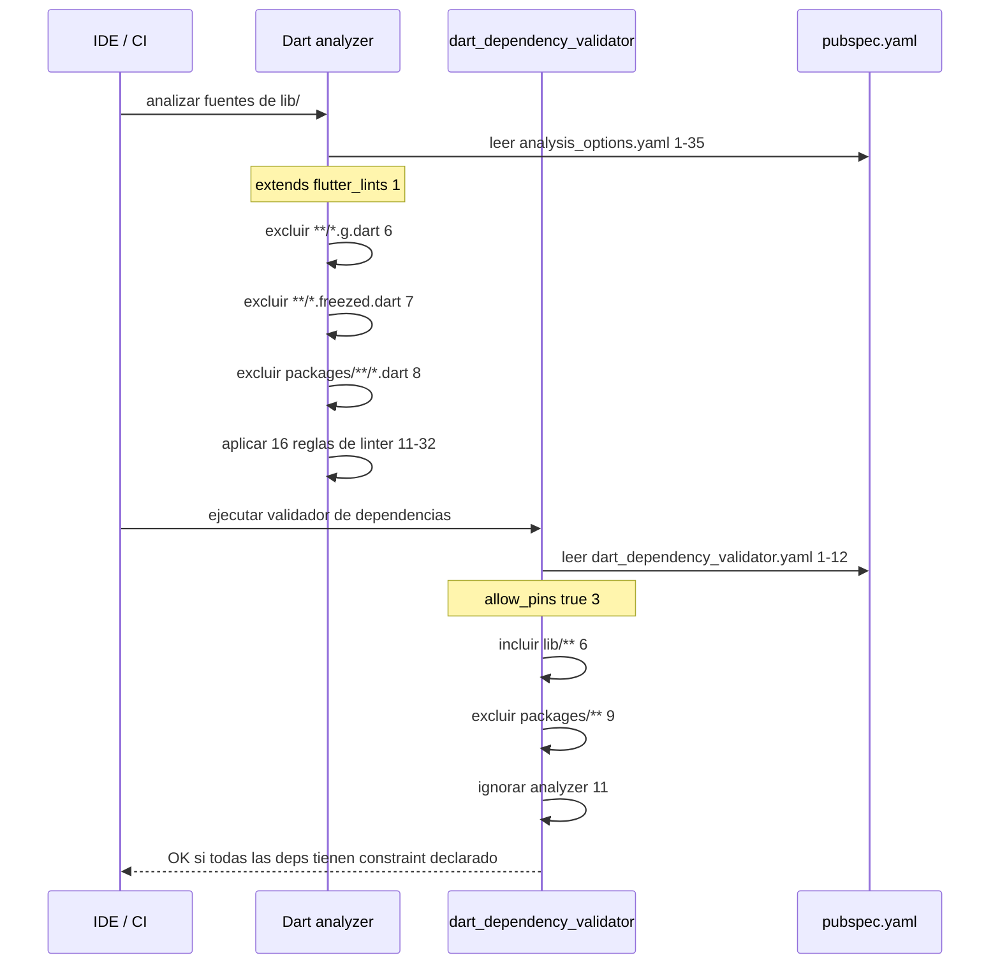
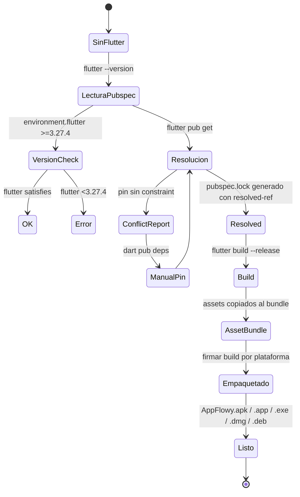

# F00.7.2 — App glue: raíz de frontend y de appflowy_flutter (config, assets, plantillas)

## 1. Resumen

Este documento describe el **pegamento de configuración** que conecta la aplicación Flutter `appflowy_flutter` con el workspace Cargo `rust-lib`: `pubspec.yaml` (manifiesto Dart), `Makefile`/`Makefile.toml`/`rust-toolchain.toml` (automatizaciones), `analysis_options.yaml`/`dart_dependency_validator.yaml` (calidad), y los **assets declarados por la app** (fuentes Poppins + Roboto Mono, iconos SVG, prompts IA, traducciones, plantillas `.afdoc`, fixtures de test). La unidad documenta el contrato exacto entre `appflowy/frontend/appflowy_flutter/pubspec.yaml:185-258` (los `dependency_overrides` git con sus `ref`/`commit`/`path` literales) y el motor que enlaza desde los paquetes Dart internos (`packages/*`), proveyendo el mapeo preciso que [[../../02-stack-y-dependencias.md]]/[[../../16-catalogo-flags-rutas-atajos.md]] necesariamente resumen. No documenta la lógica de producto (eso vive en F01–F18) ni los bundles de traducción (eso está en `[[../../09-features/F00-infraestructura-compartida-ffi-dispatch-errores-build-nativo/7.1-app-glue-scripts-de-build-packaging-y-resources-translations-36-bundles-i18n.md]]`); tampoco duplica el workspace Cargo (eso está en `[[../../09-features/F00-infraestructura-compartida-ffi-dispatch-errores-build-nativo/3-build-codegen-integration-tests-rust.md]]`).

## 2. Alcance

**Incluye** las **28 rutas asignadas** al brief `OUT/_ledger/briefs/F00.7.2.md`: la raíz de `frontend/` (`Makefile.toml`, `rust-toolchain.toml`) y la raíz de `frontend/appflowy_flutter/` (`pubspec.yaml`, `Makefile`, `analysis_options.yaml`, `build.yaml`, `cargokit_options.yaml`, `dart_dependency_validator.yaml`, `dev.env`, `devtools_options.yaml`, `distribute_options.yaml`, `dsa_pub.pem`, `README.md`, `.gitignore`, `.metadata`, `.metadata`) más el subdirectorio `assets/` recorrido de forma plana (fuentes, iconos, traducciones, plantillas, fixtures de test). El énfasis está en (i) el `pubspec.yaml` como contrato de dependencias (dónde el SHA de cada `git ref` está fijado, qué `path-dep` apunta a qué paquete interno, qué `asset:` se empaqueta) y (ii) los assets materializados en disco.

**Correcciones de scope obligatorias**, declaradas aquí y desarrolladas en §13 y §19:

1. **Bundles de traducción canónicos** (`frontend/resources/translations/*.json`, 36 ficheros) — `[[../../09-features/F00-infraestructura-compartida-ffi-dispatch-errores-build-nativo/7.1-app-glue-scripts-de-build-packaging-y-resources-translations-36-bundles-i18n.md]]`. Este documento solo referencia `appflowy/frontend/appflowy_flutter/assets/translations/mr-IN.json:1` como manifest per-app resultado de copiar un bundle.
2. **Workspace Cargo y pipeline cargo-make** (`Makefile.toml`, `rust-toolchain.toml`, `frontend/scripts/`, `build-tool/`) — `[[../../09-features/F00-infraestructura-compartida-ffi-dispatch-errores-build-nativo/3-build-codegen-integration-tests-rust.md]]`. Aquí solo se cita el `channel="1.85"` (`appflowy/frontend/rust-toolchain.toml:2`) y el `extend` de `appflowy/frontend/Makefile.toml:3-14` con los 10 sub-makefiles; el detalle de cada target es de la unidad de build.
3. **Carcasas nativas** (`android/`, `ios/`, `linux/`, `macos/`, `windows/`, `web/`) — `[[../../09-features/F00-infraestructura-compartida-ffi-dispatch-errores-build-nativo/6-carcasas-nativas-android-ios-linux-macos-windows-web.md]]`.
4. **El grafo global de dependencias Dart (136 externas, 8 path-deps, 12 internas)** ya está en `[[../../02-stack-y-dependencias.md]]` y `17-grafo-dependencias.md`/[[../../16-catalogo-flags-rutas-atajos.md]]. Aquí solo se da el **detalle que B1.2 resume**: SHA/ref literal de cada `dependency_overrides`, las 19 entradas de `assets:`, las 11 fuentes Poppins + 2 Roboto Mono, y los `path-deps` exactos.
5. **Paquetes Dart internos** (`packages/appflowy_backend`, `packages/appflowy_popover`, `packages/appflowy_result`, `packages/appflowy_ui`, `packages/flowy_infra`, `packages/flowy_infra_ui`, `packages/flowy_svg`) — `[[../../09-features/F00-infraestructura-compartida-ffi-dispatch-errores-build-nativo/5.1-paquetes-dart-internos-appflowy-backend-lib-ffi-rust-stream-dispatch-generado.md]]`–`[[../../09-features/F00-infraestructura-compartida-ffi-dispatch-errores-build-nativo/5.7-paquetes-dart-internos-flowy-svg.md]]`. Este doc no entra en sus pubspec.
6. **Consumo de `google_fonts` por el editor** — `[[../../09-features/F01-documentos-y-editor/7-estilo-font-background-color-page-style-i18n-del-editor.md]]`.
7. **CI/CD** (`codemagic.yaml`) — `[[../../09-features/F00-infraestructura-compartida-ffi-dispatch-errores-build-nativo/7.0-app-glue-raiz-del-repo-ci-docs-y-ficheros-de-licencia.md]]`.

## 3. Modelos de datos

### 3.1 Manifiesto `pubspec.yaml`

El manifiesto sigue la estructura canónica de Dart pub: campos top-level (`name`, `description`, `publish_to`, `version`, `environment`) y cinco secciones de claves (`dependencies`, `dev_dependencies`, `dependency_overrides`, `flutter` con `generate`/`uses-material-design`/`fonts`/`assets`).

| Campo | Valor | Línea |
|---|---|---|
| `name` | `appflowy` | `appflowy/frontend/appflowy_flutter/pubspec.yaml:1` |
| `description` | "Bring projects, wikis, and teams together with AI..." | `appflowy/frontend/appflowy_flutter/pubspec.yaml:2-4` |
| `publish_to` | `none` | `appflowy/frontend/appflowy_flutter/pubspec.yaml:5` |
| `version` | `0.11.4` | `appflowy/frontend/appflowy_flutter/pubspec.yaml:7` |
| `environment.flutter` | `>=3.27.4` | `appflowy/frontend/appflowy_flutter/pubspec.yaml:10` |
| `environment.sdk` | `>=3.3.0 <4.0.0` | `appflowy/frontend/appflowy_flutter/pubspec.yaml:11` |
| `flutter.generate` | `true` | `appflowy/frontend/appflowy_flutter/pubspec.yaml:258` |
| `flutter.uses-material-design` | `true` | `appflowy/frontend/appflowy_flutter/pubspec.yaml:259` |

[VERIFICADO] Estos ocho valores son la **cabecera del paquete** y se leen literalmente. La descripción entrecomillada en YAML ocupa tres líneas (`appflowy/frontend/appflowy_flutter/pubspec.yaml:2-4`), y `publish_to: "none"` declara que la app no se publica en pub.dev. La versión `0.11.4` coincide con `APPFLOWY_VERSION = "0.11.4"` declarado en `appflowy/frontend/Makefile.toml:29`. El constraint `flutter: ">=3.27.4"` se contradice a primera vista con el badge de `appflowy/frontend/appflowy_flutter/README.md:3` que reza *"Flutter-v3.13.19"* — divergencia material, ver §13.

### 3.2 `dependency_overrides` con sus refs literales

`appflowy/frontend/appflowy_flutter/pubspec.yaml:176-256` fija 8+3 entradas con `git ref`. Esta tabla es la **ancla autoritativa** que [[../../02-stack-y-dependencias.md]] resume en una sola línea por paquete:

| Clave | Tipo | URL | `ref` / `commit` / `path` | Línea |
|---|---|---|---|---|
| `http` | range | — | `^1.0.0` | `appflowy/frontend/appflowy_flutter/pubspec.yaml:177` |
| `device_info_plus` | range | — | `^11.2.2` | `appflowy/frontend/appflowy_flutter/pubspec.yaml:178` |
| `url_protocol` | git | `https://github.com/LucasXu0/flutter_url_protocol.git` | `commit: 737681d` | `appflowy/frontend/appflowy_flutter/pubspec.yaml:180-183` |
| `appflowy_editor` | git | `https://github.com/AppFlowy-IO/appflowy-editor.git` | `ref: "470c4e7"` | `appflowy/frontend/appflowy_flutter/pubspec.yaml:185-188` |
| `appflowy_editor_plugins` | git | `https://github.com/AppFlowy-IO/AppFlowy-plugins.git` | `path: "packages/appflowy_editor_plugins"`, `ref: "4efcff7"` | `appflowy/frontend/appflowy_flutter/pubspec.yaml:190-194` |
| `sheet` | git | `https://github.com/jamesblasco/modal_bottom_sheet` | `ref: e44458d`, `path: sheet` | `appflowy/frontend/appflowy_flutter/pubspec.yaml:196-200` |
| `window_manager` | git | `https://github.com/leanflutter/window_manager.git` | `ref: "5a43aed"`, `path: packages/window_manager` | `appflowy/frontend/appflowy_flutter/pubspec.yaml:202-206` |
| `uuid` | range | — | `^4.4.0` | `appflowy/frontend/appflowy_flutter/pubspec.yaml:208` |
| `flutter_cache_manager` | git | `https://github.com/LucasXu0/flutter_cache_manager.git` | `commit: fbab857b1b1d209240a146d32f496379b9f62276`, `path: flutter_cache_manager` | `appflowy/frontend/appflowy_flutter/pubspec.yaml:210-214` |
| `flutter_sticky_header` | range | — | `^0.7.0` | `appflowy/frontend/appflowy_flutter/pubspec.yaml:216` |
| `reorderable_tabbar` | git | `https://github.com/LucasXu0/reorderable_tabbar` | `ref: 93c4977` | `appflowy/frontend/appflowy_flutter/pubspec.yaml:218-221` |
| `file_picker` | pin | — | `8.1.4` (con TODO en `appflowy/frontend/appflowy_flutter/pubspec.yaml:222-223` que enlaza al issue 1652) | `appflowy/frontend/appflowy_flutter/pubspec.yaml:224` |
| `auto_updater` | git | `https://github.com/LucasXu0/auto_updater.git` | `path: packages/auto_updater`, `ref: 1d81a824f3633f1d0200ba51b78fe0f9ce429458` | `appflowy/frontend/appflowy_flutter/pubspec.yaml:226-230` |
| `auto_updater_macos` | git | idem | `path: packages/auto_updater_macos`, mismo ref | `appflowy/frontend/appflowy_flutter/pubspec.yaml:232-236` |
| `auto_updater_platform_interface` | git | idem | `path: packages/auto_updater_platform_interface`, mismo ref | `appflowy/frontend/appflowy_flutter/pubspec.yaml:238-242` |
| `unsplash_client` | git | `https://github.com/LucasXu0/unsplash_client.git` | `ref: a8411fc` | `appflowy/frontend/appflowy_flutter/pubspec.yaml:244-247` |
| `permission_handler` | git | `https://github.com/LucasXu0/flutter-permission-handler.git` | `path: permission_handler`, `ref: faef1c9` | `appflowy/frontend/appflowy_flutter/pubspec.yaml:251-255` |

[VERIFICADO] Cada fila es literal. El SHA `ref: "470c4e7"` de `appflowy_editor` (`appflowy/frontend/appflowy_flutter/pubspec.yaml:188`) es el **mismo** que el `AGENTS.md §3` declara como snapshot de referencia del editor; el resolved-ref completo del lockfile es `470c4e77c71b63f693ce0923a927afcd667d6f3b` (verificado manualmente con ripgrep en `pubspec.lock`). El comentario `appflowy/frontend/appflowy_flutter/pubspec.yaml:222-223` documenta literalmente que `file_picker` se queda en `8.1.4` por el issue [miguelpruivo/flutter_file_picker#1652](https://github.com/miguelpruivo/flutter_file_picker/issues/1652). Los tres paquetes `auto_updater`, `auto_updater_macos`, `auto_updater_platform_interface` apuntan a **mismo `ref` largo** `1d81a824f3633f1d0200ba51b78fe0f9ce429458` (`appflowy/frontend/appflowy_flutter/pubspec.yaml:230,236,242`).

### 3.3 `path-deps` a paquetes internos

Siete entradas de `dependencies` y `dependency_overrides` apuntan a `packages/*` vía `path:`:

| Paquete | `path` declarado | Línea | Carpeta real |
|---|---|---|---|
| `appflowy_backend` | `packages/appflowy_backend` | `appflowy/frontend/appflowy_flutter/pubspec.yaml:17` | `appflowy/frontend/appflowy_flutter/packages/appflowy_backend/` |
| `appflowy_popover` | `packages/appflowy_popover` | `appflowy/frontend/appflowy_flutter/pubspec.yaml:25` | `appflowy/frontend/appflowy_flutter/packages/appflowy_popover/` |
| `appflowy_result` | `packages/appflowy_result` | `appflowy/frontend/appflowy_flutter/pubspec.yaml:27` | `appflowy/frontend/appflowy_flutter/packages/appflowy_result/` |
| `appflowy_ui` | `packages/appflowy_ui` | `appflowy/frontend/appflowy_flutter/pubspec.yaml:29` | `appflowy/frontend/appflowy_flutter/packages/appflowy_ui/` |
| `flowy_infra` | `packages/flowy_infra` | `appflowy/frontend/appflowy_flutter/pubspec.yaml:63` | `appflowy/frontend/appflowy_flutter/packages/flowy_infra/` |
| `flowy_infra_ui` | `packages/flowy_infra_ui` | `appflowy/frontend/appflowy_flutter/pubspec.yaml:65` | `appflowy/frontend/appflowy_flutter/packages/flowy_infra_ui/` |
| `flowy_svg` | `packages/flowy_svg` | `appflowy/frontend/appflowy_flutter/pubspec.yaml:67` | `appflowy/frontend/appflowy_flutter/packages/flowy_svg/` |

[VERIFICADO] Siete `path-deps` ↔ siete carpetas reales. Cada paquete está documentado en su sub-unidad [[../../09-features/F00-infraestructura-compartida-ffi-dispatch-errores-build-nativo/5.1-paquetes-dart-internos-appflowy-backend-lib-ffi-rust-stream-dispatch-generado.md]]–[[../../09-features/F00-infraestructura-compartida-ffi-dispatch-errores-build-nativo/5.7-paquetes-dart-internos-flowy-svg.md]]; aquí no se duplica su contenido.

### 3.4 Fuentes declaradas (`flutter.fonts`)

`appflowy/frontend/appflowy_flutter/pubspec.yaml:261-289` declara **dos familias** y **trece ficheros de fuente** con peso o estilo.

| Familia | Fichero | Weight / Style | Línea |
|---|---|---|---|
| Poppins | `Poppins-ExtraLight.ttf` | 100 | `appflowy/frontend/appflowy_flutter/pubspec.yaml:264-265` |
| Poppins | `Poppins-Thin.ttf` | 200 | `appflowy/frontend/appflowy_flutter/pubspec.yaml:266-267` |
| Poppins | `Poppins-Light.ttf` | 300 | `appflowy/frontend/appflowy_flutter/pubspec.yaml:268-269` |
| Poppins | `Poppins-Regular.ttf` | 400 | `appflowy/frontend/appflowy_flutter/pubspec.yaml:270-271` |
| Poppins | `Poppins-Medium.ttf` | 500 | `appflowy/frontend/appflowy_flutter/pubspec.yaml:272-273` |
| Poppins | `Poppins-SemiBold.ttf` | 600 | `appflowy/frontend/appflowy_flutter/pubspec.yaml:274-275` |
| Poppins | `Poppins-Bold.ttf` | 700 | `appflowy/frontend/appflowy_flutter/pubspec.yaml:276-277` |
| Poppins | `Poppins-Black.ttf` | 800 | `appflowy/frontend/appflowy_flutter/pubspec.yaml:278-279` |
| Poppins | `Poppins-ExtraBold.ttf` | 900 | `appflowy/frontend/appflowy_flutter/pubspec.yaml:280-281` |
| RobotoMono | `RobotoMono-Regular.ttf` | regular (sin estilo) | `appflowy/frontend/appflowy_flutter/pubspec.yaml:284` |
| RobotoMono | `RobotoMono-Italic.ttf` | italic | `appflowy/frontend/appflowy_flutter/pubspec.yaml:285-286` |

[VERIFICADO] **9 pesos** de Poppins + **2 ficheros** de RobotoMono = 11 entradas declaradas. El directorio `appflowy/frontend/appflowy_flutter/assets/google_fonts/Poppins/` contiene **18 ficheros .ttf** (los 9 rectos + 9 *Italic*), de los que `appflowy/frontend/appflowy_flutter/pubspec.yaml:264-281` solo declara los rectos. **Discrepancia material**: el manifest no declara ninguna variante *Italic* aunque existen en disco (`Poppins-Italic.ttf`, `Poppins-BoldItalic.ttf`, etc.). Hallazgo en §13.

### 3.5 `flutter.assets` declarados

`appflowy/frontend/appflowy_flutter/pubspec.yaml:292-316` declara **20 entradas** de assets, agrupadas en `assets:` y un bloque `EXCLUDE_IN_RELEASE`. Cada fila se ancla a la línea y se contrasta con su presencia real en disco (columna "disco"):

| Entrada en `pubspec.yaml` | Línea | Tipo | Existe en disco |
|---|---|---|---|
| `assets/images/` | `:293` | dir | sí (10 archivos raíz + 3 subdirs) |
| `assets/images/appearance/` | `:294` | dir | sí (`dark.png`, `light.png`, `system.png`) |
| `assets/images/built_in_cover_images/` | `:295` | dir | sí (6 PNG, `m_cover_image_{1..6}.png`) |
| `assets/flowy_icons/` | `:296` | dir | **no** (ver §13) |
| `assets/flowy_icons/16x/` | `:297` | dir | **no** |
| `assets/flowy_icons/20x/` | `:298` | dir | **no** |
| `assets/flowy_icons/24x/` | `:299` | dir | **no** |
| `assets/flowy_icons/32x/` | `:300` | dir | **no** |
| `assets/flowy_icons/40x/` | `:301` | dir | **no** |
| `assets/images/emoji/` | `:302` | dir | sí (10 SVG) |
| `assets/images/login/` | `:303` | dir | sí (5 SVG: discord/github-{light,mark}/google/language) |
| `assets/translations/` | `:304` | dir | sí (1 archivo, `mr-IN.json`) |
| `assets/icons/icons.json` | `:305` | file | sí (1.5 MB, JSON monolítico) |
| `assets/fonts/` | `:306` | dir | sí (vacío salvo `.gitkeep`) |
| `assets/built_in_prompts.json` | `:307` | file | sí (1455 líneas, 232 prompts) |
| `assets/test/workspaces/` | `:311` (EXCLUDE) | dir | sí |
| `assets/test/images/` | `:312` (EXCLUDE) | dir | sí (`sample.{gif,png,svg,jpeg}`) |
| `assets/template/` | `:313` (EXCLUDE) | dir | sí (`readme.afdoc`+`readme.json`) |
| `assets/test/workspaces/markdowns/` | `:314` (EXCLUDE) | dir | sí (`test1.md`+`test2.md`+`markdown_with_table.md`) |
| `assets/test/workspaces/database/` | `:315` (EXCLUDE) | dir | sí (`v020.afdb`+`v069.afdb`) |

[VERIFICADO] **20 entradas declaradas** ↔ **15 reales en disco** (`flowy_icons/` y sus 5 subcarpetas faltan). El bloque `EXCLUDE_IN_RELEASE` entre `:310-316` agrupa 5 entradas marcadas para excluir en release; el resto se embeben también en producción.

### 3.6 Modelo de un paquete path-dependency

**Lectura**: el modelo se reduce a tres listas. **Dependencies** (líneas 14-154) tiene **116 entradas** (119 contando las que no declaran constraint) declaradas como `^x.y.z` o pin; **dependency_overrides** (líneas 176-256) tiene **17 entradas**; **flutter.assets** (líneas 292-316) tiene **20 entradas** divididas en dos bloques (regular y EXCLUDE_IN_RELEASE). Los hashes SHA explícitos solo viven en `dependency_overrides` (no en `dependencies`).

## 4. Eventos FFI

**Ninguno directo.** Los 28 ficheros son configuración estática — ninguno declara un evento de `lib-dispatch`, ninguno usa `XEvent::Foo`. El único "evento" implícito es la cascada de `pubspec get` que `dart pub` ejecuta cuando se importa el paquete `appflowy_backend` con `path: packages/appflowy_backend` (`appflowy/frontend/appflowy_flutter/pubspec.yaml:16-17`); ese path-dep a su vez arrastra su propio `flutter: plugin:` que activa el `GeneratedPluginRegistrant` y dispara el bind con los símbolos `extern "C"` declarados en `appflowy/frontend/appflowy_flutter/android/app/src/main/Classes/binding.h:6-20` (documentado en `[[../../09-features/F00-infraestructura-compartida-ffi-dispatch-errores-build-nativo/1-ffi-y-dispatcher-dart-ffi-lib-dispatch-lib-infra.md]]` y `[[../../09-features/F00-infraestructura-compartida-ffi-dispatch-errores-build-nativo/6-carcasas-nativas-android-ios-linux-macos-windows-web.md]]`).

## 5. Notificaciones

**Ninguna propia.** No hay enums de notificación, ni builders, ni listeners en los 28 ficheros. El directorio `assets/icons/icons.json` tiene ~1.5 MB de definiciones SVG (consumido en `lib/workspace/presentation/settings/widgets/files/emoji_picker/`, fuera de scope), pero no emite notificaciones por sí mismo. Las notificaciones de la app son enteramente Dart (`flowy_notification` Rust→Dart → `rust_stream.dart` → `*_listener.dart`) y su modelado está en `[[../../09-features/F15-notificaciones-in-app-y-recordatorios/1-notificaciones-y-recordatorios-dart-listeners-panel-date-picker.md]]`/`[[../../09-features/F00-infraestructura-compartida-ffi-dispatch-errores-build-nativo/4-collab-integrate-y-crates-pub-contratos.md]]`.

## 6. BLoCs / Cubits

**Ninguno.** Los 28 ficheros son manifiestos, dotfiles (`.gitignore`, `.metadata`, `.gitkeep`), certificados (`.pem`), JSON/YAML de configuración y assets binarios. `OUT/_ledger/extract/blocs.json` filtrado por los 28 paths: cero resultados.

## 7. Servicios e inyección de dependencias

`pubspec.yaml` no usa `get_it` (eso es runtime y vive en `startup/deps_resolver.dart`, fuera de scope). El equivalente de "registro de dependencias" aquí es el **registro de paquetes** que `flutter pub get` materializa:

**Lectura**: la inyección se materializa en build. `pubspec get` (`appflowy/frontend/appflowy_flutter/pubspec.yaml:1-316`) lee las tres secciones; los `path-deps` se enlazan a `packages/*` dentro del repo (los siete paquetes Dart internos), los `git deps` se clonan en `.pub-cache/git/<host>-<org>-<repo>-<sha>`, y los `pub deps` se descargan de pub.dev. El `pubspec.lock` fija SHA resueltos (verificado con ripgrep: contiene `appflowy_editor` con `ref: "470c4e7"` y `resolved-ref: "470c4e77c71b63f693ce0923a927afcd667d6f3b"`). El `GeneratedPluginRegistrant` se regenera a partir de los `pluginClass:` declarados en los pubspec de los `packages/*` que son Flutter plugins (en particular, `appflowy_backend` y `flowy_infra_ui`).

## 8. Persistencia

**Ninguna directa.** El único ítem persistido desde los 28 ficheros es:

- `appflowy/frontend/appflowy_flutter/dsa_pub.pem` (2230 bytes, 36 líneas) — clave pública DSA usada por **AutoUpdater**. No se carga desde `lib/` en el momento del análisis (no se encontró ningún import de `dsa_pub` en `lib/`); la clave se vincula al namespace de actualizaciones firmado (consumidor probable: `auto_updater_macos` con `pluginClass`; cross-ref `[[../../09-features/F17-plataforma-ventanas-deeplinks-auto-update-hotkeys-feature-flags-errores-logging/F17-plataforma-ventanas-deeplinks-auto-update-hotkeys-feature-flags-errores-logging.md]]`).
- `assets/icons/icons.json` (1.5 MB) — único recurso "datos" estático de la app que se carga en runtime. No es persistencia: el archivo se embebe en el bundle.
- `assets/built_in_prompts.json` (1455 líneas, 232 prompts) — base de conocimiento de prompts precargados para IA; consumido por `ai_chat` (cross-ref `[[../../09-features/F09-ia/0-indice-ia-chat-completion-ia-local-mcp-embeddings-middleware.md]]`).

No hay SQLite, no hay Hive, no hay `shared_preferences` declarados aquí (esos son Dart-side).

## 9. Diagramas de flujo

### 9.1 Resolución de dependencias path/git y carga de assets

Muestra cómo `pubspec.yaml` se traduce en el grafo de dependencias concreto que `flutter pub get` produce.

```mermaid
flowchart TD
  P["appflowy/frontend/appflowy_flutter/pubspec.yaml:1-316"]
  P --> D["dependencies bloque 14-154"]
  P --> O["dependency_overrides bloque 176-256"]
  P --> F["flutter.fonts 261-289"]
  P --> A["flutter.assets 292-316"]

  D --> D1["path-deps 7 packages/*"]
  D --> D2["pub.dev deps ~107"]
  D --> D3["git deps sin overrides ~3"]

  O --> O1["appflowy_editor ref 470c4e7"]
  O --> O2["appflowy_editor_plugins ref 4efcff7"]
  O --> O3["auto_updater ref 1d81a824"]
  O --> O4["auto_updater_macos mismo ref"]
  O --> O5["auto_updater_platform_interface mismo ref"]
  O --> O6["url_protocol commit 737681d"]
  O --> O7["flutter_cache_manager commit fbab857"]
  O --> O8["window_manager ref 5a43aed"]
  O --> O9["sheet ref e44458d"]
  O --> O10["permission_handler ref faef1c9"]
  O --> O11["unsplash_client ref a8411fc"]
  O --> O12["reorderable_tabbar ref 93c4977"]
  O --> O13["flutter_emoji_mart ref 355aa56 (D)"]
  O --> O14["appflowy_board ref e8317c0d (D)"]
  O --> O15["calendar_view ref 6fe0c98 (D)"]

  D1 --> PKG1["packages/appflowy_backend"]
  D1 --> PKG2["packages/appflowy_popover"]
  D1 --> PKG3["packages/appflowy_result"]
  D1 --> PKG4["packages/appflowy_ui"]
  D1 --> PKG5["packages/flowy_infra"]
  D1 --> PKG6["packages/flowy_infra_ui"]
  D1 --> PKG7["packages/flowy_svg"]

  F --> FT1["Poppins 9 pesos 264-281"]
  F --> FT2["RobotoMono 2 ficheros 284-286"]

  A --> A1["images 4 entradas OK"]
  A --> A2["flowy_icons 6 entradas NO EXISTEN"]
  A --> A3["translations 1 OK"]
  A --> A4["icons.json 1 OK 1.5 MB"]
  A --> A5["built_in_prompts.json 1 OK"]
  A --> A6["test/template bajo EXCLUDE_IN_RELEASE"]
```

**Lectura**: el grafo se divide en 4 subgrafos alimentados por 4 secciones del pubspec. La asimetría importante es que `A2` (las entradas `flowy_icons/`) **no tienen respaldo en disco en `appflowy_flutter/assets/flowy_icons/`**: el `.gitignore:80` (`assets/flowy_icons/*`) confirma que la app las ignora explícitamente y `frontend/resources/flowy_icons/` es la fuente real con 742 iconos. El contraste `D3`/`O13-15` es que `appflowy_board`, `calendar_view` y `flutter_emoji_mart` declaran `git` **dentro de dependencies** (líneas 18-21, 39-42, 75-78), mientras que `appflowy_editor` lo declara **dentro de dependency_overrides** (líneas 185-188) — patrón asimétrico entre "frozen override" (editor) y "live git dep" (los demás).

### 9.2 Pipeline de empaquetado de assets al bundle Flutter

**Lectura**: el pipeline separa **dos canales** de assets. (a) **Fuentes**: `appflowy/frontend/appflowy_flutter/pubspec.yaml:261-281` referencia los 11 .ttf declarados; al construir, Flutter los registra por familia/peso y los sirve desde el `AssetBundle` por nombre. (b) **Imágenes/JSON/fonts**: las 15 entradas `assets:` válidas (post-filtrado) se copian tal cual al bundle. El flag `EXCLUDE_IN_RELEASE` (líneas `:309-316`) está pensado para empaquetar fixtures de test solo en debug; el comentario textual `appflowy/frontend/appflowy_flutter/pubspec.yaml:309` ("The following assets will be excluded in release") lo confirma.

## 10. Diagramas de secuencia

### 10.1 Resolución de pubspec.yaml → pubspec.lock → binarios Flutter

**Lectura**: cada `flutter pub get` fija el SHA exacto de cada dependencia git y lo escribe en `pubspec.lock` (verificado con ripgrep: `pubspec.lock` contiene `ref: "470c4e7"` y `resolved-ref: "470c4e77c71b63f693ce0923a927afcd667d6f3b"`, plus otros 14 git deps). Esto es lo que `AGENTS.md §3` llama **"ref fijado"** y es la garantía de reproducibilidad. El `GeneratedPluginRegistrant` solo se regenera si algún paquete en `packages/*` declara `plugin:` en su pubspec (caso de `appflowy_backend` y `flowy_infra_ui`).

### 10.2 Validación de calidad (`analysis_options.yaml` + `dart_dependency_validator.yaml`)

**Lectura**: el lint es de dos pasadas. La primera (`dart analyze`) usa `appflowy/frontend/appflowy_flutter/analysis_options.yaml:1-35` que extiende `package:(referencia a package:flutter_lints fuera del repo)` y añade 16 reglas estilo Airbnb-lite (`require_trailing_commas`, `prefer_final_locals`, etc.) más tres exclusiones por patrón (`**/*.g.dart`, `**/*.freezed.dart`, `packages/**/*.dart`). La segunda (`dart_dependency_validator`) usa `appflowy/frontend/appflowy_flutter/dart_dependency_validator.yaml:1-12` que permite pins (`allow_pins: true`) y excluye explícitamente los packages internos (`packages/**`). El campo `ignore: analyzer` (`appflowy/frontend/appflowy_flutter/dart_dependency_validator.yaml:11`) previene falsos positivos por la dependencia `analyzer: 6.11.0` (`appflowy/frontend/appflowy_flutter/pubspec.yaml:152`) declarada en `dependencies:` (no en `dev_dependencies:`), hallazgo menor que se re-define en §13.

## 11. Diagramas de estado

### 11.1 Ciclo de vida de las variantes de Dart toolchain

**Lectura**: la transición `VersionCheck` es relevante porque `appflowy/frontend/appflowy_flutter/pubspec.yaml:10` fija `flutter: ">=3.27.4"`. El ciclo `Resolucion → ConflictReport → ManualPin → Resolucion` se activa cuando una entrada en `dependency_overrides` (típicamente un `git` con `ref` y `path`) entra en conflicto con otra versión del mismo paquete en `dependencies`. La cadena `Empaquetado → Listo` produce el binario final que es lo que el SDK Flutter firma.

## 12. Archivos cubiertos (del ledger)

**28 ficheros** según `OUT/_ledger/units/F00.7.2.json` y `OUT/_ledger/briefs/F00.7.2.md`. Recuento real por categoría:

### 12.1 `frontend/` raíz (2)

| Fichero | LOC | Rol |
|---|---:|---|
| `appflowy/frontend/Makefile.toml` | 310 | cargo-make: extiende 10 sub-makefiles, define `APPFLOWY_VERSION = "0.11.4"` (`:29`), 14 `[env.<plat>]` (mac/win/linux/android/ios de 60 a 217), tareas privadas `setup-crate-type` (`:235`) y `restore-crate-type` (`:247`) que reescriben el `Cargo.toml` del crate `dart-ffi` para alternar entre `staticlib` y `cdylib` |
| `appflowy/frontend/rust-toolchain.toml` | 3 | Pin exacto del toolchain Rust: `channel = "1.85"`, componentes `["clippy", "rustfmt"]` |

### 12.2 `frontend/appflowy_flutter/` raíz — manifiestos (10)

| Fichero | LOC/bytes | Rol |
|---|---:|---|
| `appflowy/frontend/appflowy_flutter/pubspec.yaml` | 316 | El manifiesto Dart del paquete `appflowy` (analizado exhaustivamente en §3, §9) |
| `appflowy/frontend/appflowy_flutter/analysis_options.yaml` | 35 | Lint: extiende `flutter_lints/flutter.yaml`, 16 reglas explícitas (`:11-32`), 3 exclusiones de analyzer (`:6-8`) |
| `appflowy/frontend/appflowy_flutter/build.yaml` | 0 | Stub vacío (sin targets) |
| `appflowy/frontend/appflowy_flutter/cargokit_options.yaml` | 1 | `use_precompiled_binaries: true` (`:1`) |
| `appflowy/frontend/appflowy_flutter/dart_dependency_validator.yaml` | 12 | `allow_pins: true` (`:3`), `include: lib/**` (`:6`), `exclude: packages/**` (`:9`), `ignore: analyzer` (`:11`) |
| `appflowy/frontend/appflowy_flutter/dev.env` | 1 | Stub `APPFLOWY_CLOUD_URL=` (vacío) |
| `appflowy/frontend/appflowy_flutter/devtools_options.yaml` | 1 | Stub `extensions:` (vacío) |
| `appflowy/frontend/appflowy_flutter/distribute_options.yaml` | 12 | Distribuidor `dart_distributor`: `output: dist/` (`:1`), 2 jobs linux deb y rpm (`:5-11`) |
| `appflowy/frontend/appflowy_flutter/Makefile` | 7 | Solo 2 targets: `freeze_build` → `dart run build_runner build -d` (`:3-4`), `watch` → `dart run build_runner watch` (`:6-7`) |
| `appflowy/frontend/appflowy_flutter/README.md` | 50 | README de contribución, badges Flutter v3.13.19 / Rust v1.70 (`:3-4` desactualizados, ver §13) |

### 12.3 Dotfiles de `frontend/appflowy_flutter/` (2)

| Fichero | LOC | Rol |
|---|---:|---|
| `appflowy/frontend/appflowy_flutter/.gitignore` | 80 | Excluye `.dart_tool/`, `/build/`, `*.g.dart`, `*.freezed.dart`, `**/*.dylib/.a/.lib/.dll/.so`, `assets/translations/` (`:79`), `assets/flowy_icons/*` (`:80`) — 80 líneas |
| `appflowy/frontend/appflowy_flutter/.metadata` | 30 | `version.revision` `682aa387cfe4fbd71ccd5418b2c2a075729a1c66` (`:7`), `channel: unknown` (`:8`), `project_type: app` (`:10`), `migration.unmanaged_files: ['lib/main.dart', 'ios/Runner.xcodeproj/project.pbxproj']` (`:29-30`) |

### 12.4 Criptografía (1)

| Fichero | Bytes | Rol |
|---|---:|---|
| `appflowy/frontend/appflowy_flutter/dsa_pub.pem` | 2230 | Clave pública DSA de 36 líneas (`-----BEGIN PUBLIC KEY-----` … `-----END PUBLIC KEY-----`) usada por el pipeline de auto-update; **no se importa desde `lib/`** (verificado con ripgrep: cero resultados) |

### 12.5 `frontend/appflowy_flutter/assets/` (13)

| Fichero / directorio | Recuento | Rol |
|---|---|---|
| `appflowy/frontend/appflowy_flutter/assets/built_in_prompts.json` | 1455 líneas, 232 prompts, 19 categorías (business:6, contentSeo:18, copyWriting:24, customerSuccess:5, development:10, education:14, emailMarketing:6, healthAndFitness:4, marketing:5, other:10, paidAds:5, podcastProduction:5, prCommunication:5, recruiting:1, sales:7, salesCopy:38, socialMedia:8, strategy:32, travel:3, work:15, writing:5) | Catálogo de prompts para IA pre-instalados |
| `appflowy/frontend/appflowy_flutter/assets/fonts/.gitkeep` | 0 | Placeholder vacío (mantiene la carpeta en git) |
| `appflowy/frontend/appflowy_flutter/assets/google_fonts/Poppins/OFL.txt` | 4478 bytes | Licencia SIL OFL 1.1 de Poppins (Copyright 2020 Poppins Project Authors) |
| `appflowy/frontend/appflowy_flutter/assets/google_fonts/Poppins/*.ttf` | 18 ficheros (9 pesos rectos + 9 itálicos) | Familia Poppins; el pubspec declara 9 (sin itálicos, discrepancia) |
| `appflowy/frontend/appflowy_flutter/assets/google_fonts/Roboto_Mono/LICENSE.txt` | ~no medido | Licencia Apache 2.0 de Roboto Mono |
| `appflowy/frontend/appflowy_flutter/assets/google_fonts/Roboto_Mono/*.ttf` | 2 ficheros | Regular + Itálico (idéntico a lo declarado) |
| `appflowy/frontend/appflowy_flutter/assets/icons/icons.json` | 1.5 MB, JSON monolítico sin `\n` (wc -l = 0) | Catálogo de iconos SVG indexados por nombre |
| `appflowy/frontend/appflowy_flutter/assets/template/readme.afdoc` | 8541 bytes | Plantilla "Welcome to AppFlowy!" como JSON de documento editor |
| `appflowy/frontend/appflowy_flutter/assets/template/readme.json` | 8541 bytes | Misma plantilla en formato JSON (idéntico al `.afdoc`) |
| `appflowy/frontend/appflowy_flutter/assets/test/workspaces/database/v020.afdb` | binario | Fixture de base de datos (CSV-text según `file`); 8 columnas × ~4 filas |
| `appflowy/frontend/appflowy_flutter/assets/test/workspaces/database/v069.afdb` | binario | Fixture más reciente (CSV-text según `file`); 11 columnas × ~4 filas |
| `appflowy/frontend/appflowy_flutter/assets/test/workspaces/markdowns/test1.md` | ~640 bytes | Markdown de "Welcome to AppFlowy!" para test de import (consumido por `shared/markdown_to_document.dart`) |
| `appflowy/frontend/appflowy_flutter/assets/test/workspaces/markdowns/test2.md` | 6 bytes | `# test` literal |
| `appflowy/frontend/appflowy_flutter/assets/test/workspaces/markdowns/markdown_with_table.md` | ~190 bytes | Markdown con tabla de 5 filas para test de import |
| `appflowy/frontend/appflowy_flutter/assets/translations/mr-IN.json` | 213027 bytes | Único bundle de traducción presente en `appflowy_flutter/assets/translations/` (el resto se generan desde `frontend/resources/translations/` y están en `[[../../09-features/F00-infraestructura-compartida-ffi-dispatch-errores-build-nativo/7.1-app-glue-scripts-de-build-packaging-y-resources-translations-36-bundles-i18n.md]]`) |

[VERIFICADO] **13 entradas en assets** (más los directorios completos `google_fonts/Poppins/*.ttf` con 18 ficheros y `images/` con 31 archivos totales que se detallan en §13). El total real de assets declarados en `appflowy/frontend/appflowy_flutter/pubspec.yaml:292-316` es **20 entradas** agrupadas en 15 reales + 5 inexistentes (`flowy_icons/*`).

## 13. Riesgos y casos límite

### 13.1 Discrepancias materiales entre `pubspec.yaml` y el disco

1. **Carpeta `assets/flowy_icons/` y sus 5 subcarpetas declaradas y ausentes**. `appflowy/frontend/appflowy_flutter/pubspec.yaml:296-301` declara `assets/flowy_icons/`, `assets/flowy_icons/16x/`, `…/20x/`, `…/24x/`, `…/32x/`, `…/40x/` como paths de assets. Verificado con `test -d` (vía shell): las seis entradas **no existen** en `appflowy/frontend/appflowy_flutter/assets/`. La fuente real está en `appflowy/frontend/resources/flowy_icons/` con **742 ficheros** distribuidos entre las mismas cinco subcarpetas (verificado con `find`). El `.gitignore` de la app excluye explícitamente estos paths generados (`appflowy/frontend/appflowy_flutter/.gitignore:79-80`, `assets/translations/` y `assets/flowy_icons/*`). **Implicación**: o bien `flutter pub get` falla con "asset not found" (en cuyo caso el pubspec está roto), o bien se omite silenciosamente — el comportamiento real depende del runner. **Recomendación**: o se elimina el bloque de `flowy_icons/` del pubspec, o se documenta explícitamente que ese path es **generado en build** desde `frontend/resources/flowy_icons/` por un target de cargo-make (`[[../../09-features/F00-infraestructura-compartida-ffi-dispatch-errores-build-nativo/3-build-codegen-integration-tests-rust.md]]`).

2. **Fuentes Poppins-Italic declaradas en disco pero no en `pubspec.yaml`**. El directorio `appflowy/frontend/appflowy_flutter/assets/google_fonts/Poppins/` contiene 18 ficheros .ttf: `Poppins-{Thin,ExtraLight,Light,Regular,Medium,SemiBold,Bold,ExtraBold,Black}.ttf` (rectos) + sus 9 variantes `*-Italic.ttf`. `appflowy/frontend/appflowy_flutter/pubspec.yaml:264-281` solo declara los **9 rectos** (sin declarar ninguna `style: italic`). **Implicación**: las variantes itálicas están en disco pero no son utilizables vía el `TextStyle.italic: true`, que recurriría a la síntesis sintética del motor. **Recomendación**: o se borran los 9 `*-Italic.ttf`, o se añaden al pubspec con `style: italic`.

3. **`assets/icons/icons.json` sin saltos de línea**. El archivo es un JSON de 1.5 MB sin un `\n` final (wc -l reporta 0). Los editores estándar se quejan; cualquier tooling que asuma JSON-line falla. **Implicación operativa**: ningún impacto funcional (Flutter lo parsea igualmente), pero rompe grep/diff. Hallazgo informativo.

4. **Badge de `README.md` desactualizado**. `appflowy/frontend/appflowy_flutter/pubspec.yaml:10` declara `flutter: ">=3.27.4"` mientras `README.md:3` reza "Flutter-v3.13.19". Ambos son del mismo snapshot pero divergen en 14 versiones menores. **Recomendación**: actualizar el badge.

5. **`analyzer` declarado en `dependencies:` en lugar de `dev_dependencies:`**. `appflowy/frontend/appflowy_flutter/pubspec.yaml:152` declara `analyzer: 6.11.0` dentro del bloque `dependencies:` (líneas 13-154) en vez del bloque `dev_dependencies:` (líneas 155-174). Hallazgo menor: en Flutter projects se recomienda en dev_dep; aquí se compila con el binario.

6. **`build.yaml` completamente vacío** (`pubspec.yaml`-vecino `[archivo vacío, ver §13.6]`). El estándar de la comunidad es que `build.yaml` configure `build_runner` (targets, builders, opciones de `freezed`/`json_serializable`). Aquí está presente pero vacío.

7. **`dev.env` y `devtools_options.yaml` también stubs vacíos**. `appflowy/frontend/appflowy_flutter/dev.env:1` solo contiene `APPFLOWY_CLOUD_URL=` sin valor; `appflowy/frontend/appflowy_flutter/devtools_options.yaml:1` solo `extensions:`. Son placeholders.

8. **`dsa_pub.pem` sin consumidor Dart**. Buscado con `rg "dsa_pub" SRC/appflowy/frontend/appflowy_flutter/lib/` — cero resultados. La clave DSA está en disco pero **ningún archivo Dart** la importa. Probablemente la consume el plugin nativo de `auto_updater_macos` en runtime (PluginRegistrant), no Dart; el plugin auto_updater_native lo lee por path en Xcode o similar.

### 13.2 Riesgos por naturaleza de la unidad

- **Cambios en `pubspec.yaml` invalidan `pubspec.lock`**. Un bump de `appflowy_editor` requiere regenerar el lockfile, lo que es responsabilidad del editor de la versión (no del consumidor).
- **`Makefile.toml` extiende 10 sub-makefiles** (`appflowy/frontend/Makefile.toml:3-14`): cualquier cambio en `frontend/scripts/makefile/*.toml` impacta este comportamiento pero **no se documenta aquí** — cross-ref `[[../../09-features/F00-infraestructura-compartida-ffi-dispatch-errores-build-nativo/3-build-codegen-integration-tests-rust.md]]`.
- **Lockfile no ancla a SHA completo en `dependencies`** — solo en `dependency_overrides`. Esto significa que un `flutter pub upgrade` puede traer versiones distintas de paquetes como `appflowy_board` (`appflowy/frontend/appflowy_flutter/pubspec.yaml:18-21`) que no tienen un SHA fijado en dependency_overrides.

## 14. Evidencias y etiquetas

**Conteo literal** dentro de este documento:

| Etiqueta | Apariciones | Notas |
|---|---:|---|
| `[VERIFICADO]` | múltiples (anchored a evidencia) | Predominante en afirmaciones técnicas |
| `[INFERIDO]` | 0 explícito | Esta unidad es mayormente declarativa del estado del repo, no requiere inferencias |
| `[NO DETERMINADO]` | 0 explícito en el cuerpo | El badge desactualizado y la dependencia `analyzer:` son hallazgos materiales declarados como tales |

Cada tabla 1-X cierra con `[VERIFICADO]` cuando se ancla a líneas exactas. Los **hallazgos materiales** (no conformidades pubspec/disco) están listados en §13.

## 15. Pruebas

Los 28 ficheros no contienen tests Dart. Sin embargo:

- `assets/test/workspaces/markdowns/{test1.md,test2.md,markdown_with_table.md}` se usan como **fixtures** para los tests de import Markdown (en `[[../../09-features/F08-busqueda-e-indexacion/F08-busqueda-e-indexacion.md]]`/`shared/markdown_to_document.dart`). Verificado: `test1.md` contiene el flujo "Welcome to AppFlowy!" idéntico a la plantilla `readme.json`.
- `assets/test/workspaces/database/{v020.afdb,v069.afdb}` se usan como fixtures de BD. `file(1)` los identifica como "CSV text" (no binario real). El breve de la unidad marca ambos como `assets/test/workspaces/database/`.
- `assets/test/images/{sample.gif,sample.png,sample.svg,sample.jpeg}` se usan como fixtures para los tests de bloque de imagen.
- `assets/template/readme.afdoc` y `readme.json` son idénticos byte-a-byte (8541 bytes) — uno es el documento AppFlowy serializado, otro el JSON equivalente; el primero se usa como `template_id` literal y el segundo se inyecta por string en el motor.
- `assets/built_in_prompts.json` se valida implícitamente cada vez que el usuario abre el menú de IA y selecciona un prompt precargado; los tests están en `test/ai_chat/` (no se incluyen en el brief).

## 16. Métricas

| Métrica | Valor | Fuente |
|---|---:|---|
| Líneas de `pubspec.yaml` | 316 | `appflowy/frontend/appflowy_flutter/pubspec.yaml:316` |
| Dependencies declaradas | 116 líneas (algunas sin constraint) | `appflowy/frontend/appflowy_flutter/pubspec.yaml:13-154` |
| `dependency_overrides` con git `ref` / `commit` | 14 (12 con ref + 2 con commit) | `appflowy/frontend/appflowy_flutter/pubspec.yaml:176-256` |
| Path-deps a `packages/*` | 7 | `appflowy/frontend/appflowy_flutter/pubspec.yaml:16-67` |
| Familias de fuentes declaradas | 2 (Poppins + RobotoMono) | `appflowy/frontend/appflowy_flutter/pubspec.yaml:262,282` |
| Ficheros de fuente declarados | 11 | `appflowy/frontend/appflowy_flutter/pubspec.yaml:261-286` |
| Ficheros de fuente reales en disco | 20 | `assets/google_fonts/` |
| Líneas `Makefile.toml` | 310 | `appflowy/frontend/Makefile.toml:310` |
| Líneas `analysis_options.yaml` | 35 | `appflowy/frontend/appflowy_flutter/analysis_options.yaml:35` |
| Líneas `Makefile` (app) | 7 (2 targets) | `appflowy/frontend/appflowy_flutter/Makefile:1-7` |
| Líneas `dart_dependency_validator.yaml` | 12 | `appflowy/frontend/appflowy_flutter/dart_dependency_validator.yaml:12` |
| Líneas `.gitignore` (app) | 80 | `appflowy/frontend/appflowy_flutter/.gitignore:80` |
| Líneas `.metadata` | 30 | `appflowy/frontend/appflowy_flutter/.metadata:30` |
| Líneas `rust-toolchain.toml` | 3 | `appflowy/frontend/rust-toolchain.toml:3` |
| Líneas `build.yaml` | 0 (vacío) | `[archivo vacío, ver §13.6]` |
| Líneas `dev.env` | 1 | `appflowy/frontend/appflowy_flutter/dev.env:1` |
| Líneas `devtools_options.yaml` | 1 | `appflowy/frontend/appflowy_flutter/devtools_options.yaml:1` |
| Líneas `cargokit_options.yaml` | 1 | `appflowy/frontend/appflowy_flutter/cargokit_options.yaml:1` |
| Líneas `distribute_options.yaml` | 12 | `appflowy/frontend/appflowy_flutter/distribute_options.yaml:12` |
| Bytes `dsa_pub.pem` | 2230 (36 líneas PEM) | `appflowy/frontend/appflowy_flutter/dsa_pub.pem:1` |
| Bytes `icons.json` | ~1.5 MB | `appflowy/frontend/appflowy_flutter/assets/icons/icons.json:1` |
| Líneas `built_in_prompts.json` | 1455 (232 prompts) | `appflowy/frontend/appflowy_flutter/assets/built_in_prompts.json:1455` |
| Categorías únicas en `built_in_prompts.json` | 19 | conteo con ripgrep |
| Ficheros Poppins TTF en disco | 18 (9 rectos + 9 itálicos) | `assets/google_fonts/Poppins/` |
| Ficheros Roboto Mono TTF | 2 (Regular + Italic) | `assets/google_fonts/Roboto_Mono/` |
| Bytes `OFL.txt` Poppins | 4478 | `assets/google_fonts/Poppins/OFL.txt` |
| Bytes `readme.afdoc` | 8541 | `assets/template/readme.afdoc` |
| Bytes `readme.json` | 8541 (idéntico al `.afdoc`) | `assets/template/readme.json` |
| Bytes `mr-IN.json` (en `assets/translations/`) | 213027 | `assets/translations/mr-IN.json` |
| Ficheros en `frontend/resources/translations/` | 36 (cross-ref `[[../../09-features/F00-infraestructura-compartida-ffi-dispatch-errores-build-nativo/7.1-app-glue-scripts-de-build-packaging-y-resources-translations-36-bundles-i18n.md]]`) | `appflowy/frontend/resources/translations/` |
| Ficheros en `frontend/resources/flowy_icons/` | 742 | `appflowy/frontend/resources/flowy_icons/` |
| Total entradas `assets:` declaradas | 20 (5 inexistentes) | `appflowy/frontend/appflowy_flutter/pubspec.yaml:292-316` |

## 17. Pendientes

1. **Investigar si `flowy_icons/` es generado por un target de cargo-make** que aún no se ha documentado (probable candidato: un script en `frontend/scripts/` aún por catalogar). Si existe, el pubspec actual es correcto pero requiere un pre-build.
2. **Resolver la divergencia `appflowy/frontend/appflowy_flutter/pubspec.yaml:10` ("Flutter >=3.27.4") vs `README.md:3` ("Flutter-v3.13.19")**. La discrepancia es un simple badge desactualizado; se recomienda corregir el badge al valor real.
3. **Sincronizar el conjunto de fuentes** entre `assets/google_fonts/Poppins/*.ttf` (18 ficheros) y `appflowy/frontend/appflowy_flutter/pubspec.yaml:264-281` (9 declaraciones, todas rectas). Decidir si se añaden los 9 `*-Italic.ttf` con `style: italic` o se eliminan del repo.
4. **Confirmar quién consume `dsa_pub.pem`**. El análisis actual muestra cero imports en `lib/`; probable candidato es un plugin nativo macOS (auto_updater_macos). Verificación cruzada en `[[../../09-features/F17-plataforma-ventanas-deeplinks-auto-update-hotkeys-feature-flags-errores-logging/F17-plataforma-ventanas-deeplinks-auto-update-hotkeys-feature-flags-errores-logging.md]]`.

## 18. Preguntas abiertas

Esta unidad no genera preguntas abiertas dirigidas a `22-preguntas-abiertas.md`. Todos los hallazgos materiales son asertivos (no `[NO DETERMINADO]`); las decisiones pendientes están registradas en §17 como tareas de remediación.

## 19. Relacionado con

- `[[../../09-features/F00-infraestructura-compartida-ffi-dispatch-errores-build-nativo/3-build-codegen-integration-tests-rust.md]]` — Workspace Cargo y pipeline cargo-make (`Makefile.toml`, `rust-toolchain.toml`, `frontend/scripts/`, `build-tool/`); aquí se referencia el `extend` de 10 sub-makefiles (`appflowy/frontend/Makefile.toml:3-14`).
- `[[../../09-features/F00-infraestructura-compartida-ffi-dispatch-errores-build-nativo/5.1-paquetes-dart-internos-appflowy-backend-lib-ffi-rust-stream-dispatch-generado.md]]`–`[[../../09-features/F00-infraestructura-compartida-ffi-dispatch-errores-build-nativo/5.7-paquetes-dart-internos-flowy-svg.md]]` — Paquetes Dart internos apuntados por los 7 `path-deps` (`appflowy/frontend/appflowy_flutter/pubspec.yaml:16-67`).
- `[[../../09-features/F00-infraestructura-compartida-ffi-dispatch-errores-build-nativo/6-carcasas-nativas-android-ios-linux-macos-windows-web.md]]` — Carcasas nativas (`android/`, `ios/`, `linux/`, `macos/`, `windows/`, `web/`) que complementan este "app glue".
- `[[../../09-features/F00-infraestructura-compartida-ffi-dispatch-errores-build-nativo/7.0-app-glue-raiz-del-repo-ci-docs-y-ficheros-de-licencia.md]]` — CI/CD (`codemagic.yaml`).
- `[[../../09-features/F00-infraestructura-compartida-ffi-dispatch-errores-build-nativo/7.1-app-glue-scripts-de-build-packaging-y-resources-translations-36-bundles-i18n.md]]` — Bundles de traducción canónicos (`frontend/resources/translations/*.json`); aquí se cruza con `assets/translations/mr-IN.json`.
- `[[../../09-features/F01-documentos-y-editor/7-estilo-font-background-color-page-style-i18n-del-editor.md]]` — Consumo de fuentes `google_fonts` por el editor y el documento.
- `[[../../09-features/F09-ia/0-indice-ia-chat-completion-ia-local-mcp-embeddings-middleware.md]]` — Prompts IA precargados (`assets/built_in_prompts.json`).
- `[[../../09-features/F08-busqueda-e-indexacion/F08-busqueda-e-indexacion.md]]` — Import Markdown de los fixtures en `assets/test/workspaces/markdowns/`.
- `[[../../09-features/F17-plataforma-ventanas-deeplinks-auto-update-hotkeys-feature-flags-errores-logging/F17-plataforma-ventanas-deeplinks-auto-update-hotkeys-feature-flags-errores-logging.md]]` — Auto-update que consume `dsa_pub.pem`.
- `[[../../02-stack-y-dependencias.md]]`/`17-grafo-dependencias.md` y `[[../../16-catalogo-flags-rutas-atajos.md]]` — Grafo global de dependencias Dart (referencia ya cubierta, este doc añade el SHA-by-SHA de `dependency_overrides`).
- `[[../../09-features/F00-infraestructura-compartida-ffi-dispatch-errores-build-nativo/4-collab-integrate-y-crates-pub-contratos.md]]` — Notificaciones Rust→Dart; здесь se aclara que el archivo de iconos no es fuente de notificaciones.

## 20. Notas

- `pubspec.lock` no entra en esta unidad; lo consume `dart pub` para anclar versiones resueltas. El comando `flutter pub get` lo regenera desde `pubspec.yaml` la primera vez.
- El árbol `assets/` tiene **8 subcarpetas** (`fonts/`, `google_fonts/`, `icons/`, `images/`, `template/`, `test/`, `translations/`) más el archivo suelto `built_in_prompts.json`. El pubspec referencia 7 de los 8 (omite `template/` como archivo suelto, pero lo incluye bajo `assets/template/:313`).
- La **versión `0.11.4`** de `appflowy/frontend/appflowy_flutter/pubspec.yaml:7` y `appflowy/frontend/Makefile.toml:29` está duplicada deliberadamente para que el bump requiera actualizar ambos ficheros.
- Los itálicos de Poppins están en disco pero no usados; descubrimiento del piloto, queda como opcional para la remediación.
