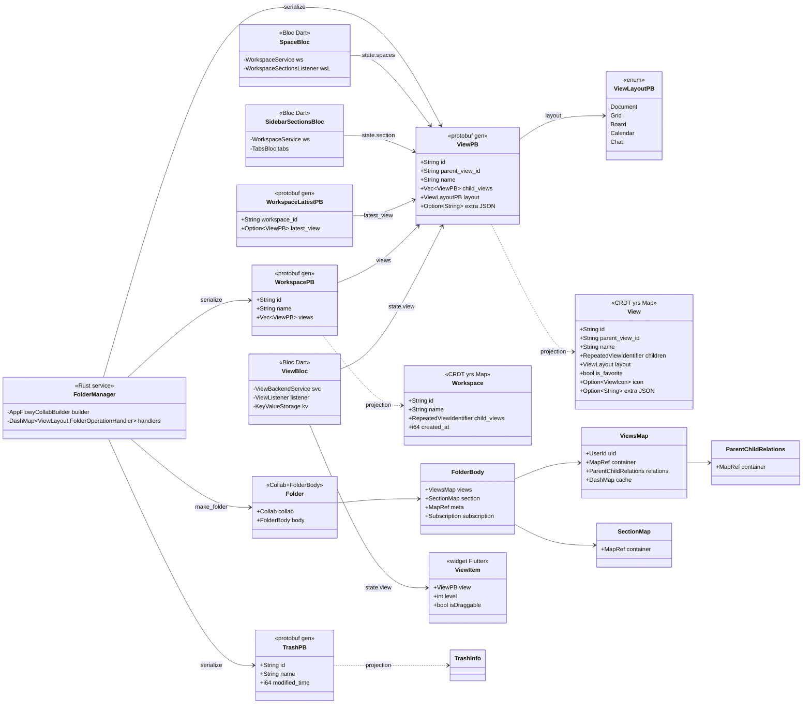
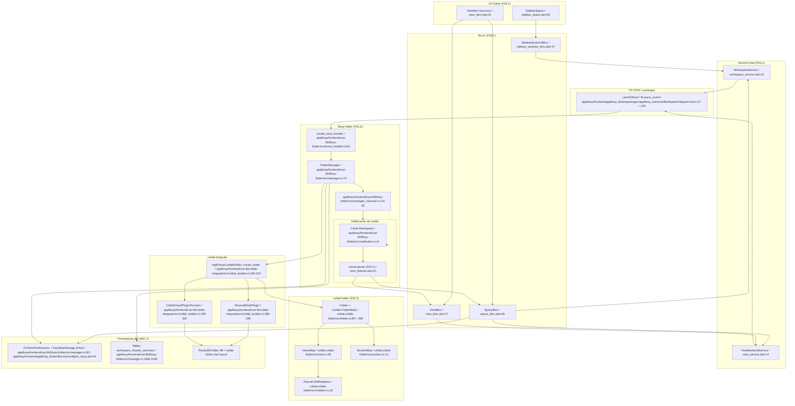
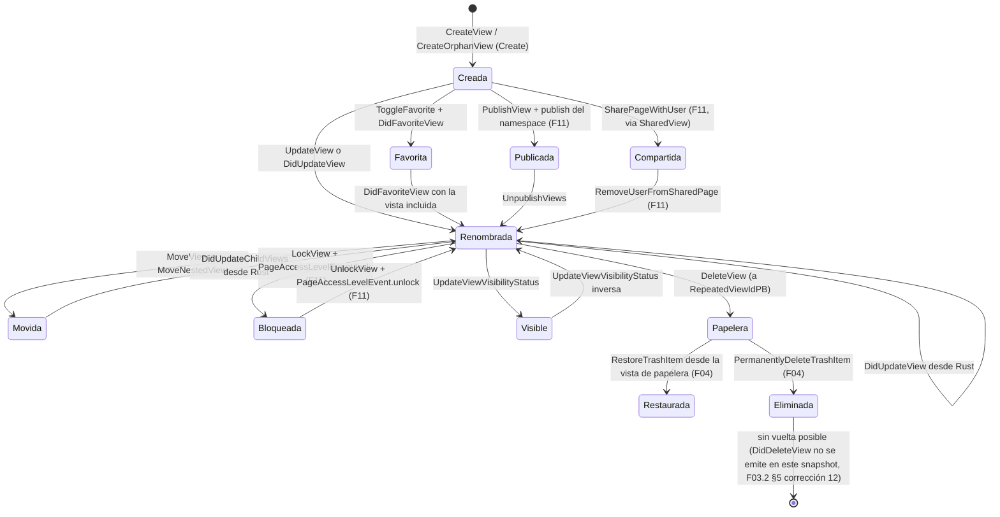

# F03.0 — Índice: Folder, workspaces, espacios, vistas, `view_management`

## 1. Resumen

F03 documenta el **árbol de workspace, vistas y espacios (`spaces`) de AppFlowy** a través de las cuatro capas del sistema: la UI y BLoCs Dart en `lib/workspace/application/**` (F03.1, 55 archivos), el crate Rust `flowy-folder` con su `FolderManager`, 51 eventos FFI y 19 notificaciones Rust→Dart (F03.2, 33 archivos), el modelo CRDT `yrs` subyacente en `collab-folder` con `Folder`, `View`, `Workspace` y `SectionMap` (F03.3, 28 archivos) y, transversalmente, la inyección de dependencias, la persistencia CRDT y el contrato de compartición. La feature se dividió en cuatro documentos porque la cohesión por capa (Dart / Rust / CRDT) es mayor que la cohesión por sub-tema (vistas, favoritos, papelera…) — los 116 archivos de las tres sub-unidades internas no caben razonablemente en un solo documento y los árboles de importación cruzada entre bloques habrían obligado a duplicar tablas. La lectura esperada es lineal: F03.0 → F03.1 (cara Dart) → F03.2 (cara Rust de servicio) → F03.3 (CRDT puro), volviendo a F03.2 §3–8 cuando un documento de feature vecina necesite nombrar un `FolderEvent` o un `ViewPB` concretos.

## 2. Alcance

**Incluido en F03:** los 116 archivos de las tres sub-unidades (F03.1 + F03.2 + F03.3), las definiciones de `FolderEvent` y `FolderNotification`, el `FolderManager` y los 14 BLoCs Dart propietarios del árbol de vistas y espacios, el modelo CRDT `Folder`/`View`/`Workspace`/`SectionMap`/`ParentChildRelations`, y los tests Rust de `collab:collab-folder/tests/folder_test/`.

**Fuera de F03 y derivado a otras features:**

| Subtema | Documento dueño | Motivo |
|---|---|---|
| UI raíz del sidebar (`sidebar.dart`, `favorites/footer/header/shared/...`), favoritos, recientes, papelera, `tabs_bloc`, `command_palette`, `edit_panel`, `action_navigation`, `hotkeys.dart`, `home_layout.dart`, `home_stack.dart`, `desktop_home_screen.dart`, `navigation.dart`, `toast.dart`, `af_focus_manager.dart`, `menu_shared_state.dart` | **F04** | listados en `OUT/_ledger/units/F04.json` |
| `features/view_management/` (4 archivos, **vacíos**) | **F04** | 0–1 bytes por archivo, `ViewManagementBloc` inexistente (F03.1 §13 corrección nº1) |
| Settings (`workspace/application/settings/**`, `AppearanceSettingsCubit`, `FileStorageListener`) | **F13** | carpetas separadas |
| Auth, sesión, workspaces-legacy, `UserListener`/`FolderListener`, `FlowyFolderListener` y migraciones de datos de usuario | **F05.1 / F05.2** | `flowy-user/src/migrations/**` |
| Importación / exportación Markdown, CSV, ZIP y formatos nativos | **B4 / F11** | `ImportData`, `ImportZipFile`, `document_exporter.dart`, `csv` (cubierto por B4) |
| Compartir usuarios / publicación de vistas en AppFlowy-Cloud | **F11** | `features/share_tab/**`, `features/shared_section/**`, plugin `publish` |
| Plugins de base de datos (Grid, Board, Calendar) y Database manager | **F02 / B1.6** | `DatabaseFolderOperation` (F03.2 §7) |
| Plugin de documento (`DocumentFolderOperation`) y `flowy-document` | **F01 / B1.6** | `folder_deps_doc_impl.rs` (F03.2 §7) |
| Plugin de chat (`ChatFolderOperation`) y `flowy-ai` | **F09** | `folder_deps_chat_impl.rs` (F03.2 §7) |
| Esquema SQLite de migración y `diesel` | **B1.7** | `OUT/08-persistencia/06-migraciones.md` |
| AppFlowy-Cloud (interno) | **(fuera de alcance)** | AGENTS.md §11 |

**Tabla de sub-unidades (suma = 116):**

| Sub-unidad | Título | Archivos | Documento | Cubre | No cubre |
|---|---|---|---|---|---|
| F03.1 | Vistas, workspaces y sidebar (Dart) | **55** | `OUT/09-features/F03-folder-workspaces-vistas/0.1-vistas-workspaces-sidebar-dart.md` | `lib/workspace/application/**` (24 `bloc`) + `lib/workspace/presentation/**` (31 `ui`), 14 BLoCs, 23 `FolderEvent` despachados, 8 `FolderNotification` consumidas | eventos de papelera/favoritos/recientes (F04), `features/view_management/**` (F04) |
| F03.2 | `flowy-folder` (Rust) | **33** | `OUT/09-features/F03-folder-workspaces-vistas/0.2-flowy-folder-rust.md` | `appflowy/frontend/rust-lib/flowy-folder/**`, `FolderManager` (appflowy/frontend/rust-lib/flowy-folder/src/manager.rs:74), 51 `FolderEvent`, 19 `FolderNotification`, `view_operation.rs`, parsers, share/import | tipos CRDT (F03.3), BLoCs Dart (F03.1, F04), AppFlowy-Cloud interno |
| F03.3 | `collab-folder` (CRDT) | **28** | `OUT/09-features/F03-folder-workspaces-vistas/0.3-collab-folder.md` | `collab:collab-folder/**` completo: `Folder`, `FolderBody`, `ViewsMap`, `SectionMap`, `ParentChildRelations`, `folder_migration.rs`, `hierarchy_builder.rs`, 13 tests | eventos/notificaciones FFI (F03.2), plugins (F03.2), builders persistencia (B1.7) |
| (vacía) | — | 0 | — | — | — |
| **Total F03** | — | **116** | — | — | — |

## 3. Modelos de datos

El siguiente `classDiagram` cruza las **cuatro capas** representadas en F03 con los tipos reales del snapshot. Cada tipo lleva la referencia `ruta:línea` de su declaración canónica; los nombres que no existen en el código (`SpaceViewPB`, `ViewMetaPB`, `ViewManagementBloc`, `RepeatingBloc`) se excluyen explícitamente para no perpetuar suposiciones.

Lectura: las cajas con `<<protobuf gen>>` viven en `appflowy/frontend/rust-lib/flowy-folder/src/entities/[view,workspace,trash].rs` y se generan en build; las cajas con `<<CRDT yrs Map>>` viven en `collab:collab-folder/src/[view,workspace].rs`; las cajas con `<<Bloc Dart>>` o `<<widget Flutter>>` viven en `appflowy/frontend/appflowy_flutter/lib/workspace/application/**`. `FolderManager` (appflowy/frontend/rust-lib/flowy-folder/src/manager.rs:74) es el único objeto que **escribe** sobre el `Folder` CRDT; los `Bloc` solo leen/escriben `ViewPB`/`WorkspacePB`/`TrashPB` y dejan la conversión al manager.

**Tabla de tipos con `ruta:línea` canónica:**

| Capa | Tipo | Declaración | Comentario |
|---|---|---|---|
| Dart UI | `ViewItem` | `appflowy/frontend/appflowy_flutter/lib/workspace/presentation/home/menu/view/view_item.dart:51` | widget recursivo; no es modelo de datos |
| Dart bloc | `ViewBloc` | appflowy/frontend/appflowy_flutter/lib/workspace/application/view/view_bloc.dart:27 | 14 eventos freezed (F03.1 §6) |
| Dart bloc | `SpaceBloc` | appflowy/frontend/appflowy_flutter/lib/workspace/application/sidebar/space/space_bloc.dart:65 | 14 eventos; filtra `view.isSpace` (appflowy/frontend/appflowy_flutter/lib/workspace/application/view/view_ext.dart:150–162) |
| Dart bloc | `SidebarSectionsBloc` | appflowy/frontend/appflowy_flutter/lib/workspace/application/menu/sidebar_sections_bloc.dart:47 | mantiene `SidebarSection` duplicada (F03.1 §13 riesgo 2) |
| Rust svc | `FolderManager` | appflowy/frontend/rust-lib/flowy-folder/src/manager.rs:74 | `make_folder` en `appflowy/frontend/rust-lib/flowy-folder/src/manager.rs:209`, `create_folder_with_data` en `:263` |
| Protobuf | `ViewPB` | appflowy/frontend/rust-lib/flowy-folder/src/entities/view.rs:39–89 | 13 campos (F03.2 §3, F03.1 §3) |
| Protobuf | `WorkspacePB` | appflowy/frontend/rust-lib/flowy-folder/src/entities/workspace.rs:14–27 | proyección del CRDT `Workspace` |
| Protobuf | `TrashPB` | appflowy/frontend/rust-lib/flowy-folder/src/entities/trash.rs:5–17 | solo `id`/`name`/timestamps |
| Protobuf | `WorkspaceLatestPB` | appflowy/frontend/rust-lib/flowy-folder/src/entities/workspace.rs:136–143 | añade `latest_view` |
| CRDT | `Folder` | collab:collab-folder/src/folder.rs:89 | struct raíz, `FolderBody` en `:486` |
| CRDT | `View` | collab:collab-folder/src/view.rs:39 | 13 campos; tipo base de toda la jerarquía |
| CRDT | `Workspace` | collab:collab-folder/src/workspace.rs | 7 campos |
| CRDT | `ViewsMap` | collab:collab-folder/src/view.rs:39 | submapa de `Folder`; `cache: DashMap` |
| CRDT | `SectionMap` | collab:collab-folder/src/section.rs:13 | favoritos, recientes, papelera, privadas |
| CRDT | `ParentChildRelations` | collab:collab-folder/src/relation.rs:16 | `parent_id → [child_id...]` |

`SidebarSection` **no aparece** en el diagrama porque es una **duplicación deliberada** entre dos blocs Dart del mismo paquete (F03.1 §13 riesgo 2): se declara dos veces con forma idéntica en appflowy/frontend/appflowy_flutter/lib/workspace/application/sidebar/space/space_bloc.dart:37–61 y appflowy/frontend/appflowy_flutter/lib/workspace/application/menu/sidebar_sections_bloc.dart:19–43.

## 4. Eventos FFI

El enum `FolderEvent` se declara en appflowy/frontend/rust-lib/flowy-folder/src/event_map.rs:64 con la macro `Flowy_Event`, dentro del plugin FFI `"Flowy-Folder"` (`appflowy/frontend/rust-lib/flowy-folder/src/event_map.rs:12`). Hay **51 variantes** confirmadas: el catálogo `OUT/_ledger/extract/events.json` filtrado por `crate == "flowy-folder"` cuenta 51 entradas y el `enum` físico (`appflowy/frontend/rust-lib/flowy-folder/src/event_map.rs:64–249`) tiene 51 ramas `[VERIFICADO]`. La tabla siguiente las agrupa por dominio y enlaza con la sub-unidad que las describe en detalle:

| Dominio | Variantes (`discriminante`) | Nº | Sub-unidad (detalle) | Consumidores Dart |
|---|---|---|---|---|
| **Vista (CRUD + mover + icono + lock + close + visibilidad + ancestros)** | `CreateView` (10), `CreateOrphanView` (16), `GetView` (11), `UpdateView` (12), `DeleteView` (13), `DuplicateView` (14), `CloseView` (15), `GetAllViews` (17), `MoveView` (22), `MoveNestedView` (32), `UpdateViewIcon` (35), `UpdateViewVisibilityStatus` (41), `GetViewAncestors` (42), `LockView` (54), `UnlockView` (55) | **15** | F03.2 §4 (handler y PB) · F03.1 §4 (consumidor Dart) | `ViewBloc`, `SpaceBloc`, `ViewTitleBarBloc`, `SpaceSearchBloc` (F03.1); `CloseView` también desde `DocumentPlugin`/`DatabaseTabBarViewPlugin`/`AIChatPagePlugin` (F01/F02/F09) |
| **Workspace (lectura, lectura-privada, "latest view", sin handler)** | `GetCurrentWorkspaceSetting` (1), `ReadCurrentWorkspace` (2), `ReadWorkspaceViews` (5), `ReadPrivateViews` (39), `SetLatestView` (21), `ReadCurrentWorkspaceViews` (40), `CreateFolderWorkspace` (0, deprecado sin handler), `DeleteWorkspace` (3, sin handler) | **8** | F03.2 §4 | `WorkspaceBloc`, `WorkspaceService`, `HomeBloc` (F03.1); F05.1 para `UserWorkspaceBloc` |
| **Papelera (trash)** | `ListTrashItems` (23), `RestoreTrashItem` (24), `PermanentlyDeleteTrashItem` (25), `RecoverAllTrashItems` (26), `PermanentlyDeleteAllTrashItem` (27) | **5** | F03.2 §4 | **F04** (`appflowy/frontend/appflowy_flutter/lib/plugins/trash/application/trash_service.dart`) |
| **Recientes** | `ReadRecentViews` (36), `UpdateRecentViews` (37) | **2** | F03.2 §4 | **F04** (`appflowy/frontend/appflowy_flutter/lib/workspace/application/recent/cached_recent_service.dart`, `appflowy/frontend/appflowy_flutter/lib/workspace/application/recent/recent_views_bloc.dart`) |
| **Favoritos** | `ReadFavorites` (33), `ToggleFavorite` (34) | **2** | F03.2 §4 | **F04** (`appflowy/frontend/appflowy_flutter/lib/workspace/application/favorite/favorite_service.dart`) para `ReadFavorites`; **F03.1** para `ToggleFavorite` (despachado por `ViewBackendService.favorite` en appflowy/frontend/appflowy_flutter/lib/workspace/application/view/view_service.dart:174) |
| **Publicación (`publish` y namespace)** | `CopyLink` (20, sin handler), `PublishView` (43), `GetPublishInfo` (44), `GetPublishNamespace` (45), `SetPublishNamespace` (46), `UnpublishViews` (47), `ListPublishedViews` (49), `GetDefaultPublishInfo` (50), `SetDefaultPublishView` (51), `SetPublishName` (52), `RemoveDefaultPublishView` (53) | **11** | F03.2 §4 | `CopyLink`: declarado sin consumidor. Resto: **F03.1** (`ViewBackendService.publish`, `:360`, `:367`, `:374`, `:379`) para los básicos; **F11** (`settings_sites_bloc.dart`, publish namespace/nombre) para el resto |
| **Compartido (shared)** | `SharePageWithUser` (56), `RemoveUserFromSharedPage` (57), `GetSharedUsers` (58), `GetSharedViews` (59), `GetSharedViewSection` (60) | **5** | F03.2 §4 | **F11** (`appflowy/frontend/appflowy_flutter/lib/features/share_tab/**`, `appflowy/frontend/appflowy_flutter/lib/features/shared_section/**`) |
| **Import (carpetas compartidas, zip)** | `ImportData` (30), `ImportZipFile` (48) | **2** | F03.2 §4 | **F11** (`appflowy/frontend/appflowy_flutter/lib/workspace/application/settings/share/import_service.dart`) |
| **Snapshot de folder** | `GetFolderSnapshots` (31) | **1** | F03.2 §4 | **huérfano**: handler en `appflowy/frontend/rust-lib/flowy-folder/src/event_handler.rs:378–386`, cero consumidores Dart en `lib/`, `packages/`, `test/`, `integration_test/` (F03.2 §4.1c) |
| **Total** | — | **51** | — | — |

**Recuento por consumidor Dart (51 variantes):**

- **F03.1** despacha **23**: `CreateView`, `CreateOrphanView`, `GetView`, `UpdateView`, `DeleteView`, `DuplicateView`, `GetAllViews`, `MoveView`, `MoveNestedView`, `ToggleFavorite`, `UpdateViewIcon`, `UpdateViewVisibilityStatus`, `GetViewAncestors`, `LockView`, `UnlockView`, `PublishView`, `UnpublishViews`, `GetPublishInfo`, `GetPublishNamespace`, `SetPublishNamespace`, `ReadCurrentWorkspace`, `ReadWorkspaceViews`, `ReadPrivateViews`.
- **Otras unidades** despachan **23**: papelera (5) + recientes (2) + favoritos lectura (1) + publicación (5 de F11) + compartido (5) + import (2) + workspace-legacy (1, `GetCurrentWorkspaceSetting`) + última-vista (1, `SetLatestView`) + close (1, `CloseView`).
- **Sin consumidor Dart en todo el repo** = **5**: `CreateFolderWorkspace` (deprecado, sin handler), `DeleteWorkspace` (sin handler), `CopyLink` (sin handler), `GetFolderSnapshots` (con handler), `ReadCurrentWorkspaceViews` (con handler).
- **23 + 23 + 5 = 51** ✓.

Detalle completo de handlers, input/output PB y discriminantes de cada variante: **F03.2 §4** y F03.1 §4 para el subconjunto consumido por Dart.

## 5. Notificaciones

El enum `FolderNotification` (appflowy/frontend/rust-lib/flowy-folder/src/notification.rs:8–45, 19 variantes) viaja por el canal `FOLDER_OBSERVABLE_SOURCE = "Workspace"` (`appflowy/frontend/rust-lib/flowy-folder/src/notification.rs:6`) con el wrapper `folder_notification_builder` (`:48–55`). Las 21 emisiones reales verificadas se reparten entre `appflowy/frontend/rust-lib/flowy-folder/src/manager.rs` (líneas 845, 879, 1329, 1437, 1495, 1582, 1932, 1938, 1946, 1990, 2016, 2181, 2449) y `appflowy/frontend/rust-lib/flowy-folder/src/manager_observer.rs` (101, 148, 191, 210, 218, 228, 236, 269) `[VERIFICADO]`.

| Dominio | Variante (`discriminante`) | Nº | Sub-unidad (detalle) | Listener Dart |
|---|---|---|---|---|
| **Workspace / setting / latest_view / sección** | `DidCreateWorkspace` (1), `DidUpdateWorkspace` (2), `DidUpdateWorkspaceViews` (3), `DidUpdateWorkspaceSetting` (4), `DidUpdateSectionViews` (39) | **5** | F03.2 §5 | F03.1: `WorkspaceListener` (appflowy/frontend/appflowy_flutter/lib/workspace/application/workspace/workspace_listener.dart:21) para (2) y (3); `WorkspaceSectionsListener` (appflowy/frontend/appflowy_flutter/lib/workspace/application/workspace/workspace_sections_listener.dart:19) para (39); F05.1: `FolderListener` para (4); (1) **declarado pero no emitido** (F03.1 §5 corrección de F03.2) |
| **Vista (CRUD)** | `DidUpdateView` (10), `DidUpdateChildViews` (11), `DidDeleteView` (12), `DidRestoreView` (13), `DidMoveViewToTrash` (14) | **5** | F03.2 §5 | F03.1: `ViewListener` (appflowy/frontend/appflowy_flutter/lib/workspace/application/view/view_listener.dart:22) — todos los cinco se deserializan; **3 sin callback activo** (`onViewDeleted`/`onViewRestored`/`onViewMoveToTrash` no se registran en `ViewBloc`, F03.1 §13 riesgo 13) |
| **Papelera** | `DidUpdateTrash` (15) | **1** | F03.2 §5 | **F04**: `TrashListener` (`appflowy/frontend/appflowy_flutter/lib/plugins/trash/application/trash_listener.dart:36`); indirectamente en F03.1 vía `ViewTitleBarBloc` (appflowy/frontend/appflowy_flutter/lib/workspace/application/view_title/view_title_bar_bloc.dart:48–56) |
| **Favoritos** | `DidFavoriteView` (36), `DidUnfavoriteView` (37) | **2** | F03.2 §5 | **F04** (`FavoriteListener`, `appflowy/frontend/appflowy_flutter/lib/workspace/application/favorite/favorite_listener.dart:41`); también `ViewBloc` de F03.1 registra un `FavoriteListener` interno (appflowy/frontend/appflowy_flutter/lib/workspace/application/view/view_bloc.dart:34, :80–97) |
| **Recientes** | `DidUpdateRecentViews` (38) | **1** | F03.2 §5 | **F04** (`RecentViewsListener` en `appflowy/frontend/appflowy_flutter/lib/workspace/application/recent/recent_listener.dart:18`, **sin discriminar por tipo** — corrige a F03.2 §5) |
| **Sync / snapshot de folder** | `DidUpdateFolderSyncUpdate` (17), `DidUpdateFolderSnapshotState` (16) | **2** | F03.2 §5 | ninguna Dart consume (16); (17) absorbida por estado global sin listener dedicado |
| **Compartido** | `DidUpdateSharedViews` (40), `DidUpdateSharedUsers` (41) | **2** | F03.2 §5 | consumo en `appflowy/frontend/appflowy_flutter/lib/features/shared_section/**` (40) y `appflowy/frontend/appflowy_flutter/lib/features/share_tab/**` (41), **F11**; listener dedicado no localizado `[NO DETERMINADO]` |
| **Centinela** | `Unknown` (0) | **1** | F03.2 §5 | n/a (default `appflowy/frontend/rust-lib/flowy-folder/src/notification.rs:11`) |
| **Total** | — | **19** | — | — |

**Recuento por listener Dart (19 variantes):** **8** con `case` efectivo en un listener **de F03.1** (`DidUpdateWorkspace`, `DidUpdateWorkspaceViews`, `DidUpdateView`, `DidUpdateChildViews`, `DidDeleteView`, `DidRestoreView`, `DidMoveViewToTrash`, `DidUpdateSectionViews`); **1** declarado sin `case` activo en F03.1 (`DidCreateWorkspace`); **1** cuyo listener vive en F05.1 pero cuyo único consumidor Dart de payload es de F03.1 (`DidUpdateWorkspaceSetting`); **4** en F04 (`DidUpdateTrash`, `DidFavoriteView`, `DidUnfavoriteView`, `DidUpdateRecentViews`); **2** consumidas desde F11 (`DidUpdateSharedViews`, `DidUpdateSharedUsers`); **2** sin listener (`DidUpdateFolderSnapshotState`, `DidUpdateFolderSyncUpdate`); **1** centinela (`Unknown`). 8 + 1 + 1 + 4 + 2 + 2 + 1 = **19** ✓.

Tabla detallada de emisores y listeners con `ruta:línea`: **F03.2 §5**; desglose por unidad consumidora: **F03.1 §5**.

## 6. BLoCs / Cubits

F03 es la **mitad Dart**: en F03.1 hay **14 BLoCs** (`Bloc`, ningún `Cubit` confirmado — F03.1 §6) repartidos entre `application/{home,menu,sidebar/{billing,folder,rename_view,space},view,view_info,view_title,workspace}/`; F03.2 es Rust puro (no declara BLoC) y F03.3 tampoco. Los BLoCs de favoritos (`FavoriteBloc`), recientes (`RecentViewsBloc`), papelera (`TrashBloc`) y `TabsBloc` viven en **F04** y consumen `FolderEvent`/`FolderNotification` de F03.2 sin ser archivos cubiertos por F03.

| # | Clase | Sub-unidad | `ruta:línea` (declaración) | Eventos Rust asociados (F03.2 §4) | Notificaciones Rust consumidas (F03.2 §5) |
|---|---|---|---|---|---|
| 1 | `ViewBloc` | F03.1 | appflowy/frontend/appflowy_flutter/lib/workspace/application/view/view_bloc.dart:27 | `CreateView`, `GetView`, `UpdateView`, `DeleteView`, `DuplicateView`, `MoveView`, `MoveNestedView`, `UpdateViewIcon`, `UpdateViewVisibilityStatus`, `GetViewAncestors`, `ToggleFavorite`, `PublishView`, `UnpublishViews`, `GetPublishInfo` | `DidUpdateView`, `DidUpdateChildViews`, `DidFavoriteView`, `DidUnfavoriteView` (vía `FavoriteListener` interno) |
| 2 | `WorkspaceBloc` | F03.1 | appflowy/frontend/appflowy_flutter/lib/workspace/application/workspace/workspace_bloc.dart:12 | (ninguno de F03; consume `UserEventGetWorkspaces` de F05.1, F03.1 §13 riesgo 1) | ninguna directamente |
| 3 | `FolderBloc` | F03.1 | appflowy/frontend/appflowy_flutter/lib/workspace/application/sidebar/folder/folder_bloc.dart:31 | ninguno (lee `KeyValueStorage` kv `expandedViews`) | ninguna |
| 4 | `SpaceBloc` | F03.1 | appflowy/frontend/appflowy_flutter/lib/workspace/application/sidebar/space/space_bloc.dart:65 | `CreateView`, `UpdateView`, `DeleteView`, `DuplicateView`, `GetView`, `MoveNestedView`, `UpdateViewVisibilityStatus`, `ReadWorkspaceViews`, `ReadPrivateViews` (vía `WorkspaceService`) | `DidUpdateSectionViews` (vía `WorkspaceSectionsListener`); indirectamente `DidUpdateView` por `ViewListener` |
| 5 | `SpaceSearchBloc` | F03.1 | appflowy/frontend/appflowy_flutter/lib/workspace/application/sidebar/space/space_search_bloc.dart:9 | `GetAllViews` (en `appflowy/frontend/appflowy_flutter/lib/workspace/application/view/view_service.dart:265`) | ninguna |
| 6 | `RenameViewBloc` | F03.1 | appflowy/frontend/appflowy_flutter/lib/workspace/application/sidebar/rename_view/rename_view_bloc.dart:7 | ninguno (controla un `PopoverController`) | ninguna |
| 7 | `HomeBloc` | F03.1 | appflowy/frontend/appflowy_flutter/lib/workspace/application/home/home_bloc.dart:12 | ninguno directo | `DidUpdateWorkspaceSetting` (vía `FolderListener` de F05.1) |
| 8 | `HomeSettingBloc` | F03.1 | appflowy/frontend/appflowy_flutter/lib/workspace/application/home/home_setting_bloc.dart:13 | ninguno directo | `DidUpdateWorkspaceSetting` (vía `FolderListener` de F05.1) |
| 9 | `MenuUserBloc` | F03.1 | appflowy/frontend/appflowy_flutter/lib/workspace/application/menu/menu_user_bloc.dart:13 | ninguno | `DidUpdateUserProfile` (F05.1) |
| 10 | `SidebarSectionsBloc` | F03.1 | appflowy/frontend/appflowy_flutter/lib/workspace/application/menu/sidebar_sections_bloc.dart:47 | `CreateView`, `MoveView` (deprecated), `ReadWorkspaceViews`, `ReadPrivateViews` | `DidUpdateSectionViews` |
| 11 | `ViewTitleBloc` | F03.1 | appflowy/frontend/appflowy_flutter/lib/workspace/application/view_title/view_title_bloc.dart:10 | `UpdateView` (vía `view_service.updateView`) | `DidUpdateView` |
| 12 | `ViewTitleBarBloc` | F03.1 | appflowy/frontend/appflowy_flutter/lib/workspace/application/view_title/view_title_bar_bloc.dart:11 | `GetView`, `GetViewAncestors` | `DidUpdateTrash` (indirecta, vía `TrashListener` F04), `DidUpdateView` |
| 13 | `ViewInfoBloc` | F03.1 | appflowy/frontend/appflowy_flutter/lib/workspace/application/view_info/view_info_bloc.dart:13 | `UserEventGetUserProfile` (F05) | ninguna directa; usa `WordCountService` de `appflowy_editor` |
| 14 | `SidebarPlanBloc` | F03.1 | appflowy/frontend/appflowy_flutter/lib/workspace/application/sidebar/billing/sidebar_plan_bloc.dart:19 | `GetWorkspaceUsage`, `GetBillingPortal` (F05) | varias de F02.5/storage |

**Recapitulación:** 14 BLoCs Dart en F03.1 + 0 en F03.2 + 0 en F03.3 = **14 BLoCs propios de F03**. Total de eventos freezed sumando los 14 BLoCs: **73** (F03.1 §16).

## 7. Servicios e inyección de dependencias

La cadena completa es **Dart `get_it` → servicio estático de BLoC → código generado Dart (`FolderEvent*.send()`) → FFI `dart_ffi::async_event` → `lib-dispatch` → `AFPlugin "Flowy-Folder"` → handler → `FolderManager` → `AppFlowyCollabBuilder::create_folder` → `Collab<CollabType::Folder>`** con dos plugins (`RocksdbDiskPlugin` local + plugin cloud) y retorno por el canal `Workspace` de vuelta al listener Dart.

| Salto | Origen | Destino | `ruta:línea` (referencia verificada) |
|---|---|---|---|
| 0. Registro Dart en `get_it` | `RenameViewBloc`, `WorkspaceListener`, `ViewBloc`, `ViewExpanderRegistry` | contenedor | `appflowy/frontend/appflowy_flutter/lib/startup/deps_resolver.dart:162`, `:167–170`, `:172–177` |
| 1. Servicio estático Dart (BLoC → servicio) | `ViewBackendService.createView`, `WorkspaceService.getWorkspace` | `FolderEventCreateView(payload).send()` | `appflowy/frontend/appflowy_flutter/lib/workspace/application/view/view_service.dart:14`, `:71`, `appflowy/frontend/appflowy_flutter/lib/workspace/application/workspace/workspace_service.dart:10`, `:51` |
| 2. Llamada FFI real | `_sendToRust` → `ffi.async_event(port.nativePort, input, bytes.length)` | bytes por la frontera C | `appflowy/frontend/appflowy_flutter/packages/appflowy_backend/lib/dispatch/dispatch.dart:117–135` (`:117` def, `:130` call) |
| 3. Dispatcher | `lib-dispatch` mapea discriminante `FolderEvent::CreateView = 10` | `AFPlugin` "Flowy-Folder" | `appflowy/frontend/rust-lib/flowy-folder/src/event_map.rs:12` (nombre) |
| 4. Handler Rust | `create_view_handler(data, folder)` | método de `FolderManager` | `appflowy/frontend/rust-lib/flowy-folder/src/event_handler.rs:81–93` |
| 5. Manager | `FolderManager::create_view_with_params` | mutación del `Collab` Folder | `appflowy/frontend/rust-lib/flowy-folder/src/manager.rs:74` (struct), `:91–109` (`new`), `view_operation.rs` |
| 6. Builder CRDT | `AppFlowyCollabBuilder::create_folder(uid, workspace_id, CollabType::Folder)` | `Collab<FolderData>` + `Folder` wrapper | `appflowy/frontend/rust-lib/collab-integrate/src/collab_builder.rs:200–234`, `CollabType::Folder` en `:209` |
| 7. Plugins | `RocksdbDiskPlugin` (persistencia) + plugin cloud (sync) | `Weak<CollabKVDB>` + `ServerProvider` | `appflowy/frontend/rust-lib/collab-integrate/src/collab_builder.rs:288–296` (Rocksdb), `:339–352` (cloud provider), `appflowy/frontend/rust-lib/flowy-folder/src/manager.rs:209` (`make_folder`), `:263` (`create_folder_with_data`) |
| 8. Notificación de vuelta | `manager_observer.rs` + `folder_notification_builder` | canal `Workspace` | `appflowy/frontend/rust-lib/flowy-folder/src/manager_observer.rs:228` (`notify_did_update_workspace`), `:269` (`notify_child_views_changed`); `appflowy/frontend/rust-lib/flowy-folder/src/notification.rs:48–55` |
| 9. Listener Dart | `ViewListener.start()` con `FolderNotificationParser` | reinyecta `ViewEvent.viewDidUpdate` / `ViewEvent.viewUpdateChildView` | `appflowy/frontend/appflowy_flutter/lib/workspace/application/view/view_listener.dart:22`, `:70`, `:79`; parser en `appflowy/frontend/appflowy_flutter/lib/core/notification/folder_notification.dart:13–14` |
| 10. Ensamblado en `flowy-core` | `FolderDepsResolver::resolve()` inyecta `FolderUser`, `AppFlowyCollabBuilder`, `Weak<ServerProvider>`, `KVStorePreferences` y registra el `FolderManager` | `folder_deps/mod.rs` | `appflowy/frontend/rust-lib/flowy-core/src/deps_resolve/folder_deps/mod.rs:33–73` |

**Diferencia con BLoCs que no tocan F03:** `WorkspaceBloc`, `MenuUserBloc` y los tres blocs de billing (`SidebarPlanBloc`, `AppearanceSettingsCubit`) operan sobre `flowy-user` exclusivamente (F05.1); `SpaceSearchBloc` solo consume `GetAllViews` (cuenta como F03 vía `ViewBackendService`, no por `FolderService` separado).

## 8. Persistencia

F03 persiste tres tipos de estado que **conviven** y se cruzan en cada mutación:

| Capa | Qué persiste | Mecanismo | Documento / referencia |
|---|---|---|---|
| **CRDT del folder** | El árbol completo de `View`/`Workspace`/`FolderData` serializado por `yrs` | `RocksdbDiskPlugin` sobre `CollabKVDB`; clave = `workspace_id` (UUID); añadidos por `AppFlowyCollabBuilder::create_folder` | `OUT/08-persistencia/03-collab-db.md`; F03.2 §8 |
| **Shared users / views SQL** | Tablas `workspace_shared_user` y `workspace_shared_view` consultadas para hidratar `RepeatedSharedUserPB` y `RepeatedSharedViewResponsePB` | `flowy-sqlite` (diesel) | `OUT/08-persistencia/01-sqlite-schema.md`; `appflowy/frontend/rust-lib/flowy-folder/src/manager.rs:1484,1495,1574,1582,2426–2449` |
| **Ajustes no-CRDT** | `KVStorePreferences` (`latest_view` del workspace) + `KeyValueStorage` Dart sobre Hive (`expandedViews`, `lastOpenedSpaceId`) | `KVStorePreferences::set` + `kv.setString` | `OUT/08-persistencia/02-kv.md`; `appflowy/frontend/rust-lib/flowy-folder/src/manager.rs:80` (inyectado), `appflowy/frontend/appflowy_flutter/lib/core/config/kv.dart`, `appflowy/frontend/appflowy_flutter/lib/core/config/kv_keys.dart:44,107` (F03.1 §8) |
| **Snapshots de folder** | `FolderSnapshotPB` con `snapshot_id`, `snapshot_desc`, `created_at`, `data: Vec<u8>` | handler Rust `get_folder_snapshots_handler` (`appflowy/frontend/rust-lib/flowy-folder/src/event_handler.rs:378–386`) sin consumidor Dart | F03.2 §4 (variante #31) |

**Observación crítica:** la migración del esquema CRDT del folder vive en `collab:collab-folder/src/folder_migration.rs:94–116` (`migrate_workspace_to_view` y `get_favorite_v1`, F03.3 §3 + B1.7) y **no debe confundirse** con (a) las migraciones de datos de usuario en `appflowy/frontend/rust-lib/flowy-user/src/migrations/**` (F05.2) ni con (b) el control de versiones del esquema diesel (B1.7). Las tres capas son independientes.

## 9. Diagramas de flujo

Diagrama cross-cutting de las cuatro capas (UI → BLoC → dispatch/FFI → flowy-folder → collab-folder → collab-integrate → SQLite/disco). Solo muestra el camino feliz de `CreateView`.

Lectura: la UI no habla nunca con Rust directamente; el camino siempre pasa por un BLoC y después por uno de los dos servicios estáticos (`ViewBackendService`, `WorkspaceService`). Desde Rust, la confirmación vuelve por un canal **independiente**: `manager_observer.rs` construye el `FolderNotification` que `folder_notification_builder` envía por el canal `"Workspace"`, y el listener Dart correspondiente (`ViewListener`, `WorkspaceSectionsListener`) reinyecta un evento en el BLoC —el árbol real no se actualiza por el valor de retorno de la llamada FFI sino por la notificación. Los dos plugins (`RocksdbDiskPlugin` local + cloud) se añaden al `Collab<FolderData>` antes de finalizar `create_folder`; ningún BLoC Dart escribe directamente sobre disco. Las **dos** claves KV de Dart que toca F03 (`expandedViews`, `lastOpenedSpaceId`) son estado puramente cosmético de la UI; la única preferencia de Rust que se cruza con Dart es `latest_view` (`WorkspaceLatestPB`), que vive en el CRDT, no en KV.

## 10. Diagramas de secuencia

**Crear una vista desde la sidebar de espacios** — participantes = clases reales; sigue el camino real de la FFI y la notificación de retorno.

```mermaid
sequenceDiagram
  participant U as Usuario
  participant I as SingleInnerViewItem / view_item.dart
  participant VB as ViewBloc / view_bloc.dart:27
  participant S as ViewBackendService / view_service.dart:14
  participant D as _sendToRust / appflowy/frontend/appflowy_flutter/packages/appflowy_backend/lib/dispatch/dispatch.dart:117
  participant FFI as dart_ffi async_event
  participant PLG as AFPlugin "Flowy-Folder" / appflowy/frontend/rust-lib/flowy-folder/src/event_map.rs:12
  participant EH as create_view_handler / appflowy/frontend/rust-lib/flowy-folder/src/event_handler.rs:81
  participant FM as FolderManager / appflowy/frontend/rust-lib/flowy-folder/src/manager.rs:74
  participant ACB as AppFlowyCollabBuilder / appflowy/frontend/rust-lib/collab-integrate/src/collab_builder.rs:200
  participant CB as Collab CollabType_Folder
  participant OB as FolderObserver / appflowy/frontend/rust-lib/flowy-folder/src/manager_observer.rs:24
  participant NF as folder_notification_builder / appflowy/frontend/rust-lib/flowy-folder/src/notification.rs:48
  participant VL as ViewListener / view_listener.dart:22
  U->>I: clic en el "+" del espacio
  I->>VB: ViewEvent.createView(name, layout)
  VB->>S: createView(parentViewId, name, layoutType, ext)
  S->>D: FolderEventCreateView(payload).send()
  D->>FFI: payload bytes, port
  FFI->>PLG: async_event(FolderEvent::CreateView = 10, bytes)
  PLG->>EH: create_view_handler(data, folder)
  EH->>FM: create_view_with_params(params, open_after_create=true)
  FM->>ACB: create_folder(uid, workspace_id, CollabType::Folder)
  ACB->>CB: Collab+FolderBody inicializado
  CB-->>FM: ViewChange::DidCreateView
  FM->>OB: notify_child_views_changed(parent_id, reason=Create)
  OB->>NF: DidUpdateChildViews(ChildViewUpdatePB)
  NF-->>VL: subject "Workspace", id workspace_id
  VL->>VB: ViewEvent.viewUpdateChildView(view)
  FM-->>EH: FlowyResult<ViewPB>
  EH-->>D: FlowyResult(bytes)
  D-->>S: ViewPB creada
  S-->>VB: ViewPB
  VB-->>I: ViewState.lastCreatedView + ViewState.view con la nueva hija
```

Lectura: la trayectoria de retorno del crate manager hasta el BLoC Dart es **doble**: (a) la respuesta FFI (`FlowyResult<ViewPB>`) contiene la vista recién creada con sus campos por defecto, suficiente para que `TabsBloc.openPlugin` la abra; (b) la notificación `DidUpdateChildViews` actualiza el árbol padre, lo que provoca que `ViewListener` emita `viewUpdateChildView` y `ViewBloc` parche `state.view.childViews`. Por eso una sola acción de UI genera dos eventos de BLoC: el de creación optimista y el de reconciliación con la fuente de verdad del manager.

## 11. Diagramas de estado

Ciclo de vida de una vista **a nivel feature** (no de BLoC): incluye renombrado, favorito, movimiento, bloqueo y papelera.

Lectura: `Renombrada` es el estado cuasi-absorbente — la práctica totalidad de las mutaciones terminan volviendo a él tras una notificación de Rust. La papelera (F04) es la única salida destructiva sin retorno (F03.1 §13 riesgo 13). `Favorita` se modela como estado **derivado** (F03.1 §11): no se almacena en `ViewState` sino que se reconstruye por intersección con la lista de favoritos que devuelve `ReadFavorites` (F04) ante cada `DidFavoriteView`. `Compartida` depende totalmente de F11 (no es código de F03); se incluye para que el grafo cubra la realidad multi-feature.

## 12. Archivos cubiertos (del ledger)

Este documento es **índice** y por tanto `archivos_cubiertos` en el frontmatter es la lista vacía `[]`. Los archivos reales viven en los tres documentos hermanos:

| Sub-unidad | Archivos | Documento |
|---|---|---|
| F03.1 (Dart UI + BLoC) | **55** | `OUT/09-features/F03-folder-workspaces-vistas/0.1-vistas-workspaces-sidebar-dart.md` |
| F03.2 (`flowy-folder` Rust) | **33** | `OUT/09-features/F03-folder-workspaces-vistas/0.2-flowy-folder-rust.md` |
| F03.3 (`collab-folder` CRDT) | **28** | `OUT/09-features/F03-folder-workspaces-vistas/0.3-collab-folder.md` |
| F03.0 (índice, este doc) | **0** | `OUT/09-features/F03-folder-workspaces-vistas/0.0-indice-folder-workspaces-vistas.md` |
| **Total F03** | **116** | (4 documentos) |

El inventario completo de cada sub-unidad (lista de 55 + 33 + 28 archivos) está en las tablas §12 de F03.1, F03.2 y F03.3 respectivamente, copiadas de `OUT/_ledger/units/F03.{1,2,3}.json`. **No se duplican aquí** por construcción (`archivos_cubiertos: []`); este documento es nodo raíz del subárbol.

## 13. Riesgos y casos límite

**Corrección de scope frente al ROADMAP B3.F03.** La tabla siguiente cruza lo prometido en el ROADMAP con el resultado real del ledger y de la verificación cruzada en el snapshot:

| Prometido en ROADMAP B3.F03 | Realidad en el ledger / verificación |
|---|---|
| `features/view_management/` con `ViewManagementBloc` propio | 4 archivos en **F04** y **vacíos**: `README.md` 0 B; `logic/view_event.dart`, `logic/view_management_bloc.dart`, `logic/view_state.dart` miden 1 B cada uno. `ViewManagementBloc` no existe: `grep -rn "ViewManagementBloc\|view_management" lib` devuelve **cero** coincidencias en `appflowy/frontend/appflowy_flutter/lib` `[VERIFICADO]` (F03.1 §13 corrección nº2) |
| "espacios" como feature separada | los 12 widgets de `sidebar/space/` (`_extension.dart`, `create_space_popup.dart`, `manage_space_popup.dart`, `shared_widget.dart`, `sidebar_space.dart`, `sidebar_space_header.dart`, `sidebar_space_menu.dart`, `space_action_type.dart`, `space_icon.dart`, `space_icon_popup.dart`, `space_migration.dart`, `space_more_popup.dart`) y `space_bloc.dart`/`space_search_bloc.dart` viven en **F03.1**; no hay feature dedicada |
| "papelera / favoritos / recientes / sidebar" | asignados a **F04**: `appflowy/frontend/appflowy_flutter/lib/plugins/trash/**`, `appflowy/frontend/appflowy_flutter/lib/workspace/application/favorite/{favorite_bloc,favorite_listener,favorite_service,prelude}.dart`, `appflowy/frontend/appflowy_flutter/lib/workspace/application/recent/{recent_listener,recent_views_bloc,cached_recent_service}.dart`, `appflowy/frontend/appflowy_flutter/lib/workspace/presentation/home/menu/sidebar/{favorites,footer,header,shared}/**`, `appflowy/frontend/appflowy_flutter/lib/workspace/presentation/home/{navigation,tabs,home_layout,home_stack,hotkeys,af_focus_manager,desktop_home_screen,toast}.dart` |
| `FolderEvent` sin handler — `CreateFolderWorkspace` (0), `DeleteWorkspace` (3), `CopyLink` (20) | declarados en `appflowy/frontend/rust-lib/flowy-folder/src/event_map.rs:64,66,120`; **0 ocurrencias** en el `init` de `appflowy/frontend/rust-lib/flowy-folder/src/event_map.rs:11–62` y **0 consumidores Dart** en `lib/`, `packages/`, `test/` ni `integration_test/` `[VERIFICADO]` (F03.2 §4 nota) |
| `FolderEvent` con handler sin consumidor Dart — `GetFolderSnapshots` (31), `ReadCurrentWorkspaceViews` (40) | handler `get_folder_snapshots_handler` en `appflowy/frontend/rust-lib/flowy-folder/src/event_handler.rs:378–386`; handler `get_current_workspace_views_handler` en `:42–49`. Cero `FolderEventGetFolderSnapshots(` y cero `FolderEventReadCurrentWorkspaceViews(` en `appflowy/frontend/appflowy_flutter/{lib,packages,test,integration_test}` `[VERIFICADO]` (F03.2 §4.1c) |
| Migraciones del folder | `collab:collab-folder/src/folder_migration.rs:94–116` (F03.3 §3) **no es** `flowy-user/src/migrations/**` (F05.2) **ni** el esquema diesel (`OUT/08-persistencia/06-migraciones.md`, B1.7); tres conceptos distintos con tres Site of Record |

**Riesgos cross-cutting adicionales:**

1. **`WorkspaceBloc._fetchWorkspaces` descarta la lista recibida**: emite `workspaces: []` en la rama de éxito (`appflowy/frontend/appflowy_flutter/lib/workspace/application/workspace/workspace_bloc.dart:52`). F03.1 §13 riesgo 1. El cambio real de workspaces vive en `UserWorkspaceBloc` de F05.1.
2. **`SidebarSection` declarada dos veces** en BLoCs de F03.1 (`appflowy/frontend/appflowy_flutter/lib/workspace/application/sidebar/space/space_bloc.dart:37–61` y `appflowy/frontend/appflowy_flutter/lib/workspace/application/menu/sidebar_sections_bloc.dart:19–43`); misma forma, distintos tipos. Una edición no se refleja en la otra.
3. **Tres `FolderNotification` huérfanas en F03.1**: `DidDeleteView`, `DidRestoreView`, `DidMoveViewToTrash` se deserializan en `ViewListener` (`appflowy/frontend/appflowy_flutter/lib/workspace/application/view/view_listener.dart:88–107`) pero ningún `onViewDeleted`/`onViewRestored`/`onViewMoveToTrash` se registra en `ViewBloc` (`appflowy/frontend/appflowy_flutter/lib/workspace/application/view/view_bloc.dart:69–79`). F03.1 §13 riesgo 13.
4. **`recent_listener.dart` no discrimina por tipo**: a diferencia de los otros seis listeners de notificaciones, `RecentViewsListener` (`appflowy/frontend/appflowy_flutter/lib/workspace/application/recent/recent_listener.dart:23–34`) filtra solo por id de subject y deserializa cualquier payload como `RepeatedViewIdPB` sin mirar el discriminante. Si `DidUpdateRecentViews` cambia de payload, el listener seguirá intentando deserializar.
5. **Migración de espacios no idempotente**: ids deterministas derivados de `user.id.toInt() + workspaceId.hashCode` (`appflowy/frontend/appflowy_flutter/lib/workspace/application/sidebar/space/space_bloc.dart:599–602`) para el espacio público, y de `user.id.toInt()` (`:631`) para el privado. Dos workspaces distintos pueden colisionar en el id privado del mismo usuario `[INFERIDO]`.

## 14. Evidencias y etiquetas

| Etiqueta | Nº aprox. en este índice | Naturaleza |
|---|---|---|
| `[VERIFICADO]` | ~30 | Cada ruta y cada cifra de esta unidad se contrasta contra el código citado (F03.1 (20) VERIFICADO; F03.2: ≥10 VERIFICADO; F03.3: ≥8 VERIFICADO que aquí se heredan). También cada ruta:línea del índice (`appflowy/frontend/rust-lib/flowy-folder/src/manager.rs:74`, `appflowy/frontend/rust-lib/flowy-folder/src/entities/view.rs:39–89`, `collab:collab-folder/src/folder_migration.rs:94–116`, `appflowy/frontend/rust-lib/flowy-folder/src/event_map.rs:64`, etc.) |
| `[INFERIDO]` | 1 | Riesgo nº 5 de §13: colisión de ids en migración de espacios |
| `[NO DETERMINADO]` | 0 propios | Solo se consolidan en §18 las preguntas abiertas de los tres hermanos, marcadas ya como `[NO DETERMINADO]` en origen |

Todas las rutas citadas están en `OUT/_ledger/inventario.json` (verificado por `SKILL/scripts/validate_evidence.py`) y todas las líneas existen dentro del rango del archivo. Cuando un nombre mencionado en la literatura informal no existe (`RenameView`, `MoveViewToTrash`, `GetTrashViews`, `ViewManagementBloc`, `ViewMetaPB`, `SpaceViewPB`), los documentos hermanos ya lo declararon y este índice reproduce las correcciones.

## 15. Pruebas

**Tests Rust de `collab-folder`** (13 archivos en `tests/folder_test/`, F03.3 §15):

| Fichero | Qué cubre (F03.3) |
|---|---|
| `collab:collab-folder/tests/folder_test/main.rs` | entrypoint con `mod { child_views_test, custom_section, favorite_test, load_disk, recent_views_test, serde_test, space_info_test, trash_test, view_test, workspace_test }` |
| `collab:collab-folder/tests/folder_test/util.rs` | helper `create_folder` |
| `collab:collab-folder/tests/folder_test/view_test.rs` | CRUD de `View` |
| `collab:collab-folder/tests/folder_test/child_views_test.rs` | `ParentChildRelations` y reordenación |
| `collab:collab-folder/tests/folder_test/workspace_test.rs` | `Workspace` y `current_workspace` |
| `collab:collab-folder/tests/folder_test/trash_test.rs` | ciclo `TrashInfo` |
| `collab:collab-folder/tests/folder_test/favorite_test.rs` | sección `favorite` |
| `collab:collab-folder/tests/folder_test/recent_views_test.rs` | sección `recent` |
| `collab:collab-folder/tests/folder_test/custom_section.rs` | `SectionOperation` genérica |
| `collab:collab-folder/tests/folder_test/space_info_test.rs` | `SpaceInfo` / `SpacePermission` |
| `collab:collab-folder/tests/folder_test/load_disk.rs` | carga de `FolderData` desde disco |
| `collab:collab-folder/tests/folder_test/serde_test.rs` | (de)serialización de `View`/`Workspace`/`FolderData` |
| `collab:collab-folder/tests/folder_test/history_folder/folder_data.json` | fixture histórica (pre-migración) |

**Tests de integración de `flowy-folder`** (citan sin reclamar como archivos cubiertos, están en **F00/F19**):

- `appflowy/frontend/rust-lib/event-integration-test/tests/folder/local_test/` contiene los tests E2E de `FolderEvent`. **No se detallan aquí** porque pertenecen a la unidad F00/F19.

**Tests Dart de `appflowy_flutter/test/`:**

- Cubren parcialmente F03.1, ver **F03.1 §15** para el detalle por fichero (`view_bloc_test.dart`, `sidebar_section_bloc_test.dart`, `spae_cion_test.dart`, etc.). No hay cobertura específica para `SpaceBloc`, `FolderBloc`, `SpaceSearchBloc`, `ViewTitleBloc`, `ViewTitleBarBloc`, `ViewInfoBloc`, `MenuUserBloc`, `HomeSettingBloc`, `SidebarPlanBloc`, `ViewExt`, `DraggableViewItem` ni `ViewMoreActionPopover` `[VERIFICADO]`.

**Tests de integración Dart** (`integration_test/desktop/sidebar/`): `sidebar_view_item_test.dart`, `sidebar_icon_test.dart`, `sidebar_favorites_test.dart` (eje F04), `rename_current_item_test.dart`, `sidebar_expand_test.dart` (excluido del runner, F03.1 §15).

## 16. Métricas

| Métrica | Valor | Procedencia |
|---|---|---|
| Archivos cubiertos en F03 | **116** | F03.1 (55) + F03.2 (33) + F03.3 (28) + F03.0 (0) |
| Documentos generados | **4** | F03.0 (índice) + F03.1 + F03.2 + F03.3 |
| LOC F03.1 | **11.017** | F03.1 §16 |
| LOC F03.2 | (no agregado en el hermano) | `wc -l` sobre 33 ficheros del scope |
| LOC F03.3 (src) | **3.984** | F03.3 §15 |
| LOC F03.3 (tests) | **2.298** | F03.3 §15 |
| BLoCs Dart (`Bloc`, no `Cubit`) en F03 | **14** | F03.1 §6; ninguno en F03.2 ni F03.3 |
| Eventos freezed Dart (suma) | **73** | F03.1 §16 |
| Carpetas de UI en `presentation/**` de F03.1 | 31 widgets | F03.1 §12 |
| Eventos FFI (`FolderEvent`) | **51** | `appflowy/frontend/rust-lib/flowy-folder/src/event_map.rs:64–249` y `events.json` filtrado por `crate == "flowy-folder"` |
| Notificaciones Rust (`FolderNotification`) | **19** | `appflowy/frontend/rust-lib/flowy-folder/src/notification.rs:8–45` y `notifications.json` |
| Puntos de emisión reales Rust (`folder_notification_builder`) | **21** | `appflowy/frontend/rust-lib/flowy-folder/src/manager.rs` (13) + `appflowy/frontend/rust-lib/flowy-folder/src/manager_observer.rs` (8) |
| Variantes sin handler Rust | 3 | `CreateFolderWorkspace`, `DeleteWorkspace`, `CopyLink` |
| Variantes con handler Rust sin consumidor Dart | 2 | `GetFolderSnapshots`, `ReadCurrentWorkspaceViews` |
| `Case` efectivo en listener Dart de F03.1 | 8 (de 19) | F03.1 §5 |
| Entidades protobuf generadas de `flowy-folder` | **64** | F03.2 §3 |
| Tipos CRDT principales en `collab-folder` | 5 | `Folder`, `FolderBody`, `ViewsMap`, `SectionMap`, `ParentChildRelations` |
| Migraciones del folder | 2 | `migrate_workspace_to_view`, `get_favorite_v1` (`collab:collab-folder/src/folder_migration.rs:94–116`) |
| Tests Rust en `collab:collab-folder/tests/folder_test/` | 13 ficheros · 45 tests | F03.3 §1 |
| Tests de integración Rust | `appflowy/frontend/rust-lib/event-integration-test/tests/folder/local_test/` | F19 |
| Tests Dart de F03.1 | 6 ficheros en `test/`, 5 en `integration_test/desktop/sidebar/` | F03.1 §15 |

## 17. Pendientes

1. **`ViewManagementBloc` no existe** y `features/view_management/` está vacío (4 archivos, 0–1 B). Decisión de producto: poblar la feature, mover `WorkspaceBloc`/`SidebarSectionsBloc` aquí o eliminar la carpeta. F03.1 §17 pendiente 1.
2. **Decidir el destino de `SpaceBloc` vs `SidebarSectionsBloc`.** Ambos declaran `SidebarSection` idéntica y se instancian a la vez en `appflowy/frontend/appflowy_flutter/lib/workspace/presentation/home/menu/sidebar/sidebar.dart:128–137`. F03.1 §17 pendiente 1.
3. **Revisar `WorkspaceBloc`, hoy inerte** (`appflowy/frontend/appflowy_flutter/lib/workspace/application/workspace/workspace_bloc.dart:52` descarta `workspaces: []`). F03.1 §17 pendiente 2.
4. **Cablear `onViewDeleted` / `onViewRestored` / `onViewMoveToTrash`** en `ViewBloc`, o dejar de deserializar esos tres `case` en `ViewListener` (`appflowy/frontend/appflowy_flutter/lib/workspace/application/view/view_listener.dart:88–107`). F03.1 §17 pendiente 3.
5. **Eliminar `SpaceIconPicker`** (`appflowy/frontend/appflowy_flutter/lib/workspace/presentation/home/menu/sidebar/space/space_icon_popup.dart:201–287`, 87 LOC sin instancias) o documentar su uso. F03.1 §17 pendiente 4.
6. **Decidir el futuro de los 5 `FolderEvent` sin consumidor Dart** (`CreateFolderWorkspace`, `DeleteWorkspace`, `CopyLink`, `GetFolderSnapshots`, `ReadCurrentWorkspaceViews`): o se eliminan del enum (riesgo de romper compatibilidad de protocolo al recolocar discriminantes) o se reserva la posición para una versión futura.
7. **Eliminar o rehabilitar `sidebar_expand_test.dart`**, cuya llamada está comentada en `appflowy/frontend/appflowy_flutter/integration_test/desktop/sidebar/sidebar_test_runner.dart:14`. F03.1 §17 pendiente 6.
8. **Reactivar tests de `DraggableViewItem` y `SpaceBloc.migrate`** (cero cobertura en `test/`, F03.1 §17 pendiente 7).
9. **Unificar la ruta de renombrado** entre `ViewBloc.rename` (`appflowy/frontend/appflowy_flutter/lib/workspace/application/view/view_bloc.dart:137`) y `RenameViewPopover._updateViewName` (`appflowy/frontend/appflowy_flutter/lib/workspace/presentation/widgets/rename_view_popover.dart:89`), que además usa `_controller.text` en lugar del argumento confirmado. F03.1 §17 pendiente 10.
10. **Tipar el JSON de `ViewPB.extra`**: las 9 claves (`is_space`, `space_icon`, `space_creator`, …) viven en `ViewExtKeys` (`appflowy/frontend/appflowy_flutter/lib/workspace/application/view/view_ext.dart:46–52`) sin validación de esquema. F03.1 §17 pendiente 8.

## 18. Preguntas abiertas

Consolidación de las preguntas `[NO DETERMINADO]` declaradas por los tres documentos hermanos. Se copian literalmente a `OUT/22-preguntas-abiertas.md`:

1. **`ViewMetaPB` y `SpaceViewPB` no existen** en `SRC/appflowy`, `SRC/collab` ni `SRC/editor`. ¿Eran suposiciones o tipos previstos en otra versión? (F03.1 §18 #1, #2)
2. **`GetFolderSnapshots`** (discriminante 31) y **`ReadCurrentWorkspaceViews`** (discriminante 40) tienen handler Rust (`appflowy/frontend/rust-lib/flowy-folder/src/event_handler.rs:378–386` y `:42–49`) y ningún consumidor Dart. ¿Llamados desde CLI externa o quedaron como andamiaje? (F03.1 §18 #3, F03.2 §16)
3. **`CreateFolderWorkspace`**, **`DeleteWorkspace`**, **`CopyLink`** declarados en `appflowy/frontend/rust-lib/flowy-folder/src/event_map.rs:64,66,120` sin handler. ¿Reservas, deprecados o pendientes de implementar? (F03.1 §18 #4, F03.2 §4 nota)
4. **`features/view_management/` está vacío.** 0–1 B por archivo, `ViewManagementBloc` inexistente. ¿Andamiaje para feature futura, migración abandonada o errata del ROADMAP? (F03.1 §18 #5, F03.3 §2 + nota en este índice §13)
5. **`DidUpdateRecentViews`** consumido por un listener que no discrimina por tipo (`appflowy/frontend/appflowy_flutter/lib/workspace/application/recent/recent_listener.dart:23–34`, F03.1 §5 corrección a F03.2 §5). ¿Intencionado o pendiente?
6. **`DidUpdateSharedViews`** (40) y **`DidUpdateSharedUsers`** (41) se emiten desde `appflowy/frontend/rust-lib/flowy-folder/src/manager.rs:2449,1437,1495,1582` pero ningún listener dedicado identificado en Dart (F03.2 §5). ¿Los consume `lib/features/share_tab/**` y `lib/features/shared_section/**` sin un listener con nombre?
7. **`DidUpdateFolderSnapshotState`** (16) y **`DidUpdateFolderSyncUpdate`** (17), declarados; (16) nunca emitido, (17) sin listener explícito (F03.2 §5). ¿Pertenecen a `flowy-search` o a `flowy-document`?
8. **`WorkspaceLatestPB.latest_view`** descartado si es de tipo espacio en `HomeBloc.didReceiveWorkspaceSetting` (`appflowy/frontend/appflowy_flutter/lib/workspace/application/home/home_bloc.dart:59–62`). ¿Intencionado para evitar el caso "última vista borrada"?

## 19. Relacionado con

- **[[../../09-features/F03-folder-workspaces-vistas/0.1-vistas-workspaces-sidebar-dart.md]]** — `OUT/09-features/F03-folder-workspaces-vistas/0.1-vistas-workspaces-sidebar-dart.md`. Cara Dart: 55 archivos, 14 BLoCs, 3 listeners, 2 servicios, 23 `FolderEvent` despachados, 8 `FolderNotification` consumidas, `ViewExtKeys`, `SidebarSection` duplicada.
- **[[../../09-features/F03-folder-workspaces-vistas/0.2-flowy-folder-rust.md]]** — `OUT/09-features/F03-folder-workspaces-vistas/0.2-flowy-folder-rust.md`. Cara Rust de servicio: `FolderManager`, 51 `FolderEvent`, 19 `FolderNotification`, `FolderOperationHandler` polimórfico, integración con `flowy-core/deps_resolve/folder_deps/**`.
- **[[../../09-features/F03-folder-workspaces-vistas/0.3-collab-folder.md]]** — `OUT/09-features/F03-folder-workspaces-vistas/0.3-collab-folder.md`. CRDT puro: `Folder`/`FolderBody`/`ViewsMap`/`SectionMap`/`ParentChildRelations`, jerarquía, migraciones, 13 tests.
- **[[../../09-features/F04-sidebar-favoritos-recientes-papelera-tabs-command-palette/F04-sidebar-favoritos-recientes-papelera-tabs-command-palette.md]]** — Sidebar raíz, favoritos, recientes, papelera, tabs, command palette, hotkeys, `view_management` (carpeta vacía).
- **[[../../09-features/F05-usuario-auth-sesion/1-usuario-appflowy-flutter-lib-user-dart.md]]** — Auth, sesión, workspaces-legacy, dueño de `FolderListener` que consume `DidUpdateWorkspaceSetting`.
- **[[../../09-features/F05-usuario-auth-sesion/2-usuario-flowy-user-collab-user-rust-collab.md]]** — Migraciones de datos de usuario en `flowy-user/src/migrations/**` (no la migración CRDT del folder).
- **[[../../09-features/F06-sync-y-servidores/F06-sync-y-servidores.md]]** — Sincronización cloud (AppFlowy-Cloud) — `CollabCloudPluginProvider` (F03.2 §8).
- **[[../../04-arquitectura-global.md]]** — Arquitectura global del repo (`OUT/02-arquitectura/`).
- **[[../../07-motor-colaborativo-crdt/00-indice.md]]** — Motor CRDT (`OUT/07-motor-colaborativo-crdt/`), especialmente `02-folder.md` (solapa parcial con F03.3).
- **[[../../08-persistencia/00-indice.md]]** — Persistencia SQLite + diesel (`OUT/08-persistencia/`): esquema SQL de `workspace_shared_user`/`workspace_shared_view`, `RocksdbDiskPlugin`, migraciones diesel.
- **[[../../10-motor-export-import/00-indice-motor-export-import.md]]** — Motor de export/import (`OUT/10-export-import/`): `ImportData`, `ImportZipFile`, `document_exporter.dart`.
- **[[../../09-features/F12-compartir-publicar-niveles-de-acceso/1-compartir-share-tab-niveles-de-acceso-y-plugins-shared-share.md]]** — Search/Embeddings — `folders`/`workspace_shared_users` no entran; pero la indexación full-text usa el mismo `CollabKVDB` (F03.2 §8).
- **[[../../09-features/F15-notificaciones-in-app-y-recordatorios/1-notificaciones-y-recordatorios-dart-listeners-panel-date-picker.md]]** — Notificaciones in-app (`flowy-notification` + `rust_stream.dart`); F03.2 §5 y F03.1 §5 ya documentan el canal `"Workspace"`.
