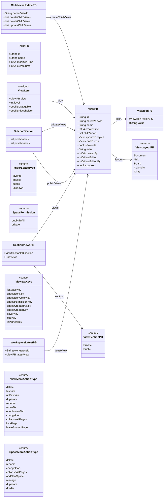
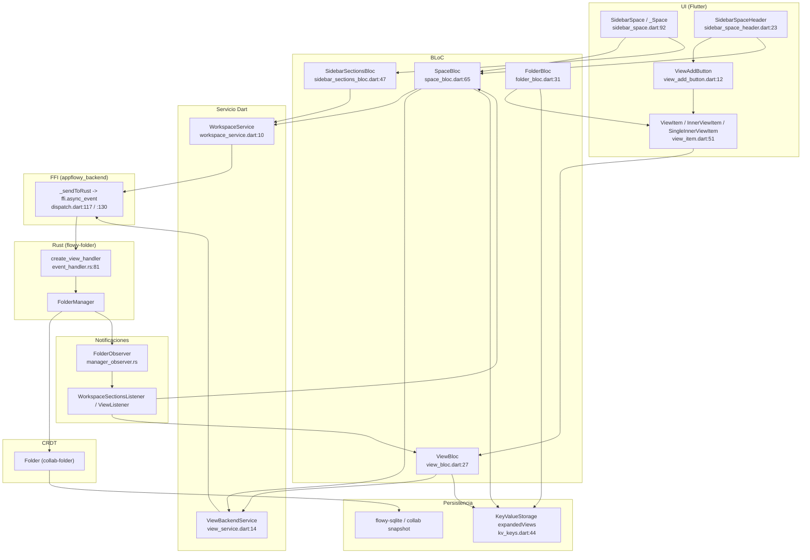
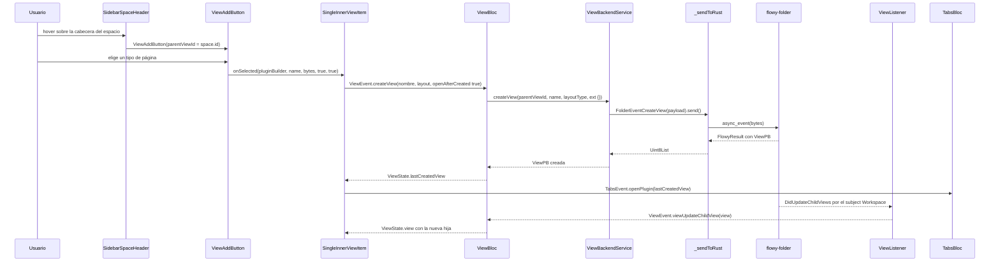
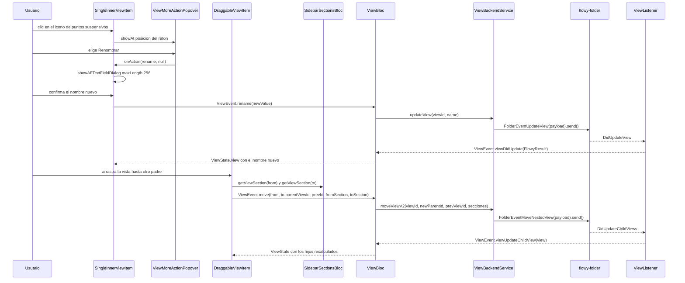
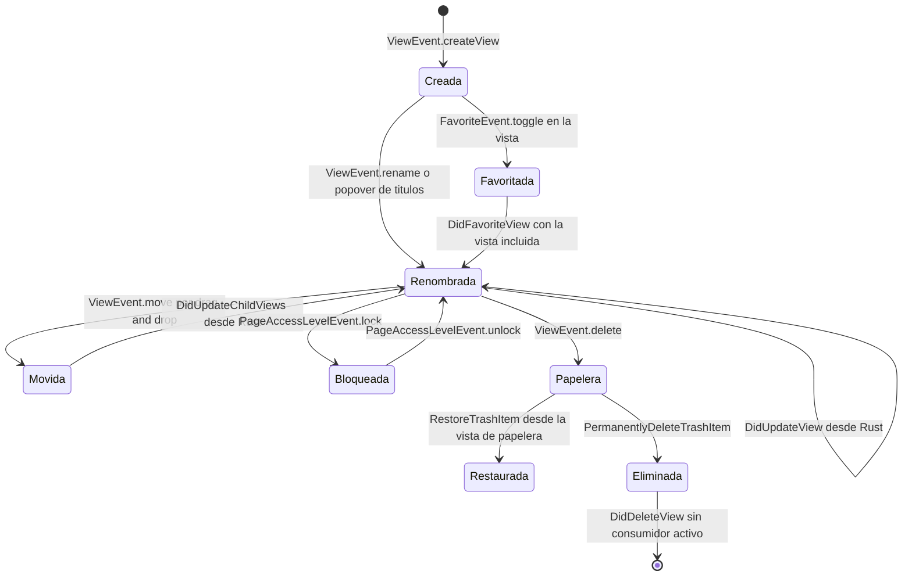

# F03.1 — Vistas, workspaces y sidebar (Dart: `workspace/application` + `presentation`)

## 1. Resumen

Este documento cubre la mitad **Dart** de la feature F03: los 55 archivos de `appflowy/frontend/appflowy_flutter/lib/workspace/` que materializan el árbol de vistas, los workspaces y la barra lateral de espacios (*spaces*) sobre el SDK Rust de `flowy-folder`. La capa de aplicación contiene **14 `Bloc`** (ningún `Cubit`), **3 listeners** de notificaciones, **2 servicios** estáticos de acceso FFI (`ViewBackendService`, `WorkspaceService`) y las extensiones que decoran `ViewPB` con semántica de espacio, portada y fuente. La capa de presentación aporta **91 clases de widget** (66 widgets y 25 clases `State`) que dibujan la cabecera del espacio, el árbol de `ViewItem` recursivo con drag & drop, los menús `···`, la barra de migas `ViewTitleBar` y el popover `MoreViewActions`. De las **51 variantes de `FolderEvent`** de Rust, **23 se despachan desde estos 55 archivos**; de las **19 variantes de `FolderNotification`**, **8 las consume un listener de esta unidad** (más una novena, `DidCreateWorkspace`, declarada en `workspace_listener.dart` pero nunca emitida por Rust); las restantes se reparten entre F04, F11 y las que no tienen listener Dart.

## 2. Alcance

**Incluido:** las 24 clases `application/**` (BLoCs, listeners, servicios, `view_ext.dart`), las 4 clases `prelude.dart` que reexportan, y las 31 clases `presentation/**` del menú lateral (espacios, carpetas por sección, árbol de vistas, menús contextuales, barra de títulos, acciones de vista). Todos los eventos FFI y notificaciones que esos archivos emiten o consumen están aquí (§4, §5).

**Fuera de alcance y redirección** (tabla completa en §13):

- **F03.2** (`OUT/09-features/F03-folder-workspaces-vistas/0.2-flowy-folder-rust.md`): los 51 `FolderEvent`, sus handlers Rust, el `FolderManager` y el modelo CRDT de `collab-folder`. Aquí solo se cita la tabla de §4 de F03.2 como fuente de nombres reales.
- **F03.3** (`OUT/09-features/F03-folder-workspaces-vistas/0.3-collab-folder.md`): el árbol CRDT, `View`, `Workspace`, `Trash` de `collab-folder`.
- **F04** (`OUT/09-features/F04-sidebar-favoritos-recientes-papelera-tabs-command-palette/F04-sidebar-favoritos-recientes-papelera-tabs-command-palette.md`): `favorite/**`, `recent/**`, `plugins/trash/**`, `tabs_bloc.dart`, `command_palette/**`, `edit_panel/**`, `action_navigation/**`, el `sidebar.dart` raíz, `hotkeys.dart`, `home_layout.dart`, `home_stack.dart`, `desktop_home_screen.dart`, `navigation.dart`, `toast.dart`, `af_focus_manager.dart`, `menu_shared_state.dart` y los cuatro archivos (vacíos) de `features/view_management/`.
- **F01 / F02 / F11 / F13**: el `Plugin` concreto que se abre al seleccionar una vista (`ViewPB.plugin()` delega en `DatabaseTabBarViewPlugin`/`DocumentPlugin`/`AIChatPagePlugin`, `appflowy/frontend/appflowy_flutter/lib/workspace/application/view/view_ext.dart:101–132`), `workspace/application/settings/**` (F13), `workspace/application/export/**` (F11) y `workspace/application/user/**` (F05.1).

**Corrección de scope obligatoria nº1 — `view_management`:** el ROADMAP asigna `features/view_management/` a B3.F03, pero sus cuatro archivos están en la unidad F04 y **están vacíos** en este snapshot: `README.md` mide 0 bytes (`appflowy/frontend/appflowy_flutter/lib/features/view_management/README.md`, 0 líneas) y `logic/view_event.dart`, `logic/view_management_bloc.dart`, `logic/view_state.dart` miden 1 byte cada uno. `ViewManagementBloc` **no existe** en ninguna fuente del snapshot: `grep -rn "ViewManagementBloc\|view_management" lib` sobre `SRC/appflowy/frontend/appflowy_flutter/lib` devuelve **cero coincidencias** `[VERIFICADO]`. Se declara explícitamente para que ningún documento afirme su existencia.

## 3. Modelos de datos

Los tipos que atraviesan esta unidad son, en su mayoría, **protobuf generados**: el repo no contiene ningún `.pb.dart` (`find SRC/appflowy/frontend/appflowy_flutter -name "*.pb.dart"` devuelve 0 resultados `[VERIFICADO]`); se generan en build a partir de los `#[derive(ProtoBuf)]` de Rust, como prueba el `part 'dart_event/flowy-folder/dart_event.dart'` declarado en `appflowy/frontend/appflowy_flutter/packages/appflowy_backend/lib/dispatch/dispatch.dart:33`. Por eso las tablas de atributos de más abajo citan la **definición Rust**, que es la fuente de la generación, y no un fichero Dart inexistente.

El siguiente `classDiagram` relaciona los tipos Dart reales que esta unidad manipula. Nótese que **no existe `SpaceViewPB`**: un espacio es una `ViewPB` raíz cuyo campo `extra` es un JSON con la clave `is_space` (`appflowy/frontend/appflowy_flutter/lib/workspace/application/view/view_ext.dart:150–162`); tampoco existen `ViewMetaPB`, `RepeatingBloc`, `ViewActionType` ni `SpaceActionType` (`grep -rl` sobre `SRC` devuelve 0 ficheros para los cinco nombres) `[VERIFICADO]`.

Lectura del diagrama: `ViewPB` es el único agregado que la sidebar manipula; todo lo demás o lo contiene (`ViewLayoutPB`, `ViewIconPB`, `childViews`), o lo envuelve para fines de transporte (`WorkspaceLatestPB`, `SectionViewsPB`, `ChildViewUpdatePB`), o es un enum de presentación (`FolderSpaceType`, `SpacePermission`, `ViewMoreActionType`, `SpaceMoreActionType`). `SidebarSection` es la estructura agregada en memoria que mantiene la sidebar (dos listas de `ViewPB`, pública y privada) y está **duplicada por decreto**: se declara dos veces, en `appflowy/frontend/appflowy_flutter/lib/workspace/application/menu/sidebar_sections_bloc.dart:19–43` y en `appflowy/frontend/appflowy_flutter/lib/workspace/application/sidebar/space/space_bloc.dart:37–61`, con campos idénticos y constructores idénticos `[VERIFICADO]`. `ViewItem` aparece como widget, no como modelo: no existe un tipo de datos `ViewItem`.

**Atributos de `ViewPB`** (definición Rust que genera la clase Dart; `#[pb(index)]` = número de campo en el cable):

| Índice | Campo Dart (`ViewPB`) | Tipo Dart | Definición Rust `ruta:línea` |
|---|---|---|---|
| 1 | `id` | `String` | `appflowy/frontend/rust-lib/flowy-folder/src/entities/view.rs:40–41` |
| 2 | `parentViewId` | `String` | `appflowy/frontend/rust-lib/flowy-folder/src/entities/view.rs:43–45` |
| 3 | `name` | `String` | `appflowy/frontend/rust-lib/flowy-folder/src/entities/view.rs:47–48` |
| 4 | `createTime` | `Int64` | `appflowy/frontend/rust-lib/flowy-folder/src/entities/view.rs:50–51` |
| 5 | `childViews` | `List<ViewPB>` | `appflowy/frontend/rust-lib/flowy-folder/src/entities/view.rs:53–55` |
| 6 | `layout` | `ViewLayoutPB` | `appflowy/frontend/rust-lib/flowy-folder/src/entities/view.rs:57–59` |
| 7 | `icon` | `ViewIconPB?` | `appflowy/frontend/rust-lib/flowy-folder/src/entities/view.rs:61–63` |
| 8 | `isFavorite` | `bool` | `appflowy/frontend/rust-lib/flowy-folder/src/entities/view.rs:65–66` |
| 9 | `extra` | `String?` | `appflowy/frontend/rust-lib/flowy-folder/src/entities/view.rs:68–70` |
| 10 | `createdBy` | `Int64?` | `appflowy/frontend/rust-lib/flowy-folder/src/entities/view.rs:72–74` |
| 11 | `lastEdited` | `Int64` | `appflowy/frontend/rust-lib/flowy-folder/src/entities/view.rs:76–78` |
| 12 | `lastEditedBy` | `Int64?` | `appflowy/frontend/rust-lib/flowy-folder/src/entities/view.rs:80–82` |
| 13 | `isLocked` | `bool?` | `appflowy/frontend/rust-lib/flowy-folder/src/entities/view.rs:84–88` |

**Metadatos de la vista.** No existe `ViewMetaPB`. Los metadatos que la UI muestra en el popover `···` del documento viven en dos sitios distintos: (a) el contador de palabras/caracteres del contenido, en `ViewInfoState.documentCounters`/`titleCounters` de tipo `Counters` (`appflowy/frontend/appflowy_flutter/lib/workspace/application/view_info/view_info_bloc.dart:114–121`), producido por `WordCountService` del `appflowy_editor` (`:29–40`); y (b) la fecha de creación, `ViewPB.createTime` convertido con `toDateTime()` (`appflowy/frontend/appflowy_flutter/lib/workspace/application/view_info/view_info_bloc.dart:20`). El widget que las presenta es `ViewMetaInfo` (`appflowy/frontend/appflowy_flutter/lib/workspace/presentation/widgets/more_view_actions/widgets/view_meta_info.dart:10–24`), que suma los contadores de documento y título (`appflowy/frontend/appflowy_flutter/lib/workspace/presentation/widgets/more_view_actions/widgets/view_meta_info.dart:42` y `:56`) y los formatea con `UserDateFormatPB`/`UserTimeFormatPB` (`appflowy/frontend/appflowy_flutter/lib/workspace/presentation/widgets/more_view_actions/widgets/view_meta_info.dart:20–21`).

**Tipos auxiliares con definición Rust verificable:**

| Tipo Dart | Definición Rust `ruta:línea` | Consumido en esta unidad en |
|---|---|---|
| `ViewLayoutPB` (`Document/Grid/Board/Calendar/Chat`) | `appflowy/frontend/rust-lib/flowy-folder/src/entities/view.rs:186–195` | `appflowy/frontend/appflowy_flutter/lib/workspace/application/view/view_ext.dart:92–99`, `:318–364`, `appflowy/frontend/appflowy_flutter/lib/workspace/presentation/home/menu/view/view_item.dart:595` |
| `ViewSectionPB` (`Private/Public`) | `appflowy/frontend/rust-lib/flowy-folder/src/entities/view.rs:345–350` | `appflowy/frontend/appflowy_flutter/lib/workspace/application/sidebar/folder/folder_bloc.dart:18–28`, `appflowy/frontend/appflowy_flutter/lib/workspace/application/menu/sidebar_sections_bloc.dart:104–129` |
| `ViewIconPB` (`ty`, `value`) | `appflowy/frontend/rust-lib/flowy-folder/src/entities/icon.rs:45–50` | `appflowy/frontend/appflowy_flutter/lib/workspace/application/view/view_service.dart:206`, `appflowy/frontend/appflowy_flutter/lib/workspace/application/view_title/view_title_bloc.dart:32` |
| `ViewIconTypePB` (`Emoji/Url/Icon`) | `appflowy/frontend/rust-lib/flowy-folder/src/entities/icon.rs:7–12` | `appflowy/frontend/appflowy_flutter/lib/workspace/application/view/view_service.dart:210`, `appflowy/frontend/appflowy_flutter/lib/workspace/presentation/home/menu/view/view_item.dart:679` |
| `WorkspaceLatestPB` (`workspace_id`, `latest_view`) | `appflowy/frontend/rust-lib/flowy-folder/src/entities/workspace.rs:137–143` | `appflowy/frontend/appflowy_flutter/lib/workspace/application/home/home_bloc.dart:55–57`, `appflowy/frontend/appflowy_flutter/lib/workspace/application/home/home_setting_bloc.dart:51` |
| `TrashPB` (`id`, `name`, `modified_time`, `create_time`) | `appflowy/frontend/rust-lib/flowy-folder/src/entities/trash.rs:5–17` | `appflowy/frontend/appflowy_flutter/lib/workspace/application/view_title/view_title_bar_bloc.dart:24`, `:31` |

**Constantes de `extra` que definen el espacio** (`appflowy/frontend/appflowy_flutter/lib/workspace/application/view/view_ext.dart:28–53`): `is_space`, `space_creator`, `space_created_at`, `space_icon`, `space_icon_color`, `space_permission`, además de `cover`/`type`/`value` para la portada, `font`, `font_layout`, `line_height_layout` e `is_pinned`. `SpaceBloc` escribe las cinco primeras al crear el espacio (`appflowy/frontend/appflowy_flutter/lib/workspace/application/sidebar/space/space_bloc.dart:428–434`) y `ViewPB.isSpace` las lee con `jsonDecode(extra)` protegido por `try/catch` (`appflowy/frontend/appflowy_flutter/lib/workspace/application/view/view_ext.dart:150–162`).

## 4. Eventos FFI

La tabla siguiente cruza **los 23 `FolderEvent` que esta unidad despacha** con el bloc que los dispara, el método de servicio que los serializa y la línea exacta del `send()`. Los nombres se han verificado contra la tabla §4 de F03.2 y contra el código Dart: **no se ha supuesto ninguno**. Se corrigen aquí tres nombres que aparecen con otra grafía en la literatura informal: el evento de renombrar es `UpdateView` (no existe `RenameView`), el de mover a papelera es `DeleteView` (no `MoveViewToTrash`), el de restaurar es `RestoreTrashItem` (no `RestoreView`) y el de papelera es `ListTrashItems` (no `GetTrashViews`).

| # | `FolderEvent` | Input PB | Output PB | Bloc/servicio Dart que lo dispara | `send()` en `view_service.dart` / `workspace_service.dart` |
|---|---|---|---|---|---|
| 10 | `CreateView` | `CreateViewPayloadPB` | `ViewPB` | `ViewBloc` (evento `createView`), `SpaceBloc` (`createPage`), `SidebarSectionsBloc` (`createRootViewInSection`) | `appflowy/frontend/appflowy_flutter/lib/workspace/application/view/view_service.dart:71` · `appflowy/frontend/appflowy_flutter/lib/workspace/application/workspace/workspace_service.dart:47` |
| 16 | `CreateOrphanView` | `CreateOrphanViewPayloadPB` | `ViewPB` | (sin bloc de la unidad; API pública de `ViewBackendService`) | `appflowy/frontend/appflowy_flutter/lib/workspace/application/view/view_service.dart:93` |
| 11 | `GetView` | `ViewIdPB` | `ViewPB` | `ViewBloc` (`initial`, `viewDidUpdate`, `_updateChildViews`), `SpaceBloc` (`open`), `ViewTitleBarBloc` vía `getViewAncestors` | `appflowy/frontend/appflowy_flutter/lib/workspace/application/view/view_service.dart:122`, `:275`, `:317` |
| 12 | `UpdateView` | `UpdateViewPayloadPB` | `ViewPB` | `ViewBloc` (`rename`), `SpaceBloc` (`update`/`rename`) | `appflowy/frontend/appflowy_flutter/lib/workspace/application/view/view_service.dart:197` |
| 13 | `DeleteView` | `RepeatedViewIdPB` | — | `ViewBloc` (`delete`), `SpaceBloc` (`delete`) | `appflowy/frontend/appflowy_flutter/lib/workspace/application/view/view_service.dart:134`, `:141` |
| 14 | `DuplicateView` | `DuplicateViewPayloadPB` | `ViewPB` | `ViewBloc` (`duplicate`), `SpaceBloc` (`_duplicateSpace`) | `appflowy/frontend/appflowy_flutter/lib/workspace/application/view/view_service.dart:167` |
| 22 | `MoveView` | `MoveViewPayloadPB` | — | `SidebarSectionsBloc` (`moveRootView`) — API marcada *deprecated* en Dart | `appflowy/frontend/appflowy_flutter/lib/workspace/application/view/view_service.dart:234` · `appflowy/frontend/appflowy_flutter/lib/workspace/application/workspace/workspace_service.dart:84` |
| 32 | `MoveNestedView` | `MoveNestedViewPayloadPB` | — | `ViewBloc` (`move`, vía `moveViewV2`), `SpaceBloc` (`migrate`) | `appflowy/frontend/appflowy_flutter/lib/workspace/application/view/view_service.dart:256` |
| 17 | `GetAllViews` | — | `RepeatedViewPB` | `SpaceSearchBloc` (`initial`) | `appflowy/frontend/appflowy_flutter/lib/workspace/application/view/view_service.dart:265` |
| 34 | `ToggleFavorite` | `RepeatedViewIdPB` | — | `ViewBackendService.favorite` — el bloc que lo emite es `FavoriteBloc` (**F04**) | `appflowy/frontend/appflowy_flutter/lib/workspace/application/view/view_service.dart:174` |
| 35 | `UpdateViewIcon` | `UpdateViewIconPayloadPB` | — | `ViewBloc` (`updateIcon`), `RenameViewPopover`, `SingleInnerViewItem` | `appflowy/frontend/appflowy_flutter/lib/workspace/application/view/view_service.dart:220` |
| 41 | `UpdateViewVisibilityStatus` | `UpdateViewVisibilityStatusPayloadPB` | — | `ViewBloc` (`updateViewVisibility`), `SpaceBloc` (`update` con permiso) | `appflowy/frontend/appflowy_flutter/lib/workspace/application/view/view_service.dart:335` |
| 42 | `GetViewAncestors` | `ViewIdPB` | `RepeatedViewPB` | `ViewTitleBarBloc` (`reload`) | `appflowy/frontend/appflowy_flutter/lib/workspace/application/view/view_service.dart:309` |
| 54 | `LockView` | `ViewIdPB` | — | `ViewBackendService.lockView` — el bloc emisor es `PageAccessLevelBloc` (F11/F05) | `appflowy/frontend/appflowy_flutter/lib/workspace/application/view/view_service.dart:420` |
| 55 | `UnlockView` | `ViewIdPB` | — | `ViewBackendService.unlockView` — mismo caso que `LockView` | `appflowy/frontend/appflowy_flutter/lib/workspace/application/view/view_service.dart:425` |
| 43 | `PublishView` | `PublishViewParamsPB` | — | `ViewBackendService.publish` — consumido por el plugin de *publish* (F11) | `appflowy/frontend/appflowy_flutter/lib/workspace/application/view/view_service.dart:360` |
| 47 | `UnpublishViews` | `UnpublishViewsPayloadPB` | — | `ViewBloc` (`unpublish`, `_unpublishPage`) | `appflowy/frontend/appflowy_flutter/lib/workspace/application/view/view_service.dart:367` |
| 44 | `GetPublishInfo` | `ViewIdPB` | `PublishInfoResponsePB` | `ViewBackendService.containPublishedPage`, invocada desde `ViewBloc.delete` | `appflowy/frontend/appflowy_flutter/lib/workspace/application/view/view_service.dart:342` |
| 45 | `GetPublishNamespace` | — | `PublishNamespacePB` | `ViewBackendService.getPublishNameSpace` | `appflowy/frontend/appflowy_flutter/lib/workspace/application/view/view_service.dart:379` |
| 46 | `SetPublishNamespace` | `SetPublishNamespacePayloadPB` | — | `ViewBackendService.setPublishNameSpace` | `appflowy/frontend/appflowy_flutter/lib/workspace/application/view/view_service.dart:374` |
| 2 | `ReadCurrentWorkspace` | — | `WorkspacePB` | `WorkspaceService.getWorkspace` | `appflowy/frontend/appflowy_flutter/lib/workspace/application/workspace/workspace_service.dart:51` |
| 5 | `ReadWorkspaceViews` | `GetWorkspaceViewPB` | `RepeatedViewPB` | `WorkspaceService.getPublicViews`, usada por `SpaceBloc._getSectionViews` y `SidebarSectionsBloc._getSectionViews` | `appflowy/frontend/appflowy_flutter/lib/workspace/application/workspace/workspace_service.dart:56` |
| 39 | `ReadPrivateViews` | `GetWorkspaceViewPB` | `RepeatedViewPB` | `WorkspaceService.getPrivateViews`, mismo par de blocs | `appflowy/frontend/appflowy_flutter/lib/workspace/application/workspace/workspace_service.dart:66` |

### 4.1. Los 28 `FolderEvent` sin consumidor dentro de esta unidad

De las 51 variantes de `FolderEvent` (F03.2 §4), **23 se despachan desde estos 55 archivos** (tabla anterior) y **28 no**. La clasificación de esos 28 distingue tres situaciones distintas:

**(a) 23 tienen consumidor Dart, pero en otra unidad** — se despachan desde `lib/plugins/trash/**` (F04: `ListTrashItems`, `RestoreTrashItem`, `PermanentlyDeleteTrashItem`, `RecoverAllTrashItems`, `PermanentlyDeleteAllTrashItem`, todos desde `trash_service.dart`), desde `lib/workspace/application/favorite/favorite_service.dart` y `recent/cached_recent_service.dart` (F04: `ReadFavorites`, `UpdateRecentViews`, `ReadRecentViews`), desde `lib/workspace/application/settings/share/import_service.dart` (F11: `ImportData`, `ImportZipFile`), desde `lib/plugins/shared/share/share_bloc.dart` y `lib/workspace/presentation/settings/pages/sites/settings_sites_bloc.dart` (F11: `SetPublishName`, `ListPublishedViews`, `GetDefaultPublishInfo`, `SetDefaultPublishView`, `RemoveDefaultPublishView`), desde `lib/plugins/document/application/document_service.dart`, `lib/plugins/database/domain/database_view_service.dart` y `lib/plugins/ai_chat/application/chat_bloc.dart` (F01/F02: `CloseView`), desde `lib/workspace/presentation/home/desktop_home_screen.dart`, `home_stack.dart`, `lib/user/presentation/router.dart`, `splash_screen.dart` y los `mobile_*` (F04/F05.1: `GetCurrentWorkspaceSetting`, `SetLatestView`), y desde `lib/features/share_tab/**` y `lib/features/shared_section/**` (F11: `GetSharedUsers`, `GetSharedViewSection`, `GetSharedViews`, `SharePageWithUser`, `RemoveUserFromSharedPage`) `[VERIFICADO]`.

**(b) 3 no tienen handler Rust registrado** — `CreateFolderWorkspace` (marcado `/// Deprecated` en `appflowy/frontend/rust-lib/flowy-folder/src/event_map.rs:67`), `DeleteWorkspace` y `CopyLink` (declarados en `event_map.rs` pero ausentes del `init`, F03.2 §4). Dart tampoco los invoca en ningún punto de `lib`, `packages`, `test` o `integration_test` `[VERIFICADO]`.

**(c) 2 tienen handler Rust pero ningún consumidor Dart en todo el repo** — `GetFolderSnapshots` (handler en `appflowy/frontend/rust-lib/flowy-folder/src/event_handler.rs:378–386`) y `ReadCurrentWorkspaceViews` (handler en `appflowy/frontend/rust-lib/flowy-folder/src/event_handler.rs:42–49`). `grep -rl "FolderEventGetFolderSnapshots("` y `grep -rl "FolderEventReadCurrentWorkspaceViews("` sobre `SRC/appflowy/frontend/appflowy_flutter/{lib,packages,test,integration_test}` devuelven **cero** ficheros `[VERIFICADO]`. El motivo es que ambos son *lecturas de solo consulta* cuyo resultado no necesita la sidebar: el historial de instantáneas del workspace se usa desde la UI de detalles en Rust y las vistas del workspace actual se reconstruyen con `ReadWorkspaceViews`/`ReadPrivateViews` en `appflowy/frontend/appflowy_flutter/lib/workspace/application/workspace/workspace_service.dart:56` y `:66`.

**Resumen:** 23 con consumidor en F03.1 · 23 con consumidor en otra unidad · 5 sin consumidor Dart en todo el código (3 de ellos, además, sin handler Rust). 23 + 23 + 5 = 51.

## 5. Notificaciones

Las 19 variantes de `FolderNotification` se declaran en `appflowy/frontend/rust-lib/flowy-folder/src/notification.rs:8–45` y viajan por el subject Rust `"Workspace"` (`appflowy/frontend/rust-lib/flowy-folder/src/notification.rs:6`), que Dart filtra en `FolderNotificationParser` (`appflowy/frontend/appflowy_flutter/lib/core/notification/folder_notification.dart:13–14`). Hay **dos mecanismos de suscripción** en Dart: el antiguo, con `id` explícito y parser manual (`ViewListener`), y el nuevo, con `objectId` y handler directo (`FolderNotificationListener`).

| # | `FolderNotification` | Listener Dart | `ruta:línea` del `case` | ¿En esta unidad? | Efecto en la UI |
|---|---|---|---|---|---|
| 0 | `Unknown` | — | — | **No** | centinela del enum, nunca se deserializa (`appflowy/frontend/rust-lib/flowy-folder/src/notification.rs:11`) |
| 1 | `DidCreateWorkspace` | `WorkspaceListener` (declarado, sin `case`) | `appflowy/frontend/appflowy_flutter/lib/workspace/application/workspace/workspace_listener.dart:57` (bloque `DidUpdateWorkspace`) | **Sí** (clase), sin caso | declared pero nunca emitido por Rust (F03.2 §5) |
| 2 | `DidUpdateWorkspace` | `WorkspaceListener` | `appflowy/frontend/appflowy_flutter/lib/workspace/application/workspace/workspace_listener.dart:57` | **Sí** | actualiza `WorkspacePB` en `_workspaceUpdatedNotifier` (`appflowy/frontend/appflowy_flutter/lib/workspace/application/workspace/workspace_listener.dart:59–60`) |
| 3 | `DidUpdateWorkspaceViews` | `WorkspaceListener` | `appflowy/frontend/appflowy_flutter/lib/workspace/application/workspace/workspace_listener.dart:65` | **Sí** | reemplaza la lista de vistas raíz del workspace (`appflowy/frontend/appflowy_flutter/lib/workspace/application/workspace/workspace_listener.dart:67–68`) |
| 4 | `DidUpdateWorkspaceSetting` | `FolderListener` (**F05.1**, `lib/user/application/user_listener.dart`) | `appflowy/frontend/appflowy_flutter/lib/user/application/user_listener.dart:153` | **No** (pero `HomeBloc` y `HomeSettingBloc`, que sí son de esta unidad, lo consumen vía `FolderListener`: `appflowy/frontend/appflowy_flutter/lib/workspace/application/home/home_bloc.dart:14`, `appflowy/frontend/appflowy_flutter/lib/workspace/application/home/home_setting_bloc.dart:18`) | actualiza `WorkspaceLatestPB` y `latestView` (`appflowy/frontend/appflowy_flutter/lib/workspace/application/home/home_bloc.dart:52–70`) |
| 10 | `DidUpdateView` | `ViewListener` | `appflowy/frontend/appflowy_flutter/lib/workspace/application/view/view_listener.dart:70` | **Sí** | recarga la vista y emite `ViewEvent.viewDidUpdate` (`appflowy/frontend/appflowy_flutter/lib/workspace/application/view/view_bloc.dart:70–72`, `:115–136`) |
| 11 | `DidUpdateChildViews` | `ViewListener` | `appflowy/frontend/appflowy_flutter/lib/workspace/application/view/view_listener.dart:79` | **Sí** | parchea `childViews` en local o recarga la vista padre (`appflowy/frontend/appflowy_flutter/lib/workspace/application/view/view_bloc.dart:383–427`) |
| 12 | `DidDeleteView` | `ViewListener` | `appflowy/frontend/appflowy_flutter/lib/workspace/application/view/view_listener.dart:88` | **Sí** | declara eliminación definitiva (`ViewListener` solo lo deserializa; **nadie de esta unidad registra `onViewDeleted`**) |
| 13 | `DidRestoreView` | `ViewListener` | `appflowy/frontend/appflowy_flutter/lib/workspace/application/view/view_listener.dart:95` | **Sí** | Igual que `DidDeleteView`: se deserializa, sin consumidor registrado en `ViewBloc` |
| 14 | `DidMoveViewToTrash` | `ViewListener` | `appflowy/frontend/appflowy_flutter/lib/workspace/application/view/view_listener.dart:102` | **Sí** | Deserializa `DeletedViewPB`, también sin callback activo |
| 15 | `DidUpdateTrash` | `TrashListener` (**F04**) | `appflowy/frontend/appflowy_flutter/lib/plugins/trash/application/trash_listener.dart:36` | **No** (pero `ViewTitleBarBloc` de esta unidad lo consume indirectamente vía `TrashListener`: `appflowy/frontend/appflowy_flutter/lib/workspace/application/view_title/view_title_bar_bloc.dart:48–56`) | recalcula `ViewTitleBarState.isDeleted` (`appflowy/frontend/appflowy_flutter/lib/workspace/application/view_title/view_title_bar_bloc.dart:30–34`) |
| 16 | `DidUpdateFolderSnapshotState` | — | — | **No** | declarado y nunca emitido (F03.2 §5) |
| 17 | `DidUpdateFolderSyncUpdate` | — | — | **No** | indicador global de sincronización, sin listener Dart |
| 36 | `DidFavoriteView` | `FavoriteListener` (**F04**) | `appflowy/frontend/appflowy_flutter/lib/workspace/application/favorite/favorite_listener.dart:41` | **No** (pero `ViewBloc` registra un `FavoriteListener` propio: `appflowy/frontend/appflowy_flutter/lib/workspace/application/view/view_bloc.dart:34`, `:80–97`) | si la vista está en la lista, refresca `ViewEvent.viewDidUpdate` con el `ViewPB` de favoritos |
| 37 | `DidUnfavoriteView` | `FavoriteListener` (**F04**) | `appflowy/frontend/appflowy_flutter/lib/workspace/application/favorite/favorite_listener.dart:48` | **No** (mismo `FavoriteListener` interno de `ViewBloc`) | mismo efecto |
| 38 | `DidUpdateRecentViews` | `RecentViewsListener` (**F04**) | clase en `appflowy/frontend/appflowy_flutter/lib/workspace/application/recent/recent_listener.dart:18` | **No** | actualiza `CachedRecentService` al borrar una vista (`appflowy/frontend/appflowy_flutter/lib/workspace/application/view/view_bloc.dart:184–187`) |
| 39 | `DidUpdateSectionViews` | `WorkspaceSectionsListener` | `appflowy/frontend/appflowy_flutter/lib/workspace/application/workspace/workspace_sections_listener.dart:49` | **Sí** | `SpaceBloc` recarga espacios (`appflowy/frontend/appflowy_flutter/lib/workspace/application/sidebar/space/space_bloc.dart:495`) y `SidebarSectionsBloc` parchea la sección (`appflowy/frontend/appflowy_flutter/lib/workspace/application/menu/sidebar_sections_bloc.dart:259`) |
| 40 | `DidUpdateSharedViews` | — | — | **No** | consumption en `lib/features/shared_section/**` (F11) |
| 41 | `DidUpdateSharedUsers` | — | — | **No** | consumption en `lib/features/share_tab/**` (F11) |

**Recuento de las 19 variantes:** **8** con `case` efectivo en un listener **de esta unidad** (`DidUpdateWorkspace`, `DidUpdateWorkspaceViews`, `DidUpdateView`, `DidUpdateChildViews`, `DidDeleteView`, `DidRestoreView`, `DidMoveViewToTrash`, `DidUpdateSectionViews`); **1** más (`DidCreateWorkspace`) cuyo listener está en esta unidad pero que nunca llega a un `case` porque Rust no la emite; **1** (`DidUpdateWorkspaceSetting`) cuyo listener vive en F05.1 pero cuyos dos únicos consumidores (`HomeBloc`, `HomeSettingBloc`) son de esta unidad; **4** en F04 (`DidUpdateTrash`, `DidFavoriteView`, `DidUnfavoriteView`, `DidUpdateRecentViews`); **2** en F11 (`DidUpdateSharedViews`, `DidUpdateSharedUsers`); **2** sin ningún listener Dart (`DidUpdateFolderSnapshotState`, `DidUpdateFolderSyncUpdate`); y el centinela `Unknown`. 8 + 1 + 1 + 4 + 2 + 2 + 1 = 19.

**Corrección importante respecto de F03.2 §5:** F03.2 atribuye `DidUpdateRecentViews` a `appflowy/frontend/appflowy_flutter/lib/workspace/application/recent/recent_listener.dart:36`, pero ese fichero **no contiene ningún `case FolderNotification`**. La clase real se llama `RecentViewsListener` (no `RecentListener`) y filtra **solo por `id` de subject** (`appflowy/frontend/appflowy_flutter/lib/workspace/application/recent/recent_listener.dart:23–34`), deserializando cualquier payload como `RepeatedViewIdPB` sin mirar el discriminante (`appflowy/frontend/appflowy_flutter/lib/workspace/application/recent/recent_listener.dart:38–51`) `[VERIFICADO]`. Es el único listener de los siete que no discrimina por tipo de notificación.

## 6. BLoCs / Cubits

**Los 14 BLoCs de la unidad son `Bloc`, ninguno `Cubit`** `[VERIFICADO]` (contrastado contra `OUT/_ledger/extract/blocs.json` y contra cada declaración en el código). Los tres *listeners* de §5 no son `Bloc` pero sí son piezas de estado reactivo, por lo que se listan aparte. Los **24 archivos** etiquetados como capa `bloc` en el ledger son estos 14 BLoCs + 3 listeners + 3 servicios/extensiones (`view_service.dart`, `workspace_service.dart`, `view_ext.dart`) + 4 `prelude.dart` (`view/prelude.dart`, `workspace/prelude.dart`, `menu/prelude.dart`, `home/prelude.dart` — este último con **0 líneas útiles**, solo un salto).

| # | Clase | Tipo | `ruta:línea` (declaración) | Eventos freezed (nº y variantes) | Estado freezed (campos) | Servicios / listeners inyectados |
|---|---|---|---|---|---|---|
| 1 | `ViewBloc` | `Bloc<ViewEvent, ViewState>` | `appflowy/frontend/appflowy_flutter/lib/workspace/application/view/view_bloc.dart:27` | 14: `initial`, `setIsEditing`, `setIsExpanded`, `rename`, `delete`, `duplicate`, `move`, `createView`, `viewDidUpdate`, `viewUpdateChildView`, `updateViewVisibility`, `updateIcon`, `collapseAllPages`, `unpublish` (`appflowy/frontend/appflowy_flutter/lib/workspace/application/view/view_bloc.dart:457–505`) | `ViewState{view, isEditing, isExpanded, successOrFailure, isDeleted, isLoading, lastCreatedView}` (`appflowy/frontend/appflowy_flutter/lib/workspace/application/view/view_bloc.dart:507–525`) | `ViewBackendService` (`:32`), `ViewListener` (`:33`), `FavoriteListener` (`:34`), `KeyValueStorage` vía `getIt` (`:358`), `CachedRecentService` vía `getIt` (`:184`), `ViewExpanderRegistry` vía `getIt` (`:42`) |
| 2 | `WorkspaceBloc` | `Bloc<WorkspaceEvent, WorkspaceState>` | `appflowy/frontend/appflowy_flutter/lib/workspace/application/workspace/workspace_bloc.dart:12` | 3: `initial`, `createWorkspace`, `workspacesReceived` (`appflowy/frontend/appflowy_flutter/lib/workspace/application/workspace/workspace_bloc.dart:85–92`) | `WorkspaceState{isLoading, workspaces, successOrFailure}` (`appflowy/frontend/appflowy_flutter/lib/workspace/application/workspace/workspace_bloc.dart:94–107`) | `UserBackendService` inyectado por constructor (`:13`, `:17`) — **no llama a `flowy-folder`** |
| 3 | `FolderBloc` | `Bloc<FolderEvent, FolderState>` | `appflowy/frontend/appflowy_flutter/lib/workspace/application/sidebar/folder/folder_bloc.dart:31` | 2: `initial`, `expandOrUnExpand` (`appflowy/frontend/appflowy_flutter/lib/workspace/application/sidebar/folder/folder_bloc.dart:78–84`) | `FolderState{type, isExpanded}` (`appflowy/frontend/appflowy_flutter/lib/workspace/application/sidebar/folder/folder_bloc.dart:86–100`) | `KeyValueStorage` vía `getIt` (`:52`, `:68`); el enum `FolderSpaceType` se declara en `:12–29` |
| 4 | `SpaceBloc` | `Bloc<SpaceEvent, SpaceState>` | `appflowy/frontend/appflowy_flutter/lib/workspace/application/sidebar/space/space_bloc.dart:65` | 14: `initial`, `create`, `rename`, `changeIcon`, `duplicate`, `update`, `open`, `expand`, `createPage`, `delete`, `didReceiveSpaceUpdate`, `reset`, `migrate`, `switchToNextSpace` (`appflowy/frontend/appflowy_flutter/lib/workspace/application/sidebar/space/space_bloc.dart:735–787`) | `SpaceState{spaces, currentSpace, isExpanded, lastCreatedPage, createPageResult, shouldShowUpgradeDialog, isDuplicatingSpace, isInitialized}` (`appflowy/frontend/appflowy_flutter/lib/workspace/application/sidebar/space/space_bloc.dart:789–804`) | `WorkspaceService` (`:479`), `WorkspaceSectionsListener` (`:487`), `ViewBackendService` (estático), `UserBackendService` (`:565–566`), `KeyValueStorage` vía `getIt` (`:514`, `:525`) |
| 5 | `SpaceSearchBloc` | `Bloc<SpaceSearchEvent, SpaceSearchState>` | `appflowy/frontend/appflowy_flutter/lib/workspace/application/sidebar/space/space_search_bloc.dart:9` | 2: `initial`, `search` (`appflowy/frontend/appflowy_flutter/lib/workspace/application/sidebar/space/space_search_bloc.dart:46–50`) | `SpaceSearchState{queryResults}` (`appflowy/frontend/appflowy_flutter/lib/workspace/application/sidebar/space/space_search_bloc.dart:52–59`) | `ViewBackendService.getAllViews` (`:15`); caché local `_allViews` (`:43`) |
| 6 | `RenameViewBloc` | `Bloc<RenameViewEvent, RenameViewState>` | `appflowy/frontend/appflowy_flutter/lib/workspace/application/sidebar/rename_view/rename_view_bloc.dart:7` | 1: `open` (`appflowy/frontend/appflowy_flutter/lib/workspace/application/sidebar/rename_view/rename_view_bloc.dart:27–30`) | `RenameViewState{controller}` (`appflowy/frontend/appflowy_flutter/lib/workspace/application/sidebar/rename_view/rename_view_bloc.dart:32–37`) | `PopoverController` de `appflowy_popover` (`:8`, `:18`); singleton en `getIt` (`appflowy/frontend/appflowy_flutter/lib/startup/deps_resolver.dart:162`) |
| 7 | `HomeBloc` | `Bloc<HomeEvent, HomeState>` | `appflowy/frontend/appflowy_flutter/lib/workspace/application/home/home_bloc.dart:12` | 3: `initial`, `showLoading`, `didReceiveWorkspaceSetting` (`appflowy/frontend/appflowy_flutter/lib/workspace/application/home/home_bloc.dart:77–84`) | `HomeState{isLoading, workspaceSetting, latestView}` (`appflowy/frontend/appflowy_flutter/lib/workspace/application/home/home_bloc.dart:86–98`) | `FolderListener` (F05.1) vía `appflowy/user/application/user_listener.dart` (`:14`, `:21`) |
| 8 | `HomeSettingBloc` | `Bloc<HomeSettingEvent, HomeSettingState>` | `appflowy/frontend/appflowy_flutter/lib/workspace/application/home/home_setting_bloc.dart:13` | 10: `initial`, `setEditPanel`, `dismissEditPanel`, `didReceiveWorkspaceSetting`, `changeMenuStatus`, `collapseNotificationPanel`, `checkScreenSize`, `editPanelResized`, `editPanelResizeStart`, `editPanelResizeEnd` (`appflowy/frontend/appflowy_flutter/lib/workspace/application/home/home_setting_bloc.dart:148–176`) | `HomeSettingState{panelContext, workspaceSetting, unauthorized, menuStatus, isNotificationPanelCollapsed, isScreenSmall, hasColappsedMenuManually, resizeOffset, resizeStart, resizeType}` (`appflowy/frontend/appflowy_flutter/lib/workspace/application/home/home_setting_bloc.dart:178–213`) | `FolderListener` (F05.1) (`:18`), `AppearanceSettingsCubit` (`:19`, `:31`); enums `MenuResizeType` (`:132`) y `MenuStatus` (`:215`) |
| 9 | `MenuUserBloc` | `Bloc<MenuUserEvent, MenuUserState>` | `appflowy/frontend/appflowy_flutter/lib/workspace/application/menu/menu_user_bloc.dart:13` | 3: `initial`, `updateUserName`, `didReceiveUserProfile` (`appflowy/frontend/appflowy_flutter/lib/workspace/application/menu/menu_user_bloc.dart:79–86`) | `MenuUserState{userProfile, workspaces, successOrFailure}` (`appflowy/frontend/appflowy_flutter/lib/workspace/application/menu/menu_user_bloc.dart:88–101`) | `UserBackendService` (`:19`), `UserListener` (`:15`), `FolderListener` (F05.1) (`:16`); **ninguno llama a `flowy-folder`** |
| 10 | `SidebarSectionsBloc` | `Bloc<SidebarSectionsEvent, SidebarSectionsState>` | `appflowy/frontend/appflowy_flutter/lib/workspace/application/menu/sidebar_sections_bloc.dart:47` | 6: `initial`, `reset`, `createRootViewInSection`, `moveRootView`, `receiveSectionViewsUpdate`, `reload` (`appflowy/frontend/appflowy_flutter/lib/workspace/application/menu/sidebar_sections_bloc.dart:275–303`) | `SidebarSectionsState{section, lastCreatedRootView, createRootViewResult, containsSpace}` (`appflowy/frontend/appflowy_flutter/lib/workspace/application/menu/sidebar_sections_bloc.dart:305–317`) | `WorkspaceService` (`:247`), `WorkspaceSectionsListener` (`:252`), `TabsBloc` vía `getIt` (`:179`, `:185`, `:191`) |
| 11 | `ViewTitleBloc` | `Bloc<ViewTitleEvent, ViewTitleState>` | `appflowy/frontend/appflowy_flutter/lib/workspace/application/view_title/view_title_bloc.dart:10` | 2: `initial`, `updateNameOrIcon` (`appflowy/frontend/appflowy_flutter/lib/workspace/application/view_title/view_title_bloc.dart:63–72`) | `ViewTitleState{name, icon, view}` (`appflowy/frontend/appflowy_flutter/lib/workspace/application/view_title/view_title_bloc.dart:74–86`) | `ViewListener` (`:13`, `:27–37`) |
| 12 | `ViewTitleBarBloc` | `Bloc<ViewTitleBarEvent, ViewTitleBarState>` | `appflowy/frontend/appflowy_flutter/lib/workspace/application/view_title/view_title_bar_bloc.dart:11` | 2: `reload`, `trashUpdated` (`appflowy/frontend/appflowy_flutter/lib/workspace/application/view_title/view_title_bar_bloc.dart:76–82`) | `ViewTitleBarState{ancestors, isDeleted}` (`appflowy/frontend/appflowy_flutter/lib/workspace/application/view_title/view_title_bar_bloc.dart:84–92`) | `ViewBackendService` (`:18`), `TrashService` (**F04**) (`:39`), `ViewListener` (`:40`), `TrashListener` (**F04**) (`:48`) |
| 13 | `ViewInfoBloc` | `Bloc<ViewInfoEvent, ViewInfoState>` | `appflowy/frontend/appflowy_flutter/lib/workspace/application/view_info/view_info_bloc.dart:13` | 6: `started`, `unregisterEditorState`, `registerEditorState`, `wordCountChanged`, `titleChanged`, `workspaceTypeChanged` (`appflowy/frontend/appflowy_flutter/lib/workspace/application/view_info/view_info_bloc.dart:95–112`) | `ViewInfoState{documentCounters, titleCounters, createdAt, workspaceType}` (`appflowy/frontend/appflowy_flutter/lib/workspace/application/view_info/view_info_bloc.dart:114–129`) | `WordCountService` de `appflowy_editor` (`:31`), `UserEventGetUserProfile` de `flowy-user` (`:63`) |
| 14 | `SidebarPlanBloc` | `Bloc<SidebarPlanEvent, SidebarPlanState>` | `appflowy/frontend/appflowy_flutter/lib/workspace/application/sidebar/billing/sidebar_plan_bloc.dart:19` | 5: `init`, `updateWorkspaceUsage`, `updateTierIndicator`, `receiveError`, `changedWorkspace` (`appflowy/frontend/appflowy_flutter/lib/workspace/application/sidebar/billing/sidebar_plan_bloc.dart:217–234`) | `SidebarPlanState{error, userProfile, workspaceId, usage, tierIndicator}` (`appflowy/frontend/appflowy_flutter/lib/workspace/application/sidebar/billing/sidebar_plan_bloc.dart:236–246`) | `SubscriptionSuccessListenable` (`:22`), `StoreageNotificationListener` (`:26`), `GlobalErrorCodeNotifier` (`:35`), `WorkspaceService.getWorkspaceUsage` (`:191`), `UserEventNotifyDidSwitchPlan` (`:69`); el union `SidebarToastTierIndicator` en `:248–255` |

**Listeners con estado reactivo (no son `Bloc`):**

| Clase | `ruta:línea` | Notificaciones que enruta | Consumidores en la unidad |
|---|---|---|---|
| `ViewListener` | `appflowy/frontend/appflowy_flutter/lib/workspace/application/view/view_listener.dart:22` | 5 (`appflowy/frontend/appflowy_flutter/lib/workspace/application/view/view_listener.dart:70`, `:79`, `:88`, `:95`, `:102`) | `ViewBloc` (`appflowy/frontend/appflowy_flutter/lib/workspace/application/view/view_bloc.dart:33`, `:69`), `ViewTitleBloc` (`appflowy/frontend/appflowy_flutter/lib/workspace/application/view_title/view_title_bloc.dart:27`), `ViewTitleBarBloc` (`appflowy/frontend/appflowy_flutter/lib/workspace/application/view_title/view_title_bar_bloc.dart:40`) |
| `WorkspaceListener` | `appflowy/frontend/appflowy_flutter/lib/workspace/application/workspace/workspace_listener.dart:21` | 2 (`appflowy/frontend/appflowy_flutter/lib/workspace/application/workspace/workspace_listener.dart:57`, `:65`) | **ninguno en esta unidad** (el árbol real de vistas lo consume `SidebarSectionsBloc`/`SpaceBloc` vía las secciones); registrado en `getIt` como *factory param* (`appflowy/frontend/appflowy_flutter/lib/startup/deps_resolver.dart:167–170`) |
| `WorkspaceSectionsListener` | `appflowy/frontend/appflowy_flutter/lib/workspace/application/workspace/workspace_sections_listener.dart:19` | 1 (`appflowy/frontend/appflowy_flutter/lib/workspace/application/workspace/workspace_sections_listener.dart:49`) | `SpaceBloc` (`appflowy/frontend/appflowy_flutter/lib/workspace/application/sidebar/space/space_bloc.dart:487`), `SidebarSectionsBloc` (`appflowy/frontend/appflowy_flutter/lib/workspace/application/menu/sidebar_sections_bloc.dart:252`) |

**Detalle relevante sobre el patrón de "espacio" hay dos BLoCs redundantes.** `SpaceBloc` y `SidebarSectionsBloc` son casi el mismo objeto: los dos mantienen un `SidebarSection` con listas pública/privada, los dos crean la `WorkspaceService` y el `WorkspaceSectionsListener`, los dos leen `ReadWorkspaceViews` + `ReadPrivateViews`, y ambos declaran una clase `SidebarSection` **idéntica** (`appflowy/frontend/appflowy_flutter/lib/workspace/application/sidebar/space/space_bloc.dart:37–61` frente a `appflowy/frontend/appflowy_flutter/lib/workspace/application/menu/sidebar_sections_bloc.dart:19–43`). La diferencia es que `SpaceBloc` filtra por `view.isSpace` (`appflowy/frontend/appflowy_flutter/lib/workspace/application/sidebar/space/space_bloc.dart:410–411`) y gestiona el espacio activo, mientras que `SidebarSectionsBloc` mantiene el modelo legacy de raíz plana por sección. Ambos se crean a la vez en el mismo `MultiBlocProvider` de `appflowy/frontend/appflowy_flutter/lib/workspace/presentation/home/menu/sidebar/sidebar.dart:128–137` `[VERIFICADO]`.

## 7. Servicios e inyección de dependencias

**Servicios Dart de la unidad (2).** Ambos son *facades* estáticos sobre el dispatch FFI generado; no son singletons de `get_it`.

- `ViewBackendService` (`appflowy/frontend/appflowy_flutter/lib/workspace/application/view/view_service.dart:14`): 20 métodos estáticos, 17 de los cuales emiten `FolderEvent` (§4). Encapsula además dos operaciones compuestas: `getAllChildViews` (`:382–401`) y `containPublishedPage` (`:403–416`), que recorren el subárbol y hacen un `GetPublishInfo` por vista; y una operación cruzada de crate, `updateViewIcon`, que borra el icono personalizado anterior con `DocumentEventDeleteFile` de `flowy-document` antes de emitir `UpdateViewIcon` (`appflowy/frontend/appflowy_flutter/lib/workspace/application/view/view_service.dart:212–218`) `[VERIFICADO]`.
- `WorkspaceService` (`appflowy/frontend/appflowy_flutter/lib/workspace/application/workspace/workspace_service.dart:10`): clase **no estática**, instanciada por cada bloc que la necesita, con `workspaceId` y `userId` como campos finales (`:11–14`). Emite 4 `FolderEvent` de carpeta (`:47`, `:51`, `:56`, `:66`, `:84`) y 2 de `flowy-user` (`UserEventGetWorkspaceUsage` en `:89`, `UserEventGetBillingPortal` en `:93`).

**Camino dedispatch verificado.** `FolderEventXxx(payload).send()` serializa el `GeneratedMessage` con `writeToBuffer()` y entra por la FFI: `_sendToRust` (`appflowy/frontend/appflowy_flutter/packages/appflowy_backend/lib/dispatch/dispatch.dart:117–135`) copia los bytes con `calloc.allocate`, registra un `Completer` con `singleCompletePort` y llama a `ffi.async_event(port.nativePort, input, bytes.length)` (`appflowy/frontend/appflowy_flutter/packages/appflowy_backend/lib/dispatch/dispatch.dart:130`), liberando el buffer. El evento generado vive en un `part` que **no está en el repo** (`appflowy/frontend/appflowy_flutter/packages/appflowy_backend/lib/dispatch/dispatch.dart:33`), coherente con que no exista ningún `.pb.dart` en el snapshot.

**Registro en `get_it` (`appflowy/frontend/appflowy_flutter/lib/startup/deps_resolver.dart`):**

| Servicio | Tipo de registro | `ruta:línea` |
|---|---|---|
| `RenameViewBloc` | `registerSingleton` | `appflowy/frontend/appflowy_flutter/lib/startup/deps_resolver.dart:162` |
| `WorkspaceListener` | `registerFactoryParam<UserProfilePB, String>` | `appflowy/frontend/appflowy_flutter/lib/startup/deps_resolver.dart:167–170` |
| `ViewBloc` | `registerFactoryParam<ViewPB, void>` | `appflowy/frontend/appflowy_flutter/lib/startup/deps_resolver.dart:172–177` |
| `ViewExpanderRegistry` | (usado por `ViewBloc`, `getIt<ViewExpanderRegistry>()`) | `appflowy/frontend/appflowy_flutter/lib/workspace/application/view/view_bloc.dart:42`, `:59` |

Los otros 12 BLoCs **no se registran en `get_it`**: se crean con `BlocProvider` en el árbol de widgets. `SpaceBloc` tiene **cuatro** puntos de creación distintos (`appflowy/frontend/appflowy_flutter/lib/workspace/presentation/home/menu/sidebar/sidebar.dart:133`, `appflowy/frontend/appflowy_flutter/lib/workspace/presentation/home/menu/view/view_item.dart:765`, `appflowy/frontend/appflowy_flutter/lib/workspace/presentation/widgets/more_view_actions/more_view_actions.dart:83`, `appflowy/frontend/appflowy_flutter/lib/mobile/presentation/home/mobile_home_page.dart:232`), lo que implica **cuatro suscripciones independientes a `DidUpdateSectionViews`** [VERIFICADO] — cada una con su propio `WorkspaceSectionsListener` y su propio id de subject.

**`view_ext.dart` como capa de semántica.** Es el archivo más consultado de la unidad (importado por 9 de los 24 archivos de aplicación). `ViewExtension on ViewPB` (`appflowy/frontend/appflowy_flutter/lib/workspace/application/view/view_ext.dart:69–316`) añade: `nameOrDefault` (`:70`), `isDocument`/`isDatabase` (`:73–78`), `defaultIcon` (`:80–90`), `pluginType` (`:92–99`), `plugin()` (`:101–132`, delega en los plugins F01/F02), `tabBarItem()`/`mobileTabBarItem()` (`:134–146`), `isSpace` (`:150–162`), `spacePermission` (`:164–172`), `buildSpaceIconSvg` (`:174–220`, con rama de compatibilidad para iconos anteriores a 0.6.7 en `:187`), `spaceIcon`/`spaceIconColor` (`:222–240`), `isPinned` (`:242–250`), `cover` (`:252–274`), `lineHeightLayout`/`fontLayout` (`:276–300`) y el setter `@visibleForTesting isSpace` (`:302–315`). Además `ViewLayoutExtension` (`:318–364`) con `icon`, `isDocumentView`, `isDatabaseView`, `defaultName`, `shrinkWrappable` y `pluginHeight`, y `ViewFinder on List<ViewPB>` (`:366–383`) con `findView` recursivo.

## 8. Persistencia

Esta unidad **no toca SQLite ni escribe ficheros**: todo su estado volátil vive en `getIt<KeyValueStorage>`, un KV que en la plataforma real se materializa sobre Hive (`appflowy/frontend/appflowy_flutter/lib/core/config/kv.dart`, importado en `appflowy/frontend/appflowy_flutter/lib/workspace/application/view/view_bloc.dart:4` y `appflowy/frontend/appflowy_flutter/lib/workspace/application/sidebar/folder/folder_bloc.dart:3`). Se usan **dos claves**, ambas definidas en `appflowy/frontend/appflowy_flutter/lib/core/config/kv_keys.dart`:

| Clave KV | Valor | Lectura | Escritura | Consumidores |
|---|---|---|---|---|
| `expandedViews` (`appflowy/frontend/appflowy_flutter/lib/core/config/kv_keys.dart:44`) | `Map<String, dynamic>` en JSON con ids de vista **y** nombres de tipo de carpeta | `appflowy/frontend/appflowy_flutter/lib/workspace/application/view/view_bloc.dart:374` · `appflowy/frontend/appflowy_flutter/lib/workspace/application/sidebar/folder/folder_bloc.dart:68` · `appflowy/frontend/appflowy_flutter/lib/workspace/application/sidebar/space/space_bloc.dart:553` | `appflowy/frontend/appflowy_flutter/lib/workspace/application/view/view_bloc.dart:370` · `appflowy/frontend/appflowy_flutter/lib/workspace/application/sidebar/folder/folder_bloc.dart:64` · `appflowy/frontend/appflowy_flutter/lib/workspace/application/sidebar/space/space_bloc.dart:545` | `ViewBloc._setViewIsExpanded`, `FolderBloc._setFolderExpandStatus`, `SpaceBloc._setSpaceExpandStatus` |
| `lastOpenedSpaceId` (`appflowy/frontend/appflowy_flutter/lib/core/config/kv_keys.dart:107`) | `String` con el id de la vista-espacio activa | `appflowy/frontend/appflowy_flutter/lib/workspace/application/sidebar/space/space_bloc.dart:514` | `appflowy/frontend/appflowy_flutter/lib/workspace/application/sidebar/space/space_bloc.dart:525` (`SpaceBloc._openSpace`) | `SpaceBloc` |

Detalle de esquema relevante: `expandedViews` es un **mapa compartido por tres Petroleum (`ViewBloc`, `FolderBloc`, `SpaceBloc`) con esquemas de clave distintos** — `ViewBloc` y `SpaceBloc` usan el `view.id` (`appflowy/frontend/appflowy_flutter/lib/workspace/application/view/view_bloc.dart:366`, `appflowy/frontend/appflowy_flutter/lib/workspace/application/sidebar/space/space_bloc.dart:540`), mientras que `FolderBloc` usa `state.type.name`, es decir las cadenas `"favorite"`, `"private"`, `"public"` y `"unknown"` (`appflowy/frontend/appflowy_flutter/lib/workspace/application/sidebar/folder/folder_bloc.dart:59`, `:62`). Un id de vista que coincidiera literalmente con `"private"` produciría una colisión de esquema; hoy `uuid` lo hace prácticamente imposible `[INFERIDO]`.

El estado de "qué vista abrir al arrancar" **no** se persiste aquí: lo conserva `WorkspaceLatestPB.latest_view` en el CRDT del workspace (`appflowy/frontend/rust-lib/flowy-folder/src/entities/workspace.rs:137–143`), que llega por `HomeBloc` (`appflowy/frontend/appflowy_flutter/lib/workspace/application/home/home_bloc.dart:52–70`).

## 9. Diagramas de flujo

El siguiente `flowchart` muestra el camino de una interacción típica de la sidebar —crear una página dentro de un espacio— atravesando las capas reales de esta unidad y el salto a Rust/FFI.

Lectura: la UI no habla nunca con Rust directamente; siempre pasa por un BLoC y después por uno de los dos servicios estáticos, que son los únicos que emiten `FolderEvent…(payload).send()`. Desde Rust, la confirmación vuelve por un camino **independiente**: el `FolderObserver` notifica por el subject `"Workspace"`, y el listener Dart correspondiente (`WorkspaceSectionsListener` para secciones, `ViewListener` para una vista concreta) reinyecta un evento en el BLoC (`appflowy/frontend/appflowy_flutter/lib/workspace/application/sidebar/space/space_bloc.dart:495`, `appflowy/frontend/appflowy_flutter/lib/workspace/application/view/view_bloc.dart:71`). Los tres bordes hacia `KeyValueStorage` guardan el estado puramente cosmético de expansión, que nunca vuelve a Rust.

Rutas completas de los nodos del diagrama (las etiquetas usan solo el nombre del fichero para no ensuciar el grafo): `appflowy/frontend/appflowy_flutter/lib/workspace/presentation/home/menu/sidebar/space/sidebar_space.dart:92` · `appflowy/frontend/appflowy_flutter/lib/workspace/presentation/home/menu/sidebar/space/sidebar_space_header.dart:23` · `appflowy/frontend/appflowy_flutter/lib/workspace/presentation/home/menu/view/view_add_button.dart:12` · `appflowy/frontend/appflowy_flutter/lib/workspace/presentation/home/menu/view/view_item.dart:51` · `appflowy/frontend/appflowy_flutter/lib/workspace/application/sidebar/space/space_bloc.dart:65` · `appflowy/frontend/appflowy_flutter/lib/workspace/application/view/view_bloc.dart:27` · `appflowy/frontend/appflowy_flutter/lib/workspace/application/menu/sidebar_sections_bloc.dart:47` · `appflowy/frontend/appflowy_flutter/lib/workspace/application/sidebar/folder/folder_bloc.dart:31` · `appflowy/frontend/appflowy_flutter/lib/workspace/application/view/view_service.dart:14` · `appflowy/frontend/appflowy_flutter/lib/workspace/application/workspace/workspace_service.dart:10` · `appflowy/frontend/appflowy_flutter/packages/appflowy_backend/lib/dispatch/dispatch.dart:117` · `appflowy/frontend/rust-lib/flowy-folder/src/event_handler.rs:81` · `appflowy/frontend/rust-lib/flowy-folder/src/manager_observer.rs:210` · `appflowy/frontend/appflowy_flutter/lib/workspace/application/workspace/workspace_sections_listener.dart:49` · `appflowy/frontend/appflowy_flutter/lib/workspace/application/view/view_listener.dart:22` · `appflowy/frontend/appflowy_flutter/lib/core/config/kv_keys.dart:44`.

## 10. Diagramas de secuencia

### 10.1. Crear una vista desde la sidebar de espacios

Lectura: `ViewAddButton` (`appflowy/frontend/appflowy_flutter/lib/workspace/presentation/home/menu/view/view_add_button.dart:12`) solo construye el `PopoverActionList` y devuelve un `PluginBuilder`; quien decide el nombre y lanza el evento es `SingleInnerViewItem._onSelected` (`appflowy/frontend/appflowy_flutter/lib/workspace/presentation/home/menu/view/view_item.dart:732–756`), que fuerza nombre vacío para `Document` y `Chat` (`:742–745`). `ViewBloc` responde con `lastCreatedView` (`:237–247`), que un `BlocConsumer` en `ViewItem` convierte en apertura de pestaña (`appflowy/frontend/appflowy_flutter/lib/workspace/presentation/home/menu/view/view_item.dart:156–160`). El mensaje de retorno de Rust es un camino distinto al de la respuesta: aunque la creación responda con la vista completa, el árbol se actualiza después con la notificación `DidUpdateChildViews` (`appflowy/frontend/appflowy_flutter/lib/workspace/application/view/view_listener.dart:79`).

### 10.2. Renombrar y mover una vista

Lectura: el renombrado pasa por `showAFTextFieldDialog` desde el menú `···` (`appflowy/frontend/appflowy_flutter/lib/workspace/presentation/home/menu/view/view_item.dart:786–796`) y por `ViewEvent.rename` (`appflowy/frontend/appflowy_flutter/lib/workspace/presentation/home/menu/view/view_item.dart:792`), mientras que el popover de la barra de títulos usa una ruta distinta, `RenameViewPopover._updateViewName`, que llama directamente a `ViewBackendService.updateView` sin pasar por `ViewBloc` (`appflowy/frontend/appflowy_flutter/lib/workspace/presentation/widgets/rename_view_popover.dart:89–97`). El movimiento lo dispara `DraggableViewItem._move` (`appflowy/frontend/appflowy_flutter/lib/workspace/presentation/home/menu/view/draggable_view_item.dart:187–239`), que según la posición del puntero elige entre `top` (`prevViewId = null`), `bottom` (`prevViewId = to.id`) y `center` (`newParentId = to.id`, `prevViewId = último hijo`). En los tres casos pasa por `MoveNestedView`, no por `MoveView`.

## 11. Diagramas de estado

El ciclo de vida de una vista tal como lo ve el cliente Dart: nace por `CreateView`, pasa por cambios de nombre/icono, favorito, movimiento entre padres y secciones, entra en papelera con `DeleteView` y de ahí solo sale restaurándose desde la UI de papelera (F04).

Lectura: las transiciones de ida las provoca el usuario (evento de BLoC) y las de vuelta las provoca Rust (notificación), de modo que cada cambio de nombre o movimiento hace **dos** viajes: la ida optimista y la vuelta autoritativa. `Favoritada` es un estado *derivado*, no almacenado: `ViewBloc` no guarda un bool de favorito sino que, al recibir `DidFavoriteView`, busca la vista en la lista de favoritos y solo entonces emite `viewDidUpdate` (`appflowy/frontend/appflowy_flutter/lib/workspace/application/view/view_bloc.dart:80–97`); `ViewPB.isFavorite` sí existe en el protobuf (`appflowy/frontend/rust-lib/flowy-folder/src/entities/view.rs:65–66`). `Eliminada` es un estado sin salida en esta unidad: `ViewListener` deserializa `DidDeleteView` (`appflowy/frontend/appflowy_flutter/lib/workspace/application/view/view_listener.dart:88–94`) pero `ViewBloc` nunca registra `onViewDeleted` (`appflowy/frontend/appflowy_flutter/lib/workspace/application/view/view_bloc.dart:69–79` solo registra `onViewUpdated` y `onViewChildViewsUpdated`) `[VERIFICADO]`.

## 12. Archivos cubiertos (del ledger)

Los 55 archivos de `OUT/_ledger/units/F03.1.json`, agrupados por subárbol. Los 24 primeros son capa `bloc`, los 31 últimos capa `ui`.

| Subárbol (`lib/workspace/`) | Archivo | Capa | LOC |
|---|---|---|---|
| `application/home/` | `home_bloc.dart` | bloc | 98 |
| `application/home/` | `home_setting_bloc.dart` | bloc | 215 |
| `application/home/` | `prelude.dart` | bloc | 1 |
| `application/menu/` | `menu_user_bloc.dart` | bloc | 101 |
| `application/menu/` | `prelude.dart` | bloc | 2 |
| `application/menu/` | `sidebar_sections_bloc.dart` | bloc | 317 |
| `application/sidebar/billing/` | `sidebar_plan_bloc.dart` | bloc | 255 |
| `application/sidebar/folder/` | `folder_bloc.dart` | bloc | 100 |
| `application/sidebar/rename_view/` | `rename_view_bloc.dart` | bloc | 37 |
| `application/sidebar/space/` | `space_bloc.dart` | bloc | 804 |
| `application/sidebar/space/` | `space_search_bloc.dart` | bloc | 59 |
| `application/view/` | `prelude.dart` | bloc | 3 |
| `application/view/` | `view_bloc.dart` | bloc | 525 |
| `application/view/` | `view_ext.dart` | bloc | 383 |
| `application/view/` | `view_listener.dart` | bloc | 122 |
| `application/view/` | `view_service.dart` | bloc | 427 |
| `application/view_info/` | `view_info_bloc.dart` | bloc | 129 |
| `application/view_title/` | `view_title_bar_bloc.dart` | bloc | 92 |
| `application/view_title/` | `view_title_bloc.dart` | bloc | 86 |
| `application/workspace/` | `prelude.dart` | bloc | 3 |
| `application/workspace/` | `workspace_bloc.dart` | bloc | 107 |
| `application/workspace/` | `workspace_listener.dart` | bloc | 85 |
| `application/workspace/` | `workspace_sections_listener.dart` | bloc | 68 |
| `application/workspace/` | `workspace_service.dart` | bloc | 95 |
| `presentation/home/menu/sidebar/folder/` | `_folder_header.dart` | ui | 79 |
| `presentation/home/menu/sidebar/folder/` | `_section_folder.dart` | ui | 145 |
| `presentation/home/menu/sidebar/move_to/` | `move_page_menu.dart` | ui | 172 |
| `presentation/home/menu/sidebar/space/` | `_extension.dart` | ui | 8 |
| `presentation/home/menu/sidebar/space/` | `create_space_popup.dart` | ui | 131 |
| `presentation/home/menu/sidebar/space/` | `manage_space_popup.dart` | ui | 125 |
| `presentation/home/menu/sidebar/space/` | `shared_widget.dart` | ui | 729 |
| `presentation/home/menu/sidebar/space/` | `sidebar_space.dart` | ui | 224 |
| `presentation/home/menu/sidebar/space/` | `sidebar_space_header.dart` | ui | 264 |
| `presentation/home/menu/sidebar/space/` | `sidebar_space_menu.dart` | ui | 143 |
| `presentation/home/menu/sidebar/space/` | `space_action_type.dart` | ui | 73 |
| `presentation/home/menu/sidebar/space/` | `space_icon.dart` | ui | 154 |
| `presentation/home/menu/sidebar/space/` | `space_icon_popup.dart` | ui | 390 |
| `presentation/home/menu/sidebar/space/` | `space_migration.dart` | ui | 160 |
| `presentation/home/menu/sidebar/space/` | `space_more_popup.dart` | ui | 211 |
| `presentation/home/menu/sidebar/workspace/` | `_sidebar_workspace_actions.dart` | ui | 224 |
| `presentation/home/menu/sidebar/workspace/` | `sidebar_workspace.dart` | ui | 413 |
| `presentation/home/menu/view/` | `draggable_view_item.dart` | ui | 285 |
| `presentation/home/menu/view/` | `view_action_type.dart` | ui | 117 |
| `presentation/home/menu/view/` | `view_add_button.dart` | ui | 138 |
| `presentation/home/menu/view/` | `view_item.dart` | ui | 966 |
| `presentation/home/menu/view/` | `view_more_action_button.dart` | ui | 313 |
| `presentation/widgets/` | `favorite_button.dart` | ui | 47 |
| `presentation/widgets/more_view_actions/` | `more_view_actions.dart` | ui | 210 |
| `presentation/widgets/more_view_actions/widgets/` | `common_view_action.dart` | ui | 148 |
| `presentation/widgets/more_view_actions/widgets/` | `font_size_action.dart` | ui | 54 |
| `presentation/widgets/more_view_actions/widgets/` | `font_size_stepper.dart` | ui | 69 |
| `presentation/widgets/more_view_actions/widgets/` | `lock_page_action.dart` | ui | 112 |
| `presentation/widgets/more_view_actions/widgets/` | `view_meta_info.dart` | ui | 81 |
| `presentation/widgets/` | `rename_view_popover.dart` | ui | 111 |
| `presentation/widgets/` | `view_title_bar.dart` | ui | 607 |

## 13. Riesgos y casos límite

**Corrección de scope nº2 — `view_management` está vacío.** Los cuatro archivos de `appflowy/frontend/appflowy_flutter/lib/features/view_management/` (0 bytes, 1 byte, 1 byte, 1 byte) pertenecen a la unidad F04 y `ViewManagementBloc` no existe. Cualquier referencia a un "BLoC de gestión de vistas" en este árbol es falsa; el equivalente real es `ViewBloc` + `ViewBackendService` [VERIFICADO].

**Tabla de redirección obligatoria** (qué sedocumenta dónde):

| Elemento | Ubicación real | Documento dueño | Motivo |
|---|---|---|---|
| `features/view_management/{README.md,logic/*.dart}` (vacíos) | `appflowy/frontend/appflowy_flutter/lib/features/view_management/` | **F04** | 0–1 bytes, `ViewManagementBloc` inexistente |
| `favorite/{favorite_bloc,favorite_listener,favorite_service}.dart` | `appflowy/frontend/appflowy_flutter/lib/workspace/application/favorite/` | **F04** | listados en la unidad F04 |
| `recent/{recent_listener,recent_views_bloc,cached_recent_service}.dart` | `appflowy/frontend/appflowy_flutter/lib/workspace/application/recent/` | **F04** | listados en la unidad F04 |
| `plugins/trash/**` y `trash_listener.dart` | `appflowy/frontend/appflowy_flutter/lib/plugins/trash/` | **F04** | el listener de `DidUpdateTrash` vive allí |
| `presentation/home/menu/sidebar/{favorites,footer,header,shared}/**` | `appflowy/frontend/appflowy_flutter/lib/workspace/presentation/home/menu/sidebar/` | **F04** | unidades listadas en F04 |
| `presentation/home/{navigation,tabs,home_layout,home_stack,hotkeys,af_focus_manager,desktop_home_screen,toast}.dart` | `appflowy/frontend/appflowy_flutter/lib/workspace/presentation/home/` | **F04** | unidades listadas en F04 |
| `presentation/home/menu/sidebar/sidebar.dart` (raíz del sidebar) | `appflowy/frontend/appflowy_flutter/lib/workspace/presentation/home/menu/sidebar/sidebar.dart` | **F04** | crea `SidebarSectionsBloc` y `SpaceBloc`, pero no es archivo cubierto de esta unidad |
| Los 51 `FolderEvent` y sus handlers | `appflowy/frontend/rust-lib/flowy-folder/src/event_map.rs` | **F03.2** | tabla completa en F03.2 §4 |
| Las 19 `FolderNotification` y sus emisores | `appflowy/frontend/rust-lib/flowy-folder/src/notification.rs` | **F03.2** | tabla completa en F03.2 §5 |
| Modelo CRDT `View`/`Workspace`/`Trash` | `SRC/collab/collab-folder/src/` | **F03.3** | `ViewPB` es solo la projection Dart |
| `workspace/application/settings/**` | `appflowy/frontend/appflowy_flutter/lib/workspace/application/settings/` | **F13** | incluye `appearance_cubit` y `file_storage_listener`, usados aquí |
| `workspace/application/export/**` | `appflowy/frontend/appflowy_flutter/lib/workspace/application/export/` | **F11** | `document_exporter.dart` |
| `workspace/application/user/**` | `appflowy/frontend/appflowy_flutter/lib/workspace/application/user/` | **F05.1** | servicios de usuario |

**Riesgos y casos límite detectados en el código:**

1. **`WorkspaceBloc._fetchWorkspaces` descarta el resultado.** Tras `userService.getWorkspaces()`, la rama de éxito emite `workspaces: []` en lugar de la lista recibida (`appflowy/frontend/appflowy_flutter/lib/workspace/application/workspace/workspace_bloc.dart:52`), y además `isLoading` nunca pasa a `true`. El bloc es, en la práctica, un no-op; el cambio real de workspaces lo hace `UserWorkspaceBloc` (`appflowy/frontend/appflowy_flutter/lib/features/workspace/logic/workspace_bloc.dart`, F05.1) `[VERIFICADO]`.
2. **`SidebarSection` duplicada** en `appflowy/frontend/appflowy_flutter/lib/workspace/application/sidebar/space/space_bloc.dart:37–61` y `appflowy/frontend/appflowy_flutter/lib/workspace/application/menu/sidebar_sections_bloc.dart:19–43`. Dos clases con la misma forma y distintos tipos: `SpaceBloc.state.spaces` y `SidebarSectionsBloc.state.section` **no son intercambiables**, aunque sus `copyWith` sean idénticos. Riesgo de divergencia silenciosa si se toca una y no la otra.
3. **Cuatro instancias de `SpaceBloc` simultáneas** (§7) crean cuatro suscripciones a `DidUpdateSectionViews` y cuatro `_getSpaces()` en cascada; cada evento de sección dispara cuatro recargas completas de vistas públicas y privadas `[INFERIDO]`.
4. **Estado global mutable de drag & drop.** `appflowy/frontend/appflowy_flutter/lib/workspace/presentation/home/menu/view/view_item.dart:220` declara `bool _isDragging = false;` a nivel de fichero, con el comentario `// TODO: We shouldn't have local global variables` en la línea 219. Se usa en `FlowyHover.buildWhenOnHover` (`appflowy/frontend/appflowy_flutter/lib/workspace/presentation/home/menu/view/view_item.dart:540`) para no mostrar el hover mientras se arrastra: dos sidebars en paralelo (p. ej. móvil + escritorio) se interferirían.
5. **Mover una vista a una base de datos no está soportado** y se filtra en tres capas distintas con mensajes distintos: `DraggableViewItem._shouldAccept` rechaza el centro si el destino es `isDatabaseView` (`appflowy/frontend/appflowy_flutter/lib/workspace/presentation/home/menu/view/draggable_view_item.dart:252–257`), `_move` rechaza el centro si el destino no es `Document` (`appflowy/frontend/appflowy_flutter/lib/workspace/presentation/home/menu/view/draggable_view_item.dart:188–192`) y `ViewItem` muestra un tooltip con opacidad 0.5 cuando `shouldIgnoreView` devuelve `IgnoreViewType.disable` (`appflowy/frontend/appflowy_flutter/lib/workspace/presentation/home/menu/view/view_item.dart:199–210`).
6. **Migración de espacios no idempotente del todo.** `SpaceBloc.migrate` crea un espacio público "Shared" y otro privado "Private" con ids **deterministas** derivados del id de usuario (`fixedUuid(user.id.toInt() + workspaceId.hashCode, UuidType.publicSpace)` en `appflowy/frontend/appflowy_flutter/lib/workspace/application/sidebar/space/space_bloc.dart:599–602` y `fixedUuid(user.id.toInt(), UuidType.privateSpace)` en `:631`). Si dos workspaces del mismo usuario se migran en paralelo, ambos acaban en el mismo id privado: colisión silenciosa `[INFERIDO]`.
7. **`SpaceBloc.shouldShowUpgradeDialog` es método muerto.** Existe como método público (`appflowy/frontend/appflowy_flutter/lib/workspace/application/sidebar/space/space_bloc.dart:681–701`) pero su único uso real es el *campo* homónimo del estado (`appflowy/frontend/appflowy_flutter/lib/workspace/application/sidebar/space/space_bloc.dart:798`), que `SpaceEvent.migrate` establece por el retorno de `migrate()` (`:346`) y `appflowy/frontend/appflowy_flutter/lib/workspace/presentation/home/menu/sidebar/sidebar.dart:481` lee. El método con parámetros nunca se invoca `[VERIFICADO]`.
8. **Espacio por defecto = `spaces.first`.** Si `KVKeys.lastOpenedSpaceId` no existe o apunta a un id borrado, `SpaceBloc._getLastOpenedSpace` cae a `spaces.first` sin verificar que exista (`appflowy/frontend/appflowy_flutter/lib/workspace/application/sidebar/space/space_bloc.dart:508–522`), y si la lista de espacios está vacía devuelve `null`, con `currentSpace` a `null` y el sidebar sin sección de espacios (`appflowy/frontend/appflowy_flutter/lib/workspace/presentation/home/menu/sidebar/space/sidebar_space.dart:126–128`).
9. **La última vista eliminada deja la app en blanco.** `HomeBloc.didReceiveWorkspaceSetting` descarta el `latestView` si es un espacio (`appflowy/frontend/appflowy_flutter/lib/workspace/application/home/home_bloc.dart:59–62`) y no hay mechanism de fallback a `BlankPagePlugin` dentro de esta unidad; el fallback está en `appflowy/frontend/appflowy_flutter/lib/workspace/presentation/home/menu/sidebar/sidebar.dart:161–168`, archivo de F04.
10. **`SpaceIconPicker` es código muerto.** Se declara completo en `appflowy/frontend/appflowy_flutter/lib/workspace/presentation/home/menu/sidebar/space/space_icon_popup.dart:201–287` con sus subwidgets privados `_Colors` y `_Icons` (`:289`, `:346`), pero `grep -rn "SpaceIconPicker" lib` solo devuelve sus propias definiciones: nadie lo instancia. El flujo vivo usa `SpaceIconPopup` (`:39`) y el `FlowyIconEmojiPicker` embebido `[VERIFICADO]`.
11. **`ViewMoreActionType` tiene tres miembros que `ViewMoreActionPopover` nunca construye.** `copyLink` está comentado como *"not supported yet"* (`appflowy/frontend/appflowy_flutter/lib/workspace/presentation/home/menu/view/view_action_type.dart:11`), y `lastModified` y `created` tienen constructores de build que devuelven un `Container` vacío (`appflowy/frontend/appflowy_flutter/lib/workspace/presentation/home/menu/view/view_more_action_button.dart:260–280`); `_buildActionTypes` nunca los añade (`appflowy/frontend/appflowy_flutter/lib/workspace/presentation/home/menu/view/view_more_action_button.dart:76–125`). Además `leaveSharedPage` devuelve el literal `'Leave'` sin pasar por i18n (`appflowy/frontend/appflowy_flutter/lib/workspace/presentation/home/menu/view/view_action_type.dart:56–57`).
12. **Drop de `appflowy/frontend/appflowy_flutter/lib/workspace/presentation/home/menu/view/view_action_type.dart:21`.** El último miembro del enum cierra con `;` en lugar de `,` (`leaveSharedPage;`), lo que es Dart válido pero rompe cualquier herramienta que parsee el enum por comas.
13. **`ViewListener` declara tres callbacks que nadie registra.** `ViewBloc` solo pasa `onViewUpdated` y `onViewChildViewsUpdated` (`appflowy/frontend/appflowy_flutter/lib/workspace/application/view/view_bloc.dart:69–79`); `onViewDeleted`, `onViewRestored` y `onViewMoveToTrash` quedan a `null` (`appflowy/frontend/appflowy_flutter/lib/workspace/application/view/view_listener.dart:28–30`), de modo que las notificaciones `DidDeleteView`, `DidRestoreView` y `DidMoveViewToTrash` se deserializan y se descartan.
14. **`SpaceBloc.open` muta el `ViewPB` recibido.** Hace `space.freeze()` y `space.rebuild(...)` sobre el argumento (`appflowy/frontend/appflowy_flutter/lib/workspace/application/sidebar/space/space_bloc.dart:249–254`), lo que congela la instancia del estado previo. Como `state.currentSpace` puede ser la misma referencia en varias listas, mutar el `ViewPB` de entrada puede afectar a iteraciones en curso `[INFERIDO]`.
15. **Toda la semántica de espacio vive en un JSON sin esquema.** `extra` es un `String?` libre; `isSpace` devuelve `false` ante cualquier error de parseo (`appflowy/frontend/appflowy_flutter/lib/workspace/application/view/view_ext.dart:150–162`), `spacePermission` devuelve `private` por defecto ante error (`:164–172`) y `buildSpaceIconSvg` devuelve `null` ante error (`:174–220`). Una vista con `extra` corrupto se comporta como página normal sin avisar.
16. **`SpaceBloc.update` tiene una rama `else if` probablemente inalcanzable.** La condición `if (icon != null || iconColor != null || permission != null)` va seguida de `else if (icon == null)` (`appflowy/frontend/appflowy_flutter/lib/workspace/application/sidebar/space/space_bloc.dart:185` y `:213`): si se entra en la rama `if`, la segunda nunca se evalúa, y solo se alcanza cuando los tres son `null`. El efecto real es "borrar icono si se pasan los tres a `null`", que es coherente, pero la redacción sugiere una intención que el código no cumple.

## 14. Evidencias y etiquetas

Todas las afirmaciones técnicas de este documento llevan una referencia `` `ruta:línea` `` verificada por `SKILL/scripts/validate_evidence.py` contra `OUT/_ledger/inventario.json`, y toda afirmación factual lleva una etiqueta. Recuento aproximado en el texto:

| Etiqueta | Nº aprox. | Naturaleza |
|---|---|---|
| `[VERIFICADO]` | 20 | Lectura directa del código Dart o Rust citado en la misma frase |
| `[INFERIDO]` | 6 | Razonamiento a partir del código: colisión de esquema en `expandedViews`, coste de las 4 instancias de `SpaceBloc`, interferencia de `_isDragging`, mutación de `ViewPB` en `SpaceBloc.open`, y efecto de `ViewMoreActionType` muerto |
| `[NO DETERMINADO]` | 5 preguntas | Las cinco entradas de §18 (las 7 apariciones de la etiqueta en el documento incluyen esta fila y la frase introductoria de §18) |

Todas las rutas citadas están inventariadas y todas las líneas existen. Cuando el tipo o el nombre buscado no existe en el snapshot se ha declarado explícitamente en lugar de aproximarlo: es el caso de `ViewMetaPB`, `SpaceViewPB`, `RepeatingBloc`, `ViewActionType`, `SpaceActionType` (§3) y `ViewManagementBloc` (§2). La tabla §4 contradijo tres nombres de la literatura informal (`RenameView`, `MoveViewToTrash`, `GetTrashViews`); los nombres reales son `UpdateView`, `DeleteView` y `ListTrashItems`. La §5 corrige a F03.2 sobre `RecentViewsListener`.

## 15. Pruebas

Búsqueda con `rg` sobre `SRC/appflowy/frontend/appflowy_flutter/test/` e `integration_test/` de los BLoCs y widgets de esta unidad.

**Tests unitarios y de BLoC (`test/`):**

| Fichero | LOC | Qué cubre | Qué no cubre |
|---|---|---|---|
| `appflowy/frontend/appflowy_flutter/test/bloc_test/home_test/view_bloc_test.dart` | 231 | 8 tests de `ViewBloc`: `rename` (`:28`), `duplicate` (`:35`), `delete` (`:56`), creación anidada (`:77`), orden de creación (`:105`), última vista abierta (`:125`), último documento abierto (`:160`), creación masiva (`:210`) | `move`, `updateIcon`, `unpublish`, `collapseAllPages`, `setIsExpanded` |
| `appflowy/frontend/appflowy_flutter/test/bloc_test/home_test/home_bloc_test.dart` | 61 | 2 tests de `HomeBloc` + `ViewBloc`: `init home screen` (`:16`) comprueba `hasLatestView()`; `open the document` (`:28`) comprueba que `latestView` del workspace se actualiza tras crear y abrir | `didReceiveWorkspaceSetting` con `latestView` de tipo espacio (`appflowy/frontend/appflowy_flutter/lib/workspace/application/home/home_bloc.dart:59–62`) |
| `appflowy/frontend/appflowy_flutter/test/bloc_test/home_test/sidebar_section_bloc_test.dart` | 57 | 2 tests de `SidebarSectionsBloc`: vistas iniciales (`:13`) y creación en sección (`:28`) | `moveRootView`, `receiveSectionViewsUpdate`, `reset`, `reload` |
| `appflowy/frontend/appflowy_flutter/test/widget_test/spae_cion_test.dart` | 58 | 2 `testWidgets` de `SpaceIcon` con `extra` vacío (`space_icon is empty`, `:11`) y con valores `null` (`space icon is null`, `:35`) — cubre el fallback a la inicial del nombre | rama de icono SVG válido, `buildSpaceIconSvg` con icono de grupo |
| `appflowy/frontend/appflowy_flutter/test/bloc_test/home_test/trash_bloc_test.dart` | 115 | `TrashBloc` (F04), relevante porque `ViewTitleBarBloc` lo consume | — |
| `appflowy/frontend/appflowy_flutter/test/bloc_test/workspace_test/workspace_bloc_test.dart` | 749 | `blocTest` de `UserWorkspaceBloc` (F05.1), **no** de `WorkspaceBloc` de esta unidad | `WorkspaceBloc` de esta unidad |

No hay ningún test dedicado a `SpaceBloc`, `FolderBloc`, `SpaceSearchBloc`, `ViewTitleBloc`, `ViewTitleBarBloc`, `ViewInfoBloc`, `MenuUserBloc`, `HomeSettingBloc`, `SidebarPlanBloc`, `ViewExt` (`findView`, `isSpace`, `buildSpaceIconSvg`), `DraggableViewItem` ni `ViewMoreActionPopover` `[VERIFICADO]`.

**Tests de integración (`integration_test/desktop/sidebar/`, ejecutados por `appflowy/frontend/appflowy_flutter/integration_test/desktop/sidebar/sidebar_test_runner.dart:10–19`):**

| Fichero | LOC | Qué cubre |
|---|---|---|
| `appflowy/frontend/appflowy_flutter/integration_test/desktop/sidebar/sidebar_view_item_test.dart` | 57 | menú contextual del `ViewItem` por clic derecho (`:26`) |
| `appflowy/frontend/appflowy_flutter/integration_test/desktop/sidebar/sidebar_icon_test.dart` | 346 | 8 `testWidgets`: emoji de página en sidebar (`:29`) y en barra de título (`:60`), foco del buscador (`:97`), icono en sidebar (`:144`), icono en barra de título (`:176`), imagen custom (`:214`), SVG custom (`:254`), SVG por pegado de enlace (`:294`) |
| `appflowy/frontend/appflowy_flutter/integration_test/desktop/sidebar/sidebar_favorites_test.dart` | 253 | alta y baja de favoritos y creación/desaparición de la cabecera (`:16–64`) — eje F04 |
| `appflowy/frontend/appflowy_flutter/integration_test/desktop/sidebar/rename_current_item_test.dart` | 50 | renombrado con atajo F2 (`:16`) |
| `appflowy/frontend/appflowy_flutter/integration_test/desktop/sidebar/sidebar_expand_test.dart` | 129 | expansión de `FolderBloc` por `FolderSpaceType.private` (`:19–49`) — **excluido del runner**: la llamada está comentada en `appflowy/frontend/appflowy_flutter/integration_test/desktop/sidebar/sidebar_test_runner.dart:14` `[VERIFICADO]` |

**Huecos de prueba relevantes:** ningún test cubre la creación de un `SpaceBloc` desde cero (espacio nuevo, `SpaceEvent.migrate`, `duplicate`, `switchToNextSpace`), ni el drag & drop real de `DraggableViewItem`, ni `MovePageMenu`. Ningún test del repo busca los espacios por nombre (`SpaceSearchBloc`).

## 16. Métricas

**Recuento de piezas de estado y UI:**

| Métrica | Valor | Cómo se obtiene |
|---|---|---|
| Archivos cubiertos | **55** | `OUT/_ledger/units/F03.1.json` (`archivos_total: 55`) |
| LOC totales | **11.017** | suma de `wc -l` sobre los 55 ficheros |
| LOC capa `application/` | 4.114 | 24 ficheros |
| LOC capa `presentation/` | 6.903 | 31 ficheros |
| BLoCs (`Bloc`) | **14** | ninguno `Cubit`; verificado fichero a fichero y contra `OUT/_ledger/extract/blocs.json` |
| Listeners con estado | 3 | `ViewListener`, `WorkspaceListener`, `WorkspaceSectionsListener` |
| Servicios Dart | 2 | `ViewBackendService`, `WorkspaceService` |
| Eventos freezed (suma) | **73** | `ViewBloc` 14 + `WorkspaceBloc` 3 + `FolderBloc` 2 + `SpaceBloc` 14 + `SpaceSearchBloc` 2 + `RenameViewBloc` 1 + `HomeBloc` 3 + `HomeSettingBloc` 10 + `MenuUserBloc` 3 + `SidebarSectionsBloc` 6 + `ViewTitleBloc` 2 + `ViewTitleBarBloc` 2 + `ViewInfoBloc` 6 + `SidebarPlanBloc` 5 |
| Estados freezed | 14 + 1 union | `SidebarToastTierIndicator` en `appflowy/frontend/appflowy_flutter/lib/workspace/application/sidebar/billing/sidebar_plan_bloc.dart:248–255` |
| Clases de widget (todas) | **91** | 66 clases widget + 25 clases `State` (`extends State<…>`) |
| Widgets con nombre público | **63** | de las 66 clases widget, 63 públicas y 3 privadas (`_DotIconWidget`, `_Colors`, `_Icons`) |
| Enums propios | 3 | `FolderSpaceType`, `SpacePermission`, `SpaceMoreActionType` (+ `ViewMoreActionType` compartido con F04, `MenuStatus`, `MenuResizeType`, `ViewTitleBehavior`, `WorkspaceMoreAction`, `ConfirmPopupStyle`, `IgnoreViewType`, `DraggableHoverPosition`) |
| `FolderEvent` con consumidor en la unidad | **23 / 51** | §4 |
| `FolderEvent` con consumidor en otra unidad | **23 / 51** | §4.1(a) |
| `FolderEvent` sin consumidor Dart en el repo | **5 / 51** | §4.1(b)+(c) |
| `FolderNotification` con `case` efectivo en un listener de la unidad | **8 / 19** | §5 (+1 declarada sin caso, `DidCreateWorkspace`) |

**LOC por subárbol:**

| Subárbol | LOC | Ficheros |
|---|---|---|
| `application/view/` | 1.460 | 5 |
| `application/sidebar/space/` | 863 | 2 |
| `application/menu/` | 420 | 3 |
| `application/workspace/` | 358 | 5 |
| `application/home/` | 314 | 3 |
| `application/sidebar/billing/` | 255 | 1 |
| `application/view_title/` | 178 | 2 |
| `application/view_info/` | 129 | 1 |
| `application/sidebar/folder/` | 100 | 1 |
| `application/sidebar/rename_view/` | 37 | 1 |
| `presentation/home/menu/sidebar/space/` | 2.612 | 12 |
| `presentation/home/menu/view/` | 1.819 | 5 |
| `presentation/widgets/more_view_actions/widgets/` | 464 | 5 |
| `presentation/home/menu/sidebar/workspace/` | 637 | 2 |
| `presentation/widgets/` | 765 | 4 |
| `presentation/widgets/more_view_actions/` | 210 | 1 |
| `presentation/home/menu/sidebar/folder/` | 224 | 2 |
| `presentation/home/menu/sidebar/move_to/` | 172 | 1 |

Los tres ficheros más pesados de la unidad son `view_item.dart` (966 LOC), `space_bloc.dart` (804 LOC) y `shared_widget.dart` (729 LOC): entre los tres acumulan 2.499 LOC, el 22,7 % del total.

## 17. Pendientes

1. **Decidir el destino de `SpaceBloc` frente a `SidebarSectionsBloc`.** Ambos se instancian a la vez (`appflowy/frontend/appflowy_flutter/lib/workspace/presentation/home/menu/sidebar/sidebar.dart:128–137`), declaran `SidebarSection` duplicada y consumen las mismas dos notificaciones. Mientras `SidebarSectionsBloc` siga vivo en `sidebar.dart`, el modelo legacy de raíz plana por sección no puede retirarse. Es una decisión de producto/arquitectura, no una tarea mechanical.
2. **Revisar `WorkspaceBloc`, hoy inerte.** `_fetchWorkspaces` descarta la lista (`appflowy/frontend/appflowy_flutter/lib/workspace/application/workspace/workspace_bloc.dart:52`). O se arregla, o se elimina el bloc y sus 3 eventos freezed; hoy es código muerto con coste de compilación.
3. **Eliminar o cablear tres notificaciones huérfanas.** `DidDeleteView`, `DidRestoreView` y `DidMoveViewToTrash` se deserializan en `ViewListener` (`appflowy/frontend/appflowy_flutter/lib/workspace/application/view/view_listener.dart:88–107`) sin ningún `onViewDeleted`/`onViewRestored`/`onViewMoveToTrash` registrado. Hay que decidir si el sidebar reacciona o si el listener deja de deserializar esos tres casos.
4. **Eliminar `SpaceIconPicker`** (`appflowy/frontend/appflowy_flutter/lib/workspace/presentation/home/menu/sidebar/space/space_icon_popup.dart:201–287`, 87 LOC sin instancias) o documentar su uso previsto.
5. **Cablear `onViewDeleted`** a algún efecto real en la sidebar, o eliminar los tres callbacks muertos de `ViewListener` si la decisión es que la papelera vive solo en F04.
6. **`sidebar_expand_test.dart` está en el runner comentado** (`appflowy/frontend/appflowy_flutter/integration_test/desktop/sidebar/sidebar_test_runner.dart:14`). O se rehabilita el test de `FolderBloc` o se borra el fichero; hoy es cobertura muerta.
7. **Reactivar el test de expansión** y añadir uno de `DraggableViewItem`, que es la parte con más lógica condicional de la unidad y cero cobertura.
8. **Documentar el esquema JSON de `extra`.** No hay ninguna constante tipada ni validación; las seis claves de espacio están sueltas en `ViewExtKeys` (`appflowy/frontend/appflowy_flutter/lib/workspace/application/view/view_ext.dart:46–52`).
9. **Revisar `moveViewCrossSpace` (`appflowy/frontend/appflowy_flutter/lib/workspace/presentation/home/menu/view/view_item.dart:884–914`)**, que fija `fromSection`/`toSection` a `null` (`:913`) mientras `DraggableViewItem._move` sí los calcula (`appflowy/frontend/appflowy_flutter/lib/workspace/presentation/home/menu/view/draggable_view_item.dart:199–200`): el movimiento entre espacios y el movimiento dentro del árbol no pasan los mismos datos.
10. **Unificar la ruta de renombrado.** `ViewBloc.rename` (`appflowy/frontend/appflowy_flutter/lib/workspace/application/view/view_bloc.dart:137`) y `RenameViewPopover._updateViewName` (`appflowy/frontend/appflowy_flutter/lib/workspace/presentation/widgets/rename_view_popover.dart:89`) hacen lo mismo con mecanismos distintos; el segundo además usa `_controller.text` en lugar del argumento `name` recibido (`:93`), lo que puede persistir un texto distinto del confirmado si el controlador se desincroniza `[INFERIDO]`.

## 18. Preguntas abiertas

Cinco cuestiones quedan marcadas `[NO DETERMINADO]`; se copian literalmente a `OUT/22-preguntas-abiertas.md`:

1. `[NO DETERMINADO]` — **`ViewMetaPB` no existe.** No se ha localizado ningún tipo con ese nombre en `SRC/appflowy`, `SRC/collab` ni `SRC/editor` (`grep -rl "ViewMetaPB"` → 0 ficheros). Los metadatos de la vista se componen en `ViewInfoState` (`appflowy/frontend/appflowy_flutter/lib/workspace/application/view_info/view_info_bloc.dart:114–121`) y se pintan con `ViewMetaInfo` (`appflowy/frontend/appflowy_flutter/lib/workspace/presentation/widgets/more_view_actions/widgets/view_meta_info.dart:10`). ¿Existe un PB de metadatos en una versión posterior del snapshot, o el nombre era una suposición?
2. `[NO DETERMINADO]` — **`SpaceViewPB` y `RepeatingBloc` no existen.** Ninguno de los dos nombres aparece en el repo. Los espacios son `ViewPB` con `extra["is_space"]` (`appflowy/frontend/appflowy_flutter/lib/workspace/application/view/view_ext.dart:150–162`) y la repetición de nodos del árbol se resuelve con la recursión de `ViewItem` (`appflowy/frontend/appflowy_flutter/lib/workspace/presentation/home/menu/view/view_item.dart:340–363`) y `ViewExpanderRegistry` (`appflowy/frontend/appflowy_flutter/lib/workspace/application/view/view_bloc.dart:42`). ¿Había previsto un tipo dedicado?
3. `[NO DETERMINADO]` — **`GetFolderSnapshots` y `ReadCurrentWorkspaceViews` tienen handler Rust y ningún consumidor Dart** (§4.1(c)). No se ha determinado si están llamados desde otro proceso (por ejemplo, la CLI de `AppFlowy-Cloud` o una tool de escritorio externa), si quedaron como andamiaje tras una refactorización, o si su ausencia es un bug. Requiere preguntar al equipo o revisar el historial de `flowy-folder`.
4. `[NO DETERMINADO]` — **`FolderEventCreateFolderWorkspace`, `DeleteWorkspace` y `CopyLink` están declarados en Rust y sin handler** (F03.2 §4) y sin consumidor Dart. No se ha determinado si deben eliminarse del enum `FolderEvent` (lo que rompería la numeración de discriminantes y, por tanto, la compatibilidad del protocolo con clientes antiguos) o si se mantienen como reservas.
5. `[NO DETERMINADO]` — **El destino de `view_management` no está determinado.** Los cuatro ficheros están vacíos y asignados a F04, y `ViewManagementBloc` no existe. No se ha determinado si la carpeta es un andamiaje para una feature futura (capa `features/<x>/{data,logic,presentation}`), un artefacto de una migración abandonada, o una errata en el ROADMAP que debería haber reasignado `WorkspaceBloc`/`SidebarSectionsBloc` a este árbol.

## 19. Relacionado con

- **[[../../09-features/F03-folder-workspaces-vistas/0.2-flowy-folder-rust.md]]** — `flowy-folder` (Rust): tabla completa de los 51 `FolderEvent` con input/output/handler (§4 de este documento es su subconjunto consumido por Dart), las 19 `FolderNotification` con sus emisores reales, el `FolderManager` y las entidades protobuf `ViewPB`/`TrashPB`/`WorkspacePB`. Ruta: `OUT/09-features/F03-folder-workspaces-vistas/0.2-flowy-folder-rust.md`.
- **[[../../09-features/F03-folder-workspaces-vistas/0.3-collab-folder.md]]** — `collab-folder`: el árbol CRDT real (`View`, `Workspace`, `TrashInfo`) del que `ViewPB` es solo la proyección serializada. Ruta: `OUT/09-features/F03-folder-workspaces-vistas/0.3-collab-folder.md`.
- **[[../../09-features/F04-sidebar-favoritos-recientes-papelera-tabs-command-palette/F04-sidebar-favoritos-recientes-papelera-tabs-command-palette.md]]** — Sidebar, favoritos, recientes, papelera, tabs y command palette. Dueño de `favorite_bloc.dart`, `recent_listener.dart`, `trash_listener.dart`, `tabs_bloc.dart`, `sidebar.dart`, `hotkeys.dart` y de los cuatro archivos vacíos de `view_management`. Ruta: `OUT/09-features/F04-sidebar-favoritos-recientes-papelera-tabs-command-palette/F04-sidebar-favoritos-recientes-papelera-tabs-command-palette.md`.
- **[[../../09-features/F01-documentos-y-editor/0.0-indice-documentos-y-editor.md]]** — Documentos y editor: consumidor de `ViewPB.plugin()` (`appflowy/frontend/appflowy_flutter/lib/workspace/application/view/view_ext.dart:101–132`) vía `DocumentPlugin`, y de `DocumentEventDeleteFile` que `ViewBackendService.updateViewIcon` emite para borrar iconos custom (`appflowy/frontend/appflowy_flutter/lib/workspace/application/view/view_service.dart:212–218`).
- **[[../../09-features/F02-bases-de-datos/0.1.0-indice-appflowy-side-database-controller-services-widgets.md]]** — Bases de datos: `DatabaseTabBarViewPlugin` y los `tabBarItem()` (`appflowy/frontend/appflowy_flutter/lib/workspace/application/view/view_ext.dart:134–146`); además `CloseView` se despacha desde `lib/plugins/database/domain/database_view_service.dart` (§4.1a).
- **[[../../09-features/F05-usuario-auth-sesion/1-usuario-appflowy-flutter-lib-user-dart.md]]** — Usuario, auth y sesión: dueño de `FolderListener` (`appflowy/frontend/appflowy_flutter/lib/user/application/user_listener.dart:123`), que es el consumidor de `DidUpdateWorkspaceSetting` que usan `HomeBloc` y `HomeSettingBloc`.
- **[[../../09-features/F11-exportacion-ui/F11-exportacion-ui.md]]** — Compartir y publicar: dueño de `import_service.dart` (`ImportData`, `ImportZipFile`), `settings_sites_bloc.dart` (`ListPublishedViews`, `SetDefaultPublishView`, `RemoveDefaultPublishView`, `GetDefaultPublishInfo`, `SetPublishName`) y de los repositorios de `share_tab`/`shared_section` (`GetSharedUsers`, `SharePageWithUser`, `GetSharedViews`, `GetSharedViewSection`, `RemoveUserFromSharedPage`).
- **[[../../09-features/F13-ajustes-apariencia-temas-fuentes/1-ajustes-logica-de-aplicacion-cuenta-billing-plan-nube-y-workspace.md]]** — Ajustes: dueño de `workspace/application/settings/**`, de donde vienen `AppearanceSettingsCubit` (usado por `appflowy/frontend/appflowy_flutter/lib/workspace/application/home/home_setting_bloc.dart:19`) y `AppearanceSettingsState` (`appflowy/frontend/appflowy_flutter/lib/workspace/presentation/widgets/more_view_actions/more_view_actions.dart:127`).
- **`OUT/_ledger/units/F03.1.json`** — definición de la unidad (55 archivos, documento destino, catálogos).
- **`OUT/_ledger/extract/{blocs,events,notifications,protobuf}.json`** — catálogos usados como punto de partida; toda entrada se reverificó leyendo el fichero fuente.