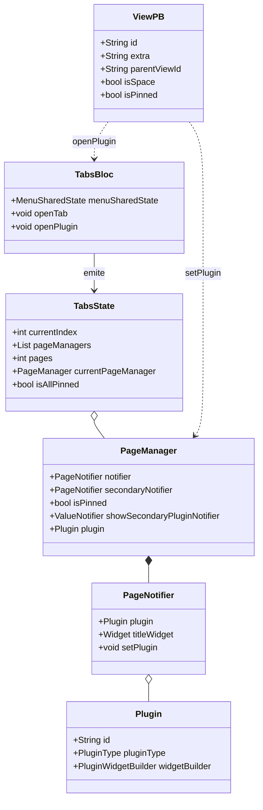
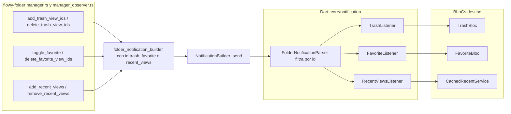
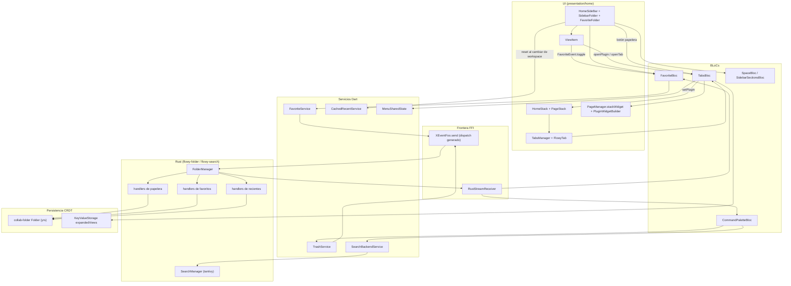
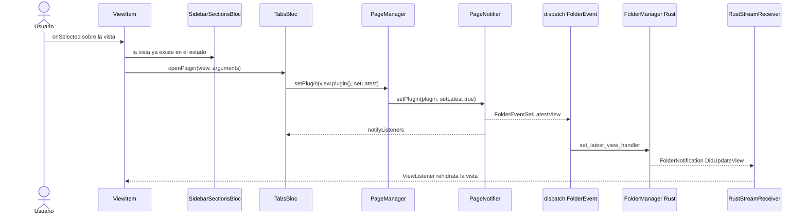
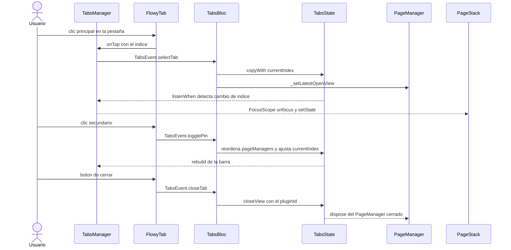
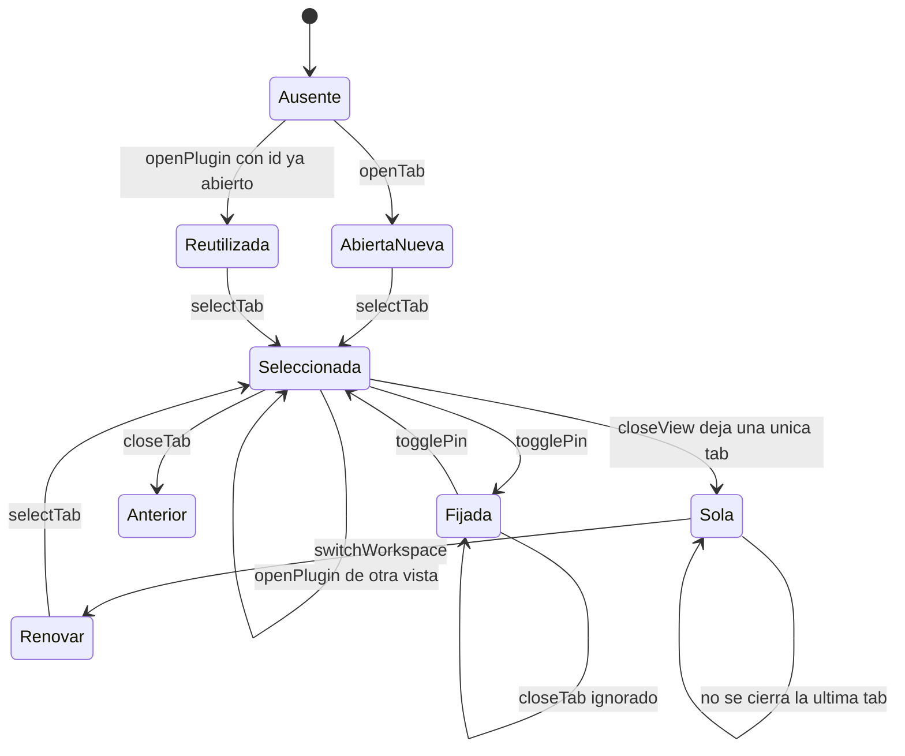

# F04 — Sidebar, favoritos, recientes, papelera, tabs y command palette

## 1. Resumen

Esta unidad documenta los 66 archivos Dart que componen el **cromo de navegación de la pantalla principal de escritorio** de AppFlowy: el sidebar (`HomeSideBar` y sus secciones), la sección de favoritos con su reordenación y fijado, el historial de vistas recientes, la papelera como *plugin* de tab, el gestor de pestañas (`TabsBloc` + `TabsManager` + `HomeStack`), la command palette que envuelve la búsqueda y el registro global de atajos de teclado. Todo el subárbol cuelga de `DesktopHomeScreen`, que es la raíz `go_router` con `routeName = '/DesktopHomeScreen'` (`appflowy:frontend/appflowy_flutter/lib/workspace/presentation/home/desktop_home_screen.dart:47`). Los BLoCs de esta unidad son el único punto de contacto de la UI con el crate Rust `flowy-folder`, a través de seis servicios Dart muy pequeños (`TrashService`, `FavoriteService`, `CachedRecentService`, `ViewBackendService`, `SearchBackendService`) y tres listeners que traducen el enum `FolderNotification` en eventos de BLoC. Documentar esta unidad exige leer también el lado servidor, que vive en `flowy-folder` (unidad F03.2) y en `collab-folder` (unidad F03.3). `[VERIFICADO]`

## 2. Alcance

### 2.1 Qué incluye

Los 66 archivos listados en §12, agrupados en doce subárboles: el andamiaje vacío `features/view_management/**` (4 archivos), el plugin de papelera `plugins/trash/**` (9), siete módulos de `workspace/application/` (17: `action_navigation`, `command_palette`, `edit_panel`, `favorite`, `recent`, `tabs`), la raíz de `workspace/presentation/home/**` (12), el sidebar (20) y tres widgets compartidos de `workspace/presentation/widgets/` (4). `[VERIFICADO]`

### 2.2 Qué queda fuera

Quedan fuera, y pertenecen a otras unidades, los BLoCs que esta UI consume pero no contiene: `HomeBloc` y `HomeSettingBloc` (`workspace/application/home/`), `SidebarSectionsBloc` (`workspace/application/menu/`), `SpaceBloc` y `FolderBloc` (`workspace/application/sidebar/`), `ViewBloc` y `ViewBackendService` (`workspace/application/view/`), todos en **F03.1**. Los widgets de la command palette (`workspace/presentation/command_palette/**`) están asignados a **F08** junto con `flowy-search`; aquí sólo se documenta su capa de aplicación. El motor Rust de papelera, favoritos y recientes (`flowy-folder`) está en **F03.2**, y el CRDT que los almacena (`collab-folder`) en **F03.3**. El puente `get_it` completo está en **F00.7.13** y el parser genérico de notificaciones en **F15**. `[VERIFICADO]`

### 2.3 Corrección de scope: `view_management` no es F03, es F04

El `ROADMAP.md` asignaba `view_management` a **B3.F03** (línea de la lista de features del bloque B3: «B3.F03 — Folder, workspaces, espacios, vistas, view_management»). El reparto final de archivos del ledger hizo otra cosa y esta unidad lo formaliza. `features/view_management/**` contiene exactamente **4 archivos** y ningún otro de la lista «Folder, workspaces, espacios, vistas» quedó en F04, así que el triage de B0.2 lo reasignó a F04 por su nombre (`view_management` ⇒ «gestión de vistas desde la UI»).

| Subárbol | Archivos | Ubicación real | Unidad que lo documenta |
|---|---|---|---|
| `features/view_management/README.md` + `logic/*` | 4 | `lib/features/view_management/` | **F04** (esta unidad) |
| `workspace/application/{home,menu,sidebar,view,workspace,view_title,view_info}` | 55 | `lib/workspace/application/` y `lib/workspace/presentation/home/menu/sidebar/{folder,space,view,workspace}` | **F03.1** |
| `flowy-folder` (handlers de papelera/favoritos/recientes) | 33 | `rust-lib/flowy-folder/` | **F03.2** |
| `collab-folder` (persistencia CRDT de folder/trash/favorites/recent) | 28 | `collab/collab-folder/` | **F03.3** |

La frontera resultante es limpia: **F03 = «folder y workspaces»** (el modelo de datos de vistas, el árbol, los espacios y su servidor), **F04 = «sidebar y todo lo que cuelga de la barra lateral»** (la superficie de navegación, los plugins de tab y el cromo de la pantalla principal). La tabla de redirección se repite en §13 porque el riesgo de confusión entre ambas unidades es real para quien lea sólo una de las dos. `[VERIFICADO]`

Un dato material sobre esos 4 archivos: **`features/view_management/README.md` está vacío (0 bytes)** y los tres `.dart` de `logic/` contienen una única línea en blanco cada uno. El inventario los registra con `loc=0` y `loc=1` respectivamente. Es decir: la arquitectura «nueva por feature» existe como *andamiaje* pero **no implementa ningún BLoC, evento ni estado**. Todo el comportamiento de gestión de vistas que el nombre sugiere sigue en los BLoCs legados de `workspace/application/`. `[VERIFICADO]`

## 3. Modelos de datos

### 3.1 El modelo de navegación

La estructura central de la unidad es la pareja `TabsState` / `PageManager`. `TabsState` (definido a mano, sin `freezed`, en `appflowy:frontend/appflowy_flutter/lib/workspace/application/tabs/tabs_bloc.dart:344`) es una lista de `PageManager` y un `currentIndex`; cada `PageManager` representa **una tab** y guarda dos `PageNotifier` —el principal y el secundario o «panel de detalle»— más un `ValueNotifier<bool>` que decide si el panel secundario está desplegado (`appflowy:frontend/appflowy_flutter/lib/workspace/presentation/home/home_stack.dart:652–663`). `PageNotifier` es un `ChangeNotifier` que envuelve un `Plugin` y, al cambiarlo, dispara `FolderEventSetLatestView` para que Rust recuerde la última vista abierta (`appflowy:frontend/appflowy_flutter/lib/workspace/presentation/home/home_stack.dart:630–646`).

El diagrama muestra las relaciones reales entre `TabsBloc`, `TabsState`, `PageManager`, `PageNotifier`, `Plugin` y la entidad `ViewPB` que las origina.

Lectura: `ViewPB` es la entidad protobuf que Rust entrega y que Dart convierte en `Plugin` mediante la extensión `ViewPB.plugin()` (`appflowy:frontend/appflowy_flutter/lib/workspace/application/view/view_ext.dart:101–130`), que decide entre `DocumentPlugin`, `DatabaseTabBarViewPlugin` o `AIChatPagePlugin` según `layout`. `TabsBloc` no guarda vistas: guarda *plugins ya materializados*. Eso explica por qué `TabsState` no es `freezed` sino una clase con `copyWith` propio y una lista mutable privada (`appflowy:frontend/appflowy_flutter/lib/workspace/application/tabs/tabs_bloc.dart:344–449`) que varios handlers mutan in-place antes de emitir. `[VERIFICADO]`

El campo `extra` de `ViewPB` es donde vive el «fijado» de favoritos: `isPinned` lo deserializa de un JSON con la clave `is_pinned` (`appflowy:frontend/appflowy_flutter/lib/workspace/application/view/view_ext.dart:44` y `:242–250`). Es decir, **fijar un favorito no usa el estado de favoritos de Rust sino un campo genérico del `ViewPB`**; ver §5.4. `[VERIFICADO]`

### 3.2 Arquitectura Dart dual: el caso `ViewManagementBloc`

`AGENTS.md` §5.7 obliga a documentar la coexistencia de dos árboles Dart sin asumir cuál es el canónico. Esta unidad es el ejemplo más extremo de esa regla en todo el repositorio, porque la rama «nueva» **no existe todavía**.

| Dimensión | Rama «nueva por feature» (`lib/features/…`) | Rama «legada» (`lib/workspace/application/…`) |
|---|---|---|
| Ruta | `features/view_management/logic/` | `workspace/application/{tabs,favorite,recent,command_palette,action_navigation,edit_panel}/` |
| Archivos de esta unidad | 4 | 17 |
| LOC de esta unidad | 3 (0 líneas en el README + 1 línea en blanco en cada fichero de `logic/`) | 1 373 |
| BLoC declarado | `ViewManagementBloc` **no existe**: el fichero `logic/view_management_bloc.dart` está vacío | `TabsBloc`, `FavoriteBloc`, `RecentViewsBloc`, `CommandPaletteBloc`, `ActionNavigationBloc`, `EditPanelBloc` |
| Estilo | `logic/` con `view_event.dart` + `view_state.dart` separados, que es el patrón canónico del árbol `features/` | `Bloc` + `Event`/`State` en el mismo fichero, con `freezed` |
| Inyección | repositorios `data/repositories/*_impl.dart` (ver `features/workspace/`) | singletons y factories en `get_it` (`startup/deps_resolver.dart`) |
| Estado real | andamiaje | producción |

Sobre el «README real» que la unidad pedía citar: `features/view_management/README.md` existe en el árbol de trabajo pero **no contiene ni un solo byte**, así que no hay contrato de arquitectura que transcribir. `[VERIFICADO]` sobre el inventario (`loc=0`, `bytes=0`) y sobre el sistema de ficheros. Cualquier intención documentada por ese README es `[NO DETERMINADO]` y queda en §18.

La comparación con `features/workspace/` (que sí es la rama nueva funcional: `logic/workspace_bloc.dart` importado por `appflowy:frontend/appflowy_flutter/lib/workspace/presentation/home/desktop_home_screen.dart:2` y por `appflowy:frontend/appflowy_flutter/lib/workspace/presentation/home/menu/sidebar/sidebar.dart:4`) sugiere que la migración genérica de `view_management` está planificada pero sin empezar: el nombre del directorio existe, la estructura de carpetas no, y ningún fichero de `lib/` importa `features/view_management/`. `[INFERIDO]` — la ausencia de imports se comprobó con `rg` sobre `lib/` y no hay ninguna coincidencia.

## 4. Eventos FFI

Los eventos que esta unidad despacha son casi todos de `flowy-folder`. Los nombres Dart (`FolderEventX`) son generados por `flowy-codegen` a partir del enum `FolderEvent`; el catálogo autoritativo es `OUT/11-catalogo-eventos-ffi.md` §5.5. `[VERIFICADO]`

| Evento Rust (`FolderEvent`) | Índice | Input PB | Output PB | Handler Rust | Servicio Dart que lo envía | Fichero Dart |
|---|---|---|---|---|---|---|
| `ListTrashItems` | 23 | — | `RepeatedTrashPB` | `read_trash_handler` | `TrashService.readTrash()` | `appflowy:frontend/appflowy_flutter/lib/plugins/trash/application/trash_service.dart:10` |
| `RestoreTrashItem` | 24 | `TrashIdPB` | — | `putback_trash_handler` | `TrashService.putback()` (estático) | `appflowy:frontend/appflowy_flutter/lib/plugins/trash/application/trash_service.dart:13–17` |
| `PermanentlyDeleteTrashItem` | 25 | `RepeatedTrashIdPB` | — | `delete_trash_handler` | `TrashService.deleteViews()` | `appflowy:frontend/appflowy_flutter/lib/plugins/trash/application/trash_service.dart:19–26` |
| `RecoverAllTrashItems` | 26 | — | — | `restore_all_trash_handler` | `TrashService.restoreAll()` | `appflowy:frontend/appflowy_flutter/lib/plugins/trash/application/trash_service.dart:28–30` |
| `PermanentlyDeleteAllTrashItem` | 27 | — | — | `delete_my_trash_handler` | `TrashService.deleteAll()` | `appflowy:frontend/appflowy_flutter/lib/plugins/trash/application/trash_service.dart:32–34` |
| `ReadFavorites` | 33 | — | `RepeatedFavoriteViewPB` | `read_favorites_handler` | `FavoriteService.readFavorites()` | `appflowy:frontend/appflowy_flutter/lib/workspace/application/favorite/favorite_service.dart:12–26` |
| `ToggleFavorite` | 34 | `RepeatedViewIdPB` | — | `toggle_favorites_handler` | `FavoriteService.toggleFavorite()` | `appflowy:frontend/appflowy_flutter/lib/workspace/application/favorite/favorite_service.dart:28–31` |
| `ReadRecentViews` | 36 | `ReadRecentViewsPB` | `RepeatedRecentViewPB` | `read_recent_views_handler` | `CachedRecentService._readRecentViews()` | `appflowy:frontend/appflowy_flutter/lib/workspace/application/recent/cached_recent_service.dart:73–90` |
| `UpdateRecentViews` | 37 | `UpdateRecentViewPayloadPB` | — | `update_recent_views_handler` | `CachedRecentService.updateRecentViews()` | `appflowy:frontend/appflowy_flutter/lib/workspace/application/recent/cached_recent_service.dart:65–70` |
| `SetLatestView` | 21 | `ViewIdPB` | — | `set_latest_view_handler` | `PageNotifier.setPlugin()` | `appflowy:frontend/appflowy_flutter/lib/workspace/presentation/home/home_stack.dart:641` |
| `GetCurrentWorkspaceSetting` | 1 | — | `WorkspaceLatestPB` | `read_current_workspace_setting_handler` | `DesktopHomeScreen` (arranque) | `appflowy:frontend/appflowy_flutter/lib/workspace/presentation/home/desktop_home_screen.dart:53` |
| `GetView` | 11 | `ViewIdPB` | `ViewPB` | `get_view_handler` | `ActionNavigationBloc` / `ViewBackendService` | `appflowy:frontend/appflowy_flutter/lib/workspace/application/action_navigation/action_navigation_bloc.dart:21` |
| `GetAllViews` | 17 | — | `RepeatedViewPB` | `get_all_views_handler` | `CommandPaletteBloc._refreshCachedViews()` | `appflowy:frontend/appflowy_flutter/lib/workspace/application/command_palette/command_palette_bloc.dart:89–90` |
| `GetViewAncestors` | 42 | `ViewIdPB` | `RepeatedViewPB` | `get_view_ancestors_handler` | `TabsBloc._expandAncestors()` y `DesktopHomeScreen._switchToSpace()` | `appflowy:frontend/appflowy_flutter/lib/workspace/application/tabs/tabs_bloc.dart:253` |
| `UpdateView` | 12 | `UpdateViewPayloadPB` | `ViewPB` | `update_view_handler` | `FavoriteService.pinOrUnpinFavorite()` (campo `extra`) | `appflowy:frontend/appflowy_flutter/lib/workspace/application/favorite/favorite_service.dart:52–55` |
| `StreamSearch` (`flowy-search`) | 0 | `SearchQueryPB` | — (stream por puerto nativo) | `stream_search_handler` | `SearchBackendService.performSearch()` | `appflowy:frontend/appflowy_flutter/lib/workspace/application/command_palette/search_service.dart:15–29` |

`StreamSearch` merece nota: es el único evento de la tabla cuya respuesta **no** vuelve por el canal de retorno FFI habitual sino por un `RawReceivePort` de Dart cuyo `nativePort` se serializa dentro del `SearchQueryPB` (`appflowy:frontend/appflowy_flutter/lib/workspace/application/command_palette/search_service.dart:19–27` y `:41`). El `searchId` es `DateTime.now().millisecondsSinceEpoch.toString()` y sirve de token de correlación para descartar respuestas de búsquedas anteriores (`:18`, `:152`, `:332–333`). `[VERIFICADO]`

## 5. Notificaciones

### 5.1 El enum `FolderNotification` y sus 19 variantes

Todas las notificaciones de esta unidad pertenecen al enum `FolderNotification` del crate `flowy-folder`, emitido bajo el source `"Workspace"` (`appflowy:frontend/rust-lib/flowy-folder/src/notification.rs:6` y `:10`). La tabla recorre las **19** variantes del enum, todas en `appflowy:frontend/rust-lib/flowy-folder/src/notification.rs:12–44`, indicando qué la emite y qué listener Dart la consume. `[VERIFICADO]`

| # | Variante | Índice | Emisor Rust (id del `SubscribeObject`) | Listener Dart | Efecto en esta unidad |
|---|---|---|---|---|---|
| 0 | `Unknown` | 0 | — | — | valor `#[default]`; nunca se envía |
| 1 | `DidCreateWorkspace` | 1 | — | — | declarada pero **sin emisor ni listener** en el snapshot |
| 2 | `DidUpdateWorkspace` | 2 | — | `workspace_listener.dart` (F03.1) | declarada sin emisor Rust en el snapshot; la rama Dart existe |
| 3 | `DidUpdateWorkspaceViews` | 3 | `notify_did_update_workspace` con id = `workspace_id` (`appflowy:frontend/rust-lib/flowy-folder/src/manager_observer.rs:223–229`) | `workspace_listener.dart` (F03.1) | fuera de alcance |
| 4 | `DidUpdateWorkspaceSetting` | 4 | `appflowy:frontend/rust-lib/flowy-folder/src/manager.rs:1329` con id = `workspace_id` | `user_listener.dart` (F05) | fuera de alcance |
| 10 | `DidUpdateView` | 10 | `notify_view_did_change` con id = `view_id` (`appflowy:frontend/rust-lib/flowy-folder/src/manager_observer.rs:233–240`) y `appflowy:frontend/rust-lib/flowy-folder/src/manager.rs:1938` | `view_listener.dart` (F03.1) | llega a la tab abierta vía `PageNotifier` |
| 11 | `DidUpdateChildViews` | 11 | `notify_child_views_changed` con id = `parent_view_id` (`appflowy:frontend/rust-lib/flowy-folder/src/manager_observer.rs:269`) | `view_listener.dart` (F03.1) | fuera de alcance |
| 12 | `DidDeleteView` | 12 | — | `view_listener.dart` (F03.1) | **sin emisor Rust**: el borrado real llega como `DidMoveViewToTrash` + `DidUpdateChildViews` |
| 13 | `DidRestoreView` | 13 | — | `view_listener.dart` (F03.1) | **sin emisor Rust**: la restauración llega como `DidUpdateChildViews` |
| 14 | `DidMoveViewToTrash` | 14 | `appflowy:frontend/rust-lib/flowy-folder/src/manager.rs:845` con id = `view_id`, payload `DeletedViewPB` | `view_listener.dart` (F03.1) | precursor de `DidUpdateTrash` |
| 15 | `DidUpdateTrash` | 15 | `appflowy:frontend/rust-lib/flowy-folder/src/manager_observer.rs:148` (observer de folder), `appflowy:frontend/rust-lib/flowy-folder/src/manager.rs:1990` (`restore_all_trash`), `appflowy:frontend/rust-lib/flowy-folder/src/manager.rs:2016` (`delete_my_trash`), todos con id = `"trash"` y payload `RepeatedTrashPB` | **`trash_listener.dart`** (esta unidad) | reemplaza la lista completa de la papelera |
| 16 | `DidUpdateFolderSnapshotState` | 16 | — | — | declarada sin emisor ni listener |
| 17 | `DidUpdateFolderSyncUpdate` | 17 | `appflowy:frontend/rust-lib/flowy-folder/src/manager_observer.rs:100–106` con id = `workspace_id`, payload `FolderSyncStatePB` | — | llega al panel de sincronía (F06) |
| 36 | `DidFavoriteView` | 36 | `appflowy:frontend/rust-lib/flowy-folder/src/manager.rs:1927–1935` con id = `"favorite"`, payload `RepeatedViewPB` | **`favorite_listener.dart`** (esta unidad) | `FavoriteBloc` relanza `fetchFavorites` |
| 37 | `DidUnfavoriteView` | 37 | `appflowy:frontend/rust-lib/flowy-folder/src/manager.rs:879–884` (descendientes) y `appflowy:frontend/rust-lib/flowy-folder/src/manager.rs:1927–1935` con id = `"favorite"` | **`favorite_listener.dart`** (esta unidad) | ídem |
| 38 | `DidUpdateRecentViews` | 38 | `appflowy:frontend/rust-lib/flowy-folder/src/manager.rs:1944–1951` con id = `"recent_views"`, payload `RepeatedViewIdPB` | **`recent_listener.dart`** (esta unidad, sin `switch` explícito) | `CachedRecentService` relee la lista completa |
| 39 | `DidUpdateSectionViews` | 39 | `appflowy:frontend/rust-lib/flowy-folder/src/manager_observer.rs:210` y `:218` con id = `workspace_id`, payload `SectionViewsPB` | `workspace_sections_listener.dart` (F03.1) | fuera de alcance |
| 40 | `DidUpdateSharedViews` | 40 | `appflowy:frontend/rust-lib/flowy-folder/src/manager.rs:2449` con id = `workspace_id` | `shared_section_bloc.dart` (F12) | fuera de alcance |
| 41 | `DidUpdateSharedUsers` | 41 | `appflowy:frontend/rust-lib/flowy-folder/src/manager.rs:1437–1445`, `:1495–1502`, `:1582–1589` con id = `cloud_page_id` | `share_tab_bloc.dart` (F12) | fuera de alcance |

El reparto de las 19 variantes es el siguiente: **4 las consumen listeners Dart de esta unidad** (`DidUpdateTrash`, `DidFavoriteView`, `DidUnfavoriteView`, `DidUpdateRecentViews`), **11 las consumen listeners Dart de otras unidades** (`DidUpdateWorkspace`, `DidUpdateWorkspaceViews`, `DidUpdateWorkspaceSetting`, `DidUpdateView`, `DidUpdateChildViews`, `DidDeleteView`, `DidRestoreView`, `DidMoveViewToTrash`, `DidUpdateSectionViews`, `DidUpdateSharedViews`, `DidUpdateSharedUsers`) y **4 no tienen ninguna referencia en Dart** (`Unknown`, `DidCreateWorkspace`, `DidUpdateFolderSnapshotState`, `DidUpdateFolderSyncUpdate`). En el lado Rust, 13 variantes tienen emisor real y 6 están declaradas pero nunca se emiten: `Unknown`, `DidCreateWorkspace`, `DidUpdateWorkspace`, `DidDeleteView`, `DidRestoreView` y `DidUpdateFolderSnapshotState` — las tres últimas tienen, aun así, su rama Dart implementada.

Advertencia sobre el catálogo: `OUT/_ledger/extract/notifications.json` marca `emitted_in_rust = 0` para **todas** las variantes de `FolderNotification`, porque su heurística sólo reconoce llamadas literales a `NotificationBuilder::new` y `flowy-folder` usa un envoltorio propio, `folder_notification_builder` (`appflowy:frontend/rust-lib/flowy-folder/src/notification.rs:48–55`). El campo `emitters` del catálogo contiene una sola entrada, la línea 54 de ese mismo fichero, que es el *forwarder*, no el emisor real. Los emisores citados en la tabla de arriba se han localizado leyendo `manager.rs` y `manager_observer.rs`. `[VERIFICADO]`

### 5.2 Qué notificación dispara qué cambio en la papelera

La tabla anterior responde a la pregunta general; esta la concreta al ciclo de vida de la papelera. `TrashListener` se registra con `id: "trash"` (`appflowy:frontend/appflowy_flutter/lib/plugins/trash/application/trash_listener.dart:23–28`), y `FolderNotificationParser` descarta cualquier `SubscribeObject` cuyo `id` no coincida (`appflowy:frontend/appflowy_flutter/lib/core/notification/notification_helper.dart:19–24`). Los tres emisores Rust de `DidUpdateTrash` emiten siempre con `id = "trash"` y payload `RepeatedTrashPB`, así que los tres llegan a `TrashListener`; lo que cambia entre ellos es el contenido del payload y, por tanto, el efecto observable: `[VERIFICADO]`

| Operación del usuario | Evento FFI enviado | Transición en `collab-folder` | Notificación que vuelve | Cambio en `TrashBloc` | Fichero Dart que dispara |
|---|---|---|---|---|---|
| Abrir la papelera | `ListTrashItems` | ninguna (sólo lectura) | ninguna | `TrashEvent.initial` → `emit` con `objects` | `appflowy:frontend/appflowy_flutter/lib/plugins/trash/trash_page.dart:42` |
| Borrar una vista desde el árbol | `DeleteView` | `add_trash_view_ids` | `DidMoveViewToTrash` (id = vista) + `DidUpdateChildViews` (id = padre) + `DidUpdateTrash` (id = `"trash"`, desde el observer de folder) | `didReceiveTrash` reemplaza la lista completa | disparado desde F03.1 (`ViewBloc`) |
| Restaurar una página | `RestoreTrashItem` | `delete_trash_view_ids` | `DidUpdateTrash` desde el observer (`appflowy:frontend/rust-lib/flowy-folder/src/manager_observer.rs:148`) | `didReceiveTrash` | `appflowy:frontend/appflowy_flutter/lib/plugins/trash/trash_page.dart:167` |
| Borrado permanente de una página | `PermanentlyDeleteTrashItem` | `delete_trash_view_ids` + borrado real | `DidUpdateTrash` desde el observer | `didReceiveTrash` | `appflowy:frontend/appflowy_flutter/lib/plugins/trash/trash_page.dart:177` |
| «Restaurar todo» | `RecoverAllTrashItems` | `remove_all_my_trash_sections` | `DidUpdateTrash` con `items: []` desde `appflowy:frontend/rust-lib/flowy-folder/src/manager.rs:1990` | lista vacía | `appflowy:frontend/appflowy_flutter/lib/plugins/trash/trash_page.dart:116` |
| «Borrar todo» | `PermanentlyDeleteAllTrashItem` | `delete_trash` por cada entrada | `DidUpdateTrash` con `items: []` desde `appflowy:frontend/rust-lib/flowy-folder/src/manager.rs:2016` | lista vacía | `appflowy:frontend/appflowy_flutter/lib/plugins/trash/trash_page.dart:133` |

Punto clave: **Rust no notifica «un objeto borrado», notifica «el nuevo contenido completo de la papelera»**. `TrashBloc` no calcula deltas, sustituye el vector completo en `didReceiveTrash` (`appflowy:frontend/appflowy_flutter/lib/plugins/trash/application/trash_bloc.dart:41–43`). El payload de `appflowy:frontend/rust-lib/flowy-folder/src/manager.rs:1990` y `appflowy:frontend/rust-lib/flowy-folder/src/manager.rs:2016` es literalmente `RepeatedTrashPB { items: vec![] }`, lo que explica por qué «restaurar todo» no necesita una relectura posterior. `[VERIFICADO]`

### 5.3 El pipeline de notificaciones de esta unidad

Lectura: los tres subsistemas comparten el mismo `enum FolderNotification` y el mismo `FolderNotificationParser`, y se distinguen **sólo por el `id` del `SubscribeObject`** (`"trash"`, `"favorite"`, `"recent_views"`). Ese `id` es un canal lógico multiplexado sobre un mismo `source = "Workspace"`; por eso tres `RustStreamReceiver.listen` distintos reciben potencialmente el mismo evento y cada parser lo descarta por `subject.id` (`appflowy:frontend/appflowy_flutter/lib/core/notification/notification_helper.dart:20–24`). `[VERIFICADO]`

### 5.4 La anomalía de `RecentViewsListener`

`TrashListener` y `FavoriteListener` hacen `switch (ty)` sobre la variante recibida (`appflowy:frontend/appflowy_flutter/lib/plugins/trash/application/trash_listener.dart:35–49` y `appflowy:frontend/appflowy_flutter/lib/workspace/application/favorite/favorite_listener.dart:40–58`). `RecentViewsListener` **no**: recibe el parámetro `ty` y lo ignora, decodificando cualquier payload como `RepeatedViewIdPB` (`appflowy:frontend/appflowy_flutter/lib/workspace/application/recent/recent_listener.dart:35–54`). Hoy no hay fallo porque el único emisor Rust con id `"recent_views"` es `DidUpdateRecentViews` (`appflowy:frontend/rust-lib/flowy-folder/src/manager.rs:1946`), pero el acoplamiento es frágil: si Rust añadiera otra notificación con ese id, `RepeatedViewIdPB.fromBuffer` intentaría interpretar el payload ajeno. Se documenta en §13. `[VERIFICADO]`

## 6. BLoCs / Cubits

La unidad contiene **10 BLoCs y ningún Cubit**. `OUT/_ledger/extract/blocs.json` los detecta correctamente en número y orden, pero su campo `decl_line` apunta sistemáticamente a la línea en blanco que sigue al `part '…_bloc.freezed.dart';`, es decir **una línea antes** de la declaración real de la clase: en los 10 casos verificados `línea real = decl_line + 1`. La tabla siguiente usa las líneas comprobadas leyendo cada fichero. `[VERIFICADO]`

| Clase | Eventos | Estados | Servicios / colaboradores | Fichero:línea |
|---|---|---|---|---|
| `TrashBloc` | `initial`, `didReceiveTrash`, `putback`, `delete`, `deleteAll`, `restoreAll` | `TrashState {objects, successOrFailure}` | `TrashService`, `TrashListener` (creados en el constructor) | `appflowy:frontend/appflowy_flutter/lib/plugins/trash/application/trash_bloc.dart:12`, eventos `:96–104`, estado `:106–117` |
| `ActionNavigationBloc` | `performAction({action, showErrorToast, nextActions})` | `ActionNavigationState {action, nextActions}` (clase manual, sin `freezed`) | `ViewBackendService`, `showToastNotification` | `appflowy:frontend/appflowy_flutter/lib/workspace/application/action_navigation/action_navigation_bloc.dart:12`, evento `:60–67`, estado `:69–93` |
| `CommandPaletteBloc` | `searchChanged`, `performSearch`, `newSearchStream`, `resultsChanged`, `trashChanged`, `workspaceChanged`, `clearSearch`, `goingToAskAI`, `askedAI`, `refreshCachedViews`, `updateCachedViews` | `CommandPaletteState` con 13 campos | `Debouncer(300 ms)`, `TrashService`, `TrashListener`, `SearchBackendService`, `ViewBackendService` | `appflowy:frontend/appflowy_flutter/lib/workspace/application/command_palette/command_palette_bloc.dart:31`, eventos `:336–369`, estado `:387–410` |
| `SearchResultListBloc` | `onHoverSummary`, `onHoverResult`, `openPage` | `SearchResultListState {hoveredSummary, hoveredResult, openPageId, userHovered}` | ninguno | `appflowy:frontend/appflowy_flutter/lib/workspace/application/command_palette/search_result_list_bloc.dart:11`, eventos `:56–70`, estado `:72–83` |
| `EditPanelBloc` | `startEdit`, `endEdit` | `EditPanelState {isEditing, editContext}` | ninguno | `appflowy:frontend/appflowy_flutter/lib/workspace/application/edit_panel/edit_panel_bloc.dart:7`, eventos `:22–27`, estado `:29–40` |
| `FavoriteBloc` | `initial`, `fetchFavorites`, `toggle`, `pin`, `unpin`, `reorder` | `FavoriteState {views, pinnedViews, unpinnedViews, isLoading}` | `FavoriteService`, `FavoriteListener`, `ViewBackendService` (indirecto, vía `FavoriteService`) | `appflowy:frontend/appflowy_flutter/lib/workspace/application/favorite/favorite_bloc.dart:14`, eventos `:117–131`, estado `:133–143` |
| `RecentViewsBloc` | `initial`, `addRecentViews`, `removeRecentViews`, `fetchRecentViews`, `resetRecentViews`, `hoverView` | `RecentViewsState {views, isLoading, hoveredView}` | `CachedRecentService` (vía `getIt`) | `appflowy:frontend/appflowy_flutter/lib/workspace/application/recent/recent_views_bloc.dart:9`, eventos `:63–73`, estado `:75–84` |
| `TabsBloc` | `selectTab`, `moveTab`, `closeTab`, `closeOtherTabs`, `closeCurrentTab`, `togglePin`, `openTab`, `openPlugin`, `openSecondaryPlugin`, `closeSecondaryPlugin`, `expandSecondaryPlugin`, `switchWorkspace` | `TabsState` (clase manual con lista mutable de `PageManager`) | `MenuSharedState`, `ViewBackendService`, `ViewExpanderRegistry`, `KeyValueStorage`, `BlankPagePlugin` | `appflowy:frontend/appflowy_flutter/lib/workspace/application/tabs/tabs_bloc.dart:23`, eventos `:306–342`, estado `:344–456` |
| `FavoriteMenuBloc` | `initial`, `search` | `FavoriteMenuState {views, queriedViews, todayViews, thisWeekViews, otherViews}` | `FavoriteService` | `appflowy:frontend/appflowy_flutter/lib/workspace/presentation/home/menu/sidebar/favorites/favorite_menu_bloc.dart:8`, eventos `:102–106`, estado `:108–119` |
| `FavoritePinBloc` | `initial`, `search` | `FavoritePinState {views, queriedViews, todayViews, lastWeekViews, otherViews}` | `FavoriteService` | `appflowy:frontend/appflowy_flutter/lib/workspace/presentation/home/menu/sidebar/favorites/favorite_pin_bloc.dart:9`, eventos `:42–46`, estado `:48–59` |

Observaciones posteriores a la lectura de los 66 ficheros:

- **`ViewManagementBloc` no existe.** El inventario asigna `logic/view_management_bloc.dart` a la capa `bloc`, pero el fichero tiene una línea en blanco. `blocs.json` no lo lista, lo que confirma la ausencia `[VERIFICADO]`.
- **`FavoritePinBloc` es código muerto.** Se declara, registra sus dos eventos y construye su estado, pero una búsqueda de `FavoritePinBloc` en todo `lib/` sólo devuelve sus propias dos líneas de declaración; ningún widget lo instancia `[VERIFICADO]`. Es un vestigio de una versión anterior del selector de favoritos, superado por `FavoriteMenuBloc`.
- **`EditPanelBloc` está cableado pero nunca se excita.** `appflowy:frontend/appflowy_flutter/lib/workspace/presentation/widgets/edit_panel/edit_panel.dart:27` lo obtiene de `get_it` y `appflowy:frontend/appflowy_flutter/lib/workspace/presentation/widgets/edit_panel/edit_panel.dart:28` lo observa, pero ningún fichero de `lib/` despacha `EditPanelEvent.startEdit` ni `EditPanelEvent.endEdit`; su `isEditing` permanece `false` para siempre `[VERIFICADO]`. El panel se abre y se cierra desde `HomeSettingState.panelContext` (`appflowy:frontend/appflowy_flutter/lib/workspace/presentation/home/desktop_home_screen.dart:230–250`), no desde el BLoC.
- **`TabsBloc` no es `freezed`** aunque use el mismo `import 'freezed_annotation'` para generar el `when` de los eventos. `TabsState` implementa `copyWith` a mano (`appflowy:frontend/appflowy_flutter/lib/workspace/application/tabs/tabs_bloc.dart:442–449`) porque necesita conservar la identidad de la lista de `PageManager` y mutarla en `togglePin` (`:153`, `:159`, `:171`, `:177`).
- **`FavoriteBloc.reorder` es un *workaround* declarado como tal** en el propio código (`appflowy:frontend/appflowy_flutter/lib/workspace/application/favorite/favorite_bloc.dart:83`): no existe un evento de reordenación en Rust, así que reordena la lista local y luego llama `toggleFavorite` **dos veces por cada vista** para forzar la reescritura del orden (`:90–93`). Además protege con `isReordering` las notificaciones entrantes (`:21`, `:84`, `:97`, `:108`) y con `isClosed` la emisión final.

## 7. Servicios e inyección de dependencias

### 7.1 Registro en `get_it`

Los BLoCs de esta unidad se registran en tres funciones distintas de `startup/deps_resolver.dart` (fichero de la unidad **F00.7.13**, citado aquí porque es imprescindible para entender el ciclo de vida):

| Tipo | Ámbito de registro | Fichero:línea |
|---|---|---|
| `EditPanelBloc` | `registerFactory` en `_resolveGeneralDeps` | `appflowy:frontend/appflowy_flutter/lib/startup/deps_resolver.dart:132` |
| `CachedRecentService` | `registerLazySingleton` en `_resolveGeneralDeps` | `appflowy:frontend/appflowy_flutter/lib/startup/deps_resolver.dart:135` |
| `MenuSharedState` | `registerSingleton` en `_resolveHomeDeps` | `appflowy:frontend/appflowy_flutter/lib/startup/deps_resolver.dart:145` |
| `ActionNavigationBloc` | `registerSingleton` en `_resolveHomeDeps` | `appflowy:frontend/appflowy_flutter/lib/startup/deps_resolver.dart:156` |
| `TabsBloc` | `registerLazySingleton` en `_resolveHomeDeps` | `appflowy:frontend/appflowy_flutter/lib/startup/deps_resolver.dart:158` |
| `TrashService` | `registerLazySingleton` en `_resolveFolderDeps` | `appflowy:frontend/appflowy_flutter/lib/startup/deps_resolver.dart:184` |
| `TrashListener` | `registerLazySingleton` en `_resolveFolderDeps` | `appflowy:frontend/appflowy_flutter/lib/startup/deps_resolver.dart:185` |
| `TrashBloc` | `registerFactory` en `_resolveFolderDeps` | `appflowy:frontend/appflowy_flutter/lib/startup/deps_resolver.dart:186–188` |
| `FavoriteBloc` | `registerFactory` en `_resolveFolderDeps` | `appflowy:frontend/appflowy_flutter/lib/startup/deps_resolver.dart:191` |
| `PluginSandbox` | `registerSingleton` en `startup.dart` | `appflowy:frontend/appflowy_flutter/lib/startup/startup.dart:192` |
| `ViewExpanderRegistry` | `registerSingleton` en `startup.dart` | `appflowy:frontend/appflowy_flutter/lib/startup/startup.dart:193` |

Tres consecuencias de esa tabla. Primera: **`TabsBloc` es singleton** y por eso vive por encima de la pantalla; `DesktopHomeScreen` lo inyecta con `BlocProvider<TabsBloc>.value(value: getIt<TabsBloc>())` (`appflowy:frontend/appflowy_flutter/lib/workspace/presentation/home/desktop_home_screen.dart:84`) y `HomeStack` vuelve a inyectarlo con `.value` (`appflowy:frontend/appflowy_flutter/lib/workspace/presentation/home/home_stack.dart:62–63`) para no crear dos instancias. Segunda: **`TrashBloc` es factory, pero `TrashBloc` no usa las singletons `TrashService`/`TrashListener` registradas justo encima**: su constructor instancia `TrashService()` y `TrashListener()` directamente (`appflowy:frontend/appflowy_flutter/lib/plugins/trash/application/trash_bloc.dart:13–16`). Las tres registros de `get_it` para papelera quedan, por tanto, sin consumidor real `[VERIFICADO]`. Tercera: **`CachedRecentService` es lazy singleton y se reinicia manualmente** al cambiar de workspace (`appflowy:frontend/appflowy_flutter/lib/workspace/presentation/home/menu/sidebar/sidebar.dart:112`), porque guarda en memoria la lista de vistas recientes del workspace anterior. `[VERIFICADO]`

### 7.2 Qué servicio consume cada BLoC

| BLoC | Servicio propio | Servicios externos (`get_it` o estáticos) |
|---|---|---|
| `TrashBloc` | `TrashService` (no singleton) | `TrashListener` (no singleton) |
| `FavoriteBloc` | `FavoriteService()` y `FavoriteListener()` por constructor (`appflowy:frontend/appflowy_flutter/lib/workspace/application/favorite/favorite_bloc.dart:19–20`) | ninguno |
| `FavoriteMenuBloc` | `FavoriteService()` por campo (`appflowy:frontend/appflowy_flutter/lib/workspace/presentation/home/menu/sidebar/favorites/favorite_menu_bloc.dart:65`) | ninguno |
| `FavoritePinBloc` | `FavoriteService()` por campo (`appflowy:frontend/appflowy_flutter/lib/workspace/presentation/home/menu/sidebar/favorites/favorite_pin_bloc.dart:39`) | ninguno |
| `RecentViewsBloc` | — | `CachedRecentService` vía `getIt` (`appflowy:frontend/appflowy_flutter/lib/workspace/application/recent/recent_views_bloc.dart:11`) |
| `TabsBloc` | — | `MenuSharedState` vía `getIt` (`appflowy:frontend/appflowy_flutter/lib/workspace/application/tabs/tabs_bloc.dart:25`), `ViewBackendService.getViewAncestors` estático (`:253`), `ViewExpanderRegistry` y `KeyValueStorage` vía `getIt` (`:247`, `:249`, `:264`) |
| `CommandPaletteBloc` | `TrashService()` y `TrashListener()` por campo (`appflowy:frontend/appflowy_flutter/lib/workspace/application/command_palette/command_palette_bloc.dart:53–54`) | `SearchBackendService.performSearch` estático (`:147`), `ViewBackendService.getAllViews` estático (`:90`) |
| `ActionNavigationBloc` | — | `ViewBackendService.getView` estático (`appflowy:frontend/appflowy_flutter/lib/workspace/application/action_navigation/action_navigation_bloc.dart:21`) |
| `SearchResultListBloc` | — | ninguno |
| `EditPanelBloc` | — | ninguno (se obtiene de `get_it` en `appflowy:frontend/appflowy_flutter/lib/workspace/presentation/widgets/edit_panel/edit_panel.dart:27`) |

### 7.3 Servicios Dart de esta unidad hacia Rust

Los cuatro servicios propios de esta unidad que cruzan la frontera son tan pequeños que merece la pena resumir su superficie (el quinto actor de la tabla, `ViewBackendService`, pertenece a F03.1 y se documenta allí). `TrashService` expone cinco métodos que mapean 1:1 con cinco variantes de `FolderEvent` (`appflowy:frontend/appflowy_flutter/lib/plugins/trash/application/trash_service.dart:8–35`). `FavoriteService` expone cuatro, y uno de ellos —`pinOrUnpinFavorite`— **no** usa un evento de favoritos: hace `jsonDecode` del campo `extra` de la vista, le añade la clave `is_pinned`, y persiste el JSON resultante con `ViewBackendService.updateView(viewId:, extra:)` (`appflowy:frontend/appflowy_flutter/lib/workspace/application/favorite/favorite_service.dart:41–61`). Es decir, **fijar un favorito escribe en el `ViewPB`, no en la sección de favoritos del folder**. `CachedRecentService` expone dos más `reset`/`dispose` (§4). `SearchBackendService` expone uno (`performSearch`) y devuelve un `SearchResponseStream` que encapsula el `RawReceivePort` (`appflowy:frontend/appflowy_flutter/lib/workspace/application/command_palette/search_service.dart:14–30`). `[VERIFICADO]`

## 8. Persistencia

De los cuatro datos que gestiona esta unidad, sólo el estado de vistas expandidas se persiste desde el lado Dart. Favoritos, recientes y papelera delegan por completo en el CRDT del folder, que es su autoridad real.

| Dato | Dónde persiste | Clave / estructura | Evidencia |
|---|---|---|---|
| Vistas expandidas en el sidebar | `KeyValueStorage` (store clave-valor local) | clave `expandedViews`, valor = `Map<String, bool>` serializado con `jsonEncode` | `appflowy:frontend/appflowy_flutter/lib/core/config/kv_keys.dart:44`, lectura/escritura en `appflowy:frontend/appflowy_flutter/lib/workspace/application/tabs/tabs_bloc.dart:249` y `:264–265` |
| Favoritos (lista) | CRDT `collab-folder`, sección `favorites: { uid: [] }` | `folder.favorite_view_ids` / `delete_favorite_view_ids` | `collab:collab-folder/src/folder.rs:74` y `:267–268` |
| Favoritos (fijado) | campo `extra` del propio `ViewPB` dentro del CRDT | JSON con clave `is_pinned` | `appflowy:frontend/appflowy_flutter/lib/workspace/application/view/view_ext.dart:44`, escritura en `appflowy:frontend/appflowy_flutter/lib/workspace/application/favorite/favorite_service.dart:46–55` |
| Recientes | CRDT `collab-folder`, sección `recent: HashMap<uid, …>` | `folder.add_recent_view_ids` / `delete_recent_view_ids` / `get_my_recent_sections` | `collab:collab-folder/src/folder.rs:675`, `:698`, `:279–284` |
| Papelera | CRDT `collab-folder`, sección `trash: HashMap<uid, …>` | `folder.add_trash_view_ids` / `delete_trash_view_ids` / `get_my_trash_info` | `collab:collab-folder/src/folder.rs:84`, `:290–296`, `:311–314` |
| Tabs abiertas, tab activa, ancho del sidebar | **no se persisten** | — | `TabsState` se construye con un único `PageManager` en su constructor (`appflowy:frontend/appflowy_flutter/lib/workspace/application/tabs/tabs_bloc.dart:344–348`) |

Dos conclusiones. La primera es que **el estado de pestañas es efímero**: al reiniciar la aplicación se abre siempre una tab en blanco, y la restauración de la última vista se hace por otro camino (`HomeBloc.latestView` en `appflowy:frontend/appflowy_flutter/lib/workspace/presentation/home/desktop_home_screen.dart:109–128`, más `_switchToSpace` en `:320–330`). La segunda es que la caché de recientes **no se persiste en el lado Dart**: `CachedRecentService` es un `ValueNotifier<List<SectionViewPB>>` en memoria (`appflowy:frontend/appflowy_flutter/lib/workspace/application/recent/cached_recent_service.dart:28–31`) que se repuebla leyendo de Rust, y la autoridad real es la sección `recent` del CRDT. `[VERIFICADO]`

## 9. Diagramas de flujo

El siguiente diagrama muestra la navegación completa del escritorio: desde el clic en el sidebar hasta el `Plugin` que se materializa dentro de la tab, cruzando la frontera FFI y llegando al CRDT del folder. `[VERIFICADO]`

Lectura: hay dos caminos distintos hacia la UI y sólo uno hacia el CRDT. El camino de escritura es `Widget → Bloc → Servicio Dart → dispatch generado → async_event → FolderManager → collab-folder`; el camino de lectura es el inverso y no pasa por ningún servicio Dart, sino por `RustStreamReceiver` directamente al listener. El comando `Sidebar` → `TB` con la etiqueta «botón papelera» es la peculiaridad del diseño: la papelera **no es una vista del árbol de `ViewPB`**, es un `Plugin` sintético creado con `makePlugin(pluginType: PluginType.trash)` (`appflowy:frontend/appflowy_flutter/lib/workspace/presentation/home/menu/sidebar/footer/sidebar_footer.dart:84–88`) que se abre en la tab actual, igual que la vista real la abre con `view.plugin()`. `PluginSandbox` decide qué `PluginWidgetBuilder` corresponde a cada `PluginType` (`appflowy:frontend/appflowy_flutter/lib/workspace/presentation/home/home_stack.dart:721–722`). `[VERIFICADO]`

## 10. Diagramas de secuencia

### 10.1 Abrir una vista desde el sidebar

Lectura: el clic del usuario **no crea una tab**. `openPlugin` reutiliza la tab actual salvo que el plugin ya esté abierto en otra posición, en cuyo caso `TabsState._selectPluginIfOpen` devuelve un `copyWith(currentIndex:)` y simplemente cambia el foco (`appflowy:frontend/appflowy_flutter/lib/workspace/application/tabs/tabs_bloc.dart:410–421` y `:428–440`). Sólo `openTab` —invocado con ⌘/Ctrl, `appflowy:frontend/appflowy_flutter/lib/workspace/presentation/home/menu/sidebar/favorites/favorite_folder.dart:150–151`, o con clic terciario, `:148`— añade un `PageManager` nuevo (`appflowy:frontend/appflowy_flutter/lib/workspace/application/tabs/tabs_bloc.dart:366–379`). El paso `notifyListeners` de `PageNotifier` es lo que reconstruye el widget del plugin a través de `Consumer<PageNotifier>` en `PageManager.stackWidget` (`appflowy:frontend/appflowy_flutter/lib/workspace/presentation/home/home_stack.dart:712–747`). `[VERIFICADO]`

Hay además una ventana de deduplicación de 500 ms: si la misma vista se abre dos veces en menos de medio segundo, el segundo `openPlugin` se descarta (`appflowy:frontend/appflowy_flutter/lib/workspace/application/tabs/tabs_bloc.dart:34` y `:83–95`). Por eso el diagrama no la representa. `[VERIFICADO]`

### 10.2 Ciclo de vida de una tab con `TabsBloc`

Lectura: hay **dos índices distintos** en juego y conviene no confundirlos. `TabsState.currentIndex` es el modelo; el `selectedIndex` de `_HomeStackState` es la copia local que decide qué hijo del `IndexedStack` se ve (`appflowy:frontend/appflowy_flutter/lib/workspace/presentation/home/home_stack.dart:58` y `:85`). `TabsManager` es quien sincroniza ambos: su `BlocConsumer` dispara `onIndexChanged(state.currentIndex)` cuando cambia cualquiera de los dos campos observados (`appflowy:frontend/appflowy_flutter/lib/workspace/presentation/home/tabs/tabs_manager.dart:16–19`), y `HomeStack` reacciona con `FocusScope.of(context).unfocus()` más `setState` (`appflowy:frontend/appflowy_flutter/lib/workspace/presentation/home/home_stack.dart:72–80`). Ese `unfocus` es funcional, no cosmético: el propio código lo justifica con el comentario «Unfocus editor to hide selection toolbar» (`appflowy:frontend/appflowy_flutter/lib/workspace/presentation/home/home_stack.dart:74`).

`togglePin` es el único evento que **muta la lista in-place** en lugar de construir una lista nueva, y por eso necesita el helper `_adjustCurrentIndex` para recalcular el foco tras el desplazamiento (`appflowy:frontend/appflowy_flutter/lib/workspace/application/tabs/tabs_bloc.dart:272–286`). `[VERIFICADO]`

## 11. Diagramas de estado

El ciclo de vida de una tab, tal y como lo modelizan `TabsEvent` y los métodos de `TabsState`.

Lectura: el estado `Fijada` (pinned) es un **estado trampa**: las transiciones de salida están bloqueadas en dos direcciones por guardas explícitas. `closeTab` retorna sin hacer nada si `pm?.isPinned == true` (`appflowy:frontend/appflowy_flutter/lib/workspace/application/tabs/tabs_bloc.dart:58–60`), igual que `closeCurrentTab` (`:66–68`); y `closeOtherTabs` conserva igualmente las tabs fijadas al filtrar (`:113`). La UI refuerza esa regla deshabilitando los botones: `TabMenu` pinta «Cerrar» con `disable: isPinned` y opacidad 0,5, y «Cerrar otras» con `disable: isAllPinned` (`appflowy:frontend/appflowy_flutter/lib/workspace/presentation/home/tabs/flowy_tab.dart:167–194`). El estado `Sola` es el otro invariante: `TabsState.closeView` devuelve `this` sin tocar nada cuando `_pageManagers.length == 1` (`appflowy:frontend/appflowy_flutter/lib/workspace/application/tabs/tabs_bloc.dart:381–385`), de modo que siempre queda al menos una tab y `HomeStack` siempre tiene un `IndexedStack` con un hijo. `[VERIFICADO]`

## 12. Archivos cubiertos (del ledger)

Los 66 archivos de la unidad `F04`, con su capa según `OUT/_ledger/units/F04.json`.

| # | Ruta | Capa | LOC |
|---|---|---|---|
| 1 | `appflowy/frontend/appflowy_flutter/lib/features/view_management/README.md` | config | 0 |
| 2 | `appflowy/frontend/appflowy_flutter/lib/features/view_management/logic/view_event.dart` | bloc | 1 |
| 3 | `appflowy/frontend/appflowy_flutter/lib/features/view_management/logic/view_management_bloc.dart` | bloc | 1 |
| 4 | `appflowy/frontend/appflowy_flutter/lib/features/view_management/logic/view_state.dart` | bloc | 1 |
| 5 | `appflowy/frontend/appflowy_flutter/lib/plugins/trash/application/prelude.dart` | bloc | 3 |
| 6 | `appflowy/frontend/appflowy_flutter/lib/plugins/trash/application/trash_bloc.dart` | bloc | 117 |
| 7 | `appflowy/frontend/appflowy_flutter/lib/plugins/trash/application/trash_listener.dart` | bloc | 57 |
| 8 | `appflowy/frontend/appflowy_flutter/lib/plugins/trash/application/trash_service.dart` | bloc | 35 |
| 9 | `appflowy/frontend/appflowy_flutter/lib/plugins/trash/src/sizes.dart` | ui | 17 |
| 10 | `appflowy/frontend/appflowy_flutter/lib/plugins/trash/src/trash_cell.dart` | ui | 72 |
| 11 | `appflowy/frontend/appflowy_flutter/lib/plugins/trash/src/trash_header.dart` | ui | 82 |
| 12 | `appflowy/frontend/appflowy_flutter/lib/plugins/trash/trash.dart` | ui | 78 |
| 13 | `appflowy/frontend/appflowy_flutter/lib/plugins/trash/trash_page.dart` | ui | 187 |
| 14 | `appflowy/frontend/appflowy_flutter/lib/workspace/application/action_navigation/action_navigation_bloc.dart` | bloc | 93 |
| 15 | `appflowy/frontend/appflowy_flutter/lib/workspace/application/action_navigation/navigation_action.dart` | bloc | 41 |
| 16 | `appflowy/frontend/appflowy_flutter/lib/workspace/application/command_palette/command_palette_bloc.dart` | bloc | 410 |
| 17 | `appflowy/frontend/appflowy_flutter/lib/workspace/application/command_palette/search_result_ext.dart` | bloc | 80 |
| 18 | `appflowy/frontend/appflowy_flutter/lib/workspace/application/command_palette/search_result_list_bloc.dart` | bloc | 83 |
| 19 | `appflowy/frontend/appflowy_flutter/lib/workspace/application/command_palette/search_service.dart` | bloc | 126 |
| 20 | `appflowy/frontend/appflowy_flutter/lib/workspace/application/edit_panel/edit_context.dart` | bloc | 17 |
| 21 | `appflowy/frontend/appflowy_flutter/lib/workspace/application/edit_panel/edit_panel_bloc.dart` | bloc | 40 |
| 22 | `appflowy/frontend/appflowy_flutter/lib/workspace/application/favorite/favorite_bloc.dart` | bloc | 143 |
| 23 | `appflowy/frontend/appflowy_flutter/lib/workspace/application/favorite/favorite_listener.dart` | bloc | 67 |
| 24 | `appflowy/frontend/appflowy_flutter/lib/workspace/application/favorite/favorite_service.dart` | bloc | 62 |
| 25 | `appflowy/frontend/appflowy_flutter/lib/workspace/application/favorite/prelude.dart` | bloc | 3 |
| 26 | `appflowy/frontend/appflowy_flutter/lib/workspace/application/recent/cached_recent_service.dart` | bloc | 127 |
| 27 | `appflowy/frontend/appflowy_flutter/lib/workspace/application/recent/prelude.dart` | bloc | 2 |
| 28 | `appflowy/frontend/appflowy_flutter/lib/workspace/application/recent/recent_listener.dart` | bloc | 61 |
| 29 | `appflowy/frontend/appflowy_flutter/lib/workspace/application/recent/recent_views_bloc.dart` | bloc | 84 |
| 30 | `appflowy/frontend/appflowy_flutter/lib/workspace/application/tabs/tabs_bloc.dart` | bloc | 456 |
| 31 | `appflowy/frontend/appflowy_flutter/lib/workspace/presentation/home/af_focus_manager.dart` | ui | 40 |
| 32 | `appflowy/frontend/appflowy_flutter/lib/workspace/presentation/home/desktop_home_screen.dart` | ui | 361 |
| 33 | `appflowy/frontend/appflowy_flutter/lib/workspace/presentation/home/errors/workspace_failed_screen.dart` | ui | 78 |
| 34 | `appflowy/frontend/appflowy_flutter/lib/workspace/presentation/home/home_layout.dart` | ui | 56 |
| 35 | `appflowy/frontend/appflowy_flutter/lib/workspace/presentation/home/home_sizes.dart` | ui | 29 |
| 36 | `appflowy/frontend/appflowy_flutter/lib/workspace/presentation/home/home_stack.dart` | ui | 1035 |
| 37 | `appflowy/frontend/appflowy_flutter/lib/workspace/presentation/home/hotkeys.dart` | ui | 279 |
| 38 | `appflowy/frontend/appflowy_flutter/lib/workspace/presentation/home/menu/menu_shared_state.dart` | ui | 29 |
| 39 | `appflowy/frontend/appflowy_flutter/lib/workspace/presentation/home/menu/sidebar/favorites/favorite_folder.dart` | ui | 220 |
| 40 | `appflowy/frontend/appflowy_flutter/lib/workspace/presentation/home/menu/sidebar/favorites/favorite_menu.dart` | ui | 199 |
| 41 | `appflowy/frontend/appflowy_flutter/lib/workspace/presentation/home/menu/sidebar/favorites/favorite_menu_bloc.dart` | bloc | 119 |
| 42 | `appflowy/frontend/appflowy_flutter/lib/workspace/presentation/home/menu/sidebar/favorites/favorite_more_actions.dart` | ui | 79 |
| 43 | `appflowy/frontend/appflowy_flutter/lib/workspace/presentation/home/menu/sidebar/favorites/favorite_pin_action.dart` | ui | 39 |
| 44 | `appflowy/frontend/appflowy_flutter/lib/workspace/presentation/home/menu/sidebar/favorites/favorite_pin_bloc.dart` | bloc | 59 |
| 45 | `appflowy/frontend/appflowy_flutter/lib/workspace/presentation/home/menu/sidebar/footer/sidebar_footer.dart` | ui | 111 |
| 46 | `appflowy/frontend/appflowy_flutter/lib/workspace/presentation/home/menu/sidebar/footer/sidebar_footer_button.dart` | ui | 43 |
| 47 | `appflowy/frontend/appflowy_flutter/lib/workspace/presentation/home/menu/sidebar/footer/sidebar_toast.dart` | ui | 298 |
| 48 | `appflowy/frontend/appflowy_flutter/lib/workspace/presentation/home/menu/sidebar/footer/sidebar_upgrade_application_button.dart` | ui | 110 |
| 49 | `appflowy/frontend/appflowy_flutter/lib/workspace/presentation/home/menu/sidebar/header/sidebar_top_menu.dart` | ui | 116 |
| 50 | `appflowy/frontend/appflowy_flutter/lib/workspace/presentation/home/menu/sidebar/header/sidebar_user.dart` | ui | 78 |
| 51 | `appflowy/frontend/appflowy_flutter/lib/workspace/presentation/home/menu/sidebar/shared/sidebar_folder.dart` | ui | 113 |
| 52 | `appflowy/frontend/appflowy_flutter/lib/workspace/presentation/home/menu/sidebar/shared/sidebar_new_page_button.dart` | ui | 83 |
| 53 | `appflowy/frontend/appflowy_flutter/lib/workspace/presentation/home/menu/sidebar/shared/sidebar_setting.dart` | ui | 165 |
| 54 | `appflowy/frontend/appflowy_flutter/lib/workspace/presentation/home/menu/sidebar/sidebar.dart` | ui | 586 |
| 55 | `appflowy/frontend/appflowy_flutter/lib/workspace/presentation/home/menu/sidebar/slider_menu_hover_trigger.dart` | ui | 13 |
| 56 | `appflowy/frontend/appflowy_flutter/lib/workspace/presentation/home/menu/sidebar/workspace/_sidebar_workspace_icon.dart` | ui | 130 |
| 57 | `appflowy/frontend/appflowy_flutter/lib/workspace/presentation/home/menu/sidebar/workspace/_sidebar_workspace_menu.dart` | ui | 526 |
| 58 | `appflowy/frontend/appflowy_flutter/lib/workspace/presentation/home/menu/sidebar/workspace/workspace_notifier.dart` | ui | 15 |
| 59 | `appflowy/frontend/appflowy_flutter/lib/workspace/presentation/home/navigation.dart` | ui | 209 |
| 60 | `appflowy/frontend/appflowy_flutter/lib/workspace/presentation/home/tabs/flowy_tab.dart` | ui | 237 |
| 61 | `appflowy/frontend/appflowy_flutter/lib/workspace/presentation/home/tabs/tabs_manager.dart` | ui | 62 |
| 62 | `appflowy/frontend/appflowy_flutter/lib/workspace/presentation/home/toast.dart` | ui | 78 |
| 63 | `appflowy/frontend/appflowy_flutter/lib/workspace/presentation/widgets/draggable_item/draggable_item.dart` | ui | 174 |
| 64 | `appflowy/frontend/appflowy_flutter/lib/workspace/presentation/widgets/edit_panel/edit_panel.dart` | ui | 69 |
| 65 | `appflowy/frontend/appflowy_flutter/lib/workspace/presentation/widgets/edit_panel/panel_animation.dart` | ui | 93 |
| 66 | `appflowy/frontend/appflowy_flutter/lib/workspace/presentation/widgets/sidebar_resizer.dart` | ui | 84 |

Total: **8 561 LOC** en 66 archivos. `[VERIFICADO]`

### 12.1 Los 33 archivos que no tienen otra cita `ruta:línea` en el cuerpo

Los 33 ficheros siguientes aparecen en la tabla anterior pero no se citan con número de línea en ninguna otra sección: son *hoja* del módulo (vistas, `prelude`, constantes de layout) o están cubiertos de forma agregada en otra sección. Se listan aquí con una referencia verificable para que ningún archivo de la unidad quede sin evidencia. `[VERIFICADO]`

| Archivo | Papel | Referencia |
|---|---|---|
| `features/view_management/README.md` | Vacío (0 bytes): no existe contrato que transcribir | sin cita de línea posible (0 líneas) |
| `features/view_management/logic/view_event.dart` | Una línea en blanco; sin `ViewEvent` | sin cita de línea posible (1 línea en blanco) |
| `features/view_management/logic/view_management_bloc.dart` | Una línea en blanco; sin `ViewManagementBloc` | sin cita de línea posible (1 línea en blanco) |
| `features/view_management/logic/view_state.dart` | Una línea en blanco; sin `ViewState` | sin cita de línea posible (1 línea en blanco) |
| `plugins/trash/application/prelude.dart` | Reexporta bloc, listener y service del plugin | `appflowy:frontend/appflowy_flutter/lib/plugins/trash/application/prelude.dart:1–3` |
| `plugins/trash/src/sizes.dart` | `TrashSizes`: `scale = 0.8` y `totalWidth` como suma de columnas | `appflowy:frontend/appflowy_flutter/lib/plugins/trash/src/sizes.dart:1–2` y `:10–16` |
| `plugins/trash/src/trash_cell.dart` | `TrashCell` con `onRestore`/`onDelete`; formatea `modifiedTime` y `createTime` | `appflowy:frontend/appflowy_flutter/lib/plugins/trash/src/trash_cell.dart:13–23` y `:65–71` |
| `plugins/trash/src/trash_header.dart` | `TrashHeaderDelegate` (`SliverPersistentHeaderDelegate`) y las tres columnas | `appflowy:frontend/appflowy_flutter/lib/plugins/trash/src/trash_header.dart:8–30` y `:42–55` |
| `plugins/trash/trash.dart` | `TrashPluginBuilder` (`PluginType.trash`, `ViewLayoutPB.Document`), `creatable = false` y `TrashPluginDisplay` | `appflowy:frontend/appflowy_flutter/lib/plugins/trash/trash.dart:16–33`, `:35–38` y `:55–78` |
| `workspace/application/action_navigation/navigation_action.dart` | `ActionType {openView, jumpToBlock, openRow}` y las claves de argumentos | `appflowy:frontend/appflowy_flutter/lib/workspace/application/action_navigation/navigation_action.dart:1–5` y `:7–12` |
| `workspace/application/command_palette/search_result_ext.dart` | `GetIcon on ResultIconPB` y el mapeo mágico de valores `"0"`–`"4"` a iconos | `appflowy:frontend/appflowy_flutter/lib/workspace/application/command_palette/search_result_ext.dart:8–52` y `:70–80` |
| `workspace/application/edit_panel/edit_context.dart` | `EditPanelContext` (`identifier`, `title`, `child`), base del panel de edición | `appflowy:frontend/appflowy_flutter/lib/workspace/application/edit_panel/edit_context.dart:4–16` |
| `workspace/application/favorite/prelude.dart` | Reexporta bloc, listener y service de favoritos | `appflowy:frontend/appflowy_flutter/lib/workspace/application/favorite/prelude.dart:1–3` |
| `workspace/application/recent/prelude.dart` | Reexporta `cached_recent_service.dart` y `recent_views_bloc.dart` | `appflowy:frontend/appflowy_flutter/lib/workspace/application/recent/prelude.dart:1–2` |
| `workspace/presentation/home/errors/workspace_failed_screen.dart` | Pantalla de fallo de carga del workspace, con enlaces a issue y Discord | `appflowy:frontend/appflowy_flutter/lib/workspace/presentation/home/errors/workspace_failed_screen.dart:12–17` y `:55–57` |
| `workspace/presentation/home/home_layout.dart` | Calcula `menuWidth`, offsets y duraciones a partir de `HomeSettingState` | `appflowy:frontend/appflowy_flutter/lib/workspace/presentation/home/home_layout.dart:13–43` |
| `workspace/presentation/home/home_sizes.dart` | Constantes de layout (`tabBarHeight`, `tabBarWidth`, `minimumSidebarWidth`) | `appflowy:frontend/appflowy_flutter/lib/workspace/presentation/home/home_sizes.dart:1–13` |
| `workspace/presentation/home/menu/menu_shared_state.dart` | `MenuSharedState`: `ValueNotifier<ViewPB?>` con `latestOpenView` y deduplicación por `id` | `appflowy:frontend/appflowy_flutter/lib/workspace/presentation/home/menu/menu_shared_state.dart:4–28` |
| `workspace/presentation/home/navigation.dart` | `NavigationNotifier` y la barra de migas del plugin; colapsa a `EllipsisNaviItem` con más de 4 elementos | `appflowy:frontend/appflowy_flutter/lib/workspace/presentation/home/navigation.dart:21–32` y `:151–165` |
| `workspace/presentation/home/toast.dart` | `initToastWithContext`, `showMessageToast` y `showSnackBarMessage` | `appflowy:frontend/appflowy_flutter/lib/workspace/presentation/home/toast.dart:34–36` y `:38–50` |
| `workspace/presentation/widgets/edit_panel/panel_animation.dart` | Extensión `animatedPanelX`, base del deslizamiento de sidebar y paneles | `appflowy:frontend/appflowy_flutter/lib/workspace/presentation/widgets/edit_panel/panel_animation.dart:51–63` |
| `workspace/presentation/home/menu/sidebar/favorites/favorite_menu.dart` | Popover «Más» con `SpaceSearchField` y agrupación Hoy / Esta semana / Otros | `appflowy:frontend/appflowy_flutter/lib/workspace/presentation/home/menu/sidebar/favorites/favorite_menu.dart:20–63` y `:113–177` |
| `workspace/presentation/home/menu/sidebar/favorites/favorite_more_actions.dart` | Menú de acciones; `rename` llama a `ViewBackendService.updateView` porque el BLoC ya está cerrado | `appflowy:frontend/appflowy_flutter/lib/workspace/presentation/home/menu/sidebar/favorites/favorite_more_actions.dart:36–68` y `:50–54` |
| `workspace/presentation/home/menu/sidebar/favorites/favorite_pin_action.dart` | Botón que alterna pin/unpin según `view.isPinned` | `appflowy:frontend/appflowy_flutter/lib/workspace/presentation/home/menu/sidebar/favorites/favorite_pin_action.dart:18–35` |
| `workspace/presentation/home/menu/sidebar/footer/sidebar_footer_button.dart` | Botón base compartido por plantilla y papelera | `appflowy:frontend/appflowy_flutter/lib/workspace/presentation/home/menu/sidebar/footer/sidebar_footer_button.dart:8–42` |
| `workspace/presentation/home/menu/sidebar/footer/sidebar_toast.dart` | `SidebarToast` reacciona a `SidebarPlanBloc.tierIndicator` y abre los diálogos de límite | `appflowy:frontend/appflowy_flutter/lib/workspace/presentation/home/menu/sidebar/footer/sidebar_toast.dart:20–59` |
| `workspace/presentation/home/menu/sidebar/footer/sidebar_upgrade_application_button.dart` | Banner de actualización de la aplicación (versión detectada por `ApplicationInfo`) | `appflowy:frontend/appflowy_flutter/lib/workspace/presentation/home/menu/sidebar/footer/sidebar_upgrade_application_button.dart:8–17` |
| `workspace/presentation/home/menu/sidebar/header/sidebar_top_menu.dart` | Barra superior con el logo y el botón de colapso del sidebar | `appflowy:frontend/appflowy_flutter/lib/workspace/presentation/home/menu/sidebar/header/sidebar_top_menu.dart:22–46` y `:67–115` |
| `workspace/presentation/home/menu/sidebar/header/sidebar_user.dart` | Avatar, nombre y botones; el propio código lo marca como reemplazable («keep this widget in case we need to roll back») | `appflowy:frontend/appflowy_flutter/lib/workspace/presentation/home/menu/sidebar/header/sidebar_user.dart:16–23` |
| `workspace/presentation/home/menu/sidebar/shared/sidebar_folder.dart` | Compone `FavoriteFolder` más las secciones pública, privada o personal | `appflowy:frontend/appflowy_flutter/lib/workspace/presentation/home/menu/sidebar/shared/sidebar_folder.dart:16–83` |
| `workspace/presentation/home/menu/sidebar/shared/sidebar_new_page_button.dart` | `_createNewPage` decide sección y emite `SpaceEvent.createPage` o `SidebarSectionsEvent.createRootViewInSection` | `appflowy:frontend/appflowy_flutter/lib/workspace/presentation/home/menu/sidebar/shared/sidebar_new_page_button.dart:58–82` |
| `workspace/presentation/home/menu/sidebar/workspace/_sidebar_workspace_menu.dart` | `WorkspacesMenu`; `_openWorkspace` emite `TabsEvent.switchWorkspace` antes de cambiar de workspace | `appflowy:frontend/appflowy_flutter/lib/workspace/presentation/home/menu/sidebar/workspace/_sidebar_workspace_menu.dart:31–132` y `:318–334` |
| `workspace/presentation/widgets/sidebar_resizer.dart` | Arrastre horizontal que emite `HomeSettingEvent.editPanelResize{Start,ed,End}` | `appflowy:frontend/appflowy_flutter/lib/workspace/presentation/widgets/sidebar_resizer.dart:34–61` |

## 13. Riesgos y casos límite

**R1 — Ambigüedad de scope F03 ↔ F04.** El nombre `view_management` evoca el modelo de vistas (F03) pero su contenido es un andamiaje vacío. Un lector que busque «gestión de vistas» en F04 encontrará tres ficheros en blanco; uno que busque «sidebar» encontrará 20 ficheros de UI. La tabla de redirección de §2.3 es la mitigación, pero conviene repetirla en el índice general (`OUT/00-INDEX.md`).

**R2 — `RecentViewsListener` no discrimina por tipo de notificación** (§5.4). Si el crate `flowy-folder` emite una segunda notificación con `id = "recent_views"`, `RepeatedViewIdPB.fromBuffer` intentará decodificar un payload ajeno y `CachedRecentService` recargará la lista de recientes de forma incorrecta. Mitigación actual: sólo existe un emisor. `[INFERIDO]` el riesgo, `[VERIFICADO]` la falta de `switch`.

**R3 — El extractor de notificaciones infravalora `flowy-folder`.** `OUT/_ledger/extract/notifications.json` reporta `emitted_in_rust = 0` para las 19 variantes porque sólo reconoce `NotificationBuilder::new` literal y el crate usa el envoltorio `folder_notification_builder`. Quien use el catálogo sin leer `manager.rs` concluirá que la carpeta no emite nada. Debería registrarse como pendiente del script `extract_notifications.py`.

**R4 — `FavoriteBloc.reorder` depende de un efecto lateral caro.** Reordenar N favoritos fijado dispara **2N** llamadas `ToggleFavorite` (`appflowy:frontend/appflowy_flutter/lib/workspace/application/favorite/favorite_bloc.dart:90–93`), cada una con su notificación Rust de ida y vuelta. Con los 3 favoritos fijados que permite el propio BLoC (`appflowy:frontend/appflowy_flutter/lib/workspace/application/favorite/favorite_bloc.dart:67`), son 6 viajes de red por cada arrastre. La bandera `isReordering` (`appflowy:frontend/appflowy_flutter/lib/workspace/application/favorite/favorite_bloc.dart:21`, `:84`, `:97`, `:108`) evita que las notificaciones intermedias disparen recargas, pero no evita los viajes.

**R5 — El «fijado» de favoritos vive fuera del modelo de favoritos.** `pinOrUnpinFavorite` escribe en `ViewPB.extra` (`appflowy:frontend/appflowy_flutter/lib/workspace/application/favorite/favorite_service.dart:41–61`), no en la sección `favorites` del folder. Consecuencias: el estado fijado no aparece en `RepeatedFavoriteViewPB` (sólo se infiere leyendo `item.isPinned`), y dos clientes que editen `extra` concurrentemente pueden pisarse, porque `mergeMaps` no resuelve conflictos: el CRDT resuelve el último escritor.

**R6 — La lista de favoritos se filtra de espacios.** `FavoriteService.readFavorites` descarta todo `item.isSpace` (`appflowy:frontend/appflowy_flutter/lib/workspace/application/favorite/favorite_service.dart:19`), igual que `CachedRecentService._readRecentViews` descarta espacios y vistas huérfanas (`appflowy:frontend/appflowy_flutter/lib/workspace/application/recent/cached_recent_service.dart:82–84`). Ninguno de los dos filtros es documentado por el backend: son reglas de presentación en el cliente, y una vista que pase a ser espacio desaparece de favoritos sin aviso.

**R7 — `FavoriteBloc.toggle` pierde la intención si hay ≥3 fijados.** En `toggle` (`appflowy:frontend/appflowy_flutter/lib/workspace/application/favorite/favorite_bloc.dart:63–73`), si la vista no está en favoritos y ya hay 3 fijados, **no se llama a `pinFavorite`** pero sí a `toggleFavorite`. El resultado es un favorito visible en la lista completa pero no fijado, sin retroalimentación al usuario. `[VERIFICADO]`

**R8 — El estado de las tabs no sobrevive al reinicio.** `TabsState` arranca siempre con un único `PageManager` (`appflowy:frontend/appflowy_flutter/lib/workspace/application/tabs/tabs_bloc.dart:344–348`). La complejidad de `togglePin` (reordenar in-place, `_adjustCurrentIndex`) se paga por un estado que dura lo que dura el proceso. Si el producto quiere persistir pestañas, `KVKeys.expandedViews` demuestra que ya existe el almacén clave-valor necesario (`appflowy:frontend/appflowy_flutter/lib/core/config/kv_keys.dart:44`).

**R9 — `ActionNavigationBloc` recursión sin límite.** El evento `performAction` se auto-desencadena con `nextActions` mientras la lista no se agote (`appflowy:frontend/appflowy_flutter/lib/workspace/application/action_navigation/action_navigation_bloc.dart:41–53`). Una cadena de acciones auto-generada podría desbordar la pila de eventos; en la práctica la cadena la construye el emisor de la notificación y es finita.

**R10 — `CommandPaletteBloc` acumula estado pesado.** Su `_onRefreshCachedViews` descarga **todas** las vistas del workspace en un `Map<String, ViewPB>` (`appflowy:frontend/appflowy_flutter/lib/workspace/application/command_palette/command_palette_bloc.dart:85–93` y `:102–111`) y lo guarda en `CommandPaletteState.cachedViews`, además de conservar `serverResponseItems`, `localResponseItems`, `combinedResponseItems`, `resultSummaries`, `trash` y un `SearchResponseStream` vivo (`appflowy:frontend/appflowy_flutter/lib/workspace/application/command_palette/command_palette_bloc.dart:387–410`). El comentario del propio código admite el motivo: «Sometimes non-existent views appear in the search results» (`:86–88`). En workspaces grandes esa caché es la mayor incertidumbre de memoria de la pantalla principal.

**R11 — Registros de `get_it` muertos para la papelera.** `TrashService` y `TrashListener` se registran como `registerLazySingleton` (`appflowy:frontend/appflowy_flutter/lib/startup/deps_resolver.dart:184–185`) pero `TrashBloc` instancia los suyos (`appflowy:frontend/appflowy_flutter/lib/plugins/trash/application/trash_bloc.dart:13–16`), de modo que esas dos singletons nunca se crean. `[VERIFICADO]`

**R12 — Widgets muertos.** `FavoritePinBloc` (nunca instanciado), `EditPanelBloc` (instanciado pero nunca excitado), `SliderMenuHoverTrigger` (13 líneas que devuelven un `Container` negro de 50 px, `appflowy:frontend/appflowy_flutter/lib/workspace/presentation/home/menu/sidebar/slider_menu_hover_trigger.dart:8–11`) y `openWorkspaceNotifier` (`appflowy:frontend/appflowy_flutter/lib/workspace/presentation/home/menu/sidebar/workspace/workspace_notifier.dart:4–5`, comentado como workaround para deep links de invitación) son superficie que se mantiene viva sin consumidor. Cuatro de los 66 archivos de la unidad existen sólo como andamiaje.

**R13 — `DraggableItem` lanza excepción en configuración inválida.** Si `enableAutoScroll` es `true` y el widget no está dentro de un `Scrollable`, `initAutoScrollerIfNeeded` lanza un `FlutterError` en `didChangeDependencies` (`appflowy:frontend/appflowy_flutter/lib/workspace/presentation/widgets/draggable_item/draggable_item.dart:100–106`). El flag global `disableAutoScrollWhenDragging` (`:7`) permite desactivar el auto-scroll en caliente, pero deja el `DragTarget` con un `hitTestSize` de 100×100 por defecto (`:21`).

**R14 — El filtro de iconos de búsqueda depende de valores mágicos.** `search_result_ext.dart` mapea los strings `"0"`–`"4"` a iconos de AppFlowy mediante una constante `_resultIconValueTypes` (`:70–80`). Si Rust cambia el esquema de `ResultIconPB.value`, el fallback es `icon_document_s` (`:76`) y el resultado se renderizará con el icono equivocado en lugar de fallar.

## 14. Evidencias y etiquetas

Recuento de etiquetas en este documento, verificado por recuento sobre el propio fichero: **43 `[VERIFICADO]`**, **3 `[INFERIDO]`** y **6 `[NO DETERMINADO]`** en el cuerpo (§18), más una mención en §3.2 y una en esta misma frase, es decir 8 ocurrencias totales de la tercera etiqueta. Todas las afirmaciones técnicas llevan referencia `ruta:línea` o `ruta:inicio–fin` con ruta relativa a la raíz de `SRC/` y prefijo de fuente `appflowy:`, `collab:` o implícita. Los 66 ficheros del §12 se leyeron completos, no por extractos; los fragmentos de código citados proceden de esas lecturas directas y ninguno excede 25 líneas.

Cuatro correcciones aplicadas sobre los catálogos durante la redacción, todas a favor del código: (a) `blocs.json` asigna `decl_line` a la línea en blanco previa a la clase (`línea real − 1`), no a la declaración; (b) `notifications.json` marca `emitted_in_rust = 0` en las 19 variantes de `FolderNotification` por no reconocer `folder_notification_builder`; (c) `misc.json` cuenta 13 ítems que son sitios de construcción de un `HotKeyItem`, no atajos registrados (uno es la declaración de la clase y tres se expanden con `.map()`), mientras el código registra 17 `HotKey` (ver §16.3); (d) la tabla de `shortcuts` del catálogo 16 incluye como hotkey nº 1 la **declaración de la clase** `HotKeyItem` (`appflowy:frontend/appflowy_flutter/lib/workspace/presentation/home/hotkeys.dart:43`), que no registra ningún atajo.

## 15. Pruebas

### 15.1 Pruebas de BLoC

`appflowy/frontend/appflowy_flutter/test/bloc_test/home_test/trash_bloc_test.dart` es la **única prueba unitaria de esta unidad** y cubre el ciclo completo de `TrashBloc`: crea tres vistas (`appflowy:frontend/appflowy_flutter/test/bloc_test/home_test/trash_bloc_test.dart:21–46`), las borra una a una y comprueba que `TrashBloc` las ve en `state.objects` por la notificación `DidUpdateTrash` (`:73–81`), las restaura con `TrashEvent.putback` y comprueba que la lista se vacía (`:84–87`), borra permanentemente una con `TrashEvent.delete` (`:102–104`) y vacía la papelera con `TrashEvent.deleteAll` (`:107–112`). Usa el arnés real (`AppFlowyUnitTest.ensureInitialized()`) en lugar de mocks, lo que significa que la prueba atraviesa FFI de verdad. `[VERIFICADO]`

`appflowy/frontend/appflowy_flutter/test/bloc_test/home_test/sidebar_section_bloc_test.dart` prueba `SidebarSectionsBloc`, que pertenece a F03.1 pero comparte la pantalla con esta unidad.

### 15.2 Pruebas de integración (escritorio)

| Fichero | Qué cubre |
|---|---|
| `appflowy/frontend/appflowy_flutter/integration_test/desktop/uncategorized/tabs_test.dart` (371 líneas) | El ciclo de tabs más completo: `open/navigate/close tabs` (`:29`), menú contextual con clic derecho y «cerrar otras» (`:82`), `cannot close pinned tabs` (`:154`) que valida exactamente el invariante de §11, `pin/unpin tabs proper order` (`:216`) que valida `_adjustCurrentIndex`, e iconos en la tab (`:293`). |
| `appflowy/frontend/appflowy_flutter/integration_test/desktop/uncategorized/hotkeys_test.dart` | Dos de los atajos de §16: alternar tema con ⌘⇧L / Ctrl⇧L (`:60–68`) y colapsar el sidebar con ⌘\` / Ctrl+\ (`:84–91`). |
| `appflowy/frontend/appflowy_flutter/integration_test/desktop/sidebar/sidebar_favorites_test.dart` (253 líneas) | Seis escenarios del grupo `Favorites` (`:16`), que cubren el toggle y el fijado. |
| `appflowy/frontend/appflowy_flutter/integration_test/desktop/sidebar/sidebar_recent_icon_test.dart` | Iconos de las vistas recientes. |
| `appflowy/frontend/appflowy_flutter/integration_test/desktop/sidebar/sidebar_test.dart` | Creación de páginas desde el sidebar, incluidos documentos, grid, board y calendar (`:19`, `:32`) y anidamiento/movimiento (`:76`). |
| `appflowy/frontend/appflowy_flutter/integration_test/desktop/sidebar/sidebar_expand_test.dart` | Expansión del folder personal y de subpáginas (`:32`, `:52`). |
| `appflowy/frontend/appflowy_flutter/integration_test/desktop/sidebar/sidebar_view_item_test.dart` | Menú contextual del ítem del sidebar por clic derecho (`:26`). |
| `appflowy/frontend/appflowy_flutter/integration_test/desktop/sidebar/sidebar_icon_test.dart` | Emojis e iconos de página en sidebar y barra de título (8 escenarios desde `:29`). |
| `appflowy/frontend/appflowy_flutter/integration_test/desktop/cloud/workspace/tabs_test.dart` | `close other tabs before opening a new workspace` (`:18`) y `the space view should not be opened` (`:76`): las dos reglas de `TabsEvent.switchWorkspace`. |
| `appflowy/frontend/appflowy_flutter/integration_test/desktop/command_palette/recent_history_test.dart` | El historial de recientes dentro de la command palette (`:12`). |
| `appflowy/frontend/appflowy_flutter/integration_test/desktop/command_palette/command_palette_test.dart` | Toggle de la command palette (`:21`) y búsqueda (`:34`). |
| `appflowy/frontend/appflowy_flutter/integration_test/desktop/command_palette/folder_search_test.dart` | Búsqueda de vistas, iconos en resultados y selección de contenido (`:25`, `:65`, `:109`). |
| `appflowy/frontend/appflowy_flutter/integration_test/desktop/document/document_deletion_test.dart` | El otro extremo de la papelera: borrar desde el árbol. |

### 15.3 Huecos de cobertura

`TabsBloc` se prueba por integración pero **no hay prueba unitaria de BLoC** para él, ni para `FavoriteBloc`, ni para `RecentViewsBloc`, ni para `CommandPaletteBloc`, ni para `ActionNavigationBloc`, ni para `EditPanelBloc`. `SidebarResizer`, `AFFocusManager`, `DraggableItem`, `AnimatedPanel` y todo `SidebarToast`/`PlanIndicator` (298 líneas) tampoco tienen cobertura directa. Los 4 ficheros de `features/view_management/` no pueden tenerla porque están vacíos. `[VERIFICADO]`

## 16. Métricas

### 16.1 LOC por subárbol

| Subárbol | Archivos | LOC |
|---|---|---|
| `workspace/presentation/home/menu/sidebar/**` | 20 | 3 102 |
| `workspace/presentation/home/**` (raíz, sin sidebar ni tabs) | 10 | 2 194 |
| `workspace/application/command_palette/**` | 4 | 699 |
| `plugins/trash/**` | 9 | 648 |
| `workspace/application/tabs/**` | 1 | 456 |
| `workspace/presentation/widgets/**` | 4 | 420 |
| `workspace/presentation/home/tabs/**` | 2 | 299 |
| `workspace/application/favorite/**` | 4 | 275 |
| `workspace/application/recent/**` | 4 | 274 |
| `workspace/application/action_navigation/**` | 2 | 134 |
| `workspace/application/edit_panel/**` | 2 | 57 |
| `features/view_management/**` | 4 | 3 |
| **Total** | **66** | **8 561** |

El 60 % del LOC de la unidad (5 295 de 8 561) está en `workspace/presentation/home/**`, y dentro de él `home_stack.dart` solo aporta 1 035 líneas, el 12 % del total de la unidad. `[VERIFICADO]`

### 16.2 BLoCs, widgets y eventos

| Métrica | Valor |
|---|---|
| BLoCs | 10 (ningún Cubit) |
| Servicios Dart propios | 4 (`TrashService`, `FavoriteService`, `CachedRecentService`, `SearchBackendService`) + el helper `Debouncer` |
| Listeners de notificación | 3 (`TrashListener`, `FavoriteListener`, `RecentViewsListener`), todos sobre `FolderNotificationParser` |
| Widgets `StatelessWidget` declarados | 36 |
| Widgets `StatefulWidget` declarados | 20 |
| Clases, mixins, enums y extensiones | 158 |
| Eventos FFI despachados (distintos) | 16 |
| Variantes de `FolderNotification` en esta unidad | 4 de 19 |
| Funciones `on<Event>` en `CommandPaletteBloc` | 11 |

### 16.3 Los 13 atajos cotejados con `misc.json`

El bloque `shortcuts` de `OUT/_ledger/extract/misc.json` (y por tanto la tabla de `OUT/16-catalogo-flags-rutas-atajos.md` §5) registra **13** ítems en `hotkeys.dart`. La lectura del fichero demuestra que esos 13 son **sitios de construcción de un `HotKeyItem`**, no atajos: uno de ellos (línea 43) es la declaración de la propia clase `HotKeyItem`, otro (línea 164) carece de comentario, y tres de ellos se expanden con `.map()` sobre listas de keycodes. La tabla siguiente es el cotejo literal. `[VERIFICADO]`

| # cat. | # real | Combinación | Acción | Fichero:línea |
|---|---|---|---|---|
| 1 | — | — | No es un atajo: declaración de la clase `HotKeyItem` (falso positivo del extractor) | `appflowy:frontend/appflowy_flutter/lib/workspace/presentation/home/hotkeys.dart:42–53` |
| 2 | 1 | ⌘\` / Ctrl+\ | Colapsar el menú lateral (`colappsedMenus`, nombre con typo en el código) | `appflowy:frontend/appflowy_flutter/lib/workspace/presentation/home/hotkeys.dart:73–81` |
| 3 | 2 | ⌘. / Ctrl+. | Colapsar el menú lateral (alias del anterior) | `appflowy:frontend/appflowy_flutter/lib/workspace/presentation/home/hotkeys.dart:83–91` |
| 4 | 3 | ⌘⇧L / Ctrl⇧L | Alternar tema claro/oscuro (`AppearanceSettingsCubit.toggleThemeMode`) | `appflowy:frontend/appflowy_flutter/lib/workspace/presentation/home/hotkeys.dart:93–105` |
| 5 | 4 | ⌘W / Ctrl+W | Cerrar la tab actual (`TabsEvent.closeCurrentTab`) | `appflowy:frontend/appflowy_flutter/lib/workspace/presentation/home/hotkeys.dart:107–116` |
| 6 | 5 | ⌘↑ / Ctrl+PageUp | Ir a la tab anterior (`_selectTab(context, -1)`) | `appflowy:frontend/appflowy_flutter/lib/workspace/presentation/home/hotkeys.dart:118–126` |
| 7 | 6 | ⌘↓ / Ctrl+PageDown | Ir a la tab siguiente (`_selectTab(context, 1)`) | `appflowy:frontend/appflowy_flutter/lib/workspace/presentation/home/hotkeys.dart:128–136` |
| 8 | 7 | F2 | Renombrar la vista actual (`getIt<RenameViewBloc>().add(RenameViewEvent.open())`) | `appflowy:frontend/appflowy_flutter/lib/workspace/presentation/home/hotkeys.dart:138–146` |
| 9 | 8–10 | ⌘= / Ctrl= , ⌘+ (numpadAdd) , ⌘+ (add) | Acercar el escalado de la app en 0,1 (`_scaleWithStep(0.1)`) | `appflowy:frontend/appflowy_flutter/lib/workspace/presentation/home/hotkeys.dart:150–161` y keycodes en `:25` |
| 10 | 11–12 | ⌘− / Ctrl− , ⌘− (numpadSubtract) | Alejar el escalado en 0,1 (`_scaleWithStep(-0.1)`) | `appflowy:frontend/appflowy_flutter/lib/workspace/presentation/home/hotkeys.dart:163–174` y keycodes en `:27` |
| 11 | 13–14 | ⌘0 / Ctrl0 , ⌘0 (numpad0) | Restablecer el escalado a 1,0 (`_scale(1)`) | `appflowy:frontend/appflowy_flutter/lib/workspace/presentation/home/hotkeys.dart:177–188` y keycodes en `:29` |
| 12 | 15 | ⌘O / Ctrl+O | Cambiar al siguiente espacio (`switchToTheNextSpace.value++`) | `appflowy:frontend/appflowy_flutter/lib/workspace/presentation/home/hotkeys.dart:190–198` y notifier en `:20` |
| 13 | 16 | ⌘N / Ctrl+N | Crear una página nueva (`createNewPageNotifier.value++`) | `appflowy:frontend/appflowy_flutter/lib/workspace/presentation/home/hotkeys.dart:200–208` y notifier en `:21` |
| — | 17 | ⌘, / Ctrl+, | Abrir (o cerrar) el diálogo de ajustes | `appflowy:frontend/appflowy_flutter/lib/workspace/presentation/home/menu/sidebar/shared/sidebar_setting.dart:21–43` |

Conclusión del cotejo: `misc.json` cuenta 13, el código registra **17** `HotKey`s. Las tres diferencias son: el falso positivo de la línea 43, los tres sitios `.map()` contados como uno cada uno, y el atajo de ajustes que se declara en `sidebar_setting.dart` y no en `hotkeys.dart` (aunque `appflowy:frontend/appflowy_flutter/lib/workspace/presentation/home/hotkeys.dart:211` lo inyecta en la lista `items`, de ahí que tampoco lo cuente el extractor). Todos los `HotKey` usan `HotKeyScope.inapp`, por lo que **ninguno** es global a nivel de sistema operativo `[VERIFICADO]`. El escalado de la app tiene una rama específica para tests de integración que guarda el factor en la variable global `appflowyScaleFactor` en lugar de tocar `ScaledWidgetsFlutterBinding` (`appflowy:frontend/appflowy_flutter/lib/workspace/presentation/home/hotkeys.dart:256–267`), porque el binding revienta la comprobación en `integration_test`. `[VERIFICADO]`

### 16.4 Rutas `go_router` de la pantalla principal

De las **35** rutas registradas en `startup/tasks/generate_router.dart` (catálogo `OUT/16-catalogo-flags-rutas-atajos.md` §4), siete tocan esta unidad o sus vecinos inmediatos:

| Ruta | Declarada en | Relación con F04 |
|---|---|---|
| `/DesktopHomeScreen` | `appflowy:frontend/appflowy_flutter/lib/startup/tasks/generate_router.dart:515`, valor en `appflowy:frontend/appflowy_flutter/lib/workspace/presentation/home/desktop_home_screen.dart:47` | **Raíz de la unidad**: registra 5 BLoCs y monta sidebar + tabs |
| `MobileHomeScreen` | `appflowy:frontend/appflowy_flutter/lib/startup/tasks/generate_router.dart:169` | Equivalente móvil; usa `RecentViewsBloc` |
| `MobileHomeTrashPage` | `appflowy:frontend/appflowy_flutter/lib/startup/tasks/generate_router.dart:310` | Papelera móvil, distinta de `TrashPage` |
| `MobileFavoriteScreen` | `appflowy:frontend/appflowy_flutter/lib/startup/tasks/generate_router.dart:192` | Favoritos móviles |
| `MobileSearchScreen` | `appflowy:frontend/appflowy_flutter/lib/startup/tasks/generate_router.dart:180` | Búsqueda móvil, gemela de la command palette |
| `WorkspaceErrorScreen` | `appflowy:frontend/appflowy_flutter/lib/startup/tasks/generate_router.dart:528` | Destino del caso de fallo que `DesktopHomeScreen` muestra como `WorkspaceFailedScreen` en línea `appflowy:frontend/appflowy_flutter/lib/workspace/presentation/home/desktop_home_screen.dart:74` |
| `MobileEmojiPickerScreen` | `appflowy:frontend/appflowy_flutter/lib/startup/tasks/generate_router.dart:344` | Se empuja desde `WorkspaceIcon._buildEditableIcon` (`appflowy:frontend/appflowy_flutter/lib/workspace/presentation/home/menu/sidebar/workspace/_sidebar_workspace_icon.dart:113–122`) |

En escritorio, la navegación **no usa `go_router` en absoluto**: `TabsBloc` + `IndexedStack` gestionan las vistas, y `DesktopHomeScreen` sólo se registra como ruta raíz. La única excepción es el selector de emoji, que en móvil sí navega por `context.push` con `MobileEmojiPickerScreen.routeName` (`appflowy:frontend/appflowy_flutter/lib/workspace/presentation/home/menu/sidebar/workspace/_sidebar_workspace_icon.dart:113`). Esta es una de las razones por las que `TabsState` no necesita serializarse: la navegación interna es un `IndexedStack`, no una pila de rutas. `[VERIFICADO]`

## 17. Pendientes

1. Documentar `DesktopHomeScreenStackAdaptor.didDeleteStackWidget` (`appflowy:frontend/appflowy_flutter/lib/workspace/presentation/home/desktop_home_screen.dart:333–360`), que reencamina la tab cuando el plugin notifica que su vista fue borrada; su lógica de elegir «la vista hermana anterior por índice» es sutil y no tiene prueba propia.
2. Documentar el contrato de `AFFocusManager` (`appflowy:frontend/appflowy_flutter/lib/workspace/presentation/home/af_focus_manager.dart:17–39`) y sus consumidores fuera de la unidad: `updateShouldNotify` devuelve `false` (`appflowy:frontend/appflowy_flutter/lib/workspace/presentation/home/af_focus_manager.dart:27`), de modo que el widget nunca notifica cambios y el acceso es siempre explícito vía `AFFocusManager.of(context).loseFocusNotifier.addListener(...)`. Conviene aclarar en F01 quién se suscribe.
3. Auditar si `TrashBloc` debería consumir de `get_it` las singletons `TrashService`/`TrashListener` ya registradas (R11), o si el registro en `appflowy:frontend/appflowy_flutter/lib/startup/deps_resolver.dart:184–185` debe eliminarse.
4. Eliminar o conectar `FavoritePinBloc` (R12) y `SliderMenuHoverTrigger`, o documentar su propósito previsto.
5. Revisar el filtro `!e.item.isSpace` de `FavoriteService.readFavorites` (`appflowy:frontend/appflowy_flutter/lib/workspace/application/favorite/favorite_service.dart:19`) con el equipo de producto: no hay equivalente en Rust y puede sorprender al usuario.

## 18. Preguntas abiertas

Estas seis preguntas se copian literalmente en `OUT/22-preguntas-abiertas.md` al cerrar la unidad:

1. **`features/view_management/README.md` está vacío** (0 bytes) y los tres ficheros de `logic/` contienen una línea en blanco cada uno. ¿Existe un contrato de arquitectura para la migración de la gestión de vistas al patrón `features/<x>/{data,logic,presentation}` que se haya perdido, o el directorio es un marcador de posición abandonado? No hay forma de reconstruirlo desde el código. `[NO DETERMINADO]`
2. **¿Cuál es el destino de `ViewManagementBloc`?** Si la rama nueva no se va a implementar, los 4 archivos deberían eliminarse del inventario; si se va a implementar, falta saber qué BLoC de `workspace/application/` es el que se migra y en qué orden. `[NO DETERMINADO]`
3. **¿Por qué `notifications.json` no detecta los emisores de `folder_notification_builder`?** La respuesta es técnica (heurística del extractor) y se propone como corrección de `SKILL/scripts/extract_notifications.py`, pero no consta si hay más wrappers de notificación fuera de `flowy-folder` con el mismo problema. `[NO DETERMINADO]`
4. **¿Deben emitirse alguna vez `DidDeleteView`, `DidRestoreView`, `DidUpdateWorkspace` y `DidCreateWorkspace`?** Los cuatro están declarados en Rust y tres tienen ramas Dart, pero ningún emisor Rust los produce en el snapshot. ¿Están planificados para un emisor cloud, o son restos de una API que se redujo? `[NO DETERMINADO]`
5. **¿Cuál es el destino de `RecentViewsListener` sin `switch`?** La lectura del código no permite distinguir entre «decisión deliberada porque sólo hay un emisor» y «refactor pendiente». `[NO DETERMINADO]`
6. **¿Se persisten las tabs entre sesiones en algún commit posterior?** En este snapshot no hay ninguna clave en `kv_keys.dart` para el estado de pestañas; el objetivo de producto (restauración de sesión) no es deducible del código. `[NO DETERMINADO]`

## 19. Relacionado con

- **[[../../09-features/F03-folder-workspaces-vistas/0.0-indice-folder-workspaces-vistas.md]]** y sus subunidades: `F03.1` (vistas, workspaces y sidebar Dart — `SpaceBloc`, `FolderBloc`, `SidebarSectionsBloc`, `ViewBloc`, `HomeSettingBloc`, los widgets de `sidebar/{folder,space,view,workspace}` y `ViewItem`, que esta unidad invoca), `F03.2` (`flowy-folder`: `event_map.rs`, `event_handler.rs`, `manager.rs`, `manager_observer.rs`, `notification.rs`, entidades de folder/trash), `F03.3` (`collab-folder`: `folder.rs`, `section.rs`, `view.rs` y sus tests de favoritos, recientes y papelera).
- **[[../../09-features/F08-busqueda-e-indexacion/F08-busqueda-e-indexacion.md]]** — Búsqueda e indexación: contiene `flowy-search` (Tantivy), los tres indexadores de `flowy-core` y **toda** la capa de presentación de la command palette (`workspace/presentation/command_palette/**`), incluido `command_palette.dart` con su `CommandPalette.of(context).toggle(...)` y la extensión `NavigationBlocExtension` que inyecta `ActionNavigationEvent.performAction` en `ActionNavigationBloc` desde un `String`. Aquí sólo se documenta la capa `application/`.
- **[[../../09-features/F06-sync-y-servidores/F06-sync-y-servidores.md]]** — Sync y servidores: `DidUpdateFolderSyncUpdate` (id = `workspace_id`, payload `FolderSyncStatePB`) es la notificación que este parser de `FolderNotification` también entrega al panel de sincronía.
- **[[../../09-features/F01-documentos-y-editor/0.0-indice-documentos-y-editor.md]]** — Documentos y editor: `PluginWidgetBuilder` instancia `DocumentPlugin`, y `SecondaryView` muestra el mismo plugin en un panel lateral (`appflowy:frontend/appflowy_flutter/lib/workspace/presentation/home/home_stack.dart:749–796`); `AFFocusManager` existe para que el editor pierda el foco al abrir diálogos o cambiar de tab.
- **[[../../11-catalogo-eventos-ffi.md]] / `OUT/11-catalogo-eventos-ffi.md` §5.5 — las 51 variantes de `FolderEvent`; §4 de este documento es la proyección de las 16 que esta unidad consume.
- **[[../../12-catalogo-entidades-protobuf.md]] / `OUT/12-catalogo-entidades-protobuf.md`** — `ViewPB`, `TrashPB`, `RepeatedFavoriteViewPB`, `RepeatedRecentViewPB`, `RepeatedViewIdPB`, `SearchQueryPB`, `SearchStatePB`.
- **[[../../14-catalogo-notificaciones.md]] / `OUT/14-catalogo-notificaciones.md`** — los 6 enums de notificación Rust; esta unidad consume 4 de las 19 variantes de `FolderNotification`.
- **[[../../16-catalogo-flags-rutas-atajos.md]] / `OUT/16-catalogo-flags-rutas-atajos.md`** §4 y §5 — las 35 rutas `go_router` y los 13 ítems de `hotcuts`, cotejados en §16.3 y §16.4.
- **[[../../09-features/F15-notificaciones-in-app-y-recordatorios/1-notificaciones-y-recordatorios-dart-listeners-panel-date-picker.md]]** — `core/notification/folder_notification.dart` y `notification_helper.dart`, el parser genérico sobre el que se construyen los tres listeners de esta unidad.
- **[[../../09-features/F00-infraestructura-compartida-ffi-dispatch-errores-build-nativo/7.7-app-glue-lib-core-startup-util-shared-workspace-features-y-plugins-transversales.md]]** — `startup/deps_resolver.dart` y `startup/plugin/`, el registro completo de `get_it` y el `PluginSandbox`.
- `PROMPT.md` §5 (plantilla de 19 secciones) y `AGENTS.md` §5.7 (arquitectura Dart dual), §6 (evidencia) y §7 (Mermaid), que son las tres reglas que condicionan la forma de este documento.