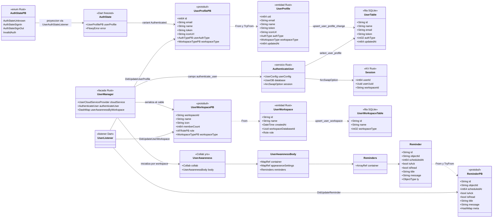
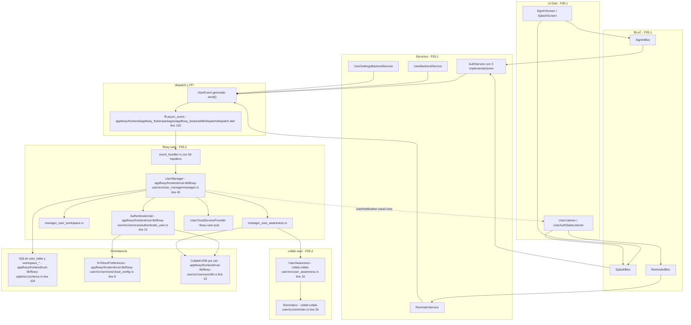
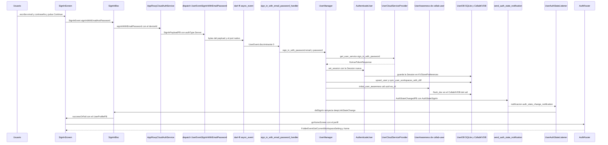
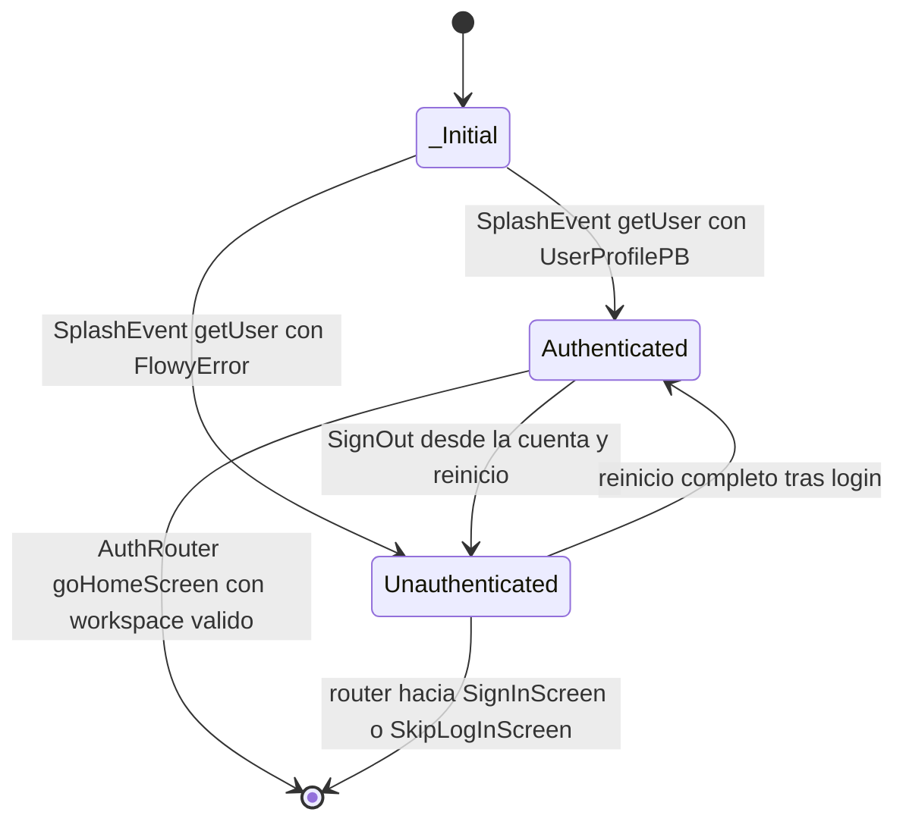

# F05.0 — Índice: usuario, autenticación, sesión, miembros, roles y migraciones

## 1. Resumen

F05 documenta el subsistema de identidad de AppFlowy —alta de usuario, entrada, sesión, workspaces, miembros, ajustes personales, recordatorios y migraciones de datos locales— a través de las dos caras del puente Flutter↔Rust: la capa Flutter (`appflowy_flutter/lib/user/**` más cinco ficheros de `workspace/application/**`, **73 archivos**, F05.1) y la capa Rust (`flowy-user` + `collab-user`, **58 archivos**, F05.2). La feature se divide en dos documentos y no en más porque la frontera natural es exactamente el puente FFI: todo lo que hay a un lado son BLoCs, listeners y pantallas, y todo lo del otro son handlers, managers y un collab `yrs`; partir por sub-tema (miembros, recordatorios, ajustes) habría duplicado las mismas tablas en dos capas. Este documento es el **índice**: no añade archivos propios, sino que fija el vocabulario común —los 56 `UserEvent`, las 10 `UserNotification`, los 9 BLoCs Dart de F05.1 y sus dos servicios backend, la cadena de inyección y el mapa de persistencia— para que cualquier documento del corpus pueda enlazar contra un único lugar. La lectura esperada es: este índice para orientarse, F05.1 cuando el asunto sea UI o flujo Dart, F05.2 cuando sea handler, entidad protobuf, SQLite o CRDT.

## 2. Alcance

**Incluido en F05:** los 131 archivos de las dos sub-unidades internas, la definición completa del enum `UserEvent` (56 variantes) y del enum `UserNotification` (10 variantes), el `UserManager` y sus colaboradores, el objeto CRDT `UserAwareness` con su array de `Reminders`, la lógica de sesión (`AuthenticateUser`, cifrado, backup) y las migraciones de datos locales de usuario.

**Fuera de F05 y derivado a otras features** (el detalle por fila está en §13):

| Subtema | Documento dueño | Motivo |
|---|---|---|
| UI de miembros, roles y nivel de acceso: `features/share_tab/**`, `share_role.dart`, `share_access_level.dart`, `people_with_access_section.dart` | **F12** | Solo los 5 eventos Rust de miembro quedan en F05.2 |
| Esquema SQLite (diesel) de las seis tablas de usuario y las migraciones del esquema | **B1.7** | F05.2 solo documenta la lógica de datos que las usa |
| Colaboradores y presencia en documentos: `document_collaborators_bloc.dart`, `document_awareness_metadata.dart` | **F01.0.1** | El awareness de documento es otro collab (`collab-document`) |
| Superficie de notificación in-app: bandeja, `inbox_action_bar.dart`, `reminder_selector.dart` | **F15** | Reparto de contenido dentro de los recordatorios, no de frontera tecnológica |
| Clientes AppFlowy Cloud de usuario: `flowy-server/src/af_cloud/impls/user/*` | **F06** | Solo se documenta el contrato cliente |
| Composición del SDK Rust: `flowy-core/src/deps_resolve/user_deps.rs`, `server_layer.rs` | **F00** | Punto de inyección, no parte de `flowy-user` |
| Checkout y billing UI (Dart) | **F13** | `billing_check.rs` (F05.2) es el motor; la pantalla no es de F05 |

**Tabla de sub-unidades (suma = 131):**

| Sub-unidad | Título | Archivos | Documento | Cubre | No cubre |
|---|---|---:|---|---|---|
| F05.1 | Usuario (Dart): `lib/user/**` y `workspace/application/user/` | **73** | `OUT/09-features/F05-usuario-auth-sesion/1-usuario-appflowy-flutter-lib-user-dart.md` | 9 BLoCs + 2 servicios backend, 53 eventos freezed, 3 caminos de login, 4 clases `AuthService`, 41 `UserEvent` despachados, 35 pantallas | handlers Rust, esquema SQLite, `collab-user` (F05.2) |
| F05.2 | Usuario: `flowy-user` + `collab-user` (Rust + Collab) | **58** | `OUT/09-features/F05-usuario-auth-sesion/2-usuario-flowy-user-collab-user-rust-collab.md` | 56 `UserEvent`, 10 `UserNotification`, `UserManager`, `AuthenticateUser`, migraciones, cifrado, `UserAwareness` | BLoCs y pantallas Dart (F05.1), SQL de `flowy-sqlite` (B1.7) |
| F05.0 | Índice (este documento) | **0** | `OUT/09-features/F05-usuario-auth-sesion/0.0-indice-usuario-auth-sesion.md` | vocabulario cross-cutting: eventos, notificaciones, BLoCs, cadena DI, persistencia | todo detalle de implementación, que vive en F05.1 y F05.2 |
| **Total F05** | — | **131** | (3 documentos) | | |

## 3. Modelos de datos

El siguiente `classDiagram` cruza las tres capas que F05 toca —Dart (`flutter_bloc`), Rust (`flowy-user`) y CRDT (`collab-user`)— con los tipos reales del snapshot `5cf3a36`. Cada caja lleva en la prosa siguiente su `ruta:línea` canónica. Los nombres `UserInfo` y `UserPB` que aparecían en el encargo **no existen** en el código: la entidad interna se llama `UserProfile` y la proyección de cable se llama `UserProfilePB`; queda registrado como `[NO DETERMINADO]` en §18.

Lectura: `UserProfilePB` es el tipo bisagra de toda la feature. En el cable lo consumen `AuthState` (Dart) y `UserListener`; en Rust lo produce `UserProfile` (entidad de `flowy-user-pub`) y ese a su vez se proyecta sobre la fila `UserTable` de `user_table`. La misma cadena de tres pasos se repite para el workspace (`UserWorkspace` → `UserWorkspaceTable` → `UserWorkspacePB`) y para el recordatorio (`Reminder` dentro del collab → `ReminderPB`), lo que da a F05 una simetría notable: **todo estado de usuario existe tres veces**, una por capa, y las conversiones son `From`/`TryFrom` explícitos. `AuthState` y `AuthStatePB` son el único par que **no** está en esa simetría: el freezed Dart tiene tres variantes (`appflowy/frontend/appflowy_flutter/lib/user/domain/auth_state.dart:9–12`) y el enum de Rust cuatro (`appflowy/frontend/rust-lib/flowy-user/src/entities/auth.rs:247–252`), y el mapeo lo hace a mano `UserAuthStateListener`.

**Tabla de tipos con `ruta:línea` canónica:**

| Capa | Tipo | Declaración | Papel en F05 |
|---|---|---|---|
| Dart dominio | `AuthState` | `appflowy/frontend/appflowy_flutter/lib/user/domain/auth_state.dart:8–13` | estado de sesión que consume `SplashBloc` (F05.1 §3.1) |
| Rust enum | `AuthStatePB` | `appflowy/frontend/rust-lib/flowy-user/src/entities/auth.rs:247–252` | payload de `UserAuthStateChanged` |
| Protobuf | `UserProfilePB` | `appflowy/frontend/rust-lib/flowy-user/src/entities/user_profile.rs:25–45` | 7 campos, el 4 es el token de GoTrue |
| Entidad Rust | `UserProfile` | `appflowy/frontend/rust-lib/flowy-user-pub/src/entities.rs:146–155` | 8 campos; **no** es `UserInfo` ni `UserPB` |
| Fila SQLite | `UserTable` | `appflowy/frontend/rust-lib/flowy-user-pub/src/sql/user_sql.rs:17–25` | mapeo de `user_table` |
| Servicio Rust | `AuthenticateUser` | `appflowy/frontend/rust-lib/flowy-user/src/services/authenticate_user.rs:21–27` | dueño del `ArcSwapOption<Session>` |
| KV Rust | `Session` | `appflowy/frontend/rust-lib/flowy-user-pub/src/session.rs:8–12` | `user_id`, `user_uuid`, `workspace_id` |
| Fachada Rust | `UserManager` | `appflowy/frontend/rust-lib/flowy-user/src/user_manager/manager.rs:45–56` | 11 campos, punto único de orquestación |
| Protobuf | `UserWorkspacePB` | `appflowy/frontend/rust-lib/flowy-user/src/entities/user_profile.rs:168–190` | 7 campos, `role` opcional (`one_of`) |
| Entidad Rust | `UserWorkspace` | `appflowy/frontend/rust-lib/flowy-user-pub/src/entities.rs:104–119` | incluye `workspace_database_id` |
| Fila SQLite | `UserWorkspaceTable` | `appflowy/frontend/rust-lib/flowy-user-pub/src/sql/workspace_sql.rs:13` | mapeo de `user_workspace_table` |
| CRDT | `UserAwareness` | `collab:collab-user/src/user_awareness.rs:19–22` | `Collab` + `UserAwarenessBody` |
| CRDT | `UserAwarenessBody` | `collab:collab-user/src/user_awareness.rs:182–190` | 2 mapas + array de recordatorios |
| CRDT | `Reminders` | `collab:collab-user/src/reminder.rs:26–30` | `ArrayRef` con `Subscription` opcional |
| CRDT | `Reminder` | `collab:collab-entity/src/reminder.rs:11` | entidad CRDT compartida con `collab-document` |
| Protobuf | `ReminderPB` | `appflowy/frontend/rust-lib/flowy-user/src/entities/reminder.rs:6–30` | 8 campos, el 8 es `meta` |
| Dart listener | `UserListener` | `appflowy/frontend/appflowy_flutter/lib/user/application/user_listener.dart:80–82` | `switch` sobre las 10 `UserNotification` |

## 4. Eventos FFI

El enum `UserEvent` se declara en `appflowy/frontend/rust-lib/flowy-user/src/event_map.rs:88–277` con la macro `Flowy_Event` y se registra en el `AFPlugin` `"Flowy-User"` en `appflowy/frontend/rust-lib/flowy-user/src/event_map.rs:26–83`. Hay **56 variantes** `[VERIFICADO]`: los discriminantes recorren el rango 0–65 con diez huecos reservados (5, 15, 16, 18, 19, 20, 23, 32, 52 y 60) por compatibilidad con clientes antiguos. El catálogo `OUT/_ledger/extract/events.json` filtrado por `crate == "flowy-user"` devuelve exactamente 56 entradas, y el detalle variante por variante (PB de entrada, PB de salida, handler y línea de registro) está en F05.2 §4. La tabla siguiente agrupa las 56 por dominio funcional; **no** repite los PB ni las líneas de handler.

| Dominio | Variantes (`discriminante`) | Nº | Sub-unidad que lo detalla | Qué lo consume desde Dart |
|---|---|---:|---|---|
| **Auth local y self-hosted** (alta, baja y estado de la sesión) | `SignInWithEmailPassword` (0), `SignUp` (1), `SignOut` (2), `GetUserProfile` (4), `InitUser` (6), `GetAnonUser` (25), `OpenAnonUser` (26), `DeleteAccount` (64) | **8** | F05.2 §4 · F05.1 §4 | `BackendAuthService` (`appflowy/frontend/appflowy_flutter/lib/user/application/auth/backend_auth_service.dart:33`), `UserBackendService` (`appflowy/frontend/appflowy_flutter/lib/user/application/user_service.dart:34`), `AnonUserBloc`, `SplashBloc`, `SignInBloc`, `SignUpBloc` |
| **Auth cloud** (AppFlowy Cloud / GoTrue) | `MagicLinkSignIn` (50), `PasscodeSignIn` (65) | **2** | F05.2 §4 · F05.1 §4 | `UserBackendService.signInWithMagicLink` y `.signInWithPasscode` (`appflowy/frontend/appflowy_flutter/lib/user/application/user_service.dart:76`, `:85`), disparados por `SignInBloc` |
| **OAuth** de terceros | `OauthSignIn` (10), `GenerateSignInURL` (11), `GetOauthURLWithProvider` (12) | **3** | F05.2 §4 · F05.1 §7.2 | `AppFlowyCloudAuthService.signUpWithOAuth` (`appflowy/frontend/appflowy_flutter/lib/user/application/auth/af_cloud_auth_service.dart:56`) y el doble `AppFlowyCloudMockAuthService` de tests (`appflowy/frontend/appflowy_flutter/lib/user/application/auth/af_cloud_mock_auth_service.dart:56`, `:68`) |
| **Perfil y ajustes** | `UpdateUserProfile` (3), `SetAppearanceSetting` (7), `GetAppearanceSetting` (8), `GetUserSetting` (9), `UpdateWorkspaceSetting` (57), `GetWorkspaceSetting` (58) | **6** | F05.2 §4 | `UserSettingsBackendService` (`appflowy/frontend/appflowy_flutter/lib/user/application/user_settings_service.dart:12`, `:22`, `:28`), `UserBackendService.updateUserProfile` (`appflowy/frontend/appflowy_flutter/lib/user/application/user_service.dart:62`) y `SettingsAIBloc` (**F13**) para los dos de workspace |
| **Ajustes de fecha y notificaciones** | `SetDateTimeSettings` (33), `GetDateTimeSettings` (34), `SetNotificationSettings` (35), `GetNotificationSettings` (36) | **4** | F05.2 §4 | `UserSettingsBackendService` (`appflowy/frontend/appflowy_flutter/lib/user/application/user_settings_service.dart:32`, `:44`, `:50`, `:54`) |
| **Workspaces** | `GetAllWorkspace` (17), `OpenWorkspace` (21), `GetUserWorkspace` (22), `CreateWorkspace` (42), `DeleteWorkspace` (43), `RenameWorkspace` (44), `ChangeWorkspaceIcon` (45), `LeaveWorkspace` (46) | **8** | F05.2 §4 | `UserBackendService` (`appflowy/frontend/appflowy_flutter/lib/user/application/user_service.dart:116`, `:146`, `:165`, `:172`, `:182`, `:192`, `:253`) y `WorkspaceSettingsBloc` (**F13**); `GetUserWorkspace` **no tiene** consumidor en `lib/` |
| **Miembros e invitaciones** | `AddWorkspaceMember` (37, *deprecado y sin handler*), `RemoveWorkspaceMember` (38), `UpdateWorkspaceMember` (39), `GetWorkspaceMembers` (40), `InviteWorkspaceMember` (47), `ListWorkspaceInvitations` (48), `AcceptWorkspaceInvitation` (49), `GetMemberInfo` (56) | **8** | F05.2 §4 y §4.1 | `UserBackendService` (`appflowy/frontend/appflowy_flutter/lib/user/application/user_service.dart:200`, `:224`, `:234`, `:246`) y la UI de **F12**; `GetMemberInfo` lo consume `appflowy/frontend/appflowy_flutter/lib/plugins/ai_chat/application/chat_member_bloc.dart` (**F09.3**) |
| **Recordatorios** | `CreateReminder` (28), `GetAllReminders` (29), `RemoveReminder` (30), `UpdateReminder` (31) | **4** | F05.2 §4 · F05.1 §4 | `ReminderService` (`appflowy/frontend/appflowy_flutter/lib/user/application/reminder/reminder_service.dart:32`, `:41`, `:48`, `:61`) desde `ReminderBloc` |
| **Red y sync** | `UpdateNetworkState` (24), `PushRealtimeEvent` (27) | **2** | F05.2 §4 | `NetworkMonitor` (`appflowy/frontend/appflowy_flutter/lib/core/network_monitor.dart:53`); `PushRealtimeEvent` **no tiene** consumidor Dart en `lib/`, `packages/`, `test/` ni `integration_test/` `[VERIFICADO]` |
| **Configuración cloud** | `SetCloudConfig` (13), `GetCloudConfig` (14) | **2** | F05.2 §4 | `AppFlowyCloudSettingBloc` (`appflowy/frontend/appflowy_flutter/lib/workspace/application/settings/appflowy_cloud_setting_bloc.dart:73`) y `SettingsDialogBloc` (`appflowy/frontend/appflowy_flutter/lib/workspace/application/settings/settings_dialog_bloc.dart:109`), ambos **F13** |
| **Suscripción y billing** | `SubscribeWorkspace` (51), `CancelWorkspaceSubscription` (53), `GetWorkspaceUsage` (54), `GetBillingPortal` (55), `GetWorkspaceSubscriptionInfo` (59), `UpdateWorkspaceSubscriptionPaymentPeriod` (61), `GetSubscriptionPlanDetails` (62), `NotifyDidSwitchPlan` (63) | **8** | F05.2 §4 | `UserBackendService` (`appflowy/frontend/appflowy_flutter/lib/user/application/user_service.dart:259`, `:273`, `:290`, `:303`), `WorkspaceService` (`appflowy/frontend/appflowy_flutter/lib/workspace/application/workspace/workspace_service.dart:89`, `:93`), `SidebarPlanBloc` (**F03.1**) y `LocalAiOnBoardingBloc` (**F13**); `GetSubscriptionPlanDetails` **no tiene** consumidor Dart |
| **Otros** — importación de datos | `ImportAppFlowyDataFolder` (41) | **1** | F05.2 §4 | `SettingFileImporterBloc` (`appflowy/frontend/appflowy_flutter/lib/workspace/application/settings/setting_file_importer_bloc.dart`, **F13**); la inserción final en folder/database es **B4** |
| **Total** | — | **56** | — | — |

**Comprobación de la suma:** 8 + 2 + 3 + 6 + 4 + 8 + 8 + 4 + 2 + 2 + 8 + 1 = **56** ✓.

**Reparto por consumidor Dart.** De las 56 variantes, **41** se despachan desde ficheros de F05.1 (F05.1 §4, 52 puntos de llamada). Las **15** restantes se despachan desde otras unidades: 2 de workspace (`GetWorkspaceUsage`, `GetBillingPortal` en F03.1), 2 de configuración cloud (F13), 6 de ajustes de workspace/IA/facturación (F13), 1 de importación (F13), 1 de `GetMemberInfo` (F09.3), 1 de `GetUserProfile` en los plugins de base de datos (F02). Quedan **8 variantes sin ningún consumidor Dart en el repositorio** `[VERIFICADO]`: `AddWorkspaceMember` (37, deprecado y sin handler), `GetUserWorkspace` (22), `ListWorkspaceInvitations` (48), `AcceptWorkspaceInvitation` (49), `PushRealtimeEvent` (27), `GetSubscriptionPlanDetails` (62) y las dos reservadas sin codificar. 41 + 15 = 56 ✓.

## 5. Notificaciones

El enum `UserNotification` se declara en `appflowy/frontend/rust-lib/flowy-user/src/notification.rs:11–24` con **10 variantes** `[VERIFICADO]` (discriminantes 0–9, sin huecos) y viaja por el canal `USER_OBSERVABLE_SOURCE = "User"` (`appflowy/frontend/rust-lib/flowy-user/src/notification.rs:7`). El envoltorio de envío es `send_notification` (`appflowy/frontend/rust-lib/flowy-user/src/notification.rs:27–30`) y el caso especial de sesión, `send_auth_state_notification`, que usa la clave fija `"auth_state_change_notification"` (`appflowy/frontend/rust-lib/flowy-user/src/notification.rs:32–41`). El detalle de emisor y línea por variante está en F05.2 §5.

| # | Variante (`discriminante`) | Sub-unidad que lo detalla | Listener Dart | Efecto sobre la UI |
|---:|---|---|---|---|
| 0 | `Unknown` (0) | F05.2 §5 | ninguno; es la variante `default` de `UserNotification` (`appflowy/frontend/rust-lib/flowy-user/src/notification.rs:12`) | ninguno `[VERIFICADO]` |
| 1 | `UserAuthStateChanged` (1) | F05.2 §5 · F05.1 §5 | `UserAuthStateListener` (`appflowy/frontend/appflowy_flutter/lib/user/application/user_auth_listener.dart:47–60`) | con `AuthStateSignIn` invoca `didSignIn`; con `InvalidAuth` invoca `onInvalidAuth`, que relanza la app (`appflowy/frontend/appflowy_flutter/lib/startup/tasks/appflowy_cloud_task.dart:241–251`) |
| 2 | `DidUpdateUserProfile` (2) | F05.2 §5 | `UserListener` (`appflowy/frontend/appflowy_flutter/lib/user/application/user_listener.dart:83–88`) | publica un `UserProfilePB` nuevo; `SettingsUserViewBloc` emite `didReceiveUserProfile` |
| 3 | `DidUpdateUserWorkspaces` (3) | F05.2 §5 | `UserListener` (`appflowy/frontend/appflowy_flutter/lib/user/application/user_listener.dart:90–97`) | invoca `onUserWorkspaceListUpdated` con un `RepeatedUserWorkspacePB`; repinta el selector de workspace |
| 4 | `DidUpdateCloudConfig` (4) | F05.2 §5 | **ninguno en F05.1** `[VERIFICADO]`; la consume la UI de ajustes cloud (**F13**) | refresca el `CloudSettingPB` de la pantalla de servidor |
| 5 | `DidUpdateUserWorkspace` (5) | F05.2 §5 | `UserListener` (`appflowy/frontend/appflowy_flutter/lib/user/application/user_listener.dart:98–101`) | invoca `onUserWorkspaceUpdated`; cae también en el `case` 6 por el `switch` sin `break` (riesgo, §13) |
| 6 | `DidUpdateWorkspaceSetting` (6) | F05.2 §5 | `UserListener` (`appflowy/frontend/appflowy_flutter/lib/user/application/user_listener.dart:102–107`) y `FolderListener` para `FolderNotification` homónimo | actualiza el `WorkspaceSettingsPB` de la vista activa |
| 7 | `DidLoadUserAwareness` (7) | F05.2 §5 | `UserAwarenessListener` (`appflowy/frontend/appflowy_flutter/lib/user/application/reminder/reminder_listener.dart:55–57`) | habilita `GetAllReminders`: el propio código indica que solo después se pueden pedir recordatorios |
| 8 | `DidUpdateReminder` (8) | F05.2 §5 | `UserAwarenessListener` acepta el callback (`appflowy/frontend/appflowy_flutter/lib/user/application/reminder/reminder_listener.dart:58–60`) | **sin emisor en Rust** y **sin `start()` que registre el callback**: la variante está marcada `// TODO: implement reminder observer` (`appflowy/frontend/rust-lib/flowy-user/src/notification.rs:21`) |
| 9 | `DidOpenWorkspace` (9) | F05.2 §5 | `UserListener` (`appflowy/frontend/appflowy_flutter/lib/user/application/user_listener.dart:108–114`) | publica el `UserProfilePB` resultante, lo que dispara `onProfileUpdated` |
| **Total** | — | **10** | — | — |

**Comprobación de la suma:** 0 + 1 + 2 + 3 + 4 + 5 + 6 + 7 + 8 + 9 = **10** ✓. Nueve de las diez tienen `case` efectivo en algún listener Dart del árbol; la décima (`Unknown`) es centinela. Solo **siete** las consume un listener cuyo fichero pertenece a F05.1; `DidUpdateCloudConfig` la consume la UI de F13 y `DidUpdateReminder` no la consume nadie.

## 6. BLoCs / Cubits

F05.1 es la única capa de F05 con estado: un barrido de `class … extends Bloc<…>` sobre sus 73 ficheros devuelve **9 clases `Bloc`** y ningún `Cubit`. F05.2 es Rust puro y no declara ninguno (expone `UserManager` como `Arc` compartido entre los 56 handlers). La tabla da, para cada BLoC, la sub-unidad que lo documenta en detalle y los `UserEvent` que despacha a través de los servicios intermedios; el desglose de eventos y estados freezed está en F05.1 §6, así que aquí solo se lista el contrato de ida.

| # | Clase BLoC | Sub-unidad | `ruta:línea` (declaración) | Eventos Rust que despacha | Notificaciones que consume |
|---:|---|---|---|---|---|
| 1 | `SignInBloc` | F05.1 | `appflowy/frontend/appflowy_flutter/lib/user/application/sign_in_bloc.dart:21` | `SignInWithEmailPassword`, `SignUp`, `SignOut`, `GetOauthURLWithProvider` | `UserAuthStateChanged` |
| 2 | `SignUpBloc` | F05.1 | `appflowy/frontend/appflowy_flutter/lib/user/application/sign_up_bloc.dart:14` | `SignUp` | ninguna |
| 3 | `AnonUserBloc` | F05.1 | `appflowy/frontend/appflowy_flutter/lib/user/application/anon_user_bloc.dart:10` | `GetAnonUser`, `OpenAnonUser` | ninguna |
| 4 | `SplashBloc` | F05.1 | `appflowy/frontend/appflowy_flutter/lib/user/application/splash_bloc.dart:9` | `GetUserProfile` | ninguna (lee el retorno síncrono de `getUser()`) |
| 5 | `PasswordBloc` | F05.1 | `appflowy/frontend/appflowy_flutter/lib/user/application/password/password_bloc.dart:15` | ninguno: habla HTTP directo con GoTrue | ninguna |
| 6 | `NotificationFilterBloc` | F05.1 | `appflowy/frontend/appflowy_flutter/lib/user/application/notification_filter/notification_filter_bloc.dart:6` | ninguno | ninguna directamente; consume `ReminderBloc`, que sí oye `DidUpdateReminder` |
| 7 | `ReminderBloc` | F05.1 | `appflowy/frontend/appflowy_flutter/lib/user/application/reminder/reminder_bloc.dart:31` | `CreateReminder`, `GetAllReminders`, `UpdateReminder`, `RemoveReminder` | `DidLoadUserAwareness`, `DidUpdateReminder` |
| 8 | `WorkspaceErrorBloc` | F05.1 | `appflowy/frontend/appflowy_flutter/lib/user/application/workspace_error_bloc.dart:11` | ninguno (traduce `FlowyError` y `UserFolderPB` a `WorkspaceState`) | ninguna |
| 9 | `SettingsUserViewBloc` | F05.1 | `appflowy/frontend/appflowy_flutter/lib/workspace/application/user/settings_user_bloc.dart:12` | `UpdateUserProfile` | `DidUpdateUserProfile` |
| **Total** | **9 BLoCs** | — | — | — | — |

**Los dos servicios sin BLoC.** La mayor parte de los 41 `UserEvent` que envía F05.1 no pasa por ningún BLoC, sino por servicios invocados directamente desde widgets o desde `getIt`: `UserBackendService`, con 25 métodos (`appflowy/frontend/appflowy_flutter/lib/user/application/user_service.dart:27`), que despacha los 20 eventos de perfil, workspace, miembro y suscripción, y `UserSettingsBackendService`, con 6 métodos (`appflowy/frontend/appflowy_flutter/lib/user/application/user_settings_service.dart:8`), que despacha los 6 de ajustes. La tercera clase de servicio, `ReminderService` (`appflowy/frontend/appflowy_flutter/lib/user/application/reminder/reminder_service.dart:9`), sí está detrás de un BLoC (`ReminderBloc`, fila 7).

**Corrección de recuento.** F05.1 §16 declara «10 clases BLoC/Cubit definidas en la unidad» mientras que su propia tabla de §6 lista 9 filas y el barrido sobre el código confirma 9. La décima fila de aquel recuento corresponde muy probablemente a `ReminderState`, que es una clase de estado manual sin BLoC propio (`appflowy/frontend/appflowy_flutter/lib/user/application/reminder/reminder_bloc.dart:673`). Este índice usa la cifra verificada de **9**. Fuera de F05.1, **15 BLoCs** más despachan al menos un `UserEvent` (§16).

## 7. Servicios e inyección

La cadena completa de F05 es: **`get_it` → `AuthService`/`UserService` → código generado de `appflowy_backend/dispatch` → FFI `dart_ffi::async_event` → `lib-dispatch` → `AFPlugin "Flowy-User"` → handler → `UserManager` → `collab-user` → SQLite/CollabKVDB**, con el retorno por dos vías simultáneas: el `FlowyResult` síncrono de la llamada y la notificación asíncrona del canal `"User"`.

| Salto | Origen | Destino | `ruta:línea` verificada |
|---|---|---|---|
| 0. Elección del `AuthService` | `currentCloudType()` | `_resolveUserDeps` hace `switch` de cuatro casos: `local` → `BackendAuthService(AuthTypePB.Local)`; `appflowyCloud`, `appflowyCloudSelfHost`, `appflowyCloudDevelop` → `AppFlowyCloudAuthService()` | `appflowy/frontend/appflowy_flutter/lib/startup/deps_resolver.dart:106–121` |
| 1. Registro de BLoCs y listeners | `_resolveUserDeps` y `_resolveHomeDeps` | `SignInBloc`, `SignUpBloc`, `SplashBloc`, `NetworkListener`, `UserListener` (factory), `ReminderBloc` (singleton) | `appflowy/frontend/appflowy_flutter/lib/startup/deps_resolver.dart:123–140`, `:142–163` |
| 2. BLoC → servicio | `SignInBloc` invoca `authService`; `ReminderBloc` invoca `ReminderService` | payload protobuf construido | `appflowy/frontend/appflowy_flutter/lib/user/application/sign_in_bloc.dart:174`, `appflowy/frontend/appflowy_flutter/lib/user/application/reminder/reminder_bloc.dart:36` |
| 3. Servicio → dispatch generado | `UserEvent*.send()` | `FFIRequest` serializado a bytes | `appflowy/frontend/appflowy_flutter/packages/appflowy_backend/lib/dispatch/dispatch.dart:117` (definición de `_sendToRust`) |
| 4. Frontera FFI | `ffi.async_event(port.nativePort, input, bytes.length)` | `dart-ffi` | `appflowy/frontend/appflowy_flutter/packages/appflowy_backend/lib/dispatch/dispatch.dart:130` |
| 5. Registro del plugin | `AFPlugin::new().name("Flowy-User").state(user_manager)` | `lib-dispatch` | `appflowy/frontend/rust-lib/flowy-user/src/event_map.rs:17–25` |
| 6. Handler Rust | `sign_in_with_email_password_handler(data, manager)` y los otros 55 | `UserManager` vía `upgrade_manager` | `appflowy/frontend/rust-lib/flowy-user/src/event_handler.rs:40–54` |
| 7. Fachada de dominio | `UserManager::sign_in_with_password` / `sign_in` | `UserCloudServiceProvider` y `AuthenticateUser` | `appflowy/frontend/rust-lib/flowy-user/src/user_manager/manager.rs:368–413` |
| 8. Estado de sesión | `AuthenticateUser::set_session` | `KVStorePreferences` bajo `session_cache_key` | `appflowy/frontend/rust-lib/flowy-user/src/services/authenticate_user.rs:139–145` |
| 9. Persistencia tabular | `upsert_user_profile_change`, `upsert_user_workspace`, `sync_user_workspaces_with_diff` | `user_table`, `user_workspace_table` (esquema en **B1.7**) | `appflowy/frontend/rust-lib/flowy-user/src/user_manager/manager.rs:815–852`, `appflowy/frontend/rust-lib/flowy-user/src/user_manager/manager_user_workspace.rs:480` |
| 10. Capa CRDT | `UserManager::initial_user_awareness` | `UserAwareness` de `collab-user` abierto en el `CollabKVDB` del uid | `appflowy/frontend/rust-lib/flowy-user/src/user_manager/manager_user_awareness.rs:129–209`, `collab:collab-user/src/user_awareness.rs:19–22` |
| 11. Notificación de vuelta | `send_auth_state_notification` y `send_notification` | canal `"User"` | `appflowy/frontend/rust-lib/flowy-user/src/notification.rs:32–41`, `:27–30` |
| 12. Listener Dart | `RustStreamReceiver.listen` + `UserNotificationParser` | BLoC reinyectado | `appflowy/frontend/appflowy_flutter/lib/user/application/user_listener.dart:70–82` |
| 13. Inyección en Rust | `UserDepsResolver::resolve(authenticate_user, collab_builder, server_provider, store_preference, database_manager, folder_manager)` | `UserManager::new(...)` y `UserWorkspaceServiceImpl` | `appflowy/frontend/rust-lib/flowy-core/src/deps_resolve/user_deps.rs:20–39`, `:41–44` |

El punto de inyección de la columna 13 pertenece a **[[../../09-features/F00-infraestructura-compartida-ffi-dispatch-errores-build-nativo/0-indice-infraestructura-compartida-ffi-dispatch-errores-build-paquetes-nativo-tes.md]]**: es el único sitio del workspace Cargo donde se ensambla el `UserManager` que los 56 handlers comparten. `flowy-user` no se instancia en ningún otro lugar; el `Weak<UserManager>` viaja dentro del `AFPlugin` como estado (columna 5).

## 8. Persistencia

F05 reparte su estado en **tres almacenes distintos**, y confundirlos es el error más común al leer esta feature. El detalle del esquema y de las migraciones diesel está en **[[../../08-persistencia/00-indice.md]]** (`OUT/08-persistencia/01-sqlite-schema.md`); aquí solo se referencia, no se redeclara.

| Almacén | Qué guarda F05 | Tablas / claves | Documento dueño del detalle |
|---|---|---|---|
| **SQLite por usuario** (una base por uid, `UserDB.sqlite_map`) | perfil y token, workspaces del usuario, ajustes de workspace, miembros e invitaciones, registro de migraciones aplicadas | `user_table` (`appflowy/frontend/rust-lib/flowy-sqlite/src/schema.rs:104`), `user_workspace_table` (`:116`), `workspace_members_table` (`:130`), `workspace_setting_table` (`:143`), `workspace_shared_user` (`:151`), `user_data_migration_records` (`:96`) | **B1.7** para el esquema; **F05.2 §8** para qué método escribe en cada una |
| **CollabKVDB por usuario** (RocksDB, `UserDB.collab_db_map`) | el collab `UserAwareness` de cada workspace, con el array de `Reminders` y el mapa de apariencia | abierto en `<storage>/<uid>/collab_db`; tipo `CollabType::UserAwareness` (`appflowy/frontend/rust-lib/flowy-user/src/user_manager/manager_user_awareness.rs:329`) | **B1.6** para el almacén; **F05.2 §8.1** para el contenido |
| **KV de Rust** (`KVStorePreferences`) | `Session` viva, `UserCloudConfig` con su `encrypt_secret`, ajustes serializados, versión de primera instalación | `af_user_cloud_config` (`appflowy/frontend/rust-lib/flowy-user/src/services/cloud_config.rs:8`), `session_cache_key` (`appflowy/frontend/rust-lib/flowy-user/src/services/authenticate_user.rs:144`), `first_install_version` (`appflowy/frontend/rust-lib/flowy-user/src/migrations/migration.rs:17`) | **F05.2 §8.2** |
| **KV de Dart** (`SharedPreferences`) | solo el tipo de servidor y su URL, es decir qué `AuthService` se registra | `kCloudType`, `kAppflowyCloudBaseURL`, `kAppflowyBaseShareDomain`, `kAppFlowyEnableSyncTrace` (`appflowy/frontend/appflowy_flutter/lib/core/config/kv_keys.dart:59–62`); backend en `appflowy/frontend/appflowy_flutter/lib/core/config/kv.dart:14–15` | **F05.1 §8** |

**Dato estructural:** `workspace_shared_user` aparece en el esquema pero F05 no la escribe directamente; se usa de forma indirecta a través de `flowy-folder`, que es de **[[../../09-features/F03-folder-workspaces-vistas/0.2-flowy-folder-rust.md]]**. Y `user_data_migration_records` es la tabla que hace idempotentes las migraciones de F05.2 §12.6: sin ella, `collab_migration_list()` reintentaría cada migración en cada arranque.

## 9. Diagramas de flujo

El siguiente `flowchart TD` muestra el camino transversal de F05 completo: qué capa habla con cuál, con los subgrafos por capa (UI Dart → BLoC → servicio → dispatch/FFI → Rust de servicio → CRDT → persistencia) y el camino de vuelta de las notificaciones.

Lectura: la UI nunca habla con Rust; el camino obligatorio pasa por un BLoC y después por uno de los cuatro servicios de F05.1, que construyen el protobuf y llaman al código generado de `dispatch`. Ese código serializa a bytes y cruza `ffi.async_event` (nodo `AEV`), que es el único punto del grafo donde la confianza cambia de capa. Del lado Rust, `lib-dispatch` resuelve el discriminante y llama al handler, que siempre termina en `UserManager`: ni siquiera los handlers de ajustes o de recordatorios saltan ese nivel, lo que convierte al `UserManager` en el cuello de botella único de F05. Desde ahí el grafo se bifurca en tres persistencias (SQLite, KV y CollabKVDB) y en una salida lateral (`UCP`) hacia el servicio cloud, cuyo interior es **[[../../09-features/F06-sync-y-servidores/F06-sync-y-servidores.md]]**. La única flecha de vuelta al lado Dart es la punteada: el `FlowyResult` síncrono ya ha regresado por el mismo `Completer` que abrió `AEV`, así que las notificaciones no transportan datos, sino *invalidaciones* que disparan lecturas nuevas.

## 10. Diagramas de secuencia

El siguiente `sequenceDiagram` recorre el login más largo de F05 —AppFlowy Cloud con email y contraseña— extremo a extremo, desde el widget hasta el rebuild de la UI, incluyendo la vuelta por notificación.

Lectura: la parte no obvia son los cinco últimos mensajes. Tras el éxito del evento FFI, `SignInBloc` **no navega**: entrega el token al gestor de deep link (`appflowy/frontend/appflowy_flutter/lib/user/application/sign_in_bloc.dart:181–183`) y espera. El retorno real llega por la notificación `UserAuthStateChanged` (`appflowy/frontend/rust-lib/flowy-user/src/user_manager/manager.rs:408–411`), que `UserAuthStateListener` traduce a `didSignIn` (`appflowy/frontend/appflowy_flutter/lib/user/application/user_auth_listener.dart:53–55`), y solo entonces el estado `successOrFail` se puebla con el `UserProfilePB`. La navegación final la decide `AuthRouter.goHomeScreen`, que consulta el workspace actual y degrada a la pantalla de inicio de workspace si la consulta falla (`appflowy/frontend/appflowy_flutter/lib/user/presentation/router.dart:38–57`). Obsérvese también el orden de los mensajes 9–11: la `Session` se persiste **antes** de tocar la tabla de usuario y **antes** de abrir el collab de awareness, de modo que un fallo de disco deja un `UserManager` consistente con la sesión en memoria pero sin workspaces locales.

## 11. Diagramas de estado

El siguiente `stateDiagram-v2` representa el ciclo de vida de la sesión con los **tres estados reales** del freezed `AuthState` (`appflowy/frontend/appflowy_flutter/lib/user/domain/auth_state.dart:9–12`), tal como los transiciona `SplashBloc` y los consume `SplashScreen`.

Lectura: el estado nace en `_Initial` porque `SplashState.initial()` lo fija así (`appflowy/frontend/appflowy_flutter/lib/user/application/splash_bloc.dart:37–39`), y `SplashScreen` dispara `SplashEvent.getUser()` nada más construir el provider (`appflowy/frontend/appflowy_flutter/lib/user/presentation/screens/splash_screen.dart:41–42`). La transición a `Authenticated` no "entra" por un login visible: la escribe el resultado de `getIt<AuthService>().getUser()`, que delega en `UserBackendService.getCurrentUserProfile()` y por tanto en `GetUserProfile` (`appflowy/frontend/appflowy_flutter/lib/user/application/auth/backend_auth_service.dart:97–99`). La transición de vuelta a `Authenticated` no ocurre dentro de `SplashBloc` —no existe evento para ella— sino por el reinicio completo de la app que provoca `AuthRouter.goHomeScreen` con `context.go`, que destruye el árbol de widgets y reconstruye `SplashScreen` desde `_Initial`. Los dos `[*]` finales son las dos salidas reales del listener de `SplashScreen` (`appflowy/frontend/appflowy_flutter/lib/user/presentation/screens/splash_screen.dart:46–50`).

**Correspondencia con el enum remoto.** `AuthStatePB` de Rust tiene **cuatro** discriminantes, no tres (`appflowy/frontend/rust-lib/flowy-user/src/entities/auth.rs:247–252`): `AuthStateUnknown = 0`, `AuthStateSignIn = 1`, `AuthStateSignOut = 2` e `InvalidAuth = 3`. `UserAuthStateListener` solo distingue `AuthStateSignIn` e `InvalidAuth` y descarta los otros dos con un `default` (`appflowy/frontend/appflowy_flutter/lib/user/application/user_auth_listener.dart:51–60`). En particular, **`AuthStateSignOut` no produce ninguna transición observable en Dart**: el `SignOut` viaja solo por el retorno síncrono del evento.

## 12. Archivos cubiertos (del ledger)

Este documento es **índice**: su `archivos_cubiertos` en el frontmatter es la lista vacía `[]` y la unidad `OUT/_ledger/units/F05.0.json` declara `archivos_total: 0`. Los 131 archivos reales viven en los dos documentos hermanos; el inventario por ruta está en sus §12, copiado de `OUT/_ledger/units/F05.{1,2}.json`.

| Sub-unidad | Archivos | LOC | Documento |
|---|---:|---:|---|
| F05.1 (Dart: BLoCs, servicios y pantallas de usuario) | **73** | **7.890** | `OUT/09-features/F05-usuario-auth-sesion/1-usuario-appflowy-flutter-lib-user-dart.md` |
| F05.2 (Rust: `flowy-user` + `collab-user`) | **58** | **9.401** | `OUT/09-features/F05-usuario-auth-sesion/2-usuario-flowy-user-collab-user-rust-collab.md` |
| F05.0 (índice, este documento) | **0** | este documento | `OUT/09-features/F05-usuario-auth-sesion/0.0-indice-usuario-auth-sesion.md` |
| **Total F05** | **131** | **17.291** | (3 documentos) |

Desglose de F05.2 por área, para que el lector sepa dónde mirar antes de abrir el hermano: `flowy-user/entities/` 17 ficheros y 2.043 LOC, `flowy-user/services/` 10 y 2.265, `flowy-user/user_manager/` 6 y 2.229, raíz de `flowy-user/src/` 4 y 1.279 (`event_map.rs`, `event_handler.rs`, `notification.rs`, `lib.rs`), `flowy-user/migrations/` 9 y 725, `collab-user/src/` 4 y 474, `collab-user/tests/` 5 y 314, y configuración (`Cargo.toml`, `Flowy.toml`, `build.rs`) 3 y 72. F05.1 se reparte entre `user/application/` (23 ficheros), `user/presentation/` (44) y `workspace/application/` (5), con `user/domain/auth_state.dart` como único fichero de dominio.

## 13. Riesgos y casos límite

### 13.1 Correcciones de scope frente al ROADMAP B3.F05

La tabla siguiente cruza lo prometido en el ROADMAP con la realidad del ledger verificada en el snapshot. Es la referencia de redistribución para el orquestador y sustituye cualquier lista de «qué queda fuera» dispersa en los hermanos.

| Prometido en ROADMAP B3.F05 | Realidad en el ledger |
|---|---|
| «miembros, roles» (UI) | `features/share_tab/**`, `share_role.dart`, `share_access_level.dart`, `people_with_access_section.dart` → **F12**. Aquí solo los 5 eventos Rust de miembro (F05.2 §4.1); en Dart únicamente los 5 métodos de `UserBackendService` que los despachan (`appflowy/frontend/appflowy_flutter/lib/user/application/user_service.dart:200–247`) |
| «migraciones» | `flowy-user/src/migrations/**` (9 ficheros, F05.2) es **lógica de datos**; el esquema diesel de las 6 migraciones ya está en **B1.7**. No son la misma cosa: las de F05.2 reescriben datos de un usuario concreto (`user_data_migration_records`), las de B1.7 redefinen columnas |
| «sesión» | `manager_user_encryption.rs`, `session_migration.rs`, `history_user.rs` (F05.2 §12.5–12.6); estado Dart en `user/domain/auth_state.dart` (F05.1 §3.1). El fichero `session_migration.rs` migra el formato legacy `SessionBackup` al `Session` actual (`appflowy/frontend/rust-lib/flowy-user/src/migrations/session_migration.rs:16–20`) |
| «awareness / colaboradores» | `user_awareness.rs` y `manager_user_awareness.rs` en **F05.2** (`collab:collab-user/src/user_awareness.rs:19`, `appflowy/frontend/rust-lib/flowy-user/src/user_manager/manager_user_awareness.rs:129`); `document_collaborators_bloc.dart` y compañía en **F01.0.1**, que además consume `DidLoadUserAwareness` indirectamente |
| «auth cloud» (lado servidor) | `flowy-server/src/af_cloud/impls/user/*` → **F06**. F05 solo documenta el contrato cliente (`UserCloudServiceProvider` en `flowy-user-pub`) |
| `UserWorkspaceBloc` | el fichero del ledger `workspace/application/user/user_workspace_bloc.dart` es un **re-export de una línea** a `appflowy/frontend/appflowy_flutter/lib/features/workspace/logic/workspace_bloc.dart:37`, que está fuera de F05 (F05.1 §6.1). El ledger asignó el envoltorio y no la implementación de ~690 líneas |
| recordatorios (`user/application/reminder/**`) | compartidos con **[[../../09-features/F15-notificaciones-in-app-y-recordatorios/1-notificaciones-y-recordatorios-dart-listeners-panel-date-picker.md]]**: en F05 queda el ciclo de vida (timer, `ReminderService`, `ReminderListener`, `NotificationFilterBloc`); en F15 la superficie (bandeja, `inbox_action_bar.dart`, `reminder_selector.dart`). Reparto de contenido, no de frontera tecnológica (F05.1 §13.1 fila F15) |

### 13.2 Riesgos técnicos cross-cutting

1. **`switch` Dart sin `break`.** En `UserListener._userNotificationCallback`, el `case DidUpdateUserWorkspace` (línea `appflowy/frontend/appflowy_flutter/lib/user/application/user_listener.dart:98`) no termina en `break`, por lo que la deserialización de la variante 5 **también** dispara `onUserWorkspaceSettingUpdated` con el mismo buffer (`appflowy/frontend/appflowy_flutter/lib/user/application/user_listener.dart:102`). Hoy es inocuo porque los dos PB tienen formatos distintos y el segundo falla al deserializar, pero es una fragilidad latente `[INFERIDO]`.
2. **Rama doble init de `UserAwareness`.** `initial_user_awareness` usa `DashMap::try_get_mut` para devolver `ErrorCode::Internal` si el awareness ya se está cargando (`appflowy/frontend/rust-lib/flowy-user/src/user_manager/manager_user_awareness.rs:140–159`). Un doble arranque rápido puede dejar el workspace sin awareness y sin reintento.
3. **Token expirado deja estado zombi.** Cuando el perfil remoto devuelve 401, `UserManager` desata `sign_out` y emite `InvalidAuth` (`appflowy/frontend/rust-lib/flowy-user/src/user_manager/manager.rs:622–636`); si falla el `Weak::upgrade` solo se registra el error y se sale de la rama sin cerrar la sesión. Mitigado parcialmente por el debounce de `refresh_user_profile_since` (`appflowy/frontend/rust-lib/flowy-user/src/user_manager/manager.rs:589–594`).
4. **Heurística de errores por texto en inglés.** `SignInBloc._stateFromCode` decide el mensaje traducido buscando subcadenas en `error.msg` (`appflowy/frontend/appflowy_flutter/lib/user/application/sign_in_bloc.dart:470–477`). Un cambio de mensaje en GoTrue degrada la UX en silencio, sin romper nada.
5. **`DidUpdateReminder` es una notificación muerta.** Declarada en Rust con `// TODO: implement reminder observer` (`appflowy/frontend/rust-lib/flowy-user/src/notification.rs:21`), deserializada en Dart (`appflowy/frontend/appflowy_flutter/lib/user/application/reminder/reminder_listener.dart:58–60`) y sin ningún `start()` que registre `onDidUpdateReminder`. Los recordatorios se actualizan por el timer de 30 s de `ReminderBloc`, no por notificación.
6. **Ocho `UserEvent` sin consumidor Dart** (§4): el caso más sorprendente es `GetUserWorkspace` (22), que tiene handler Rust (`appflowy/frontend/rust-lib/flowy-user/src/event_handler.rs:459–470`) pero ninguna invocación en `lib/`.
7. **Cifrado de `UserCloudConfig` atado al uid.** `generate_encryption_sign` cifra el `uid` con el `encrypt_secret` y `check_encryption_sign` compara el descifrado contra el uid (`appflowy/frontend/rust-lib/flowy-user/src/user_manager/manager_user_encryption.rs:7–11`, `:12`). Si el secreto se corrompe, `InvalidEncryptSecret` se propaga a toda la configuración cloud del usuario.

## 14. Evidencias y etiquetas

Todas las afirmaciones técnicas de este índice llevan referencia `ruta:línea` verificada contra `OUT/_ledger/inventario.json` por `SKILL/scripts/validate_evidence.py`, y una de las tres etiquetas de `SKILL/references/evidence-rules.md`.

| Etiqueta | Cantidad | Dónde se usa |
|---|---:|---|
| `[VERIFICADO]` | implícita (por defecto) | Toda afirmación anclada a una línea leída directamente: los 13 saltos de §7, los 20 tipos de §3, las 12 filas de §4, las 10 de §5, las 9 de §6, las 7 correcciones de scope de §13.1 y las cifras de §16 |
| `[INFERIDO]` | 2 | El comportamiento del `switch` sin `break` (§13.2 riesgo 1) y la fragilidad que supone mientras los dos PB difieran en formato |
| `[NO DETERMINADO]` | 3 declaran en este índice | Tipos `UserInfo` y `UserPB` inexistentes (§3); `PushRealtimeEvent` sin consumidor Dart localizable (§4); payload futuro de `DidUpdateReminder` (§5). Los hermanos añaden 9 más, consolidadas en §18 |

Las cifras agregadas (131 archivos, 17.291 LOC, 56 eventos, 10 notificaciones) se recalcularon desde `OUT/_ledger/units/F05.{1,2}.json` y desde `wc -l` sobre los ficheros reales, no desde promedios ni desde los resúmenes de los hermanos; cuando un resumen de hermano discrepa (F05.2 §16 cuenta 4.072 + 444 LOC, que excluye tests y configuración), este índice da la cifra completa y señala el desglose en §12.

## 15. Pruebas

**Pruebas Rust de `collab-user`** (5 ficheros, 6 tests; están en el ledger de F05.2 y se cubren en su §15.1):

| Test | Fichero:línea | Qué cubre |
|---|---|---|
| `add_reminder_test` | `collab:collab-user/tests/reminder_test/test.rs:10` | crear un recordatorio y serializarlo |
| `update_reminder_test` | `collab:collab-user/tests/reminder_test/test.rs:42` | editar campos de un recordatorio existente |
| `update_reminder_multiple_times_test` | `collab:collab-user/tests/reminder_test/test.rs:84` | sustitución sucesiva de valores en el mismo id |
| `delete_reminder_test` | `collab:collab-user/tests/reminder_test/test.rs:128` | eliminar un elemento intermedio del array |
| `subscribe_insert_reminder_test` | `collab:collab-user/tests/reminder_test/subscribe_test.rs:9` | recibir `ReminderChange::DidCreateReminders` por `broadcast` |
| `subscribe_delete_reminder_test` | `collab:collab-user/tests/reminder_test/subscribe_test.rs:33` | recibir `ReminderChange::DidDeleteReminder` |

El harness compartido es `UserAwarenessTest` en `collab:collab-user/tests/util.rs:1`, y los entrypoints son `collab:collab-user/tests/main.rs:1` y `collab:collab-user/tests/reminder_test/mod.rs:1`.

**Pruebas de integración Rust↔Dart** (`appflowy/frontend/rust-lib/event-integration-test/tests/user/**`): se citan **sin reclamar**, pertenecen a **[[../../09-features/F00-infraestructura-compartida-ffi-dispatch-errores-build-nativo/0-indice-infraestructura-compartida-ffi-dispatch-errores-build-paquetes-nativo-tes.md]]/[[../../09-features/F19-editor-tests-ejemplos-l10n-configuracion/0-indice-tests-ejemplos-l10n-configuracion-raiz-de-test.md]]**. El árbol tiene 18 ficheros de código más dos fixtures `.zip` de datos históricos, en tres grupos: `local_test/` (6 ficheros, entre ellos `auth_test.rs`, `user_profile_test.rs` y `user_awareness_test.rs`), `af_cloud_test/` (6 ficheros, entre ellos `member_test.rs`, `workspace_test.rs` e `import_af_data_folder_test.rs`) y `migration_test/` (3 ficheros, con `version_test.rs` y `document_test.rs` sobre fixtures de `020_historical_user_data.zip` y `036_fav_v1_workspace_array.zip`). El agregador es `appflowy/frontend/rust-lib/event-integration-test/tests/user/mod.rs:1`.

**Pruebas Dart unitarias y de BLoC** (`appflowy/frontend/appflowy_flutter/test/`): la única que toca un tipo de F05 por mocking es `appflowy/frontend/appflowy_flutter/test/bloc_test/workspace_test/workspace_bloc_test.dart:17`, que construye `MockReminderBloc` y `FakeReminderEvent`. No hay pruebas unitarias dedicadas a `SignInBloc`, `SignUpBloc`, `AuthService`, `ReminderService` ni `UserManager` `[VERIFICADO]` (F05.1 §15.2).

**Pruebas Dart de integración** (`appflowy/frontend/appflowy_flutter/integration_test/`): el helper de auth es `appflowy/frontend/appflowy_flutter/integration_test/shared/auth_operation.dart:35` (`tapSignInAsGuest`, que toca `SignInAnonymousButtonV2`), y la cobertura del selector de tipo de servidor es `appflowy/frontend/appflowy_flutter/integration_test/desktop/settings/sign_in_page_settings_test.dart:27`. Los huecos más grandes: la rama de error de `_stateFromCode` y `signUpWithOAuth` con `AppFlowyCloudDeepLink` no registrado (F05.1 §15.3).

## 16. Métricas

| Métrica | Valor | Procedencia |
|---|---:|---|
| Archivos cubiertos en F05 | **131** | F05.1 (73) + F05.2 (58) + F05.0 (0); `OUT/_ledger/units/F05.{1,2}.json` |
| Documentos generados | **3** | F05.0 (índice) + F05.1 + F05.2 |
| LOC totales | **17.291** | `wc -l` sobre los 131 ficheros reales |
| LOC F05.1 | **7.890** | idem; concuerda con F05.1 §16 |
| LOC F05.2 | **9.401** | idem; F05.2 §16 solo contabiliza `src/**` (4.516), no tests ni configuración |
| LOC en `flowy-user/src/**` | 8.541 | entidades 2.043 + servicios 2.265 + managers 2.229 + raíz 1.279 + migraciones 725 |
| LOC en `collab-user/src/**` | 474 | `user_awareness.rs` 243 + `reminder.rs` 194 + `lib.rs` 7 |
| Variantes de `UserEvent` | **56** | `appflowy/frontend/rust-lib/flowy-user/src/event_map.rs:88–277` y `events.json` filtrado por `crate == "flowy-user"` |
| `UserEvent` despachados desde F05.1 | 41 (+2 `FolderEvent`) | F05.1 §4, 52 puntos de llamada |
| `UserEvent` sin consumidor Dart en el repo | **8** | barrido de `UserEvent[A-Z]` sobre `lib/`, `packages/`, `test/`, `integration_test/` (§4) |
| Variantes de `UserNotification` | **10** | `appflowy/frontend/rust-lib/flowy-user/src/notification.rs:11–24` |
| `UserNotification` con `case` efectivo en Dart | 9 de 10 | la única sin consumidor efectivo es la centinela `Unknown` |
| BLoCs Dart definidos en F05.1 | **9** + 2 servicios backend sin BLoC | F05.1 §6; ninguno es `Cubit` |
| Eventos freezed declarados en F05.1 | **53** | F05.1 §6 |
| BLoCs Dart fuera de F05.1 que despachan `UserEvent*` | **15** | 7 en `plugins/**` (F02 y F09.3) + 8 en `workspace/application/**` (6 en F13, 2 en F03.1) |
| Total de BLoCs Dart que participan en F05 | **24** | 9 de F05.1 + 15 externos. La cifra de «20» del encargo no se reproduce: depende de si se cuentan o no los 7 BLoCs de plugins de F02, que despachan `GetUserProfile` y `GetMemberInfo` |
| Migraciones de datos locales | **6** | 5 en `collab_migration_list()` (`appflowy/frontend/rust-lib/flowy-user/src/user_manager/manager.rs:854–863`) más `migrate_session` (`appflowy/frontend/rust-lib/flowy-user/src/migrations/session_migration.rs:16`) |
| Módulos de `migrations/` | 9 ficheros | 7 migraciones + `mod.rs` + `util.rs` |
| Tests Rust de `collab-user` | 5 ficheros · 6 tests | §15 |
| Ficheros de test Rust que referencian F05 (sin reclamar) | 18 + 2 fixtures | `appflowy/frontend/rust-lib/event-integration-test/tests/user/**`, de [[../../09-features/F19-editor-tests-ejemplos-l10n-configuracion/0-indice-tests-ejemplos-l10n-configuracion-raiz-de-test.md]] |

## 17. Pendientes

1. **`SignUpBloc` sin pantalla.** La clase existe con 4 eventos (`appflowy/frontend/appflowy_flutter/lib/user/application/sign_up_bloc.dart:14`) pero no hay `SignUpScreen` en el barrel `appflowy/frontend/appflowy_flutter/lib/user/presentation/screens/screens.dart:1–5`, y el `export` de `SwitchSignInSignUpButton` está comentado (`appflowy/frontend/appflowy_flutter/lib/user/presentation/screens/sign_in_screen/widgets/widgets.dart:6`). Decidir si el flujo de alta se reintroduce o si es código muerto.
2. **`AppFlowyCloudAuthService.signUp` lanza `UnimplementedError`** (`appflowy/frontend/appflowy_flutter/lib/user/application/auth/af_cloud_auth_service.dart:31`) pese a que `AuthService` lo declara y `SignUpBloc` lo invoca. Con el `AuthService` cloud registrado, un `SignUpEvent` desde la UI lanzaría una excepción no capturada. Confirmar si algún camino vivo lo dispara.
3. **Cinco `UserEvent` sin consumidor desde F05.1.** `GetUserWorkspace` (22), `GetMemberInfo` (56), `SetCloudConfig` (13), `GetCloudConfig` (14) y `UpdateNetworkState` (24) existen en `event_map.rs` pero ningún fichero de F05.1 los invoca. Localizar la unidad que los consume y anotarla en el ledger.
4. **`switch` sin `break` en `UserListener._userNotificationCallback`** (`appflowy/frontend/appflowy_flutter/lib/user/application/user_listener.dart:98–107`). Añadir el `break` o un `return` explícito.
5. **`DidUpdateReminder` sin emisor ni consumidor.** Decidir si se implementa el `// TODO: implement reminder observer` (`appflowy/frontend/rust-lib/flowy-user/src/notification.rs:21`) o si la variante se elimina del enum; hoy ocupa un discriminante y dos ramas de código muertas.
6. **`UserAwarenessListener` sin instancias.** La clase existe y deserializa las dos notificaciones de awareness (`appflowy/frontend/appflowy_flutter/lib/user/application/reminder/reminder_listener.dart:35–40`) pero ninguna llamada a `start()` en todo `lib/` la instancia `[VERIFICADO]`. Es el bloque que activaría el punto 5.
7. **`SettingsUserState.successOrFailure` está muerto.** Se inicializa a `FlowyResult.success(null)` y nunca se escribe: los `updateUser*` ignoran el resultado con un `fold` que solo hace log (`appflowy/frontend/appflowy_flutter/lib/workspace/application/user/settings_user_bloc.dart:42–83`).
8. **Ocho `UserEvent` huérfanos en el repo** (§4). Decidir si se eliminan del enum —con el riesgo de romper compatibilidad de protocolo al recolocar discriminantes— o se reservan.

## 18. Preguntas abiertas

Consolidación de las preguntas `[NO DETERMINADO]` de este índice y de los dos documentos hermanos. Se copian literalmente a `OUT/22-preguntas-abiertas.md`:

1. **`UserInfo` y `UserPB` no existen `[NO DETERMINADO]`.** El encargo asumía esos dos nombres para el tipo interno de usuario. En `5cf3a36` solo hay `UserProfile` (`appflowy/frontend/rust-lib/flowy-user-pub/src/entities.rs:146–155`) y su proyección de cable `UserProfilePB` (`appflowy/frontend/rust-lib/flowy-user/src/entities/user_profile.rs:25–45`). ¿Se documenta la entidad `UserProfile` en F05.2 §3 o se considera que su papel queda cubierto por la tabla `user_table` de B1.7?
2. **`AuthProvider` y `SignUpMethod` no existen `[NO DETERMINADO]`.** El encargo asumía dos tipos Dart con esos nombres; no hay ninguna declaración con ellos en `appflowy_flutter/lib/`. Lo que existe es el enum generado `ProviderTypePB` (`appflowy/frontend/rust-lib/flowy-user/src/entities/auth.rs:172`), el enum de entorno `AuthenticatorType` (`appflowy/frontend/appflowy_flutter/lib/env/cloud_env.dart:112`) y la extensión `ProviderTypePBExtension` (`appflowy/frontend/appflowy_flutter/lib/user/application/auth/af_cloud_auth_service.dart:131`). ¿Se documenta el enum `ProviderTypePB` completo en [[../../09-features/F06-sync-y-servidores/F06-sync-y-servidores.md]]? (F05.1 §18 #1)
3. **Cinco `UserEvent` sin despachar desde F05.1 `[NO DETERMINADO]`.** `GetUserWorkspace` (22), `GetMemberInfo` (56), `SetCloudConfig` (13), `GetCloudConfig` (14) y `UpdateNetworkState` (24). Se necesita la unidad que los consume: `features/workspace/logic/` para los dos primeros, `startup/tasks/appflowy_cloud_task.dart` y `workspace/application/settings/` para los de cloud, `appflowy/frontend/appflowy_flutter/lib/core/network_monitor.dart:53` para el de red. ¿Alguna de esas unidades está ya asignada? (F05.1 §18 #2)
4. **`SignUpBloc` sin pantalla `[NO DETERMINADO]`.** ¿Es funcionalidad planificada, migrada a `features/`, o código muerto que debe eliminarse? (F05.1 §18 #3)
5. **`UserWorkspaceBloc` fuera de alcance `[NO DETERMINADO]`.** El ledger asignó el re-export de una línea pero no la implementación de `appflowy/frontend/appflowy_flutter/lib/features/workspace/logic/workspace_bloc.dart:37`. ¿Se documenta en una unidad propia bajo F05 o bajo la feature `features/workspace/`? (F05.1 §18 #4)
6. **Alcanzabilidad de `AppFlowyCloudAuthService.signUp` `[NO DETERMINADO]`.** Lanza `UnimplementedError` pero forma parte del contrato; no se pudo determinar si algún flujo la invoca con el `AuthService` cloud registrado. (F05.1 §18 #5)
7. **Reintento de `load_awareness_from_server` `[NO DETERMINADO]`.** ¿Cuántas veces se ejecuta por workspace cuando cambia `WorkspaceType` o se reautentica el usuario? La rama `if should_init { … } else { error }` de `appflowy/frontend/rust-lib/flowy-user/src/user_manager/manager_user_awareness.rs:293–297` no reintenta. (F05.2 §18 #1)
8. **Reacción ante fallo de `PeriodicallyCheckBillingState` `[NO DETERMINADO]`.** ¿`notify_did_switch_plan_handler` revierte el plan o lo deja como estaba cuando el polling devuelve `response_timeout()`? (F05.2 §18 #2)
9. **Destino de `DidUpdateReminder` `[NO DETERMINADO]`.** Si algún día se emite, ¿qué PB llevará? Solo está declarado en `appflowy/frontend/rust-lib/flowy-user/src/notification.rs:22`. (F05.2 §18 #3)
10. **Rotación de cifrado del awareness por cambio de `device_id` `[NO DETERMINADO]`.** Parece que no se rota el cifrado de `UserAwareness`, pero no está confirmado en el código. (F05.2 §18 #4)
11. **`subscribe_full_indexed_finish` en `flowy-user` `[NO DETERMINADO]`.** El trait se declara en `appflowy/frontend/rust-lib/flowy-user/src/event_map.rs:352` y se hereda, pero `flowy-user` no lo sobrescribe: ¿debe hacerlo o es residuo de una versión anterior? (F05.2 §14)
12. **Recuento de BLoCs que participan en F05 `[NO DETERMINADO]`.** El encargo fijaba 20 BLoCs Dart; el barrido verificado da 24 (9 de F05.1 más 15 externos). La diferencia son los 7 BLoCs de `plugins/**` que despachan `GetUserProfile` y `GetMemberInfo`. ¿Se cuentan como parte de F05 o se dejan exclusivamente en F02 y F09.3?

## 19. Relacionado con

- **[[../../09-features/F05-usuario-auth-sesion/1-usuario-appflowy-flutter-lib-user-dart.md]]** — `OUT/09-features/F05-usuario-auth-sesion/1-usuario-appflowy-flutter-lib-user-dart.md`. Cara Dart: 73 archivos, 9 BLoCs, 53 eventos freezed, 3 caminos de login, 4 clases `AuthService`, 41 `UserEvent` despachados, 7 notificaciones consumidas.
- **[[../../09-features/F05-usuario-auth-sesion/2-usuario-flowy-user-collab-user-rust-collab.md]]** — `OUT/09-features/F05-usuario-auth-sesion/2-usuario-flowy-user-collab-user-rust-collab.md`. Cara Rust y CRDT: 58 archivos, `UserManager`, 56 `UserEvent`, 10 `UserNotification`, 6 migraciones, cifrado, `UserAwareness`.
- **[[../../09-features/F03-folder-workspaces-vistas/0.2-flowy-folder-rust.md]]** — `flowy-folder` Rust: origen de los tres `FolderEvent` que F05.1 consume (`GetCurrentWorkspaceSetting`, `ReadCurrentWorkspace`) y del que F05 emite `DidOpenWorkspace` y `DidUpdateWorkspaceSetting`.
- **[[../../09-features/F04-sidebar-favoritos-recientes-papelera-tabs-command-palette/F04-sidebar-favoritos-recientes-papelera-tabs-command-palette.md]]** — sidebar, favoritos, recientes, papelera, tabs y command palette; su `TabsBloc` es el consumidor final de `DidOpenWorkspace`.
- **[[../../09-features/F06-sync-y-servidores/F06-sync-y-servidores.md]]** — sync y servidores: implementación de `UserCloudService` en `flowy-server/src/af_cloud/impls/user/*`, el otro lado del contrato de `AuthService` y de `UserCloudServiceProvider`.
- **[[../../09-features/F12-compartir-publicar-niveles-de-acceso/1-compartir-share-tab-niveles-de-acceso-y-plugins-shared-share.md]]** — compartir vista: UI de miembros, roles y nivel de acceso; dueña de los 5 `UserEvent` de miembro que F05.2 solo implementa.
- **[[../../09-features/F13-ajustes-apariencia-temas-fuentes/1-ajustes-logica-de-aplicacion-cuenta-billing-plan-nube-y-workspace.md]]** — ajustes: dueña de los 8 BLoCs de `workspace/application/settings/**` que despachan `UserEvent*`, del checkout de billing y de la UI de cloud config que consume `DidUpdateCloudConfig`.
- **[[../../09-features/F15-notificaciones-in-app-y-recordatorios/1-notificaciones-y-recordatorios-dart-listeners-panel-date-picker.md]]** — notificaciones in-app: comparte el contenido de `user/application/reminder/**` con F05.1 y posee el parser genérico de notificaciones.
- **[[../../09-features/F16-mobile/0-indice-mobile-shell-de-la-app-editor-movil-y-capas-de-presentacion.md]]** — mobile: `mobile/application/user_profile/user_profile_bloc.dart` y `mobile/presentation/setting/user_session_setting_group.dart` llegan a F05 desde la sesión móvil.
- **[[../../05-arranque-y-ciclo-de-vida.md]]** — arranque y ciclo de vida: traza el cold start que termina en `SplashScreen`, es decir el primer consumidor de `AuthState`.
- **[[../../08-persistencia/00-indice.md]]** — esquema SQLite y migraciones diesel: fuente de las seis tablas de usuario que F05 usa sin redeclararlas.
- **[[../../10-motor-export-import/00-indice-motor-export-import.md]]** — motor de importación: recibe el `ImportedAppFlowyData` que produce `flowy-user/services/data_import/**` a través de `ImportAppFlowyDataFolder`.
- **[[../../20-seguridad-y-privacidad.md]]** — seguridad y privacidad: destino natural de `UserProfilePB.token`, del `encrypt_secret` de `UserCloudConfig` y de `lib_infra::encryption` usado por `manager_user_encryption.rs`.