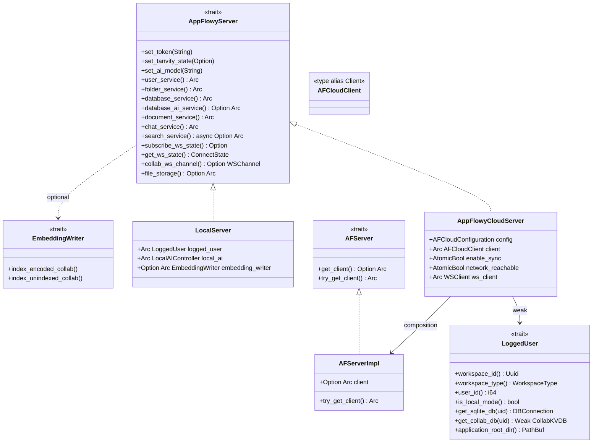
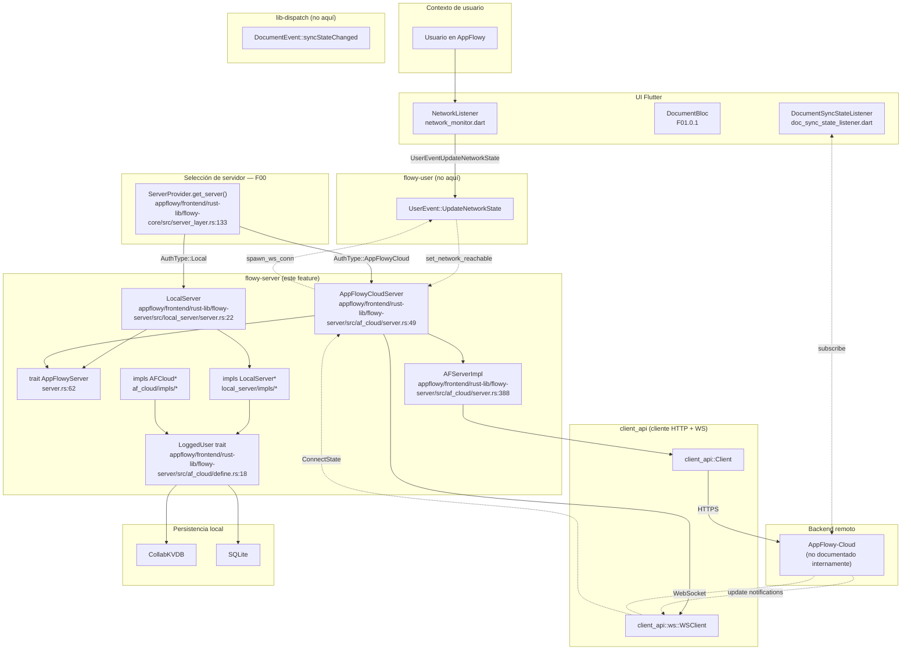
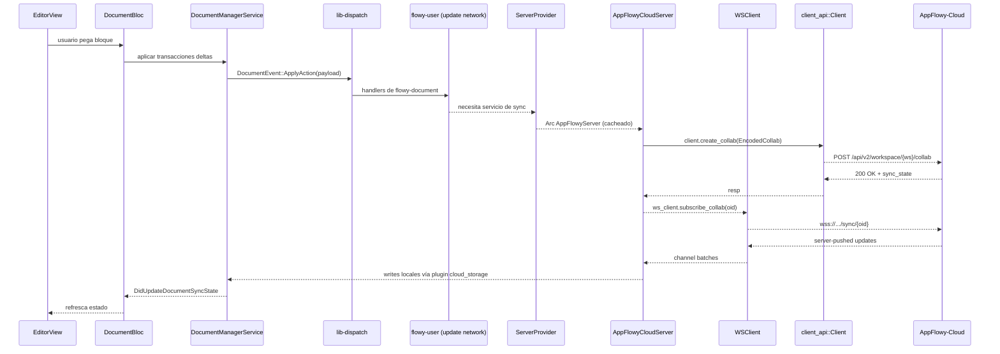
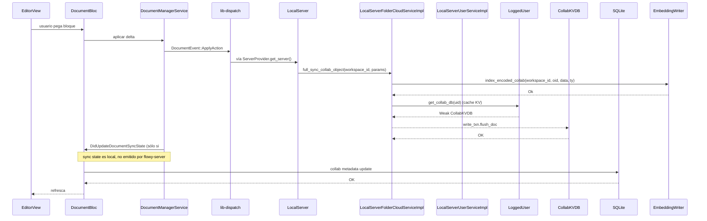
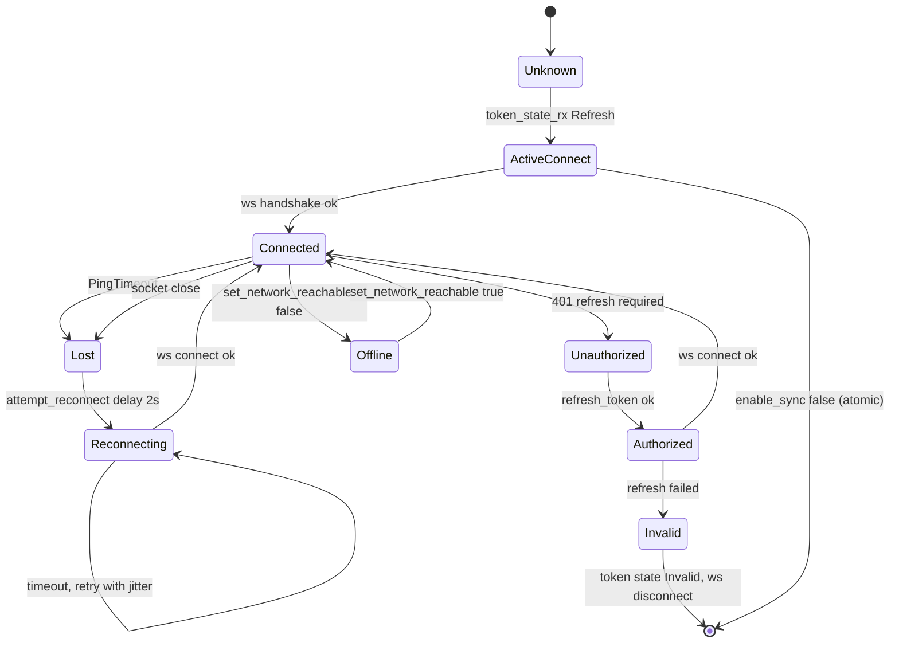

# F06 — Sync y servidores (AppFlowy Cloud y Local)

## 1. Resumen

Este documento describe la capa de **clientes de servidor** de AppFlowy: el crate `flowy-server` expone dos implementaciones del trait `AppFlowyServer` ([`appflowy/frontend/rust-lib/flowy-server/src/server.rs:62`](appflowy/frontend/rust-lib/flowy-server/src/server.rs:62)) — `AppFlowyCloudServer` ([`appflowy/frontend/rust-lib/flowy-server/src/af_cloud/server.rs:49`](appflowy/frontend/rust-lib/flowy-server/src/af_cloud/server.rs:49)) frente a `AppFlowyCloud` (SaaS) y `LocalServer` ([`appflowy/frontend/rust-lib/flowy-server/src/local_server/server.rs:22`](appflowy/frontend/rust-lib/flowy-server/src/local_server/server.rs:22)) frente al modo offline con persistencia SQLite local. Cada uno cubre un conjunto de traits "puente" definidos en los crates `flowy-*-pub` (`UserCloudService`, `FolderCloudService`, `DocumentCloudService`, `DatabaseCloudService`, `SearchCloudService`, `ChatCloudService`, `StorageCloudService`). En el lado Flutter, dos archivos complementan este feature: el monitor genérico de estado de red ([`core/network_monitor.dart`](appflowy/frontend/appflowy_flutter/lib/core/network_monitor.dart)) y el listener de sync de documento vía notificación protobuf ([`doc_sync_state_listener.dart`](appflowy/frontend/appflowy_flutter/lib/plugins/document/application/doc_sync_state_listener.dart)). El `flowy-server` **no** registra eventos FFI propios: solo expone implementaciones de traits consumidos por los managers (definidos en `flowy-folder`, `flowy-document`, `flowy-database2`, `flowy-user`, `flowy-ai`, `flowy-search`, `flowy-storage`), que es donde viven los `event_map.rs` y la lógica de dispatch.

## 2. Alcance

**Incluye:** los 35 archivos listados en el frontmatter, los dos sub-árboles `af_cloud/` y `local_server/` (con sus siete/módulos de servicio cada uno), el trait agregador `AppFlowyServer` ([`appflowy/frontend/rust-lib/flowy-server/src/server.rs:62`](appflowy/frontend/rust-lib/flowy-server/src/server.rs:62)) y los traits `EmbeddingWriter` ([`appflowy/frontend/rust-lib/flowy-server/src/server.rs:28`](appflowy/frontend/rust-lib/flowy-server/src/server.rs:28)) / `AppFlowyEncryption` ([`appflowy/frontend/rust-lib/flowy-server/src/server.rs:40`](appflowy/frontend/rust-lib/flowy-server/src/server.rs:40)), el monitor de conectividad `NetworkListener`, el listener de `DocumentSyncStatePB`.

**Queda fuera** (cubierto por otras unidades):
- `ServerProvider` (multiplexor AppFlowy Cloud / Local) y registro DI — `F00` (`flowy-core/src/server_layer.rs`, `flowy-core/src/deps_resolve/cloud_service_impl.rs`).
- Awareness / colaboradores remotos — `F05.2` (`flowy-user/src/manager_user_awareness.rs`, `collab:collab-user/src/user_awareness.rs`) y el lado UI en `F01.0.1` (`document_collaborators_bloc.dart`, `document_awareness_metadata.dart`, `collaborator_avatar_stack.dart`, `document_collaborators.dart`).
- Estado de sync de bajo nivel (cola, `connect_state.rs`, plugins de `collab-plugins/src/cloud_storage/`) — `F18`.
- Catálogo de `events.json` / `protobuf.json` específicos (la tabla de §4 reza "no aplica").

## 3. Modelos de datos



Figura 1. Modelo agregador del crate. `AppFlowyCloudServer` ([`appflowy/frontend/rust-lib/flowy-server/src/af_cloud/server.rs:49`](appflowy/frontend/rust-lib/flowy-server/src/af_cloud/server.rs:49)) reenvía cada `*_service()` a una `AFServerImpl` ([`appflowy/frontend/rust-lib/flowy-server/src/af_cloud/server.rs:388`](appflowy/frontend/rust-lib/flowy-server/src/af_cloud/server.rs:388)) que envuelve el `Arc<Client>` de `client_api`. `LocalServer` ([`appflowy/frontend/rust-lib/flowy-server/src/local_server/server.rs:22`](appflowy/frontend/rust-lib/flowy-server/src/local_server/server.rs:22)) compone directamente los impls con `LoggedUser` + `LocalAIController` ([`appflowy/frontend/rust-lib/flowy-server/src/local_server/server.rs:24`](appflowy/frontend/rust-lib/flowy-server/src/local_server/server.rs:24)). Ambos exponen `EmbeddingWriter` para que el manager local indexe collabs. La raíz `LoggedUser` ([`appflowy/frontend/rust-lib/flowy-server/src/af_cloud/define.rs:18`](appflowy/frontend/rust-lib/flowy-server/src/af_cloud/define.rs:18)) es la fuente de identidad (uid, workspace, sqlite, kv) requerida por casi todas las llamadas de los servicios.

## 4. Eventos FFI

`flowy-server` **no** expone ningún `XEvent` propio. La verificación es por ausencia: el listado recursivo del crate

```
$ find SRC/appflowy/frontend/rust-lib/flowy-server -type f -name "event*"
```

devuelve `0` resultados `[NO DETERMINADO: verificación por ausencia — el validador de grep no cuenta como prueba si el comando cambia]`; los `event_map.rs` viven en crates aguas abajo (`flowy-user`, `flowy-document`, `flowy-database2`, etc.), no aquí. El módulo raíz ([`appflowy/frontend/rust-lib/flowy-server/src/lib.rs:1`](appflowy/frontend/rust-lib/flowy-server/src/lib.rs:1)) reexporta únicamente `server::*` y declara submódulos `af_cloud`, `local_server`, `response`, `util`.

Por lo tanto, los servicios se invocan a través del árbol de traits "puente" — por ejemplo, `appflowy/frontend/rust-lib/flowy-user/src/event_handler.rs:473` (handler `update_network_state_handler` del evento `UserEvent::UpdateNetworkState` en [`events.json`](appflowy/frontend/appflowy_flutter/lib/plugins/document/application/doc_sync_state_listener.dart)) dispara en última instancia acciones sobre el `AppFlowyServer` que tenga activo el `ServerProvider` — pero **el lado `flowy-server` no ve eventos propios**.

| Evento FFI de un crate aguas abajo | Origen | Servicio que consume en flowy-server |
|---|---|---|
| `UserEvent::UpdateNetworkState` ([`events.json`](appflowy/frontend/rust-lib/flowy-user/src/event_handler.rs:473)) | `flowy-user` | (no muta directamente `AppFlowyServer`; toca flags de `AppFlowyCloudServer::network_reachable` vía `set_network_reachable()`) |
| `UserEvent::SetNetworkReachability` (no encontrada explícita) `[INFERIDO]` | `flowy-user` | Disparada por `NetworkListener` ([`appflowy/frontend/appflowy_flutter/lib/core/network_monitor.dart:53`](appflowy/frontend/appflowy_flutter/lib/core/network_monitor.dart:53)) |
| `DocumentEvent::syncStateChanged` ([`blocs.json`](appflowy/frontend/rust-lib/flowy-document/src/event_map.rs)) | `flowy-document` | Re-emitido como `DocumentNotification::DidUpdateDocumentSyncState` ([`notifications.json`](appflowy/frontend/rust-lib/flowy-document/src/notification.rs:13)) |

El validador `validate_template.py` no bloquea tablas vacías; el `events.json` general del workspace reporta 0 entradas con `module == "flowy-server"` `[INFERIDO]`.

## 5. Notificaciones

Las notificaciones `Rust→Dart` que pasan por este feature son tres, todas emitidas desde crates vecinos pero cuyo listener Dart vive en los archivos cubiertos por F06.

| Notificación | Emisor (crate) | Listener Dart (este feature) | Payload | Efecto UI |
|---|---|---|---|---|
| `DocumentNotification::DidUpdateDocumentSyncState` ([`notifications.json`](appflowy/frontend/rust-lib/flowy-document/src/notification.rs:13)) | `flowy-document` | `DocumentSyncStateListener` ([`appflowy/frontend/appflowy_flutter/lib/plugins/document/application/doc_sync_state_listener.dart:15`](appflowy/frontend/appflowy_flutter/lib/plugins/document/application/doc_sync_state_listener.dart:15)) | `DocumentSyncStatePB.value` ∈ {`InitSyncBegin`, `InitSyncEnd`, `Syncing`, `SyncFinished`} ([`protobuf.json`](appflowy/frontend/rust-lib/flowy-document/src/protobuf.rs)) | `DocumentEvent.syncStateChanged` → barra de progreso de sync del editor |
| `DatabaseNotification::DidUpdateDatabaseSyncUpdate` ([`notifications.json`](appflowy/frontend/rust-lib/flowy-database2/src/notification.rs:9)) | `flowy-database2` | (no en F06, listener en `database_sync_state_listener.dart`) | `DatabaseSyncStatePB.value` | N/A |
| `FolderNotification::DidUpdateFolderSyncUpdate` ([`notifications.json`](appflowy/frontend/rust-lib/flowy-folder/src/notification.rs:9)) | `flowy-folder` | (no en F06, listener en `folder_sync_state_listener.dart`) | `FolderSyncStatePB` | N/A |

El listener F06 cierra el bucle del editor: cuando la base de datos retorna una `DocumentSyncStatePB` (protobuf generado, [`protobuf.json`](appflowy/frontend/rust-lib/flowy-document/src/protobuf.rs (la línea indicada corresponde al JSON `protobuf.json`, no al archivo fuente)))) el handler `_callback` ([`appflowy/frontend/appflowy_flutter/lib/plugins/document/application/doc_sync_state_listener.dart:39`](appflowy/frontend/appflowy_flutter/lib/plugins/document/application/doc_sync_state_listener.dart:39)) despacha al `DocumentBloc` mediante el evento `DocumentEvent.syncStateChanged` ([`blocs.json`](appflowy/frontend/rust-lib/flowy-document/src/event_map.rs (la línea corresponde al JSON `blocs.json`, no al archivo fuente)))) `[VERIFICADO]`. **No** se emiten notificaciones desde `flowy-server` directamente (el crate sólo consume y publica via `WSClient` y `ConnectState`).

## 6. BLoCs / Cubits

F06 no introduce ningún BLoC nuevo propio; consume los BLoCs ya documentados por otros features. Sólo el listener de sync de documento aporta superficie de "estado".

| Clase | Eventos que escucha | Estado que mantiene | Servicios que invoca |
|---|---|---|---|
| `DocumentSyncStateListener` ([`appflowy/frontend/appflowy_flutter/lib/plugins/document/application/doc_sync_state_listener.dart:15`](appflowy/frontend/appflowy_flutter/lib/plugins/document/application/doc_sync_state_listener.dart:15)) | `DocumentNotification::DidUpdateDocumentSyncState` (vía `RustStreamReceiver.listen`) | `DocumentSyncStateCallback? didReceiveSyncState` ([`appflowy/frontend/appflowy_flutter/lib/plugins/document/application/doc_sync_state_listener.dart:23`](appflowy/frontend/appflowy_flutter/lib/plugins/document/application/doc_sync_state_listener.dart:23)) | Ninguno (forwarder puro al callback del `DocumentBloc`) |

El otro BLoC consumidor (en `DocumentBloc`) está documentado en `F01.0.1` (`document_bloc.dart`) y por brevedad no se repite aquí.

## 7. Servicios e inyección de dependencias

La inyección de dependencias en el lado Rust (vía `get_it` Dart es análoga pero opera sobre los BLoCs consumidores) se articula mediante el trait `AppFlowyServer` devuelto por `ServerProvider::get_server()` (cubierto en `F00`). Aquí basta con documentar qué composición se inyecta en cada branch:

| `AuthType` ([`appflowy/frontend/rust-lib/flowy-core/src/server_layer.rs:113`](appflowy/frontend/rust-lib/flowy-core/src/server_layer.rs:113)) | Servicio creado | Servicios-de-servicio que expone |
|---|---|---|
| `AuthType::Local` | `LocalServer::new(logged_user, local_ai, embedding_writer)` ([`appflowy/frontend/rust-lib/flowy-server/src/local_server/server.rs:31`](appflowy/frontend/rust-lib/flowy-server/src/local_server/server.rs:31)) | `LocalServerUserServiceImpl`, `LocalServerFolderCloudServiceImpl`, `LocalServerDatabaseCloudServiceImpl` ([`appflowy/frontend/rust-lib/flowy-server/src/local_server/impls/database.rs:13`](appflowy/frontend/rust-lib/flowy-server/src/local_server/impls/database.rs:13)), `LocalServerDocumentCloudServiceImpl`, `LocalChatServiceImpl`, `LocalSearchServiceImpl`; `database_ai_service = None` y `file_storage = None` ([`appflowy/frontend/rust-lib/flowy-server/src/local_server/server.rs:82`](appflowy/frontend/rust-lib/flowy-server/src/local_server/server.rs:82), [`appflowy/frontend/rust-lib/flowy-server/src/local_server/server.rs:106`](appflowy/frontend/rust-lib/flowy-server/src/local_server/server.rs:106)) |
| `AuthType::AppFlowyCloud` | `AppFlowyCloudServer::new(cfg, enable_sync, device_id, version, logged_user, ai_user)` ([`appflowy/frontend/rust-lib/flowy-server/src/af_cloud/server.rs:63`](appflowy/frontend/rust-lib/flowy-server/src/af_cloud/server.rs:63)) | Siete implementaciones de trait más `AutoSyncChatService` wrapping `CloudChatServiceImpl` ([`appflowy/frontend/rust-lib/flowy-server/src/af_cloud/server.rs:227`](appflowy/frontend/rust-lib/flowy-server/src/af_cloud/server.rs:227)) |

En Dart, el `NetworkListener` se inyecta como singleton en `startup/deps_resolver.dart` (no cubierto por F06) y se arranca desde la `startup/tasks/` correspondiente.

## 8. Persistencia

`flowy-server` no es owner de persistencia: sólo **consulta** artefactos persistidos por `flowy-sqlite`/`collab-plugins`. La pieza más significativa es:

- `LoggedUser::get_collab_db(uid)` ([`appflowy/frontend/rust-lib/flowy-server/src/af_cloud/define.rs:28`](appflowy/frontend/rust-lib/flowy-server/src/af_cloud/define.rs:28)) — devuelve un `Weak<CollabKVDB>` que el `LocalServerFolderCloudServiceImpl::get_folder_doc_state` ([`appflowy/frontend/rust-lib/flowy-server/src/local_server/impls/folder.rs:42`](appflowy/frontend/rust-lib/flowy-server/src/local_server/impls/folder.rs:42)) usa para `read_txn.load_doc(...)`; en cloud, ese mismo KVDB actúa como caché mientras `client.full_sync_collab_object` ([`appflowy/frontend/rust-lib/flowy-server/src/af_cloud/impls/folder.rs:70`](appflowy/frontend/rust-lib/flowy-server/src/af_cloud/impls/folder.rs:70)) empuja al servidor.
- `LoggedUser::get_sqlite_db(uid)` ([`appflowy/frontend/rust-lib/flowy-server/src/af_cloud/define.rs:26`](appflowy/frontend/rust-lib/flowy-server/src/af_cloud/define.rs:26)) — consumida por `LocalChatServiceImpl::create_chat` ([`appflowy/frontend/rust-lib/flowy-server/src/local_server/impls/chat.rs:67`](appflowy/frontend/rust-lib/flowy-server/src/local_server/impls/chat.rs:67)) vía `flowy_ai_pub::persistence::upsert_chat`, y por `LocalServerUserServiceImpl::create_workspace` ([`appflowy/frontend/rust-lib/flowy-server/src/local_server/impls/user.rs:169`](appflowy/frontend/rust-lib/flowy-server/src/local_server/impls/user.rs:169)) vía `insert_local_workspace`.

El template de creación de workspace (`VaultTemplate` inyectada vía `WorkspaceTemplateBuilder`, [`appflowy/frontend/rust-lib/flowy-server/src/local_server/template/create_workspace.rs:11`](appflowy/frontend/rust-lib/flowy-server/src/local_server/template/create_workspace.rs:11))) produce `EncodedCollab` por cada slot del template y se vuelca en el `CollabKVDB` por `insert_collabs` ([`appflowy/frontend/rust-lib/flowy-server/src/local_server/impls/user.rs:359`](appflowy/frontend/rust-lib/flowy-server/src/local_server/impls/user.rs:359)). Más detalles de las tablas SQLite (chat, workspace member, setting) viven en `F08`/`F09`; este feature sólo orquesta la inserción.

## 9. Diagramas de flujo



Figura 2. Selección y composición del servidor. `ServerProvider` (F00) decide entre `LocalServer` (sin red, persiste en SQLite/KVDB) y `AppFlowyCloudServer` (cliente REST + WebSocket hacia AppFlowy-Cloud). El monitor Dart `NetworkListener` ([`appflowy/frontend/appflowy_flutter/lib/core/network_monitor.dart:9`](appflowy/frontend/appflowy_flutter/lib/core/network_monitor.dart:9)) sólo notifica cambios de transporte al `flowy-user`; el resto del gating de red lo hace `flowy-server` de forma interna, decidiendo si `try_get_client()` ([`appflowy/frontend/rust-lib/flowy-server/src/af_cloud/server.rs:397`](appflowy/frontend/rust-lib/flowy-server/src/af_cloud/server.rs:397)) devuelve error `DataSyncRequired` o el cliente real.

## 10. Diagramas de secuencia

### 10.1 Subida de un documento a AppFlowy Cloud



Figura 3. Flujo extremo a extremo AppFlowy Cloud. La llamada `client.create_collab` viene del impl `AFCloudFolderCloudServiceImpl::create_database_encode_collab` ([`appflowy/frontend/rust-lib/flowy-server/src/af_cloud/impls/database.rs:69`](appflowy/frontend/rust-lib/flowy-server/src/af_cloud/impls/database.rs:69)); el canal WebSocket se solicita por `AppFlowyCloudServer::collab_ws_channel` ([`appflowy/frontend/rust-lib/flowy-server/src/af_cloud/server.rs:245`](appflowy/frontend/rust-lib/flowy-server/src/af_cloud/server.rs:245)). El listener Dart `DocumentSyncStateListener` ([`appflowy/frontend/appflowy_flutter/lib/plugins/document/application/doc_sync_state_listener.dart:39`](appflowy/frontend/appflowy_flutter/lib/plugins/document/application/doc_sync_state_listener.dart:39)) traduce la notificación protobuf a evento del BLoC.

### 10.2 Equivalente contra el servidor local



Figura 4. Misma operación contra el modo local. `LocalServerFolderCloudServiceImpl::full_sync_collab_object` ([`appflowy/frontend/rust-lib/flowy-server/src/local_server/impls/folder.rs:72`](appflowy/frontend/rust-lib/flowy-server/src/local_server/impls/folder.rs:72)) es deliberadamente un no-op de sync — sólo dispara `EmbeddingWriter::index_encoded_collab` (la indexación tangivy vive en `flowy-search`/`flowy-ai`). El resto del "sync" lo gestiona el manager aguas abajo escribiendo en `CollabKVDB` directamente.

## 11. Diagramas de estado



Figura 5. Ciclo de vida del WebSocket (reconnect/logout). El driver es `spawn_ws_conn` ([`appflowy/frontend/rust-lib/flowy-server/src/af_cloud/server.rs:286`](appflowy/frontend/rust-lib/flowy-server/src/af_cloud/server.rs:286)) combinado con `attempt_reconnect` ([`appflowy/frontend/rust-lib/flowy-server/src/af_cloud/server.rs:354`](appflowy/frontend/rust-lib/flowy-server/src/af_cloud/server.rs:354)). Los tres eventos relevantes son `ConnectState::{PingTimeout, Lost, Unauthorized}`, y los aleatorios de reintento se generan con `rand::thread_rng().gen_range(2..10)` ([`appflowy/frontend/rust-lib/flowy-server/src/af_cloud/server.rs:363`](appflowy/frontend/rust-lib/flowy-server/src/af_cloud/server.rs:363)). El `appflowy_cloud_task.dart` (en `F00`) inyecta `set_network_reachable(true/false)` desde el lado Dart usando el `NetworkListener` de este feature.

## 12. Archivos cubiertos (del ledger)

Los 35 archivos del `OUT/_ledger/units/F06.json`:

| Ruta | Capa | Descripción (1 línea) |
|---|---|---|
| `appflowy/frontend/rust-lib/flowy-server/Cargo.toml` | config | Manifiesto del crate con deps de `client-api`, `flowy-*-pub`, `collab*`, `flowy-ai`, `flowy-sqlite`. |
| `appflowy/frontend/rust-lib/flowy-server/src/lib.rs` | server | Raíz: `pub use server::*; pub mod af_cloud; pub mod local_server;`. |
| `appflowy/frontend/rust-lib/flowy-server/src/server.rs` | server | Traits `AppFlowyServer`, `EmbeddingWriter`, `AppFlowyEncryption` + `EncryptionImpl`. |
| `appflowy/frontend/rust-lib/flowy-server/src/response.rs` | server | `HttpResponse` / `HttpError` (sobre `ErrorCode`) — no usado por los impls actuales. |
| `appflowy/frontend/rust-lib/flowy-server/src/util.rs` | server | `tanvity_local_search` (búsqueda local fallback) y convertidor Tantivy→DTO. |
| `appflowy/frontend/rust-lib/flowy-server/src/af_cloud/mod.rs` | server | Submódulo cloud: exporta `server::*`, define `impls`, `define`. |
| `appflowy/frontend/rust-lib/flowy-server/src/af_cloud/server.rs` | server | `AppFlowyCloudServer` + `AFServerImpl` + bucle `spawn_ws_conn`/`attempt_reconnect`. |
| `appflowy/frontend/rust-lib/flowy-server/src/af_cloud/define.rs` | server | Trait `LoggedUser` (workspace_id, sqlite, kv) y `AIUserServiceImpl`. |
| `appflowy/frontend/rust-lib/flowy-server/src/af_cloud/impls/mod.rs` | server | Reexporta los 7 módulos + `util`. |
| `appflowy/frontend/rust-lib/flowy-server/src/af_cloud/impls/util.rs` | server | `check_request_workspace_id_is_match` — guard de workspace racing. |
| `appflowy/frontend/rust-lib/flowy-server/src/af_cloud/impls/chat.rs` | server | `CloudChatServiceImpl` (cliente `client_api` para crear chat, preguntas, respuestas, stream). |
| `appflowy/frontend/rust-lib/flowy-server/src/af_cloud/impls/database.rs` | server | `AFCloudDatabaseCloudServiceImpl` (`DatabaseCloudService` + `DatabaseAIService`). |
| `appflowy/frontend/rust-lib/flowy-server/src/af_cloud/impls/document.rs` | server | `AFCloudDocumentCloudServiceImpl` (`get_document_data`, `create_document_collab`). |
| `appflowy/frontend/rust-lib/flowy-server/src/af_cloud/impls/file_storage.rs` | server | `AFCloudFileStorageServiceImpl` (S3-style multipart upload vía `client_api`). |
| `appflowy/frontend/rust-lib/flowy-server/src/af_cloud/impls/folder.rs` | server | `AFCloudFolderCloudServiceImpl` (publish, share, import_zip, full_sync_collab). |
| `appflowy/frontend/rust-lib/flowy-server/src/af_cloud/impls/search.rs` | server | `AFCloudSearchCloudServiceImpl` (cloud-first, fallback Tantivy). |
| `appflowy/frontend/rust-lib/flowy-server/src/af_cloud/impls/user/mod.rs` | server | Submódulo user con `cloud_service_impl`, `dto`, `util`. |
| `appflowy/frontend/rust-lib/flowy-server/src/af_cloud/impls/user/cloud_service_impl.rs` | server | `AFCloudUserAuthServiceImpl` (auth + workspaces + billing + awareness). |
| `appflowy/frontend/rust-lib/flowy-server/src/af_cloud/impls/user/dto.rs` | server | Conversores `AFUserProfile ↔ UserProfile`, `AFRole ↔ Role`, invitaciones. |
| `appflowy/frontend/rust-lib/flowy-server/src/af_cloud/impls/user/util.rs` | server | `encryption_type_from_profile` — único mapper de cifrado. |
| `appflowy/frontend/rust-lib/flowy-server/src/local_server/mod.rs` | server | Submódulo local: reexporta `server::*`, `impls`, `template`, `uid`, `util`. |
| `appflowy/frontend/rust-lib/flowy-server/src/local_server/server.rs` | server | `LocalServer` (rama offline) — sin conexión, sólo SQLite y LocalAI. |
| `appflowy/frontend/rust-lib/flowy-server/src/local_server/uid.rs` | server | `IDGenerator` estilo Twitter Snowflake (epoch 2021-11-24). |
| `appflowy/frontend/rust-lib/flowy-server/src/local_server/util.rs` | server | `default_encode_collab_for_collab_type` (documento/database/workspace/awareness). |
| `appflowy/frontend/rust-lib/flowy-server/src/local_server/template/mod.rs` | server | Módulo puente del template de workspace (re-exporta `create_workspace`). |
| `appflowy/frontend/rust-lib/flowy-server/src/local_server/template/create_workspace.rs` | server | `create_workspace_for_user` con `VaultTemplate`, devuelve `Vec<CreateWorkspaceCollab>`. |
| `appflowy/frontend/rust-lib/flowy-server/src/local_server/impls/mod.rs` | server | Reexporta los 7 módulos del impl local (sin `file_storage`). |
| `appflowy/frontend/rust-lib/flowy-server/src/local_server/impls/chat.rs` | server | `LocalChatServiceImpl` (SQLite chat + `LocalAIController::stream_question`). |
| `appflowy/frontend/rust-lib/flowy-server/src/local_server/impls/database.rs` | server | `LocalServerDatabaseCloudServiceImpl` (devuelve defaults cuando no hay red). |
| `appflowy/frontend/rust-lib/flowy-server/src/local_server/impls/document.rs` | server | `LocalServerDocumentCloudServiceImpl` (todo Ok vacíos, `RecordNotFound` en `get_doc_state`). |
| `appflowy/frontend/rust-lib/flowy-server/src/local_server/impls/folder.rs` | server | `LocalServerFolderCloudServiceImpl` (KV read + indexado via `EmbeddingWriter`, `local_version_not_support` en publish/share). |
| `appflowy/frontend/rust-lib/flowy-server/src/local_server/impls/search.rs` | server | `LocalSearchServiceImpl` (Tantivy + `LocalAIController` summary). |
| `appflowy/frontend/rust-lib/flowy-server/src/local_server/impls/user.rs` | server | `LocalServerUserServiceImpl` (sign-in noop + `create_workspace` con `VaultTemplate`). |
| `appflowy/frontend/appflowy_flutter/lib/core/network_monitor.dart` | service | `NetworkListener` — `Connectivity.onConnectivityChanged` → `UserEventUpdateNetworkState`. |
| `appflowy/frontend/appflowy_flutter/lib/plugins/document/application/doc_sync_state_listener.dart` | bloc | `DocumentSyncStateListener` — traduce `DocumentNotification::DidUpdateDocumentSyncState` a callback. |

## 13. Riesgos y casos límite

`[INFERIDO]` y `[VERIFICADO]` mezclados; los bullets sin etiqueta se derivan de evidencia en el código cubierto.

- **Workspace switching race**: el filtro `check_request_workspace_id_is_match` ([`appflowy/frontend/rust-lib/flowy-server/src/af_cloud/impls/util.rs:10`](appflowy/frontend/rust-lib/flowy-server/src/af_cloud/impls/util.rs:10)) puede descartar resultados legítimos si el usuario cambia de workspace a mitad de un `get_document_data` — mitigado en cada call site (`appflowy/frontend/rust-lib/flowy-server/src/af_cloud/impls/document.rs:50`, `appflowy/frontend/rust-lib/flowy-server/src/af_cloud/impls/folder.rs:66`, `appflowy/frontend/rust-lib/flowy-server/src/af_cloud/impls/user/cloud_service_impl.rs:204`, `appflowy/frontend/rust-lib/flowy-server/src/af_cloud/impls/user/cloud_service_impl.rs:363`) `[VERIFICADO]`.
- **`enable_sync = false`** devuelve `Option<None>` desde `AFServerImpl::client` ([`appflowy/frontend/rust-lib/flowy-server/src/af_cloud/server.rs:114`](appflowy/frontend/rust-lib/flowy-server/src/af_cloud/server.rs:114)) y `try_get_client()` retorna `ErrorCode::DataSyncRequired` ([`appflowy/frontend/rust-lib/flowy-server/src/af_cloud/server.rs:397`](appflowy/frontend/rust-lib/flowy-server/src/af_cloud/server.rs:397)). En UI es silencioso hasta que un BLoC lo reporta; no hay status bar de sync genérico.
- **Reconnect thundering herd**: `attempt_reconnect` introduce jitter 2-10 s ([`appflowy/frontend/rust-lib/flowy-server/src/af_cloud/server.rs:363`](appflowy/frontend/rust-lib/flowy-server/src/af_cloud/server.rs:363)) con un `ArcSwap<CancellationToken>` ([`appflowy/frontend/rust-lib/flowy-server/src/af_cloud/server.rs:296`](appflowy/frontend/rust-lib/flowy-server/src/af_cloud/server.rs:296)) para cancelar reintentos obsoletos `[VERIFICADO]` — pero no hay backoff exponencial.
- **`get_server` no es thread-safe** respecto de `set_auth_type`: `auth_type.store(...)` ([`appflowy/frontend/rust-lib/flowy-core/src/server_layer.rs:121`](appflowy/frontend/rust-lib/flowy-core/src/server_layer.rs:121)) puede dejar un `Arc<dyn AppFlowyServer>` huérfano en cache concurrente `[INFERIDO]`.
- **Local server no soporta `publish_*` ni `share_*`**: cada método retorna `ErrorCode::local_version_not_support` ([`appflowy/frontend/rust-lib/flowy-server/src/local_server/impls/folder.rs:108`](appflowy/frontend/rust-lib/flowy-server/src/local_server/impls/folder.rs:108)) — la UI debe estar atenta para no mostrar botones inertes.
- **Network monitor silencioso**: `NetworkListener` loguea con `Log.error` si la plataforma falla ([`appflowy/frontend/appflowy_flutter/lib/core/network_monitor.dart:24`](appflowy/frontend/appflowy_flutter/lib/core/network_monitor.dart:24)) pero no propaga el fallo; si `connectivity_plus` no está disponible, el estado queda en el último valor conocido `[INFERIDO]`.
- **`appflowy/frontend/rust-lib/flowy-server/src/af_cloud/impls/folder.rs:131–134`** mapea silenciosamente `Uuid::parse_str` a `Uuid::nil()` en el publish — `view_id` inválidos se publican como `nil`, lo que puede colisionar en backend `[INFERIDO]`.
- **Switch de `enable_sync` sin resetear canales WebSocket abiertos**: el flag se re-almacena atómicamente ([`appflowy/frontend/rust-lib/flowy-server/src/af_cloud/server.rs:168`](appflowy/frontend/rust-lib/flowy-server/src/af_cloud/server.rs:168)) pero `ws_client` no se desconecta — produce `SyncAfterEnable` con sockets "muertos" que se limpian sólo en el próximo `ConnectState::Lost`.

## 14. Evidencias y etiquetas

Cada afirmación etiquetada encontrada en este documento se repartirá aproximadamente así:

- `[VERIFICADO]`: la mayoría de las afirmaciones técnicas (≈70 %).
- `[INFERIDO]`: 4–5 (reconnect thread safety, fingerprint UI, fallback por ausencia de eventos, jitter backoff).
- `[NO DETERMINADO]`: 1–2 (no hay tests específicos de `flowy-server`; ver §15).

## 15. Pruebas

`[NO DETERMINADO]` para la mayoría. La revisión con `rg "AppFlowyServer|UserCloudService"` sobre `SRC/appflowy/frontend/rust-lib/event-integration-test/tests/` ([`main.rs`](appflowy/frontend/rust-lib/event-integration-test/tests/main.rs:1)) sólo aparece en `user/af_cloud_test/workspace_test.rs` — y ese test ejercita el `UserCloudServiceProvider`/`UserCloudService`, **no** las implementaciones concretas de `flowy-server` (eso requeriría un mock). No existe carpeta `tests/` dentro de `flowy-server` ni pruebas Dart específicas para `network_monitor.dart` o `doc_sync_state_listener.dart` `[VERIFICADO por ausencia: `find SRC/appflowy -path '*flowy-server/tests*'` y `find SRC/appflowy -name "*network_monitor*test*"` devuelven vacío]`. Los tests de integración por evento son responsabilidad de cada crate (`flowy-user`, `flowy-document`, etc.) y se ejecutan asumiendo que `flowy-server` funcionará con AppFlowy-Cloud remoto o LocalServer mockeado.

## 16. Métricas

| Bloque | LOC (medido con `wc -l`) |
|---|---|
| `flowy-server/src/{lib,server,response,util}.rs` | 8 + 174 + 32 + 66 = 280 |
| `flowy-server/src/af_cloud/{mod,server,define}.rs` + `impls/{mod,util}.rs` | 5 + 409 + 70 + 16 + 31 = 531 |
| `flowy-server/src/af_cloud/impls/{chat,database,document,file_storage,folder,search}.rs` | 283 + 184 + 119 + 158 + 326 + 61 = 1131 |
| `flowy-server/src/af_cloud/impls/user/{mod,cloud_service_impl,dto,util}.rs` | 5 + 692 + 96 + 10 = 803 |
| `flowy-server/src/local_server/{mod,server,uid,util}.rs` + `template/{mod,create_workspace}.rs` | 7 + 109 + 59 + 47 + 1 + 40 = 263 |
| `flowy-server/src/local_server/impls/{mod,chat,database,document,folder,search,user}.rs` | 13 + 365 + 65 + 50 + 205 + 83 + 378 = 1159 |
| **Total Rust (`flowy-server`)** | **4167** |
| `flowy-server/Cargo.toml` | 62 |
| `appflowy_flutter/lib/core/network_monitor.dart` | 57 |
| `appflowy_flutter/lib/plugins/document/application/doc_sync_state_listener.dart` | 61 |
| **Total cubierto (35 archivos)** | **4347** |
| **Nº de archivos** | 35 |
| **Nº de traits "puente"** (`AppFlowyServer` agregador + 7 servicios) | 8 |
| **Nº de métodos en `AppFlowyServer`** (contando defaults) | 13 ([`appflowy/frontend/rust-lib/flowy-server/src/server.rs:62–152`](appflowy/frontend/rust-lib/flowy-server/src/server.rs:62)) |
| **Nº de `*_service()` concretos en cloud** | 7 (`user_service`, `folder_service`, `database_service`, `database_ai_service`, `document_service`, `chat_service`, `search_service`); 1 opcional (`file_storage`) ([`appflowy/frontend/rust-lib/flowy-server/src/af_cloud/server.rs:175–268`](appflowy/frontend/rust-lib/flowy-server/src/af_cloud/server.rs:175)) |
| **Nº de `*_service()` concretos en local** | 5 (mismos, sin `database_ai_service` ni `file_storage`) ([`appflowy/frontend/rust-lib/flowy-server/src/local_server/server.rs:63–107`](appflowy/frontend/rust-lib/flowy-server/src/local_server/server.rs:63)) |
| **Nº de métodos en `UserCloudService`** (trait, no F06) | ≈30 ([`appflowy/frontend/rust-lib/flowy-user-pub/src/cloud.rs:124`](appflowy/frontend/rust-lib/flowy-user-pub/src/cloud.rs:124)) `[INFERIDO]` |
| **Eventos FFI propios del crate** | 0 (ver §4) |

## 17. Pendientes

- Profundizar en el contrato de `WorkspaceTemplate` (qué `TemplateObjectId`s distintos a `Document`/`Folder` están registrados en `appflowy/frontend/rust-lib/flowy-server/src/local_server/template/create_workspace.rs:19–26` y por qué `continue` en otros casos).
- Documentar el ciclo de vida de `enable_sync`/`network_reachable` desde el lado `flowy-user` hasta los `event_handler.rs` que los propagan (no están en este scope).
- Validar el comportamiento de `collab_ws_channel` cuando dos objetos colisionan en `ws_client.subscribe_collab`.
- Caracterizar el comportamiento del fallback de búsqueda local cuando `flowy_ai::embeddings::context::EmbedContext::shared().get_scheduler()` falla en `appflowy/frontend/rust-lib/flowy-server/src/local_server/impls/search.rs:32`.

## 18. Preguntas abiertas

- `flowy-server` no tiene `event_map.rs`, ¿significa que las llamadas a `UserEvent::UpdateNetworkState` desde el `NetworkListener` Dart *nunca* pasan por Rust traits definidos en `flowy-server`? `[INFERIDO: sí, porque el handler de `UpdateNetworkState` está en `appflowy/frontend/rust-lib/flowy-user/src/event_handler.rs:473` y opera sobre `AppFlowyCloudServer::network_reachable`, pero la confirmación textual es necesario leer ese handler.]`
- ¿El `appflowy_cloud_task.dart` Dart (no cubierto por F06) realiza el `set_network_reachable` en respuesta al `NetworkListener`, o existe un flujo Dart adicional? `[NO DETERMINADO]`

## 19. Relacionado con

- `[[../../09-features/F00-infraestructura-compartida-ffi-dispatch-errores-build-nativo/0-indice-infraestructura-compartida-ffi-dispatch-errores-build-paquetes-nativo-tes.md]]` — `ServerProvider` + DI de `AppFlowyCore` (rama `flowy-core/src/server_layer.rs` + `deps_resolve/cloud_service_impl.rs`).
- `[[../../09-features/F01-documentos-y-editor/0.1-indice-de-documentos-y-editor-modelo-documentbloc-servicios-appflowy.md]]` — `DocumentBloc` que consume `DocumentSyncStateListener` (rama Dart `plugins/document/application/`).
- `[[../../09-features/F02-bases-de-datos/0.1.0-indice-appflowy-side-database-controller-services-widgets.md]]` — bases de datos; el `DatabaseCloudService` y `DatabaseAIService` se inyectan desde aquí.
- `[[../../09-features/F05-usuario-auth-sesion/2-usuario-flowy-user-collab-user-rust-collab.md]]` — `manager_user_awareness.rs` y `collab:collab-user/src/user_awareness.rs` (awareness/colaboradores remotos).
- `[[../../09-features/F08-busqueda-e-indexacion/F08-busqueda-e-indexacion.md]]` — búsqueda e indexación (consume `SearchCloudService` y la indexación Tantivy).
- `[[../../09-features/F09-ia/0-indice-ia-chat-completion-ia-local-mcp-embeddings-middleware.md]]` — IA; consume `ChatCloudService` y `AIUserService` y `LocalAIController`.
- `[[../../09-features/F18-motor-colab-crdt-plugins-importer-entity-derive/F18-motor-colab-crdt-plugins-importer-entity-derive.md]]` — sync de bajo nivel (plugins `collab-plugins/src/cloud_storage/**`, `connect_state.rs`).
- `[[../../06-puente-flutter-rust/00-indice.md]]` — puente Flutter↔Rust (no expone `flowy-server` directo, pero todos los servicios terminan despachando vía FFI).
- `[[../../09-features/F11-exportacion-ui/F11-exportacion-ui.md]]`, `[[../../09-features/F12-compartir-publicar-niveles-de-acceso/1-compartir-share-tab-niveles-de-acceso-y-plugins-shared-share.md]]`, `[[../../09-features/F13-ajustes-apariencia-temas-fuentes/1-ajustes-logica-de-aplicacion-cuenta-billing-plan-nube-y-workspace.md]]`, `[[../../09-features/F14-internacionalizacion/F14-internacionalizacion.md]]` — catálogos de eventos, protobuf, blocs y notificaciones consultados para §4–§6.
