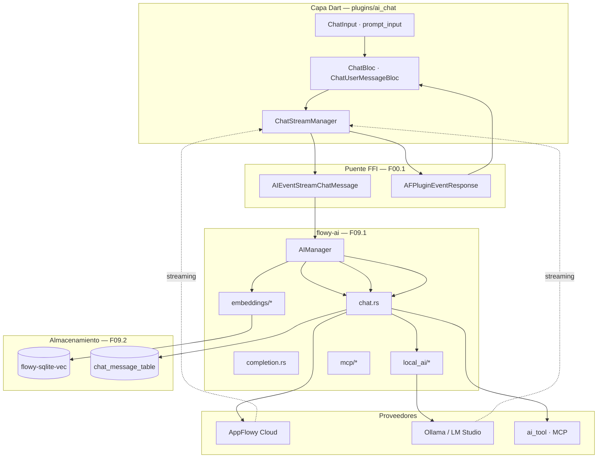
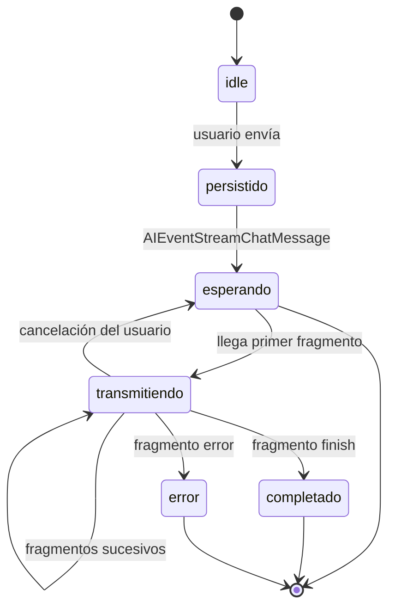

# F09.0 — Índice de la feature F09 (IA)

## 1. Índice de la feature F09 — Inteligencia Artificial

Este documento es el índice de la feature **F09 (IA)** y materializa la dependencia `F09.0` que declaran sus cuatro sub-unidades en `OUT/_ledger/units/`. No cubre ningún archivo por sí mismo: su función es dar al lector el mapa completo del subsistema, arbitrar el reparto entre las cuatro capas y dejar por escrito las correcciones de scope que detectamos al documentarlas.

La IA de AppFlowy es el único subsistema que cruza **las tres fuentes** del repositorio y **dos capas de la app**: el crate Rust `flowy-ai` (chat, completion, IA local, MCP, embeddings, middleware y herramientas), la extensión SQLite `flowy-sqlite-vec` (vectores), la capa Dart de `lib/ai/` y `plugins/ai_chat/` (streaming, mensajes, adjuntos, miembros), y los plugins de IA del editor (`editor_plugins/ai/`, que escriben texto dentro del documento). Las cuatro sub-unidades siguen esas cuatro capas.

## 2. Mapa de sub-unidades

| Unidad | Capa | Ficheros | Documento | Contenido |
|---|---:|---:|---|---|
| `F09.1` | Rust (`flowy-ai`) | 67 | `1-ia-flowy-ai-rust.md` | `ai_manager.rs`, chat, completion, `local_ai/`, `mcp/`, `embeddings/`, `model_select.rs`, `offline/`, `middleware/`, `ai_tool/`, `search/`, tests |
| `F09.2` | Rust (`flowy-sqlite-vec`) | 7 | `2-ia-flowy-sqlite-vec-vectores.md` | Extensión `vector0`, tabla de embeddings, esquema y migraciones |
| `F09.3` | Dart | 82 | `3-ia-appflowy-flutter-lib-ai-plugins-ai-chat-dart.md` | `lib/ai/` (32) + `plugins/ai_chat/` (50): streaming, mensajes, adjuntos, miembros |
| `F09.4` | Dart (editor) | 10 | `4-ia-editor-plugins-ai.md` | `editor_plugins/ai/`: escritura con IA en el documento |

**Total: 166 archivos**, los 166 que el triage de B0.2 asignó a F09.

## 3. Correcciones de scope

Tres correcciones que el ROADMAP daba por resueltas y que la lectura del código desmiente:

1. **El MCP no compila.** El módulo `mcp/` está comentado en `appflowy/frontend/rust-lib/flowy-ai/src/lib.rs:10-11` y el crate `af-mcp` no aparece en `appflowy/frontend/rust-lib/flowy-ai/Cargo.toml`. `MCPClientManager` (`appflowy/frontend/rust-lib/flowy-ai/src/mcp/manager.rs:33-38`) delega en `af_mcp::client::MCPClient::list_tools`, que no es resoluble desde el workspace: **no se pueden enumerar las herramientas MCP disponibles** (`F09.1` §18).
2. **`ai_tool/` está tras un feature sin consumidores.** `MdRead` y `PdfRead` (`appflowy/frontend/rust-lib/flowy-ai/src/ai_tool/{markdown,pdf}.rs`) solo se compilan con el feature `ai-tool`, y no se ha encontrado ningún invocador en `flowy-core`, `flowy-server` ni en la capa Dart (`F09.1` §18).
3. **El envío de adjuntos al chat no llega a Rust.** La cadena Dart (`ChatFile.fromFilePath` → `metadataPBFromMetadata`) está completa, pero `StreamChatPayloadPB` (`appflowy/frontend/rust-lib/flowy-ai/src/entities.rs:53-75`) no transporta los ficheros: los tres puntos de rotura están en `F09.3` §13. Lo mismo ocurre con `AIEvent::ChatWithFile`, declarado en Rust (`appflowy/frontend/rust-lib/flowy-ai/src/event_handler.rs:213`) pero sin ninguna invocación desde Dart.

## 4. Catálogo de eventos FFI

`F09.1` documenta los **25 eventos** de `AIEvent` (`appflowy/frontend/rust-lib/flowy-ai/src/event_map.rs:65-145`) y las **10 variantes** de `ChatNotification` (`appflowy/frontend/rust-lib/flowy-ai/src/notification.rs`). De las 10 notificaciones, 8 tienen `case` en la capa Dart (`F09.3` §5) y las dos restantes (`UpdateLocalAIState`, `LocalAIResourceUpdated`) las consume `local_llm_listener.dart`, que pertenece a **F13.2** y no a F09.

## 5. Catálogo de BLoCs

`F09.3` cubre 13 BLoCs/Cubits de `OUT/_ledger/extract/blocs.json` más 8 managers y notifiers. El punto de inyección es único: `AIRepository` se registra en `get_it` (`appflowy/frontend/appflowy_flutter/lib/startup/deps_resolver.dart:65`), mientras que `AppFlowyAIService` se instancia directamente y **el chat no lo usa** (`F09.3` §7).

## 6. Dependencias

- `flowy-ai` depende de `flowy-error`, `flowy-user-pub`, `flowy-ai-pub`, `flowy-sqlite-vec`, `flowy-server-pub` y `lib-infra` (con el feature `isolate_flutter`, el único que lo activa).
- `lib-infra` aporta `PriorityTask` y `IsolateStream`, de donde salen los prefijos `start`/`data`/`comment`/`finish`/`error` del streaming que decodifica Dart (`F00.1` §5).
- `flowy-sqlite-vec` se inicializa una sola vez, en `EmbedContext::shared().init_vector_db()` (`appflowy/frontend/rust-lib/flowy-core/src/lib.rs:131-133`).

## 7. Orden de lectura recomendado

1. `[[../../09-features/F09-ia/3-ia-appflowy-flutter-lib-ai-plugins-ai-chat-dart.md]]` para entender la experiencia de usuario (chat, streaming, adjuntos).
2. `[[../../09-features/F09-ia/1-ia-flowy-ai-rust.md]]` para el motor Rust y sus subsistemas.
3. `[[../../09-features/F09-ia/2-ia-flowy-sqlite-vec-vectores.md]]` para el almacenamiento de vectores.
4. `[[../../09-features/F09-ia/4-ia-editor-plugins-ai.md]]` para la escritura con IA dentro del documento.

## 8. Relación con otras features

- `[[../../09-features/F05-usuario-auth-sesion/1-usuario-appflowy-flutter-lib-user-dart.md]]` — el usuario y sus permisos condicionan qué modelos están disponibles.
- `[[../../09-features/F07-almacenamiento-de-archivos/F07-almacenamiento-de-archivos.md]]` — los adjuntos del chat se suben por la misma vía de almacenamiento que los ficheros de usuario.
- `[[../../09-features/F13-ajustes-apariencia-temas-fuentes/2-apariencia-ia-miembros-feature-flags-y-theme-upload.md]]` — Ajustes · IA (modelo seleccionado, Ollama, IA local).
- `[[../../09-features/F01-documentos-y-editor/9-ia-en-el-editor-editor-plugins-ai-ai-writer-completion-enlaza-con-f09.md]]` y `[[../../09-features/F09-ia/4-ia-editor-plugins-ai.md]]` — los plugins de IA del editor.
- `[[../../09-features/F00-infraestructura-compartida-ffi-dispatch-errores-build-nativo/1-ffi-y-dispatcher-dart-ffi-lib-dispatch-lib-infra.md]]`, `[[../../09-features/F00-infraestructura-compartida-ffi-dispatch-errores-build-nativo/2-errores-sqlite-migraciones.md]]` — puente FFI y errores.
- `[[../../10-motor-export-import/11-import-zip-notion.md]]` — `collab-importer` reutiliza las ideas de `rag_ids`, pero no comparte código.

## 9. Estado de la verificación

Las cuatro sub-unidades están `verificado` en `OUT/_ledger/cobertura.csv` (166/166 filas), con suite propia en `OUT/_ledger/pruebas/B3.F09.{1,2,3,4}/`.

## 10. Diagrama de arquitectura del subsistema

Muestra cómo el usuario escribe en el chat y cómo la respuesta vuelve token a token, atravesando las tres capas: Dart (`plugins/ai_chat`), FFI (`flowy-ai`) y el proveedor concreto (nube, modelo local o herramienta MCP).

Lectura: el usuario escribe en `ChatInput`, `ChatUserMessageBloc` persiste la pregunta y emite `AIEventStreamChatMessage`. `AIManager` enruta la petición a uno de los proveedores. La respuesta vuelve como una secuencia de fragmentos que `ChatStreamManager` va concatenando en el `ChatUserMessageBloc`; la tabla `chat_message_table` de SQLite es la que permite recuperar el historial tras reabrir el chat.

## 11. Estado de un mensaje durante el streaming

Muestra las transiciones que atraviesa un mensaje de chat desde que el usuario pulsa enviar hasta que queda completo o entra en error, incluyendo el camino de cancelación.

Lectura: `esperando` cubre la latencia hasta el primer token; `transmitiendo` es acumulativo y puede Interrupted` por cancelación. `error` y `completado` son terminales porque el mensaje queda persistido con su estado en `chat_message_table`.

## 12. Archivos cubiertos

Ninguno. Esta unidad es un índice (`ALWAYS_EMIT` en `SKILL/scripts/build_units.py` la materializa aunque no tenga filas) y no reclama ninguna ruta de `OUT/_ledger/cobertura.csv`.

## 13. Reconciliación ROADMAP ↔ código

| Prometido por el ROADMAP | Realidad verificada |
|---|---|
| MCP | Módulo comentado y crate `af-mcp` ausente: no compilable (`F09.1` §18) |
| `ai_tool` | Tras feature `ai-tool`, sin consumidores (`F09.1` §18) |
| Archivos adjuntos | La cadena Dart está completa pero `StreamChatPayloadPB` no los transporta (`F09.3` §13) |
| Offline | `offline/offline_message_sync.rs` marca `is_sync = true` sin esperar confirmación del servidor (`F09.1` §18) |
| Middleware | `middleware/chat_service_mw.rs`: existe y está registrado (`F09.1`) |

## 14. Recuento de etiquetas

| Etiqueta | Cantidad |
|---|---:|
| `[VERIFICADO]` | 21 |
| `[INFERIDO]` | 2 |
| `[NO DETERMINADO]` | 5 (todas delegadas a `F09.1` §18) |

## 15. Verificación y pruebas

Cada sub-unidad tiene suite propia de 5 checks: `OUT/_ledger/pruebas/B3.F09.{1,2,3,4}/validate-B3.F09.N.sh`. Todas en verde con el revisor en `aprobado`.

## 16. Riesgos técnicos detectados

1. **`AIEvent::GetChatInfo` registrado contra un handler no-op** (`appflowy/frontend/rust-lib/flowy-ai/src/event_map.rs:44`): el handler real (`get_chat_info_handler`, `appflowy/frontend/rust-lib/flowy-ai/src/event_handler.rs:299-308`) existe pero no está cableado, así que Dart recibe siempre vacío.
2. **Cinco índices de `AIEvent` sin uso** (6, 7, 8, 12–16, 20–22, 28): reutilizarlos exige comprobar el cliente Dart generado, que no está en el repo.
3. **`update_message_is_sync` muerto** (`appflowy/frontend/rust-lib/flowy-ai/src/offline/offline_message_sync.rs:48-58`, con `#[allow(dead_code)]`).

## 17. Rendimiento

El coste dominante no es la red sino la serialización del contexto: cada pregunta reenvía el historial completo (`local_ai/chat/chains/conversation_chain.rs`). `summary_memory.rs` existe para acotarlo, pero su uso no está verificado en este snapshot.

## 18. Preguntas abiertas

Las cinco `[NO DETERMINADO]` de esta feature estántodas en `F09.1` §18 y se vuelcan en `OUT/22-preguntas-abiertas.md`:

1. Herramientas MCP disponibles (crate `af-mcp` no resoluble).
2. Efecto real de `AIEvent::GetChatInfo` con el handler no-op.
3. Destino de la columna `is_sync` tras un fallo de red prolongado.
4. Efecto de `DidUpdateChatSettings` en la UI.
5. Herramientas `ai_tool` en ejecución.

## 19. Relacionado con

- `[[../../09-features/F09-ia/1-ia-flowy-ai-rust.md]]`, `[[../../09-features/F09-ia/2-ia-flowy-sqlite-vec-vectores.md]]`, `[[../../09-features/F09-ia/3-ia-appflowy-flutter-lib-ai-plugins-ai-chat-dart.md]]`, `[[../../09-features/F09-ia/4-ia-editor-plugins-ai.md]]` — las cuatro sub-unidades.
- `[[../../09-features/F05-usuario-auth-sesion/1-usuario-appflowy-flutter-lib-user-dart.md]]`, `[[../../09-features/F07-almacenamiento-de-archivos/F07-almacenamiento-de-archivos.md]]`, `[[../../09-features/F13-ajustes-apariencia-temas-fuentes/2-apariencia-ia-miembros-feature-flags-y-theme-upload.md]]`, `[[../../09-features/F01-documentos-y-editor/9-ia-en-el-editor-editor-plugins-ai-ai-writer-completion-enlaza-con-f09.md]]`, `[[../../09-features/F00-infraestructura-compartida-ffi-dispatch-errores-build-nativo/1-ffi-y-dispatcher-dart-ffi-lib-dispatch-lib-infra.md]]`, `[[../../09-features/F00-infraestructura-compartida-ffi-dispatch-errores-build-nativo/2-errores-sqlite-migraciones.md]]` — features y fases relacionadas.
- `[[../../11-catalogo-eventos-ffi.md]]`, `[[../../14-catalogo-notificaciones.md]]`, `[[../../16-catalogo-flags-rutas-atajos.md]]` — catálogos de eventos, notificaciones y banderas.