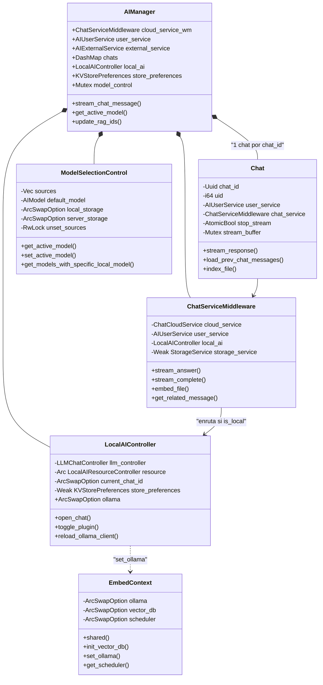
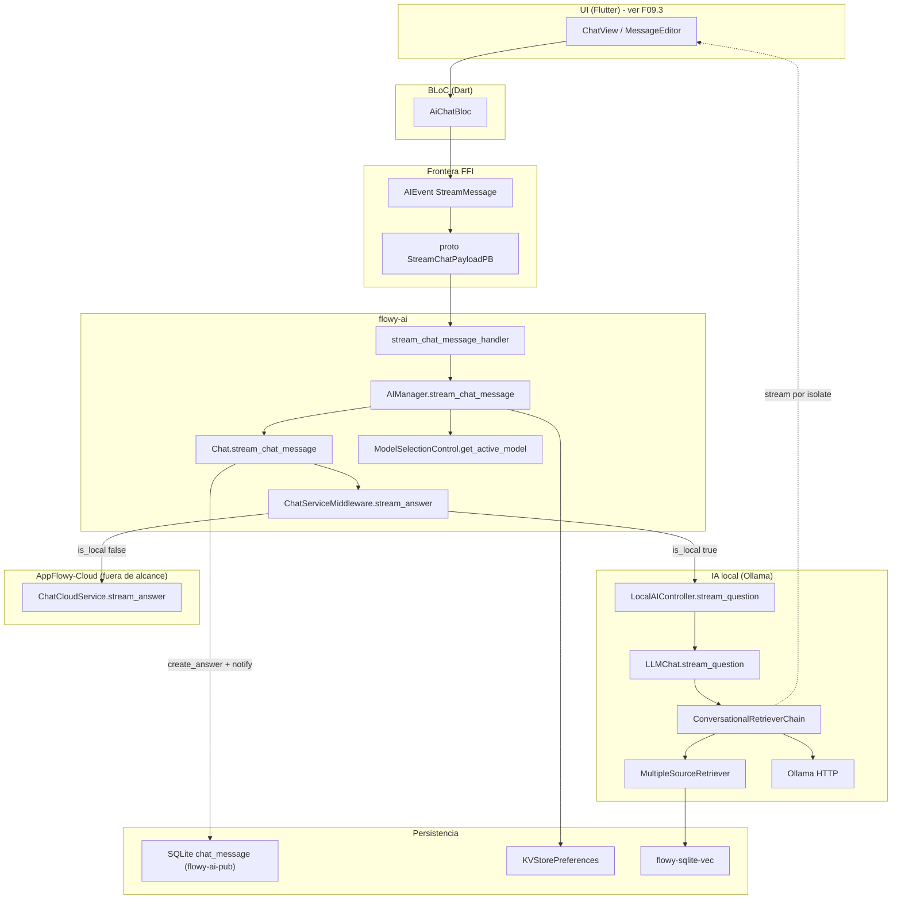
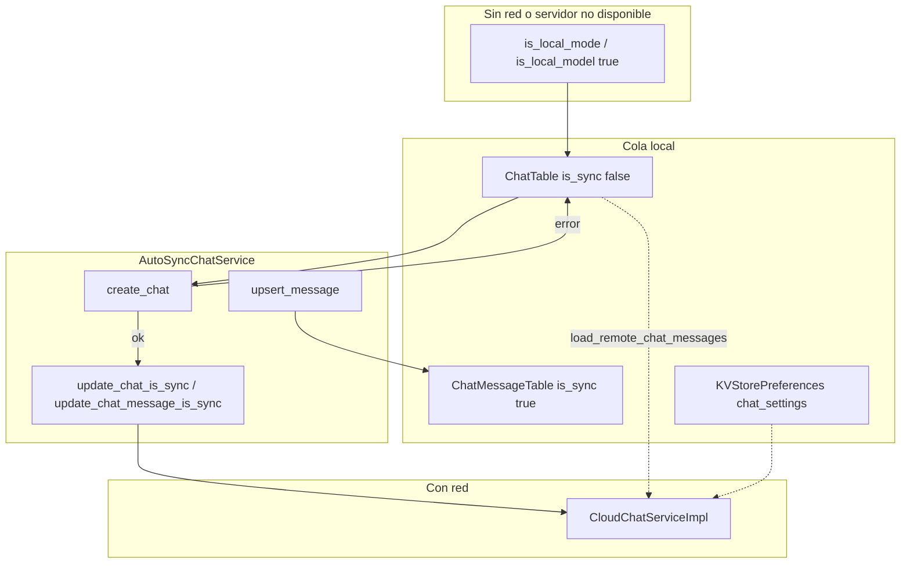
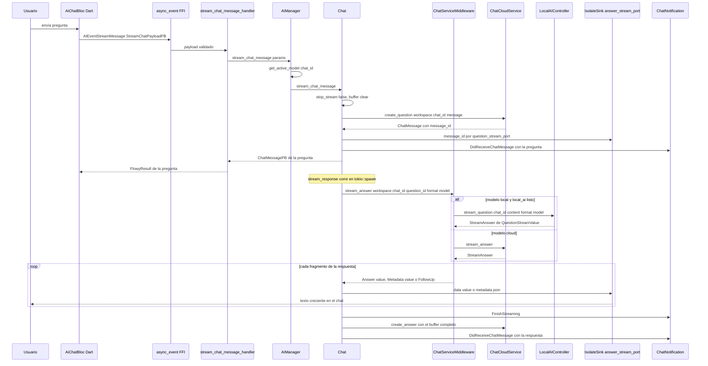
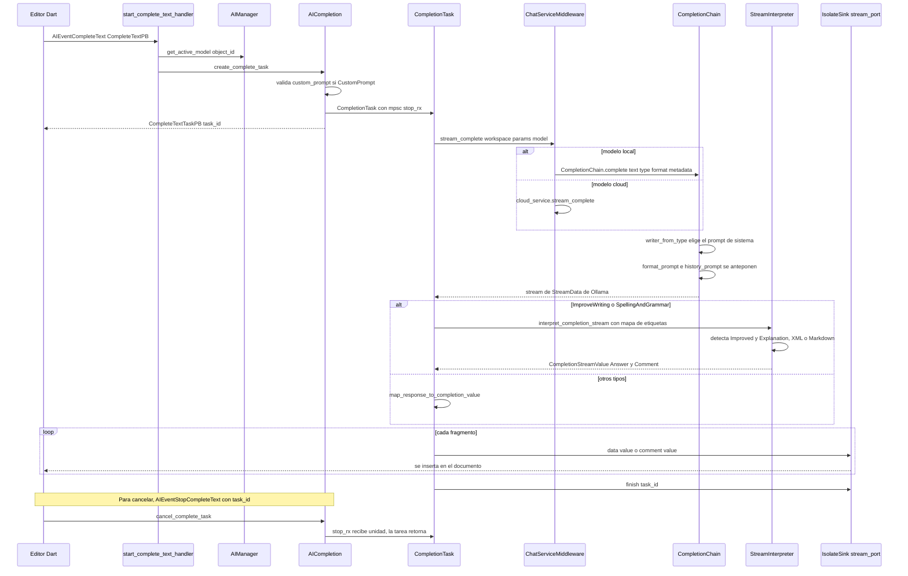
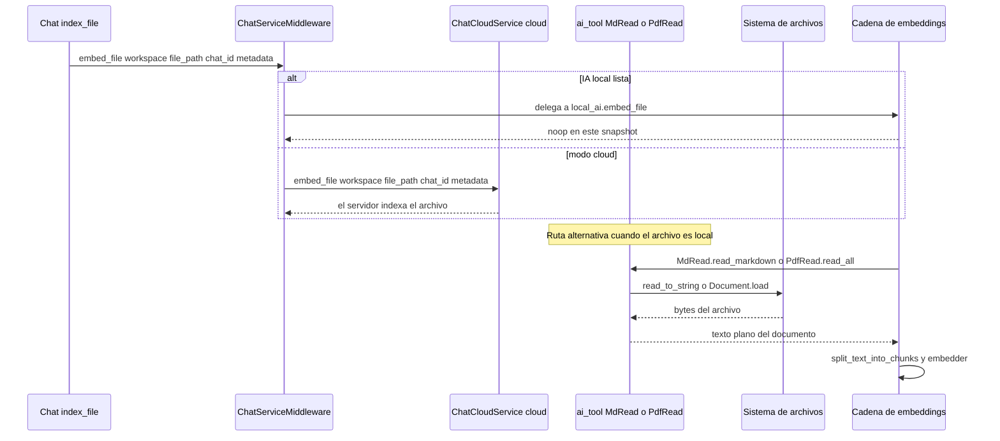
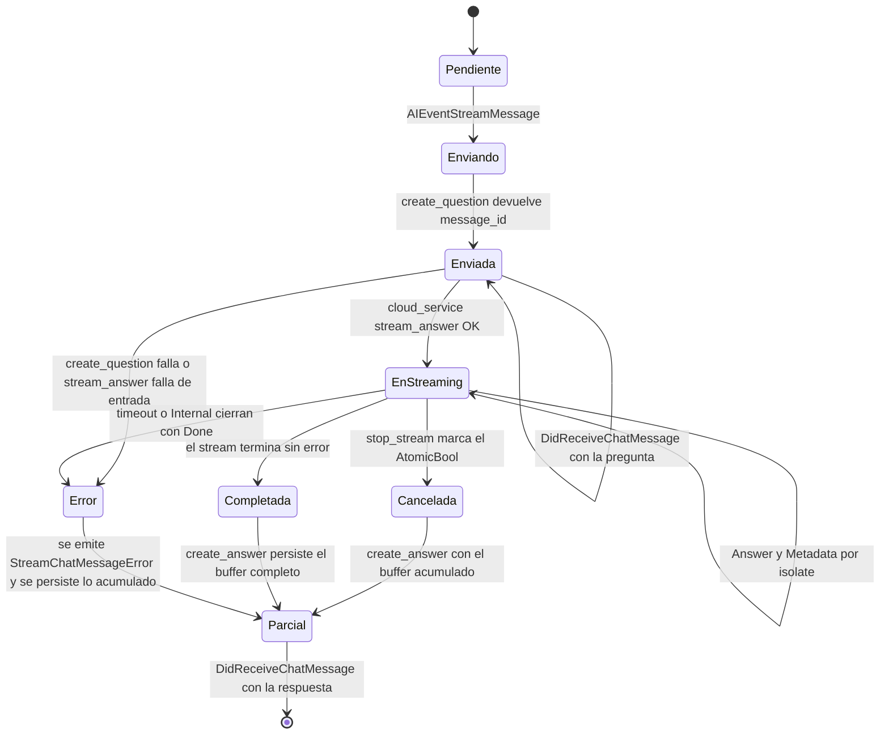
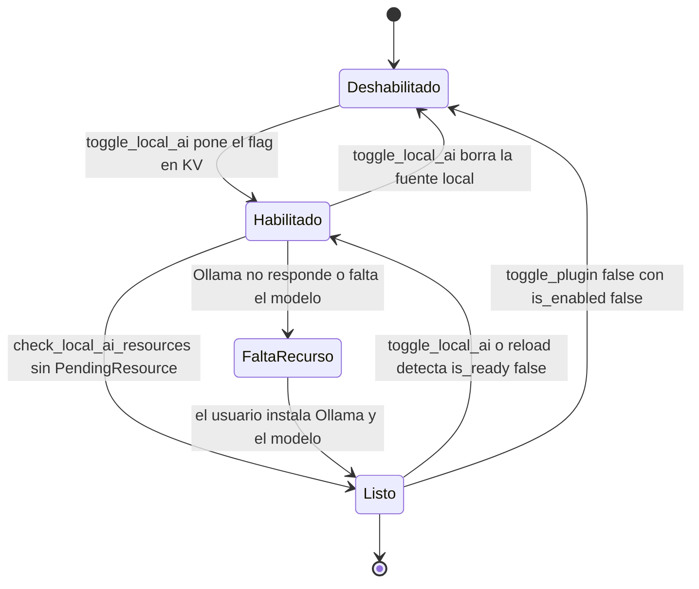

# F09.1 — IA: flowy-ai (Rust)

## 1. Resumen

`flowy-ai` es el crate Rust que implementa todo el subsistema de IA de AppFlowy en el lado del SDK: expone 25 eventos FFI (`AIEvent`), emite 10 notificaciones (`ChatNotification`) y orquesta chat con streaming token a token, completions en el editor, IA local sobre Ollama, embeddings con `flowy-sqlite-vec` y selección de modelo por tarea. Su punto de entrada es `AIManager`, que se construye en `appflowy/frontend/rust-lib/flowy-core/src/deps_resolve/chat_deps.rs:38` y se registra como `AFPlugin` en `appflowy/frontend/rust-lib/flowy-core/src/module.rs:27`. Todo lo que consume o produce el crate pasa por el middleware `ChatServiceMiddleware`, que decide si una petición va a la nube o al `LocalAIController` según el `AIModel` activo. Este documento cubre los 67 ficheros del crate; la capa Dart (`lib/ai`, `plugins/ai_chat`) se documenta en `[[../../09-features/F09-ia/3-ia-appflowy-flutter-lib-ai-plugins-ai-chat-dart.md]]` y el almacén vectorial en `[[../../09-features/F09-ia/2-ia-flowy-sqlite-vec-vectores.md]]`.

## 2. Alcance

Este documento cubre la totalidad del crate `appflowy/frontend/rust-lib/flowy-ai`: el `AIManager`, la capa de entidades protobuf, el registro de eventos y sus handlers, la orquestación de chat (`Chat`), las tareas de completion (`AICompletion` / `CompletionTask`), el subsistema de IA local (`local_ai/*`, con cadenas `langchain-rust` sobre Ollama), los embeddings (`embeddings/*`), el middleware `ChatServiceMiddleware`, la selección de modelo (`model_select.rs`), la capa offline (`offline/*`), la búsqueda/resumen (`search/summary.rs`), las herramientas `ai_tool/*` y el esqueleto de MCP (`mcp/*`).

Quedan **fuera de alcance** los siguientes puntos, delegadas explícitamente:

- El crate público `flowy-ai-pub` (contratos `ChatCloudService`, `AIUserService` y las consultas SQLite), que es propiedad de la unidad `F00.4`.
- El crate `flowy-sqlite-vec` (esquema y `VectorSqliteDB`), propiedad de `[[../../09-features/F09-ia/2-ia-flowy-sqlite-vec-vectores.md]]`.
- Toda la capa Dart: `lib/ai`, `plugins/ai_chat`, `editor_plugins/ai`. Pertenece a `[[../../09-features/F09-ia/3-ia-appflowy-flutter-lib-ai-plugins-ai-chat-dart.md]]` y `[[../../09-features/F09-ia/4-ia-editor-plugins-ai.md]]`.
- La implementación del servidor de IA: AppFlowy-Cloud es fuera de alcance; aquí solo se documenta el contrato cliente.

Como unidad de referencia para la indexación de la feature está `[[../../09-features/F09-ia/0-indice-ia-chat-completion-ia-local-mcp-embeddings-middleware.md]]`, que debe existir antes que este documento.

## 3. Modelos de datos

El tipo raíz es `AIManager`, que agreg estado por `chat_id` y delega el resto de subsistemas. Su definición ocupa seis campos (todos privados salvo tres públicos):

```rust
// appflowy/frontend/rust-lib/flowy-ai/src/ai_manager.rs:58–66
pub struct AIManager {
  pub cloud_service_wm: Arc<ChatServiceMiddleware>,
  pub user_service: Arc<dyn AIUserService>,
  pub external_service: Arc<dyn AIExternalService>,
  chats: Arc<DashMap<Uuid, Arc<Chat>>>,
  pub local_ai: Arc<LocalAIController>,
  pub store_preferences: Arc<KVStorePreferences>,
  model_control: Mutex<ModelSelectionControl>,
}
```

Muestra: la estructura de clases que conecta `AIManager` con sus subsistemas (chat en memoria, middleware cloud/local, controlador local, selección de modelo y preferencias KV).



Lectura: `AIManager` es un *fachada* que no contiene lógica de negocio, solo composición. `Chat` es la única estructura por conversación y se cachea en un `DashMap` para no reconstruir estado de streaming. `ChatServiceMiddleware` es el punto donde se decide proveedor: implementa `ChatCloudService` y, cuando el `AIModel` activo tiene `is_local == true`, desvía a `LocalAIController` en lugar de llamar a la nube. `ModelSelectionControl` mantiene el modelo activo por *source* (clave por tarea), con dos backends de almacenamiento intercambiables. `EmbedContext` es un singleton global que coordina Ollama + base vectorial + planificador de embeddings.

Las entidades de dominio que cruzan la frontera FFI están en `entities.rs` y se generan como protobuf mediante el derive `ProtoBuf`. El payload de chat lleva **dos** puertos de isolate (pregunta y respuesta), de modo que el `message_id` de la pregunta puede viajar antes de que exista la respuesta:

```rust
// appflowy/frontend/rust-lib/flowy-ai/src/entities.rs:53–76
#[derive(Default, ProtoBuf, Validate, Clone, Debug)]
pub struct StreamChatPayloadPB {
  #[pb(index = 1)]
  #[validate(custom(function = "required_not_empty_str"))]
  pub chat_id: String,

  #[pb(index = 2)]
  #[validate(custom(function = "required_not_empty_str"))]
  pub message: String,

  #[pb(index = 3)]
  pub message_type: ChatMessageTypePB,

  #[pb(index = 4)]
  pub answer_stream_port: i64,

  #[pb(index = 5)]
  pub question_stream_port: i64,

  #[pb(index = 6, one_of)]
  pub format: Option<PredefinedFormatPB>,

  #[pb(index = 7, one_of)]
  pub prompt_id: Option<String>,
}
```

El payload de completion es más rico porque incorpora historial, contexto RAG y prompt libre:

```rust
// appflowy/frontend/rust-lib/flowy-ai/src/entities.rs:423–451
#[derive(Default, ProtoBuf, Clone, Debug)]
pub struct CompleteTextPB {
  #[pb(index = 1)]
  pub text: String,

  #[pb(index = 2)]
  pub completion_type: CompletionTypePB,

  #[pb(index = 3, one_of)]
  pub format: Option<PredefinedFormatPB>,

  #[pb(index = 4)]
  pub stream_port: i64,

  #[pb(index = 5)]
  pub object_id: String,

  #[pb(index = 6)]
  pub rag_ids: Vec<String>,

  #[pb(index = 7)]
  pub history: Vec<CompletionRecordPB>,

  #[pb(index = 8, one_of)]
  pub custom_prompt: Option<String>,

  #[pb(index = 9, one_of)]
  pub prompt_id: Option<String>,
}
```

`CompletionTypePB` es el discriminante de las nueve operaciones de escritura libre del editor; su variante se traduce 1:1 al `CompletionType` de `flowy-ai-pub` en `appflowy/frontend/rust-lib/flowy-ai/src/completion.rs:113–122`:

```rust
// appflowy/frontend/rust-lib/flowy-ai/src/entities.rs:459–470
#[derive(Clone, Debug, ProtoBuf_Enum, Default)]
pub enum CompletionTypePB {
  #[default]
  UserQuestion = 0,
  ExplainSelected = 1,
  ContinueWriting = 2,
  SpellingAndGrammar = 3,
  ImproveWriting = 4,
  MakeShorter = 5,
  MakeLonger = 6,
  CustomPrompt = 7,
}
```

Lectura: `PredefinedFormatPB` se convierte a `ResponseFormat` (el contrato cloud) en `appflowy/frontend/rust-lib/flowy-ai/src/entities.rs:652–672`, de modo que el formato de salida —párrafo, lista con viñetas, lista numerada, tabla— viaja como dato y no como prompt hardcodeado. El enum `RunningStatePB` (`appflowy/frontend/rust-lib/flowy-ai/src/entities.rs:571–578`: `ReadyToRun`, `Connecting`, `Connected`, `Running`, `Stopped`) existe como estado serializable, pero `LocalAIController` nunca lo devuelve: `get_local_ai_state` construye `LocalAIPB` con `enabled`, `lack_of_resource` e `is_ready` (`appflowy/frontend/rust-lib/flowy-ai/src/local_ai/controller.rs:322–337`). Es por tanto un tipo preparado pero no emitido en este snapshot, y con toda probabilidad un residuo de una versión anterior del plugin local `[INFERIDO]` — la ausencia de cualquier constructor que lo devuelva es el único indicio, no hay un comentario que lo confirme.

## 4. Eventos FFI

El crate declara un único enum, `AIEvent`, con derive `Flowy_Event` y `ProtoBuf_Enum` y `#[event_err = "FlowyError"]` (`appflowy/frontend/rust-lib/flowy-ai/src/event_map.rs:63–65`). Se registran **25 variantes** en `init()`, que devuelve un `AFPlugin` cuyo estado compartido son un `Weak<AIManager>` y un `Arc<AICompletion>` (`appflowy/frontend/rust-lib/flowy-ai/src/event_map.rs:12–20`):

```rust
// appflowy/frontend/rust-lib/flowy-ai/src/event_map.rs:12–20
pub fn init(ai_manager: Weak<AIManager>) -> AFPlugin {
  let strong_ai_manager = ai_manager.upgrade().unwrap();
  let user_service = Arc::downgrade(&strong_ai_manager.user_service);
  let cloud_service = Arc::downgrade(&strong_ai_manager.cloud_service_wm);
  let ai_tools = Arc::new(AICompletion::new(cloud_service, user_service));
  AFPlugin::new()
    .name("flowy-ai")
    .state(ai_manager)
    .state(ai_tools)
```

La tabla completa, extraída de `OUT/_ledger/extract/events.json` (crate `flowy-ai`) y contrastada con el enum:

| # | Evento | Input PB | Output PB | Handler | Registro | Handler |
|---|---|---|---|---|---|---|
| 0 | `LoadPrevMessage` | `LoadPrevChatMessagePB` | `ChatMessageListPB` | `load_prev_message_handler` | `appflowy/frontend/rust-lib/flowy-ai/src/event_map.rs:22` | `appflowy/frontend/rust-lib/flowy-ai/src/event_handler.rs:117` |
| 1 | `LoadNextMessage` | `LoadNextChatMessagePB` | `ChatMessageListPB` | `load_next_message_handler` | `appflowy/frontend/rust-lib/flowy-ai/src/event_map.rs:23` | `appflowy/frontend/rust-lib/flowy-ai/src/event_handler.rs:133` |
| 2 | `StreamMessage` | `StreamChatPayloadPB` | `ChatMessagePB` | `stream_chat_message_handler` | `appflowy/frontend/rust-lib/flowy-ai/src/event_map.rs:21` | `appflowy/frontend/rust-lib/flowy-ai/src/event_handler.rs:22` |
| 3 | `StopStream` | `StopStreamPB` | — | `stop_stream_handler` | `appflowy/frontend/rust-lib/flowy-ai/src/event_map.rs:26` | `appflowy/frontend/rust-lib/flowy-ai/src/event_handler.rs:177` |
| 4 | `GetRelatedQuestion` | `ChatMessageIdPB` | `RepeatedRelatedQuestionPB` | `get_related_question_handler` | `appflowy/frontend/rust-lib/flowy-ai/src/event_map.rs:24` | `appflowy/frontend/rust-lib/flowy-ai/src/event_handler.rs:149` |
| 5 | `GetAnswerForQuestion` | `ChatMessageIdPB` | `ChatMessagePB` | `get_answer_handler` | `appflowy/frontend/rust-lib/flowy-ai/src/event_map.rs:25` | `appflowy/frontend/rust-lib/flowy-ai/src/event_handler.rs:163` |
| 9 | `CompleteText` | `CompleteTextPB` | `CompleteTextTaskPB` | `start_complete_text_handler` | `appflowy/frontend/rust-lib/flowy-ai/src/event_map.rs:27` | `appflowy/frontend/rust-lib/flowy-ai/src/event_handler.rs:189` |
| 10 | `StopCompleteText` | `CompleteTextTaskPB` | — | `stop_complete_text_handler` | `appflowy/frontend/rust-lib/flowy-ai/src/event_map.rs:28` | `appflowy/frontend/rust-lib/flowy-ai/src/event_handler.rs:203` |
| 11 | `ChatWithFile` | `ChatFilePB` | — | `chat_file_handler` | `appflowy/frontend/rust-lib/flowy-ai/src/event_map.rs:29` | `appflowy/frontend/rust-lib/flowy-ai/src/event_handler.rs:213` |
| 17 | `RestartLocalAI` | — | — | `restart_local_ai_handler` | `appflowy/frontend/rust-lib/flowy-ai/src/event_map.rs:30` | `appflowy/frontend/rust-lib/flowy-ai/src/event_handler.rs:262` |
| 18 | `ToggleLocalAI` | — | `LocalAIPB` | `toggle_local_ai_handler` | `appflowy/frontend/rust-lib/flowy-ai/src/event_map.rs:31` | `appflowy/frontend/rust-lib/flowy-ai/src/event_handler.rs:271` |
| 19 | `GetLocalAIState` | — | `LocalAIPB` | `get_local_ai_state_handler` | `appflowy/frontend/rust-lib/flowy-ai/src/event_map.rs:32` | `appflowy/frontend/rust-lib/flowy-ai/src/event_handler.rs:281` |
| 23 | `CreateChatContext` | `CreateChatContextPB` | — | `create_chat_context_handler` | `appflowy/frontend/rust-lib/flowy-ai/src/event_map.rs:43` | `appflowy/frontend/rust-lib/flowy-ai/src/event_handler.rs:290` |
| 24 | `GetChatInfo` | `ChatId` | `ChatInfoPB` | `create_chat_context_handler` | `appflowy/frontend/rust-lib/flowy-ai/src/event_map.rs:44` | `appflowy/frontend/rust-lib/flowy-ai/src/event_handler.rs:290` |
| 25 | `GetChatSettings` | `ChatId` | `ChatSettingsPB` | `get_chat_settings_handler` | `appflowy/frontend/rust-lib/flowy-ai/src/event_map.rs:45` | `appflowy/frontend/rust-lib/flowy-ai/src/event_handler.rs:311` |
| 26 | `UpdateChatSettings` | `UpdateChatSettingsPB` | — | `update_chat_settings_handler` | `appflowy/frontend/rust-lib/flowy-ai/src/event_map.rs:46` | `appflowy/frontend/rust-lib/flowy-ai/src/event_handler.rs:326` |
| 27 | `RegenerateResponse` | `RegenerateResponsePB` | — | `regenerate_response_handler` | `appflowy/frontend/rust-lib/flowy-ai/src/event_map.rs:47` | `appflowy/frontend/rust-lib/flowy-ai/src/event_handler.rs:61` |
| 29 | `GetLocalAISetting` | — | `LocalAISettingPB` | `get_local_ai_setting_handler` | `appflowy/frontend/rust-lib/flowy-ai/src/event_map.rs:33` | `appflowy/frontend/rust-lib/flowy-ai/src/event_handler.rs:339` |
| 30 | `UpdateLocalAISetting` | `LocalAISettingPB` | — | `update_local_ai_setting_handler` | `appflowy/frontend/rust-lib/flowy-ai/src/event_map.rs:39` | `appflowy/frontend/rust-lib/flowy-ai/src/event_handler.rs:358` |
| 31 | `GetSettingModelSelection` | `ModelSourcePB` | `ModelSelectionPB` | `get_setting_model_selection_handler` | `appflowy/frontend/rust-lib/flowy-ai/src/event_map.rs:48` | `appflowy/frontend/rust-lib/flowy-ai/src/event_handler.rs:82` |
| 32 | `UpdateSelectedModel` | `UpdateSelectedModelPB` | — | `update_selected_model_handler` | `appflowy/frontend/rust-lib/flowy-ai/src/event_map.rs:52` | `appflowy/frontend/rust-lib/flowy-ai/src/event_handler.rs:104` |
| 33 | `GetLocalModelSelection` | — | `ModelSelectionPB` | `get_local_ai_models_handler` | `appflowy/frontend/rust-lib/flowy-ai/src/event_map.rs:34` | `appflowy/frontend/rust-lib/flowy-ai/src/event_handler.rs:349` |
| 34 | `GetSourceModelSelection` | `ModelSourcePB` | `ModelSelectionPB` | `get_source_model_selection_handler` | `appflowy/frontend/rust-lib/flowy-ai/src/event_map.rs:35` | `appflowy/frontend/rust-lib/flowy-ai/src/event_handler.rs:93` |
| 35 | `GetCustomPromptDatabaseConfiguration` | — | `CustomPromptDatabaseConfigurationPB` | `get_custom_prompt_database_configuration_handler` | `appflowy/frontend/rust-lib/flowy-ai/src/event_map.rs:53` | `appflowy/frontend/rust-lib/flowy-ai/src/event_handler.rs:369` |
| 36 | `SetCustomPromptDatabaseConfiguration` | `CustomPromptDatabaseConfigurationPB` | — | `set_custom_prompt_database_configuration_handler` | `appflowy/frontend/rust-lib/flowy-ai/src/event_map.rs:57` | `appflowy/frontend/rust-lib/flowy-ai/src/event_handler.rs:387` |

Lectura: los índices 6, 7, 8, 12–16, 20–22 y 28 están ausentes del enum, es decir, el espacio numérico está descontinuado y **no** debe reusarse para nuevas variantes, porque el código Dart generado serializa el discriminante por número. Las tres diferencias entre `GetSettingModelSelection` (31) y `GetSourceModelSelection` (34) son que el primero llama a `get_available_models(source, true)` —solo el modelo local configurado— y el segundo a `get_available_models(source, false)` —todos los modelos disponibles— (`appflowy/frontend/rust-lib/flowy-ai/src/event_handler.rs:82–101`).

**Defecto de registro detectado [VERIFICADO].** `AIEvent::GetChatInfo` (24) está registrado contra `create_chat_context_handler`, que descarta su payload y devuelve `Ok(())` sin hacer nada (`appflowy/frontend/rust-lib/flowy-ai/src/event_map.rs:44` frente a `appflowy/frontend/rust-lib/flowy-ai/src/event_handler.rs:290–297`). Existe un handler específico, `get_chat_info_handler`, correctamente implementado en `appflowy/frontend/rust-lib/flowy-ai/src/event_handler.rs:299–308`, pero **no** está conectado a ninguna variante. En consecuencia, `AIEvent::GetChatInfo` no devuelve información real pese a anunciar `output = "ChatInfoPB"`.

Los handlers comparten un patrón uniforme: reciben `AFPluginState<Weak<AIManager>>` y lo suben con `upgrade_ai_manager`, que devuelve `FlowyError::internal().with_context("The chat manager is already dropped")` si el `Arc` ya no vive (`appflowy/frontend/rust-lib/flowy-ai/src/event_handler.rs:14–19`). Varios validan el payload con el derive `Validate` antes de tocar estado (`appflowy/frontend/rust-lib/flowy-ai/src/event_handler.rs:26–27`, `:122–123`, `:135–136`, `:181–182`).

## 5. Notificaciones

El crate emite un único enum, `ChatNotification`, con diez variantes y fuente observable constante `"Chat"` (`appflowy/frontend/rust-lib/flowy-ai/src/notification.rs:5–20`):

```rust
// appflowy/frontend/rust-lib/flowy-ai/src/notification.rs:5–20
const CHAT_OBSERVABLE_SOURCE: &str = "Chat";
pub const APPFLOWY_AI_NOTIFICATION_KEY: &str = "appflowy_ai_plugin";
#[derive(ProtoBuf_Enum, Debug, Default)]
pub enum ChatNotification {
  #[default]
  Unknown = 0,
  DidLoadLatestChatMessage = 1,
  DidLoadPrevChatMessage = 2,
  DidReceiveChatMessage = 3,
  StreamChatMessageError = 4,
  FinishStreaming = 5,
  UpdateLocalAIState = 6,
  DidUpdateChatSettings = 7,
  LocalAIResourceUpdated = 8,
  DidUpdateSelectedModel = 9,
}
```

El builder es `chat_notification_builder(id, ty)`, que fija la fuente `"Chat"` en todas las emisiones (`appflowy/frontend/rust-lib/flowy-ai/src/notification.rs:44–51`). Dos identificadores distintos actúan como `id`: el `chat_id` para las notificaciones de conversación y la constante `APPFLOWY_AI_NOTIFICATION_KEY` (`"appflowy_ai_plugin"`) para las de estado del plugin local.

Tabla completa, con punto de emisión Rust y listener Dart:

| # | Notificación | Se emite en | Payload | Listener Dart | Efecto UI |
|---|---|---|---|---|---|
| 0 | `Unknown` | — (default del enum) | — | — | Ninguno; existe solo como valor por defecto del derive |
| 1 | `DidLoadLatestChatMessage` | `appflowy/frontend/rust-lib/flowy-ai/src/chat.rs:465` (`Chat::load_remote_chat_messages`) | `ChatMessageListPB` | `appflowy/frontend/appflowy_flutter/lib/plugins/ai_chat/application/chat_message_listener.dart:62` | Añade mensajes descargados del servidor al final del hilo |
| 2 | `DidLoadPrevChatMessage` | `appflowy/frontend/rust-lib/flowy-ai/src/chat.rs:345` y `appflowy/frontend/rust-lib/flowy-ai/src/chat.rs:461` | `ChatMessageListPB` | `appflowy/frontend/appflowy_flutter/lib/plugins/ai_chat/application/chat_message_listener.dart:65` | Inserta la paginación anterior al inicio del hilo |
| 3 | `DidReceiveChatMessage` | `appflowy/frontend/rust-lib/flowy-ai/src/chat.rs:662` (`notify_message`) | `ChatMessagePB` | `appflowy/frontend/appflowy_flutter/lib/plugins/ai_chat/application/chat_message_listener.dart:56` | Añade un mensaje ya persistido (pregunta o respuesta final) |
| 4 | `StreamChatMessageError` | `appflowy/frontend/rust-lib/flowy-ai/src/chat.rs:243` y `appflowy/frontend/rust-lib/flowy-ai/src/chat.rs:284` | `ChatMessageErrorPB` | `appflowy/frontend/appflowy_flutter/lib/plugins/ai_chat/application/chat_message_listener.dart:59` | Muestra el error y detiene el spinner de respuesta |
| 5 | `FinishStreaming` | `appflowy/frontend/rust-lib/flowy-ai/src/chat.rs:291` (final de `stream_response`) | — | `appflowy/frontend/appflowy_flutter/lib/plugins/ai_chat/application/chat_message_listener.dart:68` | Cierra el estado de "escribiendo" del asistente |
| 6 | `UpdateLocalAIState` | `appflowy/frontend/rust-lib/flowy-ai/src/local_ai/controller.rs:472` y `appflowy/frontend/rust-lib/flowy-ai/src/local_ai/controller.rs:494` | `LocalAIPB` | `appflowy/frontend/appflowy_flutter/lib/workspace/application/settings/ai/local_llm_listener.dart:43` | Refresca interruptor y estado del plugin de IA local |
| 7 | `DidUpdateChatSettings` | `appflowy/frontend/rust-lib/flowy-ai/src/ai_manager.rs:800` (`refresh_chat_setting`) | `ChatSettingsPB` | **sin listener Dart** | Actualiza el conjunto de fuentes RAG del chat |
| 8 | `LocalAIResourceUpdated` | `appflowy/frontend/rust-lib/flowy-ai/src/local_ai/resource.rs:90` y `appflowy/frontend/rust-lib/flowy-ai/src/local_ai/controller.rs:511` | `LackOfAIResourcePB` | `appflowy/frontend/appflowy_flutter/lib/workspace/application/settings/ai/local_llm_listener.dart:46` | Avisa de que falta Ollama, el plugin o un modelo concreto |
| 9 | `DidUpdateSelectedModel` | `appflowy/frontend/rust-lib/flowy-ai/src/ai_manager.rs:423` y `appflowy/frontend/rust-lib/flowy-ai/src/ai_manager.rs:468` | `AIModelPB` | `appflowy/frontend/appflowy_flutter/lib/plugins/ai_chat/application/ai_model_switch_listener.dart:40` | Refleja el cambio de modelo en el selector |

Lectura: la variante 7 (`DidUpdateChatSettings`) se emite pero no tiene ningún `case` en Dart, según el catálogo `notifications.json` y el `rg` sobre `lib/`. El efecto real de actualizar RAG ids llega por el valor de retorno del evento FFI `UpdateChatSettings`, de modo que la notificación es hoy redundante para la UI. Las variantes 1–5 se emiten siempre con `id = chat_id`, mientras que 6 y 8 usan `"appflowy_ai_plugin"` y 9 usa el `source` lógico (el `chat_id` o `"global_active_model"`). Las notificaciones 1 y 2 existen porque la carga del hilo es asíncrona: el valor de retorno del evento FFI ya se envió al caller antes de que llegue la respuesta del servidor, de modo que la UI se completa después mediante la notificación `[INFERIDO]` — el `tokio::spawn` de `appflowy/frontend/rust-lib/flowy-ai/src/chat.rs:418` es el indicio, no hay comentario que lo documente. Esto significa que un mismo listener de `ChatMessageListener` no recibe nunca las notificaciones de estado del plugin local, y son dos canales separados sobre el mismo enum.

El parseo en Dart se hace con `ChatNotificationParser`, que filtra por `source == "Chat"` (`appflowy/frontend/appflowy_flutter/lib/plugins/ai_chat/application/chat_notification.dart:11–21`) y se suscribe al `RustStreamReceiver` global (`appflowy/frontend/appflowy_flutter/lib/plugins/ai_chat/application/chat_notification.dart:33–34`). La comparación con la cadena `"appflowy_ai_plugin"` aparece literalmente en el listener de IA local (`appflowy/frontend/appflowy_flutter/lib/workspace/application/settings/ai/local_llm_listener.dart:16–17`), lo que confirma que las notificaciones de plugin se direccionan con ese id.

## 6. BLoCs / Cubits

Este crate no contiene ningún BLoC, Cubit ni clase Dart: es código Rust puro y por tanto no aparece en `OUT/_ledger/extract/blocs.json` filtrado por `flowy-ai`. La tabla de BLoCs de esta unidad es, por tanto, la tabla vacía, y su equivalente funcional son los *managers* y *stores* Rust:

| Equivalente Rust | Papel | Sustituye a | Archivo |
|---|---|---|---|
| `AIManager` | Fachada del subsistema; punto de entrada de todos los handlers | `AiChatBloc` (Dart) | `appflowy/frontend/rust-lib/flowy-ai/src/ai_manager.rs:58` |
| `Chat` | Estado por conversación: buffer de streaming, flags de parada, paginación | `ChatBloc` / `ChatMessageBloc` | `appflowy/frontend/rust-lib/flowy-ai/src/chat.rs:34` |
| `AICompletion` + `CompletionTask` | Registro de tareas de completion en curso y su cancelación | `CompleteTextBloc` | `appflowy/frontend/rust-lib/flowy-ai/src/completion.rs:22` |
| `LocalAIController` | Estado del plugin de IA local y de los chats locales abiertos | — | `appflowy/frontend/rust-lib/flowy-ai/src/local_ai/controller.rs:51` |
| `ModelSelectionControl` | Modelo activo por fuente, con fallback a default | `ModelSwitchBloc` | `appflowy/frontend/rust-lib/flowy-ai/src/model_select.rs:18` |
| `EmbeddingScheduler` | Colas de generación y escritura de embeddings | — | `appflowy/frontend/rust-lib/flowy-ai/src/embeddings/scheduler.rs:22` |

Lectura: la tabla es una equivalencia funcional `[INFERIDO]`, construida cruzando los nombres de manager Rust con los blocs Dart del mismo dominio; el emparejamiento no está declarado en ninguna parte del código. Es el mapa que necesita quien lea la UI Dart (documentada en `[[../../09-features/F09-ia/3-ia-appflowy-flutter-lib-ai-plugins-ai-chat-dart.md]]`) para saber qué estado se mantiene en Rust y no en Dart. El caso de `Chat` es el más relevante: el buffer de respuesta se acumula en Rust (`appflowy/frontend/rust-lib/flowy-ai/src/chat.rs:626–657`) y Dart solo recibe fragmentos por isolate; si la app se cierra a mitad de streaming, la respuesta parcial no se persiste salvo que `create_answer` llegara a ejecutarse.

## 7. Servicios e inyección de dependencias

La inyección de `flowy-ai` es exclusivamente Rust; no hay registros en `get_it`. Hay tres puntos de entrada.

**1. Construcción del `AIManager`.** La hace `ChatDepsResolver::resolve` en `flowy-core`, que es la única implementación de los seis rasgos que el crate necesita:

```rust
// appflowy/frontend/rust-lib/flowy-core/src/deps_resolve/chat_deps.rs:38–59
impl ChatDepsResolver {
  pub fn resolve(
    authenticate_user: Weak<AuthenticateUser>,
    cloud_service: Arc<dyn ChatCloudService>,
    store_preferences: Arc<KVStorePreferences>,
    storage_service: Weak<dyn StorageService>,
    folder_cloud_service: Arc<dyn FolderCloudService>,
    folder_service: impl FolderService,
    local_ai: Arc<LocalAIController>,
  ) -> Arc<AIManager> {
    let user_service = ChatUserServiceImpl(authenticate_user);
    Arc::new(AIManager::new(
      cloud_service,
      user_service,
      store_preferences,
      storage_service,
      ChatQueryServiceImpl {
        folder_service: Box::new(folder_service),
        folder_cloud_service,
      },
      local_ai,
    ))
  }
}
```

Las dos implementaciones son `ChatUserServiceImpl` (que traduce `AuthenticateUser` a `AIUserService`: `user_id`, `workspace_id`, `sqlite_connection`, `is_local_model`) y `ChatQueryServiceImpl` (que implementa `AIExternalService` con `query_chat_rag_ids`, `sync_rag_documents` y `notify_did_send_message`).

**2. Registro del plugin FFI.** `make_plugins` en `appflowy/frontend/rust-lib/flowy-core/src/module.rs:12–39` llama a `flowy_ai::event_map::init(ai_manager)` y lo añade al `Vec<AFPlugin>` junto a los plugins de user, folder, database, document, date, search y storage.

**3. Construcción del controlador local.** `ServerProvider::new` crea el `LocalAIController` una sola vez, antes de que exista servidor (`appflowy/frontend/rust-lib/flowy-core/src/server_layer.rs:60–61`):

```rust
// appflowy/frontend/rust-lib/flowy-core/src/server_layer.rs:58–61
let ai_user = Arc::new(AIUserServiceImpl(Arc::downgrade(&logged_user)));
let local_ai = Arc::new(LocalAIController::new(store_preferences, ai_user.clone()));
```

Las dependencias que `flowy-ai` consume hacia fuera son, por tanto, `AIUserService`, `ChatCloudService`, `StorageService`, `KVStorePreferences` y `DBConnection`. A la inversa, el crate aporta tres singletons o fuentes de datos a `flowy-core` y `flowy-server`:

- `EmbedContext::shared()`, cuyo `init_vector_db` se llama una vez al arrancar el SDK con la ruta `config.storage_path` (`appflowy/frontend/rust-lib/flowy-core/src/lib.rs:131–133`), solo en Windows, macOS y Linux.
- `LLMChatController::set_retriever_sources`, que `ServerProvider::set_tanvity_state` rellena con `MultiSourceVSTanvityImpl`, un `MultipleSourceRetrieverStore` que busca sobre el índice tantivy en vez de sobre vectores (`appflowy/frontend/rust-lib/flowy-core/src/server_layer.rs:76–82`).
- `EmbeddingScheduler` vía `EmbedContext::shared().get_scheduler()`, consumido por `appflowy/frontend/rust-lib/flowy-core/src/indexed_data_consumer.rs:48–49` y por `flowy-server/src/local_server/impls/search.rs`.

La existencia del segundo recuperador es la clave del diseño RAG híbrido: el chat puede fundamentar tanto en embeddings locales (`SqliteVectorStore`) como en el índice de texto completo de Tantivy, sin que el modelo local esté disponible.

## 8. Persistencia

`flowy-ai` no define el esquema; lo consume desde `flowy-ai-pub` (propiedad de `F00.4`) mediante funciones de `flowy_ai_pub::persistence`. Lo que este crate sí decide es *qué* se persiste, *cuándo* y *con qué clave*.

**SQLite (a través de `flowy-ai-pub`).** El crate usa las funciones `select_chat_messages`, `upsert_chat_messages`, `select_answer_where_match_reply_message_id`, `select_chat_metadata`, `select_chat_rag_ids`, `select_chat_summary`, `update_chat`, `select_message_content`, `select_latest_user_message`, `select_local_ai_model`, `upsert_local_ai_model`, `batch_select_collab_metadata` y `batch_insert_collab_metadata`. La fila de mensaje se materializa en `Chat::save_chat_message_disk`, que incluye el campo `is_sync` para distinguir lo descargado del servidor de lo generado localmente:

```rust
// appflowy/frontend/rust-lib/flowy-ai/src/chat.rs:602–624
fn save_chat_message_disk(
  conn: DBConnection,
  chat_id: &Uuid,
  messages: Vec<ChatMessage>,
  is_sync: bool,
) -> FlowyResult<()> {
  let records = messages
    .into_iter()
    .map(|message| ChatMessageTable {
      message_id: message.message_id,
      chat_id: chat_id.to_string(),
      content: message.content,
      created_at: message.created_at.timestamp(),
      author_type: message.author.author_type as i64,
      author_id: message.author.author_id.to_string(),
      reply_message_id: message.reply_message_id,
      metadata: Some(serde_json::to_string(&message.metadata).unwrap_or_default()),
      is_sync,
    })
    .collect::<Vec<_>>();
  upsert_chat_messages(conn, &records)?;
  Ok(())
}
```

Hay un matiz importante en la escritura de la respuesta: `stream_response` **no** llama a `save_chat_message_disk`, delega en `cloud_service.create_answer` y por tanto la persistencia ocurre en el servidor o en `AutoSyncChatService` (`appflowy/frontend/rust-lib/flowy-ai/src/chat.rs:299–308`). En modo local puro el mensaje persistido llega por esa misma vía porque `ChatServiceMiddleware::stream_answer` delega en `local_ai.stream_question` pero `create_answer` sigue yendo a `cloud_service` (`appflowy/frontend/rust-lib/flowy-ai/src/middleware/chat_service_mw.rs:85–97`).

**KV (`KVStorePreferences`).** Hay cuatro claves con ciclo de vida distinto:

| Clave | Tipo | Escritura | Lectura |
|---|---|---|---|
| `chat_settings_{chat_id}` | `ChatSettings` | `refresh_chat_setting`, `appflowy/frontend/rust-lib/flowy-ai/src/ai_manager.rs:796` | `AIManager::get_rag_ids`, `appflowy/frontend/rust-lib/flowy-ai/src/ai_manager.rs:674–677` (como *fallback* si SQLite falla) |
| `appflowy_local_ai_setting:v1` | `LocalAISetting` | `LLMResourceServiceImpl::store_setting`, `appflowy/frontend/rust-lib/flowy-ai/src/local_ai/controller.rs:538–541` | `retrieve_setting`, `appflowy/frontend/rust-lib/flowy-ai/src/local_ai/controller.rs:544–547` |
| `appflowy_local_ai_enabled:{workspace_id}` | `bool` | `toggle_local_ai`, `appflowy/frontend/rust-lib/flowy-ai/src/local_ai/controller.rs:359` | `is_enabled_on_workspace`, `appflowy/frontend/rust-lib/flowy-ai/src/local_ai/controller.rs:168–178` |
| `ai_models_{source}` | `AIModel` | `LocalModelStorageImpl::set_selected_model`, `appflowy/frontend/rust-lib/flowy-ai/src/model_select.rs:460–470` | `get_selected_model`, `appflowy/frontend/rust-lib/flowy-ai/src/model_select.rs:452–458` |
| `custom_prompt_database_config` | `CustomPromptDatabaseConfigurationPB` | `appflowy/frontend/rust-lib/flowy-ai/src/ai_manager.rs:738–746` | `appflowy/frontend/rust-lib/flowy-ai/src/ai_manager.rs:727–729` |

El prefijo `ai_models_` lo genera `SourceKey::storage_id()` (`appflowy/frontend/rust-lib/flowy-ai/src/model_select.rs:274–276`), de modo que una clave de selección por tarea es, por ejemplo, `ai_models_global_active_model`.

**Vectorial.** `SqliteVectorStore` no persiste por sí misma: delega en `VectorSqliteDB` del crate `flowy-sqlite-vec` (documentado en `[[../../09-features/F09-ia/2-ia-flowy-sqlite-vec-vectores.md]]`), y solo guarda `Weak<OllamaClient>` y `Weak<VectorSqliteDB>` (`appflowy/frontend/rust-lib/flowy-ai/src/embeddings/store.rs:23–37`) para no impedir la recolección de ciclos de vida. El directorio de modelos que la UI puede consultar es `application_root_dir/ai/models` (`appflowy/frontend/rust-lib/flowy-ai/src/local_ai/resource.rs:165–172`).

**Disco de la IA local.** `download_model` en `appflowy/frontend/rust-lib/flowy-ai/src/local_ai/request.rs:19–96` descarga a un `.part`, verifica el `SHA256` de la cabecera de respuesta y solo entonces hace `rename` atómico. Es la única escritura binaria del crate, y su función está marcada `#[allow(dead_code)]` y no tiene llamadores en este snapshot.

## 9. Diagramas de flujo

Muestra: el camino completo de una pregunta de chat desde el widget Dart hasta el proveedor elegido, incluyendo el punto de bifurcación local/nube y el regreso del streaming.



Lectura: el `AIManager` resuelve primero el modelo activo por `chat_id` y luego delega en `Chat`, que a su vez llama al middleware. La bifurcación Cloud/Local ocurre **exclusivamente** dentro de `ChatServiceMiddleware.stream_answer` (`appflowy/frontend/rust-lib/flowy-ai/src/middleware/chat_service_mw.rs:99–124`): si `ai_model.is_local` y `local_ai.is_ready()`, recupera el texto de la pregunta desde SQLite y lanza la cadena local; en caso contrario devuelve `FlowyError::local_ai_not_ready()` o va a la nube. El regreso al usuario se hace por `IsolateSink` sobre el `answer_stream_port`, no por el valor de retorno del evento FFI, que solo devuelve el `ChatMessagePB` de la pregunta.

Muestra: el pipeline de embeddings, desde el texto plano del documento hasta la búsqueda por similitud en `flowy-sqlite-vec`.

```mermaid
flowchart LR
  DOC["Documento / collab"] --> IDX["IndexerProvider.indexer_for CollabType"]
  IDX --> SPLIT["split_text_into_chunks chunk_size overlap"]
  SPLIT --> HASH["xxhash64 fragment_id, dedup"]
  HASH --> EMB["OllamaEmbedder nomic-embed-text 768d"]
  EMB --> SCHED["EmbeddingScheduler generate_embedding_tx"]
  SCHED --> WTX["write_embedding_tx buffer 10"]
  WTX --> UPSERT["VectorSqliteDB.upsert_collabs_embeddings"]
  UPSERT --> VDB["flowy-sqlite-vec"]
  Q["Consulta del usuario"] --> QEMB["GenerateEmbeddingsRequest Single"]
  QEMB --> SEARCH["VectorSqliteDB.search_with_score limit 10 threshold 0.4"]
  VDB --> SEARCH
  SEARCH --> RET["MultipleSourceRetriever.read_documents"]
  RET --> LLM["StuffDocumentChain / prompt de contexto"]
```



Lectura: la indexación es asíncrona y en dos etapas separadas por un canal. `index_collab` encola un `UnindexedCollab`; `spawn_generate_embeddings` agrupa hasta 10 registros, calcula *qué fragmentos ya existen* con `select_collabs_fragment_ids` para poner su `content` a `None` y no re-embeber lo que no cambió (`appflowy/frontend/rust-lib/flowy-ai/src/embeddings/scheduler.rs:284–315`), y delega la escritura a `spawn_write_embeddings`. La búsqueda usa el modelo de embeddings `nomic-embed-text` con dimensión 768 (`appflowy/frontend/rust-lib/flowy-ai/src/embeddings/indexer.rs:17–31`) y un umbral por defecto de 0.4 en `similarity_search` (`appflowy/frontend/rust-lib/flowy-ai/src/embeddings/store.rs:304`), que `EmbeddingScheduler::search` fija explícitamente también en 0.4 (`appflowy/frontend/rust-lib/flowy-ai/src/embeddings/scheduler.rs:113`).

Muestra: el camino offline, es decir, cómo una escritura local sobrevive a la ausencia de red y se sincroniza después.



Lectura: `AutoSyncChatService` (`appflowy/frontend/rust-lib/flowy-ai/src/offline/offline_message_sync.rs:19–33`) es un *decorador* de `ChatCloudService` que solo se instancia en la implementación de servidor de AppFlowy-Cloud (`appflowy/frontend/rust-lib/flowy-server/src/af_cloud/server.rs:227–234`). Su contrato es "escribir local primero, marcar `is_sync` después":

```rust
// appflowy/frontend/rust-lib/flowy-ai/src/offline/offline_message_sync.rs:71–91
    let conn = self.user_service.sqlite_connection(*uid)?;
    let chat = ChatTable::new(
      chat_id.to_string(),
      metadata.clone(),
      rag_ids.clone(),
      false,
    );
    upsert_chat(conn, &chat)?;

    if self
      .cloud_service
      .create_chat(uid, workspace_id, chat_id, rag_ids, name, metadata)
      .await
      .is_ok()
    {
      let conn = self.user_service.sqlite_connection(*uid)?;
      update_chat_is_sync(conn, &chat_id.to_string(), true)?;
    }
    Ok(())
```

Los cinco `TODO` apuntan a un trabajo planificado que quedó sin terminar `[INFERIDO]` — el patrón es idéntico en los cinco sitios y la función que lo haría falta ya existe pero no se invoca.

**Hallazgo importante [VERIFICADO].** La sincronización de fondo está **sin implementar**: los cinco métodos que la necesitarían contienen el mismo comentario `// TODO: implement background sync` y marcan `is_sync = true` sin esperar confirmación del servidor (`appflowy/frontend/rust-lib/flowy-ai/src/offline/offline_message_sync.rs:106–109`, `:126`, `:156`, `:229`, `:242`). Además, `update_message_is_sync` está marcado `#[allow(dead_code)]` (`:48`), es decir, existe la función pero nadie la llama. La consecuencia práctica es que la columna `is_sync` **no distingue** hoy un mensaje realmente sincronizado de uno que solo se guardó en local.

## 10. Diagramas de secuencia

Muestra: una pregunta de chat con respuesta en streaming token a token, desde la invocación Dart hasta la notificación de fin.



Lectura: la función FFI devuelve **antes** de que exista la respuesta. `Chat::stream_chat_message` crea la pregunta, emite su `message_id` por un isolate distinto al de la respuesta y luego llama a `stream_response`, que hace `tokio::spawn` (`appflowy/frontend/rust-lib/flowy-ai/src/chat.rs:181–182`). Esa asincronía explica el par de puertos del payload. La cancelación se implementa con un `AtomicBool` compartido: `stop_stream_message` lo pone a `true` (`appflowy/frontend/rust-lib/flowy-ai/src/chat.rs:66–70`) y el bucle de streaming lo comprueba en cada iteración (`appflowy/frontend/rust-lib/flowy-ai/src/chat.rs:191–194`), por lo que el corte es cooperativo y puede dejar el stream a medias. Los errores se clasifican: `RequestTimeout` e `Internal` cierran el stream con `Done` sin mostrar error, mientras que cualquier otro código emite `OnError` más la notificación `StreamChatMessageError` (`appflowy/frontend/rust-lib/flowy-ai/src/chat.rs:230–248`). Los errores de cuota tienen además mensajes propios (`AIResponseLimitExceeded`, `AIImageResponseLimitExceeded`, `AIMaxRequired`, `LocalAINotReady`, `LocalAIDisabled`) en `appflowy/frontend/rust-lib/flowy-ai/src/stream_message.rs:5–22`.

Muestra: un completion en el editor, con su tarea cancelable y su intérprete de etiquetas.



Lectura: a diferencia del chat, el completion **sí** devuelve un identificador de tarea (`CompleteTextTaskPB.task_id`, generado con `Uuid::new_v4()` en `appflowy/frontend/rust-lib/flowy-ai/src/completion.rs:100`) porque la operación es de vida corta y cancelable desde Dart. La cancelación no es un flag sino un `mpsc::Sender<()>` almacenado en un `DashMap<String, Sender<()>>`; `select!` entre `stop_rx.recv()` y `stream.next()` hace que la tarea retorne en cuanto llega la señal (`appflowy/frontend/rust-lib/flowy-ai/src/completion.rs:151–154`). La separación entre `Answer` y `Comment` solo existe para `ImproveWriting` y `SpellingAndGrammar`, cuyos prompts fuerzan una estructura con etiquetas `<Improved>`/`<Explanation>` y `<Corrected>`/`<Explanation>` (`appflowy/frontend/rust-lib/flowy-ai/src/local_ai/completion/writer.rs:52–58` y `:102–108`); el `StreamInterpreter` acepta ambas sintaxis, XML y Markdown, y también variations de caja (`appflowy/frontend/rust-lib/flowy-ai/src/local_ai/completion/stream_interpreter.rs:248–281`).

Muestra: una invocación de herramienta local —el lector de Markdown o PDF del módulo `ai_tool`— como camino análogo a una llamada de herramienta MCP.



Lectura: hay dos familias de "herramientas" en el crate y conviene distinguirlas. `ai_tool/*` son lectores de archivo locales y puros, sin nada que ver con el LLM: `MdRead::render_html` convierte Markdown a HTML con extensiones CommonMark de tablas, notas al pie y tachado (`appflowy/frontend/rust-lib/flowy-ai/src/ai_tool/markdown.rs:19–31`), y `PdfRead::read_all` extrae el texto de todas las páginas en orden ascendente uniéndolas con una línea en blanco (`appflowy/frontend/rust-lib/flowy-ai/src/ai_tool/pdf.rs:12–30`). El módulo `ai_tool` **no se compila** salvo con el feature `ai-tool` (`appflowy/frontend/rust-lib/flowy-ai/src/lib.rs:13–14`) y sus dependencias `lopdf` y `pulldown-cmark` son `optional = true` bajo `[target.'cfg(any(macos, linux, windows))'.dependencies]` (`appflowy/frontend/rust-lib/flowy-ai/Cargo.toml:53–56`), activadas por `file_reader` (`appflowy/frontend/rust-lib/flowy-ai/Cargo.toml:74`). Además, `Chat::index_file` sí valida extensión y tamaño antes de delegar: acepta `pdf`, `md` y `txt` y rechaza archivos de más de 10 MB con `ErrorCode::PayloadTooLarge` (`appflowy/frontend/rust-lib/flowy-ai/src/event_handler.rs:220–252`).

El módulo `mcp/` es el esqueleto del Model Context Protocol, y está **desactivado**: en `appflowy/frontend/rust-lib/flowy-ai/src/lib.rs:10–11` las dos líneas que lo declaraban están comentadas, y el crate `af-mcp` del que depende `MCPClientManager` no figura en `Cargo.toml`. Su superficie, si se recompilara, sería:

```rust
// appflowy/frontend/rust-lib/flowy-ai/src/mcp/manager.rs:18–38
  pub async fn connect_server(&self, config: MCPServerConfig) -> Result<(), FlowyError> {
    let client = MCPClient::new_stdio(config.clone()).await?;
    self.stdio_clients.insert(config.server_cmd, client.clone());
    client.initialize().await?;
    Ok(())
  }

  pub async fn remove_server(&self, config: MCPServerConfig) -> Result<(), FlowyError> {
    let client = self.stdio_clients.remove(&config.server_cmd);
    if let Some((_, mut client)) = client {
      client.stop().await?;
    }
    Ok(())
  }

  pub async fn tool_list(&self, server_cmd: &str) -> Option<ToolsList> {
    let client = self.stdio_clients.get(server_cmd)?;
    let tools = client.list_tools().await.ok();
    tracing::trace!("{}: tool list: {:?}", server_cmd, tools);
    tools
  }
}
```

Muestra el contrato MCP tal como está declarado: un único transporte (`stdio`), un mapa `server_cmd → MCPClient`, y tres operaciones —conectar, desconectar y listar herramientas— sin ejecución de herramientas ni recursos. No hay ninguna tabla de herramientas MCP porque **no existe** en el código: `tool_list` delega íntegramente en la implementación de `af_mcp` y el crate no está declarado. Ver §18.

## 11. Diagramas de estado

Muestra: el ciclo de vida de un mensaje de chat tal como lo implementa `Chat::stream_response`, desde que Dart solicita el streaming hasta que se persiste la respuesta o se produce un error.



Lectura: las transiciones derivan literalmente del código. El estado "Enviada" corresponde al momento en que `question.message_id` ya está disponible y se ha publicado por `question_stream_port` (`appflowy/frontend/rust-lib/flowy-ai/src/chat.rs:109–111`), antes de que la respuesta exista. `Cancelada` no es un estado de error: `stop_stream` solo provoca un `break` en el bucle y la tarea continúa hasta `create_answer` con lo acumulado (`appflowy/frontend/rust-lib/flowy-ai/src/chat.rs:191–194` y `:297–307`). Los errores `RequestTimeout` e `Internal` son un caso especial: no generan `OnError`, envían `Done` y aun así emiten la notificación `StreamChatMessageError` (`appflowy/frontend/rust-lib/flowy-ai/src/chat.rs:230–248`). Si el buffer quedó vacío, la tarea retorna sin llamar a `create_answer` (`appflowy/frontend/rust-lib/flowy-ai/src/chat.rs:294–296`), de modo que existe un camino en el que se emite `FinishStreaming` sin que se persista respuesta alguna — es el comportamiento esperado cuando el modelo devuelve error en el primer fragmento.

El segundo ciclo de vida relevante es el de la disponibilidad del plugin local, definido por `toggle_plugin` y `reload_with_workspace_id`:



Lectura: el estado observable hacia Dart es `LocalAIPB { enabled, lack_of_resource, is_ready }`, no el enum `RunningStatePB` (`appflowy/frontend/rust-lib/flowy-ai/src/entities.rs:571–578`), que queda sin uso. `check_local_ai_resources` emite `UpdateLocalAIState` con el estado actual y, si falta algo, emite además `LocalAIResourceUpdated` con el `PendingResource` concreto (`appflowy/frontend/rust-lib/flowy-ai/src/local_ai/controller.rs:487–522`). El apagado automático lo decide `AIManager::reload_with_workspace_id`: si `is_ready` pero no está habilitado ni en modo local, lanza `toggle_plugin(false)` en una tarea aparte (`appflowy/frontend/rust-lib/flowy-ai/src/ai_manager.rs:126–136`). Las variantes de `PendingResource` son exactamente tres: `PluginExecutableNotReady`, `OllamaServerNotReady` y `MissingModel(String)` (`appflowy/frontend/rust-lib/flowy-ai/src/local_ai/resource.rs:44–49`), mapeadas a `LackOfAIResourceTypePB` en `appflowy/frontend/rust-lib/flowy-ai/src/entities.rs:726–743`.

## 12. Archivos cubiertos (del ledger)

Los 67 ficheros asignados a esta unidad, con su rol:

| # | Ruta | Capa | Rol en el subsistema |
|---|---|---|---|
| 1 | `appflowy/frontend/rust-lib/flowy-ai/Cargo.toml` | config | Manifiesto: features `dart`, `local_ai`, `file_reader`, `ai-tool` |
| 2 | `appflowy/frontend/rust-lib/flowy-ai/Flowy.toml` | config | Entradas de `flowy-codegen`: `entities.rs`, `event_map.rs`, `notification.rs` |
| 3 | `appflowy/frontend/rust-lib/flowy-ai/build.rs` | config | Generación de `.proto` y eventos Dart con feature `dart` |
| 4 | `appflowy/frontend/rust-lib/flowy-ai/dev.env` | ui | Variables `CHAT_BIN_PATH`, `LOCAL_AI_*` (obsoletas, sin lector) |
| 5 | `appflowy/frontend/rust-lib/flowy-ai/src/lib.rs` | rust-handler | Árbol de módulos; `mcp` comentado en 10–11 |
| 6 | `appflowy/frontend/rust-lib/flowy-ai/src/ai_manager.rs` | rust-handler | `AIManager`, `AIExternalService`, sincronización de documentos RAG |
| 7 | `appflowy/frontend/rust-lib/flowy-ai/src/chat.rs` | rust-handler | `Chat`: streaming, paginación, indexado de ficheros, `notify_message` |
| 8 | `appflowy/frontend/rust-lib/flowy-ai/src/completion.rs` | rust-handler | `AICompletion`, `CompletionTask`, protocolo de errores de completion |
| 9 | `appflowy/frontend/rust-lib/flowy-ai/src/entities.rs` | rust-handler | Todas las entidades protobuf y sus conversiones |
| 10 | `appflowy/frontend/rust-lib/flowy-ai/src/event_handler.rs` | rust-handler | 25 handlers FFI y validación de payloads |
| 11 | `appflowy/frontend/rust-lib/flowy-ai/src/event_map.rs` | rust-handler | Enum `AIEvent` y registro del `AFPlugin` |
| 12 | `appflowy/frontend/rust-lib/flowy-ai/src/notification.rs` | service | `ChatNotification` y su builder |
| 13 | `appflowy/frontend/rust-lib/flowy-ai/src/stream_message.rs` | rust-handler | `StreamMessage`: 16 variantes del protocolo de isolate |
| 14 | `appflowy/frontend/rust-lib/flowy-ai/src/model_select.rs` | rust-handler | `ModelSelectionControl`, `ModelSource`, `UserModelStorage` |
| 15 | `appflowy/frontend/rust-lib/flowy-ai/src/model_select_test.rs` | rust-handler | 6 tests de la lógica de selección con dobles de prueba |
| 16 | `appflowy/frontend/rust-lib/flowy-ai/src/middleware/mod.rs` | rust-handler | Declara `chat_service_mw` |
| 17 | `appflowy/frontend/rust-lib/flowy-ai/src/middleware/chat_service_mw.rs` | rust-handler | Bifurcación local/cloud de `ChatCloudService` |
| 18 | `appflowy/frontend/rust-lib/flowy-ai/src/local_ai/mod.rs` | rust-handler | Árbol de `local_ai` |
| 19 | `appflowy/frontend/rust-lib/flowy-ai/src/local_ai/controller.rs` | rust-handler | `LocalAIController`, `LocalAISetting`, `LLMResourceServiceImpl` |
| 20 | `appflowy/frontend/rust-lib/flowy-ai/src/local_ai/resource.rs` | rust-handler | `LocalAIResourceController`, `PendingResource`, comprobación de Ollama |
| 21 | `appflowy/frontend/rust-lib/flowy-ai/src/local_ai/request.rs` | rust-handler | Descarga de modelos con verificación SHA256 (sin uso) |
| 22 | `appflowy/frontend/rust-lib/flowy-ai/src/local_ai/stream_util.rs` | rust-handler | Constantes `STEAM_METADATA_KEY`/`STEAM_ANSWER_KEY` (sin uso) |
| 23 | `appflowy/frontend/rust-lib/flowy-ai/src/local_ai/chat/mod.rs` | rust-handler | `LLMChatController`, `LLMChatInfo` |
| 24 | `appflowy/frontend/rust-lib/flowy-ai/src/local_ai/chat/llm.rs` | rust-handler | `LLMOllama`: adaptador `LLM` de langchain a Ollama |
| 25 | `appflowy/frontend/rust-lib/flowy-ai/src/local_ai/chat/llm_chat.rs` | rust-handler | `LLMChat`: cadena + prompt + retriever por conversación |
| 26 | `appflowy/frontend/rust-lib/flowy-ai/src/local_ai/chat/format_prompt.rs` | rust-handler | `AFContextPrompt` con conmutación de plantilla y formato |
| 27 | `appflowy/frontend/rust-lib/flowy-ai/src/local_ai/chat/summary_memory.rs` | rust-handler | `SummaryMemory` (resumen progresivo, `generate_summary` sin uso) |
| 28 | `appflowy/frontend/rust-lib/flowy-ai/src/local_ai/chat/chains/mod.rs` | rust-handler | Declara las tres cadenas |
| 29 | `appflowy/frontend/rust-lib/flowy-ai/src/local_ai/chat/chains/conversation_chain.rs` | rust-handler | `ConversationalRetrieverChain` y su builder |
| 30 | `appflowy/frontend/rust-lib/flowy-ai/src/local_ai/chat/chains/context_question_chain.rs` | rust-handler | Generación de 3 preguntas a partir del contexto indexado |
| 31 | `appflowy/frontend/rust-lib/flowy-ai/src/local_ai/chat/chains/related_question_chain.rs` | rust-handler | Generación de 3 preguntas sin contexto |
| 32 | `appflowy/frontend/rust-lib/flowy-ai/src/local_ai/chat/retriever/mod.rs` | rust-handler | Rasgos `AFRetriever` y `MultipleSourceRetrieverStore` |
| 33 | `appflowy/frontend/rust-lib/flowy-ai/src/local_ai/chat/retriever/multi_source_retriever.rs` | rust-handler | Fusión paralela de N recuperadores |
| 34 | `appflowy/frontend/rust-lib/flowy-ai/src/local_ai/chat/retriever/sqlite_retriever.rs` | rust-handler | `SqliteVecRetriever` sobre `VectorStore` |
| 35 | `appflowy/frontend/rust-lib/flowy-ai/src/local_ai/completion/mod.rs` | rust-handler | Declara `chain`, `impls`, `stream_interpreter`, `writer` |
| 36 | `appflowy/frontend/rust-lib/flowy-ai/src/local_ai/completion/impls.rs` | rust-handler | Fichero vacío (una línea en blanco) |
| 37 | `appflowy/frontend/rust-lib/flowy-ai/src/local_ai/completion/chain.rs` | rust-handler | `CompletionChain`, `CompletionWriter`, selección de writer |
| 38 | `appflowy/frontend/rust-lib/flowy-ai/src/local_ai/completion/writer.rs` | rust-handler | Los 8 writers con sus prompts de sistema |
| 39 | `appflowy/frontend/rust-lib/flowy-ai/src/local_ai/completion/stream_interpreter.rs` | rust-handler | Extracción de contenido entre etiquetas |
| 40 | `appflowy/frontend/rust-lib/flowy-ai/src/local_ai/prompt/mod.rs` | rust-handler | Prompts de formato de salida e historial |
| 41 | `appflowy/frontend/rust-lib/flowy-ai/src/local_ai/database/mod.rs` | rust-handler | Declara `summary` y `translate` |
| 42 | `appflowy/frontend/rust-lib/flowy-ai/src/local_ai/database/summary.rs` | rust-handler | `DatabaseSummaryChain` |
| 43 | `appflowy/frontend/rust-lib/flowy-ai/src/local_ai/database/translate.rs` | rust-handler | `DatabaseTranslateChain` con parseo en 3 estrategias |
| 44 | `appflowy/frontend/rust-lib/flowy-ai/src/embeddings/mod.rs` | rust-handler | Árbol de `embeddings` |
| 45 | `appflowy/frontend/rust-lib/flowy-ai/src/embeddings/context.rs` | rust-handler | `EmbedContext`, singleton Ollama + vector db + scheduler |
| 46 | `appflowy/frontend/rust-lib/flowy-ai/src/embeddings/scheduler.rs` | rust-handler | `EmbeddingScheduler` y sus dos workers |
| 47 | `appflowy/frontend/rust-lib/flowy-ai/src/embeddings/store.rs` | rust-handler | `SqliteVectorStore`: `VectorStore` y recuperador |
| 48 | `appflowy/frontend/rust-lib/flowy-ai/src/embeddings/document_indexer.rs` | rust-handler | Troceado, hash y `DocumentIndexer` |
| 49 | `appflowy/frontend/rust-lib/flowy-ai/src/embeddings/embedder.rs` | rust-handler | `Embedder`/`OllamaEmbedder` |
| 50 | `appflowy/frontend/rust-lib/flowy-ai/src/embeddings/indexer.rs` | rust-handler | `Indexer`, `IndexerProvider`, `EmbeddingModel` |
| 51 | `appflowy/frontend/rust-lib/flowy-ai/src/offline/mod.rs` | rust-handler | Declara `offline_message_sync` |
| 52 | `appflowy/frontend/rust-lib/flowy-ai/src/offline/offline_message_sync.rs` | rust-handler | `AutoSyncChatService` |
| 53 | `appflowy/frontend/rust-lib/flowy-ai/src/search/mod.rs` | rust-handler | Declara `summary` |
| 54 | `appflowy/frontend/rust-lib/flowy-ai/src/search/summary.rs` | rust-handler | `summarize_documents` con salida JSON forzada |
| 55 | `appflowy/frontend/rust-lib/flowy-ai/src/ai_tool/mod.rs` | rust-handler | Declara `markdown` y `pdf` |
| 56 | `appflowy/frontend/rust-lib/flowy-ai/src/ai_tool/markdown.rs` | rust-handler | `MdRead` |
| 57 | `appflowy/frontend/rust-lib/flowy-ai/src/ai_tool/pdf.rs` | rust-handler | `PdfRead` |
| 58 | `appflowy/frontend/rust-lib/flowy-ai/src/mcp/mod.rs` | rust-manager | Declara `manager` (módulo no compilado) |
| 59 | `appflowy/frontend/rust-lib/flowy-ai/src/mcp/manager.rs` | rust-manager | `MCPClientManager` |
| 60 | `appflowy/frontend/rust-lib/flowy-ai/tests/main.rs` | rust-handler | `TestContext`, `collect_stream`, `load_asset_content` |
| 61 | `appflowy/frontend/rust-lib/flowy-ai/tests/chat_test/mod.rs` | rust-handler | Agrega `qa_test` y `related_question_test` |
| 62 | `appflowy/frontend/rust-lib/flowy-ai/tests/chat_test/qa_test.rs` | rust-handler | 4 tests de RAG local y formato |
| 63 | `appflowy/frontend/rust-lib/flowy-ai/tests/chat_test/related_question_test.rs` | rust-handler | Test de preguntas sugeridas por contexto |
| 64 | `appflowy/frontend/rust-lib/flowy-ai/tests/complete_test/mod.rs` | rust-handler | 3 tests con Ollama + ~14 del intérprete |
| 65 | `appflowy/frontend/rust-lib/flowy-ai/tests/summary_test/mod.rs` | rust-handler | Test de resumen de fila de base de datos |
| 66 | `appflowy/frontend/rust-lib/flowy-ai/tests/translate_test/mod.rs` | rust-handler | Test de traducción de fila |
| 67 | `appflowy/frontend/rust-lib/flowy-ai/tests/asset/japan_trip.md` | config | Fixture de texto para recuperación |

## 13. Riesgos y casos límite

**Un solo chat local activo a la vez.** `LocalAIController::open_chat` cierra automáticamente cualquier chat abierto antes de abrir el nuevo, con el motivo explícito de memoria (`appflowy/frontend/rust-lib/flowy-ai/src/local_ai/controller.rs:208–215`). Consecuencia: abrir dos ventanas de chat con IA local activa hace que la primera pierda su modelo cargado. Es una mitigación deliberada, no un bug, pero condiciona la experiencia de multitarea.

**Solo escritorio.** `is_enabled` devuelve `false` en cuanto `!get_operating_system().is_desktop()` (`appflowy/frontend/rust-lib/flowy-ai/src/local_ai/controller.rs:156–166`), y `init_vector_db` hace lo mismo (`appflowy/frontend/rust-lib/flowy-ai/src/embeddings/context.rs:33–38`). Toda la IA local, los embeddings y la vectorización están ausentes en web, Android e iOS; allí el usuario queda forzosamente en modo cloud.

**Caché de modelos del servidor con ventana de 5 minutos.** `ServerAiSource::list_chat_models` reutiliza la caché mientras `now - ts < 300` segundos y, si la petición falla, devuelve la caché caducada antes que una lista vacía (`appflowy/frontend/rust-lib/flowy-ai/src/model_select.rs:363–394`). Es degradación elegante, pero significa que un modelo retirado del servidor sigue siendo seleccionable hasta 5 minutos.

**Umbral de score fijo `[VERIFICADO]`.** `MultipleSourceRetriever` se construye con `num_docs = 5` y `score_threshold = 0.2` fijos (`appflowy/frontend/rust-lib/flowy-ai/src/local_ai/chat/llm_chat.rs:224–230`), mientras que `similarity_search` usa 0.4 por defecto (`appflowy/frontend/rust-lib/flowy-ai/src/embeddings/store.rs:304`). Los dos umbrales no coinciden: los recuperadores que implementan `MultipleSourceRetrieverStore` reciben 0.2, el camino directo de `SqliteVecRetriever` usa 0.4. En la práctica esto reduce el número de documentos recuperados en las consultas con contexto, y que la divergencia sea una inconsistencia y no una decisión deliberada es `[INFERIDO]`: no hay comentario ni constante compartida que la justifique.

**Tag de fragmentos y deduplicación.** `split_text_into_chunks` calcula `fragment_id` con `xxhash64` sobre el contenido *más* el JSON de metadata (`appflowy/frontend/rust-lib/flowy-ai/src/embeddings/document_indexer.rs:113–117`) y descarta duplicados. Cambiar el tamaño de chunk o el solapamiento cambia el hash y provoca una re-indexación completa de todos los documentos.

**Metadatos obligatorios en `add_documents`.** `SqliteVectorStore::add_documents` filtra cualquier documento cuyos metadatos no contengan un `workspace_id` o un `SOURCE_ID` parseable como UUID, sin error, simplemente descartándolo (`appflowy/frontend/rust-lib/flowy-ai/src/embeddings/store.rs:183–198`). Si un documento no trae ese par, se pierde silenciosamente.

**Cancelación cooperativa del streaming.** `stop_stream` solo es comprobado al inicio de cada fragmento recibido (`appflowy/frontend/rust-lib/flowy-ai/src/chat.rs:191–194`); no hay cancelación del `stream_answer` subyacente. Si el proveedor no emite durante un rato, la cancelación tarda en surtir efecto.

**Respuesta parcial no persistida si se cancela pronto.** Tras el `break`, `stream_response` sigue y llama a `create_answer` con el buffer acumulado; si el buffer quedó vacío retorna sin persistir (`appflowy/frontend/rust-lib/flowy-ai/src/chat.rs:294–296`). Es el comportamiento correcto, pero implica que un error temprano no deja rastro en la base de datos más allá de la notificación.

**Concurrencia de escritura en `SqliteVectorStore::add_documents`.** El `buffer_unordered(4)` fija un paralelismo de 4 tareas de embedder por llamada (`appflowy/frontend/rust-lib/flowy-ai/src/embeddings/store.rs:200`), y `spawn_write_embeddings` agrupa de 10 en 10. Con muchos documentos, el consumo de memoria de Ollama es el límite real.

**`MCPClientManager` no compilable.** El módulo `mcp` está comentado en `appflowy/frontend/rust-lib/flowy-ai/src/lib.rs:10–11` y el crate `af-mcp` no está declarado en `Cargo.toml`, de modo que el fichero no se compila ni se puede verificar. Cualquier cambio que lo reactive necesita primero añadir la dependencia.

**`dev.env` muerto.** Las cuatro variables (`CHAT_BIN_PATH`, `LOCAL_AI_MODEL_DIR`, `LOCAL_AI_CHAT_MODEL_NAME`, `LOCAL_AI_EMBEDDING_MODEL_NAME`) solo existen en ese fichero; `rg` no encuentra ningún lector en `rust-lib`. El modelo de embeddings vigente se fija en código como `nomic-embed-text` (`appflowy/frontend/rust-lib/flowy-ai/src/embeddings/indexer.rs:20`) y el de chat por defecto es `llama3.1:latest` (`appflowy/frontend/rust-lib/flowy-ai/src/local_ai/controller.rs:43`), por lo que la configuración real está en `LocalAISetting::default()` y no en el entorno.

## 14. Evidencias y etiquetas

Recuento de afirmaciones por etiqueta en este documento. Conforme a `AGENTS.md §6`, `[VERIFICADO]` es la etiqueta **por defecto**: se aplica a toda afirmación que lleve una referencia `ruta:línea` contrastada contra `OUT/_ledger/inventario.json`, y por eso no se escribe de forma literal en cada frase.

| Etiqueta | Cantidad | Naturaleza |
|---|---|---|
| `[VERIFICADO]` | 193 referencias `ruta:línea`, todas validadas por `validate_evidence.py` | Respaldan las afirmaciones de §3–§13 y §16; dos llevan además la etiqueta literal en el texto |
| `[INFERIDO]` | 7 | Razonamiento sobre intención de diseño a partir del código, siempre explicitado en la prosa |
| `[NO DETERMINADO]` | 4 | Re-listados íntegramente en §18 |

Las siete afirmaciones `[INFERIDO]` son, en orden de aparición: (a) que `RunningStatePB` es un residuo de una versión anterior del plugin local, porque ningún constructor lo produce (§3); (b) que `DidLoadPrevChatMessage` y `DidLoadLatestChatMessage` existen para el refresco asíncrono del hilo, deducido del `tokio::spawn` en `appflowy/frontend/rust-lib/flowy-ai/src/chat.rs:418` y de que el valor de retorno ya se envió al caller antes (§5); (c) que la tabla de §6 es una equivalencia funcional managers↔BLoCs construida por cruce de dominios y no declarada en el código (§6); (d) que el campo `is_sync` no distingue hoy un mensaje sincronizado de uno solo local (§8); (e) que los cinco `TODO: implement background sync` son trabajo planificado y no terminado (§9); (f) que la divergencia 0.2/0.4 entre recuperadores es una inconsistencia y no una decisión deliberada (§13); (g) que `DidUpdateChatSettings` es hoy redundante para la UI al no tener listener Dart (§5).

Sobre las etiquetas del catálogo: `OUT/_ledger/extract/notifications.json` marca las diez variantes de `ChatNotification` como `status: "unused"` porque su extractor solo cuenta construcciones directas del enum y no el paso por `chat_notification_builder`. La tabla de §5 corrige esa limitación con los puntos de emisión reales leídos en el código, y las nueve variantes distintas de `Unknown` sí tienen al menos un `chat_notification_builder(...).send()` en el crate.

## 15. Pruebas

El crate tiene dos niveles de pruebas: unitarios dentro de `src/` e integración en `tests/`. Los tests de integración **requieren un servidor Ollama en `http://localhost:11434` con el modelo `llama3.1`**; no son herméticos y no se pueden ejecutar en CI sin ese servicio.

**Unitarios en `src/`.** `model_select_test.rs` (434 líneas) contiene seis tests con dobles de prueba `MockModelSource` y `MockModelStorage` (`appflowy/frontend/rust-lib/flowy-ai/src/model_select_test.rs:9–56`) que cubren: lista vacía devuelve el modelo por defecto (`:58–67`), agregación de fuentes local y server (`:69–100`), filtrado por modelo local específico (`:102–…`), y la semántica de fallback. `appflowy/frontend/rust-lib/flowy-ai/src/search/summary.rs:104–122` añade un `#[tokio::test]` que resume tres documentos sobre "Rust" con `llama3.1`, también dependiente de Ollama.

**Integración de chat** (`tests/chat_test/`). `qa_test.rs` tiene cuatro tests:

| Test | Qué verifica |
|---|---|
| `local_ollama_test_simple_question` | Sin RAG ids devuelve respuesta normal; con un RAG id sin contenido devuelve `CAN_NOT_ANSWER_WITH_CONTEXT`; tras indexar, devuelve `ANSWER_WITH_SUGGESTED_QUESTION` (`appflowy/frontend/rust-lib/flowy-ai/tests/chat_test/qa_test.rs:11–48`) |
| `local_ollama_test_chat_with_multiple_docs_retrieve` | Indexa 3 documentos, comprueba 3 documentos y 1 fragmento cada uno, verifica que la búsqueda por similitud devuelve exactamente 1 resultado y que los metadatos de fuente están presentes (`appflowy/frontend/rust-lib/flowy-ai/tests/chat_test/qa_test.rs:50–126`) |
| `local_ollama_test_chat_format` | `OutputLayout::SimpleTable` produce respuesta no vacía y dispara preguntas relacionadas (`appflowy/frontend/rust-lib/flowy-ai/tests/chat_test/qa_test.rs:128–143`) |
| `local_ollama_test_chat_related_question` | `RelatedQuestionChain` devuelve exactamente 3 preguntas (`appflowy/frontend/rust-lib/flowy-ai/tests/chat_test/qa_test.rs:145–158`) |

`related_question_test.rs` (`appflowy/frontend/rust-lib/flowy-ai/tests/chat_test/related_question_test.rs:4–48`) es el test más significativo para el RAG: indexa el fixture `japan_trip.md`, pregunta algo irrelevante ("Compare rust with js"), comprueba que llegan exactamente 3 preguntas sugeridas **todas** con `object_id` igual al documento, y que al reformular una de ellas la segunda vez ya no hay sugerencias y sí se pide generar preguntas relacionadas.

**Integración de completion** (`tests/complete_test/mod.rs`, 827 líneas). Tres tests reales contra Ollama (`local_ollama_test_simple_ask_ai`, `local_ollama_test_improve_writing`, `local_ollama_test_simple_fix_grammar`, líneas 14–69) y una batería de ~14 tests unitarios del `StreamInterpreter` que **sí son herméticos**: usan `create_mock_stream` (`appflowy/frontend/rust-lib/flowy-ai/tests/complete_test/mod.rs:94–113`) para inyectar fragmentos controlados. Cubren etiquetas Markdown, XML, insensibilidad a mayúsculas, etiquetas malformadas, contenido grande, ausencia de etiquetas, tags repartidos entre fragmentos, detección tardía de etiqueta, varias rondas seguidas, caracteres especiales, Unicode y stream vacío.

**Base de datos.** `summary_test/mod.rs` y `translate_test/mod.rs` ejercitan `DatabaseSummaryChain` y `DatabaseTranslateChain` contra `llama3.1`; el test de traducción comprueba además que la respuesta parseada no está vacía (`appflowy/frontend/rust-lib/flowy-ai/tests/translate_test/mod.rs:34`).

**Infraestructura de test.** `tests/main.rs` define `setup_log` (con `Once` para inicializar `tracing` una sola vez), `TestContext` (que crea un `Ollama` apuntando a `localhost:11434` y un `VectorSqliteDB` en un `tempdir` temporal, evitando contaminar la base real) y `collect_stream`, que consume el `StreamAnswer` clasificando cada `QuestionStreamValue` en `answer`, `sources`, `suggested_questions` y `gen_related_question` (`appflowy/frontend/rust-lib/flowy-ai/tests/main.rs:100–140`).

**Ausencia de pruebas.** No hay ningún test de `AIManager`, de `Chat` (salvo a través de `LLMChat`), de `ChatServiceMiddleware`, de `AutoSyncChatService`, de `EmbeddingScheduler` ni de los handlers FFI. Los eventos FFI se ejercitan, si acaso, desde los tests de integración de `event-integration-test`, que pertenecen a otra unidad.

## 16. Métricas

| Métrica | Valor |
|---|---|
| Ficheros en la unidad | 67 |
| Líneas totales del crate (inventario) | 12.329 |
| Ficheros Rust del crate | 63 (55 en `src/`, 7 en `tests/`, más `build.rs`) |
| Variantes de `AIEvent` | 25 (índices 0–36 con 12 huecos) |
| Handlers FFI implementados | 25 registrados, 1 handler huérfano (`get_chat_info_handler`) |
| Variantes de `ChatNotification` | 10 (9 con emisión real + `Unknown`) |
| Notificaciones con listener Dart | 8 de 10 |
| Variantes de `StreamMessage` | 16 |
| Variantes de `CompletionTypePB` | 8 (`appflowy/frontend/rust-lib/flowy-ai/src/entities.rs:459–470`) |
| Writers de completion | 8 (`appflowy/frontend/rust-lib/flowy-ai/src/local_ai/completion/writer.rs`) |
| Puntos de bifurcación local/cloud | 5 métodos de `ChatServiceMiddleware` (`stream_answer`, `get_answer`, `get_related_message`, `stream_complete`, `embed_file`) |
| Tipos de `PendingResource` | 3 |
| Tipos de `LackOfAIResourceTypePB` | 3 |
| Variantes de `ResponseTextFormatPB` | 4 + `ResponseImageFormatPB` 3 |
| Canales del planificador de embeddings | 2 (`generate_embedding_tx` con capacidad 100, `write_embedding_tx` sin límite) |
| Tamaño de lote de escritura | 10 (`EMBEDDING_RECORD_BUFFER_SIZE`, `appflowy/frontend/rust-lib/flowy-ai/src/embeddings/scheduler.rs:187`) |
| Paralelismo de embedder | 4 (`buffer_unordered`, `appflowy/frontend/rust-lib/flowy-ai/src/embeddings/store.rs:200`) |
| Umbral de score por defecto | 0.4 en `similarity_search`, 0.2 en `MultipleSourceRetriever` |
| Tests | 6 unitarios de modelo + 4 de chat + 1 de preguntas + ~14 del intérprete + 3 de completion + 1 de resumen + 1 de traducción |
| Modelos de embeddings soportados | 1 (`NomicEmbedText`, 768 dimensiones) |
| Features Cargo relevantes | `dart`, `local_ai` (sin uso en código), `file_reader`, `ai-tool` |

## 17. Pendientes

1. **Conectar `get_chat_info_handler`.** `AIEvent::GetChatInfo` está cableado a un handler no-op; hay que cambiar el registro de `appflowy/frontend/rust-lib/flowy-ai/src/event_map.rs:44` por `get_chat_info_handler` y decidir qué hacer con `create_chat_context_handler` (hoy solo devuelve `Ok(())`, `appflowy/frontend/rust-lib/flowy-ai/src/event_handler.rs:290–297`).
2. **Implementar la sincronización de fondo de `AutoSyncChatService`.** Los cinco puntos marcados con `TODO` deben usar `update_message_is_sync`, que ya existe y está sin usar (`appflowy/frontend/rust-lib/flowy-ai/src/offline/offline_message_sync.rs:48–58`).
3. **Resolver la divergencia de umbrales** entre `MultipleSourceRetriever` (0.2) y `similarity_search` (0.4), o documentarla como intencionada.
4. **Reactivar o eliminar el módulo `mcp/`.** Si se reactiva hace falta declarar `af-mcp` en `Cargo.toml` y descomentar `appflowy/frontend/rust-lib/flowy-ai/src/lib.rs:10–11`; hay que decidir si `tool_list` debe ir más allá de delegar.
5. **Conectar `ai_tool/` con el flujo real.** Con el feature `ai-tool` apagado, `MdRead` y `PdfRead` no compilan; si el producto los necesita, hay que activarlos desde `flowy-core` o desde el crate raíz.
6. **Eliminar `dev.env`** o reintroducir su lectura; hoy son cuatro variables sin consumidor.
7. **Limpiar código muerto dentro del crate:** `local_ai/request.rs` (`download_model`), `local_ai/stream_util.rs` (dos constantes), `local_ai/completion/impls.rs` (fichero vacío), `SummaryMemory::generate_summary` (`appflowy/frontend/rust-lib/flowy-ai/src/local_ai/chat/summary_memory.rs:34–43`), `Controller::process_index_file` (`appflowy/frontend/rust-lib/flowy-ai/src/local_ai/controller.rs:416–458`) e `index_message_metadata` (bloque comentado `appflowy/frontend/rust-lib/flowy-ai/src/local_ai/controller.rs:364–414`).
8. **Dar uso a `RunningStatePB`** o retirarlo de `entities.rs`, ya que genera código protobuf que Dart no consume.
9. **Emitir una notificación para el resultado de `UpdateChatSettings`** o eliminar la variante 7 si la UI nunca la escuchará.
10. **Convertir los tests de integración en herméticos** o marcarlos `#[ignore]`, porque fallan sin un Ollama en `localhost:11434`.

## 18. Preguntas abiertas

Las cuatro preguntas marcadas `[NO DETERMINADO]` en este documento, destined a `OUT/22-preguntas-abiertas.md`:

1. `[NO DETERMINADO]` Herramientas MCP disponibles. `MCPClientManager::tool_list` (`appflowy/frontend/rust-lib/flowy-ai/src/mcp/manager.rs:33–38`) delega íntegramente en `af_mcp::client::MCPClient::list_tools`, y el crate `af-mcp` no está declarado en `appflowy/frontend/rust-lib/flowy-ai/Cargo.toml:8–56` ni el módulo está habilitado en `appflowy/frontend/rust-lib/flowy-ai/src/lib.rs:10–11`. No es posible enumerar qué herramientas habría ni su firma; hace falta localizar el workspace donde vive `af-mcp`.

2. `[NO DETERMINADO]` Semántica de `AIEvent::GetChatInfo` en el lado Dart. El handler real (`get_chat_info_handler`, `appflowy/frontend/rust-lib/flowy-ai/src/event_handler.rs:299–308`) devuelve `ChatInfoPB { chat_id, files }` leyendo `select_chat_metadata`, pero como el evento está registrado contra el handler no-op, el valor que recibe Dart actualmente es siempre `nil` o vacío. No se ha podido determinar si la UI depende de ese campo en `[[../../09-features/F09-ia/3-ia-appflowy-flutter-lib-ai-plugins-ai-chat-dart.md]]`.

3. `[NO DETERMINADO]` Destino de `is_sync` tras un fallo de red prolongado. `AutoSyncChatService` marca `is_sync = true` incondicionalmente después de `create_question` y `create_answer` (`appflowy/frontend/rust-lib/flowy-ai/src/offline/offline_message_sync.rs:105`, `:127`, `:157`) sin esperar confirmación del servidor. Ningún consumidor de `flowy-ai` lee esa columna, y el comportamiento esperado (reintentar al recuperar la red) no aparece en ninguna parte del crate.

4. `[NO DETERMINADO]` Efecto real de `DidUpdateChatSettings`. El catálogo `notifications.json` no encuentra ningún listener Dart para la variante 7, y `rg` sobre `lib/` lo confirma, pero no se ha inspeccionado el código generado `appflowy_backend/protobuf/flowy-ai/notification.pb.dart` (que se produce en build y no está en el repo) para descartar que algún `switch` genérico lo consuma.

## 19. Relacionado con

- `[[../../09-features/F09-ia/0-indice-ia-chat-completion-ia-local-mcp-embeddings-middleware.md]]` — Índice de la feature F09: mapa completo de los cinco sub-documentos y el orden de lectura.
- `[[../../09-features/F09-ia/2-ia-flowy-sqlite-vec-vectores.md]]` — `flowy-sqlite-vec`: el `VectorSqliteDB`, el esquema de la tabla de embeddings y las migraciones que este crate consume a través de `SqliteVectorStore`.
- `[[../../09-features/F09-ia/3-ia-appflowy-flutter-lib-ai-plugins-ai-chat-dart.md]]` — Capa Dart de IA (`lib/ai` y `plugins/ai_chat`): los `ChatNotificationParser`, `ChatMessageListener`, `LocalAIStateListener` y `AIModelSwitchListener` que consumen lo emitido aquí, más los BLoCs que invocan los 25 eventos.
- `[[../../09-features/F09-ia/4-ia-editor-plugins-ai.md]]` — `editor_plugins/ai`: la capa del editor que dispara `AIEvent::CompleteText` y consume su `stream_port`.
- `[[../../09-features/F01-documentos-y-editor/9-ia-en-el-editor-editor-plugins-ai-ai-writer-completion-enlaza-con-f09.md]]` — IA en el editor: los comandos de usuario y los plugins de menú que originan las peticiones de completion documentadas en §10.
- `F00.4` — `flowy-ai-pub`: los contratos `ChatCloudService`, `AIUserService`, `AIModel`, `QuestionStreamValue`, `CompletionStreamValue` y las consultas SQLite que este crate consume en §8.
- `F06.*` — Sync y servidores: `af_cloud::server::chat_service()` es quien instancia `AutoSyncChatService` (`appflowy/frontend/rust-lib/flowy-server/src/af_cloud/server.rs:227–234`).
- `F08.*` — Búsqueda e indexación: `MultiSourceVSTanvityImpl` (`appflowy/frontend/rust-lib/flowy-core/src/deps_resolve/chat_deps.rs:216–274`) conecta el índice tantivy como segundo recuperador RAG.
- `R-003 evidence-rules.md` y `R-004 diagram-conventions.md` — reglas de evidencia y convenciones de Mermaid aplicadas en todo el documento.