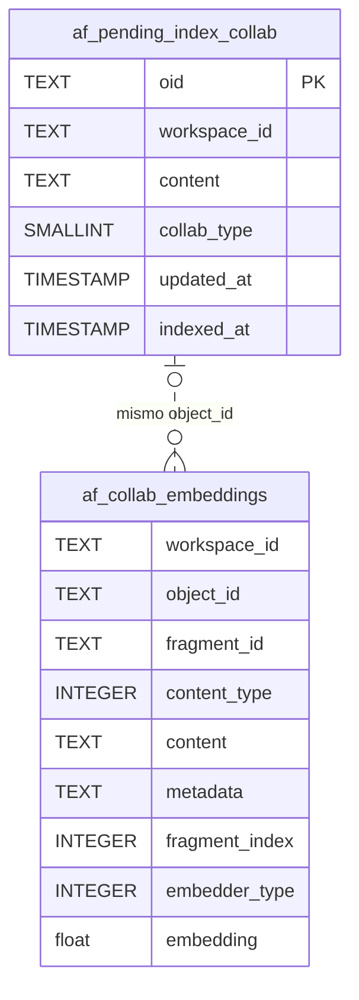
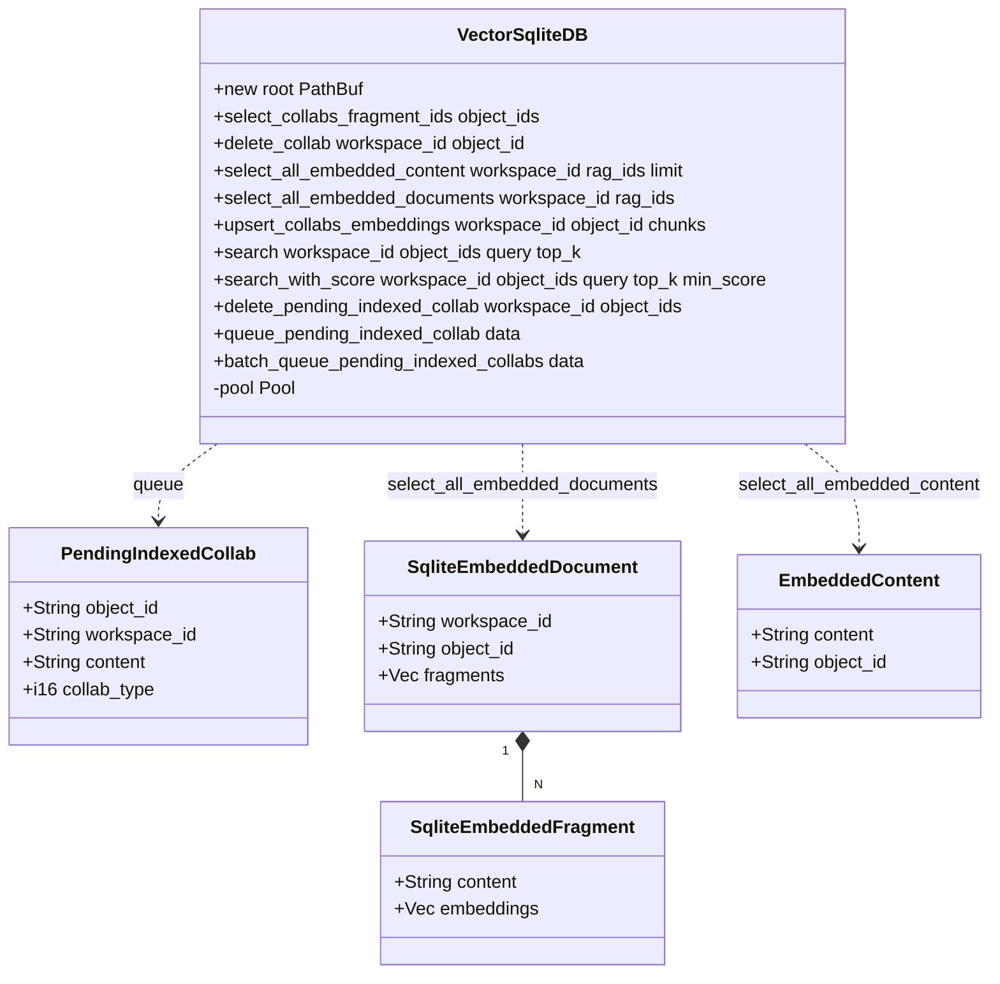
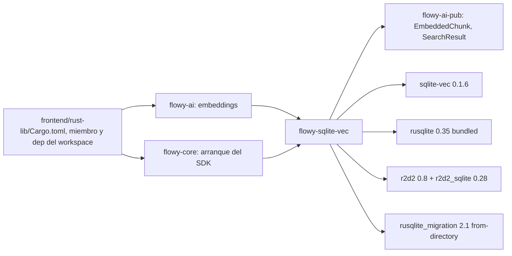
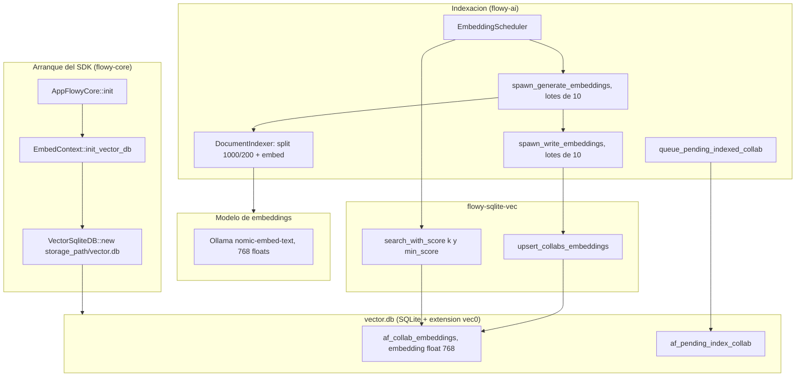
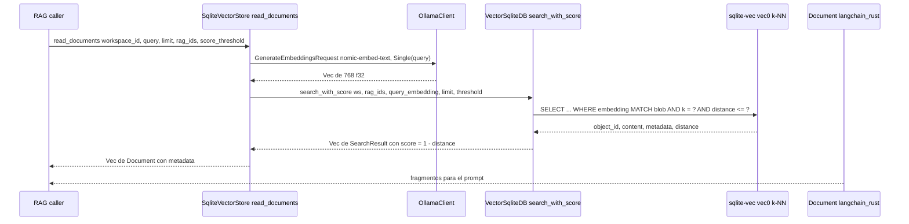
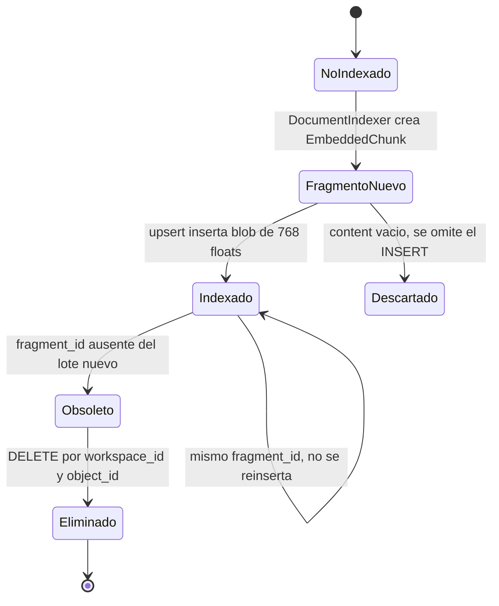

# F09.2 — IA: flowy-sqlite-vec (vectores)

## 1. Resumen

`flowy-sqlite-vec` es el almacén vectorial local de AppFlowy: un crate Rust de 7 ficheros y 1.128 líneas que persiste los *embeddings* de los documentos en un SQLite independiente (`vector.db`) usando la extensión `vector0` del módulo `sqlite-vec`. La extensión se registra como auto-extensión del proceso SQLite y el esquema —una tabla virtual `af_collab_embeddings` y una cola `af_pending_index_collab`— se crea desde `migrations/001-init/up.sql` incrustado en el binario. La API pública es una única struct, `VectorSqliteDB`, que envuelve un pool `r2d2` de 10 conexiones y expone operaciones de escritura (upsert por fragmentos, borrado por collab, cola de indexación pendiente) y de lectura (k-NN por distancia, listado de fragmentos y volcado de documentos). Este documento cubre los 7 ficheros del crate; la orquestación que decide *qué* se indexa y *cuándo* vive en `flowy-ai`, documentada en `[[../../09-features/F09-ia/1-ia-flowy-ai-rust.md]]`, y las tablas diesel del SQLite principal en `[[../../08-persistencia/00-indice.md]]`.

## 2. Alcance

Este documento cubre la totalidad del crate `appflowy/frontend/rust-lib/flowy-sqlite-vec`: su manifiesto de dependencias, el registro de la extensión `sqlite-vec`, el esquema de las dos tablas, el pool de conexiones, las once operaciones públicas de `VectorSqliteDB`, los cuatro tipos de `entities.rs`, el mecanismo de migraciones basado en `include_dir` y la batería de ocho tests de integración del propio crate.

Quedan **fuera de alcance** los siguientes puntos:

- La capa `flowy-ai` que decide qué collabs se indexan: `EmbedContext`, `EmbeddingScheduler`, `DocumentIndexer` y `SqliteVectorStore`. Todos aparecen aquí solo como **consumidores** de esta API, con cita para poder encadenar la lectura; su análisis completo está en `[[../../09-features/F09-ia/1-ia-flowy-ai-rust.md]]`.
- El algoritmo de *chunking*, el embedder de Ollama y la elección de `nomic-embed-text`, que son responsabilidad de `flowy-ai` (`appflowy/frontend/rust-lib/flowy-ai/src/embeddings/document_indexer.rs:91–145`).
- La base SQLite principal de AppFlowy (`flowy-sqlite`, diesel, 16 tablas), documentada en `[[../../08-persistencia/00-indice.md]]`. Este crate **no** usa diesel ni comparte conexión con ella: abre su propio fichero.
- AppFlowy-Cloud y el esquema remoto de embeddings, que quedan fuera de alcance por diseño de la skill.

## 3. Modelos de datos

El esquema completo del almacén cabe en un solo fichero SQL de 25 líneas, que crea dos objetos con finalidades distintas: el índice vectorial propiamente dicho y una cola de indexación pendiente. El DDL literal es:

```sql
-- appflowy/frontend/rust-lib/flowy-sqlite-vec/migrations/001-init/up.sql:1–12
CREATE VIRTUAL TABLE af_collab_embeddings
USING vec0(
  workspace_id    TEXT    NOT NULL,
  object_id       TEXT    NOT NULL,
  fragment_id     TEXT    NOT NULL,
  content_type    INTEGER NOT NULL,
  content         TEXT    NOT NULL,
  metadata        TEXT,
  fragment_index  INTEGER NOT NULL DEFAULT 0,
  embedder_type   INTEGER NOT NULL DEFAULT 0,
  embedding       float[768]
);
```

Muestra: las dos tablas del almacén vectorial y la relación lógica entre la cola de pendientes y el índice ya materializado.



Lectura: `af_collab_embeddings` es una **tabla virtual `vec0`**, no una tabla ordinary: sus columnas escalares (`workspace_id`, `object_id`, `fragment_id`, `content`, `metadata`) son *metadata* que la extensión indexa como filtros auxiliares, mientras que `embedding float[768]` es la columna vectorial que sostiene el índice k-NN. No declara clave primaria ni restricción `UNIQUE` sobre `fragment_id`, por lo que la unicidad es responsabilidad de la lógica de upsert descrita en §8 y no del esquema. `af_pending_index_collab` es en cambio una tabla relacional normal con `oid` como `PRIMARY KEY` e índice compuesto sobre `(oid, workspace_id)` (`appflowy/frontend/rust-lib/flowy-sqlite-vec/migrations/001-init/up.sql:14–25`); modela el texto plano de un collab a la espera de ser troceado y embebido. La relación del diagrama es lógica, no una clave foránea: ninguna de las dos tablas declara `FOREIGN KEY`.

### 3.1 Dimensión y métrica de distancia

La dimensión del vector está fijada en el esquema a **768 componentes** (`appflowy/frontend/rust-lib/flowy-sqlite-vec/migrations/001-init/up.sql:11`) y coincide exactamente con el único modelo de embedding soportado por el pipeline, `EmbeddingModel::NomicEmbedText`, cuyo método `dimension()` devuelve `768` con la URL del blob de Ollama como comentario (`appflowy/frontend/rust-lib/flowy-ai/src/embeddings/indexer.rs:12–30`). Los tests del propio crate generan vectores de 768 floats con `vec![value; size]` (`appflowy/frontend/rust-lib/flowy-sqlite-vec/tests/main.rs:366–368`), lo que confirma que el crate no acepta otras dimensiones.

El DDL **no declara `distance_metric`** (`appflowy/frontend/rust-lib/flowy-sqlite-vec/migrations/001-init/up.sql:1–12`), de modo que la extensión aplica la métrica por defecto de `vec0`; el crate no la fija ni la documenta en ningún punto `[NO DETERMINADO]`. Lo que sí es observable es el contrato de puntuación que el código construye alrededor de esa distancia:

```rust
// appflowy/frontend/rust-lib/flowy-sqlite-vec/src/db.rs:399–410
    // clamp min_score to [0,1]
    let min_score = min_score.clamp(0.0, 1.0);
    if object_ids.is_empty() {
      self
        .search_without_object_ids(workspace_id, query, top_k, min_score)
        .await
    } else {
      self
        .search_with_object_ids(workspace_id, object_ids, query, top_k, min_score)
        .await
    }
```

Con `min_score` recortado a `[0,1]`, las dos consultas k-NN traducen el umbral a distancia con `max_distance = 1.0 - min_score` (`appflowy/frontend/rust-lib/flowy-sqlite-vec/src/db.rs:424` y `appflowy/frontend/rust-lib/flowy-sqlite-vec/src/db.rs:472`) y proyectan la puntuación con `(1.0 - distance) AS score`, ordenando por `distance ASC` (`appflowy/frontend/rust-lib/flowy-sqlite-vec/src/db.rs:439–445`). Es decir, el crate asume implícitamente una distancia acotada en `[0,1]`, coherente con vectores normalizados como los que produce `nomic-embed-text` `[INFERIDO]`.

### 3.2 Tipos del crate

`entities.rs` define cuatro structs planos, todos `Clone + Debug`, sin `serde::Deserialize` (la deserialización del metadata se hace a mano con `serde_json::from_str`, `appflowy/frontend/rust-lib/flowy-sqlite-vec/src/db.rs:530–532`):

| Tipo | Campos | Papel | Evidencia |
|---|---|---|---|
| `PendingIndexedCollab` | `object_id`, `workspace_id`, `content`, `collab_type: i16` | Fila de la cola `af_pending_index_collab` | `appflowy/frontend/rust-lib/flowy-sqlite-vec/src/entities.rs:3–9` |
| `SqliteEmbeddedDocument` | `workspace_id`, `object_id`, `fragments: Vec<SqliteEmbeddedFragment>` | Documento reconstruido a partir de N fragmentos | `appflowy/frontend/rust-lib/flowy-sqlite-vec/src/entities.rs:11–16` |
| `SqliteEmbeddedFragment` | `content: String`, `embeddings: Vec<f32>` | Fragmento con su vector deserializado | `appflowy/frontend/rust-lib/flowy-sqlite-vec/src/entities.rs:18–22` |
| `EmbeddedContent` | `content`, `object_id` (con `Serialize`) | Par mínimo para prompts de RAG | `appflowy/frontend/rust-lib/flowy-sqlite-vec/src/entities.rs:24–28` |

El tipo de entrada y el de salida **no** son del crate: `upsert_collabs_embeddings` consume `EmbeddedChunk` y `search_with_score` devuelve `SearchResult`, ambos definidos en la capa pública `flowy-ai-pub` (`appflowy/frontend/rust-lib/flowy-ai-pub/src/entities.rs:67–77` y `appflowy/frontend/rust-lib/flowy-ai-pub/src/entities.rs:79–85`). Esa dependencia es la razón de que el crate no pueda compilarse aislado: `flowy-ai-pub` es su única dependencia interna (`appflowy/frontend/rust-lib/flowy-sqlite-vec/Cargo.toml:16`).

## 4. Eventos FFI

Este crate **no declara ningún evento FFI**. No existe `event_map.rs`, no hay enum con `#[derive(Flowy_Event)]` y no hay entrada en `events.json` asociada a `flowy-sqlite-vec`: `lib.rs` solo expone dos módulos públicos (`db` y `entities`), un módulo privado (`migration`) y una función libre (`appflowy/frontend/rust-lib/flowy-sqlite-vec/src/lib.rs:4–6`). Ningún tipo del crate lleva `#[derive(ProtoBuf)]`.

La consecuencia es arquitectónica: el almacén vectorial no es alcanzable desde Dart por ningún `XEventFoo(payload).send()`. Todo su control llega desde Rust, o bien desde el `AIManager` a través de `AIEvent`, ya documentados en `[[../../09-features/F09-ia/1-ia-flowy-ai-rust.md]]`, o bien desde `flowy-core` durante el arranque del SDK.

| Evento | Input PB | Output PB | Handler | Nota |
|---|---|---|---|---|
| — | — | — | — | Sin eventos: el crate no implementa `AFPlugin` ni registra handlers en `lib-dispatch` |

## 5. Notificaciones

Este crate **no emite notificaciones Rust→Dart**. No existe `notification.rs` ni enum `XNotification` en `flowy-sqlite-vec`, y no hay ninguna entrada correspondiente en `notifications.json`. El crate solo escribe trazas de `tracing` con el prefijo `[VectorStore]` (`appflowy/frontend/rust-lib/flowy-sqlite-vec/src/db.rs:260–265`, `appflowy/frontend/rust-lib/flowy-sqlite-vec/src/db.rs:419–422`, `appflowy/frontend/rust-lib/flowy-sqlite-vec/src/db.rs:534–537`).

Estas trazas sí son accesibles desde la capa Dart, porque `flowy-core` añade el crate al filtro de logging con el objetivo `flowy_sqlite_vec` (`appflowy/frontend/rust-lib/flowy-core/src/log_filter.rs:65`): el usuario ve el progreso de la indexación en la consola de la aplicación. No es una notificación de estado, sino logging de diagnóstico.

| Notificación | Emisor | Listener Dart | Efecto UI | Evidencia |
|---|---|---|---|---|
| — | — | — | — | Sin notificaciones: solo `tracing` con destino `flowy_sqlite_vec` |

## 6. BLoCs / Cubits

No hay BLoCs ni Cubits asociados: el crate es puramente Rust de backend y no toca la capa Flutter. Tampoco hay widget, ni servicio Dart, ni entrada en `blocs.json` cuya ruta pertenezca a `flowy-sqlite-vec`. El estado que este crate mantiene es puramente en disco (las filas de `vector.db`) y el que expone a sus consumidores son los tipos de `entities.rs` y de `flowy-ai-pub`.

El equivalente funcional del «estado observable» es la tabla `af_pending_index_collab`, que actúa como cola durable entre el detector de collabs modificados y el worker de embeddings; su ciclo de vida se describe en §11.

| Clase | Eventos | Estados | Servicios | Evidencia |
|---|---|---|---|---|
| — | — | — | — | Sin BLoCs: el estado vive en `vector.db` |

## 7. Servicios e inyección de dependencias

### 7.1 Registro de la extensión SQLite

El crate no usa `get_it` ni `deps_resolve`: su "inyección" consiste en registrar, a nivel de proceso, la función de inicialización de `sqlite-vec` como auto-extensión de SQLite antes de que exista ninguna conexión. El código completo son seis líneas:

```rust
// appflowy/frontend/rust-lib/flowy-sqlite-vec/src/lib.rs:1–13
use rusqlite::ffi::sqlite3_auto_extension;
use sqlite_vec::sqlite3_vec_init;

pub mod db;
pub mod entities;
mod migration;

#[allow(clippy::missing_transmute_annotations)]
pub fn init_sqlite_vector_extension() {
  unsafe {
    sqlite3_auto_extension(Some(std::mem::transmute(sqlite3_vec_init as *const ())));
  }
}
```

Lectura: `sqlite3_vec_init` se expone como `unsafe extern "C"` y se transmuta a la firma que espera `sqlite3_auto_extension`, que es un registro **global al proceso**: a partir de ese momento, cualquier conexión SQLite nueva —venga de este crate o de otro— cargará la extensión automáticamente `[INFERIDO]`. El `transmute` está justificado con `#[allow(clippy::missing_transmute_annotations)]`. Nótese que la función es pública y que los tests la invocan explícitamente una vez (`appflowy/frontend/rust-lib/flowy-sqlite-vec/tests/main.rs:113–117`), lo que sugiere que el registro explícito se considera parte del contrato, aunque el pool ya lo hace por conexión (§7.3).

### 7.2 API pública del crate

Muestra: la superficie pública completa de `flowy-sqlite-vec`, con las operaciones de `VectorSqliteDB` agrupadas por naturaleza (escritura, lectura, cola) y los structs de `entities.rs` que viajan con ellas.



Lectura: `VectorSqliteDB` es la única struct del crate y expone **11** métodos públicos: cinco de lectura/escritura sobre `af_collab_embeddings`, dos de k-NN (`search` como azúcar con `min_score` fijo `0.4` que delega en `search_with_score`, `appflowy/frontend/rust-lib/flowy-sqlite-vec/src/db.rs:379–389`) y tres sobre la cola de pendientes, más el constructor `new`. Los tipos de `entities.rs` aparecen como structs de valor, no como traits: `PendingIndexedCollab` es la entrada de las dos APIs de cola, `EmbeddedContent` la salida de `select_all_embedded_content` y `SqliteEmbeddedDocument` la de `select_all_embedded_documents`, que devuelve documentos con sus fragmentos anidados. Los tipos `EmbeddedChunk` y `SearchResult`, que son la verdadera frontera del crate, viven en `flowy-ai-pub` y por eso no aparecen en el diagrama.

### 7.3 Construcción del pool y orden de arranque

`VectorSqliteDB::new` es el único punto de construcción y hace tres cosas en un orden significativo: fija la ruta del fichero, engancha el registro de la extensión al callback de inicialización de cada conexión del pool, y migra el esquema inmediatamente.

```rust
// appflowy/frontend/rust-lib/flowy-sqlite-vec/src/db.rs:23–48
  pub fn new(root: PathBuf) -> Result<Self> {
    let db_path = root.join("vector.db");

    // Setup the connection manager with the database path
    let manager = SqliteConnectionManager::file(db_path);

    // Initialize SQLite extensions and settings in each new connection
    let manager = manager.with_init(|_| {
      init_sqlite_vector_extension();
      Ok(())
    });

    // Create the connection pool
    let pool = Pool::builder()
      .max_size(10) // Adjust based on your needs
      .build(manager)
      .context("Failed to create connection pool")?;

    // Ensure database is migrated
    let mut conn = pool
      .get()
      .context("Failed to get connection for migration")?;
    init_sqlite_with_migrations(&mut conn)?;

    Ok(Self { pool })
  }
```

Lectura: el fichero es siempre `<root>/vector.db`, de modo que el `root` decide la ubicación. El pool es `r2d2` con `max_size(10)` (el propio código anota que el valor es ajustable) y usa `SqliteConnectionManager` de `r2d2_sqlite`, no el pool de `flowy-sqlite`. La migración se ejecuta sobre **una** conexión sacada del pool justo después de construirlo; como la extensión ya quedó registrada a nivel de proceso, el `CREATE VIRTUAL TABLE` ve `vec0` disponible.

Quién llama a `new` lo decide `flowy-core`, y solo en escritorio: `AppFlowyCore::init` invoca `EmbedContext::shared().init_vector_db(PathBuf::from(&config.storage_path))` bajo `#[cfg(any(target_os = "windows", target_os = "macos", target_os = "linux"))]` (`appflowy/frontend/rust-lib/flowy-core/src/lib.rs:131–133`). `EmbedContext` vuelve a comprobar el sistema operativo y aborta con un `warn!` en móvil (`appflowy/frontend/rust-lib/flowy-ai/src/embeddings/context.rs:33–38`), de modo que en Android, iOS y web `vector.db` nunca se crea.

### 7.4 Grafo de dependencias

Muestra: qué crates del workspace dependen de `flowy-sqlite-vec` y qué bibliotecas externas consume a su vez.



Lectura: el crate es una **hoja** del grafo: solo depende de `flowy-ai-pub` hacia dentro del workspace (`appflowy/frontend/rust-lib/flowy-sqlite-vec/Cargo.toml:16`), lo que evita cualquier ciclo con `flowy-ai`. Hacia arriba lo consumen dos crates: `flowy-ai`, que lo importa con `flowy-sqlite-vec.workspace = true` (`appflowy/frontend/rust-lib/flowy-ai/Cargo.toml:51`) y lo usa en `embeddings/{store,scheduler,context}.rs`, y `flowy-core`, que lo declara como dependencia del workspace (`appflowy/frontend/rust-lib/flowy-core/Cargo.toml:66`) aunque no se localizó ningún `use flowy_sqlite_vec` en su código Rust `[INFERIDO]`. El manifiesto del workspace lo registra como miembro y como dependencia con ruta (`appflowy/frontend/rust-lib/Cargo.toml:33` y `appflowy/frontend/rust-lib/Cargo.toml:106`).

La pila externa es deliberadamente mínima y auto-contenida: `sqlite-vec 0.1.6` aporta la extensión, `rusqlite 0.35` se compila con la feature `bundled` (SQLite embebido, sin dependencia del sistema), `rusqlite_migration 2.1` con `from-directory` aporta el gestor de migraciones, `r2d2`/`r2d2_sqlite` el pool, `zerocopy` el `as_bytes()` para volcar los `f32` a bytes little-endian, e `include_dir` incrusta el SQL en el binario (`appflowy/frontend/rust-lib/flowy-sqlite-vec/Cargo.toml:6–21`).

## 8. Persistencia

El almacén es un **SQLite propio**, `vector.db`, en el mismo directorio `storage_path` que el resto de bases locales pero **sin** pasar por `flowy-sqlite` ni por diesel. Las tres piezas de persistencia son:

**1. El fichero de esquema, incrustado en el binario.** `migration.rs` usa `include_dir!` sobre `$CARGO_MANIFEST_DIR/migrations` y lo envuelve en un `LazyLock<Migrations>`, de modo que el SQL viaja dentro del ejecutable y no necesita leerse de disco en runtime:

```rust
// appflowy/frontend/rust-lib/flowy-sqlite-vec/src/migration.rs:7–17
static MIGRATIONS_DIR: Dir = include_dir!("$CARGO_MANIFEST_DIR/migrations");
static MIGRATIONS: LazyLock<Migrations<'static>> =
  LazyLock::new(|| Migrations::from_directory(&MIGRATIONS_DIR).unwrap());

/// Initialize a new SQLite database with migrations
pub fn init_sqlite_with_migrations(
  conn: &mut PooledConnection<SqliteConnectionManager>,
) -> anyhow::Result<()> {
  MIGRATIONS.to_latest(conn)?;
  Ok(())
}
```

`to_latest` es idempotente y registra la versión aplicada en la tabla interna `user_version` de rusqlite_migration. El directorio contiene **un solo** migración, `001-init`, y **solo `up.sql`**: no hay `down.sql` ni migraciones posteriores (`appflowy/frontend/rust-lib/flowy-sqlite-vec/migrations/001-init/up.sql:1–25`). El esquema es, por tanto, inmutable en esta versión del crate `[VERIFICADO]`.

**2. La tabla de embeddings.** `upsert_collabs_embeddings` implementa un *upsert* manual, en cuatro pasos dentro de una única transacción: carga los `fragment_id` ya presentes para el par `(workspace_id, object_id)`, calcula la diferencia `existentes − nuevos`, borra los sobrantes con un `DELETE ... AND fragment_id IN (...)` de placeholders generados dinámicamente, y por último inserta únicamente los fragmentos **nuevos**:

```rust
// appflowy/frontend/rust-lib/flowy-sqlite-vec/src/db.rs:326–348
    // 5) Insert only the brand-new fragments (new − existing)
    let to_insert: Vec<&EmbeddedChunk> = fragments
      .iter()
      .filter(|f| !existing_ids.contains(&f.fragment_id))
      .collect();

    if !to_insert.is_empty() {
      trace!(
        "[VectorStore] Inserting {} {} new fragments. ids: {:?}",
        object_id,
        to_insert.len(),
        to_insert
          .iter()
          .map(|f| f.fragment_id.as_str())
          .collect::<Vec<_>>()
      );
      let mut insert = tx.prepare(
        "INSERT INTO af_collab_embeddings
               (workspace_id, object_id, fragment_id,
                content_type, content, metadata,
                fragment_index, embedder_type, embedding)
             VALUES (?1, ?2, ?3, ?4, ?5, ?6, ?7, ?8, ?9)",
      )?;
```

Lectura: la clave de identidad del fragmento es el `fragment_id`, que el productor calcula como `xxhash64(contenido + metadata_json)` en hexadecimal (`appflowy/frontend/rust-lib/flowy-ai/src/embeddings/document_indexer.rs:113–118`). Como el identificador depende del contenido, "el mismo contenido produce el mismo `fragment_id`" es lo que permite que este `INSERT` condicional sea una caché incremental: si el texto de un párrafo no ha cambiado, su `fragment_id` sigue igual y el upsert lo omite sin re-embeber. Por eso el productor marca `chunk.content = None` en los fragmentos ya conocidos (el `INSERT` los salta, `appflowy/frontend/rust-lib/flowy-sqlite-vec/src/db.rs:350–354`) y el consumidor se apoya en `select_collabs_fragment_ids` para saber qué hay ya escrito (`appflowy/frontend/rust-lib/flowy-ai/src/embeddings/scheduler.rs:275–282`).

El vector se serializa como bytes little-endian planos con `zerocopy` (`frag.embeddings.as_ref().map(|b| b.as_bytes()).unwrap_or(&[])`, `appflowy/frontend/rust-lib/flowy-sqlite-vec/src/db.rs:365–369`), que es el formato que espera la columna `float[768]` de `vec0`; el camino inverso, al releer, reagrupa los bytes de cuatro en cuatro con `chunks_exact(4)` y `f32::from_le_bytes` (`appflowy/frontend/rust-lib/flowy-sqlite-vec/src/db.rs:210–223`).

**3. La cola `af_pending_index_collab`.** Tres métodos escriben en ella: `queue_pending_indexed_collab` (que no hace más que envolver un vector de un elemento, `appflowy/frontend/rust-lib/flowy-sqlite-vec/src/db.rs:594–596`), `batch_queue_pending_indexed_collabs` (que inserta N filas en una transacción con un único `Statement` preparado, `appflowy/frontend/rust-lib/flowy-sqlite-vec/src/db.rs:599–637`) y `delete_pending_indexed_collab` (que borra por `workspace_id` + `object_id IN (...)`, `appflowy/frontend/rust-lib/flowy-sqlite-vec/src/db.rs:549–592`). Los tres former son un `INSERT` puro, sin `INSERT OR REPLACE`: `oid` es `PRIMARY KEY`, de modo que re-encolar el mismo collab dos veces viola la restricción `[INFERIDO]`.

**Relación con `local_ai_model_table` (`[[../../08-persistencia/00-indice.md]]`).** La tabla `local_ai_model_table` de la base principal (`name TEXT PRIMARY KEY`, `model_type SMALLINT`, `appflowy/frontend/rust-lib/flowy-sqlite/src/schema.rs:65–70`, creada en `appflowy/frontend/rust-lib/flowy-sqlite/migrations/2025-04-25-071459_local_ai_model/up.sql:2–6`) registra qué modelos de IA locales tiene descargados el usuario. Es la **tabla hermana pero independiente** de `af_collab_embeddings`: vive en otra base, la gestiona diesel desde `flowy-ai-pub` (`appflowy/frontend/rust-lib/flowy-ai-pub/src/persistence/local_model_sql.rs:45–49`), y su `model_type` distingue clases de modelo (chat frente a embeddings), no vectores. El vínculo conceptual es que ambos dependen de Ollama en local: si el usuario borra `nomic-embed-text` de `local_ai_model_table`, los vectores ya almacenados en `af_collab_embeddings` **no** se borran — quedan huérfanos y sus consultas devolverán distancias calculadas con un modelo que ya no existe. No hay ninguna clave foránea, trigger ni tarea de limpieza que lo impida `[VERIFICADO]`.

## 9. Diagramas de flujo

Muestra: el pipeline completo desde que `flowy-core` arranca hasta que una búsqueda por similitud sale de `flowy-sqlite-vec`, con los dos puntos en los que este crate toca disco.



Lectura: el grafo tiene un único punto de entrada (el arranque del SDK, restringido a escritorio) y dos caminos de salida hacia la tabla de embeddings. El **camino de escritura** es asíncrono y por lotes: `EmbeddingScheduler` recibe `UnindexedCollab`, `spawn_generate_embeddings` drena hasta 10 registros por iteración, el `DocumentIndexer` trocea (1000 caracteres con 200 de solape) y pide a Ollama un vector de 768 floats por chunk, y `spawn_write_embeddings` vuelve a drenar lotes de 10 para llamar a `upsert_collabs_embeddings`. El **camino de lectura** es síncrono a demanda: cualquier consumidor con `Arc<VectorSqliteDB>` llama a `search_with_score` y la consulta k-NN se resuelve dentro de SQLite. La flecha hacia `af_pending_index_collab` es el único uso de la cola en todo el grafo, y no hay ninguna flecha de regreso que la drene (véase §18).

## 10. Diagramas de secuencia

Muestra: una consulta semántica completa, desde el prompt RAG hasta los `Document` de `langchain-rust` que entran en el prompt del modelo.



Lectura: el productor (`SqliteVectorStore::read_documents`, `appflowy/frontend/rust-lib/flowy-ai/src/embeddings/store.rs:94–159`) **no** envía el texto de la consulta a la base: primero lo vectoriza con el mismo `nomic-embed-text` usado al indexar —esto es lo que hace comparables los vectores— y solo entonces delega. `search_with_score` recorta el umbral a `[0,1]`, lo convierte en `max_distance = 1.0 - min_score` y elige entre dos sentencias SQL según haya `rag_ids` o no (`appflowy/frontend/rust-lib/flowy-sqlite-vec/src/db.rs:391–410`). La sentencia con filtro añade `object_id IN (...)` con placeholders generados en runtime, mientras que la sentencia sin filtro restringe solo por `workspace_id` (`appflowy/frontend/rust-lib/flowy-sqlite-vec/src/db.rs:433–446` y `appflowy/frontend/rust-lib/flowy-sqlite-vec/src/db.rs:487–502`). La extensión devuelve filas con la columna virtual `distance`, que `process_search_results` convierte en `SearchResult` parseando el `oid` como UUID, el `metadata` como JSON y **`score` de la columna 4**, es decir el `(1.0 - distance)` proyectado por SQL; los `oid` malformados se descartan con un `warn!` en lugar de abortar la consulta (`appflowy/frontend/rust-lib/flowy-sqlite-vec/src/db.rs:518–547`). El nivel superior descarta el UUID: los `Document` que salen hacia el prompt solo llevan `content` y el `metadata` aplanado como `HashMap<String, Value>` (`appflowy/frontend/rust-lib/flowy-ai/src/embeddings/store.rs:143–156`).

## 11. Diagramas de estado

Muestra: el ciclo de vida de un fragmento de texto dentro de `af_collab_embeddings`, desde que el indexador lo crea hasta que un borrado de collab lo elimina.



Lectura: `fragment_id` es la identidad estable del estado, y como es un hash del contenido, el estado `Indexado → Indexado` modela el acierto de caché del upsert: si el texto del párrafo no ha cambiado, el hash tampoco y la fila se conserva intacta. `FragmentoNuevo → Descartado` cubre el `continue` que salta los fragmentos sin `content` (`appflowy/frontend/rust-lib/flowy-sqlite-vec/src/db.rs:350–354`), que es el mecanismo por el que `spawn_generate_embeddings` comunica «esto ya está en la base» sin escribir nada. `Indexado → Obsoleto → Eliminado` es la única forma de que una fila desapareya por upsert, y requiere que el lote nuevo **sí** contenga otros fragmentos: con un vector de fragmentos vacío el método hace `return Ok(())` antes de borrar nada (`appflowy/frontend/rust-lib/flowy-sqlite-vec/src/db.rs:255–258`). La transición a `Eliminado` desde cualquier estado intermedio también ocurre de forma masiva con `delete_collab`, que borra todas las filas de un `(workspace_id, object_id)` en una transacción (`appflowy/frontend/rust-lib/flowy-sqlite-vec/src/db.rs:93–112`) y es lo que invoca el borrado de un documento a través de `EmbeddingScheduler::delete_collab` (`appflowy/frontend/rust-lib/flowy-ai/src/embeddings/scheduler.rs:84–94`).

## 12. Archivos cubiertos (del ledger)

Los siete ficheros de la unidad `F09.2` y el papel exacto de cada uno:

| # | Ruta | LOC | Capa | Papel |
|---|---|---|---|---|
| 1 | `appflowy/frontend/rust-lib/flowy-sqlite-vec/Cargo.toml` | 24 | config | Declara el crate (`flowy-sqlite-vec` 0.1.0, edition 2024) y su pila: `sqlite-vec 0.1.6`, `rusqlite 0.35` con `bundled`, `rusqlite_migration 2.1` con `from-directory`, `r2d2`/`r2d2_sqlite`, `zerocopy`, `include_dir` y la única dependencia interna, `flowy-ai-pub` (`appflowy/frontend/rust-lib/flowy-sqlite-vec/Cargo.toml:6–21`). |
| 2 | `appflowy/frontend/rust-lib/flowy-sqlite-vec/migrations/001-init/up.sql` | 25 | ui | Único fichero de esquema: crea la tabla virtual `af_collab_embeddings` con `embedding float[768]` y la cola relacional `af_pending_index_collab` con su índice `(oid, workspace_id)` (`appflowy/frontend/rust-lib/flowy-sqlite-vec/migrations/001-init/up.sql:1–25`). |
| 3 | `appflowy/frontend/rust-lib/flowy-sqlite-vec/src/db.rs` | 638 | persistence | Núcleo del crate: `VectorSqliteDB` y sus 11 métodos públicos —constructor con pool y migración, upsert incremental, borrado, k-NN con y sin filtro de `object_id`, listado de fragmentos y de documentos, volcado de contenido y las tres operaciones de cola— más tres auxiliares privados (`appflowy/frontend/rust-lib/flowy-sqlite-vec/src/db.rs:412`, `appflowy/frontend/rust-lib/flowy-sqlite-vec/src/db.rs:459`, `appflowy/frontend/rust-lib/flowy-sqlite-vec/src/db.rs:518`). |
| 4 | `appflowy/frontend/rust-lib/flowy-sqlite-vec/src/entities.rs` | 28 | persistence | Los cuatro structs de valor que cruzan la frontera del crate: `PendingIndexedCollab`, `SqliteEmbeddedDocument`, `SqliteEmbeddedFragment` y `EmbeddedContent` (`appflowy/frontend/rust-lib/flowy-sqlite-vec/src/entities.rs:3–28`). |
| 5 | `appflowy/frontend/rust-lib/flowy-sqlite-vec/src/lib.rs` | 13 | persistence | Raíz del crate: exporta `db` y `entities` como módulos públicos, mantiene `migration` privado y define `init_sqlite_vector_extension()`, que registra `sqlite3_vec_init` como auto-extensión del proceso (`appflowy/frontend/rust-lib/flowy-sqlite-vec/src/lib.rs:1–13`). |
| 6 | `appflowy/frontend/rust-lib/flowy-sqlite-vec/src/migration.rs` | 17 | persistence | Motor de migraciones: incrusta `migrations/` con `include_dir!`, lo envuelve en un `LazyLock<Migrations>` y expone `init_sqlite_with_migrations`, que aplica `to_latest` sobre una conexión del pool (`appflowy/frontend/rust-lib/flowy-sqlite-vec/src/migration.rs:7–17`). |
| 7 | `appflowy/frontend/rust-lib/flowy-sqlite-vec/tests/main.rs` | 383 | persistence | Ocho tests de integración `#[tokio::test]` sobre `tempfile::tempdir()`, más los helpers `generate_embedding_with_size` y `create_test_fragment` (`appflowy/frontend/rust-lib/flowy-sqlite-vec/tests/main.rs:366–383`). |

**Total: 7 ficheros, 1.128 líneas.** La distribución es reveladora: el 90 % del código está en `db.rs` y en sus tests; `lib.rs`, `entities.rs` y `migration.rs` suman 58 líneas, porque el crate delega en `rusqlite`, `r2d2`, `rusqlite_migration` y `sqlite-vec` toda la mecánica de bajo nivel.

## 13. Riesgos y casos límite

- **E/S síncrona dentro de funciones `async`.** Todos los métodos son `async fn` pero ejecutan `rusqlite` de forma bloqueante sin `spawn_blocking`: `self.pool.get()` y `stmt.query(...)` se.awaitan directamente (`appflowy/frontend/rust-lib/flowy-sqlite-vec/src/db.rs:68–79`). Con un pool de 10 conexiones y consultas k-NN sobre tablas grandes, esto puede ocupar un worker del runtime de Tokio durante toda la consulta. Un k-NN sobre un corpus grande es precisamente el caso peor.
- **Borrado de fragmentos obsoletos condicionado a que el lote no esté vacío.** `upsert_collabs_embeddings` hace `return Ok(())` si `fragments.is_empty()` (`appflowy/frontend/rust-lib/flowy-sqlite-vec/src/db.rs:255–258`), de modo que un documento al que se le borra todo el contenido conserva sus filas y sus vectores **para siempre** en `af_collab_embeddings`. El único remedio disponible es `delete_collab`.
- **El upsert no actualiza fragmentos existentes.** Solo inserta los `fragment_id` nuevos (`appflowy/frontend/rust-lib/flowy-sqlite-vec/src/db.rs:326–330`). Como el `fragment_id` es un hash del contenido, cambiar el modelo de embeddings manteniendo los textos deja todos los vectores obsoletos sin ninguna señal en la base: no hay columna que registre qué modelo generó cada fila más allá del entero `embedder_type`, que el pipeline real fija siempre a `0` (`appflowy/frontend/rust-lib/flowy-ai/src/embeddings/document_indexer.rs:127`) y los tests a `1` (`appflowy/frontend/rust-lib/flowy-sqlite-vec/tests/main.rs:380`).
- **Ausencia de unicidad en la tabla virtual.** El DDL no declara `PRIMARY KEY` ni `UNIQUE(fragment_id)` (`appflowy/frontend/rust-lib/flowy-sqlite-vec/migrations/001-init/up.sql:1–12`). Dos `upsert_collabs_embeddings` concurrentes sobre el mismo `(workspace_id, object_id)` pueden leer ambos los mismos `existing_ids` e insertar los mismos fragmentos, duplicando filas y desvirtuando el k-NN. `upsert_collabs_embeddings` es transaccional, pero la lectura y la escritura del mismo método no se serializan entre instancias distintas de `VectorSqliteDB`.
- **`k` combinado con filtro de distancia.** Las sentencias piden `k = top_k` **y** `distance <= max_distance` en el mismo `WHERE` (`appflowy/frontend/rust-lib/flowy-sqlite-vec/src/db.rs:441–445`). En `vec0` el `k` limita los vecinos candidatos antes de aplicar el resto de filtros, así que una consulta puede devolver menos de `top_k` filas aunque existan más coincidencias válidas en la base `[INFERIDO]`. El comportamiento se manifiesta en los tests: `test_search_no_hits` afirma que una consulta con el vector opuesto devuelve vacío (`appflowy/frontend/rust-lib/flowy-sqlite-vec/tests/main.rs:155–179`).
- **Pérdida silenciosa de `metadata`.** `process_search_results` hace `serde_json::from_str::<Value>(&s).ok()`; cualquier `metadata` que no sea JSON válido se convierte en `None` sin aviso (`appflowy/frontend/rust-lib/flowy-sqlite-vec/src/db.rs:530–532`). Como la columna acepta `TEXT` libre, un productor futuro podría escribir JSON inválido sin que nada lo detecte.
- **Inconsistencia de `collab_type` con la tabla real.** `PendingIndexedCollab.collab_type` es `i16` y la columna `SMALLINT`, pero el tipo fuerte `CollabType` no está definido en el repositorio: llega reexportado desde el crate externo `client_api` a través de `pub use client_api::entity::*` (`appflowy/frontend/rust-lib/flowy-ai-pub/src/cloud.rs:13`). El mapeo entero↔variante ocurre fuera del código auditable.
- **Requisito de escritorio.** En móvil y web el almacén no existe (`appflowy/frontend/rust-lib/flowy-core/src/lib.rs:131–133`, `appflowy/frontend/rust-lib/flowy-ai/src/embeddings/context.rs:34–38`), de modo que cualquier consumidor que asuma la presencia de `VectorSqliteDB` debe degradar con `FlowyError` y no con `panic`. `SqliteVectorStore` lo hace con `weak.upgrade()` y `FlowyError::internal()` (`appflowy/frontend/rust-lib/flowy-ai/src/embeddings/store.rs:103–106`).
- **Orden extensión/migración.** `sqlite3_auto_extension` es un registro global al proceso (`appflowy/frontend/rust-lib/flowy-sqlite-vec/src/lib.rs:11`); si otra parte del SDK crease una conexión antes de que `VectorSqliteDB::new` se ejecutase, esa conexión no tendría `vec0`. La mitigación actual es que `new()` migra inmediatamente tras construir el pool (`appflowy/frontend/rust-lib/flowy-sqlite-vec/src/db.rs:41–45`).
- **Cola `af_pending_index_collab` sin consumidor ni `OR REPLACE`.** Las tres APIs de cola no tienen ningún lector en el repositorio (§18), y `batch_queue_pending_indexed_collabs` inserta filas cuyo `oid` es `PRIMARY KEY` (`appflowy/frontend/rust-lib/flowy-sqlite-vec/migrations/001-init/up.sql:16`), por lo que encolar dos veces el mismo collab falla con violación de restricción en vez de ser idempotente.

## 14. Evidencias y etiquetas

| Etiqueta | Cantidad | Naturaleza |
|---|---|---|
| `[VERIFICADO]` | 103 referencias `ruta:línea`, todas validadas por `validate_evidence.py` | Respaldo de las afirmaciones de §3–§13 y §16; `[VERIFICADO]` es la etiqueta por defecto y solo se escribe literalmente dos veces, en §8, donde el matiz importa |
| `[INFERIDO]` | 6 | Razonamiento sobre comportamiento no escrito explícitamente, siempre explicitado en la prosa |
| `[NO DETERMINADO]` | 5 | Re-listados íntegramente en §18 |

Las seis afirmaciones `[INFERIDO]` son, en orden de aparición: (a) que `score = 1.0 - distance` solo tiene sentido si la distancia queda acotada en `[0,1]`, lo que implica embeddings normalizados (§3.1); (b) que el registro vía `sqlite3_auto_extension` es global al proceso y afecta a cualquier conexión SQLite del binario, deducido de la firma de la función y de que el pool la reinvoca por conexión (§7.1); (c) que la ausencia de `INSERT OR REPLACE` combinada con `oid` como `PRIMARY KEY` vuelve no idempotente el reencolado (§8); (d) que `flowy-core` declara la dependencia sin usarla, porque no hay ningún `use flowy_sqlite_vec` en su código Rust (§7.4); (e) que `vec0` aplica el límite `k` antes que el resto de filtros, lo que puede devolver menos de `top_k` filas (§13); (f) que en una tabla virtual sin restricción `UNIQUE`, dos escrituras concurrentes del mismo `fragment_id` pueden duplicar la fila (§13).

Las cinco `[NO DETERMINADO]` de §18 son: (a) la métrica de distancia efectiva de `vec0`, que el DDL no declara; (b) el consumidor de la cola `af_pending_index_collab`, que no tiene ningún lector en el workspace; (c) la estrategia de evolución del esquema, con una única migración y sin `down.sql`; (d) si la dependencia `flowy-sqlite-vec` de `flowy-core` es vestigial o intencionada; (e) la codificación entera de `content_type`, que el pipeline escribe como `0` y los tests como `1`.

Las citas cubren los siete ficheros de la unidad más dieciocho ficheros externos usados solo como contexto de enlace: `Cargo.toml` del workspace, `flowy-ai/{Cargo.toml, tests/main.rs, src/embeddings/{context,document_indexer,indexer,scheduler,store}.rs, src/local_ai/chat/{llm_chat.rs, chains/context_question_chain.rs}}`, `flowy-ai-pub/src/{cloud.rs, entities.rs, persistence/local_model_sql.rs}`, `flowy-core/{Cargo.toml, src/lib.rs, src/log_filter.rs}`, `flowy-sqlite/src/schema.rs` y `flowy-sqlite/migrations/2025-04-25-071459_local_ai_model/up.sql`. Ninguna afirmación de §4, §5 o §6 cita rutas, porque en este crate no existen eventos, notificaciones ni BLoCs que documentar.

## 15. Pruebas

El crate incluye ocho tests de integración en `tests/main.rs`, todos `#[tokio::test]` y todos sobre un `tempfile::tempdir()` nuevo, de modo que ninguno toca la `vector.db` real. Ninguno requiere red ni Ollama: los vectores se generan sintéticamente con `vec![value; size]` (`appflowy/frontend/rust-lib/flowy-sqlite-vec/tests/main.rs:366–368`) y los fragmentos se construyen con `create_test_fragment`, que fija `content_type: 1` y `embedder_type: 1` (`appflowy/frontend/rust-lib/flowy-sqlite-vec/tests/main.rs:370–383`).

| Test | Qué cubre | Evidencia |
|---|---|---|
| `test_vector_sqlite_db_basic_operations` | Alta de 3 fragmentos de 768 floats y lectura de `select_collabs_fragment_ids`, que devuelve 3 ids para un oid. | `appflowy/frontend/rust-lib/flowy-sqlite-vec/tests/main.rs:9–35` |
| `test_upsert_and_remove_fragments` | El borrado de fragmentos obsoletos: se reindexa con un subconjunto (2 de 3) y se verifica que quedan 2; después una búsqueda con `min_score` por defecto (`0.4`) devuelve el fragmento 0. | `appflowy/frontend/rust-lib/flowy-sqlite-vec/tests/main.rs:37–88` |
| `test_empty_fragments_noop_and_select_empty` | El caso límite del `return Ok(())`: un upsert con vector vacío no inserta nada y el select devuelve mapa vacío. | `appflowy/frontend/rust-lib/flowy-sqlite-vec/tests/main.rs:90–111` |
| `test_duplicate_upsert_idempotent` | Que un segundo upsert idéntico no cambia el conjunto de fragmentos; es el test que invoca `init_sqlite_vector_extension()` explícitamente. | `appflowy/frontend/rust-lib/flowy-sqlite-vec/tests/main.rs:113–153` |
| `test_search_no_hits` | Que un vector ortogonal (`+1.0` frente a `-1.0`) no produce falsos positivos al filtrar por distancia. | `appflowy/frontend/rust-lib/flowy-sqlite-vec/tests/main.rs:155–179` |
| `test_multi_workspace_isolation` | Aislamiento por `workspace_id`: el mismo `oid` con embeddings opuestos en dos workspaces devuelve un resultado distinto en cada búsqueda. | `appflowy/frontend/rust-lib/flowy-sqlite-vec/tests/main.rs:181–213` |
| `test_select_multiple_oids` | Que `select_collabs_fragment_ids` con dos oids en la misma consulta devuelve un mapa con dos entradas. | `appflowy/frontend/rust-lib/flowy-sqlite-vec/tests/main.rs:215–255` |
| `test_skip_missing_content` | Que un fragmento con `content = None` se salta y no ocupa fila, validando el `continue` del bucle de inserción. | `appflowy/frontend/rust-lib/flowy-sqlite-vec/tests/main.rs:257–279` |
| `test_object_ids_handling` | Que distintos formatos de `object_id` (UUID estándar, UUID cero y un valor largo) se guardan y recuperan, y que la búsqueda los encuentra. | `appflowy/frontend/rust-lib/flowy-sqlite-vec/tests/main.rs:281–364` |

**Cobertura ausente.** Ningún test ejercita `select_all_embedded_content`, `select_all_embedded_documents`, `delete_collab` (en su camino de borrado masivo), ni ninguna de las tres APIs de la cola `af_pending_index_collab`. Tampoco hay tests de integración desde `flowy-ai` que timbres Ollama: el crate de tests de `flowy-ai` construye un `VectorSqliteDB` real en un `tempdir` pero requiere un servidor Ollama vivo en `localhost:11434` (`appflowy/frontend/rust-lib/flowy-ai/tests/main.rs:53–59`).

## 16. Métricas

| Métrica | Valor |
|---|---|
| Ficheros del crate | 7 |
| Líneas totales | 1.128 |
| Líneas en `src/db.rs` | 638 (56,6 %) |
| Líneas en `tests/main.rs` | 383 (34,0 %) |
| Líneas de esquema SQL | 25 |
| Tablas creadas | 2 (1 virtual `vec0`, 1 relacional) |
| Columnas en `af_collab_embeddings` | 9 |
| Columnas en `af_pending_index_collab` | 6 |
| Dimensión del vector | 768 `f32` little-endian (3.072 bytes por fila) |
| Métodos públicos de `VectorSqliteDB` | 11 |
| Métodos privados auxiliares | 3 |
| Tipos en `entities.rs` | 4 |
| Structs públicas del crate | 1 |
| Eventos FFI | 0 |
| Notificaciones | 0 |
| BLoCs / Cubits | 0 |
| Dependencias internas | 1 (`flowy-ai-pub`) |
| Dependencias declaradas en `[dependencies]` | 15, de las que 1 es interna (`flowy-ai-pub`) y 5 heredan del workspace (más `tempfile` en `[dev-dependencies]`) |
| Tests de integración | 8 |
| Migraciones | 1 (`001-init`, solo `up.sql`) |
| Tamaño máximo del pool | 10 conexiones |
| Diagramas Mermaid en este documento | 6 (`erDiagram`, `flowchart TD`, `sequenceDiagram`, `stateDiagram-v2`, `classDiagram`, `flowchart LR`) |

## 17. Pendientes

- **Hacer idempotente la cola.** `batch_queue_pending_indexed_collabs` debería usar `INSERT OR REPLACE` (o `ON CONFLICT(oid) DO UPDATE`) para que reencolar un collab ya pendiente no violé la clave primaria, dado que `updated_at` e `indexed_at` existen para justo ese propósito (`appflowy/frontend/rust-lib/flowy-sqlite-vec/migrations/001-init/up.sql:20–21`).
- **Añadir índice de unicidad lógico.** Crear un índice `UNIQUE(workspace_id, object_id, fragment_id)` sobre la tabla virtual, o documentar explícitamente que la deduplicación depende del `fragment_id` direccionado por contenido y de que solo haya un escritor por collab.
- **Cubrir con tests las cuatro APIs sin cobertura**: `select_all_embedded_content`, `select_all_embedded_documents`, `delete_collab` y las tres de cola. Son las que usa el RAG de chat (`appflowy/frontend/rust-lib/flowy-ai/src/local_ai/chat/chains/context_question_chain.rs:130–133` y `appflowy/frontend/rust-lib/flowy-ai/src/local_ai/chat/llm_chat.rs:117–118`).
- **Extraer el tipo de fragmento a una constante compartida.** `content_type` y `embedder_type` se escriben como enteros crudos tanto en el esquema como en los binds (`appflowy/frontend/rust-lib/flowy-sqlite-vec/src/db.rs:356–370`); los tests usan `1` y el pipeline real usa `0`, así que la columna **no** es interpretable hoy.
- **Evaluar `spawn_blocking` o un pool dedicado** para las consultas k-NN, dado que bloquean el runtime de Tokio.
- **Documentar la métrica de distancia.** Declararla explícitamente en el `CREATE VIRTUAL TABLE` o en el README del crate haría el comportamiento reproducible ante actualizaciones de `sqlite-vec`.

## 18. Preguntas abiertas

- `[NO DETERMINADO]` **Métrica de distancia efectiva de `vec0`.** La declaración `USING vec0(...)` no incluye `distance_metric` (`appflowy/frontend/rust-lib/flowy-sqlite-vec/migrations/001-init/up.sql:1–12`) y el crate no la nombra en ningún punto; la extensión `sqlite-vec 0.1.6` es código externo al repositorio y su valor por defecto no está fijado en el código de AppFlowy. Lo único verificable es el contrato de puntuación que lo rodea: `max_distance = 1.0 - min_score` y `score = 1.0 - distance` (`appflowy/frontend/rust-lib/flowy-sqlite-vec/src/db.rs:424`, `appflowy/frontend/rust-lib/flowy-sqlite-vec/src/db.rs:439`).
- `[NO DETERMINADO]` **Consumidor de `af_pending_index_collab`.** Las tres únicas APIs que escriben o borran en esa tabla (`queue_pending_indexed_collab`, `batch_queue_pending_indexed_collabs`, `delete_pending_indexed_collab`) no tienen ningún lector en el workspace: no existe ningún `SELECT` sobre `af_pending_index_collab` en `frontend/rust-lib`. No se localizó el worker que debería drenar la cola, ni si el pipeline actual la usa en absoluto (el `EmbeddingScheduler` opera directamente sobre `af_collab_embeddings`, `appflowy/frontend/rust-lib/flowy-ai/src/embeddings/scheduler.rs:225–228`).
- `[NO DETERMINADO]` **Estrategia de evolución del esquema.** Solo existe `001-init/up.sql`, sin `down.sql` ni migraciones posteriores. Si el modelo de embeddings cambia de dimensión o si `vec0` actualiza su formato de blob, no hay en el repo el mecanismo (ni el `up.sql` correspondiente) que migre los datos ya indexados; habría que recrear `vector.db` y reindexar.
- `[NO DETERMINADO]` **Dependencia declarada y no usada.** `flowy-core` declara `flowy-sqlite-vec = { workspace = true }` (`appflowy/frontend/rust-lib/flowy-core/Cargo.toml:66`) pero no se localizó ningún `use flowy_sqlite_vec` en su código Rust; la inicialización real se hace a través de `flowy_ai::embeddings::context::EmbedContext` (`appflowy/frontend/rust-lib/flowy-core/src/lib.rs:131–133`). Queda por determinar si es una dependencia vestigial o si sirve para fijar el build del crate en las releases de escritorio.
- `[NO DETERMINADO]` **Codificación de `content_type`.** Ni el esquema ni el crate definen el enumerado de valores de `content_type` (el pipeline escribe `0`, `appflowy/frontend/rust-lib/flowy-ai/src/embeddings/document_indexer.rs:122`, y los tests escriben `1`, `appflowy/frontend/rust-lib/flowy-sqlite-vec/tests/main.rs:376`); la columna está hoy sin interpretación.

## 19. Relacionado con

- `[[../../09-features/F09-ia/1-ia-flowy-ai-rust.md]]` — IA: `flowy-ai` (Rust). Es el consumidor íntegro de este crate: `EmbedContext` construye la base, `EmbeddingScheduler` decide qué se indexa, `DocumentIndexer` calcula los `fragment_id` y `SqliteVectorStore` expone la búsqueda al RAG. Contiene además el detalle de por qué `vector.db` solo existe en escritorio.
- `[[../../09-features/F09-ia/0-indice-ia-chat-completion-ia-local-mcp-embeddings-middleware.md]]` — Índice de documentos de IA: mapa de las sub-unidades de la feature y orden de lectura recomendado.
- `[[../../08-persistencia/00-indice.md]]` — Persistencia: esquema SQLite principal. Contiene `local_ai_model_table` y el resto de tablas diesel, y deja explícito que `flowy-sqlite-vec` mantiene una base **separada** que no aparece en `schema.rs`.
- `[[../../02-stack-y-dependencias.md]]` — Stack del proyecto: contexto de por qué el workspace Cargo mezcla `diesel` (base principal) y `rusqlite` (base vectorial).
- `[[../../09-features/F00-infraestructura-compartida-ffi-dispatch-errores-build-nativo/4-collab-integrate-y-crates-pub-contratos.md]]` — `flowy-ai-pub`: define `EmbeddedChunk` y `SearchResult`, los dos tipos que cruzan la frontera de entrada y salida de este crate.