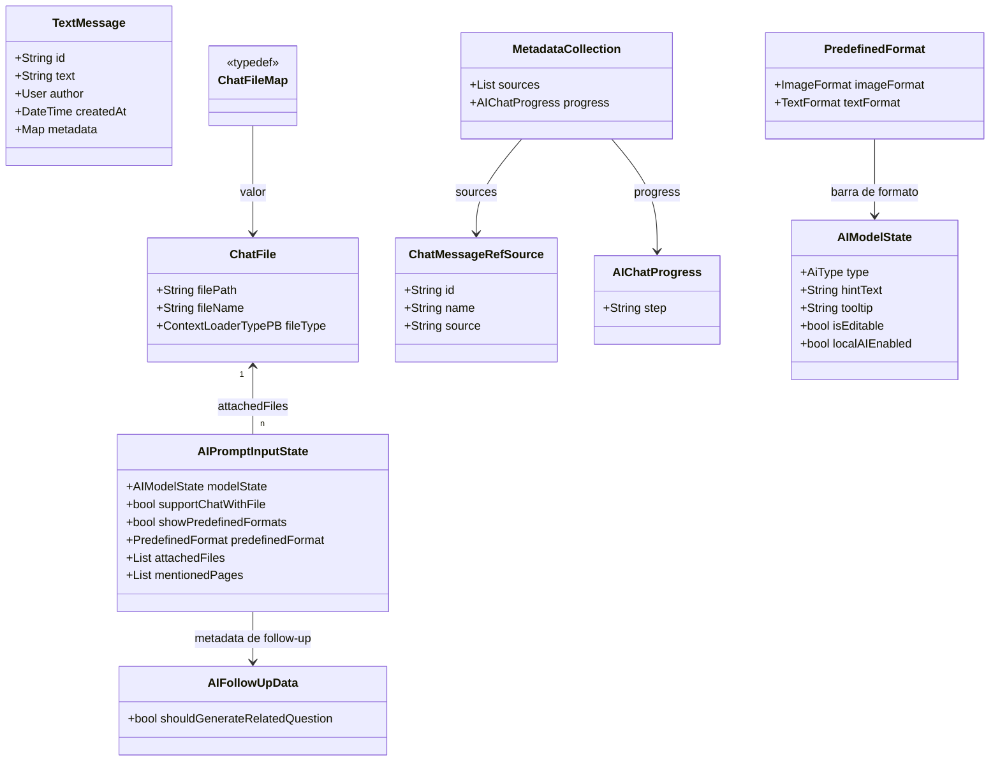
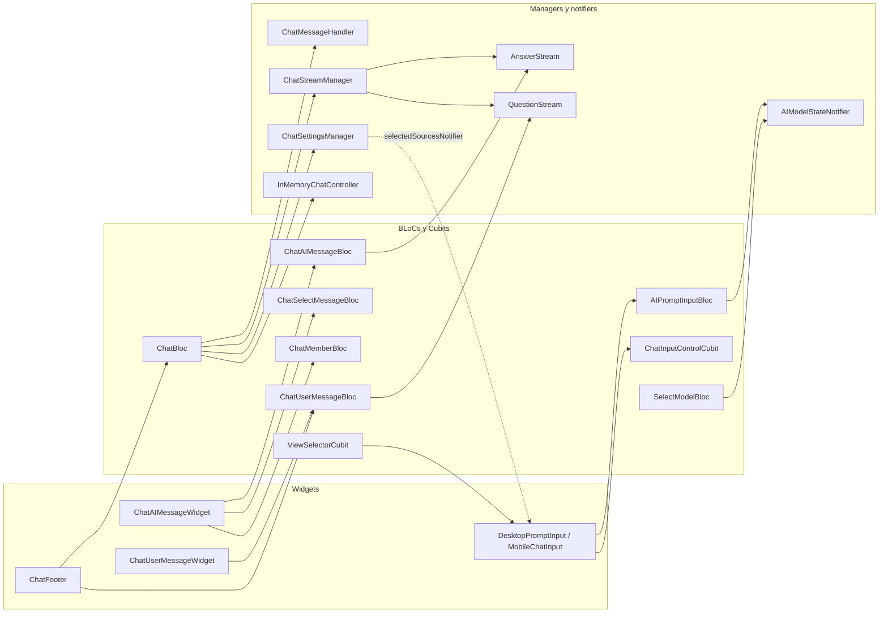
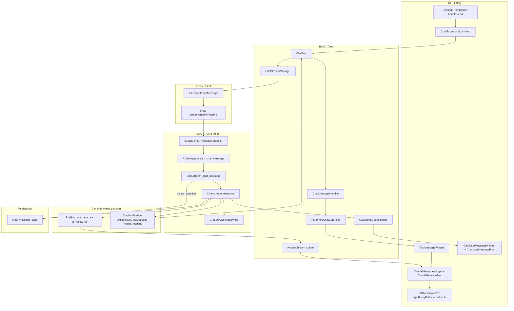
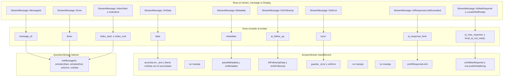
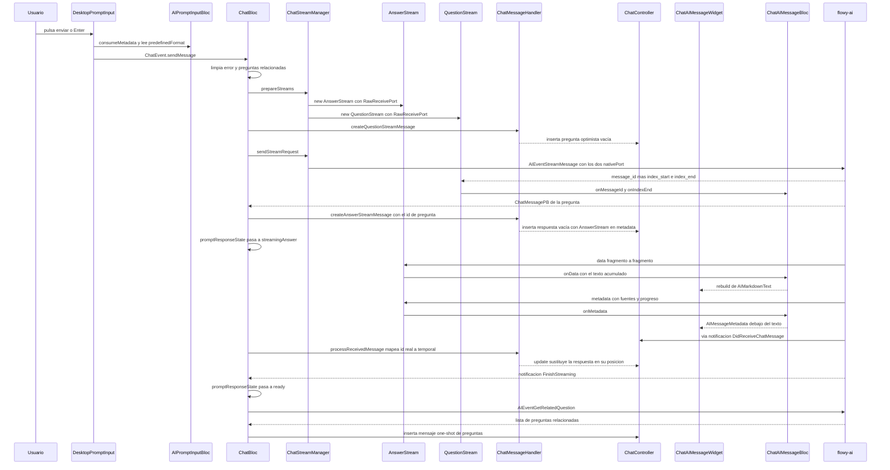
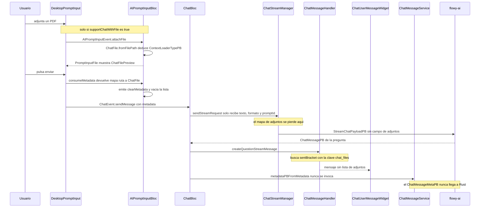
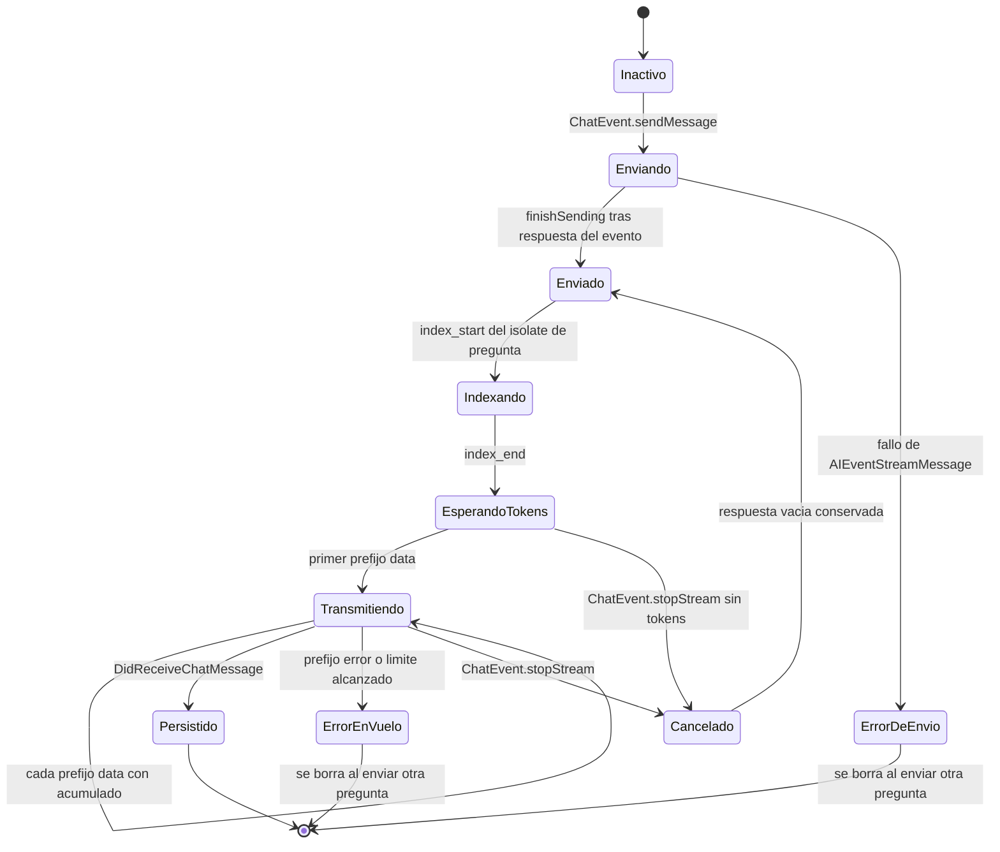

# F09.3 — IA: `appflowy_flutter/lib/ai` + `plugins/ai_chat` (Dart)

## 1. Resumen

Este documento cubre la capa Dart completa del subsistema de IA de AppFlowy: 82 ficheros, 16.514 líneas, repartidos entre la biblioteca compartida `lib/ai/` (servicio de IA, estado de modelo, prompts, selección de fuentes y widgets del prompt) y el plugin `plugins/ai_chat/` (la vista de chat completa: lista, editor de mensajes, streaming token a token, adjuntos, miembros y preguntas relacionadas). Es la contraparte Dart de `[[../../09-features/F09-ia/1-ia-flowy-ai-rust.md]]`: aquí se invocan 15 de los 25 eventos `AIEvent` y se consumen 8 de las 10 variantes de `ChatNotification`. El punto de entrada de la UI es `AIChatPage`, que crea el `ChatBloc`, el `AIPromptInputBloc` y el `ChatMemberBloc`, y los entrega a un `ChatController` de `flutter_chat_core` que actúa como lista observable de mensajes. El streaming no usa el puerto nativo del servicio de completion sino dos isolates propios, `AnswerStream` y `QuestionStream`, cuyo protocolo de prefijos de texto es el que se documenta en §3 y §5.

## 2. Alcance

**Dentro de esta unidad.** La capa de widgets del servicio compartido (`lib/ai/widgets/**`, 22 ficheros), sus nueve BLoCs y servicios (`lib/ai/service/**`) más el barril `ai.dart`, y el plugin de chat completo (`plugins/ai_chat/**`, 50 ficheros: 20 en `application/`, 28 en `presentation/` y los dos raíces `chat.dart` y `chat_page.dart`). Entran los ficheros no-BLoC que sostienen el estado del chat —`ChatMessageHandler`, `ChatStreamManager`, `ChatSettingsManager`, `ChatMessageHeightManager`, `ChatEditDocumentService` y los cuatro listeners— porque son los equivalentes funcionales de lo que en Rust son `Chat` y `AIManager`, y sin ellos el recorrido de un mensaje no se puede explicar.

**Fuera de esta unidad.** La implementación Rust del crate `flowy-ai` (25 handlers, `Chat`, `AIManager`, middleware local/nube, `LocalAIController`) está en `[[../../09-features/F09-ia/1-ia-flowy-ai-rust.md]]`; aquí solo se documenta el contrato que Dart envía y recibe. El almacén vectorial de embeddings es `[[../../09-features/F09-ia/2-ia-flowy-sqlite-vec-vectores.md]]`. La capa de IA *dentro del editor de documentos* (`editor_plugins/ai`), que es el único consumidor real de `AppFlowyAIService` y de `AIEvent::CompleteText`, es `[[../../09-features/F09-ia/4-ia-editor-plugins-ai.md]]`. La página de ajustes de IA —donde vive `LocalAIStateListener`, el consumidor de dos notificaciones que esta unidad no maneja— es `[[../../09-features/F13-ajustes-apariencia-temas-fuentes/2-apariencia-ia-miembros-feature-flags-y-theme-upload.md]]`. El índice de la feature es `[[../../09-features/F09-ia/0-indice-ia-chat-completion-ia-local-mcp-embeddings-middleware.md]]`.

**Una advertencia de alcance que condiciona todo el documento.** La función de adjuntar ficheros por mensaje está implementada de extremo a extremo en el código Dart pero **está deshabilitada por un `false` literal** y, aunque se habilitara, el camino se corta en la frontera FFI. La prueba literal del recorrido con adjunto de §10 documenta ese recorrido *tal como está escrito en el código*, marcando con `Note` dónde se interrumpe. El mecanismo de contexto que sí funciona en producción no es el adjunto por mensaje sino el conjunto de fuentes RAG a nivel de chat (§8).

## 3. Modelos de datos

El modelo de mensajes en Dart es mínimo: `flutter_chat_core` aporta una única clase, `TextMessage`, con campos `id`, `text`, `author`, `createdAt` y un `metadata` libre (`Map<String, dynamic>`). Toda la semántica de dominio —tipo de mensaje, ficheros adjuntos, referencias, id de pregunta, identificadores deisolate— se codifica **como claves dentro de ese `metadata`**, lo que convierte al `metadata` en un bus de protocolo no tipado.

Muestra: los tipos de datos propios de la unidad y sus relaciones, con los tipos de `flutter_chat_core` explicitados sin genéricos.



Lectura: `ChatFile` es el único tipo de la unidad con identidad estable (`Equatable` compara por `filePath`, `appflowy/frontend/appflowy_flutter/lib/plugins/ai_chat/application/chat_entity.dart:108–109`) y con construcción desde disco, que decide el `ContextLoaderTypePB` según la extensión (`appflowy/frontend/appflowy_flutter/lib/plugins/ai_chat/application/chat_entity.dart:73–102`). `MetadataCollection` es un par VALUE-tipo-contenedor: `sources` son las referencias que el modelo usó y `progress` es el texto del paso en curso, y ambos salen del mismo JSON emitido por Rust con el prefijo `metadata:`. `AIModelState` es el único modelo con comportamiento (los getters `isEditable`/`localAIEnabled` gobiernan el hint y la editabilidad del campo de texto) y se calcula en `AIModelStateNotifier._computeState`, que devuelve siempre el estado por defecto en móvil (`appflowy/frontend/appflowy_flutter/lib/ai/service/ai_model_state_notifier.dart:176–207`).

**El `metadata` de `TextMessage` y sus claves.** Estas cinco constantes son el contrato no tipado entre Rust, `ChatMessageHandler` y los widgets; todas están en `appflowy/frontend/appflowy_flutter/lib/plugins/ai_chat/application/chat_entity.dart:13–23`:

| Clave | Tipo de valor | Quién la escribe | Quién la lee | Significado |
|---|---|---|---|---|
| `"ref_source_json_string"` | `String` (JSON) | `ChatMessageHandler.createTextMessage` (`appflowy/frontend/appflowy_flutter/lib/plugins/ai_chat/application/chat_message_handler.dart:58–60`) | `ChatAIMessageWidget` vía `refSourceJsonString` (`appflowy/frontend/appflowy_flutter/lib/plugins/ai_chat/presentation/chat_page/text_message_widget.dart:91–92`) y `ChatUserMessageWidget._getFiles` | Fuentes de referencia del mensaje: en un mensaje **recibido**, las citas del modelo; en uno **optimista**, los adjuntos |
| `"chat_files"` | `List<ChatFile>` | `ChatMessageHandler.createQuestionStreamMessage` (`appflowy/frontend/appflowy_flutter/lib/plugins/ai_chat/application/chat_message_handler.dart:100–101`) | `ChatUserMessageWidget._getFiles` (`appflowy/frontend/appflowy_flutter/lib/plugins/ai_chat/presentation/message/user_text_message.dart:61–63`) | Adjuntos mostrados en la burbuja optimista del usuario |
| `"question_id"` | `Int64` | `ChatMessageHandler.createAnswerStreamMessage` (`appflowy/frontend/appflowy_flutter/lib/plugins/ai_chat/application/chat_message_handler.dart:80`) | `TextMessageWidget` → `ChatAIMessageBloc.questionId` (`appflowy/frontend/appflowy_flutter/lib/plugins/ai_chat/presentation/message/ai_text_message.dart:73–76`) | Id real del mensaje de pregunta al que responde este mensaje |
| `"OnetimeShotType"` | `OnetimeShotType` | `ChatBloc._handleRelatedQuestions` y `_startStreamingMessage` (`appflowy/frontend/appflowy_flutter/lib/plugins/ai_chat/application/chat_bloc.dart:293–305`, `:486–489`) | `TextMessageWidget.build` (`appflowy/frontend/appflowy_flutter/lib/plugins/ai_chat/presentation/chat_page/text_message_widget.dart:38–46`) | Marca mensajes efímeros de error y de preguntas relacionadas |
| `"errorMessageText"` | `String` | `ChatBloc._startStreamingMessage` (`appflowy/frontend/appflowy_flutter/lib/plugins/ai_chat/application/chat_bloc.dart:488`) | `TextMessageWidget` (`appflowy/frontend/appflowy_flutter/lib/plugins/ai_chat/presentation/chat_page/text_message_widget.dart:44`) | Texto de error mostrable, ausente si el código de error es `Internal` |
| `"$AnswerStream"` | `AnswerStream` | `createAnswerStreamMessage` (`appflowy/frontend/appflowy_flutter/lib/plugins/ai_chat/application/chat_message_handler.dart:79`) | `ChatAIMessageWidget.stream` (`appflowy/frontend/appflowy_flutter/lib/plugins/ai_chat/presentation/chat_page/text_message_widget.dart:89`) | Enganche del isolate de respuesta mientras dura el streaming |
| `"$QuestionStream"` | `QuestionStream` | `createQuestionStreamMessage` (`appflowy/frontend/appflowy_flutter/lib/plugins/ai_chat/application/chat_message_handler.dart:98`) | `ChatUserMessageWidget` (`appflowy/frontend/appflowy_flutter/lib/plugins/ai_chat/presentation/message/user_text_message.dart:25–26`) | Enganche del isolate de pregunta (id del mensaje, indexado de ficheros) |
| `"chatId"` | `String` | ambos creadores de mensaje de stream (`appflowy/frontend/appflowy_flutter/lib/plugins/ai_chat/application/chat_message_handler.dart:81`, `:99`) | — | Copia del `chatId` en el mensaje; hoy ningún widget la lee |

El identificador de autor funciona como discriminador de tipo de mensaje sin enum propio: `"0"` es la respuesta de la IA (`aiResponseUserId`), `"system"` son los mensajes del sistema como errores y preguntas relacionadas (`systemUserId`), y el prefijo `"streamId:"` marca mensajes de streaming cuyo autor no existe todavía (`appflowy/frontend/appflowy_flutter/lib/plugins/ai_chat/application/chat_bloc.dart:613–617` y `appflowy/frontend/appflowy_flutter/lib/plugins/ai_chat/application/chat_select_message_bloc.dart:77–81`). Las dos funciones son lógicas inversas entre sí, lo que confirma que el prefijo es la convención real de clasificación.

**Los tipos de mensaje del chat y su ciclo de vida en Dart.** Los mensajes no tienen una clase por tipo: el tipo se deduce del autor y de las claves de `metadata`, y cada uno tiene un ciclo distinto. La tabla siguiente es la prueba literal de esa clasificación.

| Tipo de mensaje | Cómo se identifica | Quién lo crea | BLoC que lo consume | Ciclo de vida en Dart | Desaparece cuando |
|---|---|---|---|---|---|
| Pregunta del usuario (persistente) | `author.id == userId` o `isOtherUserMessage`, sin claves de un solo uso | `ChatMessageHandler.createTextMessage` desde `DidReceiveChatMessage` | `ChatUserMessageWidget` → `ChatUserMessageBloc` | Texto ya completo desde el servidor; si trae `QuestionStream` se muestra el texto acumulado del isolate | Nunca dentro de la sesión; se borra solo si es `deleteMessage` |
| Pregunta del usuario (optimista) | `author.id == userId`, `metadata` con `"$QuestionStream"`, id = timestamp Unix | `ChatMessageHandler.createQuestionStreamMessage` (`appflowy/frontend/appflowy_flutter/lib/plugins/ai_chat/application/chat_message_handler.dart:88–107`) | `ChatUserMessageWidget` → `ChatUserMessageBloc` (`appflowy/frontend/appflowy_flutter/lib/plugins/ai_chat/application/chat_user_message_bloc.dart:39–93`) | El isolate emite `index_start:`→`index_end:`→`done:`; `QuestionMessageState` pasa por `indexStart`, `indexEnd` y `finish`; la opacidad baja a 0.8 mientras no esté en `finish` (`appflowy/frontend/appflowy_flutter/lib/plugins/ai_chat/presentation/message/user_text_message.dart:38–43`) | Cuando llega `DidReceiveChatMessage`, `_temporaryMessageIDMap` mapea el id real al id temporal y `ChatController.update` lo sustituye en el sitio (`appflowy/frontend/appflowy_flutter/lib/plugins/ai_chat/application/chat_bloc.dart:197–205`) |
| Respuesta de la IA (streaming) | `author.id` empieza por `"streamId:"`, `metadata` con `"$AnswerStream"`, id = `<idPregunta>_ans` o `questionMessageId + 1` | `ChatMessageHandler.createAnswerStreamMessage` (`appflowy/frontend/appflowy_flutter/lib/plugins/ai_chat/application/chat_message_handler.dart:65–85`) | `ChatAIMessageWidget` → `ChatAIMessageBloc` | `AnswerStream` acumula el texto completo en `_text` y entrega el acumulado en cada `data:`; `ChatAIMessageState.messageState` va de `ready` a `loading` solo en el reintento, y el render usa `AIMarkdownText` con animación incremental mientras `stream != null` (`appflowy/frontend/appflowy_flutter/lib/plugins/ai_chat/presentation/message/ai_text_message.dart:279–285`) | Al llegar `DidReceiveChatMessage` con `authorType == 3`, `processReceivedMessage` registra el id real en `_temporaryMessageIDMap` y lo sustituye (`appflowy/frontend/appflowy_flutter/lib/plugins/ai_chat/application/chat_message_handler.dart:152–160`) |
| Respuesta de la IA (persistente) | `author.id == "0"`, `metadata["ref_source_json_string"]` con las citas | `createTextMessage` desde `DidReceiveChatMessage` | `ChatAIMessageWidget` sin stream | `MessageState.ready` con el texto del servidor; muestra `AIMessageMetadata` solo si `state.sources.isNotEmpty` (`appflowy/frontend/appflowy_flutter/lib/plugins/ai_chat/presentation/message/ai_text_message.dart:286–292`) | No se borra automáticamente; `ChatAIMessageWidget._handleMessageState` lo elimina si el stream insular dejó error (`appflowy/frontend/appflowy_flutter/lib/plugins/ai_chat/presentation/message/ai_text_message.dart:200`) |
| Error de envío | `metadata[OnetimeShotType] == error`, `author.id == "system"`, id = `"system"` | `ChatBloc._startStreamingMessage` rama de fallo (`appflowy/frontend/appflowy_flutter/lib/plugins/ai_chat/application/chat_bloc.dart:491–497`) | `ChatErrorMessageWidget` | Instantáneo: se borra al enviar el siguiente mensaje | `ChatMessageHandler.clearErrorMessages` (`appflowy/frontend/appflowy_flutter/lib/plugins/ai_chat/application/chat_message_handler.dart:110–122`) |
| Preguntas relacionadas | `metadata[OnetimeShotType] == relatedQuestion`, `metadata["questions"]`, id = `"related_question_<fecha>"`, autor `"system"`, texto vacío | `ChatBloc._handleRelatedQuestions` (`appflowy/frontend/appflowy_flutter/lib/plugins/ai_chat/application/chat_bloc.dart:299–307`) | `RelatedQuestionList` | Instantáneo: al pulsar una pregunta se envía como `ChatEvent.sendMessage` y el mensaje desaparece del hilo | `ChatMessageHandler.clearRelatedQuestions` (`appflowy/frontend/appflowy_flutter/lib/plugins/ai_chat/application/chat_message_handler.dart:125–137`) |
| Marcador de carga de respuesta | Respuesta con `metadata["$AnswerStream"]` y `state.text.isEmpty` | el mismo `createAnswerStreamMessage` | `_LoadingMessage` con `AILoadingIndicator` | Existe entre `sendMessage` y el primer `data:` | Se sustituye solo cuando llega el primer fragmento de texto |

El ciclo combinado de pregunta+respuesta para un mismo envío está en el diagrama de estado de §11.

## 4. Eventos FFI

Los eventos dispatched desde Dart son los que Rust registra en `appflowy/frontend/rust-lib/flowy-ai/src/event_map.rs`; la tabla del enum completo (25 variantes) está en `[[../../09-features/F09-ia/1-ia-flowy-ai-rust.md]] §4` y aquí se listan solo los que esta unidad emite, con el punto de invocación exacto. Todos pasan por el código generado de `appflowy_backend/dispatch`, con el patrón `AIEventX(payload).send()` seguido de `.fold(onSuccess, onError)`.

| Evento `AIEvent` | Índice | Input PB | Output PB | Handler Rust | Fichero Dart que lo emite | Línea Dart |
|---|---|---|---|---|---|---|
| `LoadNextMessage` | 1 | `LoadNextChatMessagePB` | `ChatMessageListPB` | `load_next_message_handler` | `ChatBloc._loadMessages` | `appflowy/frontend/appflowy_flutter/lib/plugins/ai_chat/application/chat_bloc.dart:411` |
| `LoadPrevMessage` | 0 | `LoadPrevChatMessagePB` | `ChatMessageListPB` | `load_prev_message_handler` | `ChatBloc._loadPreviousMessages` | `appflowy/frontend/appflowy_flutter/lib/plugins/ai_chat/application/chat_bloc.dart:447` |
| `StreamMessage` | 2 | `StreamChatPayloadPB` | `ChatMessagePB` | `stream_chat_message_handler` | `ChatStreamManager.sendStreamRequest` | `appflowy/frontend/appflowy_flutter/lib/plugins/ai_chat/application/chat_stream_manager.dart:68` |
| `StopStream` | 3 | `StopStreamPB` | — | `stop_stream_handler` | `ChatStreamManager.stopStream` | `appflowy/frontend/appflowy_flutter/lib/plugins/ai_chat/application/chat_stream_manager.dart:111` |
| `RegenerateResponse` | 27 | `RegenerateResponsePB` | — | `regenerate_response_handler` | `ChatStreamManager.sendRegenerateRequest` | `appflowy/frontend/appflowy_flutter/lib/plugins/ai_chat/application/chat_stream_manager.dart:101` |
| `GetRelatedQuestion` | 4 | `ChatMessageIdPB` | `RepeatedRelatedQuestionPB` | `get_related_question_handler` | `ChatBloc._fetchRelatedQuestionsIfNeeded` | `appflowy/frontend/appflowy_flutter/lib/plugins/ai_chat/application/chat_bloc.dart:373` |
| `GetAnswerForQuestion` | 5 | `ChatMessageIdPB` | `ChatMessagePB` | `get_answer_handler` | `ChatAIMessageBloc` evento `_Retry` | `appflowy/frontend/appflowy_flutter/lib/plugins/ai_chat/application/chat_ai_message_bloc.dart:58` |
| `GetChatSettings` | 25 | `ChatId` | `ChatSettingsPB` | `get_chat_settings_handler` | `ChatBloc._loadSettings` y `ChatSettingsManager.loadSettings` | `appflowy/frontend/appflowy_flutter/lib/plugins/ai_chat/application/chat_bloc.dart:393` · `appflowy/frontend/appflowy_flutter/lib/plugins/ai_chat/application/chat_settings_manager.dart:20` |
| `UpdateChatSettings` | 26 | `UpdateChatSettingsPB` | — | `update_chat_settings_handler` | `ChatSettingsManager.updateSelectedSources` | `appflowy/frontend/appflowy_flutter/lib/plugins/ai_chat/application/chat_settings_manager.dart:41` |
| `GetSourceModelSelection` | 34 | `ModelSourcePB` | `ModelSelectionPB` | `get_source_model_selection_handler` | `AIModelStateNotifier._loadModelSelection` | `appflowy/frontend/appflowy_flutter/lib/ai/service/ai_model_state_notifier.dart:148` |
| `UpdateSelectedModel` | 32 | `UpdateSelectedModelPB` | — | `update_selected_model_handler` | `SelectModelBloc` evento `selectModel` | `appflowy/frontend/appflowy_flutter/lib/ai/service/select_model_bloc.dart:20` |
| `GetLocalAIState` | 19 | — | `LocalAIPB` | `get_local_ai_state_handler` | `AIModelStateNotifier._loadLocalState` | `appflowy/frontend/appflowy_flutter/lib/ai/service/ai_model_state_notifier.dart:161` |
| `GetCustomPromptDatabaseConfiguration` | 35 | — | `CustomPromptDatabaseConfigurationPB` | `get_custom_prompt_database_configuration_handler` | `AiPromptSelectorCubit.loadCustomPrompts` | `appflowy/frontend/appflowy_flutter/lib/ai/service/ai_prompt_selector_cubit.dart:71` |
| `SetCustomPromptDatabaseConfiguration` | 36 | `CustomPromptDatabaseConfigurationPB` | — | `set_custom_prompt_database_configuration_handler` | `AiPromptSelectorCubit.updateCustomPromptDatabaseConfiguration` | `appflowy/frontend/appflowy_flutter/lib/ai/service/ai_prompt_selector_cubit.dart:285` |
| `CompleteText` | 9 | `CompleteTextPB` | `CompleteTextTaskPB` | `start_complete_text_handler` | `AppFlowyAIService.streamCompletion` | `appflowy/frontend/appflowy_flutter/lib/ai/service/appflowy_ai_service.dart:97` |

**Eventos de otros crates emitidos desde esta unidad.** Además de `flowy-ai`, hay cinco llamadas FFI a crates ajenos que forman parte de los recorridos descritos más adelante:

| Evento | Input PB | Output PB | Fichero Dart que lo emite | Línea |
|---|---|---|---|---|
| `DatabaseEventGetDatabaseCustomPrompts` | `CustomPromptDatabaseConfigPB` | lista de `CustomPromptPB` | `appflowy/frontend/appflowy_flutter/lib/ai/service/appflowy_ai_service.dart` | `:133` |
| `DatabaseEventTestCustomPromptDatabaseConfiguration` | `DatabaseViewIdPB` | `CustomPromptDatabaseConfigPB` | `appflowy/frontend/appflowy_flutter/lib/ai/service/ai_prompt_database_selector_cubit.dart` | `:142` |
| `DocumentEventGetDocumentText` | `OpenDocumentPayloadPB` | texto plano | `appflowy/frontend/appflowy_flutter/lib/plugins/ai_chat/application/chat_message_service.dart` | `:134` |
| `UserEventGetMemberInfo` | `WorkspaceMemberIdPB` | `WorkspaceMemberPB` | `appflowy/frontend/appflowy_flutter/lib/plugins/ai_chat/application/chat_member_bloc.dart` | `:31` |
| `FolderEventCloseView` | `ViewIdPB` | — | `appflowy/frontend/appflowy_flutter/lib/plugins/ai_chat/application/chat_bloc.dart` | `:82` |

**El payload de streaming y sus siete campos.** `ChatStreamManager.buildStreamPayload` construye el `StreamChatPayloadPB` con exactamente siete valores y ningún campo de metadatos (`appflowy/frontend/appflowy_flutter/lib/plugins/ai_chat/application/chat_stream_manager.dart:37–59`):

```dart
// appflowy/frontend/appflowy_flutter/lib/plugins/ai_chat/application/chat_stream_manager.dart:42–58
final payload = StreamChatPayloadPB(
  chatId: chatId,
  message: message,
  messageType: ChatMessageTypePB.User,
  questionStreamPort: Int64(questionStream!.nativePort),
  answerStreamPort: Int64(answerStream!.nativePort),
);

if (format != null) {
  payload.format = format.toPB();
}

if (promptId != null) {
  payload.promptId = promptId;
}
```

El enum Rust `StreamChatPayloadPB` confirma la ausencia de un campo de adjuntos: sus siete índices son `chat_id`, `message`, `message_type`, `answer_stream_port`, `question_stream_port`, `format` y `prompt_id` (`appflowy/frontend/rust-lib/flowy-ai/src/entities.rs:53–75`), y el handler los desestructura uno a uno y los copia a `StreamMessageParams` sin dejar ningún campo sin mapear (`appflowy/frontend/rust-lib/flowy-ai/src/event_handler.rs:29–53`). Esto es la causa estructural del hallazgo de §13 sobre adjuntos.

## 5. Notificaciones

Las diez variantes de `ChatNotification` están definidas en `appflowy/frontend/rust-lib/flowy-ai/src/notification.rs:8–20` y su tabla de emisión está en `[[../../09-features/F09-ia/1-ia-flowy-ai-rust.md]] §5`; aquí lo que se prueba es el **lado Dart**: qué listener escucha cada variante y qué efecto produce. El enum tiene dos subtypes de consumidor en Dart, ambos construidos sobre el mismo `ChatNotificationParser`, que filtra por `source == "Chat"` y se suscribe al `RustStreamReceiver` global (`appflowy/frontend/appflowy_flutter/lib/plugins/ai_chat/application/chat_notification.dart:11–21`).

| # | Variante | Listener Dart en esta unidad | Fichero:línea del `case` | Efecto en la UI | Fichero que lo consume |
|---|---|---|---|---|---|
| 0 | `Unknown` | **ninguno** — valor por defecto del derive Rust | — | Ninguno; existe solo como discriminante 0 | — |
| 1 | `DidLoadLatestChatMessage` | `ChatMessageListener._callback` | `appflowy/frontend/appflowy_flutter/lib/plugins/ai_chat/application/chat_message_listener.dart:62` | Convierte la lista a `Message` y dispara `ChatEvent.didLoadLatestMessages` | `appflowy/frontend/appflowy_flutter/lib/plugins/ai_chat/application/chat_bloc.dart:333–339` |
| 2 | `DidLoadPrevChatMessage` | `ChatMessageListener._callback` | `appflowy/frontend/appflowy_flutter/lib/plugins/ai_chat/application/chat_message_listener.dart:65` | Inserta la página anterior al inicio del hilo con `didLoadPreviousMessages(messages, list.hasMore)` | `appflowy/frontend/appflowy_flutter/lib/plugins/ai_chat/application/chat_bloc.dart:340–346` |
| 3 | `DidReceiveChatMessage` | `ChatMessageListener._callback` | `appflowy/frontend/appflowy_flutter/lib/plugins/ai_chat/application/chat_message_listener.dart:56` | Registra el id real↔temporal y hace `insert` o `update` del mensaje | `appflowy/frontend/appflowy_flutter/lib/plugins/ai_chat/application/chat_bloc.dart:317–326` |
| 4 | `StreamChatMessageError` | `ChatMessageListener._callback` | `appflowy/frontend/appflowy_flutter/lib/plugins/ai_chat/application/chat_message_listener.dart:59` | Log del error y cierre del streaming con `didFinishAnswerStream` | `appflowy/frontend/appflowy_flutter/lib/plugins/ai_chat/application/chat_bloc.dart:327–332` |
| 5 | `FinishStreaming` | `ChatMessageListener._callback` | `appflowy/frontend/appflowy_flutter/lib/plugins/ai_chat/application/chat_message_listener.dart:68` | Vuelve a `PromptResponseState.ready` y pide las preguntas relacionadas | `appflowy/frontend/appflowy_flutter/lib/plugins/ai_chat/application/chat_bloc.dart:347–354` |
| 6 | `UpdateLocalAIState` | **fuera de la unidad**: `LocalAIStateListener` | `appflowy/frontend/appflowy_flutter/lib/workspace/application/settings/ai/local_llm_listener.dart:43` | Emite `LocalAIPB` a `AIModelStateNotifier`, que recalcula `AIModelState` (hint, tooltip, `isEditable`) | `appflowy/frontend/appflowy_flutter/lib/ai/service/ai_model_state_notifier.dart:69–74` |
| 7 | `DidUpdateChatSettings` | **sin uso** — ningún `case` en `lib/` | — | Ninguno; la UI ya conoce el nuevo conjunto de fuentes por el valor de retorno de `UpdateChatSettings` | — |
| 8 | `LocalAIResourceUpdated` | **fuera de la unidad**: `LocalAIStateListener` | `appflowy/frontend/appflowy_flutter/lib/workspace/application/settings/ai/local_llm_listener.dart:46` | Emite `LackOfAIResourcePB`; en esta unidad solo se usa el callback de estado, no el de recursos | — |
| 9 | `DidUpdateSelectedModel` | `AIModelSwitchListener._callback` | `appflowy/frontend/appflowy_flutter/lib/plugins/ai_chat/application/ai_model_switch_listener.dart:40` | Sustituye `_selectedModel`, avisa a los listeners y recarga el estado local si el modelo nuevo es local | `appflowy/frontend/appflowy_flutter/lib/ai/service/ai_model_state_notifier.dart:77–86` |

Lectura: de las diez variantes, **ocho** tienen un `case` en Dart —seis dentro de esta unidad y dos en `lib/workspace/application/settings/ai/`— y dos no lo tienen por motivos distintos. `Unknown` es el valor por defecto y no representa un evento. `DidUpdateChatSettings` se emite desde `refresh_chat_setting` pero nadie la escucha; el efecto real llega por el retorno del evento FFI, porque `ChatSettingsManager.updateSelectedSources` actualiza su `ValueNotifier` antes de enviar la petición (`appflowy/frontend/appflowy_flutter/lib/plugins/ai_chat/application/chat_settings_manager.dart:33–42`). Y `UpdateLocalAIState`/`LocalAIResourceUpdated` se escuchan desde `lib/workspace/application/settings/ai/`, no desde el plugin de chat, pero su valor llega a esta unidad a través de `AIModelStateNotifier`, que es el consumidor final. Los tres listeners Dart se distinguen por el `id` con el que se suscriben: `chatId` para `ChatMessageListener`, `objectId` (el `chat_id` o `"global_active_model"`) para `AIModelSwitchListener` y la constante literal `"appflowy_ai_plugin"` para `LocalAIStateListener` (`appflowy/frontend/appflowy_flutter/lib/workspace/application/settings/ai/local_llm_listener.dart:16–17`).

**Clase auxiliar sin uso.** `ChatNotificationListener` (`appflowy/frontend/appflowy_flutter/lib/plugins/ai_chat/application/chat_notification.dart:28–45`) es un listener genérico con typedef propio que nadie instancia: `rg` sobre `lib/`, `test/` e `integration_test/` solo encuentra su propia definición. Los tres listeners reales replican su mismo patrón de tres líneas, lo que indica que la clase quedó como esqueleto de una abstracción que se preferido duplicar por ergonomicidad.

## 6. BLoCs / Cubits

La tabla siguiente es el filtrado literal de `OUT/_ledger/extract/blocs.json` por los ficheros de esta unidad: trece clases, todas en la columna `service` de `lib/ai` o en `application` de `plugins/ai_chat`. Las líneas de la columna `línea` son las declaraciones reales en el fichero, no las del catálogo, que va desplazado una unidad por usar numeración base cero.

| # | Clase | Tipo | Fichero:línea | Eventos | Estados | Servicios / colaboradores |
|---|---|---|---|---|---|---|
| 1 | `AiPromptDatabaseSelectorCubit` | Cubit | `appflowy/frontend/appflowy_flutter/lib/ai/service/ai_prompt_database_selector_cubit.dart:11` | — (métodos `selectDatabaseView`, `selectContentField`, `selectExampleField`, `selectCategoryField`) | `AiPromptDatabaseSelectorState`: `loading`, `empty`, `selected`, `invalidDatabase` | `FieldBackendService.getFields`, `DatabaseEventTestCustomPromptDatabaseConfiguration`, `AiPromptSelectorCubit.getDatabaseView` |
| 2 | `AIPromptInputBloc` | Bloc | `appflowy/frontend/appflowy_flutter/lib/ai/service/ai_prompt_input_bloc.dart:13` | `updateAIState`, `toggleShowPredefinedFormat`, `updatePredefinedFormat`, `attachFile`, `removeFile`, `updateMentionedViews`, `clearMetadata`, `updatePromptId` | `AIPromptInputState`: `modelState`, `supportChatWithFile`, `showPredefinedFormats`, `predefinedFormat`, `attachedFiles`, `mentionedPages` | `AIModelStateNotifier` (propio, creado en el constructor) |
| 3 | `AiPromptSelectorCubit` | Cubit | `appflowy/frontend/appflowy_flutter/lib/ai/service/ai_prompt_selector_cubit.dart:19` | — (métodos `selectCustomSection`, `selectFeaturedSection`, `selectCategory`, `selectPrompt`, `toggleFavorite`, `reset`, `loadCustomPrompts`, `updateCustomPromptDatabaseConfiguration`) | `AiPromptSelectorState`: `loading`, `invalidDatabase`, `ready` | `AppFlowyAIService` (instanciado directamente), `ViewBackendService.getView`, `TrashService.readTrash`, `AIEventGetCustomPromptDatabaseConfiguration`, `AIEventSetCustomPromptDatabaseConfiguration` |
| 4 | `SelectModelBloc` | Bloc | `appflowy/frontend/appflowy_flutter/lib/ai/service/select_model_bloc.dart:11` | `selectModel`, `didLoadModels` | `SelectModelState`: `models`, `selectedModel` | `AIModelStateNotifier` (inyectado), `AIEventUpdateSelectedModel` |
| 5 | `ViewSelectorCubit` | Cubit | `appflowy/frontend/appflowy_flutter/lib/ai/service/view_selector_cubit.dart:103` | — (métodos `refreshSources`, `toggleSelectedStatus`, `toggleIsExpanded`, `onFilterChanged`, `updateSelectedStatus`) | `ViewSelectorState`: `visibleSources`, `selectedSources` | `ViewBackendService.getChildViews` |
| 6 | `ChatAIMessageBloc` | Bloc | `appflowy/frontend/appflowy_flutter/lib/plugins/ai_chat/application/chat_ai_message_bloc.dart:14` | `updateText`, `receiveError`, `retry`, `retryResult`, `onAIResponseLimit`, `onAIImageResponseLimit`, `onAIMaxRequired`, `onLocalAIInitializing`, `receiveMetadata`, `onAIFollowUp` | `ChatAIMessageState`: `stream`, `text`, `messageState`, `sources`, `progress` | `AnswerStream` (injected en el mensaje), `parseMetadata`, `AIEventGetAnswerForQuestion` |
| 7 | `ChatBloc` | Bloc | `appflowy/frontend/appflowy_flutter/lib/plugins/ai_chat/application/chat_bloc.dart:31` | `didReceiveChatSettings`, `updateSelectedSources`, `sendMessage`, `finishSending`, `failedSending`, `regenerateAnswer`, `stopStream`, `didFinishAnswerStream`, `receiveMessage`, `didLoadLatestMessages`, `loadPreviousMessages`, `didLoadPreviousMessages`, `didReceiveRelatedQuestions`, `deleteMessage`, `onAIFollowUp` | `ChatState`: `loadingState`, `promptResponseState`, `clearErrorMessages` | `InMemoryChatController`, `ChatMessageListener`, `ChatMessageHandler`, `ChatStreamManager`, `ChatSettingsManager`, 7 eventos `AIEvent`, `FolderEventCloseView` |
| 8 | `ChatInputControlCubit` | Cubit | `appflowy/frontend/appflowy_flutter/lib/plugins/ai_chat/application/chat_input_control_cubit.dart:15` | — (métodos `refreshViews`, `startSearching`, `updateFilter`, `updateInputText`, `updateSelectionUp`/`Down`, `selectPage`, `reset`, `formatIntputText`) | `ChatInputControlState`: `loading`, `ready`, `updateSelectedViews` (estado *one-shot*: emite el valor y vuelve a emitir el anterior) | `ViewBackendService.getAllViews` |
| 9 | `ChatInputFileBloc` | Bloc | `appflowy/frontend/appflowy_flutter/lib/plugins/ai_chat/application/chat_input_file_bloc.dart:7` | `updateUploadState` | `ChatInputFileState`: `uploadFileIndicator`; indicador `UploadFileIndicator`: `finish`, `uploading`, `error` | ninguno |
| 10 | `ChatMemberBloc` | Bloc | `appflowy/frontend/appflowy_flutter/lib/plugins/ai_chat/application/chat_member_bloc.dart:11` | `getMemberInfo`, `receiveMemberInfo` | `ChatMemberState`: `members` (`Map<String, ChatMember>`) | `UserEventGetMemberInfo` |
| 11 | `ChatSelectMessageBloc` | Bloc | `appflowy/frontend/appflowy_flutter/lib/plugins/ai_chat/application/chat_select_message_bloc.dart:9` | `enableStartSelectingMessages`, `toggleSelectingMessages`, `toggleSelectMessage`, `selectAllMessages`, `unselectAllMessages`, `reset` | `ChatSelectMessageState`: `isSelectingMessages`, `selectedMessages`, `enabled` | ninguno; recibe un `ViewPluginNotifier` para consultar el tipo de plugin |
| 12 | `ChatUserCubit` | Cubit | `appflowy/frontend/appflowy_flutter/lib/plugins/ai_chat/application/chat_user_cubit.dart:10` | — (`fetchUserProfile`, `refresh`) | `ChatUserState` jerárquico: `ChatUserLoadingState`, `ChatUserSuccessState`, `ChatUserFailureState` | `getIt<AuthService>().getUser` |
| 13 | `ChatUserMessageBloc` | Bloc | `appflowy/frontend/appflowy_flutter/lib/plugins/ai_chat/application/chat_user_message_bloc.dart:8` | `updateText`, `updateQuestionState`, `updateMessageId`, `receiveError` | `ChatUserMessageState`: `text`, `messageId`, `messageState`; `QuestionMessageState`: `indexFileStart`, `indexFileEnd`, `indexFileFail`, `indexStart`, `indexEnd`, `finish` | `QuestionStream` |

**Los no-BLoC que sostienen el mismo estado.** El extractor no los recoge porque no extienden `Bloc`, pero son tan parte del estado del chat como los trece anteriores; sin ellos el flujo de un mensaje no tiene explicación.

| Clase | Tipo | Fichero:línea | Estado que mantiene | Consumidor |
|---|---|---|---|---|
| `AIModelStateNotifier` | notifier con callbacks | `appflowy/frontend/appflowy_flutter/lib/ai/service/ai_model_state_notifier.dart:42` | Modelo activo, lista de modelos disponibles y estado del plugin local; notifica por callback | `AIPromptInputBloc`, `SelectModelBloc`, `ChatAIMessageBubble` (mobile) |
| `ChatMessageHandler` | factory de mensajes | `appflowy/frontend/appflowy_flutter/lib/plugins/ai_chat/application/chat_message_handler.dart:19` | Mapa `_temporaryMessageIDMap` id real ↔ id temporal y borrado de mensajes one-shot | `ChatBloc` |
| `ChatStreamManager` | gestor de isolates | `appflowy/frontend/appflowy_flutter/lib/plugins/ai_chat/application/chat_stream_manager.dart:13` | `AnswerStream` y `QuestionStream` vivos, y construcción de los tres payloads de red | `ChatBloc` |
| `ChatSettingsManager` | gestor + `ValueNotifier` | `appflowy/frontend/appflowy_flutter/lib/plugins/ai_chat/application/chat_settings_manager.dart:8` | `selectedSourcesNotifier`: fuentes RAG del chat | `ChatFooter`, selectores de fuentes |
| `ChatMessageHeightManager` | singleton con caché | `appflowy/frontend/appflowy_flutter/lib/plugins/ai_chat/application/chat_message_height_manager.dart:21` | Caché de alturas por `messageId` para calcular alturas mínimas | `ChatAnimatedList`, `ChatAIMessageWidget`, `TextMessageWidget` |
| `ChatEditDocumentService` | servicio estático | `appflowy/frontend/appflowy_flutter/lib/plugins/ai_chat/application/chat_edit_document_service.dart:16` | ninguno; convierte mensajes en documento | `AIMessageActionBar`, `ChatMessageSelectorBanner` |
| `ChatMessageListener` | listener de notificaciones | `appflowy/frontend/appflowy_flutter/lib/plugins/ai_chat/application/chat_message_listener.dart:18` | Suscripción a 5 variantes de `ChatNotification` | `ChatBloc` |
| `AIModelSwitchListener` | listener de notificaciones | `appflowy/frontend/appflowy_flutter/lib/plugins/ai_chat/application/ai_model_switch_listener.dart:14` | Suscripción a `DidUpdateSelectedModel` | `AIModelStateNotifier` |

Muestra: el grafo de dependencias entre BLoCs, notifier y managers que sostienen un mismo envío de mensaje.



Lectura: la dependencia es estrictamente descendente salvo por dos aristas de retorno. `AIModelStateNotifier` es el único nodo con dos clientes BLoC (`AIPromptInputBloc` y `SelectModelBloc`), y por eso expone una API de listeners en lugar de ser un Bloc: `addListener`/`removeListener` con dos callbacks separados para estado y para modelos (`appflowy/frontend/appflowy_flutter/lib/ai/service/ai_model_state_notifier.dart:98–121`). La arista `ChatBloc → InMemoryChatController` es de una sola dirección en el sentido de que el BLoC **escribe** en el controlador, pero la UI lo lee a través del `Provider` que `flutter_chat_ui` inyecta; por eso `LoadChatMessageStatusReady` recibe el `chatController` como parámetro y lo pasa al widget `Chat` (`appflowy/frontend/appflowy_flutter/lib/plugins/ai_chat/presentation/chat_page/load_chat_message_status_ready.dart:24`, `:58–60`). `ViewSelectorCubit` se dibuja como dependencia de los widgets y no del `ChatBloc`: se crea por widget (`appflowy/frontend/appflowy_flutter/lib/ai/widgets/view_selector.dart:8–39`) para el selector de fuentes y para el botón "guardar en página", y su estado nunca pasa por el bloc de chat.

## 7. Servicios e inyección de dependencias

Hay **un solo registro** de esta unidad en `get_it`, y es del servicio compartido de completion, no del chat:

```dart
// appflowy/frontend/appflowy_flutter/lib/startup/deps_resolver.dart:65
getIt.registerFactory<AIRepository>(() => AppFlowyAIService());
```

Ese factory lo consume `AiWriterCubit`, el bloque de IA del editor (`appflowy/frontend/appflowy_flutter/lib/plugins/document/presentation/editor_plugins/ai/operations/ai_writer_cubit.dart:32`), que es `[[../../09-features/F09-ia/4-ia-editor-plugins-ai.md]]`. `AppFlowyAIService` implementa `AIRepository` y su único uso dentro de esta unidad es la carga de prompts personalizados de `AiPromptSelectorCubit`, que **lo instancia directamente** en lugar de resolverlo del contenedor (`appflowy/frontend/appflowy_flutter/lib/ai/service/ai_prompt_selector_cubit.dart:20–23`). La inconsistencia no tiene efecto funcional porque el factory es `registerFactory` y devuelve una nueva instancia sin estado, pero significa que un test que sustituya `AIRepository` en `get_it` no tendría efecto sobre el navegador de prompts, que seguiría hablando con la implementación real: `[INFERIDO]` a partir de la comparación de ambos puntos de construcción, sin comentario que lo justifique.

El resto de dependencias del chat son **locales al `ChatBloc`** y se construyen en su propio constructor, sin registro global (`appflowy/frontend/appflowy_flutter/lib/plugins/ai_chat/application/chat_bloc.dart:32–52`):

```dart
// appflowy/frontend/appflowy_flutter/lib/plugins/ai_chat/application/chat_bloc.dart:35–51
chatController = InMemoryChatController(),
listener = ChatMessageListener(chatId: chatId),
super(ChatState.initial()) {
  _messageHandler = ChatMessageHandler(
    chatId: chatId,
    userId: userId,
    chatController: chatController,
  );
  _streamManager = ChatStreamManager(chatId);
  _settingsManager = ChatSettingsManager(chatId: chatId);
  _startListening();
  _dispatch();
  _loadMessages();
  _loadSettings();
}
```

La tabla de dependencias externas que sí usa la unidad, con su procedencia:

| Dependencia | Versión / origen | Para qué se usa en esta unidad |
|---|---|---|
| `flutter_chat_core` | `0.0.2` | `InMemoryChatController`, `ChatItem`, `User`, `Message`, `TextMessage`, `ChatOperation` y `operationsStream` — el motor de lista del chat |
| `flutter_chat_ui` | `^2.0.0-dev.1` | El widget `Chat` con su `Builders`, `ChatTheme` y `scrollToBottomBuilder`, que `LoadChatMessageStatusReady` reconfigura por completo |
| `flutter_bloc` | `^9.1.0` | `Bloc`, `Cubit`, `BlocProvider`, `BlocBuilder`, `BlocSelector`, `BlocListener` |
| `desktop_drop` | `^0.5.0` | `DropTarget` en `AIChatPage` para arrastrar ficheros al chat (hoy inerte, §13) |
| `appflowy_editor` | git, ref fijado en `pubspec.yaml` | `AppFlowyEditor` en modo no editable para renderizar el markdown de la respuesta con el mismo motor que el documento (`appflowy/frontend/appflowy_flutter/lib/plugins/ai_chat/presentation/message/ai_markdown_text.dart:168–179`) |
| `nanoid` | `^1.0.0` | Id del autor temporal `streamId:<nanoid>` de la respuesta en streaming |
| `fixnum` | `^1.1.0` | `Int64` para puertos de isolate y `messageId` |
| `provider` | `^6.0.5` | `context.watch<User>()` y `Provider.of<ChatController>` en la lista animada |
| `scrollable_positioned_list` | `^0.3.8` | `ScrollablePositionedList` en `ChatAnimatedList` |
| `diffutil_dart` | `^4.0.1` | Cálculo del diff de la lista de mensajes en ambas listas animadas |

## 8. Persistencia

Dart **no escribe nada en disco** en esta unidad: todo el estado persistente del chat lo posee Rust en SQLite, y Dart solo lo lee a través de eventos. Las tres tablas implicadas están declaradas con diesel en `appflowy/frontend/rust-lib/flowy-sqlite/src/schema.rs:12–43`.

| Tabla SQLite | Clave | Columnas | Quién escribe | Qué consume Dart |
|---|---|---|---|---|
| `chat_message_table` | `message_id` (BigInt) | `chat_id`, `content`, `created_at`, `author_type`, `author_id`, `reply_message_id`, `metadata`, `is_sync` | `Chat::create_question` / `create_answer` en Rust | `ChatMessagePB` recibido por `DidReceiveChatMessage` y por `LoadNext/PrevMessage` |
| `chat_table` | `chat_id` | `chat_id`, `created_at`, `metadata`, `rag_ids`, `is_sync`, `summary` | `ChatSettingsManager.updateSelectedSources` vía `AIEvent::UpdateChatSettings` | `ChatSettingsPB.ragIds` en `didReceiveChatSettings`, que puebla el `selectedSourcesNotifier` |
| `chat_local_setting_table` | `chat_id` | `chat_id`, `local_model_path`, `local_model_name` | `[[../../09-features/F13-ajustes-apariencia-temas-fuentes/2-apariencia-ia-miembros-feature-flags-y-theme-upload.md]]`, el plugin de IA local | Indirecto: `AIModelState.localAIEnabled` refleja si el modelo local está listo |

**El `metadata` de un mensaje es el puente entre SQLite y Dart.** Rust lo serializa a JSON en la columna `metadata` de `chat_message_table` (`appflowy/frontend/rust-lib/flowy-ai/src/chat.rs:618`) y Dart lo envuelve sin parsear en la clave `"ref_source_json_string"` (`appflowy/frontend/appflowy_flutter/lib/plugins/ai_chat/application/chat_message_handler.dart:51–61`). Hay dos funciones de parseo distintas para el mismo JSON, y la elección depende del sentido del mensaje:

- `parseMetadata` (`appflowy/frontend/appflowy_flutter/lib/plugins/ai_chat/application/chat_message_service.dart:78–121`) la usa `ChatAIMessageBloc` en el constructor. Devuelve `MetadataCollection`, y **distingue por forma del objeto** si el elemento es una referencia (`{"id", "name", "source"}`) o un paso de progreso (`{"step"}`), con un `else` que registra `Unsupported metadata format`.
- `chatFilesFromMetadataString` (`appflowy/frontend/appflowy_flutter/lib/plugins/ai_chat/application/chat_message_service.dart:31–55`) la usa `ChatUserMessageWidget` y acepta tanto un objeto único como una lista, invocando `chatFileFromMap`, que reconstruye el `ChatFile` leyendo las claves `"source"` (ruta) y `"name"` (nombre). Es la única forma en que un fichero adjunto llega a la burbuja del usuario, y por tanto depende de que Rust lo haya escrito en ese JSON.

**El caché en memoria de Dart.** Tres estructuras viven solo en memoria y se pierden al cerrar la vista:

| Estructura | Ámbito | Contenido | Invalidación |
|---|---|---|---|
| `_temporaryMessageIDMap` de `ChatMessageHandler` | Por `ChatBloc` | Mapa `idReal → idTemporal` de los mensajes de streaming ya reemplazados | Nunca se limpia; muere con el bloc |
| `_heightCache` de `ChatMessageHeightManager` | **Singleton de proceso** | Alturas por `messageId`, con claves sufijo `_ans` y `_without_min_height` | `removeFromCache` y `clearCache`; nadie los llama desde la UI |
| `selectedSourcesNotifier` de `ChatSettingsManager` | Por `ChatBloc` | `List<String>` de fuentes RAG seleccionadas | Se resetea al cerrar el bloc (`dispose`) y se recarga desde SQLite en el constructor |

El hecho de que `ChatMessageHeightManager` sea un singleton (`appflowy/frontend/appflowy_flutter/lib/plugins/ai_chat/application/chat_message_height_manager.dart:22–27`) y de que su caché nunca se purgue es un riesgo de fuga entre chats sucesivos en la misma sesión: las claves son ids numéricos de mensaje que el backend reinicia por chat, de modo que una altura medida en el chat A puede aplicarse a un mensaje homónimo del chat B.

## 9. Diagramas de flujo

Muestra: el recorrido completo de una pregunta de chat con streaming, desde el widget que captura el texto hasta el retorno token a token y la persistencia final.



Lectura: el camino feliz tiene dos líneas de retorno y ninguna pasa por el valor de retorno del evento. El evento `AIEvent::StreamMessage` devuelve solo el `ChatMessagePB` de la pregunta, que Dart usa para conocer su `message_id`; el texto de la respuesta llega íntegramente por el isolate de `answer_stream_port`, y el mensaje final ya persistido llega por la notificación `DidReceiveChatMessage`. El isolate de pregunta es un segundo canal, independiente del de respuesta, que emite `message_id:` al principio y una secuencia `index_start:`/`index_end:` mientras Rust indexa ficheros y documentos para el RAG. La sustitución del mensaje optimista por el real es el paso que cierra el ciclo: `ChatMessageHandler.processReceivedMessage` detecta `authorType == 3` y mapea el id nuevo al id temporal (`appflowy/frontend/appflowy_flutter/lib/plugins/ai_chat/application/chat_message_handler.dart:152–160`), y `ChatController.update` lo cambia en la misma posición para que el hilo no salte.

Muestra: el protocolo textual de los dos isolates del chat, con los prefijos que emite Rust y las ramas que ejecuta Dart.



Lectura: el protocolo no es tipado sino textual, y la asimetría entre los dos isolates es deliberada. `AnswerStream` maneja ocho prefijos y `QuestionStream` maneja nueve, con `data:` y `error:` en común; los prefijos `metadata:`, `ai_follow_up:`, `ai_response_limit:`, `ai_image_response_limit:`, `ai_max_required:` y `local_ai_not_ready:` los entiende **solo** `AnswerStream`, y `message_id:`, `index_start:`, `index_end:`, `index_file_*:` y `done:` los entiende **solo** `QuestionStream`. Cada `StreamMessage` de Rust tiene una correspondencia nominal con un prefijo en `Display` (`appflowy/frontend/rust-lib/flowy-ai/src/stream_message.rs:29–62`) y Dart los reconoce por `startsWith` en `_handleEvent` (`appflowy/frontend/appflowy_flutter/lib/plugins/ai_chat/application/chat_message_stream.dart:65–106`) y en el `listen` del constructor de `QuestionStream` (`appflowy/frontend/appflowy_flutter/lib/plugins/ai_chat/application/chat_message_stream.dart:161–204`). La correspondencia es **nominal, no efectiva**: `IndexStart` e `IndexEnd` no se construyen en ningún punto del crate —`rg` sobre `rust-lib` solo los encuentra en la definición del enum y en su `Display` (`appflowy/frontend/rust-lib/flowy-ai/src/stream_message.rs:7`, `:8`, `:33`, `:34`)—, de modo que `onIndexStart` y `onIndexEnd` son ramas muertas y `QuestionMessageState.indexStart` nunca se emite. Además el prefijo está mal escrito en los dos lados: Rust emite la cadena `index_end` **sin dos puntos** (`appflowy/frontend/rust-lib/flowy-ai/src/stream_message.rs:34`) y Dart busca `index_end:` (`appflowy/frontend/appflowy_flutter/lib/plugins/ai_chat/application/chat_message_stream.dart:187`). Es un defecto latente: si mañana `IndexEnd` se construyera, la rama seguiría sin dispararse. `AnswerStream` mantiene además una caché de eventos que llegan antes de que exista el listener —`_pendingAIMaxRequiredEvents` y `_pendingLocalAINotReady`— y la vacía en `listen()` (`appflowy/frontend/appflowy_flutter/lib/plugins/ai_chat/application/chat_message_stream.dart:143–155`), lo que evita que un error de cuota o un aviso de IA local se pierda por una carrera entre isolate y construcción del BLoC.

## 10. Diagramas de secuencia

Muestra: el envío de una pregunta de chat con respuesta en streaming, desde la pulsación del botón hasta la sustitución del mensaje optimista por el persistido.



Lectura: la secuencia tiene cinco momentos en los que el estado observable de la UI cambia, y ninguno de ellos depende del retorno del evento FFI salvo el tercero. Primero aparece la pregunta optimista, vacía, con opacidad 0.8 mientras `QuestionMessageState` no esté en `finish`; el isolate de pregunta la va rellenando solo con progreso de indexado, porque el texto real ya viaja dentro del `ChatMessagePB` del evento. Segundo, `ChatBloc` cambia a `PromptResponseState.streamingAnswer`, que es lo que hace que `ChatFooter` cambie el botón de enviar por el de parar y que `TextMessageWidget` pase `isStreaming: true`. Tercero, el evento resuelve con el id de la pregunta y solo entonces se inserta la respuesta, porque su id se deriva de ese número (`appflowy/frontend/appflowy_flutter/lib/plugins/ai_chat/application/chat_message_handler.dart:70–72`). Cuarto, cada `data:` entrega el **acumulado**, no el fragmento: `AnswerStream` concatena en `_text` y pasa la cadena entera (`appflowy/frontend/appflowy_flutter/lib/plugins/ai_chat/application/chat_message_stream.dart:66–70`), de modo que `AIMarkdownText` puede recomputar el documento markdown conservando los ids de nodo y animar únicamente los bloques que cambian (`appflowy/frontend/appflowy_flutter/lib/plugins/ai_chat/presentation/message/ai_markdown_text.dart:87–107`, `:223–249`). Quinto, la notificación `DidReceiveChatMessage` sustituye la respuesta temporal por la persistida; si el usuario ha seguido escribiendo, el `isClosed` guard de cada callback evita emisiones sobre un bloc cerrado.

Muestra: el recorrido de una pregunta con fichero adjunto tal como está escrito en el código, marcando en qué punto se interrumpe el camino hacia el backend.



Lectura: el diagrama documenta una cadena de tres rupturas independientes, y por eso el recorrido está anotado con `Note`. **Primera**: `AIPromptInputState.initial` fija `supportChatWithFile: false` de forma literal (`appflowy/frontend/appflowy_flutter/lib/ai/service/ai_prompt_input_bloc.dart:184`), y tanto el botón de adjunto (`appflowy/frontend/appflowy_flutter/lib/ai/widgets/prompt_input/desktop_prompt_input.dart:679`) como el `DropTarget` de arrastre (`appflowy/frontend/appflowy_flutter/lib/plugins/ai_chat/chat_page.dart:53`) quedan condicionados a ese valor, de modo que hoy no existe ninguna forma de adjuntar un fichero desde la UI. **Segunda**: si se invirtiera el flag, `ChatStreamManager.buildStreamPayload` no tiene dónde colocar los adjuntos, porque `StreamChatPayloadPB` carece de campo de metadatos y Rust lo desestructura y lo copia entero a `StreamMessageParams`, sin dejar ningún campo sin mapear (§4). **Tercera**: aunque se añadiera el campo, `createQuestionStreamMessage` lee `sentMetadata[messageChatFileListKey]`, es decir `sentMetadata["chat_files"]`, mientras que `consumeMetadata` devuelve un mapa **indexado por ruta de fichero y por id de vista** (`appflowy/frontend/appflowy_flutter/lib/ai/service/ai_prompt_input_bloc.dart:127–138`); la clave `"chat_files"` nunca existe en él, de modo que la lista es siempre `null` y la burbuja optimista nunca mostraría los adjuntos. El único camino que funciona hoy es el inverso: los adjuntos que Rust devuelve en el `metadata` del mensaje, que `chatFilesFromMetadataString` sabe reconstruir.

## 11. Diagramas de estado

Muestra: el ciclo de vida de un mensaje del chat, desde que el usuario pulsa enviar hasta que el mensaje queda persistido o substituido por un error.



Lectura: el diagrama tiene tres estados que no son de `MessageState` sino de `ChatState.promptResponseState` y de la existencia del mensaje en el `ChatController`, y conviene no confundirlos. `PromptResponseState` solo tiene cuatro valores (`appflowy/frontend/appflowy_flutter/lib/plugins/ai_chat/application/chat_entity.dart:57–64`) y recorre `ready → sendingQuestion → streamingAnswer → ready`, más un salto a `relatedQuestionsReady` cuando llegan las preguntas. `MessageState`, el enum del `ChatAIMessageBloc` (`appflowy/frontend/appflowy_flutter/lib/plugins/ai_chat/application/chat_ai_message_bloc.dart:218–228`), tiene ocho variantes y solo se usa para el **contenido**: `loading` durante el reintento, `ready` en el caso normal, `onError`, `onAIResponseLimit`, `onAIImageResponseLimit`, `onAIMaxRequired`, `onInitializingLocalAI` y `aiFollowUp`. Los estados `Indexando`, `EsperandoTokens` y `Transmitiendo` no tienen ninguna enum que los represente: se deducen de la presencia de los dos isolates en el `metadata` del mensaje, y por eso la UI los distingue por `isStreaming: !state.promptResponseState.isReady` (`appflowy/frontend/appflowy_flutter/lib/plugins/ai_chat/presentation/chat_page/text_message_widget.dart:116`) y por `stream == null` en `_NonEmptyMessage` (`appflowy/frontend/appflowy_flutter/lib/plugins/ai_chat/presentation/message/ai_text_message.dart:267`). La transición `Cancelado → Enviado` refleja el caso en que se detiene el stream **antes** del primer token: en ese caso `ChatBloc._handleStopStream` devuelve temprano y conserva el mensaje vacío en lugar de borrarlo (`appflowy/frontend/appflowy_flutter/lib/plugins/ai_chat/application/chat_bloc.dart:239–242`); una vez que el stream ha empezado, en cambio, se conserva y Rust persiste el buffer acumulado.

## 12. Archivos cubiertos (del ledger)

Los 82 ficheros asignados a la unidad F09.3, con su capa declarada en el ledger y sus líneas según el inventario.

| # | Ruta | Capa | LOC | Rol |
|---|---|---|---|---|
| 1 | `appflowy/frontend/appflowy_flutter/lib/ai/ai.dart` | service | 22 | Barrel de 22 `export` que define la API pública de `lib/ai` |
| 2 | `appflowy/frontend/appflowy_flutter/lib/ai/service/ai_entities.dart` | service | 386 | `AIStreamEventPrefix`, `PredefinedFormat`, `ImageFormat`, `TextFormat`, `AiPromptCategory` (22 valores), `AiPrompt`, `CustomPromptDatabaseConfig` |
| 3 | `appflowy/frontend/appflowy_flutter/lib/ai/service/ai_model_state_notifier.dart` | service | 214 | `AIModelState`, `AIModelStateNotifier`, `AIModelPBExtension` |
| 4 | `appflowy/frontend/appflowy_flutter/lib/ai/service/ai_prompt_database_selector_cubit.dart` | service | 161 | Configuración de la base de datos de prompts personalizados |
| 5 | `appflowy/frontend/appflowy_flutter/lib/ai/service/ai_prompt_input_bloc.dart` | bloc | 190 | Estado del prompt: formato, ficheros, páginas mencionadas, modelo |
| 6 | `appflowy/frontend/appflowy_flutter/lib/ai/service/ai_prompt_selector_cubit.dart` | service | 415 | Navegador de prompts: destacados, personalizados, categorías y favoritos |
| 7 | `appflowy/frontend/appflowy_flutter/lib/ai/service/appflowy_ai_service.dart` | service | 259 | `AIRepository`, `AppFlowyAIService`, `CompletionStream`, `AppFlowyCompletionStream` |
| 8 | `appflowy/frontend/appflowy_flutter/lib/ai/service/error.dart` | service | 28 | `AIError` (freezed) y `AIErrorCode` con tres valores |
| 9 | `appflowy/frontend/appflowy_flutter/lib/ai/service/select_model_bloc.dart` | bloc | 92 | Selector de modelo por fuente lógica |
| 10 | `appflowy/frontend/appflowy_flutter/lib/ai/service/view_selector_cubit.dart` | service | 458 | Árbol de fuentes RAG con selección parcial, filtrado y límite de selección |
| 11 | `appflowy/frontend/appflowy_flutter/lib/ai/widgets/ai_prompt_modal/ai_prompt_category_list.dart` | service | 250 | Secciones de destacados y personalizados, y lista de categorías |
| 12 | `appflowy/frontend/appflowy_flutter/lib/ai/widgets/ai_prompt_modal/ai_prompt_database_modal.dart` | service | 626 | Modal de configuración de la base de prompts, con `changeCustomPromptDatabaseConfig` |
| 13 | `appflowy/frontend/appflowy_flutter/lib/ai/widgets/ai_prompt_modal/ai_prompt_modal.dart` | service | 173 | `showAiPromptModal`, contenedor de dos columnas |
| 14 | `appflowy/frontend/appflowy_flutter/lib/ai/widgets/ai_prompt_modal/ai_prompt_onboarding.dart` | service | 61 | Estado vacío cuando no hay prompts configurados |
| 15 | `appflowy/frontend/appflowy_flutter/lib/ai/widgets/ai_prompt_modal/ai_prompt_preview.dart` | service | 187 | Vista previa con contenido y ejemplo del prompt |
| 16 | `appflowy/frontend/appflowy_flutter/lib/ai/widgets/ai_prompt_modal/ai_prompt_visible_list.dart` | service | 515 | Lista filtrable con búsqueda, estado vacío y spinner |
| 17 | `appflowy/frontend/appflowy_flutter/lib/ai/widgets/loading_indicator.dart` | service | 78 | `AILoadingIndicator`: puntos animados con `flutter_animate` |
| 18 | `appflowy/frontend/appflowy_flutter/lib/ai/widgets/prompt_input/action_buttons.dart` | service | 67 | Botones de adjunto y de mención de página |
| 19 | `appflowy/frontend/appflowy_flutter/lib/ai/widgets/prompt_input/browse_prompts_button.dart` | service | 67 | Botón que abre `showAiPromptModal` |
| 20 | `appflowy/frontend/appflowy_flutter/lib/ai/widgets/prompt_input/desktop_prompt_input.dart` | service | 754 | Input de escritorio: overlay de mención, barra de formatos, acciones inferiores, atajos de teclado |
| 21 | `appflowy/frontend/appflowy_flutter/lib/ai/widgets/prompt_input/file_attachment_list.dart` | service | 162 | `PromptInputFile` y `ChatFilePreview` con botón de borrado al pasar el ratón |
| 22 | `appflowy/frontend/appflowy_flutter/lib/ai/widgets/prompt_input/layout_define.dart` | service | 42 | `DesktopAIPromptSizes` y `MobileAIPromptSizes` |
| 23 | `appflowy/frontend/appflowy_flutter/lib/ai/widgets/prompt_input/mention_page_bottom_sheet.dart` | service | 204 | `showPageSelectorSheet` para móvil |
| 24 | `appflowy/frontend/appflowy_flutter/lib/ai/widgets/prompt_input/mention_page_menu.dart` | service | 435 | Menú emergente de mención con anclaje al campo de texto |
| 25 | `appflowy/frontend/appflowy_flutter/lib/ai/widgets/prompt_input/mentioned_page_text_span.dart` | service | 77 | `PromptInputTextSpanBuilder` y `MentionedPageText` para pintar la mención |
| 26 | `appflowy/frontend/appflowy_flutter/lib/ai/widgets/prompt_input/predefined_format_buttons.dart` | service | 215 | `ChangeFormatBar` y los botones de toggle de escritorio y móvil |
| 27 | `appflowy/frontend/appflowy_flutter/lib/ai/widgets/prompt_input/prompt_input_text_controller.dart` | service | 79 | `AiPromptInputTextEditingController`: sustituye corchetes por equivalentes invisibles y pinta el tramo mencionable |
| 28 | `appflowy/frontend/appflowy_flutter/lib/ai/widgets/prompt_input/select_model_menu.dart` | service | 262 | `SelectModelMenu` y `SelectModelPopoverContent` sobre `SelectModelBloc` |
| 29 | `appflowy/frontend/appflowy_flutter/lib/ai/widgets/prompt_input/select_sources_bottom_sheet.dart` | service | 324 | Selector de fuentes RAG para móvil |
| 30 | `appflowy/frontend/appflowy_flutter/lib/ai/widgets/prompt_input/select_sources_menu.dart` | service | 578 | Selector de fuentes RAG de escritorio con árbol y checkbox triestado |
| 31 | `appflowy/frontend/appflowy_flutter/lib/ai/widgets/prompt_input/send_button.dart` | service | 89 | `SendButtonState` de tres valores y `PromptInputSendButton` |
| 32 | `appflowy/frontend/appflowy_flutter/lib/ai/widgets/view_selector.dart` | service | 40 | `ViewSelector`: provee `SpaceBloc` y el `ViewSelectorCubit` a sus hijos |
| 33 | `appflowy/frontend/appflowy_flutter/lib/plugins/ai_chat/application/ai_chat_prelude.dart` | bloc | 14 | Barrel de 13 `export` de la capa `application` |
| 34 | `appflowy/frontend/appflowy_flutter/lib/plugins/ai_chat/application/ai_model_switch_listener.dart` | bloc | 53 | `AIModelSwitchListener`: escucha `DidUpdateSelectedModel` |
| 35 | `appflowy/frontend/appflowy_flutter/lib/plugins/ai_chat/application/chat_ai_message_bloc.dart` | bloc | 228 | `ChatAIMessageBloc`, `ChatAIMessageState` (10 eventos), `MessageState` |
| 36 | `appflowy/frontend/appflowy_flutter/lib/plugins/ai_chat/application/chat_bloc.dart` | bloc | 617 | `ChatBloc`, `ChatEvent` (15 eventos), `ChatState`, `isOtherUserMessage` |
| 37 | `appflowy/frontend/appflowy_flutter/lib/plugins/ai_chat/application/chat_edit_document_service.dart` | bloc | 107 | `saveMessagesToNewPage` y `addMessagesToPage` |
| 38 | `appflowy/frontend/appflowy_flutter/lib/plugins/ai_chat/application/chat_entity.dart` | bloc | 142 | Constantes de protocolo, `ChatMessageRefSource`, `AIChatProgress`, `PromptResponseState`, `ChatFile`, `OnetimeShotType`, `LoadChatMessageStatus` |
| 39 | `appflowy/frontend/appflowy_flutter/lib/plugins/ai_chat/application/chat_input_control_cubit.dart` | bloc | 246 | Mención de páginas: filtro, navegación con teclado y formato del texto |
| 40 | `appflowy/frontend/appflowy_flutter/lib/plugins/ai_chat/application/chat_input_file_bloc.dart` | bloc | 44 | Estado de subida por fichero y `UploadFileIndicator` |
| 41 | `appflowy/frontend/appflowy_flutter/lib/plugins/ai_chat/application/chat_member_bloc.dart` | bloc | 75 | Caché de `WorkspaceMemberPB` por id de autor |
| 42 | `appflowy/frontend/appflowy_flutter/lib/plugins/ai_chat/application/chat_message_handler.dart` | bloc | 171 | Fábrica de los tres tipos de `TextMessage` y del mapa de ids temporales |
| 43 | `appflowy/frontend/appflowy_flutter/lib/plugins/ai_chat/application/chat_message_height_manager.dart` | bloc | 160 | Singleton de alturas en caché y cálculo de altura mínima |
| 44 | `appflowy/frontend/appflowy_flutter/lib/plugins/ai_chat/application/chat_message_listener.dart` | bloc | 81 | `ChatMessageListener`: 5 variantes de notificación |
| 45 | `appflowy/frontend/appflowy_flutter/lib/plugins/ai_chat/application/chat_message_service.dart` | bloc | 183 | Parseo de metadatos y conversión a `ChatMessageMetaPB` |
| 46 | `appflowy/frontend/appflowy_flutter/lib/plugins/ai_chat/application/chat_message_stream.dart` | bloc | 272 | `AnswerStream`, `QuestionStream`, `AIFollowUpData` |
| 47 | `appflowy/frontend/appflowy_flutter/lib/plugins/ai_chat/application/chat_notification.dart` | bloc | 45 | `ChatNotificationParser`, `ChatNotificationListener` (sin uso) |
| 48 | `appflowy/frontend/appflowy_flutter/lib/plugins/ai_chat/application/chat_select_message_bloc.dart` | bloc | 113 | Selección múltiple de mensajes para guardarlos en una página |
| 49 | `appflowy/frontend/appflowy_flutter/lib/plugins/ai_chat/application/chat_settings_manager.dart` | bloc | 48 | Fuentes RAG del chat, con `ValueNotifier` |
| 50 | `appflowy/frontend/appflowy_flutter/lib/plugins/ai_chat/application/chat_stream_manager.dart` | bloc | 126 | Ciclo de vida de los isolates y los tres payloads de red |
| 51 | `appflowy/frontend/appflowy_flutter/lib/plugins/ai_chat/application/chat_user_cubit.dart` | bloc | 78 | Perfil del usuario y `supportSelectSource` |
| 52 | `appflowy/frontend/appflowy_flutter/lib/plugins/ai_chat/application/chat_user_message_bloc.dart` | bloc | 138 | `ChatUserMessageBloc` y `QuestionMessageState` (6 variantes) |
| 53 | `appflowy/frontend/appflowy_flutter/lib/plugins/ai_chat/chat.dart` | ui | 218 | `AIChatPluginBuilder`, `AIChatPagePlugin`, barra de título y acciones de guardado |
| 54 | `appflowy/frontend/appflowy_flutter/lib/plugins/ai_chat/chat_page.dart` | ui | 89 | `AIChatPage`: crea los tres BLoCs, el `DropTarget` y el atajo de parada |
| 55 | `appflowy/frontend/appflowy_flutter/lib/plugins/ai_chat/presentation/animated_chat_list.dart` | ui | 349 | Lista animada con `ScrollablePositionedList`, diff y carga de página anterior |
| 56 | `appflowy/frontend/appflowy_flutter/lib/plugins/ai_chat/presentation/animated_chat_list_reversed.dart` | ui | 375 | Variante invertida de la lista, activa si se desactiva la animación |
| 57 | `appflowy/frontend/appflowy_flutter/lib/plugins/ai_chat/presentation/chat_avatar.dart` | ui | 135 | `ChatAIAvatar` y `ChatUserAvatar` (URL, emoji o iniciales) |
| 58 | `appflowy/frontend/appflowy_flutter/lib/plugins/ai_chat/presentation/chat_editor_style.dart` | ui | 151 | `ChatEditorStyleCustomizer`: estilo de `appflowy_editor` para el chat |
| 59 | `appflowy/frontend/appflowy_flutter/lib/plugins/ai_chat/presentation/chat_input/mobile_chat_input.dart` | ui | 394 | Input móvil con `ExtendedTextField`, hoja de mención y `checkForAskingAI` |
| 60 | `appflowy/frontend/appflowy_flutter/lib/plugins/ai_chat/presentation/chat_message_selector_banner.dart` | ui | 315 | Banner de selección múltiple y guardado en página nueva o existente |
| 61 | `appflowy/frontend/appflowy_flutter/lib/plugins/ai_chat/presentation/chat_page/chat_animation_list_widget.dart` | ui | 98 | Decide entre lista animada normal o invertida, y muestra la bienvenida |
| 62 | `appflowy/frontend/appflowy_flutter/lib/plugins/ai_chat/presentation/chat_page/chat_content_page.dart` | ui | 33 | Gate de `LoadChatMessageStatus` antes de mostrar el chat |
| 63 | `appflowy/frontend/appflowy_flutter/lib/plugins/ai_chat/presentation/chat_page/chat_footer.dart` | ui | 137 | Pie de página: alterna entre `DesktopPromptInput` y `MobileChatInput` |
| 64 | `appflowy/frontend/appflowy_flutter/lib/plugins/ai_chat/presentation/chat_page/chat_message_widget.dart` | ui | 33 | `ChatMessage` propio que alinea según el autor, cuyo nombre choca con el de `flutter_chat_ui` |
| 65 | `appflowy/frontend/appflowy_flutter/lib/plugins/ai_chat/presentation/chat_page/load_chat_message_status_ready.dart` | ui | 131 | Configura el `Chat` de `flutter_chat_ui` con todos sus builders |
| 66 | `appflowy/frontend/appflowy_flutter/lib/plugins/ai_chat/presentation/chat_page/text_message_widget.dart` | ui | 174 | Despachador por tipo de mensaje y manejador de las citas RAG |
| 67 | `appflowy/frontend/appflowy_flutter/lib/plugins/ai_chat/presentation/chat_related_question.dart` | ui | 91 | `RelatedQuestionList` e `RelatedQuestionItem` |
| 68 | `appflowy/frontend/appflowy_flutter/lib/plugins/ai_chat/presentation/chat_welcome_page.dart` | ui | 281 | Bienvenida con preguntas de ejemplo (4 en escritorio, 6 en móvil) |
| 69 | `appflowy/frontend/appflowy_flutter/lib/plugins/ai_chat/presentation/layout_define.dart` | ui | 42 | `AIChatUILayout` y `DesktopAIChatSizes` |
| 70 | `appflowy/frontend/appflowy_flutter/lib/plugins/ai_chat/presentation/message/ai_change_format_bottom_sheet.dart` | ui | 196 | `showChangeFormatBottomSheet` para móvil |
| 71 | `appflowy/frontend/appflowy_flutter/lib/plugins/ai_chat/presentation/message/ai_change_model_bottom_sheet.dart` | ui | 145 | `showChangeModelBottomSheet` para móvil |
| 72 | `appflowy/frontend/appflowy_flutter/lib/plugins/ai_chat/presentation/message/ai_markdown_text.dart` | ui | 286 | `AIMarkdownText`: `AppFlowyEditor` en solo lectura con animación de bloques |
| 73 | `appflowy/frontend/appflowy_flutter/lib/plugins/ai_chat/presentation/message/ai_message_action_bar.dart` | ui | 774 | Barra de acciones: copiar, regenerar, cambiar formato, cambiar modelo, guardar en página |
| 74 | `appflowy/frontend/appflowy_flutter/lib/plugins/ai_chat/presentation/message/ai_message_bubble.dart` | ui | 536 | Burbuja con tres estrategias de acciones (inline, hover, bottom sheet) y checkbox de selección |
| 75 | `appflowy/frontend/appflowy_flutter/lib/plugins/ai_chat/presentation/message/ai_metadata.dart` | ui | 159 | `AIMessageMetadata`: desplegable con las fuentes citadas |
| 76 | `appflowy/frontend/appflowy_flutter/lib/plugins/ai_chat/presentation/message/ai_text_message.dart` | ui | 298 | `ChatAIMessageWidget` y las 8 ramas de `MessageState` |
| 77 | `appflowy/frontend/appflowy_flutter/lib/plugins/ai_chat/presentation/message/error_text_message.dart` | ui | 107 | `ChatErrorMessageWidget`, reutilizado para los 5 tipos de error |
| 78 | `appflowy/frontend/appflowy_flutter/lib/plugins/ai_chat/presentation/message/message_util.dart` | ui | 59 | `openPageFromMessage` y `showSaveMessageSuccessToast` |
| 79 | `appflowy/frontend/appflowy_flutter/lib/plugins/ai_chat/presentation/message/user_message_bubble.dart` | ui | 157 | `ChatUserMessageBubble` con avatar de `ChatMemberBloc` y lista de adjuntos |
| 80 | `appflowy/frontend/appflowy_flutter/lib/plugins/ai_chat/presentation/message/user_text_message.dart` | ui | 86 | `ChatUserMessageWidget` y `TextMessageText` |
| 81 | `appflowy/frontend/appflowy_flutter/lib/plugins/ai_chat/presentation/scroll_to_bottom.dart` | ui | 88 | `CustomScrollToBottom` con `ScaleTransition` |
| 82 | `appflowy/frontend/appflowy_flutter/lib/plugins/ai_chat/presentation/widgets/message_height_calculator.dart` | ui | 126 | Mide la altura del mensaje con hasta 3 reintentos por frame |

## 13. Riesgos y casos límite

**Los adjuntos por mensaje están muertos en tres puntos distintos [VERIFICADO].** Es el hallazgo principal de la unidad y se ha desglosado en el diagrama de §10. `supportChatWithFile` vale `false` en el estado inicial (`appflowy/frontend/appflowy_flutter/lib/ai/service/ai_prompt_input_bloc.dart:184`), de modo que no se puede adjuntar nada desde la UI; `StreamChatPayloadPB` no tiene campo de adjuntos (§4); y `createQuestionStreamMessage` busca una clave que `consumeMetadata` nunca produce (`appflowy/frontend/appflowy_flutter/lib/plugins/ai_chat/application/chat_message_handler.dart:100–101` frente a `appflowy/frontend/appflowy_flutter/lib/ai/service/ai_prompt_input_bloc.dart:128–131`). El agravante es que `metadataPBFromMetadata`, la única función que sabe convertir un `ViewPB` o un `ChatFile` en el `ChatMessageMetaPB` que Rust entiende (`appflowy/frontend/appflowy_flutter/lib/plugins/ai_chat/application/chat_message_service.dart:123–168`), **no tiene ninguna llamada en todo `lib/`**; `rg` la encuentra solo en su propia definición. La consecuencia funcional es que el mecanismo de contexto que realmente funciona es el conjunto de fuentes RAG del chat (§8), no el adjunto por mensaje.

**La mención de página no transporta contenido.** Una página mencionada se inserta en el prompt como su **id** y `ChatInputControlCubit.formatIntputText` lo sustituye por el **nombre** antes de enviar (`appflowy/frontend/appflowy_flutter/lib/plugins/ai_chat/application/chat_input_control_cubit.dart:208–223`). El texto del documento solo se leería en `metadataPBFromMetadata`, que no se invoca. `[INFERIDO]` el comportamiento pretendido es adjuntar el contenido de la página como contexto, porque la función existe y pide el texto con `DocumentEventGetDocumentText`; lo que ocurre hoy es que la IA recibe el título.

**Dos implementaciones del protocolo de isolate con prefijos distintos.** `lib/ai` y `plugins/ai_chat` decodifican el mismo canal de dos maneras: `AppFlowyCompletionStream` reconoce `start:`, `comment:` y `finish:` (`appflowy/frontend/appflowy_flutter/lib/ai/service/appflowy_ai_service.dart:228–239`), mientras que `AnswerStream` no reconoce ninguno de los tres pero sí `metadata:` y `ai_follow_up:` (`appflowy/frontend/appflowy_flutter/lib/plugins/ai_chat/application/chat_message_stream.dart:74–105`). No es una inconsistencia: Rust emite `start:`/`comment:`/`finish:` solo en `completion.rs` (`appflowy/frontend/rust-lib/flowy-ai/src/completion.rs:124`, `:162`, `:174`), y `data:`/`metadata:`/`ai_follow_up:`/`done:` solo en `StreamMessage`. Son dos protocolos distintos con una palabra común, `data:`, y el riesgo es futuro: si algún día `StreamMessage` gana una variante `comment`, el editor la verá y el chat no, sin que ningún test lo detecte.

**La notificación `DidUpdateChatSettings` se emite sin consumidor.** Si un segundo cliente del mismo chat —otra pestaña, otro dispositivo— cambiase las fuentes RAG, esta UI no se enteraría por notificación: solo conoce el resultado de su propia llamada, en `ChatSettingsManager.updateSelectedSources` (`appflowy/frontend/appflowy_flutter/lib/plugins/ai_chat/application/chat_settings_manager.dart:33–42`). La corrección sería añadir el `case` correspondiente al `ChatMessageListener` o un listener aparte, ya que Rust la emite con `id = chat_id` (`appflowy/frontend/rust-lib/flowy-ai/src/ai_manager.rs:800`).

**El singleton de alturas nunca se purga.** `ChatMessageHeightManager` es un singleton de proceso (`appflowy/frontend/appflowy_flutter/lib/plugins/ai_chat/application/chat_message_height_manager.dart:22–27`) y expone `removeFromCache` y `clearCache`, pero ningún widget de la unidad los invoca. Como las claves son ids numéricos de mensaje, que el backend reinicia por chat, cambiar de chat sin recargar deja alturas obsoletas que se aplican a mensajes nuevos; el síntoma sería un salto de layout o un mínimo de altura excesivo en la primera respuesta del chat siguiente.

**Dos ramas del isolate de pregunta que nunca se disparan [VERIFICADO].** `onIndexStart` y `onIndexEnd` de `QuestionStream` no tienen emisor: las variantes `StreamMessage::IndexStart` e `IndexEnd` no se construyen en ningún fichero de `rust-lib`, según la lectura de §9. El único camino que devuelve la pregunta a su estado normal es `done:`, que sí se emite al final de `stream_response` (`appflowy/frontend/rust-lib/flowy-ai/src/chat.rs:233`) y que Dart mapea a `QuestionMessageState.finish()`. El efecto observable es que el estado intermedio `QuestionMessageState.indexEnd` —la semántica de indexado terminado, respuesta pendiente— no llega a existir, y que la opacidad 0.8 de la burbuja del usuario solo se restituye por el `done:` final. Se acumula con el fallo de prefijo de §9: corregir solo uno de los dos lados seguiría sin hacer funcionar la rama.

**Dos widgets `ChatMessage` con el mismo nombre.** `plugins/ai_chat` define su propio `ChatMessage` (`appflowy/frontend/appflowy_flutter/lib/plugins/ai_chat/presentation/chat_page/chat_message_widget.dart:5`) y `LoadChatMessageStatusReady` importa `flutter_chat_ui` con `hide ChatMessage` (`appflowy/frontend/appflowy_flutter/lib/plugins/ai_chat/presentation/chat_page/load_chat_message_status_ready.dart:11`). Funciona, pero cualquier fichero nuevo que importe `flutter_chat_ui` sin ese `hide` tendrá un conflicto de nombres.

**`_temporaryMessageIDMap` no distingue mensajes ni se limpia.** El mapa traduce ids reales a ids temporales (`appflowy/frontend/appflowy_flutter/lib/plugins/ai_chat/application/chat_message_handler.dart:30`) y solo se escribe cuando `answerStreamMessageId` o `questionStreamMessageId` están informed, lo que impide que dos respuestas simultáneas se pisen; pero nunca se borra, y `getEffectiveMessageId` busca por valor con `firstWhereOrNull` (`appflowy/frontend/appflowy_flutter/lib/plugins/ai_chat/application/chat_message_handler.dart:33–38`), de modo que con muchos mensajes la búsqueda es lineal y el mapa crece sin límite durante la sesión.

**El estado one-shot de menciones puede perderse.** `ChatInputControlState.updateSelectedViews` emite el valor y acto seguido vuelve a emitir el estado anterior (`appflowy/frontend/appflowy_flutter/lib/plugins/ai_chat/application/chat_input_control_cubit.dart:225–231`), un patrón pensado para que `BlocListener` recoja el evento sin alterar el estado visible. Funciona porque los widgets usan `BlocListener` y no `BlocBuilder` para ese caso (`appflowy/frontend/appflowy_flutter/lib/plugins/ai_chat/presentation/chat_input/mobile_chat_input.dart:76–86`), pero cualquier refactor que cambie ese listener a `buildWhen` perderá silenciosamente las páginas mencionadas.

**La lista animada tiene dos implementaciones equivalentes que hay que mantener sincronizadas.** `ChatAnimatedList` y `ChatAnimatedListReversed` implementan las mismas tres operaciones sobre `operationsStream` —insert, remove y diff por `MessageListDiff`— y ambas importan internals de `flutter_chat_ui` con `ignore_for_file: implementation_imports` (`appflowy/frontend/appflowy_flutter/lib/plugins/ai_chat/presentation/animated_chat_list.dart:1` y `appflowy/frontend/appflowy_flutter/lib/plugins/ai_chat/presentation/animated_chat_list_reversed.dart:1`). La reversa está desactivada en producción porque `LoadChatMessageStatusReady` fija `enableAnimation = true` y luego `enableReversedList: !enableAnimation` (`appflowy/frontend/appflowy_flutter/lib/plugins/ai_chat/presentation/chat_page/load_chat_message_status_ready.dart:48`, `:105`), de modo que las 375 líneas de la variante invertida son código muerto en el camino por defecto.

**La parada del stream por teclado secuestra `Ctrl+C`.** `AIChatPage` instala un `FocusScope.onKeyEvent` que, ante un `KeyUpEvent` con `Escape` o con `Ctrl+C` y siempre que `promptResponseState` no esté en `ready`, consume la tecla y emite `ChatEvent.stopStream` (`appflowy/frontend/appflowy_flutter/lib/plugins/ai_chat/chat_page.dart:62–78`). La condición de precedencia es correcta (`&&` liga más que `||`, luego la expresión es `escape || (keyC && ctrl)`), pero el efecto es que **mientras hay una respuesta generándose, `Ctrl+C` deja de copiar**: `LoadChatMessageStatusReady` envuelve toda la lista en un `SelectionArea` (`appflowy/frontend/appflowy_flutter/lib/plugins/ai_chat/presentation/chat_page/load_chat_message_status_ready.dart:53`) cuyo contenido es seleccionable, y `AIMarkdownText` registra además un comando de copiado propio en el menú contextual (`appflowy/frontend/appflowy_flutter/lib/plugins/ai_chat/presentation/message/ai_markdown_text.dart:177`, `:210–218`). El atajo global gana al widget porque se evalúa en el `FocusScope` antes que en la selección. El tooltip del botón de parar lo anuncia como `StopTooltip  ESC` (`appflowy/frontend/appflowy_flutter/lib/ai/widgets/prompt_input/send_button.dart:32`), es decir, el atajo visible es solo `Escape` y el de `Ctrl+C` queda sin documentar.

**El ancho de la hoja de respuestas está cableado en píxeles.** `ChatAIMessageHover` fija `width: 784` en la capa de overlay (`appflowy/frontend/appflowy_flutter/lib/plugins/ai_chat/presentation/message/ai_message_bubble.dart:222`), el mismo valor que `BoxConstraints(maxWidth: 784)` del contenedor de contenido (`appflowy/frontend/appflowy_flutter/lib/plugins/ai_chat/presentation/chat_page/load_chat_message_status_ready.dart:124`). Los dos están duplicados sin constante compartida, de modo que cambiar el ancho de columna descentrará la barra de acciones.

## 14. Evidencias y etiquetas

Recuento por etiqueta. Conforme a `AGENTS.md §6`, `[VERIFICADO]` es la etiqueta **por defecto**: toda afirmación con referencia `ruta:línea` contrastada contra `OUT/_ledger/inventario.json` queda verificada, y por eso no se escribe de forma literal en cada frase.

| Etiqueta | Cantidad | Naturaleza |
|---|---|---|
| `[VERIFICADO]` | 164 referencias `ruta:línea` validadas por `validate_evidence.py` | Respaldan §3–§13 y §16; tres llevan además la etiqueta literal en el texto |
| `[INFERIDO]` | 6 | Razonamiento explícito sobre comportamiento o intención, siempre justificado en la prosa |
| `[NO DETERMINADO]` | 4 | Re-listados íntegramente en §18 |

Las seis afirmaciones `[INFERIDO]` son, en orden de aparición: (a) que la mención de página debería transportar el contenido del documento y hoy solo el título, porque `metadataPBFromMetadata` existe y pide el texto pero nunca se invoca (§13); (b) que `AiPromptSelectorCubit` instancia `AppFlowyAIService` directamente y por tanto ignora una sustitución de `AIRepository` en `get_it`, deducido de comparar los dos puntos de construcción sin comentario que lo justifique (§7); (c) que las dos implementaciones de isolate son dos protocolos distintos y no una inconsistencia, porque Rust emite los prefijos en ficheros distintos (§13); (d) que el estado one-shot de menciones depende de que los widgets usen `BlocListener` y no `BlocBuilder` (§13); (e) que la caché de alturas sin purgar produce un mínimo de altura excesivo en el chat siguiente, por el reinicio de ids numéricos por chat (§13); (f) que `ChatAnimatedListReversed` es código muerto en el camino por defecto porque `enableAnimation` es constante `true` (§13).

**Sobre los catálogos.** `OUT/_ledger/extract/blocs.json` aporta las 13 filas de §6, pero su `decl_line` va desplazado una unidad respecto al fichero real en todos los casos; las líneas de la tabla se han releído del código. El mismo catálogo **no recoge** `AIModelStateNotifier`, `ChatMessageHandler`, `ChatStreamManager`, `ChatSettingsManager`, `ChatMessageHeightManager` ni `ChatEditDocumentService`, porque el extractor solo detecta clases que extienden `Bloc` o `Cubit`; esos seis aparecen en la tabla complementaria de §6 y son indispensables para explicar el flujo. `OUT/_ledger/extract/notifications.json` marca las diez variantes como `status: "unused"` por la limitación que ya documenta `[[../../09-features/F09-ia/1-ia-flowy-ai-rust.md]] §14`; la tabla de §5 corrige esa limitación con los `case` de Dart leídos directamente.

## 15. Pruebas

La cobertura de tests de esta unidad es **marginal**: hay un test de bloc vacío, dos tests de widget de integración y un fichero de utilidades compartidas. Ninguno de los BLoCs tiene test unitario.

| Fichero | Tipo | Qué cubre | Estado |
|---|---|---|---|
| `appflowy/frontend/appflowy_flutter/test/bloc_test/chat_test/chat_load_message_test.dart` | unitario | Un `test('send message')` **completamente comentado**: las dos líneas del test están comentadas | No ejecuta nada (`appflowy/frontend/appflowy_flutter/test/bloc_test/chat_test/chat_load_message_test.dart:13–15`) |
| `appflowy/frontend/appflowy_flutter/test/bloc_test/chat_test/util.dart` | soporte | `AppFlowyChatTest.ensureInitialized` y `createChat`, que crea una vista `ViewLayoutPB.Chat` con `AIChatPluginBuilder().layoutType` | Usado por el test anterior |
| `appflowy/frontend/appflowy_flutter/integration_test/desktop/chat/chat_page_test.dart` | integración | Dos `testWidgets`: envío con mensajes precargados y envío sin ellos | 264 líneas, requiere la app completa |
| `appflowy/frontend/appflowy_flutter/integration_test/shared/ai_test_op.dart` | soporte | Extensión de `WidgetTester`: `selectModel` por nombre, `enterTextInPromptTextField`, `getCurrentChatBloc`, `loadDefaultMessages`, `sendUserMessage`, `receiveAIMessage` | Simula el flujo injecting eventos en lugar de esperar al isolate |

Lo que las extensiones de test revelan sobre la estrategia actual es revelador: `sendUserMessage` y `receiveAIMessage` hacen exactamente lo mismo, añadir un `ChatEvent.receiveMessage`, con el comentario "using received message to simulate the user message" (`appflowy/frontend/appflowy_flutter/integration_test/shared/ai_test_op.dart:57–68`). Es decir, **los tests no ejercitan el isolate**: no hay ningún test que verifique que un `data:` se acumule correctamente, que `metadata:` se parsee, que `AI_MAX_REQUIRED` se cachee antes del listener, ni que el mapa de ids temporales sustituya el mensaje en su posición.

**Ausencias notables.** No hay tests de `AIModelStateNotifier._computeState` pese a tener cuatro ramas (móvil, sin datos, modelo no local, modelo local con tres sub-estados del hint); no hay test de `ChatMessageHeightManager.calculateMinHeight` ni de `ViewSelectorCubit.toggleSelectedStatus` con sus tres estados; no hay test de `AiPromptSelectorCubit` pese a tener tres estados y una emisión `invalidDatabase` seguida de una reversión al estado anterior (`appflowy/frontend/appflowy_flutter/lib/ai/service/ai_prompt_selector_cubit.dart:275–279`); y no hay test de `ChatUserMessageBloc` ni de `ChatSelectMessageBloc`. El único flag global `@visibleForTesting bool skipAIChatWelcomePage` (`appflowy/frontend/appflowy_flutter/lib/plugins/ai_chat/presentation/chat_page/chat_animation_list_widget.dart:12–13`) existe precisamente porque la bienvenida no tiene forma de inyectarse en un test.

## 16. Métricas

| Métrica | Valor |
|---|---|
| Ficheros en la unidad | 82 |
| Líneas totales (inventario) | 16.514 |
| Distribución por capa | `service` 30, `bloc` 22, `ui` 30 |
| Ficheros por subárbol | `lib/ai/**` 32 (1 barril + 9 de servicio + 22 de widgets), `plugins/ai_chat/**` 50 (20 de aplicación + 28 de presentación + 2 raíces) |
| BLoCs y Cubits (catálogo `blocs.json`) | 13 (8 Bloc + 5 Cubit) |
| Notificadores y managers adicionales | 8 |
| Listeners de notificación Dart | 3 activos + 1 clase sin uso |
| Eventos `AIEvent` emitidos desde la unidad | 15 de 25 (más 5 eventos de otros crates) |
| Variantes de `ChatNotification` con `case` en Dart | 8 de 10 (6 de ellas dentro de la unidad) |
| Variantes de `StreamMessage` decodificadas por `AnswerStream` | 8 prefijos de 16 |
| Variantes de `StreamMessage` decodificadas por `QuestionStream` | 9 prefijos de 16, de los cuales 2 no tienen emisor |
| Claves de protocolo en `metadata` de `TextMessage` | 8 |
| Tipos de mensaje distinguidos por autor o `metadata` | 7 |
| Estados de `PromptResponseState` | 4 |
| Estados de `MessageState` | 8 |
| Estados de `QuestionMessageState` | 6 |
| Estados de `ViewSelectedStatus` | 3 |
| Estados de `AiPromptSelectorState` | 3 (`loading`, `invalidDatabase`, `ready`) |
| Estados de `AiPromptDatabaseSelectorState` | 4 |
| Estados de `ChatUserState` | 3 (jerarquía de clases, no freezed) |
| Eventos de `ChatEvent` | 15 |
| Eventos de `ChatAIMessageEvent` | 10 |
| Eventos de `AIPromptInputEvent` | 8 |
| Eventos de `ChatSelectMessageEvent` | 6 |
| Estados de `AIPromptInputState` | 6 campos |
| Valores de `AiPromptCategory` | 22 |
| Valores de `SendButtonState` | 3 |
| Funciones de parseo de metadatos | 2 con propósitos distintos |
| Tablas SQLite que esta unidad lee | 3 (`chat_message_table`, `chat_table`, `chat_local_setting_table`) |
| Columnas de `StreamChatPayloadPB` | 7 (ninguna de adjuntos) |
| Structs de `StreamMessage` en Rust | 16 |
| Caches en memoria sin invalidar | 3 (`_temporaryMessageIDMap`, `_heightCache`, `selectedSourcesNotifier`) |
| Widgets con layout cableado en píxeles | 1 ancho duplicado (784) |
| Tests de BLoC | 1, vacío |
| Tests de integración del chat | 2 `testWidgets` |
| Ficheros de utilidad de test compartidos | 2 |
| LOC del fichero más grande | 774 (`ai_message_action_bar.dart`) |
| Ficheros de más de 500 LOC | 4 |

## 17. Pendientes

1. **Decidir qué se hace con los adjuntos por mensaje.** Hay que elegir entre revivir la función (poner `supportChatWithFile: true`, añadir un campo de metadatos a `StreamChatPayloadPB` **y** su desestructuración en el handler Rust, corregir la clave `"chat_files"` en `createQuestionStreamMessage`, y llamar a `metadataPBFromMetadata`) o eliminar el código muerto (`supportChatWithFile`, `ChatInputFileBloc`, `UploadFileIndicator`, `PromptInputFile`, `PromptInputAttachmentButton`, `DropTarget` y `metadataPBFromMetadata`), dejando solo la lectura de adjuntos que Rust devuelve en el `metadata` del mensaje.
2. **Conectar la notificación `DidUpdateChatSettings`.** Añadir el `case` al `ChatMessageListener` para que un cambio de fuentes desde otro cliente refresque el `selectedSourcesNotifier`, o retirar la variante 7 del enum Rust si la UI nunca la escuchará.
3. **Unificar `AnswerStream` y `AppFlowyCompletionStream` en una sola implementación parametrizada** por el juego de prefijos, para eliminar la divergencia `start:`/`comment:`/`finish:` frente a `metadata:`/`ai_follow_up:` y evitar que una futura variante de `StreamMessage` se decodifique solo en un consumidor.
4. **Purgar la caché de alturas al cambiar de chat.** Llamar a `clearCache()` en `ChatBloc.close()` o en el `initState` de `ChatAnimatedList`, dado que los ids numéricos de mensaje se reinician por chat.
5. **Eliminar `ChatNotificationListener`**, que no tiene ninguna instancia en todo el repositorio, o convertir los tres listeners reales en subclases suyas para eliminar la duplicación del patrón de suscripción.
6. **Sustituir el literal `false` de `supportChatWithFile` por una constante con nombre** aunque la decisión sea no habilitarla, para que la intención quede explícita en el código en lugar de leerse como un descuido.
7. **Escribir tests de BLoC para `AIPromptInputBloc` y `AiPromptSelectorCubit`**, que son los dos con más superficie de estado y ninguno tiene cobertura. El de `AiPromptSelectorCubit` debería verificar la secuencia `invalidDatabase` seguida de reversión al estado anterior de `updateCustomPromptDatabaseConfiguration`.
8. **Eliminar `ChatAnimatedListReversed` o documentar por qué se mantiene**, dado que `enableAnimation` es constante `true` y la variante invertida es inalcanzable desde `load_chat_message_status_ready.dart`.
9. **Extraer el ancho de columna a una constante compartida** entre `appflowy/frontend/appflowy_flutter/lib/plugins/ai_chat/presentation/chat_page/load_chat_message_status_ready.dart:124` y `appflowy/frontend/appflowy_flutter/lib/plugins/ai_chat/presentation/message/ai_message_bubble.dart:222`, hoy duplicado como `784`.
10. **Añadir un test del protocolo de isolate** con un `AnswerStream` alimentado por strings prefijados a mano, que es la única forma de cubrir la caché de `_pendingAIMaxRequiredEvents` y la sustitución de ids temporales, y que hoy no tiene ninguna cobertura.
11. **Revisar el `hidden` de `ChatMessage`**: `flutter_chat_ui` se importa con `hide ChatMessage` en un solo fichero; conviene agrupar los imports del chat en un barrel propio para que el conflicto no reaparezca.

## 18. Preguntas abiertas

Las cuatro preguntas marcadas `[NO DETERMINADO]` en este documento, destinadas a `OUT/22-preguntas-abiertas.md`:

1. `[NO DETERMINADO]` Intención original del camino de adjuntos por mensaje. El código Dart está completo y bien formado desde `ChatFile.fromFilePath` hasta `metadataPBFromMetadata`, pero los tres puntos de rotura de §13 son independientes entre sí y ninguno está marcado como `TODO` ni comentado. No es posible determinar con el código disponible si se trata de una funcionalidad en construcción que se deactivate a la espera del backend, o de un residuo de una versión anterior en la que el payload sí llevaba los adjuntos. Determinarlo requiere el historial de `StreamChatPayloadPB` en `appflowy/frontend/rust-lib/flowy-ai/src/entities.rs:53–75`.

2. `[NO DETERMINADO]` Semántica de `UpdateFileIndicator` en el widget de adjunto. `ChatInputFileBloc` y su `UploadFileIndicator` declaran tres estados —`uploading`, `finish` y `error` con su mensaje— y `ChatFilePreview` los observa con un `BlocBuilder`, pero el `build` del widget **no lee `state.uploadFileIndicator` en ninguna rama**: solo usa el `state` para reconstruir el `BlocBuilder` (`appflowy/frontend/appflowy_flutter/lib/ai/widgets/prompt_input/file_attachment_list.dart:68–131`). No hay ningún emisor de `ChatInputFileEvent.updateUploadState` en `lib/`. No se ha podido determinar si la subida debía hacerse desde Dart antes de enviar el mensaje, o si el indicador se alimentará de una notificación de Rust que todavía no existe.

3. `[NO DETERMINADO]` Efecto real de `DidUpdateChatSettings` en la UI. `rg` no encuentra ningún `case ChatNotification.DidUpdateChatSettings` en `lib/`, y la clase `ChatSettingsManager` solo se actualiza con el retorno de su propia llamada (`appflowy/frontend/appflowy_flutter/lib/plugins/ai_chat/application/chat_settings_manager.dart:33–42`). No se ha inspeccionado el código generado `appflowy_backend/protobuf/flowy-ai/notification.pb.dart`, que se produce en build y no está en el repositorio, para descartar que algún `switch` genérico lo consuma; y no se ha revisado si el chat se abre en más de una ventana a la vez, condición que sería necesaria para que la notificación tuviera efecto observable.

4. `[NO DETERMINADO]` Uso real de `AIEvent::ChatWithFile`. El evento existe en Rust con payload `ChatFilePB { file_path, chat_id }` y su handler `chat_file_handler` (`appflowy/frontend/rust-lib/flowy-ai/src/event_handler.rs:213`), pero `rg` no encuentra ninguna invocación `AIEventChatWithFile` en `lib/`. No está documentado si el indexado de ficheros al chat debe dispararse desde Dart al enviar el mensaje, si lo hace `stream_chat_message_handler` como efecto secundario, o si quedó sin uso cuando el contexto pasó a gestionarse por `rag_ids` a nivel de chat.

## 19. Relacionado con

- `[[../../09-features/F09-ia/0-indice-ia-chat-completion-ia-local-mcp-embeddings-middleware.md]]` — Índice de la feature F09: mapa completo de los cinco sub-documentos y orden de lectura.
- `[[../../09-features/F09-ia/1-ia-flowy-ai-rust.md]]` — `flowy-ai` (Rust): los 25 handlers, el enum `ChatNotification` con sus diez variantes, `Chat`, `AIManager`, el middleware local/nube y el esquema de `chat_message_table` que esta unidad consume. Las tablas de §4 y §5 son la contraparte Dart de sus §4 y §5.
- `[[../../09-features/F09-ia/4-ia-editor-plugins-ai.md]]` — `editor_plugins/ai`: el único consumidor real de `AppFlowyAIService`, de `AIEvent::CompleteText` y de los prefijos `start:`/`comment:`/`finish:`; también el dueño de `LocalAIStreamingState`.
- `[[../../09-features/F13-ajustes-apariencia-temas-fuentes/2-apariencia-ia-miembros-feature-flags-y-theme-upload.md]]` — Ajustes · IA: contiene `LocalAIStateListener`, el listener de `UpdateLocalAIState` y `LocalAIResourceUpdated`, y el estado de `chat_local_setting_table` que refleja `AIModelState.localAIEnabled`.
- `[[../../09-features/F03-folder-workspaces-vistas/0.1-vistas-workspaces-sidebar-dart.md]]` — Vistas y plugin: el sistema de plugins donde `AIChatPluginBuilder` se registra y el `PluginWidgetBuilder` que decide la barra lateral, el título y las acciones de `AIChatPagePluginWidgetBuilder`.
- `[[../../09-features/F01-documentos-y-editor/3-media-y-archivos-image-video-file-cover-link-preview-link-embed.md]]` — Documents: `DocumentBloc`, `DocumentDataPBFromTo` y `customMarkdownToDocument`, que usa `ChatEditDocumentService` para volcar la conversación en una página.
- `F00.4` — `flowy-ai-pub`: los contratos `ChatCloudService`, `AIModel`, `CompletionStreamValue` y `ContextLoaderTypePB` que aparecen en los payloads Dart de §3 y §4.
- `R-003 evidence-rules.md` y `R-004 diagram-conventions.md` — reglas de evidencia y convenciones de Mermaid aplicadas en todo el documento.