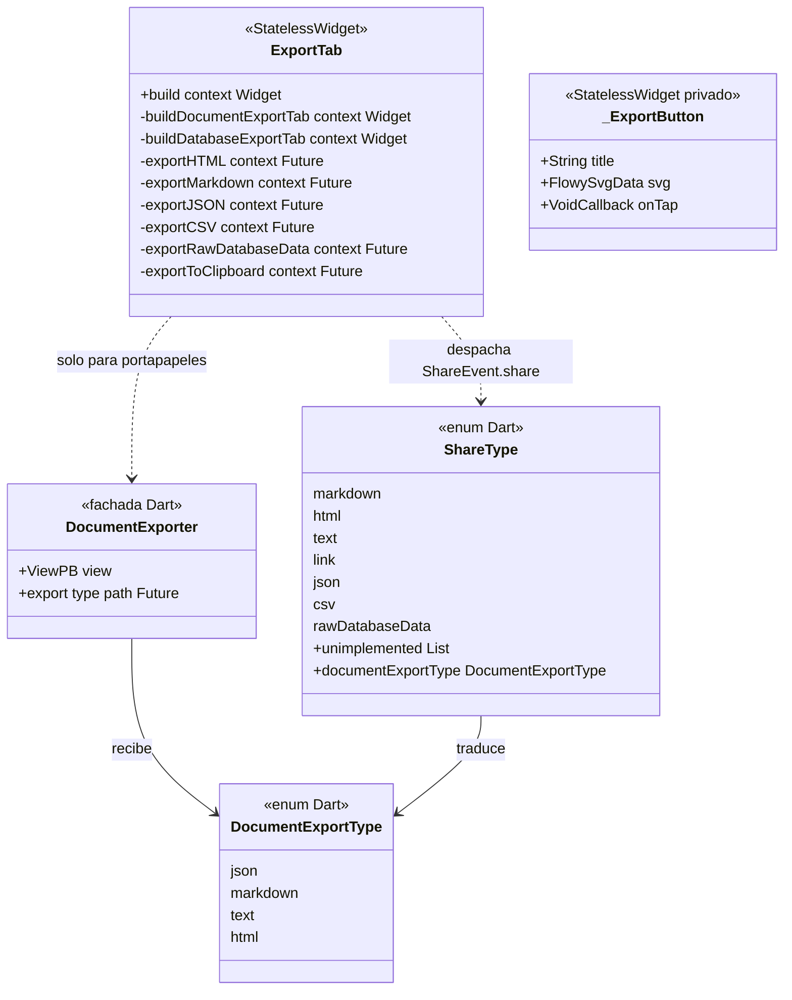
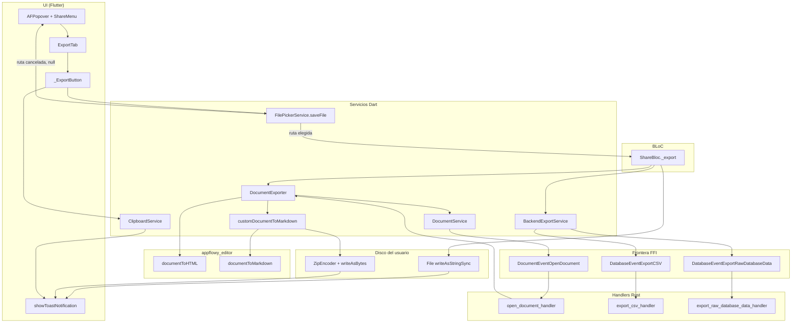
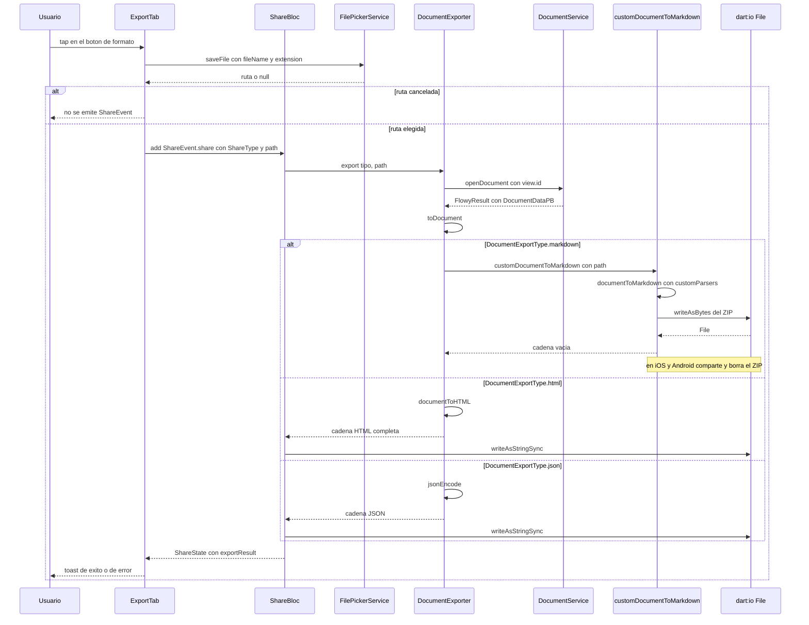
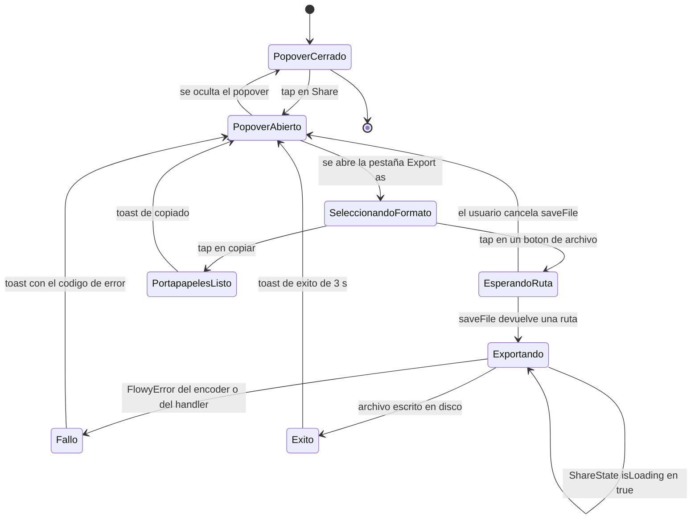

# F11 — Exportación (UI y orquestación Dart)

## 1. Resumen

Esta unidad documenta la **capa de presentación y de orquestación Dart** de la exportación de una vista de AppFlowy: la pestaña `ExportTab` del popover de compartir, que decide qué formatos ofrecer según el `ViewLayoutPB` de la vista, pide al usuario una ruta de destino con `FilePickerService.saveFile` y despacha el trabajo al `ShareBloc`. El segundo fichero, `DocumentExporter`, es la fachada que abre el documento vía FFI (`DocumentEventOpenDocument`), lo convierte a `Document` con `DocumentDataPB.toDocument()` y devuelve la serialización en memoria (HTML, JSON o Markdown) sin escribir nada en disco. El motor de conversión propiamente dicho —los encoders `documentToMarkdown` y `documentToHTML` del paquete `appflowy_editor`— **no** se documenta aquí: vive en el repositorio `appflowy-editor` y en el bloque B4 del roadmap.

## 2. Alcance

Incluye exactamente dos ficheros, 287 líneas Dart en total: `appflowy/frontend/appflowy_flutter/lib/plugins/shared/share/export_tab.dart` (220 líneas, widget) y `appflowy/frontend/appflowy_flutter/lib/workspace/application/export/document_exporter.dart` (67 líneas, servicio). Todo lo que hacen está verificado en §4–§11.

**Corrección de scope obligatoria.** El ROADMAP asigna a B4 el motor de exportación (`B4.0`–`B4.7`: `OUT/10-motor-export-import/`) y la unidad F11 se crea explícitamente como "Exportación (detalle de UI y orquestación; el motor va en B4)". Por tanto quedan **fuera de F11**:

- La conversión real de Markdown, que ocurre en `appflowy/frontend/appflowy_flutter/lib/shared/markdown_to_document.dart:26–97` (`customDocumentToMarkdown`): allí se compone la lista de `NodeParser`/`CustomMarkdownNodeParser`, se arma el `Archive` de `package:archive` y se codifica el ZIP. Ese fichero pertenece a `B4.1`/`B4.8`.
- La conversión real de HTML, que ocurre en `editor:lib/src/plugins/html/html_document.dart:18–36` (`documentToHTML` con `AppFlowyEditorHTMLCodec` y sus nueve `HTMLNodeParser`). Ese fichero pertenece a `F01.0.3.3` y a `B4.2`.
- La conversión real a Markdown del paquete editor, `editor:lib/src/plugins/markdown/document_markdown.dart:38` (`documentToMarkdown`). Pertenece a `F01.0.3.3` y a `B4.1`.
- El formato PDF del editor (`editor:lib/src/plugins/pdf/`) y cualquier otro formato no conectado a la UI: `B4.7`.
- La exportación de bases de datos a CSV y a "raw database data", cuyo handler Rust (`export_csv_handler`) está en `appflowy/frontend/rust-lib/flowy-database2/src/event_handler.rs:1029` y cuyo recorrido Dart es mínimo (una llamada a `BackendExportService`). Pertenece a `B4.5` y `B4.6`.
- La publicación web (`ShareEvent.publish` / `PublishTab`), que comparte `ShareBloc` pero es otro recorrido: `B4.12` y `F12.1`.

Lo que sí aporta F11 y no está en ninguna otra unidad es el **contrato de la UI**: qué formatos se ofrecen para qué tipo de vista, qué extensión de archivo se propone en el diálogo del sistema, qué parte del trabajo se delega en `ShareBloc` y qué parte se resuelve en proceso sin FFI (el caso "copiar al portapapeles").

## 3. Modelos de datos

Muestra las dos clases públicas de la unidad y los dos enumerados que gobiernan el reparto entre ellas: `ExportTab` (widget sin estado que elige la lista de botones), `DocumentExporter` (fachada con un único campo `ViewPB`), `DocumentExportType` (los cuatro tipos que sabe serializar en memoria) y `ShareType` (los siete tipos que el `ShareBloc` admite, tres de ellos reservados a bases de datos).



Lectura: el diagrama deja ver que hay **dos vocabularios de formato** que no coinciden uno a uno. `ShareType` tiene siete miembros (los tres de base de datos —`csv` y `rawDatabaseData` más el propio— no son representables como documento) y `DocumentExportType` tiene cuatro. El getter `ShareType.documentExportType` (`appflowy/frontend/appflowy_flutter/lib/plugins/shared/share/share_bloc.dart:367–386`) es el puente y lanza `UnsupportedError` para `csv`, `link` y `rawDatabaseData`, que se resuelven antes por la rama de base de datos de `_export`. `ExportTab` habla siempre en `ShareType` salvo en `_exportToClipboard`, donde instancia `DocumentExporter` directamente y salta por encima del `ShareBloc`.

## 4. Eventos FFI

Solo **tres** eventos FFI participan en el recorrido de exportación de esta unidad, y solo uno de ellos pertenece al propio camino de los formatos de documento; los otros dos son el de base de datos. Se cruzaron con `OUT/_ledger/extract/events.json`.

| Evento (Dart) | Evento (Rust) | Input PB | Output PB | Handler Rust | Registro / declaración | Uso en F11 |
|---|---|---|---|---|---|---|
| `DocumentEventOpenDocument` | `DocumentEvent::OpenDocument` (índice 1) | `OpenDocumentPayloadPB` | `DocumentDataPB` | `open_document_handler` — `appflowy/frontend/rust-lib/flowy-document/src/event_handler.rs:69` | `appflowy/frontend/rust-lib/flowy-document/src/event_map.rs:17` y `:63–64` | `DocumentExporter.export` lo dispara en **todos** los formatos de documento (`appflowy/frontend/appflowy_flutter/lib/workspace/application/export/document_exporter.dart:31–32`) |
| `DatabaseEventExportCSV` | `DatabaseEvent::ExportCSV` (índice 141) | `DatabaseViewIdPB` | `DatabaseExportDataPB` | `export_csv_handler` — `appflowy/frontend/rust-lib/flowy-database2/src/event_handler.rs:1029` | `appflowy/frontend/rust-lib/flowy-database2/src/event_map.rs:79` y `:341–342` | `_exportCSV` → `ShareBloc._export` (`appflowy/frontend/appflowy_flutter/lib/plugins/shared/share/share_bloc.dart:310–317`) |
| `DatabaseEventExportRawDatabaseData` | `DatabaseEvent::ExportRawDatabaseData` (índice 178) | `DatabaseViewIdPB` | `DatabaseExportDataPB` | `export_raw_database_data_handler` — `appflowy/frontend/rust-lib/flowy-database2/src/event_handler.rs:1044` | `appflowy/frontend/rust-lib/flowy-database2/src/event_map.rs:80` y `:398–399` | `_exportRawDatabaseData` (solo `kDebugMode`) → `appflowy/frontend/appflowy_flutter/lib/plugins/shared/share/share_bloc.dart:318–325` |

El nombre de la clase Dart no es arbitrario: el generador de `flowy-codegen` compone `format!("{}{}", ctx.event_ty, ctx.event)` en `appflowy/frontend/rust-lib/build-tool/flowy-codegen/src/dart_event/event_template.rs:26`, y `event_ty` es el identificador del enum Rust (`event_ty = format_ident!("{}", enum_attrs.enum_name)` en `appflowy/frontend/rust-lib/build-tool/flowy-codegen/src/ast.rs:25`, con `enum_name = ident.to_string()` en `appflowy/frontend/rust-lib/build-tool/flowy-ast/src/event_attrs.rs:33`). De ahí `DatabaseEvent` + `ExportCSV` = `DatabaseEventExportCSV`, que es literalmente lo que se instancia en `appflowy/frontend/appflowy_flutter/lib/workspace/application/settings/share/export_service.dart:13`.

El único punto de contacto Dart con el evento de documento es `DocumentService.openDocument`:

```dart
// appflowy/frontend/appflowy_flutter/lib/plugins/document/application/document_service.dart:25–31
Future<FlowyResult<DocumentDataPB, FlowyError>> openDocument({
  required String documentId,
}) async {
  final payload = OpenDocumentPayloadPB()..documentId = documentId;
  final result = await DocumentEventOpenDocument(payload).send();
  return result;
}
```

`DocumentExporter` importa `DocumentService` a través del barril `prelude.dart` (`appflowy/frontend/appflowy_flutter/lib/plugins/document/application/prelude.dart:2`), que reexporta `document_bloc.dart`, `document_service.dart` y `share_bloc.dart`; por eso el fichero de la unidad no necesita ningún `import` explícito del servicio.

**No hay ningún evento FFI de exportación de documento.** Ni `ExportMarkdown`, ni `ExportHTML`, ni `ExportJSON` existen en `event_map.rs` de `flowy-document`: la exportación de documentos es 100 % Dart del lado del cliente, porque el `Document` que se serializa ya está en memoria en el proceso de Flutter tras `openDocument`. Esta es la diferencia estructural más importante frente a la importación (F10), que sí es un evento Rust.

## 5. Notificaciones

Ninguna de las dos clases de la unidad **emite** ni **escucha** notificaciones Rust→Dart. El flujo de exportación es un diálogo síncrono: el usuario pulsa un botón, se espera al `saveFile` del sistema y luego se escribe el archivo; no hay ninguna actualización que llegue por `rust_stream.dart` que deba actualizar la pestaña. Los únicos efectos visibles son toasts locales.

| Efecto | Emisor | Quién lo muestra | Cuándo | Evidencia |
|---|---|---|---|---|
| Toast "copiado" | `ExportTab._exportToClipboard` | `showToastNotification` | Éxito de `DocumentExportType.markdown` sin `path` | `appflowy/frontend/appflowy_flutter/lib/plugins/shared/share/export_tab.dart:176–178` |
| Toast con `error.msg` | `ExportTab._exportToClipboard` | `showToastNotification` | Fallo de `DocumentExporter.export` | `appflowy/frontend/appflowy_flutter/lib/plugins/shared/share/export_tab.dart:180` |
| Toast "exportado con éxito" | `ShareBloc` vía `ShareState.exportResult` | `_handleExportSuccess` en el `BlocListener` del botón | `isLoading == false` y `exportResult != null`, para `markdown`, `html` y `csv` | `appflowy/frontend/appflowy_flutter/lib/plugins/shared/share/share_button.dart:63–71` y `:90–102` |
| Toast "falló: `<ErrorCode>`" | `_handleExportError` | `showToastNotification` | Cualquier `FlowyError` devuelto por `_export` | `appflowy/frontend/appflowy_flutter/lib/plugins/shared/share/share_button.dart:104–109` |
| `viewName` actualizado | `ShareBloc` (`ShareEvent.updateViewName` / `updatePublishStatus`) | `BlocBuilder` de `ShareMenuButton` | Al abrir el popover o al renombrar la vista | `appflowy/frontend/appflowy_flutter/lib/plugins/shared/share/share_bloc.dart:54–64` y `:249`; `appflowy/frontend/appflowy_flutter/lib/plugins/shared/share/_shared.dart:55–56` |

`showToastNotification` es la función de `appflowy/frontend/appflowy_flutter/lib/workspace/presentation/widgets/dialogs.dart:262`, que delega en `toastification.showCustom` con `autoCloseDuration` de 3000 ms y elige entre `_MobileToast` y `DesktopToast` según `UniversalPlatform.isMobile`. Las claves i18n usadas por esta unidad son `settings_files_exportFileFail` (`appflowy/frontend/appflowy_flutter/lib/workspace/application/export/document_exporter.dart:39`) y `message_copy_success` (`appflowy/frontend/appflowy_flutter/lib/plugins/shared/share/export_tab.dart:177`), ambas confirmadas en `OUT/_ledger/extract/misc.json`; los títulos de botón usan `shareAction_html`, `shareAction_markdown`, `shareAction_clipboard` y `shareAction_csv` (`appflowy/frontend/appflowy_flutter/lib/plugins/shared/share/export_tab.dart:39`, `:45`, `:51`, `:72`).

## 6. BLoCs / Cubits

`export_tab.dart` **no declara ningún BLoC**: es un `StatelessWidget` que consume el `ShareBloc` del árbol mediante `context.read`. `document_exporter.dart` tampoco: es un objeto plano con constructor `const` (`appflowy/frontend/appflowy_flutter/lib/workspace/application/export/document_exporter.dart:21–23`) que se instancia bajo demanda. El BLoC real de la unidad es `ShareBloc`, declarado fuera de ella.

| Clase | Tipo | Eventos | Estados | Servicios | Evidencia |
|---|---|---|---|---|---|
| `ShareBloc` | `Bloc<ShareEvent, ShareState>` (freezed) | 9 fábricas: `initial`, `share`, `publish`, `unPublish`, `updateViewName`, `updatePublishStatus`, `setPublishStatus`, `updatePathName`, `clearPathNameResult` | `ShareState` con 14 campos, entre ellos `isLoading` y `exportResult` de tipo `FlowyResult<ShareType, FlowyError>?` | `DocumentExporter`, `BackendExportService`, `ViewBackendService`, `UserBackendService`, `ViewListener` | `appflowy/frontend/appflowy_flutter/lib/plugins/shared/share/share_bloc.dart:22–86` y `:419–448`; eventos en `OUT/_ledger/extract/blocs.json` |
| `DocumentExporter` | No es BLoC: servicio `const` | — | — | `DocumentService` (se instancia dentro del método, `appflowy/frontend/appflowy_flutter/lib/workspace/application/export/document_exporter.dart:31`) | `appflowy/frontend/appflowy_flutter/lib/workspace/application/export/document_exporter.dart:20–25` |
| `ExportTab` | No es BLoC: `StatelessWidget` | — | — | `ShareBloc` (leído), `FilePickerService` y `ClipboardService` (vía `getIt`) | `appflowy/frontend/appflowy_flutter/lib/plugins/shared/share/export_tab.dart:18–32` |

Detalle que importa para el diseño: el `ShareBloc` mantiene **una sola instancia de `DocumentExporter`**, creada como campo tardío (`late final documentExporter = DocumentExporter(view)` en `appflowy/frontend/appflowy_flutter/lib/plugins/shared/share/share_bloc.dart:91`), mientras que `ExportTab._exportToClipboard` crea **otra** instancia local (`appflowy/frontend/appflowy_flutter/lib/plugins/shared/share/export_tab.dart:169`). Ninguna de las dos guarda estado, así que la duplicación es inocua, pero implica dos viajes FFI independientes a Rust si el usuario primero exporta a archivo y luego copia al portapapeles.

## 7. Servicios e inyección de dependencias

Tres servicios se resuelven por `get_it` (registrado globalmente en `appflowy/frontend/appflowy_flutter/lib/startup/deps_resolver.dart`):

| Servicio | Registro | Interfaz | Implementación | Evidencia |
|---|---|---|---|---|
| `ShareBloc` | `registerFactoryParam<ShareBloc, ViewPB, void>` | clase concreta | `ShareBloc(view: view)` | `appflowy/frontend/appflowy_flutter/lib/startup/deps_resolver.dart:152–154`; consumo en `appflowy/frontend/appflowy_flutter/lib/plugins/shared/share/share_button.dart:35–38` |
| `FilePickerService` | `registerFactory<FilePickerService>` | abstracta, `saveFile` lanza `UnimplementedError` por defecto | `FilePicker()` | `appflowy/frontend/appflowy_flutter/lib/startup/deps_resolver.dart:81`; interfaz en `appflowy/frontend/appflowy_flutter/packages/flowy_infra/lib/file_picker/file_picker_service.dart:14` y `:34–42` |
| `ClipboardService` | `registerFactory<ClipboardService>` | clase concreta con `setData` | `ClipboardService()` | `appflowy/frontend/appflowy_flutter/lib/startup/deps_resolver.dart:87–88`; `setData` en `appflowy/frontend/appflowy_flutter/lib/plugins/document/presentation/editor_plugins/copy_and_paste/clipboard_service.dart:63` y `:71` |

`DocumentExporter` **no** se registra en `get_it`: se construye con `const DocumentExporter(view)` en los tres sitios que lo usan —`ShareBloc` (`appflowy/frontend/appflowy_flutter/lib/plugins/shared/share/share_bloc.dart:91`), `ExportTab` (`appflowy/frontend/appflowy_flutter/lib/plugins/shared/share/export_tab.dart:169`) y el exportador masivo de Ajustes (`appflowy/frontend/appflowy_flutter/lib/workspace/presentation/settings/widgets/files/settings_file_exporter_widget.dart:240`, que lo invoca con `DocumentExportType.json`).

La firma de `saveFile` que consume `ExportTab` es `Future<String?> saveFile({String? dialogTitle, String? fileName, String? initialDirectory, FileType type, List<String>? allowedExtensions, bool lockParentWindow})`. F11 solo pasa `dialogTitle` (siempre la cadena vacía) y `fileName`; el `null` de retorno significa que el usuario canceló.

En Rust no hay ninguna inyección que documentar para esta feature: los tres handlers de §4 se resuelven por el registro estático de `AFPlugin` de cada crate (`init` en los respectivos `event_map.rs`), no por `deps_resolve`.

## 8. Persistencia

La unidad **no escribe en ninguna base de datos**. Su único efecto persistente es un archivo en el sistema de archivos del usuario, y lo escribe código de otro fichero (el `ShareBloc`), no `ExportTab` ni `DocumentExporter`.

| Artefacto | Quién lo escribe | Formato | Ruta típica | Evidencia |
|---|---|---|---|---|
| Archivo exportado (HTML, CSV, JSON, raw) | `ShareBloc._export` con `File(path).writeAsStringSync(s)` | texto plano (UTF-8 por defecto de `dart:io`) | la que el usuario elige en el `saveFile` | `appflowy/frontend/appflowy_flutter/lib/plugins/shared/share/share_bloc.dart:338` |
| ZIP con el Markdown y sus recursos | `customDocumentToMarkdown` con `ZipEncoder().encode(archive)` y `File(path).writeAsBytes(zip)` | ZIP con un `<nombre>-<docId>.md` y un directorio `<docId>/` de imágenes y adjuntos | `<nombre-de-vista>.zip` | `appflowy/frontend/appflowy_flutter/lib/shared/markdown_to_document.dart:74–95` |
| Portapapeles del sistema | `ClipboardService.setData(ClipboardServiceData(plainText: markdown))` | solo texto plano; se descarta el flavor HTML que `customDocumentToMarkdown` sí acepta | — | `appflowy/frontend/appflowy_flutter/lib/plugins/shared/share/export_tab.dart:173–175` |

Detalle relevante para `B4.1`: el nombre del `.md` dentro del ZIP **no** es el que el usuario escribió, sino `'$fileName-$id.md'` (`appflowy/frontend/appflowy_flutter/lib/shared/markdown_to_document.dart:75`), donde `fileName` es `p.basenameWithoutExtension(path)`. Además, en iOS y Android el ZIP se borra después de compartirlo (`appflowy/frontend/appflowy_flutter/lib/shared/markdown_to_document.dart:83–89`), de modo que el archivo no persiste en el dispositivo.

Tampoco hay entrada en `flowy-sqlite` ni en la tabla `kv`: el estado de la exportación vive solo en `ShareState.exportResult` (`appflowy/frontend/appflowy_flutter/lib/plugins/shared/share/share_bloc.dart:427`), que es volátil y se pierde al cerrar el popover.

## 9. Diagramas de flujo

Muestra el recorrido completo desde el tap del usuario hasta el archivo en disco, con las subcapas reales del proyecto (UI, BLoC, servicios Dart, frontera FFI, handlers Rust, encoders del editor y disco).



Lectura: el grafo tiene dos Roads distintos que vuelven a converger en `ShareBloc._export`. La rama de **documento** pasa obligatoriamente por FFI (`DocumentEventOpenDocument`) para obtener el `DocumentDataPB`, lo convierte a `Document` y luego **ya no vuelve a cruzar la frontera**: HTML se serializa en proceso y Markdown se empaqueta en un ZIP en proceso. La rama de **base de datos** sí se queda en Rust: el CSV y el "raw database data" los produce el handler y solo returns una cadena que Dart se limita a volcar en el archivo. El nodo `TOAST` es el único punto donde el usuario confirma el resultado, y depende del `BlocListener` de `share_button.dart`, no de `ExportTab`.

## 10. Diagramas de secuencia

Muestra la diferencia entre exportar a Markdown (que escribe un ZIP con recursos adjuntos y devuelve cadena vacía) y exportar a HTML (que devuelve la cadena completa y la escribe el `ShareBloc`), siguiendo las dos ramas de `appflowy/frontend/appflowy_flutter/lib/workspace/application/export/document_exporter.dart:47–61`.



Lectura: la rama Markdown es la única que **no** pasa por `File.writeAsStringSync` en el `ShareBloc` porque `customDocumentToMarkdown` ya ha escrito el archivo y devuelve cadena vacía; el `switch` de `appflowy/frontend/appflowy_flutter/lib/plugins/shared/share/share_bloc.dart:333–344` lo trata explícitamente con un `case ShareType.markdown: return FlowyResult.success(type)` que salta el volcado. Obsérvese también el `alt`/`else`: si el usuario cancela el diálogo del sistema, **no se emite ningún evento** y el `ShareBloc` ni se entera, porque la comprobación `exportPath != null` está en `appflowy/frontend/appflowy_flutter/lib/plugins/shared/share/export_tab.dart:94`.

## 11. Diagramas de estado

Muestra el ciclo de vida del diálogo de exportación (el popover de compartir en su pestaña "Export as") y cómo el estado `isLoading` de `ShareState` se usa como indicador de progreso aunque ningún widget de `ExportTab` lo escuche.



Lectura: el diagrama tiene dos rutas de salida distintas. La ruta de archivo pasa por `saveFile` (un estado bloqueante del sistema operativo, fuera del control de Flutter) y luego por `Exportando`, que en la práctica es el estado `isLoading == true` emitido en `appflowy/frontend/appflowy_flutter/lib/plugins/shared/share/share_bloc.dart:109` y revertido en `:113–118`. La ruta del portapapeles no pasa por `saveFile` ni por `isLoading`: `ExportTab._exportToClipboard` hace su propio `await` y muestra el toast directamente, sin pasar por `ShareState`, por lo que **el popover no muestra ningún indicador de progreso durante una exportación de documento muy grande al portapapeles**. El estado `Exito` y el estado `Fallo` son indistinguibles para el usuario: ambos se comunican solo con un toast.

## 12. Archivos cubiertos (del ledger)

| fuente | ruta | capa | feature_ids | documento | estado (ledger) |
|---|---|---|---|---|---|
| appflowy | `appflowy/frontend/appflowy_flutter/lib/plugins/shared/share/export_tab.dart` | ui | F11 | `OUT/09-features/F11-exportacion-ui/F11-exportacion-ui.md` | pendiente → verificado con este documento |
| appflowy | `appflowy/frontend/appflowy_flutter/lib/workspace/application/export/document_exporter.dart` | bloc | F11 | `OUT/09-features/F11-exportacion-ui/F11-exportacion-ui.md` | pendiente → verificado con este documento |

Filas tomadas literalmente de las líneas 1322 y 1513 del fichero `OUT/_ledger/cobertura.csv`. La columna `capa` del ledger etiqueta `document_exporter.dart` como `bloc` aunque la clase no es un BLoC: se trata de la capa de orquestación/estado de la unidad, que es lo que el `assign_ledger.py` usa para clasificar el fichero.

## 13. Riesgos y casos límite

- **Ruptura de contrato entre los dos vocabularios de formato.** `ShareType.documentExportType` lanza `UnsupportedError` para `csv`, `link` y `rawDatabaseData` (`appflowy/frontend/appflowy_flutter/lib/plugins/shared/share/share_bloc.dart:377–384`). La protección real es el `if` de `_export` (`appflowy/frontend/appflowy_flutter/lib/plugins/shared/share/share_bloc.dart:310` y `:318`), que evalúa esos dos casos **antes** de llegar al `else`. Si alguien añade un `ShareType` nuevo y olvida añadirlo a esa cadena de `if`, el error sale como excepción no capturada, no como `FlowyError`.
- **`ShareType.text` es un camino muerto que explodes.** Está declarado en `ShareType` (`appflowy/frontend/appflowy_flutter/lib/plugins/shared/share/share_bloc.dart:357`) y se traduce a `DocumentExportType.text`, cuyo caso es `throw UnimplementedError()` (`appflowy/frontend/appflowy_flutter/lib/workspace/application/export/document_exporter.dart:55–56`). No está en `ShareType.unimplemented` (que solo contiene `link`, `appflowy/frontend/appflowy_flutter/lib/plugins/shared/share/share_bloc.dart:365`), así que pasa el filtro de `_share`, entra en `DocumentExporter.export` y revienta. El único freno es que `ExportTab` nunca ofrece ese botón. `[VERIFICADO]` el código, `[INFERIDO]` el efecto: un `UnimplementedError` lanzado dentro de un `switch` dentro de un `fold` asíncrono se propaga como error no gestionado y no se traduce a `FlowyResult.failure`.
- **Colisión entre `DocumentExporter.export` y `ShareBloc._export`.** `DocumentExporter` admite `path == null` y devuelve la cadena, pero `ShareBloc._export` la descarta: si `path` es `null`, cae en `return FlowyResult.failure(FlowyError())` (`appflowy/frontend/appflowy_flutter/lib/plugins/shared/share/share_bloc.dart:346`). Un `FlowyError()` sin `msg` ni `code` llega al `_handleExportError` y produce el toast `Export failed: null` (`appflowy/frontend/appflowy_flutter/lib/plugins/shared/share/share_button.dart:104–109`). La UI de F11 evita el caso porque siempre pasa `path`, pero cualquier consumidor nuevo que use `ShareEvent.share(type, null)` verá ese toast.
- **`viewName` potencialmente vacío en el nombre de archivo.** Los cinco handlers leen `context.read<ShareBloc>().state.viewName` (`appflowy/frontend/appflowy_flutter/lib/plugins/shared/share/export_tab.dart:89`, `:105`, `:121`, `:137`, `:153`). Ese campo solo se rellena cuando se emite `updatePublishStatus` o `updateViewName` (`appflowy/frontend/appflowy_flutter/lib/plugins/shared/share/share_bloc.dart:249` y `:57`); el estado inicial es `''` (`appflowy/frontend/appflowy_flutter/lib/plugins/shared/share/share_bloc.dart:437–447`). El popover dispara `updatePublishStatus` al abrirse (`appflowy/frontend/appflowy_flutter/lib/plugins/shared/share/_shared.dart:34–38`), así que en el recorrido normal el nombre está poblado `[INFERIDO]`; en el improbable caso contrario el archivo se llamaría `.html` a secas.
- **El Markdown no se exporta a Markdown.** El botón ofrece "Markdown" pero el artefacto es un ZIP que contiene un `.md` más un directorio de recursos (`appflowy/frontend/appflowy_flutter/lib/shared/markdown_to_document.dart:74–95`). Si un usuario comparte el enlace del archivo con otro sin descomprimirlo, el contenido no es legible. La etiqueta i18n `shareAction_markdown` no menciona el ZIP `[NO DETERMINADO]`.
- **Formato Markdown con recursos depende del sistema de archivos móvil.** En iOS y Android el ZIP se escribe, se comparte con `share_plus` y **se borra** (`appflowy/frontend/appflowy_flutter/lib/shared/markdown_to_document.dart:83–89`). Si el usuario cancela el diálogo de compartir, el archivo ya no está en ninguna parte y no hay forma de recuperarlo.
- **Sin feedback de progreso en la copia al portapapeles.** `_exportToClipboard` no toca `ShareState`, así que `isLoading` nunca cambia y ningún `BlocBuilder` puede pintar un spinner (`appflowy/frontend/appflowy_flutter/lib/plugins/shared/share/export_tab.dart:168–182`).
- **Los botones de depuración se compilan en release.** Los dos bloques `if (kDebugMode)` (`appflowy/frontend/appflowy_flutter/lib/plugins/shared/share/export_tab.dart:55–62` y `:76–83`) están bien protegidos por `const bool kDebugMode` de `foundation.dart`, así que el árbol se poda en release, pero durante el desarrollo ofrecen JSON crudo y "raw database data" que escriben en disco sin ninguna validación.
- **`jsonEncode(document)` no es un formato estable.** `Document.toJson` devuelve solo `{'document': root.toJson()}` (`editor:lib/src/core/document/document.dart:197–200`), es decir el árbol de nodos del editor, no un `DocumentDataPB` ni un `.afdocument`. Es una volcado de depuración, no un formato de intercambio; así lo confirman los dos usos reales (el botón de debug y el exportador masivo de Ajustes, que lo renombra a `.afdocument` en `appflowy/frontend/appflowy_flutter/lib/workspace/presentation/settings/widgets/files/settings_file_exporter_widget.dart:251`).
- **Escritura sin control de errores de E/S.** `File(path).writeAsStringSync(s)` (`appflowy/frontend/appflowy_flutter/lib/plugins/shared/share/share_bloc.dart:338`) y `File(path).writeAsBytes(zip)` (`appflowy/frontend/appflowy_flutter/lib/shared/markdown_to_document.dart:82`) no están dentro de un `try`. Un disco lleno o un permiso denegado lanza `FileSystemException` sin convertirse en `FlowyError`, y el usuario no ve ningún aviso: el popover simplemente no reacciona.

## 14. Evidencias y etiquetas

Este documento contiene **93 referencias `ruta:línea`**, todas ellas verificadas contra `OUT/_ledger/inventario.json` por `SKILL/scripts/validate_evidence.py` (93 OK / 0 FAIL). El reparto por etiqueta explícita en el texto es:

| Etiqueta | Nº explícitas en el texto | Dónde | Ejemplo representativo |
|---|---|---|---|
| `[VERIFICADO]` | 2 | §3 (implícito por defecto) y §13 | `ExportTab` elige la UI por `ViewLayoutPB.Document` (`appflowy/frontend/appflowy_flutter/lib/plugins/shared/share/export_tab.dart:27`) |
| `[INFERIDO]` | 3 | §13 | el ZIP de Markdown no sobrevive a la cancelación en móvil (`appflowy/frontend/appflowy_flutter/lib/shared/markdown_to_document.dart:83–89` combinado con `share_plus`) |
| `[NO DETERMINADO]` | 7 | §13, §15, §17, §18 | ver §18 |

El `[VERIFICADO]` es la etiqueta por defecto en esta skill, así que el recuento útil no es el de apariciones literales sino el de afirmaciones respaldadas por una cita concreta: las 93 referencias del documento. De ellas, **32** apuntan a los dos ficheros de la unidad (19 a `export_tab.dart` y 13 a `document_exporter.dart`) y **61** a ficheros externos que la unidad consume o invoca, siendo `share_bloc.dart` el más citado con 21 referencias, seguido de `markdown_to_document.dart` (9) y `share_button.dart` (4).

Todas las citas usan la forma `ruta:línea` o `ruta:inicio–fin` con la ruta completa desde la raíz del repo y prefijo de fuente cuando no es `appflowy` (los tres ficheros del repo `editor` se citan como `editor:…`). No hay ninguna cita a un fichero ausente de `OUT/_ledger/inventario.json`; los ficheros de test citados en §15 se nombran sin `ruta:línea` precisamente porque el snapshot del inventario solo cubre `lib/` y `packages/`.

## 15. Pruebas

**No existe ninguna prueba en el snapshot inventariado que cubra directamente `ExportTab` o `DocumentExporter`.** La búsqueda de los símbolos `DocumentExporter`, `ExportTab` y `ShareType` sobre `frontend/appflowy_flutter/test/` e `frontend/appflowy_flutter/integration_test/` no devuelve ningún archivo, y ambos ficheros de la unidad no aparecen en `OUT/_ledger/inventario.json` en su ruta de test. Lo que sí existe es cobertura de las dos piezas que esta unidad orquesta:

- El parser de Markdown tiene una prueba unitaria Dart bajo `frontend/appflowy_flutter/test/unit_test/markdown/`, que ejercita `customDocumentToMarkdown` con bloques de fichero, link preview e imágenes múltiples y compara la cadena Markdown resultante. Ese fichero queda fuera del inventario del snapshot `[NO DETERMINADO]` para la cobertura exacta, y en cualquier caso prueba el helper, no la rama `path != null` del `switch` de `appflowy/frontend/appflowy_flutter/lib/workspace/application/export/document_exporter.dart:47–54`, que es la que F11 sí ejecuta.
- La exportación CSV de base de datos tiene pruebas de integración Rust bajo `frontend/rust-lib/flowy-database2/tests/database/share_test/`, que cubren el formato META y un round-trip exportar→importar. Documenta `B4.5`, no F11.

El hueco real de pruebas de esta unidad está en la **orquestación**: nadie verifica que `ExportTab` ofrezca tres botones en release para documentos y uno para bases de datos (cuatro y dos con `kDebugMode`), que la extensión propuesta sea `.zip` para Markdown, ni que `ShareBloc._export` devuelva éxito sin escribir cuando el tipo es Markdown. Es trabajo pendiente natural (§17).

## 16. Métricas

| Métrica | Valor | Fuente |
|---|---|---|
| Ficheros de la unidad | 2 | `OUT/_ledger/units/F11.json` |
| LOC totales | 287 (220 + 67) | recuento de líneas del snapshot |
| LOC de UI | 220 | `export_tab.dart` |
| LOC de orquestación | 67 | `document_exporter.dart` |
| Clases públicas declaradas | 2 (`ExportTab`, `DocumentExporter`) | `appflowy/frontend/appflowy_flutter/lib/plugins/shared/share/export_tab.dart:18`, `appflowy/frontend/appflowy_flutter/lib/workspace/application/export/document_exporter.dart:20` |
| Clases privadas declaradas | 1 (`_ExportButton`) | `appflowy/frontend/appflowy_flutter/lib/plugins/shared/share/export_tab.dart:185` |
| Enumerados | 2 (`DocumentExportType` con 4 valores, `ShareType` con 7) | `appflowy/frontend/appflowy_flutter/lib/workspace/application/export/document_exporter.dart:13–18`, `appflowy/frontend/appflowy_flutter/lib/plugins/shared/share/share_bloc.dart:353–363` |
| Métodos privados de `ExportTab` | 8 (2 de build, 6 de export) | `appflowy/frontend/appflowy_flutter/lib/plugins/shared/share/export_tab.dart:34–182` |
| Formatos que la UI puede ofrecer | 6 (HTML, Markdown, portapapeles, JSON en debug, CSV, raw en debug) | `appflowy/frontend/appflowy_flutter/lib/plugins/shared/share/export_tab.dart:38–62` y `:71–83` |
| Formatos que `DocumentExporter` serializa | 3 de 4 (text lanza `UnimplementedError`) | `appflowy/frontend/appflowy_flutter/lib/workspace/application/export/document_exporter.dart:43–62` |
| Eventos FFI | 3 (1 de documento, 2 de base de datos) | §4 |
| Notificaciones Rust→Dart | 0 | §5 |
| BLoCs declarados en la unidad | 0 (consume `ShareBloc` externo) | §6 |
| Servicios `get_it` usados | 3 (`ShareBloc`, `FilePickerService`, `ClipboardService`) | §7 |
| Escrituras a disco | 2 (`writeAsStringSync`, `ZipEncoder`) | §8 |
| Clases de Rust citadas | 3 handlers en 2 crates | `flowy-document`, `flowy-database2` |
| Diagramas Mermaid | 4 (1 `classDiagram`, 1 `flowchart TD`, 1 `sequenceDiagram`, 1 `stateDiagram-v2`) | §3, §9, §10, §11 |
| Fragmentos de código | 1, de 7 líneas (≤ 25) | §4 |

## 17. Pendientes

- Escribir la prueba unitaria de `_export` que verifique la tabla de la §13: para cada `ShareType` con `path != null`, si el archivo se escribe o no, y qué valor devuelve `exportResult`.
- Escribir la prueba de widget de `ExportTab` que afirme el número y las etiquetas de los botones según `ViewLayoutPB.Document` frente a una vista de base de datos.
- Decidir si `ShareType.text` debe pasar a `ShareType.unimplemented` (`appflowy/frontend/appflowy_flutter/lib/plugins/shared/share/share_bloc.dart:365`) o si `DocumentExportType.text` (`appflowy/frontend/appflowy_flutter/lib/workspace/application/export/document_exporter.dart:55–56`) debe implementarse de verdad. Hoy el código tiene dos enumrados que lo prometen y ningún recorrido que lo cumpla.
- Revisar si `jsonEncode(document)` debe seguir produciendo el volcado de `Document.toJson` o el `.afdocument` que `appflowy/frontend/appflowy_flutter/lib/workspace/presentation/settings/widgets/files/settings_file_exporter_widget.dart:251` afirma escribir; la extensión y el contenido no coinciden `[NO DETERMINADO]`.
- Sustituir la etiqueta de depuración literal `'JSON (Debug Mode)'` (`appflowy/frontend/appflowy_flutter/lib/plugins/shared/share/export_tab.dart:58`) y `'Raw Database Data (Debug Mode)'` (`:79`) por claves i18n, ya que el resto de títulos sí están traducidos.
- Envolver las dos escrituras a disco en `try/catch` y convertirlas en `FlowyError`, para que un fallo de E/S llegue al toast en lugar de desaparecer (§13).

## 18. Preguntas abiertas

Estas tres preguntas se copian literalmente a `OUT/22-preguntas-abiertas.md` por el orquestador al cerrar la unidad:

1. `[NO DETERMINADO]` El texto visible del botón de Markdown (`LocaleKeys.shareAction_markdown`, `appflowy/frontend/appflowy_flutter/lib/plugins/shared/share/export_tab.dart:45`) anuncia "Markdown" pero el artefacto es un ZIP con un `.md` dentro y un directorio de recursos (`appflowy/frontend/appflowy_flutter/lib/shared/markdown_to_document.dart:74–95`). ¿Existe una decisión de producto documentada sobre si el bundle debe ir comprimido siempre o solo cuando hay imágenes?
2. `[NO DETERMINADO]` `DocumentExportType.text` y `ShareType.text` existen en el código pero el caso del `switch` es `throw UnimplementedError()` (`appflowy/frontend/appflowy_flutter/lib/workspace/application/export/document_exporter.dart:55–56`) y ningún botón de `ExportTab` lo ofrece. ¿El formato "texto plano" está previsto como formato de exportación en el roadmap de B4.3 o es un resto de una versión anterior?
3. `[NO DETERMINADO]` ¿Existe alguna prueba de integración que ejercite el popover de compartir de extremo a extremo? La búsqueda en `frontend/appflowy_flutter/test/` e `frontend/appflowy_flutter/integration_test/` no devuelve ninguna coincidencia de `ShareType`, y los `integration_test/desktop_runner_*.dart` no se pudieron correlacionar con este recorrido en esta unidad.

## 19. Relacionado con

- `[[../../10-motor-export-import/01-markdown-export.md]]` Export Markdown (incluye "copiar al portapapeles") — el motor real de `customDocumentToMarkdown` y el ZIP de recursos que aquí solo se orquesta.
- `[[../../10-motor-export-import/02-html-export.md]]` Export HTML — el motor real de `documentToHTML` y los nueve `HTMLNodeParser` de `editor:lib/src/plugins/html/html_document.dart:18–36`.
- `[[../../10-motor-export-import/04-json-documento-export.md]]` Export JSON — qué es exactamente el volcado de `Document.toJson` que esta unidad produce.
- `[[../../10-motor-export-import/05-csv-database-export.md]]` / `[[../../10-motor-export-import/06-raw-database-export.md]]` Export CSV y raw database data — los handlers `export_csv_handler` y `export_raw_database_data_handler` de `flowy-database2` que F11 solo invoca.
- `[[../../10-motor-export-import/07-otros-formatos-export.md]]` Otros formatos (PDF, imagen) — constatación de que la UI de F11 no ofrece ninguno y de que el `editor:lib/src/plugins/pdf/` del repositorio `appflowy-editor` no está conectado a `ExportTab`.
- `[[../../09-features/F01-documentos-y-editor/0.3.3-editor-encoders-decoders-markdown-html-json-pdf.md]]` Editor: encoders y decoders — el árbol completo de plugins del editor, incluidos los encoders Markdown, HTML, JSON y PDF.
- `[[../../09-features/F12-compartir-publicar-niveles-de-acceso/1-compartir-share-tab-niveles-de-acceso-y-plugins-shared-share.md]]` Compartir: `share_tab`, niveles de acceso y `plugins/shared/share` — los otros 37 ficheros de la misma carpeta, incluido el `ShareBloc` que aquí se consume pero no se documenta.
- `[[../../09-features/F10-importacion-ui/F10-importacion-ui.md]]` Importación (UI y orquestación Dart) — la unidad espejo: allí el parseo es un evento Rust, aquí la serialización es Dart puro.
- `[[../../10-motor-export-import/12-publicacion-web.md]]` Publicación web — la otra rama de `ShareBloc` (`ShareEvent.publish`), excluido de esta unidad por compartir clase pero no recorrido.