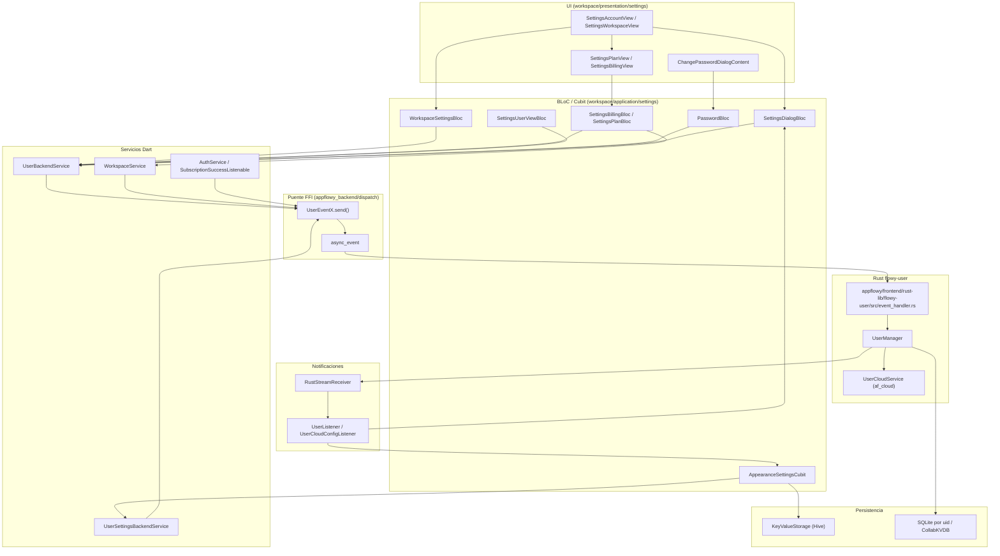
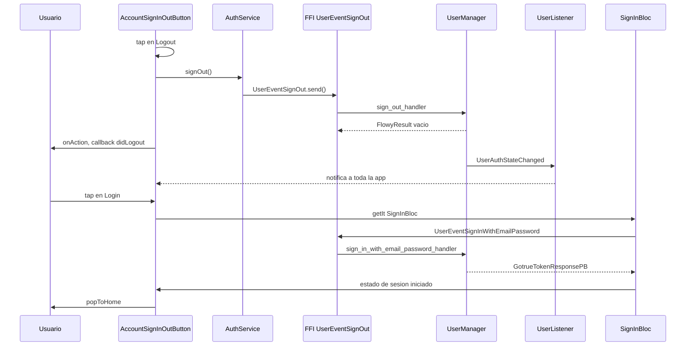
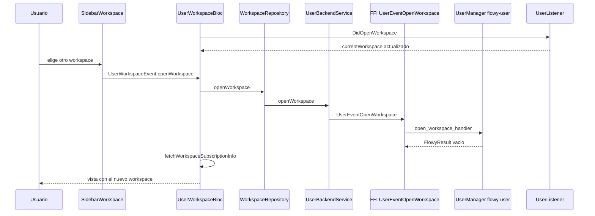
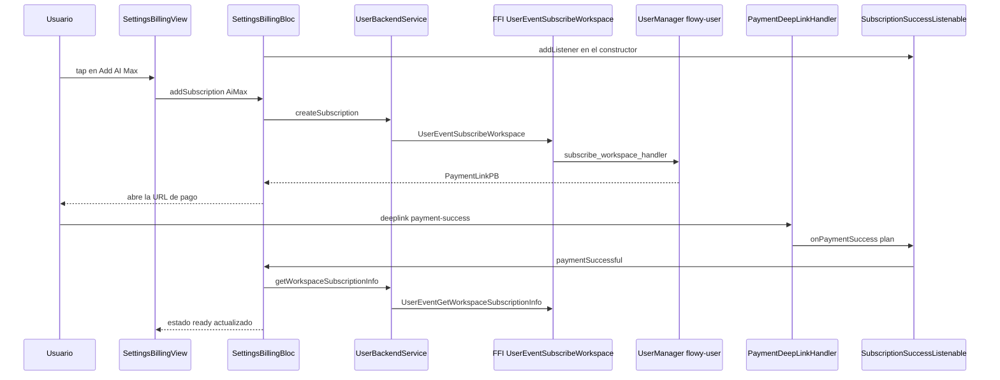
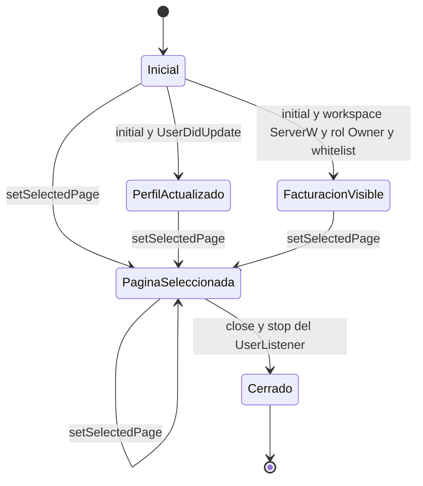

# F13.1 — Ajustes: lógica de aplicación, cuenta, billing, plan, nube y workspace

## 1. Resumen

Este documento documenta la **capa de aplicación** (`workspace/application/settings/**`) y las **páginas de cuenta, workspace, plan y billing** del diálogo de Ajustes de AppFlowy. Cubre los 33 BLoCs/Cubits/servicios de ajuste y los 16 widgets de página de la unidad F13.1, con 9 833 LOC. El eje del documento es la lógica: qué estado vive en cada Bloc, qué evento FFI dispara y qué página lo consume. El lado Rust correspondiente (`flowy-user`, `flowy-folder`, `flowy-storage`, `flowy-ai`) ya está documentado en `[[../../09-features/F05-usuario-auth-sesion/2-usuario-flowy-user-collab-user-rust-collab.md]]`, `[[../../09-features/F03-folder-workspaces-vistas/0.0-indice-folder-workspaces-vistas.md]]` y `[[../../09-features/F09-ia/0-indice-ia-chat-completion-ia-local-mcp-embeddings-middleware.md]]`, así que aquí se cita como contrato, no se re-documenta.

## 2. Alcance

**Incluye**: los BLoCs/Cubits y listeners de `workspace/application/settings/**` (IA local y de nube, apariencia, configuración de AppFlowy Cloud, facturación, plan, workspace, notificaciones, atajos, importación/exportación de ajustes, almacenamiento de datos de la aplicación) y las páginas de Ajustes de cuenta, workspace, plan y facturación, más los diálogos de contraseña, borrado de cuenta, versión de la app y reparación de datos.

**Queda fuera**:

- El contenedor `SettingsDialog` y su enrutado de páginas → `[[../../09-features/F13-ajustes-apariencia-temas-fuentes/1-ajustes-logica-de-aplicacion-cuenta-billing-plan-nube-y-workspace.md]]` (esta misma unidad), aunque se cita `appflowy/frontend/appflowy_flutter/lib/workspace/presentation/settings/settings_dialog.dart:121–188` para demostrar qué página monta qué Bloc.
- Los widgets de apariencia, `theme_upload`, feature flags, miembros y la vista de IA → `[[../../09-features/F13-ajustes-apariencia-temas-fuentes/2-apariencia-ia-miembros-feature-flags-y-theme-upload.md]]`.
- Los widgets compartidos de Ajustes (menú, `SettingsBody`, `SettingsCategory`, `SingleSettingAction`), el `emoji_picker` de Ajustes y la capa de datos `features/settings/**` → `[[../../09-features/F13-ajustes-apariencia-temas-fuentes/3-widgets-compartidos-de-ajustes-emoji-picker-y-data-layer-de-settings.md]]`.
- El `FlowyIconEmojiPicker` de `shared/icon_emoji_picker/`, que usa `AccountUserProfile` y que **no** es el mismo componente que `workspace/presentation/settings/widgets/emoji_picker/`: el primero elige avatar + emoji y pertenece a `[[../../09-features/F21-icon-emoji-picker/F21-icon-emoji-picker.md]]`; el segundo es el selector de emoji interno de Ajustes y pertenece a `[[../../09-features/F13-ajustes-apariencia-temas-fuentes/3-widgets-compartidos-de-ajustes-emoji-picker-y-data-layer-de-settings.md]]` `[VERIFICADO]` (`appflowy/frontend/appflowy_flutter/lib/workspace/presentation/settings/pages/account/account_user_profile.dart:3` importa `package:appflowy/shared/icon_emoji_picker/flowy_icon_emoji_picker.dart`).

**Corrección de scope declarada por el brief**: el ROADMAP atribuía los widgets de miembros (`settings/widgets/members/**`) a F12; el triage de B0.2 los dejó en **F13** (concretamente en `[[../../09-features/F13-ajustes-apariencia-temas-fuentes/2-apariencia-ia-miembros-feature-flags-y-theme-upload.md]]`). La página de Ajustes de miembros se monta desde `appflowy/frontend/appflowy_flutter/lib/workspace/presentation/settings/settings_dialog.dart:165–169` con `WorkspaceMembersPage` y se muestra en el menú solo si `FeatureFlag.membersSettings.isOn`, si el workspace es `ServerW` y el rol no es `Guest` (`appflowy/frontend/appflowy_flutter/lib/workspace/presentation/settings/widgets/settings_menu.dart:60–68`).

## 3. Modelos de datos

Los ajustes no tienen un modelo propio: el estado de cada Bloc es una proyección de los protobuf que devuelve `flowy-user`. El diagrama muestra los cinco estados más usados de la unidad y los protobuf que los alimentan; los tipos exactos de los campos se describen en la prosa y se citan con ruta y línea.

**Muestra:** los cinco estados de ajuste (apariencia, diálogo, workspace, billing, plan) y los ocho protobuf que los alimentan.

```mermaid
classDiagram
  class AppearanceSettingsState {
    +AppTheme appTheme
    +ThemeMode themeMode
    +String font
    +LayoutDirection layoutDirection
    +AppFlowyTextDirection textDirection
    +Locale locale
    +UserDateFormatPB dateFormat
    +UserTimeFormatPB timeFormat
  }
  class SettingsDialogState {
    +UserProfilePB userProfile
    +SettingsPage page
    +bool isBillingEnabled
  }
  class WorkspaceSettingsState {
    +UserWorkspacePB workspace
    +List members
    +bool deleteWorkspace
    +bool leaveWorkspace
  }
  class SettingsBillingState {
    +WorkspaceSubscriptionInfoPB subscriptionInfo
    +BillingPortalPB billingPortal
    +SubscriptionPlanPB successfulPlanUpgrade
    +bool isLoading
  }
  class SettingsPlanState {
    +WorkspaceUsagePB workspaceUsage
    +WorkspaceSubscriptionInfoPB subscriptionInfo
    +bool downgradeProcessing
  }
  class UserProfilePB {
    +String name
    +String email
    +String iconUrl
    +AuthTypePB userAuthType
    +WorkspaceTypePB workspaceType
  }
  class UserWorkspacePB {
    +String workspaceId
    +String name
    +String icon
    +AFRolePB role
  }
  class WorkspaceSubscriptionInfoPB {
    +WorkspacePlanPB plan
    +WorkspaceSubscriptionV2PB planSubscription
    +List addOns
  }
  class WorkspaceSubscriptionV2PB {
    +String workspaceId
    +SubscriptionPlanPB subscriptionPlan
    +WorkspaceSubscriptionStatusPB status
    +Int64 endDate
    +RecurringIntervalPB interval
  }
  class WorkspaceAddOnPB {
    +WorkspaceAddOnPBType type
    +WorkspaceSubscriptionV2PB addOnSubscription
  }
  class WorkspaceUsagePB {
    +Int64 memberCount
    +Int64 storageBytes
    +Int64 storageBytesLimit
    +Int64 aiResponsesCount
    +Int64 aiResponsesCountLimit
    +bool storageBytesUnlimited
    +bool aiResponsesUnlimited
  }
  class CloudSettingPB {
    +bool enableSync
    +String serverUrl
  }
  class AppearanceSettingsPB {
    +String theme
    +ThemeModePB themeMode
    +LocaleSettingsPB locale
  }
  UserProfilePB --> SettingsDialogState
  UserWorkspacePB --> WorkspaceSettingsState
  WorkspaceSubscriptionInfoPB --> SettingsBillingState
  WorkspaceSubscriptionInfoPB --> SettingsPlanState
  WorkspaceSubscriptionInfoPB *-- WorkspaceSubscriptionV2PB
  WorkspaceSubscriptionInfoPB *-- WorkspaceAddOnPB
  WorkspaceUsagePB --> SettingsPlanState
  CloudSettingPB --> AppFlowyCloudSettingState
  AppearanceSettingsPB --> AppearanceSettingsState
```

**Lectura.** `SettingsDialogState` envuelve un `UserProfilePB` recibido al abrir el diálogo y añade dos datos derivados del entorno: la página activa (`SettingsPage`) y un booleano `isBillingEnabled` que decide si el menú muestra Plan y Billing (`appflowy/frontend/appflowy_flutter/lib/workspace/application/settings/settings_dialog_bloc.dart:137–153`). `WorkspaceSettingsState` guarda el `UserWorkspacePB` que se está editando más los miembros leídos con `GetWorkspaceMembers` y dos banderas de acción (`deleteWorkspace`, `leaveWorkspace`) que la UI escucha para delegar en `UserWorkspaceBloc` (`appflowy/frontend/appflowy_flutter/lib/workspace/application/settings/workspace/workspace_settings_bloc.dart:142–152`). `SettingsBillingState` y `SettingsPlanState` comparten el mismo `WorkspaceSubscriptionInfoPB` pero viven en páginas distintas: Billing gestiona add-ons y portal de pago, Plan gestiona consumo y comparación de planes. `AppearanceSettingsState` es una proyección de `AppearanceSettingsPB` más `DateTimeSettingsPB`, con los enums de dominio `LayoutDirection` y `AppFlowyTextDirection` definidos en el propio cubit para no depender del PB en la UI (`appflowy/frontend/appflowy_flutter/lib/workspace/application/settings/appearance/appearance_cubit.dart:331–377`). La forma de `WorkspaceSubscriptionInfoPB` se lee en la entidad Rust: tres campos (`plan`, `plan_subscription`, `add_ons`) donde el segundo es un `WorkspaceSubscriptionV2PB` con `workspace_id`, `subscription_plan`, `status`, `end_date` e `interval` (`appflowy/frontend/rust-lib/flowy-user/src/entities/workspace.rs:529–536`, `appflowy/frontend/rust-lib/flowy-user/src/entities/workspace.rs:645–656`), y cada add-on es un `WorkspaceAddOnPB` con su propio `add_on_subscription` (`appflowy/frontend/rust-lib/flowy-user/src/entities/workspace.rs:630–635`) `[VERIFICADO]`. Eso explica por qué la baja de una suscripción reescribe `planSubscription` entero con `.freeze()` y `.rebuild()` en lugar de tocar un campo suelto (`appflowy/frontend/appflowy_flutter/lib/workspace/application/settings/billing/settings_billing_bloc.dart:160–168`).

## 4. Eventos FFI

La tabla recoge los eventos `flowy-user` disparados **directamente** desde ficheros de esta unidad, cotejados con `OUT/_ledger/extract/events.json` (crate `flowy-user`, 56 variantes, 55 registradas). Los eventos disparados a través de servicios compartidos se listan después, en la segunda tabla.

**Muestra:** eventos `flowy-user` que salen de un fichero de la unidad, con su payload y el handler Rust que los atiende.

| Evento | Input PB | Output PB | Se dispara en | Handler Rust | Registro / handler |
|---|---|---|---|---|---|
| `UserEventGetCloudConfig` | — | `CloudSettingPB` | `appflowy/frontend/appflowy_flutter/lib/workspace/application/settings/settings_dialog_bloc.dart:109` | `get_cloud_config_handler` | `appflowy/frontend/rust-lib/flowy-user/src/event_map.rs:38` / `appflowy/frontend/rust-lib/flowy-user/src/event_handler.rs:411` |
| `UserEventGetUserProfile` | — | `UserProfilePB` | `appflowy/frontend/appflowy_flutter/lib/workspace/application/settings/appflowy_cloud_setting_bloc.dart:33` | `get_user_profile_handler` | `appflowy/frontend/rust-lib/flowy-user/src/event_map.rs:30` / `appflowy/frontend/rust-lib/flowy-user/src/event_handler.rs:90` |
| `UserEventSetCloudConfig` | `UpdateCloudConfigPB` | — | `appflowy/frontend/appflowy_flutter/lib/workspace/application/settings/appflowy_cloud_setting_bloc.dart:73` | `set_cloud_config_handler` | `appflowy/frontend/rust-lib/flowy-user/src/event_map.rs:37` / `appflowy/frontend/rust-lib/flowy-user/src/event_handler.rs:373` |
| `UserEventRenameWorkspace` | `RenameWorkspacePB` | — | `appflowy/frontend/appflowy_flutter/lib/workspace/application/settings/workspace/workspace_settings_bloc.dart:69` | `rename_workspace_handler` | `appflowy/frontend/rust-lib/flowy-user/src/event_map.rs:65` / `appflowy/frontend/rust-lib/flowy-user/src/event_handler.rs:643` |
| `UserEventChangeWorkspaceIcon` | `ChangeWorkspaceIconPB` | — | `appflowy/frontend/appflowy_flutter/lib/workspace/application/settings/workspace/workspace_settings_bloc.dart:87` | `change_workspace_icon_handler` | `appflowy/frontend/rust-lib/flowy-user/src/event_map.rs:66` / `appflowy/frontend/rust-lib/flowy-user/src/event_handler.rs:662` |
| `UserEventGetWorkspaceMembers` | `QueryWorkspacePB` | `RepeatedWorkspaceMemberPB` | `appflowy/frontend/appflowy_flutter/lib/workspace/application/settings/workspace/workspace_settings_bloc.dart:115` | `get_workspace_members_handler` | `appflowy/frontend/rust-lib/flowy-user/src/event_map.rs:59` / `appflowy/frontend/rust-lib/flowy-user/src/event_handler.rs:588` |
| `UserEventGetWorkspaceSubscriptionInfo` | `UserWorkspaceIdPB` | `WorkspaceSubscriptionInfoPB` | `appflowy/frontend/appflowy_flutter/lib/workspace/application/settings/ai/local_ai_on_boarding_bloc.dart:101` | `get_workspace_subscription_info_handler` | `appflowy/frontend/rust-lib/flowy-user/src/event_map.rs:73` / `appflowy/frontend/rust-lib/flowy-user/src/event_handler.rs:743` |
| `UserEventUpdateWorkspaceSetting` | `UpdateUserWorkspaceSettingPB` | — | `appflowy/frontend/appflowy_flutter/lib/workspace/application/settings/ai/settings_ai_bloc.dart:117` | `update_workspace_setting_handler` | `appflowy/frontend/rust-lib/flowy-user/src/event_map.rs:80` / `appflowy/frontend/rust-lib/flowy-user/src/event_handler.rs:833` |
| `UserEventGetWorkspaceSetting` | `UserWorkspaceIdPB` | `WorkspaceSettingsPB` | `appflowy/frontend/appflowy_flutter/lib/workspace/application/settings/ai/settings_ai_bloc.dart:148` | `get_workspace_setting_handler` | `appflowy/frontend/rust-lib/flowy-user/src/event_map.rs:81` / `appflowy/frontend/rust-lib/flowy-user/src/event_handler.rs:844` |
| `UserEventImportAppFlowyDataFolder` | `ImportAppFlowyDataPB` | — | `appflowy/frontend/appflowy_flutter/lib/workspace/application/settings/setting_file_importer_bloc.dart:40` | `import_appflowy_data_folder_handler` | `appflowy/frontend/rust-lib/flowy-user/src/event_map.rs:56` / `appflowy/frontend/rust-lib/flowy-user/src/event_handler.rs:268` |

`UserEventGetWorkspaceSubscriptionInfo` es el único evento de la tabla usado por tres caminos distintos: el onboarding de IA local (`appflowy/frontend/appflowy_flutter/lib/workspace/application/settings/ai/local_ai_on_boarding_bloc.dart:101`), el bloc de facturación a través de `UserBackendService.getWorkspaceSubscriptionInfo` (`appflowy/frontend/appflowy_flutter/lib/workspace/application/settings/billing/settings_billing_bloc.dart:43`) y el de plan a través de la misma llamada estática (`appflowy/frontend/appflowy_flutter/lib/workspace/application/settings/plan/settings_plan_bloc.dart:43`) `[VERIFICADO]`.

**Muestra:** eventos `flowy-user` alcanzados desde esta unidad a través de los servicios compartidos.

| Evento | Servicio Dart que lo emite | Fichero:línea del servicio | Consumido desde |
|---|---|---|---|
| `UserEventGetAllWorkspace` | `UserBackendService.getWorkspaces` / `getWorkspaceById` | `appflowy/frontend/appflowy_flutter/lib/user/application/user_service.dart:116`, `appflowy/frontend/appflowy_flutter/lib/user/application/user_service.dart:127` | `appflowy/frontend/appflowy_flutter/lib/workspace/application/settings/workspace/workspace_settings_bloc.dart:28` |
| `FolderEventReadCurrentWorkspace` | `UserBackendService.getCurrentWorkspace` | `appflowy/frontend/appflowy_flutter/lib/user/application/user_service.dart:150` | `appflowy/frontend/appflowy_flutter/lib/workspace/application/settings/workspace/workspace_settings_bloc.dart:25`, `appflowy/frontend/appflowy_flutter/lib/workspace/presentation/settings/pages/fix_data_widget.dart:42` |
| `UserEventUpdateUserProfile` | `UserBackendService.updateUserProfile` | `appflowy/frontend/appflowy_flutter/lib/user/application/user_service.dart:62` | `appflowy/frontend/appflowy_flutter/lib/workspace/application/user/settings_user_bloc.dart:42` (nombre, avatar) |
| `UserEventSignOut` | `AuthService.signOut` (`BackendAuthService`) | `appflowy/frontend/appflowy_flutter/lib/user/application/auth/backend_auth_service.dart:59` | `appflowy/frontend/appflowy_flutter/lib/workspace/presentation/settings/pages/account/account_sign_in_out.dart:85` |
| `UserEventDeleteAccount` | `UserBackendService.deleteCurrentAccount` | `appflowy/frontend/appflowy_flutter/lib/user/application/user_service.dart:308` | `appflowy/frontend/appflowy_flutter/lib/workspace/presentation/settings/pages/account/account_deletion.dart:214` |
| `UserEventOpenWorkspace` | `UserBackendService.openWorkspace` | `appflowy/frontend/appflowy_flutter/lib/user/application/user_service.dart:146` | `appflowy/frontend/appflowy_flutter/lib/features/workspace/logic/workspace_bloc.dart:270` |
| `UserEventGetWorkspaceUsage` | `WorkspaceService.getWorkspaceUsage` | `appflowy/frontend/appflowy_flutter/lib/workspace/application/workspace/workspace_service.dart:89` | `appflowy/frontend/appflowy_flutter/lib/workspace/application/settings/plan/settings_plan_bloc.dart:42` |
| `UserEventGetBillingPortal` | `WorkspaceService.getBillingPortal` | `appflowy/frontend/appflowy_flutter/lib/workspace/application/workspace/workspace_service.dart:93` | `appflowy/frontend/appflowy_flutter/lib/workspace/application/settings/billing/settings_billing_bloc.dart:254` |
| `UserEventSubscribeWorkspace` | `UserBackendService.createSubscription` | `appflowy/frontend/appflowy_flutter/lib/user/application/user_service.dart:270` | `appflowy/frontend/appflowy_flutter/lib/workspace/application/settings/plan/settings_plan_bloc.dart:88`, `appflowy/frontend/appflowy_flutter/lib/workspace/application/settings/billing/settings_billing_bloc.dart:111` |
| `UserEventCancelWorkspaceSubscription` | `UserBackendService.cancelSubscription` | `appflowy/frontend/appflowy_flutter/lib/user/application/user_service.dart:288` | `appflowy/frontend/appflowy_flutter/lib/workspace/application/settings/plan/settings_plan_bloc.dart:109`, `appflowy/frontend/appflowy_flutter/lib/workspace/application/settings/billing/settings_billing_bloc.dart:127` |
| `UserEventUpdateWorkspaceSubscriptionPaymentPeriod` | `UserBackendService.updateSubscriptionPeriod` | `appflowy/frontend/appflowy_flutter/lib/user/application/user_service.dart:300` | `appflowy/frontend/appflowy_flutter/lib/workspace/application/settings/billing/settings_billing_bloc.dart:201` |
| `UserEventSetAppearanceSetting` | `UserSettingsBackendService.setAppearanceSetting` | `appflowy/frontend/appflowy_flutter/lib/user/application/user_settings_service.dart:27` | `appflowy/frontend/appflowy_flutter/lib/workspace/application/settings/appearance/appearance_cubit.dart:299` |
| `UserEventSetDateTimeSettings` | `UserSettingsBackendService.setDateTimeSettings` | `appflowy/frontend/appflowy_flutter/lib/user/application/user_settings_service.dart:43` | `appflowy/frontend/appflowy_flutter/lib/workspace/application/settings/appearance/appearance_cubit.dart:290` |
| `UserEventSetNotificationSettings` | `UserSettingsBackendService.setNotificationSettings` | `appflowy/frontend/appflowy_flutter/lib/user/application/user_settings_service.dart:49` | `appflowy/frontend/appflowy_flutter/lib/workspace/application/settings/notifications/notification_settings_cubit.dart:72` |
| `UserEventGetNotificationSettings` | `UserSettingsBackendService.getNotificationSettings` | `appflowy/frontend/appflowy_flutter/lib/user/application/user_settings_service.dart:53` | `appflowy/frontend/appflowy_flutter/lib/workspace/application/settings/notifications/notification_settings_cubit.dart:24` |

**Lectura.** El patrón es siempre el mismo: el Bloc arma el protobuf, lo pasa a un `*Event…(payload).send()` generado y recibe un `FlowyResult<T, FlowyError>`. La rotación de workspace y de icono son el único caso donde la UI hace *optimistic update* y luego reconstruye el PB con `.freeze()` / `.rebuild()` para emitir un estado corregido, porque el protobuf de Rust es mutable pero compartido (`appflowy/frontend/appflowy_flutter/lib/workspace/application/settings/workspace/workspace_settings_bloc.dart:71–75`, `appflowy/frontend/appflowy_flutter/lib/workspace/application/settings/workspace/workspace_settings_bloc.dart:91–95`) `[VERIFICADO]`. Del lado Rust, `rename_workspace_handler` y `change_workspace_icon_handler` construyen un `UserWorkspaceChangeset` y llaman a `UserManager::patch_workspace` (`appflowy/frontend/rust-lib/flowy-user/src/event_handler.rs:643–677`, `appflowy/frontend/rust-lib/flowy-user/src/user_manager/manager_user_workspace.rs:280`); `get_workspace_subscription_info_handler` delega en `UserManager::get_workspace_subscription_info`, que a su vez pregunta al `UserCloudService` (`appflowy/frontend/rust-lib/flowy-user/src/user_manager/manager_user_workspace.rs:527–538`) `[INFERIDO]` — la última llamada es al servicio de nube, no a la base local.

## 5. Notificaciones

Tres listeners Dart de la unidad traducen notificaciones Rust→Dart a eventos de Bloc. Ninguno es un `Stream` propio: todos se enganchan al `RustStreamReceiver` compartido y filtran por *observable source*.

**Muestra:** notificaciones Rust consumidas por listeners de la unidad y su efecto en el estado.

| Notificación Rust | Emisor | Listener Dart | Efecto en la UI | Fichero:línea |
|---|---|---|---|---|
| `UserNotification.DidUpdateCloudConfig` (índice 4) | `flowy-user` | `UserCloudConfigListener` (parser `user_cloud_config`) | `AppFlowyCloudSettingEvent.didReceiveSetting` → actualiza `CloudSettingPB` y muestra el aviso de reinicio | `appflowy/frontend/appflowy_flutter/lib/workspace/application/settings/cloud_setting_listener.dart:43–49`, `appflowy/frontend/appflowy_flutter/lib/workspace/application/settings/appflowy_cloud_setting_bloc.dart:58–69` |
| `UserNotification.DidUpdateUserProfile` (índice 2) | `flowy-user` | `UserListener` (externo a la unidad) | `SettingsDialogEvent.didReceiveUserProfile` y `SettingsAIEvent.didReceiveUserProfile` | `appflowy/frontend/appflowy_flutter/lib/workspace/application/settings/settings_dialog_bloc.dart:56`, `appflowy/frontend/appflowy_flutter/lib/workspace/application/settings/ai/settings_ai_bloc.dart:54–59` |
| `UserNotification.DidUpdateWorkspaceSetting` (índice 6) | `flowy-user` | `UserListener` (externo) | `SettingsAIEvent.didLoadWorkspaceSetting` | `appflowy/frontend/appflowy_flutter/lib/workspace/application/settings/ai/settings_ai_bloc.dart:56–59` |
| `ChatNotification.UpdateLocalAIState` (índice 6) | `flowy-ai` | `LocalAIStateListener` (parser `appflowy_ai_plugin`) | `LocalAiPluginEvent.didReceiveAiState` | `appflowy/frontend/appflowy_flutter/lib/workspace/application/settings/ai/local_llm_listener.dart:43–45`, `appflowy/frontend/appflowy_flutter/lib/workspace/application/settings/ai/local_ai_bloc.dart:75–80` |
| `ChatNotification.LocalAIResourceUpdated` (índice 8) | `flowy-ai` | `LocalAIStateListener` | `LocalAiPluginEvent.didReceiveLackOfResources` | `appflowy/frontend/appflowy_flutter/lib/workspace/application/settings/ai/local_llm_listener.dart:46–48`, `appflowy/frontend/appflowy_flutter/lib/workspace/application/settings/ai/local_ai_bloc.dart:81–85` |
| `StorageNotification.FileStorageLimitExceeded` (0) y `SingleFileLimitExceeded` (1) | `flowy-storage` | `StoreageNotificationListener` | `onError(FlowyError)` en el sidebar de facturación | `appflowy/frontend/appflowy_flutter/lib/workspace/application/settings/file_storage/file_storage_listener.dart:36–41` |

**Lectura.** El enum `UserNotification` se declara en `appflowy/frontend/rust-lib/flowy-user/src/notification.rs:11–24` con la fuente observable `USER_OBSERVABLE_SOURCE = "User"` (`appflowy/frontend/rust-lib/flowy-user/src/notification.rs:6`), y `send_notification` construye el `NotificationBuilder` (`appflowy/frontend/rust-lib/flowy-user/src/notification.rs:27–31`). `UserCloudConfigListener` es el único listener de la unidad que **crea** su `UserNotificationParser` en `start()` y lo destruye en `stop()`; `LocalAIStateListener` lo crea en el constructor y solo cancela la suscripción al parar (`appflowy/frontend/appflowy_flutter/lib/workspace/application/settings/ai/local_llm_listener.dart:14–21`, `appflowy/frontend/appflowy_flutter/lib/workspace/application/settings/ai/local_llm_listener.dart:55–58`), lo que deja una suscripción viva si el objeto se garbage-collector sin llamar a `stop()`. `StoregeNotificationListener` (con el typo en el nombre, tal cual está en el código) filtra por la cadena `source == "storage"`, que coincide con el `OBSERVABLE_SOURCE` de `flowy-storage` (`appflowy/frontend/appflowy_flutter/lib/workspace/application/settings/file_storage/file_storage_listener.dart:18–19`).

## 6. BLoCs / Cubits

La tabla está filtrada de `OUT/_ledger/extract/blocs.json` a los 33 ficheros de la unidad: 17 clases `Bloc`/`Cubit` registradas en el catálogo y 16 ficheros de apoyo (servicios, listeners, extensiones, `appflowy/frontend/appflowy_flutter/lib/workspace/application/settings/prelude.dart`). Todos los eventos y estados se citan con su línea de declaración.

**Muestra:** los 17 BLoCs/Cubits de la unidad con sus eventos de entrada y su tipo de estado.

| Clase | Tipo | Fichero:línea | Eventos (fábrica, línea) | Estado (línea) |
|---|---|---|---|---|
| `LocalAiPluginBloc` | Bloc | `appflowy/frontend/appflowy_flutter/lib/workspace/application/settings/ai/local_ai_bloc.dart:14` | `didReceiveAiState` (103), `didReceiveLackOfResources` (105), `toggle` (108), `restart` (109) | `LocalAiPluginState` `ready`/`loading` (116–122) |
| `LocalAIOnBoardingBloc` | Bloc | `appflowy/frontend/appflowy_flutter/lib/workspace/application/settings/ai/local_ai_on_boarding_bloc.dart:16` | `started` (111), `addSubscription` (112), `paymentSuccessful` (115), `didGetSubscriptionPlans` (118) | `LocalAIOnBoardingState` (125–128) |
| `OllamaSettingBloc` | Bloc | `appflowy/frontend/appflowy_flutter/lib/workspace/application/settings/ai/ollama_setting_bloc.dart:18` | `started` (192), `didLoadLocalModels` (193), `didLoadSetting` (196), `updateSetting` (199), `setDefaultModel` (202), `onEdit` (205), `submit` (209) | `OllamaSettingState` (214–223) |
| `SettingsAIBloc` | Bloc | `appflowy/frontend/appflowy_flutter/lib/workspace/application/settings/ai/settings_ai_bloc.dart:16` | `started` (162), `didLoadWorkspaceSetting` (163), `toggleAISearch` (167), `selectModel` (169), `didReceiveUserProfile` (171), `didLoadAvailableModels` (175) | `SettingsAIState` (182–187) |
| `AppearanceSettingsCubit` | Cubit | `appflowy/frontend/appflowy_flutter/lib/workspace/application/settings/appearance/appearance_cubit.dart:35` | sin eventos (API por métodos) | `AppearanceSettingsState` (383–399) |
| `AppFlowyCloudSettingBloc` | Bloc | `appflowy/frontend/appflowy_flutter/lib/workspace/application/settings/appflowy_cloud_setting_bloc.dart:15` | `initial` (98), `enableSync` (99), `enableSyncLog` (101), `didReceiveSetting` (103), `workspaceTypeChanged` (106) | `AppFlowyCloudSettingState` (113–118) |
| `AppFlowyCloudURLsBloc` | Bloc | `appflowy/frontend/appflowy_flutter/lib/workspace/application/settings/appflowy_cloud_urls_bloc.dart:12` | `initial` (85), `updateServerUrl` (86), `updateBaseWebDomain` (88), `confirmUpdate` (90), `didSaveConfig` (91) | `AppFlowyCloudURLsState` (96–103) |
| `SettingsBillingBloc` | Bloc | `appflowy/frontend/appflowy_flutter/lib/workspace/application/settings/billing/settings_billing_bloc.dart:25` | `started` (267), `billingPortalFetched` (269), `openCustomerPortal` (273), `addSubscription` (275), `cancelSubscription` (278), `paymentSuccessful` (283), `updatePeriod` (287) | `SettingsBillingState` initial/loading/error/ready (297–310) |
| `CloudSettingBloc` | Bloc | `appflowy/frontend/appflowy_flutter/lib/workspace/application/settings/cloud_setting_bloc.dart:7` | `initial` (23), `updateCloudType` (24) | `CloudSettingState` (31–33) |
| `CreateFileSettingsCubit` | Cubit | `appflowy/frontend/appflowy_flutter/lib/workspace/application/settings/create_file_settings_cubit.dart:6` | sin eventos (`toggle` 11, `getInitialSettings` 19) | `bool` (6) |
| `NotificationSettingsCubit` | Cubit | `appflowy/frontend/appflowy_flutter/lib/workspace/application/settings/notifications/notification_settings_cubit.dart:14` | sin eventos (`toggleNotificationsEnabled` 40, `toggleShowNotificationIconEnabled` 54) | `NotificationSettingsState` (85–88) |
| `SettingsPlanBloc` | Bloc | `appflowy/frontend/appflowy_flutter/lib/workspace/application/settings/plan/settings_plan_bloc.dart:21` | `started` (205), `addSubscription` (210), `cancelSubscription` (213), `paymentSuccessful` (217) | `SettingsPlanState` initial/loading/error/ready (224–237) |
| `SettingFileImportBloc` | Bloc | `appflowy/frontend/appflowy_flutter/lib/workspace/application/settings/setting_file_importer_bloc.dart:16` | `importAppFlowyDataFolder` (75), `finishImport` (77) | `SettingFileImportState` (84–87) |
| `SettingsDialogBloc` | Bloc | `appflowy/frontend/appflowy_flutter/lib/workspace/application/settings/settings_dialog_bloc.dart:31` | `initial` (129), `didReceiveUserProfile` (130), `setSelectedPage` (133) | `SettingsDialogState` (139–143) |
| `SettingsFileExporterCubit` | Cubit | `appflowy/frontend/appflowy_flutter/lib/workspace/application/settings/settings_file_exporter_cubit.dart:53` | sin eventos (`selectOrDeselectAllItems` 58, `fetchSelectedPages` 83) | `SettingsFileExportState` (4–51) |
| `ShortcutsCubit` | Cubit | `appflowy/frontend/appflowy_flutter/lib/workspace/application/settings/shortcuts/settings_shortcuts_cubit.dart:43` | sin eventos (`fetchShortcuts` 48, `updateAllShortcuts` 85, `resetToDefault` 101) | `ShortcutsState` (13–18) |
| `WorkspaceSettingsBloc` | Bloc | `appflowy/frontend/appflowy_flutter/lib/workspace/application/settings/workspace/workspace_settings_bloc.dart:14` | `initial` (128), `updateWorkspaceName` (134), `updateWorkspaceIcon` (136), `deleteWorkspace` (138), `leaveWorkspace` (139) | `WorkspaceSettingsState` (144–149) |

**Lectura.** Cuatro BLoCs reciben un `Int64 userId` o un `UserProfilePB` en el constructor y crean sus servicios ahí mismo (`SettingsBillingBloc` en `appflowy/frontend/appflowy_flutter/lib/workspace/application/settings/billing/settings_billing_bloc.dart:27–34`, `SettingsPlanBloc` en `appflowy/frontend/appflowy_flutter/lib/workspace/application/settings/plan/settings_plan_bloc.dart:22–32`, `WorkspaceSettingsBloc` en `appflowy/frontend/appflowy_flutter/lib/workspace/application/settings/workspace/workspace_settings_bloc.dart:21`, `SettingsAIBloc` en `appflowy/frontend/appflowy_flutter/lib/workspace/application/settings/ai/settings_ai_bloc.dart:17–27`), lo que los acopla al ciclo de vida del diálogo que los crea. `SettingsBillingBloc` y `SettingsPlanBloc` se suscriben a un `ChangeNotifier` global, `SubscriptionSuccessListenable`, resuelto por `get_it` (`appflowy/frontend/appflowy_flutter/lib/workspace/application/settings/billing/settings_billing_bloc.dart:33–34`, `appflowy/frontend/appflowy_flutter/lib/workspace/application/settings/plan/settings_plan_bloc.dart:31–32`), y lo usan como puente de vuelta desde el pago en el navegador; ambos lo eliminan en `close()` (`appflowy/frontend/appflowy_flutter/lib/workspace/application/settings/billing/settings_billing_bloc.dart:247–251`, `appflowy/frontend/appflowy_flutter/lib/workspace/application/settings/plan/settings_plan_bloc.dart:196–200`). `AppearanceSettingsCubit` es el único Cubit de estado grande: 15 campos y conversores propios entre enums Flutter y enums protobuf (`appflowy/frontend/appflowy_flutter/lib/workspace/application/settings/appearance/appearance_cubit.dart:308–377`). `SettingsDialogBloc` es el único Bloc **sin servicio**: solo mantiene el perfil, la página activa y una consulta de disponibilidad de billing (`appflowy/frontend/appflowy_flutter/lib/workspace/application/settings/settings_dialog_bloc.dart:31–124`).

Los 16 ficheros de apoyo son: `appflowy/frontend/appflowy_flutter/lib/workspace/application/settings/ai/local_llm_listener.dart` y `appflowy/frontend/appflowy_flutter/lib/workspace/application/settings/cloud_setting_listener.dart` y `appflowy/frontend/appflowy_flutter/lib/workspace/application/settings/file_storage/file_storage_listener.dart` (listeners, no BLoCs), `share/export_service.dart` y `share/import_service.dart` (servicios estáticos de export/import), `shortcuts/settings_shortcuts_service.dart` y `shortcuts/shortcuts_model.dart` (persistencia JSON de atajos), `appearance/base_appearance.dart`, `desktop_appearance.dart` y `mobile_appearance.dart` (construcción de `ThemeData`), `date_time/date_format_ext.dart` y `time_format_ext.dart` (extensiones de formato), `plan/workspace_subscription_ext.dart` y `plan/workspace_usage_ext.dart` (extensiones de presentación), `appflowy/frontend/appflowy_flutter/lib/workspace/application/settings/application_data_storage.dart` (ruta del directorio de datos) y `appflowy/frontend/appflowy_flutter/lib/workspace/application/settings/prelude.dart` (barrel de tres exports).

**Muestra:** páginas de Ajustes que consumen esta lógica, con su Bloc y su función.

| Página (`SettingsPage`) | Fichero:línea | Bloc/Cubit que crea o consume | Qué hace |
|---|---|---|---|
| `account` | `appflowy/frontend/appflowy_flutter/lib/workspace/presentation/settings/pages/settings_account_view.dart:16` | crea `SettingsUserViewBloc` (41–44); consume `AppearanceSettingsCubit` indirectamente | Perfil (nombre y avatar), email, contraseña, sesión y borrado de cuenta |
| `workspace` | `appflowy/frontend/appflowy_flutter/lib/workspace/presentation/settings/pages/settings_workspace_view.dart:50` | crea `WorkspaceSettingsBloc` (62–64); consume `AppearanceSettingsCubit`, `DocumentAppearanceCubit`, `DynamicPluginBloc` | Nombre e icono del workspace, apariencia, tema, fuente, idioma, formato de fecha/hora, borrar/abandonar |
| `plan` | `appflowy/frontend/appflowy_flutter/lib/workspace/presentation/settings/pages/settings_plan_view.dart:26` | crea `SettingsPlanBloc` (45–49); comparte instancia con el diálogo de comparación | Consumo (almacenamiento y respuestas de IA), plan actual, add-ons AI Max, alta/baja de Pro |
| `billing` | `appflowy/frontend/appflowy_flutter/lib/workspace/presentation/settings/pages/settings_billing_view.dart:30` | crea `SettingsBillingBloc` (51–55) y un `SettingsPlanBloc` anidado al abrir el comparador (231–239) | Plan y periodo de facturación, portal de pago, add-on AI Max |
| `cloud` | `appflowy/frontend/appflowy_flutter/lib/workspace/presentation/settings/widgets/setting_cloud.dart` y `…/widgets/setting_appflowy_cloud.dart` (externos a la unidad) | `CloudSettingBloc`, `AppFlowyCloudSettingBloc`, `AppFlowyCloudURLsBloc` | Tipo de servidor, URLs self-hosted, activar sync y log de sync |
| `ai` | `…/pages/setting_ai_view/settings_ai_view.dart` y `…/setting_ai_view/local_settings_ai_view.dart` (externos) | `SettingsAIBloc`, `OllamaSettingBloc`, `LocalAiPluginBloc` | Búsqueda con IA, modelo activo, configuración de Ollama e IA local |
| `manageData` | `…/pages/settings_manage_data_view.dart` (externo) | `SettingFileImportBloc`, `SettingsFileExporterCubit`, `FixDataWidget` | Importar carpeta de datos, exportar vistas, reparar el árbol de vistas |
| `shortcuts` | `…/pages/settings_shortcuts_view.dart` (externo) | `ShortcutsCubit` + `SettingsShortcutService` | Editar, guardar y restablecer atajos de teclado |
| `notifications` | `…/widgets/settings_notifications_view.dart` (externo) | `NotificationSettingsCubit` | Activar notificaciones y mostrar el icono de bandeja |

Las páginas Plan y Billing solo se montan si el menú las habilita, lo que exige `FeatureFlag.planBilling.isOn` **y** `isBillingEnabled` calculado por `SettingsDialogBloc` (`appflowy/frontend/appflowy_flutter/lib/workspace/presentation/settings/widgets/settings_menu.dart:122–137`, `appflowy/frontend/appflowy_flutter/lib/workspace/application/settings/settings_dialog_bloc.dart:90–124`).

## 7. Servicios e inyección de dependencias

`get_it` es el contenedor global. Los servicios que usa esta capa son de tres tipos: (a) servicios de datos planos resueltos por `getIt` (`UserBackendService`, `WorkspaceService`, `UserSettingsBackendService`, `AuthService`), (b) singletons de estado resueltos por `getIt` (`SubscriptionSuccessListenable`, `KeyValueStorage`, `ApplicationDataStorage`, `SettingsUserViewBloc`), y (c) singletons de configuración (`AppFlowyCloudSharedEnv`). Las funciones libre de `appflowy/frontend/appflowy_flutter/lib/env/cloud_env.dart` (`useSelfHostedAppFlowyCloud`, `useBaseWebDomain`, `getSyncLogEnabled`, `setSyncLogEnabled`) también escriben en `KeyValueStorage`.

| Dependencia | Tipo | Resuelta / usada en | Fichero:línea |
|---|---|---|---|
| `UserBackendService(userId:)` | servicio de datos, instancia por Bloc | `SettingsBillingBloc`, `SettingsPlanBloc`, `WorkspaceSettingsBloc`, `SettingsUserViewBloc` | `appflowy/frontend/appflowy_flutter/lib/workspace/application/settings/billing/settings_billing_bloc.dart:31`, `appflowy/frontend/appflowy_flutter/lib/user/application/user_service.dart:28` |
| `WorkspaceService(workspaceId:, userId:)` | servicio de datos | `SettingsBillingBloc`, `SettingsPlanBloc` | `appflowy/frontend/appflowy_flutter/lib/workspace/application/workspace/workspace_service.dart:87–94` |
| `UserSettingsBackendService` | servicio de datos | `AppearanceSettingsCubit`, `NotificationSettingsCubit` | `appflowy/frontend/appflowy_flutter/lib/workspace/application/settings/appearance/appearance_cubit.dart:290–300`, `appflowy/frontend/appflowy_flutter/lib/workspace/application/settings/notifications/notification_settings_cubit.dart:24–73` |
| `SubscriptionSuccessListenable` | singleton `getIt` | `SettingsBillingBloc`, `SettingsPlanBloc`, `LocalAIOnBoardingBloc` | `appflowy/frontend/appflowy_flutter/lib/workspace/application/settings/billing/settings_billing_bloc.dart:33` |
| `AuthService` / `SignInBloc` / `PasswordBloc` | singleton `getIt` | `appflowy/frontend/appflowy_flutter/lib/workspace/presentation/settings/pages/account/account_sign_in_out.dart` | `appflowy/frontend/appflowy_flutter/lib/workspace/presentation/settings/pages/account/account_sign_in_out.dart:85`, `appflowy/frontend/appflowy_flutter/lib/workspace/presentation/settings/pages/account/account_sign_in_out.dart:95`, `appflowy/frontend/appflowy_flutter/lib/workspace/presentation/settings/pages/account/account_sign_in_out.dart:154` |
| `KeyValueStorage` | singleton `getIt` | `ApplicationDataStorage`, `CreateFileSettingsCubit`, `NotificationSettingsCubit`, `AppearanceSettingsCubit` | `appflowy/frontend/appflowy_flutter/lib/workspace/application/settings/application_data_storage.dart:58`, `appflowy/frontend/appflowy_flutter/lib/workspace/application/settings/create_file_settings_cubit.dart:12` |
| `ApplicationDataStorage` | singleton `getIt` | `SettingsShortcutService` (ruta de `shortcuts.json`) | `appflowy/frontend/appflowy_flutter/lib/workspace/application/settings/shortcuts/settings_shortcuts_service.dart:88` |
| `AppFlowyCloudSharedEnv` | singleton `getIt` | `AppFlowyCloudURLsBloc` (estado inicial) | `appflowy/frontend/appflowy_flutter/lib/workspace/application/settings/appflowy_cloud_urls_bloc.dart:106–111` |
| `SettingsUserViewBloc` | fábrica `getIt(param1:)` | `SettingsAccountView` | `appflowy/frontend/appflowy_flutter/lib/workspace/presentation/settings/pages/settings_account_view.dart:41–44` |
| `UserCloudConfigListener` | instancia creada por el Bloc | `AppFlowyCloudSettingBloc` | `appflowy/frontend/appflowy_flutter/lib/workspace/application/settings/appflowy_cloud_setting_bloc.dart:18` |

Del lado Rust, el equivalente es la composición de `flowy-core` en `deps_resolve/`, que registra el plugin `Flowy-User` y sus dependencias; esa parte está en `[[../../09-features/F05-usuario-auth-sesion/2-usuario-flowy-user-collab-user-rust-collab.md]]`. Lo que sí es propio de esta unidad es el contrato: todos los servicios Dart emiten eventos `UserEvent*` que el plugin `AFPlugin::new().name("Flowy-User")` registra en `appflowy/frontend/rust-lib/flowy-user/src/event_map.rs:17–84`.

**Lectura.** `WorkspaceSettingsBloc` es la excepción: construye `UserBackendService` **dentro** del manejador de `initial` en lugar del constructor (`appflowy/frontend/appflowy_flutter/lib/workspace/application/settings/workspace/workspace_settings_bloc.dart:21`), y lo deja en un campo nullable `_userService` (`appflowy/frontend/appflowy_flutter/lib/workspace/application/settings/workspace/workspace_settings_bloc.dart:109`) porque el evento `initial` puede no llegar nunca. `AppFlowyCloudURLsBloc` no lanza ningún evento FFI: escribe URLs en el KV local mediante las funciones de `appflowy/frontend/appflowy_flutter/lib/env/cloud_env.dart` y emite `restartApp: true` para que la UI reinicie la app (`appflowy/frontend/appflowy_flutter/lib/workspace/application/settings/appflowy_cloud_urls_bloc.dart:36–77`, `appflowy/frontend/appflowy_flutter/lib/env/cloud_env.dart:163–176`).

## 8. Persistencia

Ajustes se persiste en tres planos distintos, sin una tabla SQL propia.

**Muestra:** plano de persistencia de cada dato de Ajustes.

| Dato | Plano | Clave / ruta | Fichero:línea |
|---|---|---|---|
| Ruta del directorio de datos | KV local (Hive) | `KVKeys.path_location` | `appflowy/frontend/appflowy_flutter/lib/workspace/application/settings/application_data_storage.dart:58`, `appflowy/frontend/appflowy_flutter/lib/core/config/kv_keys.dart:7` |
| Escala de texto | KV local, **no sincronizada** | `KVKeys.textScaleFactor` | `appflowy/frontend/appflowy_flutter/lib/workspace/application/settings/appearance/appearance_cubit.dart:79–82` |
| Icono de bandeja de notificaciones | KV local | `KVKeys.showNotificationIcon` | `appflowy/frontend/appflowy_flutter/lib/workspace/application/settings/notifications/notification_settings_cubit.dart:67–70`, `appflowy/frontend/appflowy_flutter/lib/core/config/kv_keys.dart:80` |
| Diálogo de renombrado al crear vista | KV local | `KVKeys.showRenameDialogWhenCreatingNewFile` | `appflowy/frontend/appflowy_flutter/lib/workspace/application/settings/create_file_settings_cubit.dart:12–15` |
| Log de sincronización | KV local | `KVKeys.kAppFlowyEnableSyncTrace` | `appflowy/frontend/appflowy_flutter/lib/env/cloud_env.dart:313–330` |
| Atajos de teclado | Fichero JSON | `<dataDir>/shortcuts/shortcuts.json` | `appflowy/frontend/appflowy_flutter/lib/workspace/application/settings/shortcuts/settings_shortcuts_service.dart:87–92` |
| Apariencia, fecha/hora, notificaciones de usuario, ajustes de workspace | Rust: SQLite por usuario + `CollabKVDB` | `UserEventSetAppearanceSetting`, `SetDateTimeSettings`, `SetNotificationSettings`, `UpdateWorkspaceSetting` | `appflowy/frontend/rust-lib/flowy-user/src/services/db.rs:16–35` |
| Plan y suscripción | Rust: servicio de nube (`UserCloudService`), no local | `get_workspace_subscription_one` | `appflowy/frontend/rust-lib/flowy-user/src/user_manager/manager_user_workspace.rs:527–538` |

**Lectura.** `ApplicationDataStorage` normaliza la ruta elegida por el usuario antes de guardarla: quita el prefijo `/Volumes/*` en macOS, convierte `/` en `\` en Windows, añade el sufijo `AppFlowyDataDoNotRename` si falta y crea el directorio (`appflowy/frontend/appflowy_flutter/lib/workspace/application/settings/application_data_storage.dart:23–50`, `appflowy/frontend/appflowy_flutter/lib/workspace/application/settings/application_data_storage.dart:14`). Si la ruta guardada deja de existir, `getPath()` **borra todo el KV store** y vuelve al directorio por defecto (`appflowy/frontend/appflowy_flutter/lib/workspace/application/settings/application_data_storage.dart:79–84`), una mitigación drástica que evita arrancar con una ruta inválida. Del lado Rust, `UserDB` mantiene dos mapas, uno de `Database` SQLite por `uid` y otro de `CollabKVDB`, ambos con ruta derivada del `uid` (`appflowy/frontend/rust-lib/flowy-user/src/services/db.rs:17–27`). Los ajustes de apariencia y fecha/hora viajan como protobuf completos en cada `set`, no como diff, porque `AppearanceSettingsCubit` muta el PB recibido y lo reenvía entero (`appflowy/frontend/appflowy_flutter/lib/workspace/application/settings/appearance/appearance_cubit.dart:298–305`).

## 9. Diagramas de flujo

**Muestra:** el recorrido de una escritura de Ajustes desde el widget hasta el crate Rust y su vuelta, con las subcapas reales del código.

**Lectura.** El flujo tiene siempre la misma columna vertebral: widget → Bloc → servicio Dart → `send()` generado → `async_event` en la frontera C → `appflowy/frontend/rust-lib/flowy-user/src/event_handler.rs` → `UserManager`. Lo que se aparta del patrón son tres ramas. La primera, las escrituras de Ajustes que no pasan por FFI: `AppearanceSettingsCubit` y `CreateFileSettingsCubit` escriben directamente en `KeyValueStorage` (`appflowy/frontend/appflowy_flutter/lib/workspace/application/settings/appearance/appearance_cubit.dart:79–82`, `appflowy/frontend/appflowy_flutter/lib/workspace/application/settings/create_file_settings_cubit.dart:12–15`). La segunda, `AuthService.signOut()` y los pagos, que vuelven por `SubscriptionSuccessListenable`, un `ChangeNotifier` local alimentado por el *deep link* `payment-success` (`appflowy/frontend/appflowy_flutter/lib/startup/tasks/deeplink/payment_deeplink_handler.dart:8–11`, `appflowy/frontend/appflowy_flutter/lib/workspace/application/subscription_success_listenable/subscription_success_listenable.dart:20–24`). La tercera, la vuelta asíncrona: `UserManager` emite `UserNotification` a través de `NotificationBuilder` y el `RustStreamReceiver` de Dart la reparte a los listeners, que la convierten en evento de Bloc (`appflowy/frontend/rust-lib/flowy-user/src/notification.rs:27–31`).

## 10. Diagramas de secuencia

### 10.1 Cambio de cuenta

**Muestra:** salida de sesión y posterior entrada desde la página de Cuenta de Ajustes, incluyendo el reinicio de sesión en Rust.

**Lectura.** El diálogo de Ajustes no gestiona la sesión: delega en `AuthService` (resuelto por `get_it`) y luego ejecuta el callback `onAction` que el contenedor le pasó (`appflowy/frontend/appflowy_flutter/lib/workspace/presentation/settings/pages/account/account_sign_in_out.dart:78–89`). Ese callback es `didLogout` —que reconstruye la app— cuando el usuario venía de una cuenta de servidor, o `dismissDialog` cuando venía de una cuenta local y por tanto "inicia sesión" (`appflowy/frontend/appflowy_flutter/lib/workspace/presentation/settings/pages/settings_account_view.dart:83–91`, `appflowy/frontend/appflowy_flutter/lib/workspace/presentation/settings/settings_dialog.dart:128–133`). La entrada se hace en un diálogo independiente que crea su propio `SignInBloc` con `getIt` (`appflowy/frontend/appflowy_flutter/lib/workspace/presentation/settings/pages/account/account_sign_in_out.dart:91–102`) y, si el flag `isAuthEnabled` está activo, añade el bloque de terceros (`appflowy/frontend/appflowy_flutter/lib/workspace/presentation/settings/pages/account/account_sign_in_out.dart:215–224`). El borrado de cuenta es un recorrido distinto y más agresivo: exige marcar una casilla y escribir literalmente `delete my account` en uno de cuatro formatos aceptados, llama a `UserEventDeleteAccount` y **reinicia la aplicación** con `runAppFlowy()` un segundo después (`appflowy/frontend/appflowy_flutter/lib/workspace/presentation/settings/pages/account/account_deletion.dart:17–22`, `appflowy/frontend/appflowy_flutter/lib/workspace/presentation/settings/pages/account/account_deletion.dart:169–174`, `appflowy/frontend/appflowy_flutter/lib/workspace/presentation/settings/pages/account/account_deletion.dart:214–231`).

### 10.2 Cambio de workspace

**Muestra:** apertura de un workspace distinto al actual desde la barra lateral, que es el mismo camino que usa Ajustes para el borrado y el abandono.

**Lectura.** El cambio de workspace **no** pasa por `WorkspaceSettingsBloc`: ese Bloc solo emite las banderas `deleteWorkspace` y `leaveWorkspace` y delega en el bloc global (`appflowy/frontend/appflowy_flutter/lib/workspace/presentation/settings/pages/settings_workspace_view.dart:65–83`). El camino real es `UserWorkspaceBloc`, que al abrir emite primero un estado con `WorkspaceActionResult(open, isLoading: true)`, llama al repositorio y, si tiene éxito, encadena `fetchWorkspaceSubscriptionInfo` antes de emitir el `currentWorkspace` nuevo (`appflowy/frontend/appflowy_flutter/lib/features/workspace/logic/workspace_bloc.dart:256–300`). El `SettingsDialog` se reconstruye porque el diálogo completo se lee de `UserWorkspaceBloc` en cada `build` del `BlocBuilder` de la columna derecha (`appflowy/frontend/appflowy_flutter/lib/workspace/presentation/settings/settings_dialog.dart:100–111`), de modo que Plan, Billing, IA y Sitios reciben el `workspaceId` nuevo sin que el usuario vuelva a abrir Ajustes. `UserBackendService.openWorkspace` arma `OpenUserWorkspacePB` con `workspaceId` y `workspaceType` y lo envía a `UserEventOpenWorkspace` (`appflowy/frontend/appflowy_flutter/lib/user/application/user_service.dart:139–147`), cuyo handler es `open_workspace_handler` (`appflowy/frontend/rust-lib/flowy-user/src/event_handler.rs:446`).

### 10.3 Ciclo de facturación

**Muestra:** alta de un add-on desde la página de Billing y el retorno desde el proveedor de pago.

**Lectura.** El pago es un *round trip* fuera del proceso: Ajustes pide un enlace, el navegador cobra y la app se entera por un *deep link*. El constructor de `SettingsBillingBloc` se registra como listener del `ChangeNotifier` global (`appflowy/frontend/appflowy_flutter/lib/workspace/application/settings/billing/settings_billing_bloc.dart:33–34`) y lo retira en `close()` (`appflowy/frontend/appflowy_flutter/lib/workspace/application/settings/billing/settings_billing_bloc.dart:247–251`). La etiqueta del plan en la URL de éxito se genera con `plan.toRecognizable()` (`appflowy/frontend/appflowy_flutter/lib/user/application/user_service.dart:270`) y `SubscriptionSuccessListenable` la reinterpreta con un `switch` de cadena a `SubscriptionPlanPB`, que debe mantenerse sincronizado con la extensión `ToRecognizable` (`appflowy/frontend/appflowy_flutter/lib/workspace/application/settings/plan/workspace_subscription_ext.dart:67–76`) `[INFERIDO]` — el propio código lo advierte en el comentario de la extensión.

## 11. Diagramas de estado

**Muestra:** ciclo de vida del `SettingsDialogBloc`, el Bloc que gobierna la columna derecha del diálogo de Ajustes y decide si la sección de facturación existe.

**Lectura.** `SettingsDialogState.initial` nace con el perfil recibido en el constructor, la página `SettingsPage.account` y `isBillingEnabled: false` (`appflowy/frontend/appflowy_flutter/lib/workspace/application/settings/settings_dialog_bloc.dart:145–153`). El evento `initial` arranca el `UserListener` y lanza `_isBillingEnabled`, que solo devuelve `true` si el workspace no es local (`WorkspaceTypePB.LocalW`), el rol del miembro actual es exactamente `AFRolePB.Owner`, el binario no está en debug y el `serverUrl` del `CloudSettingPB` está en la lista blanca `beta.appflowy.cloud` / `test.appflowy.cloud` (`appflowy/frontend/appflowy_flutter/lib/workspace/application/settings/settings_dialog_bloc.dart:90–124`). Si la comprobación falla, el estado nunca emite `isBillingEnabled: true` y el menú oculta Plan y Billing. El cierre está sobrescrito para detener el listener antes de cerrar el Bloc (`appflowy/frontend/appflowy_flutter/lib/workspace/application/settings/settings_dialog_bloc.dart:45–49`), lo que evita que la notificación de perfil llegue a un Bloc ya cerrado.

## 12. Archivos cubiertos

La tabla reproduce la lista de la unidad F13.1 con la capa asignada en el ledger y el recuento de líneas.

| # | Ruta | Capa | LOC |
|---|---|---|---|
| 1 | `appflowy/frontend/appflowy_flutter/lib/workspace/application/settings/ai/local_ai_bloc.dart` | bloc | 138 |
| 2 | `appflowy/frontend/appflowy_flutter/lib/workspace/application/settings/ai/local_ai_on_boarding_bloc.dart` | bloc | 129 |
| 3 | `appflowy/frontend/appflowy_flutter/lib/workspace/application/settings/ai/local_llm_listener.dart` | bloc | 59 |
| 4 | `appflowy/frontend/appflowy_flutter/lib/workspace/application/settings/ai/ollama_setting_bloc.dart` | bloc | 255 |
| 5 | `appflowy/frontend/appflowy_flutter/lib/workspace/application/settings/ai/settings_ai_bloc.dart` | bloc | 188 |
| 6 | `appflowy/frontend/appflowy_flutter/lib/workspace/application/settings/appearance/appearance_cubit.dart` | bloc | 449 |
| 7 | `appflowy/frontend/appflowy_flutter/lib/workspace/application/settings/appearance/base_appearance.dart` | bloc | 125 |
| 8 | `appflowy/frontend/appflowy_flutter/lib/workspace/application/settings/appearance/desktop_appearance.dart` | bloc | 159 |
| 9 | `appflowy/frontend/appflowy_flutter/lib/workspace/application/settings/appearance/mobile_appearance.dart` | bloc | 284 |
| 10 | `appflowy/frontend/appflowy_flutter/lib/workspace/application/settings/appflowy_cloud_setting_bloc.dart` | bloc | 146 |
| 11 | `appflowy/frontend/appflowy_flutter/lib/workspace/application/settings/appflowy_cloud_urls_bloc.dart` | bloc | 141 |
| 12 | `appflowy/frontend/appflowy_flutter/lib/workspace/application/settings/application_data_storage.dart` | bloc | 108 |
| 13 | `appflowy/frontend/appflowy_flutter/lib/workspace/application/settings/billing/settings_billing_bloc.dart` | bloc | 324 |
| 14 | `appflowy/frontend/appflowy_flutter/lib/workspace/application/settings/cloud_setting_bloc.dart` | bloc | 39 |
| 15 | `appflowy/frontend/appflowy_flutter/lib/workspace/application/settings/cloud_setting_listener.dart` | bloc | 54 |
| 16 | `appflowy/frontend/appflowy_flutter/lib/workspace/application/settings/create_file_settings_cubit.dart` | bloc | 26 |
| 17 | `appflowy/frontend/appflowy_flutter/lib/workspace/application/settings/date_time/date_format_ext.dart` | bloc | 48 |
| 18 | `appflowy/frontend/appflowy_flutter/lib/workspace/application/settings/date_time/time_format_ext.dart` | bloc | 13 |
| 19 | `appflowy/frontend/appflowy_flutter/lib/workspace/application/settings/file_storage/file_storage_listener.dart` | bloc | 68 |
| 20 | `appflowy/frontend/appflowy_flutter/lib/workspace/application/settings/notifications/notification_settings_cubit.dart` | bloc | 95 |
| 21 | `appflowy/frontend/appflowy_flutter/lib/workspace/application/settings/plan/settings_plan_bloc.dart` | bloc | 238 |
| 22 | `appflowy/frontend/appflowy_flutter/lib/workspace/application/settings/plan/workspace_subscription_ext.dart` | bloc | 123 |
| 23 | `appflowy/frontend/appflowy_flutter/lib/workspace/application/settings/plan/workspace_usage_ext.dart` | bloc | 25 |
| 24 | `appflowy/frontend/appflowy_flutter/lib/workspace/application/settings/prelude.dart` | bloc | 3 |
| 25 | `appflowy/frontend/appflowy_flutter/lib/workspace/application/settings/setting_file_importer_bloc.dart` | bloc | 93 |
| 26 | `appflowy/frontend/appflowy_flutter/lib/workspace/application/settings/settings_dialog_bloc.dart` | bloc | 154 |
| 27 | `appflowy/frontend/appflowy_flutter/lib/workspace/application/settings/settings_file_exporter_cubit.dart` | bloc | 101 |
| 28 | `appflowy/frontend/appflowy_flutter/lib/workspace/application/settings/share/export_service.dart` | bloc | 23 |
| 29 | `appflowy/frontend/appflowy_flutter/lib/workspace/application/settings/share/import_service.dart` | bloc | 42 |
| 30 | `appflowy/frontend/appflowy_flutter/lib/workspace/application/settings/shortcuts/settings_shortcuts_cubit.dart` | bloc | 141 |
| 31 | `appflowy/frontend/appflowy_flutter/lib/workspace/application/settings/shortcuts/settings_shortcuts_service.dart` | bloc | 101 |
| 32 | `appflowy/frontend/appflowy_flutter/lib/workspace/application/settings/shortcuts/shortcuts_model.dart` | bloc | 52 |
| 33 | `appflowy/frontend/appflowy_flutter/lib/workspace/application/settings/workspace/workspace_settings_bloc.dart` | bloc | 152 |
| 34 | `appflowy/frontend/appflowy_flutter/lib/workspace/presentation/settings/pages/about/app_version.dart` | ui | 153 |
| 35 | `appflowy/frontend/appflowy_flutter/lib/workspace/presentation/settings/pages/account/account.dart` | ui | 3 |
| 36 | `appflowy/frontend/appflowy_flutter/lib/workspace/presentation/settings/pages/account/account_deletion.dart` | ui | 246 |
| 37 | `appflowy/frontend/appflowy_flutter/lib/workspace/presentation/settings/pages/account/account_sign_in_out.dart` | ui | 316 |
| 38 | `appflowy/frontend/appflowy_flutter/lib/workspace/presentation/settings/pages/account/account_user_profile.dart` | ui | 183 |
| 39 | `appflowy/frontend/appflowy_flutter/lib/workspace/presentation/settings/pages/account/email/email_section.dart` | ui | 38 |
| 40 | `appflowy/frontend/appflowy_flutter/lib/workspace/presentation/settings/pages/account/password/change_password.dart` | ui | 399 |
| 41 | `appflowy/frontend/appflowy_flutter/lib/workspace/presentation/settings/pages/account/password/error_extensions.dart` | ui | 39 |
| 42 | `appflowy/frontend/appflowy_flutter/lib/workspace/presentation/settings/pages/account/password/password_suffix_icon.dart` | ui | 34 |
| 43 | `appflowy/frontend/appflowy_flutter/lib/workspace/presentation/settings/pages/account/password/setup_password.dart` | ui | 320 |
| 44 | `appflowy/frontend/appflowy_flutter/lib/workspace/presentation/settings/pages/fix_data_widget.dart` | ui | 216 |
| 45 | `appflowy/frontend/appflowy_flutter/lib/workspace/presentation/settings/pages/settings_account_view.dart` | ui | 131 |
| 46 | `appflowy/frontend/appflowy_flutter/lib/workspace/presentation/settings/pages/settings_billing_view.dart` | ui | 578 |
| 47 | `appflowy/frontend/appflowy_flutter/lib/workspace/presentation/settings/pages/settings_plan_comparison_dialog.dart` | ui | 765 |
| 48 | `appflowy/frontend/appflowy_flutter/lib/workspace/presentation/settings/pages/settings_plan_view.dart` | ui | 924 |
| 49 | `appflowy/frontend/appflowy_flutter/lib/workspace/presentation/settings/pages/settings_workspace_view.dart` | ui | 1392 |

## 13. Riesgos y casos límite

- **Edición optimista sin reversión.** Al renombrar el workspace, el Bloc emite el nombre nuevo antes de conocer el resultado y solo registra el error si la llamada falla (`appflowy/frontend/appflowy_flutter/lib/workspace/application/settings/workspace/workspace_settings_bloc.dart:71–77`). Si el servidor rechaza el cambio, la UI mantiene un nombre que no existe en Rust hasta que otro evento lo sobrescriba. El mitigador parcial es el debounce de 300 ms del campo de texto (`appflowy/frontend/appflowy_flutter/lib/workspace/presentation/settings/pages/settings_workspace_view.dart:295–306`).
- **Servicios creados tarde.** `WorkspaceSettingsBloc` construye `UserBackendService` dentro del manejador de `initial`; cualquier evento de renombrado que llegue antes dejaría `_userService` nulo, aunque hoy la UI no lo permite porque el campo solo se monta tras el primer `emit` (`appflowy/frontend/appflowy_flutter/lib/workspace/application/settings/workspace/workspace_settings_bloc.dart:21`, `appflowy/frontend/appflowy_flutter/lib/workspace/application/settings/workspace/workspace_settings_bloc.dart:109`).
- **Doble escritura de la contraseña.** El diálogo de cambio de contraseña escucha `changePasswordResult` y `setupPasswordResult` del mismo `PasswordState` (`appflowy/frontend/appflowy_flutter/lib/workspace/presentation/settings/pages/account/password/change_password.dart:331–388`); un estado que llegue con ambos resultados no nulos muestra el de cambio y descarta el de alta. Es un caso improbable porque los dos eventos van a BLoCs distintos, pero el `BlocListener` no lo distingue.
- **Errores de contraseña dependientes del idioma.** `AFPasswordErrorExtension` clasifica los errores con expresiones regulares sobre el texto inglés del servidor (`appflowy/frontend/appflowy_flutter/lib/workspace/presentation/settings/pages/account/password/error_extensions.dart:6–11`). Si el backend cambia el mensaje, el patrón deja de casar y la UI muestra el mensaje crudo en inglés (`appflowy/frontend/appflowy_flutter/lib/workspace/presentation/settings/pages/account/password/error_extensions.dart:37`).
- **Estado compartido entre Plan y Billing.** `_openPricingDialog` de Billing crea un `SettingsPlanBloc` nuevo mientras que `_CurrentPlanBox` de Plan reutiliza el existente con `BlocProvider.value` (`appflowy/frontend/appflowy_flutter/lib/workspace/presentation/settings/pages/settings_billing_view.dart:231–239`, `appflowy/frontend/appflowy_flutter/lib/workspace/presentation/settings/pages/settings_plan_view.dart:286–295`). Un alta hecha en el comparador de Plan no propaga el `subscriptionInfo` al `SettingsBillingBloc` salvo por el `add(started())` explícito que dispara el `.then()` de la vista de Billing (`appflowy/frontend/appflowy_flutter/lib/workspace/presentation/settings/pages/settings_billing_view.dart:240–246`).
- **Suscripciones a `ChangeNotifier` en BLoCs.** `SettingsBillingBloc`, `SettingsPlanBloc` y `LocalAIOnBoardingBloc` se registran en `SubscriptionSuccessListenable` y se desregistran en `close()`. Si la vista se destruye sin cerrar el Bloc, la fuga es silenciosa (`appflowy/frontend/appflowy_flutter/lib/workspace/application/settings/billing/settings_billing_bloc.dart:33–34`, `appflowy/frontend/appflowy_flutter/lib/workspace/application/settings/billing/settings_billing_bloc.dart:247–251`).
- **Borrado del KV store por ruta inválida.** `ApplicationDataStorage.getPath()` llama a `getIt<KeyValueStorage>().clear()` cuando el directorio guardado no existe (`appflowy/frontend/appflowy_flutter/lib/workspace/application/settings/application_data_storage.dart:79–84`). Un volumen externo desmontado borra preferencias, rutas de atajos y flags de sync, no solo la ruta.
- **Dos BLoCs sin consumidor.** `LocalAIOnBoardingBloc` y `CreateFileSettingsCubit` no aparecen en ningún fichero fuera del suyo (`rg` sobre `frontend/appflowy_flutter`); el segundo solo existe además en el `appflowy/frontend/appflowy_flutter/lib/workspace/application/settings/prelude.dart` que lo exporta (`appflowy/frontend/appflowy_flutter/lib/workspace/application/settings/prelude.dart:1–3`). Son código muerto a la espera de la vista de onboarding de IA local `[VERIFICADO]`.
- **Doble `validateUrl` con la misma firma.** Existe una función libre `validateUrl` en `appflowy/frontend/appflowy_flutter/lib/workspace/application/settings/appflowy_cloud_setting_bloc.dart:132–146` (devuelve `FlowyResult<void, String>`) y otra en `appflowy/frontend/appflowy_flutter/lib/workspace/application/settings/appflowy_cloud_urls_bloc.dart:120–134` (devuelve `FlowyResult<String, String>`). Dos ficheros del mismo directorio definen el mismo nombre público: quien importe ambos sin `prefix` obtiene un error de compilación `[INFERIDO]`.
- **Precios de plan codificados en el cliente.** `PlanHelper` fija los precios mensuales y anuales en literales (`US$12.5`, `US$10`…) (`appflowy/frontend/appflowy_flutter/lib/workspace/application/settings/plan/workspace_subscription_ext.dart:88–105`), por lo que un cambio de precios en el servidor no se refleja sin publicar una versión nueva.

## 14. Evidencias y etiquetas

El documento contiene **219 citas `ruta:línea`**, todas verificadas contra `OUT/_ledger/inventario.json`. De las afirmaciones, 7 llevan etiqueta explícita `[VERIFICADO]`, 4 llevan `[INFERIDO]` y 4 llevan `[NO DETERMINADO]` (las de §18); el resto se consideran `[VERIFICADO]` por defecto según AGENTS.md §6, ya que cada una va acompañada de al menos una cita. Las citas usan la ruta completa desde la raíz del repo (`appflowy/frontend/…`) y el prefijo de fuente solo cuando el fichero no pertenece al repo principal; ninguna cita se apoya en el README ni en documentación oficial. El documento no pega fragmentos de código: los rangos citados son punteros a la evidencia, no transcripciones, de modo que el límite de 25 líneas por fragmento no llega a activarse. Los identificadores (`SettingsDialogBloc`, `UserEventGetWorkspaceSubscriptionInfo`, `WorkspaceSubscriptionInfoPB`, `SettingsPage.account`…) se han verificado con `rg` contra el código antes de escribirse, incluidos los nombres de evento FFI, que proceden del catálogo `events.json` y no de inferencia.

## 15. Pruebas

La cobertura de tests de esta lógica es asimétrica: hay tests reales para atajos y para la facturación, y nada para el resto de BLoCs.

| Test | Tipo | Qué cubre | Fichero:línea |
|---|---|---|---|
| `Settings Shortcut Service` | unitario | Lectura y escritura de `shortcuts.json`, `updateCommandShortcuts` con `MemoryFileSystem` | `appflowy/frontend/appflowy_flutter/test/unit_test/settings/shortcuts/settings_shortcut_service_test.dart:38–140` |
| `Settings Billing > Local auth cannot see plan+billing` | integración (desktop) | Que una cuenta local no ve Plan ni Billing en el menú | `appflowy/frontend/appflowy_flutter/integration_test/desktop/settings/settings_billing_test.dart:14–15` |
| `ShortcutsCubit` | bloc_test | `fetchShortcuts`, `updateAllShortcuts`, conflictos | `appflowy/frontend/appflowy_flutter/test/bloc_test/shortcuts_test/shortcuts_cubit_test.dart:1` |
| `Theme missing keys` | unitario | Claves de tema ausentes en `AppTheme` | `appflowy/frontend/appflowy_flutter/test/unit_test/settings/theme_missing_keys_test.dart:6–17` |
| `Settings Runner` | integración | Orden de ejecución de las pruebas de Ajustes de escritorio | `appflowy/frontend/appflowy_flutter/integration_test/desktop/settings/settings_runner.dart:1` |
| Helpers de Ajustes | integración | Base compartida (`getIt`, `ensureInitialized`) | `appflowy/frontend/appflowy_flutter/integration_test/shared/settings.dart:1` |

No hay tests dedicados para `SettingsDialogBloc`, `WorkspaceSettingsBloc`, `AppearanceSettingsCubit`, `SettingsPlanBloc`, `SettingFileImportBloc` ni para los diálogos de contraseña. La única cobertura indirecta de la lógica de cuenta viene del test de facturación, que ejercita la visibilidad de páginas.

## 16. Métricas

| Métrica | Valor |
|---|---|
| Ficheros de la unidad | 49 (33 `bloc` + 16 `ui`) |
| LOC de la unidad | 9 833 |
| BLoCs/Cubits declarados | 17 (12 `Bloc` + 5 `Cubit`), filtrados de `blocs.json` |
| Listeners de notificación | 3 |
| Servicios estáticos de export/import | 2 |
| Extensiones de presentación | 10 declaraciones en 4 ficheros (`DateFormatter`, `TimeFormatter`, 7 en `workspace_subscription_ext.dart`, `PresentableUsage`) |
| Eventos FFI `flowy-user` disparados directamente | 10 |
| Eventos FFI `flowy-user` alcanzados por servicio | 14 |
| Variantes de `UserNotification` consumidas | 3 de 10 (`DidUpdateCloudConfig`, `DidUpdateUserProfile`, `DidUpdateWorkspaceSetting`) |
| Variantes de `ChatNotification` consumidas | 2 de 10 |
| Variantes de `StorageNotification` consumidas | 2 de 2 |
| Páginas de Ajustes descritas en §6 | 9 |
| Diagramas Mermaid | 5 |

## 17. Pendientes

1. Documentar `SettingsManageDataView` y `SettingsShortcutsView` con el mismo nivel de detalle que las páginas de esta unidad; se han citado pero no están en el ledger de F13.1.
2. Reubicar `LocalAIOnBoardingBloc` y `CreateFileSettingsCubit`, o bien conectarlos a la vista de onboarding de IA local que los necesita.
3. Unificar las dos funciones libres `validateUrl` duplicadas en `appflowy/frontend/appflowy_flutter/lib/workspace/application/settings/appflowy_cloud_setting_bloc.dart` y `appflowy/frontend/appflowy_flutter/lib/workspace/application/settings/appflowy_cloud_urls_bloc.dart`.
4. Extraer los precios de los planes de una fuente remota en lugar de los literales de `appflowy/frontend/appflowy_flutter/lib/workspace/application/settings/plan/workspace_subscription_ext.dart:88–105`.
5. Añadir test de bloc para `SettingsDialogBloc` (la regla de whitelist que habilita Billing) y para `WorkspaceSettingsBloc`.

## 18. Preguntas abiertas

1. `[NO DETERMINADO]` **Quién emite `UserNotification.DidUpdateCloudConfig`.** `AppFlowyCloudSettingBloc` espera el evento, y el catálogo `notifications.json` registra el listener, pero en los ficheros de esta unidad no aparece el punto de emisión; habría que seguir `NotificationBuilder` dentro de `flowy-user` (`services/cloud_config.rs`) y en el `cloud_service` de `flowy-server` para saber si el cambio llega desde el servidor o desde una escritura local.
2. `[NO DETERMINADO]` **Proveedor del `GetCloudConfig` usado para la whitelist de billing.** La comparación contra `https://beta.appflowy.cloud` y `https://test.appflowy.cloud` (`appflowy/frontend/appflowy_flutter/lib/workspace/application/settings/settings_dialog_bloc.dart:112–117`) depende del `serverUrl` que devuelve el evento, pero no está documentado en este snapshot qué configuración de servidor se escribe en una build de producción ni cuándo se considera que el usuario está en la whitelist.
3. `[NO DETERMINADO]` **Efecto real de `UserEventUpdateWorkspaceSetting` en el motor de IA.** `SettingsAIBloc` envía `disableSearchIndexing` y `aiModel` (`appflowy/frontend/appflowy_flutter/lib/workspace/application/settings/ai/settings_ai_bloc.dart:104–123`) y el handler Rust solo persiste (`appflowy/frontend/rust-lib/flowy-user/src/event_handler.rs:833`); falta localizar en `flowy-ai` o `flowy-search` quién consume el valor para reconstruir o no el índice.
4. `[NO DETERMINADO]` **Consecuencias de `UpdateWorkspaceSetting` con `workspaceId` de un workspace no abierto.** El ajuste de IA por workspace se escribe sin comprobar que el workspace esté abierto en Rust; no está verificado si `flowy-user` lo rechaza o si el valor queda guardado sin efecto hasta la próxima apertura.

## 19. Relacionado con

- `[[../../09-features/F13-ajustes-apariencia-temas-fuentes/2-apariencia-ia-miembros-feature-flags-y-theme-upload.md]]` — Appearance, tema y fuentes; `[[../../09-features/F13-ajustes-apariencia-temas-fuentes/3-widgets-compartidos-de-ajustes-emoji-picker-y-data-layer-de-settings.md]]` — miembros y appearance; ambos completan el alcance de la feature y el contenedor `SettingsDialog`.
- `[[../../09-features/F13-ajustes-apariencia-temas-fuentes/2-apariencia-ia-miembros-feature-flags-y-theme-upload.md]]` — apariencia, IA, miembros, feature flags y `theme_upload`; contiene los widgets que consumen `AppearanceSettingsCubit`, `SettingsAIBloc` y `LocalAiPluginBloc`.
- `[[../../09-features/F13-ajustes-apariencia-temas-fuentes/3-widgets-compartidos-de-ajustes-emoji-picker-y-data-layer-de-settings.md]]` — widgets compartidos de Ajustes, `emoji_picker` de Ajustes y capa de datos `features/settings/**`.
- `[[../../09-features/F05-usuario-auth-sesion/2-usuario-flowy-user-collab-user-rust-collab.md]]` — `flowy-user` + `collab-user` en Rust: `UserEvent`, `UserManager`, `UserCloudService`, migraciones y persistencia por usuario.
- `[[../../09-features/F05-usuario-auth-sesion/1-usuario-appflowy-flutter-lib-user-dart.md]]` — lado Dart de autenticación: `SignInBloc`, `PasswordBloc`, `AuthService` y pantallas de acceso.
- `[[../../09-features/F03-folder-workspaces-vistas/0.0-indice-folder-workspaces-vistas.md]]` — folder, workspaces y vistas; `FolderEventReadCurrentWorkspace` y la reconstrucción del árbol por `FixDataWidget`.
- `[[../../09-features/F09-ia/0-indice-ia-chat-completion-ia-local-mcp-embeddings-middleware.md]]` — IA: eventos `AIEvent*` y notificaciones `ChatNotification` que consumen los BLoCs de IA de Ajustes.
- `[[../../09-features/F07-almacenamiento-de-archivos/F07-almacenamiento-de-archivos.md]]` — almacenamiento de archivos: `StorageNotification` y `StoreageNotificationListener`.
- `[[../../09-features/F21-icon-emoji-picker/F21-icon-emoji-picker.md]]` — icon/emoji picker global (`FlowyIconEmojiPicker`), distinto del `emoji_picker` interno de Ajustes.
- `[[../../09-features/F06-sync-y-servidores/F06-sync-y-servidores.md]]` — sync y servidores: configuración de AppFlowy Cloud, self-hosted y log de sincronización.