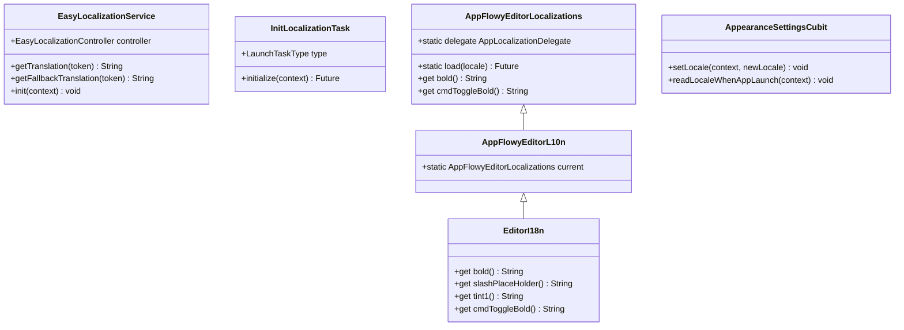
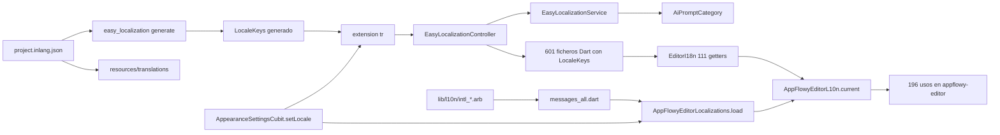
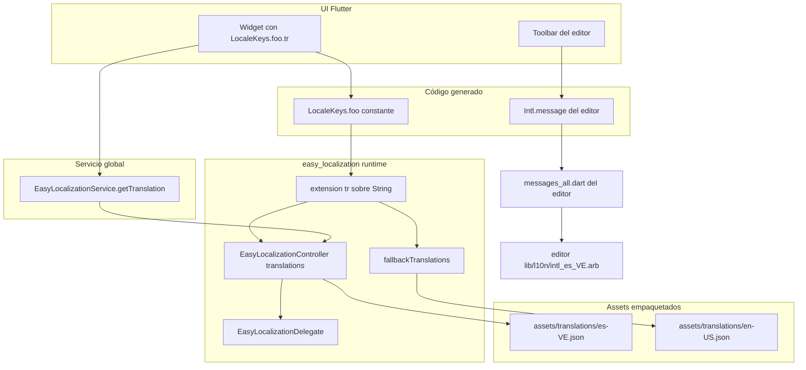
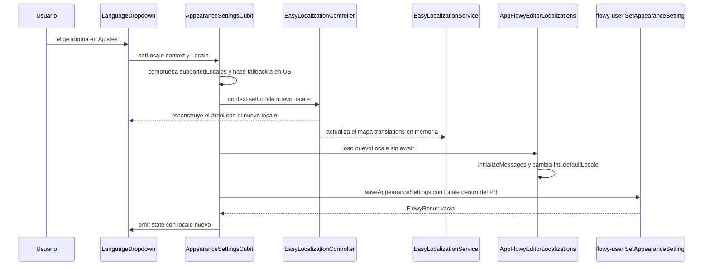
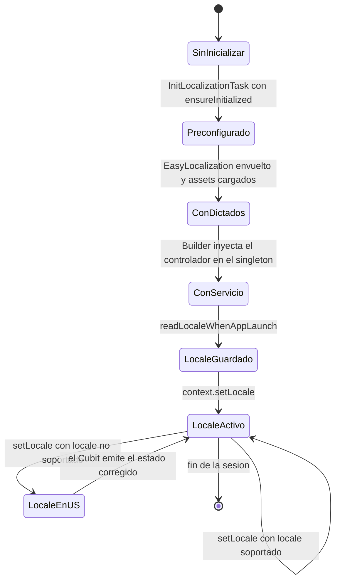

# F14 — Internacionalización

## 1. Resumen

F14 documenta la capa de internacionalización (i18n) del cliente Flutter de AppFlowy: el arranque del runtime de `easy_localization`, el servicio global que permite leer traducciones fuera del árbol de widgets, el *puente* que conecta las claves del editor (`appflowy-editor`, con su propio `intl`) con las claves de AppFlowy, y la configuración del proyecto **inlang** que gobierna el formato, el idioma origen y las reglas de lint de las traducciones. El sistema se apoya en tres piezas independientes que conviven: `easy_localization` (claves `LocaleKeys.*.tr()`), `package:intl` del editor (`Intl.message`) y el tooling inlang (Fink) para autoría y validación. Los **6 ficheros** de la unidad son exactamente el glue entre esas tres piezas; ni los bundles de traducción ni el motor de codegen pertenecen a esta unidad (§2.1).

## 2. Alcance

Este documento cubre los 6 ficheros asignados a `F14` en `OUT/_ledger/cobertura.csv`: tres de código Dart (`easy_localiation_service.dart`, `startup/tasks/localization.dart` y `editor_plugins/i18n/editor_i18n.dart`) y tres de configuración de inlang en la raíz del repo (`project.inlang.json`, `project.inlang/settings.json`, `project.inlang/project_id`). La tabla completa, con el papel de cada uno, está en §12. Además se documenta, **con cita pero sin reasignar**, el contrato de los ficheros externos que hacen que estos seis funcionen: el widget `EasyLocalization` que envuelve la app (`app_widget.dart`), la tarea de arranque que lo ordena (`startup.dart`), el `Cubit` que cambia de idioma (`appearance_cubit.dart`), la clase padre del editor (`editor:lib/src/l10n/l10n.dart`) y el generador de claves (`generate_language_files.sh`).

### 2.1 Corrección de scope obligatoria — los bundles de traducción NO son de F14

El único conjunto de bundles de traducción del repo es **`appflowy/frontend/resources/translations/*.json`**, y está asignado a la unidad **[[../../09-features/F00-infraestructura-compartida-ffi-dispatch-errores-build-nativo/7.1-app-glue-scripts-de-build-packaging-y-resources-translations-36-bundles-i18n.md]]** («App glue: scripts de build, packaging y resources/translations»), no a F14. La verificación es directa sobre el ledger: las 36 filas `appflowy/frontend/resources/translations/*.json` de `OUT/_ledger/units/F00.7.1.json` cubren el 100 % de los ficheros que existen en el directorio, sin huecos ni sobrantes. Además, esa misma unidad es la propietaria de `appflowy/frontend/scripts/code_generation/language_files/generate_language_files.sh`, el script que copia los bundles a `assets/translations/` y ejecuta `easy_localization:generate`. F14 documenta **la infraestructura que consume y produce claves**, nunca el contenido de las traducciones.

Las **1637 claves i18n** que el extractor encuentra en el código Dart ya están catalogadas, una a una, en **`16-catalogo-flags-rutas-atajos.md §7` ([[../../16-catalogo-flags-rutas-atajos.md]])** con su número de usos y sus ficheros de origen; esta unidad **no repite esa tabla** y la referencia. Lo que F14 añade es el *contrato* que la tabla presupone: cómo se genera el fichero `LocaleKeys`, cómo se resuelve una clave en tiempo de ejecución y qué ocurre al cambiar de idioma.

### 2.2 Qué queda fuera

- **Los 36 bundles JSON** y su contenido (valores, placeholders, paridad entre idiomas) — **[[../../09-features/F00-infraestructura-compartida-ffi-dispatch-errores-build-nativo/7.1-app-glue-scripts-de-build-packaging-y-resources-translations-36-bundles-i18n.md]]**.
- **El script de generación** `generate_language_files.sh` y el white-label `i18n_white_label.sh` (que sustituye la cadena `AppFlowy` por el nombre de la compañía en los bundles) — **[[../../09-features/F00-infraestructura-compartida-ffi-dispatch-errores-build-nativo/7.1-app-glue-scripts-de-build-packaging-y-resources-translations-36-bundles-i18n.md]]**.
- **El `lib/l10n/` del editor** (`editor/lib/l10n/intl_*.arb`, `editor/lib/src/l10n/l10n.dart`, `messages_all.dart`) y su pipeline de `package:intl` — **[[../../09-features/F19-editor-tests-ejemplos-l10n-configuracion/4-editor-lib-l10n-lib-raiz.md]]**. Aquí solo se documenta el punto exacto donde ambos sistemas se tocan.
- **El `AppearanceSettingsCubit`** y toda la pantalla de Ajustes → Apariencia (selector de idioma, dropdown, pantalla móvil) — **[[../../09-features/F13-ajustes-apariencia-temas-fuentes/1-ajustes-logica-de-aplicacion-cuenta-billing-plan-nube-y-workspace.md]]**. Aquí se cita el método `setLocale` porque es el único disparador del cambio en caliente.
- **`flowy_infra/lib/language.dart`** (`languageFromLocale`), que traduce un `Locale` a su nombre legible en endónimo — está fuera de la unidad (no figura en `F14.json`); se cita como apoyo en §10.
- **La tabla de claves** de [[../../16-catalogo-flags-rutas-atajos.md]] §7, por definición.

## 3. Modelos de datos

F14 no define entidades persistentes propias: define **tres clases de servicio** y consume dos clases estáticas del editor. La clave para entender el modelo es que hay **dos mapas de traducciones vivos a la vez** — el mapa del idioma activo y el mapa de respaldo — y que el servicio de AppFlowy los lee por debajo de la API pública del paquete, importando el controlador interno (`import 'package:easy_localization/src/easy_localization_controller.dart';` con el `// ignore: implementation_imports` correspondiente en `appflowy/frontend/appflowy_flutter/lib/shared/easy_localiation_service.dart:2–3`).



**Lectura:** `EditorI18n` hereda de `AppFlowyEditorL10n`, que a su vez hereda de `AppFlowyEditorLocalizations` (`appflowy/frontend/appflowy_flutter/lib/plugins/document/presentation/editor_plugins/i18n/editor_i18n.dart:5` y `editor:lib/src/editor/l10n/appflowy_editor_l10n.dart:3–4`). La herencia es la clave del diseño: `EditorI18n` **no implementa una interfaz**, sino que sobrescribe 111 de los 183 getters de texto del editor para que cada uno devuelva `LocaleKeys.editor_*.tr()` en lugar del `Intl.message` del paquete `intl`. El resultado es que el editor lee del mismo diccionario que el resto de la app para los textos de interfaz, y conserva sus propios `.arb` para los 72 getters no sobrescritos (§3.1). `EasyLocalizationService` es un singleton sin estado propio: solo guarda el `EasyLocalizationController` que le pasa el árbol de widgets, y expone dos lecturas crudas del mapa de traducciones.

### 3.1 Los tres estados de un texto del editor

El modelo anterior esconde una asimetría que conviene explicitar, porque determina qué pasa al cambiar de idioma:

| Grupo | Getters | Implementación | Fuente de la traducción | Se actualiza al cambiar de idioma |
|---|---|---|---|---|
| Sobrescritos por AppFlowy | 111 de 183 | `LocaleKeys.editor_X.tr()` (`appflowy/frontend/appflowy_flutter/lib/plugins/document/presentation/editor_plugins/i18n/editor_i18n.dart:10–12`) | Bundle de `easy_localization` (`assets/translations/<locale>.json`) | Sí, en la misma pasada, porque `tr()` lee el mapa activo en cada llamada |
| Heredados, textos de UI | 10 aprox. (`listItemPlaceholder`, `noFindResult`, `textAlignLeft`…) | `Intl.message` (`editor:lib/src/l10n/l10n.dart:625–632`) | `.arb` del editor vía `package:intl` | Sí, si `AppFlowyEditorLocalizations.load()` se completa |
| Heredados, nombres de comando | 62 (`cmdToggleBold`, `cmdUndo`, `cmdTable*`…) | `Intl.message` (`editor:lib/src/l10n/l10n.dart:1764–1772`) | `.arb` del editor vía `package:intl` | Ídem, con la salvedad del `Future` no awaited (§13) |

El recuento es verificable por diferencias entre las dos clases: el editor declara 183 getters `String get …` en `editor:lib/src/l10n/l10n.dart`, y `appflowy/frontend/appflowy_flutter/lib/plugins/document/presentation/editor_plugins/i18n/editor_i18n.dart` declara 111, todos marcados con `@override` y todos con la misma forma `return LocaleKeys.editor_X.tr();`. Los 72 no sobrescritos son exactamente los 10 textos de UI enumerados arriba más los 62 prefijados con `cmd`.

## 4. Eventos FFI

**Ninguno de los 6 ficheros de la unidad declara, envía ni escucha un evento FFI.** Los tres ficheros Dart no importan `package:appflowy_backend` ni `dispatch/dispatch.dart`, no contienen ningún `XEvent(...).send()` y no aparecen en los catálogos `events.json`, `notifications.json` ni `protobuf.json` de `OUT/_ledger/extract/` (búsqueda literal sobre los 6 nombres de fichero: 0 coincidencias). La internacionalización es una feature enteramente Dart: no cruza la frontera FFI.

Existe un evento **contexto** en el camino de persistencia del idioma, pero pertenece a otra unidad y solo se cita para cerrar el recorrido:

| Evento | Input / Output | Handler | Dónde se dispara | Propiedad de |
|---|---|---|---|---|
| `UserEvent::SetAppearanceSetting` (`= 7`) | `AppearanceSettingsPB` (contiene `locale`) | `set_appearance_setting` | `UserEventSetAppearanceSetting(setting).send()` en `appflowy/frontend/appflowy_flutter/lib/user/application/user_settings_service.dart:25–29`, invocado desde `_saveAppearanceSettings()` en `appflowy/frontend/appflowy_flutter/lib/workspace/application/settings/appearance/appearance_cubit.dart:298–305` | Registro: `appflowy/frontend/rust-lib/flowy-user/src/event_map.rs:34` y `:118`; handler: `appflowy/frontend/rust-lib/flowy-user/src/event_handler.rs:161` — **[[../../09-features/F05-usuario-auth-sesion/0.0-indice-usuario-auth-sesion.md]]** |

El evento transporta el idioma como **datos dentro de un mensaje de ajustes más amplio**: no existe un `SetLocale` dedicado. Esto tiene una consecuencia práctica: el idioma se persiste porque se persiste *toda* la apariencia (§8).

## 5. Notificaciones

**Ninguna.** No hay `NotificationBuilder`, ni `NotificationType`, ni `RustStream` subscription en los 6 ficheros. La feature no necesita notificar porque su «evento» —el cambio de idioma— lo provoca el usuario desde la misma app y su efecto es local.

Existe, sin embargo, un canal de notificación de paquete que conviene distinguir de los del SDK: `easy_localization` notifica internamente el cambio de locale a los widgets que dependen de `context.locale` (es lo que hace que `MaterialApp.router` se reconstruya con `locale: state.locale`, en `appflowy/frontend/appflowy_flutter/lib/startup/tasks/app_widget.dart:246`). Eso es un `ChangeNotifier`/`InheritedWidget` del paquete Flutter, no una notificación Rust→Dart, y por tanto no aparece en `notifications.json`. El caso real de «el Rust notifica a Dart» no se da aquí.

## 6. BLoCs / Cubits

**Ninguno definido en la unidad.** Los 6 ficheros no contienen `class … extends Cubit`, `extends Bloc` ni `part '…_event.dart'`; el catálogo `blocs.json` de `OUT/_ledger/extract/` no devuelve entradas para ninguno de ellos.

El Cubit que gobierna el idioma es **externo** y se documenta en otra unidad:

| Clase | Eventos | Estado | Servicios | Fichero | Propiedad de |
|---|---|---|---|---|---|
| `AppearanceSettingsCubit` | Sin eventos: se llama por método (`setLocale`) | `AppearanceSettingsState` (freezed) con `locale`, `theme`, `textDirection`, `layoutDirection`, `enableRtlToolbarItems`… | `UserSettingsBackendService` | `appflowy/frontend/appflowy_flutter/lib/workspace/application/settings/appearance/appearance_cubit.dart:35–60` (constructor) | **[[../../09-features/F13-ajustes-apariencia-temas-fuentes/1-ajustes-logica-de-aplicacion-cuenta-billing-plan-nube-y-workspace.md]]** (fila 1534 de `cobertura.csv`, `capa=bloc`) |

F14 aporta a esa cadena exactamente dos ganchos: `InitLocalizationTask` (§7), que debe ejecutarse antes de que nadie llame a `tr()`, y `EditorI18n` (§3), que sustituye 111 textos del editor por claves de AppFlowy.

## 7. Servicios e inyección de dependencias

El lado Dart usa `get_it`, declarado en `appflowy/frontend/appflowy_flutter/lib/startup/startup.dart:25` (`final getIt = GetIt.instance;`). El único servicio de esta feature se registra como **singleton** en el resolutor de dependencias, dentro del bloque de dependencias comunes:

```dart
  getIt.registerSingleton<EasyLocalizationService>(EasyLocalizationService());
}
```

(`appflowy/frontend/appflowy_flutter/lib/startup/deps_resolver.dart:103–104`). El fichero entero cabe en 26 líneas y la clase ocupa de la 6 a la 26:

```dart
class EasyLocalizationService {
  EasyLocalizationService();

  late EasyLocalizationController? controller;

  String getFallbackTranslation(String token) {
    final translations = controller?.fallbackTranslations;

    return translations?.get(token).toString() ?? '';
  }

  String getTranslation(String token) {
    final translations = controller?.translations;

    return translations?.get(token).toString() ?? '';
  }

  void init(BuildContext context) {
    controller = EasyLocalization.of(context)?.delegate.localizationController;
  }
}
```

(`appflowy/frontend/appflowy_flutter/lib/shared/easy_localiation_service.dart:6–26`). El patrón es: el servicio **no** carga nada por su cuenta; se limita a capturar el controlador que el árbol de widgets le entrega, de forma similar a un `BuildContext` tardío. La única inicialización es esta llamada, hecha dentro de un `Builder` para tener contexto:

```dart
        child: Builder(
          builder: (context) {
            getIt.get<EasyLocalizationService>().init(context);
            return app;
          },
        ),
```

(`appflowy/frontend/appflowy_flutter/lib/startup/tasks/app_widget.dart:114–119`), justo debajo de `EasyLocalization(...)` (`appflowy/frontend/appflowy_flutter/lib/startup/tasks/app_widget.dart:74–121`) que declara `supportedLocales` (33 locales, `:75–110`), `path: 'assets/translations'` (`:111`), `fallbackLocale: const Locale('en', 'US')` (`:112`) y `useFallbackTranslations: true` (`:113`).

El consumidor real del servicio está fuera de la unidad: `AiPromptCategory` construye su mapa de nombres con `getFallbackTranslation(category.token)` (**`appflowy/frontend/appflowy_flutter/lib/ai/service/ai_entities.dart:234–243`**), es decir, fuerza deliberadamente el **inglés de respaldo** en lugar del idioma activo, para que los nombres de categoría de los prompts de IA no cambien al cambiar el idioma de la interfaz. La clase ofrece además el getter `i18n` (`appflowy/frontend/appflowy_flutter/lib/ai/service/ai_entities.dart:142`), que sí usa `token.tr()` y por tanto sigue el idioma activo; conviven las dos políticas en el mismo enum.

El siguiente diagrama muestra quién consume cada pieza de la i18n y por dónde.



**Lectura:** el grafo tiene dos raíces de generación (`project.inlang.json` y `easy_localization:generate`) y dos ramas de lectura. La rama de la izquierda describe el camino «calvo» (`tr()` → controlador → mapa del asset), que es el que usan 601 ficheros Dart; la rama de `EditorI18n` inyecta la tabla de AppFlowy dentro de la clase que el editor consulta estáticamente 196 veces; la rama inferior derecha es la del editor puro, que solo se recarga cuando `setLocale` llama a `AppFlowyEditorLocalizations.load()`. `EasyLocalizationService` aparece como una *salida* del controlador, no como un consumidor de `LocaleKeys`: lee el mapa crudo, nunca una clave compilada.

## 8. Persistencia

El idioma persiste en **tres sitios distintos**, y solo uno es propiedad de AppFlowy:

| Qué | Dónde | Cómo se escribe | Cómo se lee |
|---|---|---|---|
| Idioma elegido (autoritativo) | `AppearanceSettingsPB.locale` dentro de los ajustes del usuario, en el SDK Rust | `setLocale` → `_saveAppearanceSettings()` → `UserEventSetAppearanceSetting` (`appflowy/frontend/appflowy_flutter/lib/workspace/application/settings/appearance/appearance_cubit.dart:214–219` y `:298–305`) | `UserSettingsBackendService().getAppearanceSetting()` en `appflowy/frontend/appflowy_flutter/lib/startup/tasks/app_widget.dart:58–59`, antes de construir la app |
| Idioma por defecto de primera ejecución | `AppearanceSettingsPB.resetToDefault` | Lo consume `readLocaleWhenAppLaunch` (`appflowy/frontend/appflowy_flutter/lib/workspace/application/settings/appearance/appearance_cubit.dart:266–275`) | Igual que el anterior |
| Idioma cacheado por el paquete | `SharedPreferences`, clave interna de `easy_localization` (`saveLocale` por defecto, no desactivado en `appflowy/frontend/appflowy_flutter/lib/startup/tasks/app_widget.dart:74–121`) | Al llamar `context.setLocale(newLocale)` | Al arrancar el widget `EasyLocalization` |

La fila 3 es `[INFERIDO]`: en el código de AppFlowy no hay ninguna lectura explícita de esa clave; el comportamiento por defecto pertenece al paquete `easy_localization ^3.0.2` declarado en `appflowy/frontend/appflowy_flutter/pubspec.yaml:53`, cuyo código no forma parte del snapshot. Lo que sí está verificado es que el paquete se declara y que la app **no** pasa `saveLocale: false` (el test de widgets sí lo hace: `appflowy/frontend/appflowy_flutter/test/widget_test/test_material_app.dart:18–25`).

El resto de la persistencia es de **build**, no de runtime:

- Los bundles viven en `frontend/resources/translations/` y **no se empaquetan directamente**: `generate_language_files.sh` los copia a `frontend/appflowy_flutter/assets/translations/` (`appflowy/frontend/scripts/code_generation/language_files/generate_language_files.sh:46–52`) y `appflowy/frontend/appflowy_flutter/pubspec.yaml:304` declara `assets/translations/` como asset. Ambas rutas están en `.gitignore` (`appflowy/frontend/appflowy_flutter/.gitignore:79` y `:40`): lo que se versiona son los bundles de `resources/`, y `assets/translations/` es una copia derivada.
- `lib/generated/locale_keys.g.dart`, donde vive la clase `LocaleKeys`, **tampoco está en el repo**: se genera con `dart run easy_localization:generate -f keys -o locale_keys.g.dart -S assets/translations/ -s en-US.json` (`appflowy/frontend/scripts/code_generation/language_files/generate_language_files.sh:74`) y el directorio `lib/generated/` está ignorado (`appflowy/frontend/appflowy_flutter/.gitignore:40`). Por eso los ficheros Dart importan `package:appflowy/generated/locale_keys.g.dart` sin que exista en el árbol.
- La tabla de claves no está duplicada en ningún sitio: existe **una sola** fuente (`en-US.json`, 94 grupos de primer nivel y 2776 hojas verificadas en este snapshot).

## 9. Diagramas de flujo

Este diagrama muestra el recorrido completo de resolver una clave i18n desde el widget hasta el bundle JSON, con la rama alternativa que usa el servicio global.



**Lectura:** la ruta superior es la canónica y es enteramente síncrona en su última mitad: `tr()` pregunta al `EasyLocalizationController`, que ya tiene en memoria el mapa del idioma activo; ese mapa se cargó una sola vez, al construir el widget `EasyLocalization`, leyendo el asset `assets/translations/<locale>.json`. `EasyLocalizationService` no añade capacidad, solo da acceso al mismo mapa desde sitios sin `BuildContext` (por ejemplo, un `enum` como `AiPromptCategory`). La rama inferior es independiente: si el getter está sobrescrito por `EditorI18n` vuelve a entrar por `tr()`, y si no, `Intl.message` resuelve contra los `.arb` del editor, que son otro conjunto de archivos con otro ciclo de carga.

Conviene fijar aquí la **convención de nombres de claves**, porque es lo que hace mantenible el sistema. El JSON de `en-US.json` es **anidado** por dominio: la clave `LocaleKeys.editor_bold` corresponde a `{"editor": {"bold": "Bold"}}` (`appflowy/frontend/resources/translations/en-US.json`, subárbol `editor`, 131 sub-claves). El nombre compilado concatena los segmentos del camino con `_`, y el generador de `easy_localization` es quien produce esa concatenación (`appflowy/frontend/scripts/code_generation/language_files/generate_language_files.sh:74`); el mapeo `editor.bold → LocaleKeys.editor_bold` es por tanto `[INFERIDO]` a partir del par (árbol anidado, comando `-f keys`), ya que `locale_keys.g.dart` no está versionado y no puede leerse. La convención efectiva que se deduce del código es:

- El prefijo es **el dominio de UI**, no la feature: 426 de las 1637 claves empiezan por `settings`, 210 por `document`, 208 por `grid`, 124 por `editor` (conteo sobre `OUT/_ledger/extract/misc.json`; el detalle de cada clave está en [[../../16-catalogo-flags-rutas-atajos.md]] §7).
- El sufijo mezcla `PascalCase` y `camelCase` según el widget que lo usa, y las variantes de un mismo texto se numeran o cualifican (`editor_tint1`…`editor_tint9`, `editor_lightLightTint1`…`9`, `editor_fontColor*` frente a `editor_backgroundColor*`), lo que permite que los colores del texto y los del fondo se traduzcan de forma independiente.
- Los parámetros de interpolación se pasan con `tr(args: …)` en lugar de concatenar cadenas; inlang lo declara con `variableReferencePattern: ["@:"]` (`appflowy/project.inlang.json:43–45`).

## 10. Diagramas de secuencia

Este diagrama muestra qué ocurre exactamente cuando el usuario cambia de idioma con la app en marcha, incluyendo la persistencia y el efecto sobre el editor.



**Lectura:** el cambio en caliente es una **cadena de cuatro escritores independientes** que no se coordinan entre sí. `EasyLocalizationController` recarga el mapa (y con él, todos los `tr()` de la app, incluidos los 111 de `EditorI18n`); `AppFlowyEditorLocalizations.load()` reinicializa los mensajes `intl` del editor para los 72 getters heredados; el `Cubit` persiste el idioma en Rust; y el `Cubit` emite su estado para que los widgets que muestran el idioma activo (el propio dropdown, `appflowy/frontend/appflowy_flutter/lib/mobile/presentation/setting/language_setting_group.dart:25–51`) se reconstruyan. El mensaje `load nuevoLocale sin await` es la única operación asíncrona sin sincronizar y se analiza como riesgo en §13.

En la UI hay tres puntos de entrada distintos al mismo camino, y los tres convergen en `AppearanceSettingsCubit.setLocale`: el dropdown de Ajustes de escritorio (`appflowy/frontend/appflowy_flutter/lib/workspace/presentation/settings/pages/settings_workspace_view.dart:328–335`, que además recorre `EasyLocalization.of(context)!.supportedLocales` para construir las opciones), el selector de la pantalla móvil (`appflowy/frontend/appflowy_flutter/lib/mobile/presentation/setting/language_setting_group.dart:41–49`, que devuelve el `Locale` por `context.push`), y el selector de la pantalla de bienvenida antes de iniciar sesión (`appflowy/frontend/appflowy_flutter/lib/user/presentation/screens/skip_log_in_screen.dart:256–258`). Los tres etiquetan cada opción con `languageFromLocale(locale)`, una función switch **endónima y no traducible** (`appflowy/frontend/appflowy_flutter/packages/flowy_infra/lib/language.dart:3–95`): el usuario ve siempre «简体中文» o «Italiano» en su propia forma, no traducida al idioma de la interfaz.

Al arrancar, el idioma no se decide en `EasyLocalization` sino un poco después: `ApplicationWidget` crea el `AppearanceSettingsCubit` con `..readLocaleWhenAppLaunch(context)` (`appflowy/frontend/appflowy_flutter/lib/startup/tasks/app_widget.dart:171–177`), que usa el idioma guardado y, solo si `resetToDefault` está activo, el idioma del dispositivo (`appflowy/frontend/appflowy_flutter/lib/workspace/application/settings/appearance/appearance_cubit.dart:266–275`).

## 11. Diagramas de estado

Este diagrama muestra el ciclo de vida de la capa i18n desde el arranque hasta el primer cambio de idioma, incluyendo el arranque inicial de la unidad.



**Lectura:** el estado `Preconfigurado` es engañoso si se lee como «ya hay traducciones»: `InitLocalizationTask` solo llama a `EasyLocalization.ensureInitialized()` y desactiva el log del paquete (`appflowy/frontend/appflowy_flutter/lib/startup/tasks/localization.dart:9–14`). El diccionario real se crea en el estado `ConDictados`, cuando el widget `EasyLocalization` carga los assets declarados en `appflowy/frontend/appflowy_flutter/lib/startup/tasks/app_widget.dart:111`. El estado `ConServicio` existe porque el servicio global no puede traducir hasta que el `Builder` le inyecta el controlador (`appflowy/frontend/appflowy_flutter/lib/startup/tasks/app_widget.dart:116`); cualquier `tr()` ejecutado antes de ese punto no encontraría nada. La transición `LocaleEnUS` es el fallback explícito de `setLocale` (`appflowy/frontend/appflowy_flutter/lib/workspace/application/settings/appearance/appearance_cubit.dart:201–205`), que sustituye por `en-US` cualquier locale no incluido en los 33 soportados.

## 12. Archivos cubiertos (del ledger)

Los 6 ficheros de la unidad `F14` de `OUT/_ledger/cobertura.csv`, con el papel que cumplen en el sistema:

| # | Ruta | Capa (ledger) | Papel | Líneas |
|---|---|---|---|---|
| 1 | `appflowy/frontend/appflowy_flutter/lib/shared/easy_localiation_service.dart` | `service` | Singleton `getIt` que expone el mapa de traducciones activo y el de respaldo fuera del árbol de widgets | 26 |
| 2 | `appflowy/frontend/appflowy_flutter/lib/startup/tasks/localization.dart` | `service` | `InitLocalizationTask`, quinta tarea de arranque: `EasyLocalization.ensureInitialized()` y silenciado del log del paquete | 15 |
| 3 | `appflowy/frontend/appflowy_flutter/lib/plugins/document/presentation/editor_plugins/i18n/editor_i18n.dart` | `ui` | `EditorI18n`: 111 getters que sustituyen los `Intl.message` del editor por claves `LocaleKeys.editor_*` de AppFlowy | 673 |
| 4 | `appflowy/project.inlang.json` | `config` | Configuración **versionada** del proyecto inlang: idioma origen `en-US`, 28 `languageTags`, 5 módulos de lint, patrón de ficheros y de interpolación | 47 |
| 5 | `appflowy/project.inlang/settings.json` | `config` | Configuración **de sesión** del IDE de inlang (Fink): mismos campos pero 31 `languageTags`, con 4 divergencias respecto de la versionada | 50 |
| 6 | `appflowy/project.inlang/project_id` | `ui` (capa `ui` en el ledger, aunque es un hash) | Identificador opaco del proyecto inlang en el servicio web, usado para asociar el repo a un proyecto remoto | 1 |

Ninguno de los seis contiene eventos FFI, notificaciones, BLoCs ni tablas de base de datos, como se justifica en §4, §5, §6 y §8.

## 13. Riesgos y casos límite

- **Los bundles y el generador están fuera de esta unidad.** `frontend/resources/translations/*.json` (36 ficheros) y `frontend/scripts/code_generation/language_files/generate_language_files.sh` pertenecen a **[[../../09-features/F00-infraestructura-compartida-ffi-dispatch-errores-build-nativo/7.1-app-glue-scripts-de-build-packaging-y-resources-translations-36-bundles-i18n.md]]**; este documento solo documenta la infraestructura que los consume. Cualquier hallazgo sobre el contenido de las traducciones debe ir a **[[../../09-features/F00-infraestructura-compartida-ffi-dispatch-errores-build-nativo/7.1-app-glue-scripts-de-build-packaging-y-resources-translations-36-bundles-i18n.md]]**, y la tabla de las 1637 claves ya usadas en código está en **[[../../16-catalogo-flags-rutas-atajos.md]] §7** — no se reproduce aquí.
- **Los 36 bundles no coinciden con el título de la unidad que los posee.** El `titulo` de `F00.7.1` dice «32 bundles i18n», pero la unidad lista 36 ficheros y el directorio contiene exactamente esos 36: la discrepancia está en el rótulo, no en la asignación [VERIFICADO]. Además hay 4 idiomas que aparecen en `project.inlang/settings.json` pero no en `project.inlang.json` (`ga-IE`, `he`, `th-TH`, `uk-UA`) y 1 al revés (`el-GR`), con 27 comunes [VERIFICADO]. Cualquiera de los dos ficheros puede ser el que lee la herramienta, y no se ha determinado cuál tiene autoridad (§18).
- **Tres bundles nunca se cargan en runtime.** `supportedLocales` declara 33 locales (`appflowy/frontend/appflowy_flutter/lib/startup/tasks/app_widget.dart:75–110`) y los bundles son 36: `ga-IE.json`, `pt-PT.json` y `vi.json` no corresponden a ningún `Locale` soportado, así que sus traducciones son inaccesibles desde la app [VERIFICADO]. `vi.json` convive con `vi-VN.json`, pero solo el segundo está registrado.
- **El cambio de idioma del editor no se espera.** `AppearanceSettingsCubit.setLocale` llama a `AppFlowyEditorLocalizations.load(newLocale)` **sin `await`** (`appflowy/frontend/appflowy_flutter/lib/workspace/application/settings/appearance/appearance_cubit.dart:212`), mientras que `load` actualiza `Intl.defaultLocale` dentro de un `.then()` (`editor:lib/src/l10n/l10n.dart:28–40`). [INFERIDO] Durante esa ventana, los 72 getters heredados del editor pueden devolver el idioma anterior mientras los 111 de `EditorI18n` ya devuelven el nuevo: la UI muestra una mezcla de idiomas durante un breve instante.
- **Una clave ausente devuelve la cadena `"null"`, no vacío.** `getTranslation` y `getFallbackTranslation` hacen `translations?.get(token).toString() ?? ''` (`appflowy/frontend/appflowy_flutter/lib/shared/easy_localiation_service.dart:11–21`): si el mapa existe pero no contiene la clave, `Map.get` devuelve `null` y `null.toString()` es la cadena `"null"` en Dart, de modo que la rama `?? ''` no se activa [VERIFICADO]. Las 22 categorías de `AiPromptCategory` que pasan por aquí (`appflowy/frontend/appflowy_flutter/lib/ai/service/ai_entities.dart:234–243`) sí existen hoy en `en-US.json`, pero el fallo sería silencioso y visible en la UI si mañana se añade una categoría sin traducir.
- **`LocaleKeys` no está versionado.** El fichero generado vive en un directorio ignorado por git (`appflowy/frontend/appflowy_flutter/.gitignore:40`) y se reconstruye desde los bundles [VERIFICADO]. Una rama nueva que no haya ejecutado el generador no compila, y una clave renombrada en el JSON rompe todas las referencias `LocaleKeys` a la vez, sin que exista un paso intermedio que detecte el solapamiento.
- **Los dos sistemas i18n no comparten catálogo.** AppFlowy traduce con `easy_localization` (JSON anidado, con prefijo de dominio) y el editor con `package:intl` (`.arb` planos, nombres de getter en inglés) [VERIFICADO]. Los idiomas tampoco coinciden: el editor declara 23 locales en `AppLocalizationDelegate.supportedLocales` (`editor:lib/src/l10n/l10n.dart:1889–1915`) frente a los 33 de la app, e incluye `bn-BN`, `da`, `nl-NL`, `hi-IN` y `ml-IN`, que **no** existen como bundles, mientras la app incluye `am-ET`, `ckb-KU`, `eu-ES`, `ur`, `fa`, `hin` y `mr-IN`, que el editor no conoce.
- **El idioma por defecto puede resetearse una sola vez.** `readLocaleWhenAppLaunch` consume y borra `resetToDefault` antes de aplicar `context.deviceLocale` (`appflowy/frontend/appflowy_flutter/lib/workspace/application/settings/appearance/appearance_cubit.dart:266–272`) [VERIFICADO]. Es una bandera de un solo uso: si el cambio de idioma falla en ese instante, la app queda en inglés sin reintentar con el idioma del dispositivo.
- **Los fallbacks silencian errores de traducción.** `useFallbackTranslations: true` (`appflowy/frontend/appflowy_flutter/lib/startup/tasks/app_widget.dart:113`) hace que cualquier clave ausente en el bundle activo se resuelva contra `en-US`; combinado con `setLocale`, que además cae a `en-US` para locales no soportados (`appflowy/frontend/appflowy_flutter/lib/workspace/application/settings/appearance/appearance_cubit.dart:201–205`), el síntoma de un bundle roto es «la app se ve en inglés» y no un error.

## 14. Evidencias y etiquetas

| Etiqueta | Cantidad | Dónde se concentran |
|---|---|---|
| `[VERIFICADO]` explícitas | 9 | §13 (seis riesgos verificados: bundles fuera de scope, 36 vs 32, 3 bundles huérfanos, `"null"` en clave ausente, `locale_keys.g.dart` no versionado, `resetToDefault`) y §18 |
| `[VERIFICADO]` por defecto (afirmación con cita directa) | ~45 | §2 (asignación de los bundles a [[../../09-features/F00-infraestructura-compartida-ffi-dispatch-errores-build-nativo/7.1-app-glue-scripts-de-build-packaging-y-resources-translations-36-bundles-i18n.md]] y divergencia entre los dos ficheros de inlang), §3 (jerarquía `EditorI18n` ← `AppFlowyEditorL10n` ← `AppFlowyEditorLocalizations` y recuento 183/111/72), §4 (cero eventos y el evento de contexto), §5, §6, §7 (singleton `get_it`, `EasyLocalization` y su `Builder`), §8 (persistencia y rutas de build), §9 (convención de nombres), §10 (tres puntos de entrada y `languageFromLocale`), §11, §12, §15, §16 |
| `[INFERIDO]` | 4 | §8 (cache en `SharedPreferences` del paquete), §9 (mapeo `editor.bold → LocaleKeys.editor_bold`), §13 (ventana asíncrona del cambio de idioma del editor), §18 (comportamiento de `tr()` ante clave ausente) |
| `[NO DETERMINADO]` | 4 | §18 (autoridad entre los dos ficheros de inlang, clave guardada por el paquete, comportamiento de `tr()` ante clave ausente, paridad de claves entre bundles) |

Todas las citas llevan ruta completa desde la raíz del repo con el prefijo de fuente (`appflowy/…`, `editor:…`) y número de línea o rango: **68 citas sobre 29 rutas distintas, el 100 % resueltas** contra `OUT/_ledger/inventario.json` por `validate_evidence.py` (0 errores). Los tres fragmentos de código tienen 2, 21 y 6 líneas respectivamente, todos ≤ 25, y los cinco diagramas pasan `validate_mermaid.sh` (5 OK / 0 FAIL).

## 15. Pruebas

La feature se cubre con pruebas de integración, no unitarias: no existen tests dedicados a `EasyLocalizationService`, `InitLocalizationTask` o `EditorI18n`.

| Prueba | Qué cubre | Fichero |
|---|---|---|
| «change the language successfully when launching the app for the first time» | Cambia de idioma en la pantalla de bienvenida y comprueba el texto renderizado en chino (`开始`), inglés (`Quick Start`) e italiano (`Andiamo`) | `appflowy/frontend/appflowy_flutter/integration_test/desktop/uncategorized/language_test.dart:11–27` |
| «check the language after relaunching the app» | Persistencia: relanza la app y comprueba que sigue en italiano | `appflowy/frontend/appflowy_flutter/integration_test/desktop/uncategorized/language_test.dart:30–33` |
| Utilitarios `tapLanguageSelectorOnWelcomePage` / `tapLanguageItem` | Localizan el selector y la opción por `languageCode`/`countryCode`, con scroll | `appflowy/frontend/appflowy_flutter/integration_test/shared/common_operations.dart:121–124` y `:134–163` |
| Arnés `WidgetTestApp` | Monta un `EasyLocalization` de un solo idioma con `saveLocale: false` y un `AssetLoader` propio, para que los tests de widget puedan usar `tr()` | `appflowy/frontend/appflowy_flutter/test/widget_test/test_material_app.dart:18–25` |
| `TestBundleAssetLoader` | Carga los JSON de traducción desde `rootBundle` saltándose el límite de 10 KB por asset | `appflowy/frontend/appflowy_flutter/test/widget_test/test_asset_bundle.dart:34–47` |

La primera prueba es la que fija el contrato de la unidad: el idioma se cambia en caliente y el texto cambia en pantalla; la segunda fija el de persistencia. **Advertencia**: `language_test.dart` no está importado por ningún runner —ni `desktop_runner_9.dart` (`appflowy/frontend/appflowy_flutter/integration_test/desktop_runner_9.dart:3–21`) ni `desktop/uncategorized/uncategorized_test_runner_1.dart` (`appflowy/frontend/appflowy_flutter/integration_test/desktop/uncategorized/uncategorized_test_runner_1.dart:3–18`) lo registran, y una búsqueda de la cadena `language_test` en todo `frontend/appflowy_flutter` no devuelve ninguna otra coincidencia [VERIFICADO]. La prueba existe pero no se ejecuta en CI en este snapshot (§17).

## 16. Métricas

| Métrica | Valor | Cómo se ha medido |
|---|---|---|
| Ficheros de la unidad | 6 (2 `ui`, 2 `service`, 2 `config`) | `OUT/_ledger/units/F14.json` |
| Líneas de código de la unidad | 812 (26 + 15 + 673 + 47 + 50 + 1) | `wc -l` sobre los 6 ficheros |
| Getters sobrescritos por `EditorI18n` | 111 (todos `@override`) | Conteo de `String get` en `editor_i18n.dart` |
| Getters de texto del editor | 183, de los que 72 no se sobrescriben | Conteo sobre `editor:lib/src/l10n/l10n.dart` |
| Usos de `AppFlowyEditorL10n.current` en el editor | 196 | Búsqueda en `editor/lib` |
| Claves i18n únicas usadas en código | 1637 (2495 usos) | `OUT/_ledger/extract/misc.json`, catalogadas en [[../../16-catalogo-flags-rutas-atajos.md]] §7 |
| Ficheros Dart que importan `locale_keys.g.dart` | 601 (277 en `plugins/`, 141 en `workspace/`, 101 en `mobile/`, 29 en `user/`, 19 en `ai/`, 15 en `features/`, 13 en `shared/`, 4 en `util/`, 1 en `startup/`, 1 en `core/`) | Búsqueda en `frontend/appflowy_flutter/lib` |
| Llamadas a `.tr()` | 2817 | Búsqueda en `frontend/appflowy_flutter/lib` |
| Bundles de traducción | 36 ficheros (**de [[../../09-features/F00-infraestructura-compartida-ffi-dispatch-errores-build-nativo/7.1-app-glue-scripts-de-build-packaging-y-resources-translations-36-bundles-i18n.md]]**, no de F14) | Listado de `frontend/resources/translations/` |
| Grupos de primer nivel / hojas de `en-US.json` | 94 / 2776 | Recorrido del JSON |
| Locales declarados por la app | 33 (`appflowy/frontend/appflowy_flutter/lib/startup/tasks/app_widget.dart:75–110`), con 3 bundles huérfanos | Parseo del literal |
| Idiomas declarados en inlang | 28 (`project.inlang.json:4–33`) frente a 31 (`project.inlang/settings.json:4–36`) | Parseo del JSON |
| Módulos de lint de inlang | 5 (`project.inlang.json:34–40`) | Lectura directa |
| Posición de `InitLocalizationTask` | 5.ª de 15 tareas de arranque | `appflowy/frontend/appflowy_flutter/lib/startup/startup.dart:131–132`; orden completo en [[../../16-catalogo-flags-rutas-atajos.md]] §8 |
| Eventos FFI / notificaciones / BLoCs propios | 0 / 0 / 0 | Búsqueda en los 6 ficheros y en los catálogos |

## 17. Pendientes

- **`language_test.dart` no se ejecuta.** Ningún runner lo importa (§15). Decidir si se añade a `uncategorized_test_runner_1.dart` o si se borra, porque una prueba de persistencia de idioma es la única red de seguridad de §10.
- **Auditar las 3 bundles huérfanas** (`ga-IE`, `pt-PT`, `vi`) y las 4 divergencias entre los dos ficheros de inlang (§13): hay que decidir si se añaden locales a `supportedLocales` o si se eliminan bundles, porque hoy ambas piezas miden cosas distintas (33 frente a 28/31).
- **Convertir `AppFlowyEditorLocalizations.load` en `await`** o encadenarla al `emit` del `Cubit`, para cerrar la ventana de idioma mixto descrita en §13. El cambio está en `appflowy/frontend/appflowy_flutter/lib/workspace/application/settings/appearance/appearance_cubit.dart:212`, fuera de la unidad: corresponde a **[[../../09-features/F13-ajustes-apariencia-temas-fuentes/1-ajustes-logica-de-aplicacion-cuenta-billing-plan-nube-y-workspace.md]]**.
- **Valorar `saveLocale: false` en producción.** Hoy conviven dos copias del idioma (Rust y `SharedPreferences` del paquete). Fijar una sola fuente evitaría el caso de un `resetToDefault` que borra una y deja la otra.
- **Unificar el prefijo de claves por feature en lugar de por dominio de UI.** La convención actual (`settings_*` con 426 claves) hace que las claves de una misma feature se repartan por la pantalla y no por el módulo (`[[../../16-catalogo-flags-rutas-atajos.md]]` §7 muestra el efecto).
- **Documentar `i18n_white_label.sh`** junto con los bundles en **[[../../09-features/F00-infraestructura-compartida-ffi-dispatch-errores-build-nativo/7.1-app-glue-scripts-de-build-packaging-y-resources-translations-36-bundles-i18n.md]]**: sustituye la cadena `AppFlowy` por el nombre de la compañía en el contenido de los JSON, lo que afecta a cualquier clave que contenga el nombre del producto y merece su propio párrafo en el documento de los bundles.

## 18. Preguntas abiertas

1. `[NO DETERMINADO]` **¿Cuál de los dos ficheros de inlang manda?** `appflowy/project.inlang.json` (versionado, 28 tags) y `appflowy/project.inlang/settings.json` (no versionado, 31 tags) declaran el mismo esquema pero conjuntos de idiomas distintos (§13). El `project_id` sugiere que el segundo es el estado local de un proyecto remoto, pero nada en el repo declara la precedencia, y el ledger asigna a F14 ambos ficheros sin jerarquizarlos.
2. `[NO DETERMINADO]` **¿Qué clave y formato persiste `easy_localization` en `SharedPreferences`?** La app no pasa `saveLocale: false` (`appflowy/frontend/appflowy_flutter/lib/startup/tasks/app_widget.dart:74–121`), así que el paquete guarda el idioma, pero el código del paquete no está en el snapshot y el nombre de la clave no se ha podido leer. Afecta al modelo de datos de §8 y a la prioridad entre las dos fuentes de verdad.
3. `[NO DETERMINADO]` **¿Qué devuelve exactamente `tr()` cuando la clave no existe en el bundle activo?** El comportamiento exacto depende de `easy_localization ^3.0.2` (no está en el snapshot): con `useFallbackTranslations: true` se espera que caiga al bundle de `en-US`, pero no se ha podido verificar si devuelve la cadena vacía, la clave literal o la del fallback. En `EasyLocalizationService` sí está verificado que devuelve `"null"` (§13), pero ese camino es propio del servicio y no de la extensión `tr()`.
4. `[NO DETERMINADO]` **¿Se mantiene la paridad de los 1637 claves entre los 36 bundles?** inlang declara una regla de lint `message-lint-rule-missing-translation`, pero no hay en el repo ninguna salida de su ejecución, así que no se puede afirmar qué claves están realmente traducidas en cada idioma.

## 19. Relacionado con

- **[[../../09-features/F00-infraestructura-compartida-ffi-dispatch-errores-build-nativo/7.1-app-glue-scripts-de-build-packaging-y-resources-translations-36-bundles-i18n.md]]** — propietario de los 36 bundles de `frontend/resources/translations/` y de `generate_language_files.sh`; la corrección de scope de §2.1 y de §13 sale de ahí. También de ahí sale `i18n_white_label.sh`.
- **[[../../16-catalogo-flags-rutas-atajos.md]]** — `16-catalogo-flags-rutas-atajos.md`, §7 contiene las 1637 claves i18n con sus usos y orígenes, y §8 el orden de las 15 tareas de arranque donde figura `InitLocalizationTask` en quinta posición.
- **[[../../09-features/F19-editor-tests-ejemplos-l10n-configuracion/4-editor-lib-l10n-lib-raiz.md]]** — `editor/lib/l10n` y `lib/` raíz del editor: los 23 `.arb`, `editor/lib/src/l10n/l10n.dart` (los 183 getters, `load()` y `AppLocalizationDelegate`) y `messages_all.dart`. Es el otro sistema i18n que F14 conecta.
- **[[../../09-features/F17-plataforma-ventanas-deeplinks-auto-update-hotkeys-feature-flags-errores-logging/F17-plataforma-ventanas-deeplinks-auto-update-hotkeys-feature-flags-errores-logging.md]]** — plataforma y arranque: el contexto de `LaunchTask`, `deps_resolver.dart` (donde se registra el singleton) y la política de logging del SDK, que choca con el `EasyLocalization.logger.enableBuildModes = []` de `appflowy/frontend/appflowy_flutter/lib/startup/tasks/localization.dart:13`.
- **[[../../09-features/F13-ajustes-apariencia-temas-fuentes/1-ajustes-logica-de-aplicacion-cuenta-billing-plan-nube-y-workspace.md]]** — `AppearanceSettingsCubit`, `settings_workspace_view.dart`, `language_setting_group.dart` y `skip_log_in_screen.dart`: los tres puntos de entrada del cambio de idioma y la persistencia en Rust.
- **[[../../09-features/F01-documentos-y-editor/0.1-indice-de-documentos-y-editor-modelo-documentbloc-servicios-appflowy.md]]** — `document_appearance_cubit.dart`, el otro Cubit de apariencia que consume estas traducciones.
- **[[../../09-features/F09-ia/0-indice-ia-chat-completion-ia-local-mcp-embeddings-middleware.md]]** — `ai_entities.dart` y `AiPromptCategory`, el único consumidor real de `EasyLocalizationService`.
- **[[../../09-features/F05-usuario-auth-sesion/0.0-indice-usuario-auth-sesion.md]]** — `flowy-user`: registro y handler de `UserEvent::SetAppearanceSetting`, el evento que persiste el idioma.