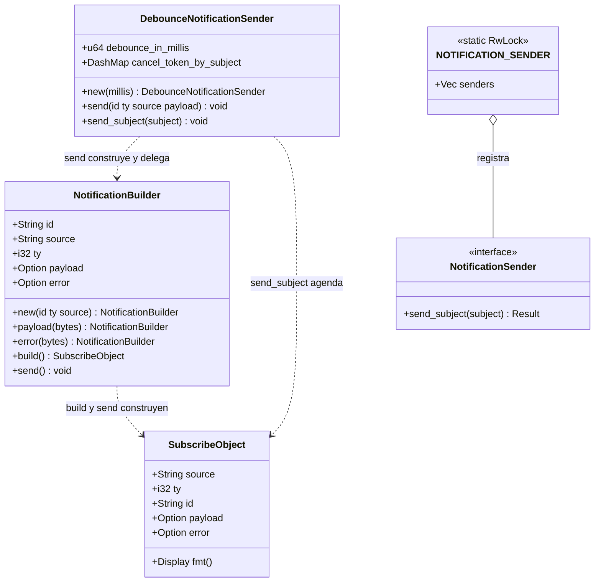
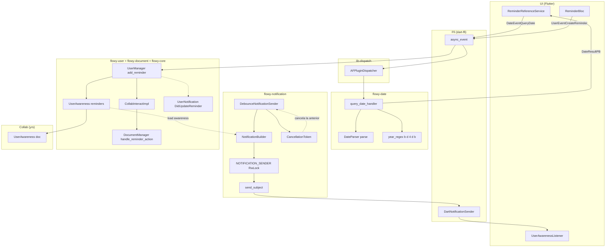
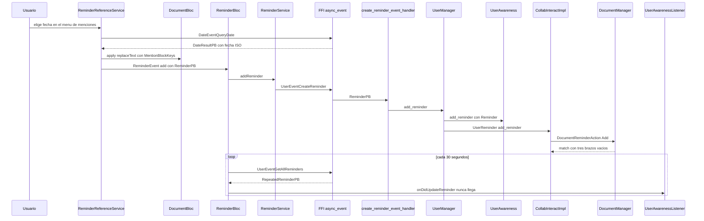
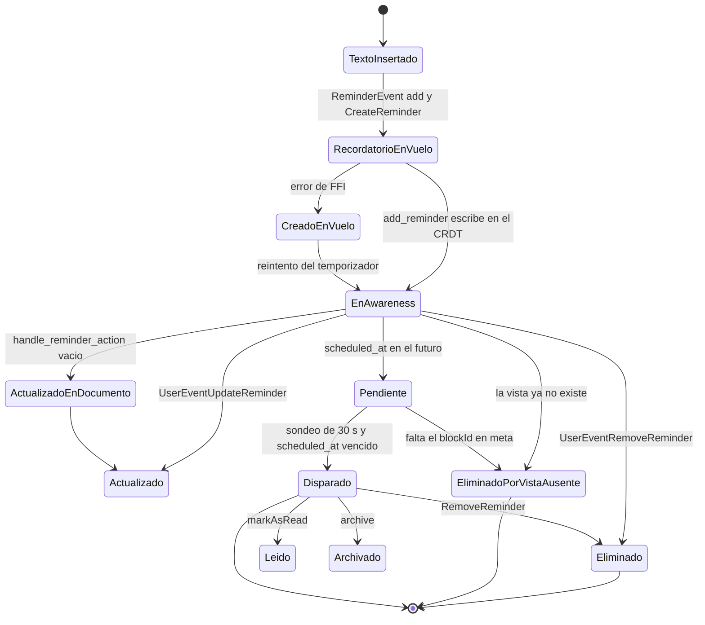

# F15.2 — flowy-date, reminder.rs y flowy-notification (Rust)

## 1. Resumen (3–6 líneas)

Este documento cubre la **capa Rust de las notificaciones in-app** en tres piezas independientes. `flowy-date` es un crate diminuto (7 ficheros, 108 líneas) que resuelve un único evento, `DateEvent::QueryDate`, para traducir texto en lenguaje natural a una fecha ISO; delega todo el trabajo real de parseo en el crate externo `date_time_parser 0.2.0` y solo añade un parche de año con la expresión regular `\b\d{4}\b`. `flowy-document/src/reminder.rs` (24 líneas) define el contrato **documentado pero no implementado** del recordatorio en el lado Rust: `DocumentManager::handle_reminder_action` recibe la acción y las descarta en un `match` con los tres brazos vacíos, y la variante `UserNotification::DidUpdateReminder = 8` que el panel de notificaciones Dart espera está marcada con `// TODO: implement reminder observer` y no la emite ningún emisor del workspace. `flowy-notification` sí es infraestructura viva: aporta el `NotificationBuilder`, el registro global de emisores `NOTIFICATION_SENDER` y el `DebounceNotificationSender`, que en este snapshot tiene **una única instanciación en todo el workspace**, `DebounceNotificationSender::new(200)` en `flowy-database2`, es decir 200 ms de agrupamiento solo para filas y celdas de base de datos.

## 2. Alcance

Este documento es la sub-unidad `F15.2` y documenta exactamente 16 ficheros: los 7 de `frontend/rust-lib/flowy-date/` (2 de configuración, 1 de build y 4 de código), 1 de `frontend/rust-lib/flowy-document/src/reminder.rs` y los 8 de `frontend/rust-lib/flowy-notification/` (2 de configuración, 1 de build y 5 de código). La tabla completa, con el papel de cada uno, está en §12.

**Corrección de scope obligatoria (dos puntos).**

1. **`flowy-notification/**` ya está documentado en `[[../../06-puente-flutter-rust/00-indice.md]]`.** Los ocho ficheros de este crate se re-describen aquí solo en su aportación propia —la tabla de APIs del `NotificationBuilder` (§3.3) y la política de debounce con los valores reales leídos del código (§3.4)— y en el papel que juegan dentro de la feature F15. Todo lo demás (la cadena completa de emisión, los seis enums de notificación con sus 70 variantes y los parsers Dart) está en `OUT/06-puente-flutter-rust/04-notificaciones.md` y no se re-verifica aquí; se cita por cross-ref.
2. **Los dos lados Dart quedan fuera.** El listener y el `ReminderBloc` que consumen lo que aquí se emite están en `[[../../09-features/F15-notificaciones-in-app-y-recordatorios/1-notificaciones-y-recordatorios-dart-listeners-panel-date-picker.md]]` y `[[../../09-features/F05-usuario-auth-sesion/1-usuario-appflowy-flutter-lib-user-dart.md]]`; la lógica de mención que crea el recordatorio en el editor está en `[[../../09-features/F01-documentos-y-editor/4-menciones-pagina-fecha-persona-recordatorio-inline-actions.md]]`. Aquí se documenta el contrato Rust y se citan esos ficheros Dart únicamente como punto de entrada y como evidencia del extremo a extremo (§10).

Quedan fuera, y se citan solo como contexto: `appflowy/frontend/rust-lib/flowy-user/src/entities/reminder.rs`, `appflowy/frontend/rust-lib/flowy-user/src/event_map.rs`, `appflowy/frontend/rust-lib/flowy-user/src/event_handler.rs` y `appflowy/frontend/rust-lib/flowy-user/src/user_manager/manager_user_awareness.rs` (los cuatro eventos de recordatorio, propiedad de `[[../../09-features/F05-usuario-auth-sesion/1-usuario-appflowy-flutter-lib-user-dart.md]]`), `appflowy/frontend/rust-lib/flowy-core/src/deps_resolve/reminder_deps.rs` y `appflowy/frontend/rust-lib/flowy-core/src/module.rs` (composición, `[[../../09-features/F00-infraestructura-compartida-ffi-dispatch-errores-build-nativo/1-ffi-y-dispatcher-dart-ffi-lib-dispatch-lib-infra.md]]`), `appflowy/frontend/rust-lib/dart-ffi/src/notification/sender.rs` (el emisor hacia Dart, `[[../../06-puente-flutter-rust/00-indice.md]]`) y `collab:collab-entity/src/reminder.rs` (la entidad CRDT, `[[../../09-features/F06-sync-y-servidores/F06-sync-y-servidores.md]]`).

## 3. Modelos de datos

### 3.1 Tipos propios de esta unidad

| Tipo | Fichero:línea | Campos / variantes | Papel |
|---|---|---|---|
| `DateQueryPB` | `appflowy/frontend/rust-lib/flowy-date/src/entities.rs:3–7` | `query: String` (`pb(index = 1)`) | Payload de entrada de `QueryDate`: la cadena tal cual la escribió el usuario |
| `DateResultPB` | `appflowy/frontend/rust-lib/flowy-date/src/entities.rs:9–13` | `date: String` (`pb(index = 1)`) | Payload de salida: la fecha ya formateada como texto |
| `DateEvent` | `appflowy/frontend/rust-lib/flowy-date/src/event_map.rs:14–19` | una variante, `QueryDate = 0` | Enum de eventos del crate, con `#[event_err = "FlowyError"]` |
| `SubscribeObject` | `appflowy/frontend/rust-lib/flowy-notification/src/entities/subject.rs:5–21` | `source: String` (1), `ty: i32` (2), `id: String` (3), `payload: Option<Vec<u8>>` (4, `one_of`), `error: Option<Vec<u8>>` (5, `one_of`) | Sobre de transporte Rust→Dart; `payload` y `error` son `one_of`, de ahí las dos opciones |
| `DocumentReminder` | `appflowy/frontend/rust-lib/flowy-document/src/reminder.rs:11–14` | `document_id: String` (campo privado) | Proyección del recordatorio al ámbito de documento; el comentario del código dice literalmente `// defines the necessary fields for a reminder` |
| `DocumentReminderAction` | `appflowy/frontend/rust-lib/flowy-document/src/reminder.rs:4–9` | `Add { reminder }`, `Remove { reminder_id: String }`, `Update { reminder }` | Acción en memoria que `flowy-core` inyecta en el `DocumentManager` |

`DocumentReminderAction` y `DocumentReminder` derivan `Serialize`/`Deserialize` pero **no** derivan `ProtoBuf`, y por eso `flowy-document/Flowy.toml` no las expone al codegen: no cruzan la frontera FFI, son un mensaje interno entre `flowy-core` y `flowy-document` (`appflowy/frontend/rust-lib/flowy-core/src/deps_resolve/reminder_deps.rs:19–56`). El `TryFrom<Reminder>` que las une (`appflowy/frontend/rust-lib/flowy-document/src/reminder.rs:16–24`) declara `type Error = serde_json::Error` pero devuelve siempre `Ok`, porque el único campo (`object_id`) es un `String` que no puede fallar al copiar: la firma de error existe solo por simetría con otras conversiones del SDK.

El diagrama muestra la superficie pública de `flowy-notification`: el builder, el sobre que produce, el registro global de emisores y el envoltorio con debounce.

**Muestra:** la API pública de `flowy-notification` —el constructor del builder, los dos\setadores opcionales `payload`/`error`, los dos unflos terminales `build`/`send`, el sobre `SubscribeObject`, el trait de emisor y el envoltorio con debounce.



**Lectura:** el builder es un valor plano con dos `Option` que se rellenan por consumo de `self` (cada `setter` devuelve `Self`), de manera que la construcción es encadenable y termina en uno de dos desenlaces: `build()`, que devuelve el `SubscribeObject` sin enviarlo y sirve para que otro componente lo reenvíe (por ejemplo a través del debounce), y `send()`, que lo entrega directamente al registro global. `NOTIFICATION_SENDER` es un `RwLock<Vec<Box<dyn NotificationSender>>>` global del proceso, y tanto `send()` como el debounce terminan en la misma función libre `send_subject`, que itera **todos** los emisores registrados: si el SDK se inicializa dos veces (hot reload de Flutter, tests de integración), se envían copias duplicadas salvo que se llame antes a `unregister_all_notification_sender`. El `DebounceNotificationSender` no es un emisor, es un *scheduler*: construye el `SubscribeObject` con el builder y pospone el envío real.

### 3.2 Formatos y parseadores de `flowy-date`

`flowy-date` es un crate sin estado: todo su comportamiento cabe en 36 líneas de handler. La tabla enumera cada formato o parser que el crate acepta o produce, con la función concreta y su línea.

| # | Formato / parser | Función | Archivo:línea | Observación |
|---|---|---|---|---|
| 1 | Lenguaje natural (`"next monday"`, `"mañana"`, …) | `date_time_parser::DateParser::parse(&str) -> Option<NaiveDate>` | `appflowy/frontend/rust-lib/flowy-date/src/event_handler.rs:21` | Delegación total: el crate no implementa gramática propia, usa la del crate externo |
| 2 | Año explícito de 4 dígitos con límites de palabra | `year_regex()` sobre `OnceLock<Regex>` con `r"\b\d{4}\b"` | `appflowy/frontend/rust-lib/flowy-date/src/event_handler.rs:10–14` | Compilado una sola vez por proceso gracias a `OnceLock`; es el único regex del crate |
| 3 | Recomposición año + mes/día del resultado NLP | `NaiveDate::from_ymd_opt(year, naive_date.month0(), naive_date.day0())` | `appflowy/frontend/rust-lib/flowy-date/src/event_handler.rs:26–28` | Si la consulta no trae año, `from_ymd_opt` recibe el año que el NLP haya supuesto y el resultado es el mismo; si la fecha es imposible (31 de febrero) devuelve `None` |
| 4 | Formato de salida (serialización) | `NaiveDate::to_string()` (`Display` de `chrono`) | `appflowy/frontend/rust-lib/flowy-date/src/event_handler.rs:29–30` | `chrono` serializa `NaiveDate` en ISO 8601 `YYYY-MM-DD` `[INFERIDO]`; el contrato real lo fija el consumidor Dart (§3.2, fila 5) |
| 5 | Re-parseo del resultado en Dart | `DateTime.tryParse(String)` | `appflowy/frontend/appflowy_flutter/lib/date/date_service.dart:14` | Si la cadena no es parseable, `DateService.queryDate` devuelve `FlowyError(msg: 'Could not parse Date (NLP) from String')` (`appflowy/frontend/appflowy_flutter/lib/date/date_service.dart:17–19`) |
| 6 | Formato patrón por locale, solo en Dart | `DateFormat.yMd(_locale).parse(search)` | `appflowy/frontend/appflowy_flutter/lib/plugins/inline_actions/handlers/reminder_reference.dart:100` | No pasa por Rust: el menú de menciones intenta primero el patrón local y después el NLP |
| 7 | Fallo de parseo | `FlowyError::internal().with_context("Failed to parse date from")` | `appflowy/frontend/rust-lib/flowy-date/src/event_handler.rs:34` | Único error posible del handler; el mensaje está truncado y no incluye la consulta ni su contexto |

El handler completo cabe en el siguiente fragmento (`appflowy/frontend/rust-lib/flowy-date/src/event_handler.rs:20–35`):

```rust
let query: String = data.into_inner().query;
let date = DateParser::parse(&query);

match date {
  Some(naive_date) => {
    let year_match = year_regex().find(&query).unwrap();
    let formatted = year_match
      .and_then(|capture| capture.as_str().parse::<i32>().ok())
      .and_then(|year| NaiveDate::from_ymd_opt(year, naive_date.month0(), naive_date.day0()))
      .map(|date| date.to_string())
      .unwrap_or_else(|| naive_date.to_string());

    data_result_ok(DateResultPB { date: formatted })
  },
  None => Err(FlowyError::internal().with_context("Failed to parse date from")),
}
```

Lo que el crate **no** tiene: no hay cache, no hay estado entre llamadas, no hay formateo localizado (el formato de salida es fijo, la localización se aplica en Dart con `DateFormat.yMd`), y no hay ninguna otra función pública que `lib.rs` exporte (`appflowy/frontend/rust-lib/flowy-date/src/lib.rs:1–4` declara `entities`, `event_handler`, `event_map` y el módulo generado `protobuf`). El crate se compila con `edition = "2024"` y `crate-type = ["cdylib", "rlib"]` (`appflowy/frontend/rust-lib/flowy-date/Cargo.toml:3–8`), y su tabla de dependencias es mínima: `lib-dispatch`, `flowy-error`, `flowy-derive`, `protobuf`, `bytes`, `strum_macros 0.21`, `tracing`, `date_time_parser 0.2.0`, `chrono` y `fancy-regex 0.11.0` (`appflowy/frontend/rust-lib/flowy-date/Cargo.toml:10–20`).

### 3.3 APIs del `NotificationBuilder`

| API | Firma | Archivo:línea | Efecto |
|---|---|---|---|
| `NotificationBuilder::new` | `(id: &str, ty: T, source: &str) -> Self` con `T: Into<i32>` | `appflowy/frontend/rust-lib/flowy-notification/src/builder.rs:18–26` | Deja `payload` y `error` en `None`; copia `id` y `source` |
| `.payload` | `(self, payload: T) -> Self` con `T: ToBytes` | `appflowy/frontend/rust-lib/flowy-notification/src/builder.rs:28–40` | Serializa el payload a `Bytes`; si `into_bytes()` falla **solo registra** `tracing::error!` y continúa sin payload (la notificación se emite igual, vacía) |
| `.error` | `(self, error: T) -> Self` con `T: ToBytes` | `appflowy/frontend/rust-lib/flowy-notification/src/builder.rs:42–53` | Idéntico para el canal de error, que Dart recibe en `error` y no en `payload` |
| `.build` | `(self) -> SubscribeObject` | `appflowy/frontend/rust-lib/flowy-notification/src/builder.rs:55–65` | Consume el builder y devuelve el sobre **sin enviarlo**; convierte `Bytes` a `Vec<u8>` |
| `.send` | `(self) -> ()` | `appflowy/frontend/rust-lib/flowy-notification/src/builder.rs:67–79` | Construye el mismo sobre y llama a `send_subject(subject)` |
| `send_subject` (libre) | `(subject: SubscribeObject) -> ()` | `appflowy/frontend/rust-lib/flowy-notification/src/builder.rs:83–94` | Toma `NOTIFICATION_SENDER.read()` y hace `send_subject` en **todos** los emisores, clonando el sobre por emisor; los errores de cada emisor solo se registran |
| `register_notification_sender` | `(sender: T)` con `T: NotificationSender` | `appflowy/frontend/rust-lib/flowy-notification/src/lib.rs:22–28` | Añade un emisor al registro global; hay que llamarlo antes que a `unregister_all_notification_sender` para no acumular |
| `unregister_all_notification_sender` | `() -> ()` | `appflowy/frontend/rust-lib/flowy-notification/src/lib.rs:30–35` | Vacía el registro; lo invoca `set_stream_port` antes de registrar el emisor de Dart (`appflowy/frontend/rust-lib/dart-ffi/src/lib.rs:239–244`) |

El campo `id` es la clave de correlación: el comentario del código explica que identifica de forma única cada notificación y que el frontend lo usa para enlazarla con la entidad observable correspondiente (`appflowy/frontend/rust-lib/flowy-notification/src/builder.rs:7–10`). El parser Dart lo reproduce literalmente: `UserNotificationParser` acepta el aviso solo si `source == 'User'` y después resuelve el valor de `ty` (`appflowy/frontend/appflowy_flutter/lib/core/notification/user_notification.dart:7–18`).

### 3.4 Políticas de debounce

`DebounceNotificationSender` agrupa por clave `"{source}-{id}-{ty}"` (`appflowy/frontend/rust-lib/flowy-notification/src/debounce.rs:29`). Al recibir un aviso con la misma clave cancela el `CancellationToken` de la tarea anterior y lo retira del `DashMap`, inserta un token nuevo y lanza un `tokio::spawn` que —solo si `debounce_in_millis > 0`— duerme ese tiempo antes de enviar (`appflowy/frontend/rust-lib/flowy-notification/src/debounce.rs:31–52`). Con valor `0` el envío es inmediato, sin `sleep`. El efecto real es *trailing-edge* con ventana fija desde la última llegada: la primera notificación de una ráfaga se retrasa `debounce_in_millis` y solo sale la última.

| Crate / consumidor | Cómo se instancia | `debounce_in_millis` | Archivo:línea |
|---|---|---|---|
| `flowy-database2` (`DatabaseEditorImpl::new`) | `Arc::new(DebounceNotificationSender::new(200))` y se pasa a `observe_rows_change` | **200 ms** | `appflowy/frontend/rust-lib/flowy-database2/src/services/database/database_editor.rs:93` y `:100` |
| `flowy-notification` (envío directo) | `NotificationBuilder::send()` llama a `send_subject` sin pasar por el debounce | **0 ms** (inmediato) | `appflowy/frontend/rust-lib/flowy-notification/src/builder.rs:67–79` |
| `flowy-user` (recordatorios, `send_notification`) | `NotificationBuilder::new(...).payload(...).send()`, sin debounce | **0 ms** (inmediato) | `appflowy/frontend/rust-lib/flowy-user/src/notification.rs:26–30` |
| Resto del workspace | ninguna otra instanciación | — | `rg "DebounceNotificationSender::new\("` sobre `frontend/rust-lib/` devuelve **una sola** coincidencia, la de la fila 1 |

Los dos únicos emisores que pasan por el debounce son los de base de datos: `notify_row` construye `DatabaseNotification::DidUpdateRow` con `RowsChangePB` y `notify_cell` construye `DatabaseNotification::DidUpdateCell` **sin payload**, ambos con `notification_sender.send_subject(subject)` (`appflowy/frontend/rust-lib/flowy-database2/src/services/database/database_observe.rs:319–334` y `:337–344`). Esa asimetría importa: el aviso de celda solo transporta el `id` de la celda como clave de correlación, sin datos, y el frontend tiene que releer.

## 4. Eventos FFI

El catálogo `events.json` registra un único crate con eventos en esta unidad, `flowy-date`, con una variante registrada y ninguna sin handler:

| Evento | Input PB | Output PB | Handler | Registro | Handler en |
|---|---|---|---|---|---|
| `DateEvent::QueryDate = 0` | `DateQueryPB` | `DateResultPB` | `query_date_handler` | `appflowy/frontend/rust-lib/flowy-date/src/event_map.rs:11` | `appflowy/frontend/rust-lib/flowy-date/src/event_handler.rs:17` |

El registro del plugin es el patrón canónico del SDK: `AFPlugin::new().name(env!("CARGO_PKG_NAME")).event(DateEvent::QueryDate, query_date_handler)` (`appflowy/frontend/rust-lib/flowy-date/src/event_map.rs:8–12`). El nombre del plugin se toma del nombre del paquete Cargo, así que en el dispatcher aparece como `flowy-date`. La declaración del enum lleva `#[derive(..., ProtoBuf_Enum, Flowy_Event)]` y `#[event_err = "FlowyError"]`, y la variante declara sus tipos con `#[event(input = "DateQueryPB", output = "DateResultPB")]` (`appflowy/frontend/rust-lib/flowy-date/src/event_map.rs:14–18`).

**Los cuatro eventos de recordatorio son de `flowy-user`, no de esta unidad**, y se documentan en `[[../../09-features/F05-usuario-auth-sesion/1-usuario-appflowy-flutter-lib-user-dart.md]]`. Se reproducen aquí porque son el otro extremo del recorrido de §10: `CreateReminder = 28` (input `ReminderPB`, sin salida), `GetAllReminders = 29` (output `RepeatedReminderPB`), `RemoveReminder = 30` (input `ReminderIdentifierPB`) y `UpdateReminder = 31` (input `ReminderPB`), registrados en `appflowy/frontend/rust-lib/flowy-user/src/event_map.rs:48–51` y `:170–180`. El handler de creación solo desempaqueta y delega: `create_reminder_event_handler` llama a `manager.add_reminder(params)` (`appflowy/frontend/rust-lib/flowy-user/src/event_handler.rs:523–531`).

El codegen de ambos crates está gobernado por su `Flowy.toml`: el de `flowy-date` declara `proto_input = ["src/event_map.rs", "src/entities.rs"]` y `event_files = ["src/event_map.rs"]` (`appflowy/frontend/rust-lib/flowy-date/Flowy.toml:2–3`), de modo que genera tanto el `.proto` de entidades como los eventos Dart; su `build.rs` llama a `dart_gen` y a `dart_event::gen` bajo el feature `dart` (`appflowy/frontend/rust-lib/flowy-date/build.rs:1–7`), que se activa con `dart = ["flowy-codegen/dart"]` (`appflowy/frontend/rust-lib/flowy-date/Cargo.toml:25–26`). El de `flowy-notification` solo declara `proto_input = ["src/entities"]` (`appflowy/frontend/rust-lib/flowy-notification/Flowy.toml:2`) porque no tiene eventos, y su `build.rs` únicamente invoca `dart_gen` (`appflowy/frontend/rust-lib/flowy-notification/build.rs:1–4`). Eso es lo que produce el `SubscribeObject` Dart que el listener importa como `package:appflowy_backend/protobuf/flowy-notification/subject.pb.dart` (`appflowy/frontend/appflowy_flutter/lib/user/application/reminder/reminder_listener.dart:6`).

## 5. Notificaciones

`flowy-notification` **no declara ningún enum de notificación**: es infraestructura pura, sin `notification.rs`. Los enums viven en los crates de dominio, y el más relevante para esta feature es `flowy-user`.

| Notificación | Valor | Emisor | Listener Dart | Efecto UI | Archivo:línea |
|---|---|---|---|---|---|
| `UserNotification::DidUpdateReminder` | `8` | **ninguno**: declarado y nunca emitido en todo el workspace | `UserAwarenessListener._userNotificationCallback` | `onDidUpdateReminder(ReminderPB.fromBuffer(r))` | `appflowy/frontend/rust-lib/flowy-user/src/notification.rs:21–22` y `appflowy/frontend/appflowy_flutter/lib/user/application/reminder/reminder_listener.dart:58–59` |
| `UserNotification::DidLoadUserAwareness` | `7` | `send_notification(workspace_id, …)` al terminar de crear el awareness | mismo listener | dispara la carga de recordatorios | `appflowy/frontend/rust-lib/flowy-user/src/notification.rs:20`, `appflowy/frontend/rust-lib/flowy-user/src/user_manager/manager_user_awareness.rs:295` y `appflowy/frontend/appflowy_flutter/lib/user/application/reminder/reminder_listener.dart:55–56` |

La fila 1 es el hallazgo central de esta unidad para F15. La variante está declarada inmediatamente después de un comentario que dice `// TODO: implement reminder observer` (`appflowy/frontend/rust-lib/flowy-user/src/notification.rs:21–22`), y `rg "DidUpdateReminder"` sobre `SRC/` no encuentra **ninguna** construcción de ese valor: solo la declaración y las tres referencias Dart del `case`. En consecuencia, el `ReminderBloc` no recibe avisos pushed y refresca por sondeo cada 30 s con `Timer.periodic(const Duration(seconds: 30), (_) async { if (!isClosed) add(const ReminderEvent.refresh()); })` (`appflowy/frontend/appflowy_flutter/lib/user/application/reminder/reminder_bloc.dart:457–464`).

El resto del enum, que no se re-documenta aquí por estar cubierto en `[[../../06-puente-flutter-rust/00-indice.md]]`, va de `Unknown = 0` a `DidOpenWorkspace = 9` (`appflowy/frontend/rust-lib/flowy-user/src/notification.rs:9–24`). El `source` de esta familia es la constante `USER_OBSERVABLE_SOURCE: &str = "User"` (`appflowy/frontend/rust-lib/flowy-user/src/notification.rs:7`), replicada literalmente en Dart como `const String _source = 'User'` (`appflowy/frontend/appflowy_flutter/lib/core/notification/user_notification.dart:7`): si una de las dos cambiara, el parser descartaría silenciosamente todas las notificaciones, porque `tyParser` devuelve `null` cuando el `source` no coincide.

## 6. BLoCs / Cubits

Ninguno de los 16 ficheros de esta unidad declara un bloc, un cubit ni una clase Dart: son todos Rust o configuración de build. La tabla documenta quién consume lo que aquí se produce, para dejar el contrato cerrado sin re-documentar `[[../../09-features/F15-notificaciones-in-app-y-recordatorios/1-notificaciones-y-recordatorios-dart-listeners-panel-date-picker.md]]` ni `[[../../09-features/F05-usuario-auth-sesion/1-usuario-appflowy-flutter-lib-user-dart.md]]`.

| Clase | Eventos / estado | Servicios que usa | Relación con esta unidad | Archivo:línea |
|---|---|---|---|---|
| `ReminderBloc` | `ReminderEvent.add/update/removeReminder/refresh/resetTimer/…` sobre `ReminderState` | `ReminderService` (`UserEventCreateReminder`, `UserEventGetAllReminders`, `UserEventUpdateReminder`) | Emite `CreateReminder` (`flowy-user`) y consume `UserNotification::DidUpdateReminder`; no toca `flowy-date` ni `flowy-notification` directamente | `appflowy/frontend/appflowy_flutter/lib/user/application/reminder/reminder_bloc.dart:31`, `:564–615` |
| `ReminderService` (`IReminderService`) | — | `dispatch` generado (`UserEventCreateReminder`) | Envía la `ReminderPB` que Rust convierte en `Reminder` | `appflowy/frontend/appflowy_flutter/lib/user/application/reminder/reminder_service.dart:9–35` |
| `UserAwarenessListener` | — | `RustStreamReceiver.listen` + `UserNotificationParser` | Único consumidor Dart de `SubscribeObject` para `source = "User"` | `appflowy/frontend/appflowy_flutter/lib/user/application/reminder/reminder_listener.dart:12–64` |
| `ReminderReferenceService` (`InlineActionsDelegate`) | — | `DateService.queryDate` (`QueryDate` de `flowy-date`) y `DocumentBloc` | Único consumidor de `flowy-date`; crea la mención y despacha `ReminderEvent.add` | `appflowy/frontend/appflowy_flutter/lib/plugins/inline_actions/handlers/reminder_reference.dart:24–32`, `:107–123` |

## 7. Servicios e inyección de dependencias

En Rust no hay contenedor de dependencias: hay dos mecanismos, registro explícito de plugins y construcción manual con `Arc`/`Weak`.

**Registro de plugin.** `flowy-date` es el único plugin de esta unidad, y se registra en la lista que `flowy-core` devuelve al arrancar el SDK: `let date_plugin = flowy_date::event_map::init();` dentro de `make_plugins`, entre el plugin de documento y el de búsqueda (`appflowy/frontend/rust-lib/flowy-core/src/module.rs:12–39`, la línea concreta es `appflowy/frontend/rust-lib/flowy-core/src/module.rs:25`). `flowy-date` se añade al workspace con `flowy-date = { path = "flowy-date" }` (`appflowy/frontend/rust-lib/Cargo.toml:65`) y `dart-ffi` lo habilita con `features = ["dart"]` (`appflowy/frontend/rust-lib/dart-ffi/Cargo.toml:40`), que es lo que hace que el crate genere su protobuf Dart.

**Debounce.** `DebounceNotificationSender` no se inyecta: se crea dentro del propio editor de base de datos, como campo local del constructor, y se pasa por parámetro al observador de filas (`appflowy/frontend/rust-lib/flowy-database2/src/services/database/database_editor.rs:93` y `:100`). No hay ningún registro global ni_factoría para él.

**Recordatorios.** El puente entre el gestor de usuario y el de documento es un trait, `UserReminder`, definido en el crate público `flowy-user` con tres métodos que ya traen cuerpo `Ok(())` por defecto (`appflowy/frontend/rust-lib/flowy-user/src/services/collab_interact.rs:5–16`) e implementado por `CollabInteractImpl` en `flowy-core` (`appflowy/frontend/rust-lib/flowy-core/src/deps_resolve/reminder_deps.rs:19–56`). El `UserManager` lo invoca a través del campo `collab_interact` con un `read().await` (por ejemplo `appflowy/frontend/rust-lib/flowy-user/src/user_manager/manager_user_awareness.rs:43–48`), de modo que el recordatorio se propaga a documentos sin que `flowy-user` dependa de `flowy-document`: `CollabInteractImpl` guarda un `Weak<DocumentManager>` y hace `upgrade()` antes de actuar (`appflowy/frontend/rust-lib/flowy-core/src/deps_resolve/reminder_deps.rs:22`). Esa indirección por `Weak` es la que hace que, si el gestor de documento ya no está vivo, la llamada se convierta en un no-op silencioso en lugar de un error. Conviene notar que el crate ofrece además una implementación por defecto, `DefaultCollabInteract`, que hereda los tres cuerpos `Ok(())` sin hacer nada (`appflowy/frontend/rust-lib/flowy-user/src/services/collab_interact.rs:18–21`): con ella, cualquier fallo de cableado es indistinguible de un funcionamiento correcto.

**Registro de emisores.** `NOTIFICATION_SENDER` es un `lazy_static` con `RwLock<Vec<Box<dyn NotificationSender>>>`, global de proceso (`appflowy/frontend/rust-lib/flowy-notification/src/lib.rs:14–16`). El emisor real lo registra la frontera FFI: `set_stream_port` desregistra todo y luego registra `DartNotificationSender::new(notification_port)` (`appflowy/frontend/rust-lib/dart-ffi/src/lib.rs:239–244`), cuyo `send_subject` serializa el `SubscribeObject` a bytes y los postea al isolate (`appflowy/frontend/rust-lib/dart-ffi/src/notification/sender.rs:19–24`).

## 8. Persistencia

Ninguno de los tres componentes persiste por sí mismo, y conviene separar los tres casos:

| Dato | Dónde vive | Evidencia |
|---|---|---|
| `SubscribeObject` (todo lo que cruza a Dart) | **transitorio**: existe solo entre `send_subject` y el isolate; no se escribe en ningún sitio | `appflowy/frontend/rust-lib/flowy-notification/src/entities/subject.rs:5–21` |
| Resultado de `QueryDate` | **transitorio**: se devuelve en el `FlowyResult` de la llamada FFI y el Dart lo convierte a `DateTime` en memoria | `appflowy/frontend/rust-lib/flowy-date/src/entities.rs:9–13`, `appflowy/frontend/appflowy_flutter/lib/date/date_service.dart:11–19` |
| `DocumentReminderAction` | **transitorio**: mensaje interno, nunca serializado a disco ni a protobuf | `appflowy/frontend/rust-lib/flowy-document/src/reminder.rs:4–9` |
| `Reminder` (el dato real del recordatorio) | **CRDT**: array `reminders` dentro del documento `UserAwareness`, con claves fijas | `collab:collab-user/src/user_awareness.rs:16` y `:199–204`, `collab:collab-entity/src/reminder.rs:168–176` |

La fila 4 es la que importa: el recordatorio no vive en SQLite sino en un documento `yrs` de *user awareness*, serializado a `MapPrelim` con nueve claves constantes —`id`, `object_id`, `scheduled_at`, `is_ack`, `is_read`, `ty`, `title`, `message`, `meta`— (`collab:collab-entity/src/reminder.rs:225–239`) y reconstruido con `reminder_from_map` (`collab:collab-entity/src/reminder.rs:178–223`). `meta` es un `HashMap<String, String>` genérico envuelto en `ReminderMeta`, con conversiones a `Any::Map` de yrs (`collab:collab-entity/src/reminder.rs:115–166`); es ahí donde Dart guarda `includeTime`, `blockId` y `createdAt` (`appflowy/frontend/appflowy_flutter/lib/plugins/inline_actions/handlers/reminder_reference.dart:242–247`). El documento se carga de disco cuando existe o del servidor si no, siempre con `CollabBuilderConfig::default().sync_enable(true)` (`appflowy/frontend/rust-lib/flowy-user/src/user_manager/manager_user_awareness.rs:171–183` y `:335`), de modo que los recordatorios viajan por el mismo canal que el resto del awareness y no por una tabla propia.

## 9. Diagramas de flujo

**Muestra:** las dos rutas Rust de F15 con sus subgrafos por capa: a la izquierda, el parseo de fecha natural de `flowy-date`; a la derecha, la construcción y el envío de una notificación con `flowy-notification`, incluyendo la rama opcional del debounce y el salto de vuelta a Dart.



**Lectura:** el grafo separa los dos caminos que no comparten nada salvo la frontera FFI. El camino superior es un ida y vuelta síncrono: el menú de menciones envía `QueryDate`, el dispatcher lo enruta al único handler del crate, y la respuesta vuelve por el mismo puerto sin tocar ninguna notificación. El camino inferior es asíncrono y tiene dos ramas: la escritura en el CRDT de awareness (`UM → UA → YRS`) y, por separado, el aviso hacia Dart (`NB → NSS → DNSEND → DNS → LA`). Las aristas punteadas son las que **no existen** en este snapshot: `UA -.-> NB` solo se materializa con `DidLoadUserAwareness`, y `UM -.-> UN` es la ruta teórica de `DidUpdateReminder`, que ningún emisor ejecuta. La rama del debounce se dibuja a la izquierda porque, como se discutería en §3.4, solo la usan filas y celdas de base de datos; el token de cancelación es lo que convierte cada ráfaga en una sola emisión.

## 10. Diagramas de secuencia

**Muestra:** el recorrido completo de creación de un recordatorio —mención en el editor, `CreateReminder`, escritura en el CRDT y trampas en `reminder.rs`— seguido del camino real de disparo, que es de sondeo, no de notificación.



**Lectura:** las diez primeras líneas son el camino que sí funciona: el editor inserta la mención con su `reminderId` en los atributos y *después* pide el recordatorio, de modo que un fallo de Rust deja el texto con una mención colgante pero no rompe el documento. La línea `DM-->>CDI` es el punto donde el recorrido se apaga: `handle_reminder_action` recibe la acción y las tres ramas del `match` están vacías (`appflowy/frontend/rust-lib/flowy-document/src/manager.rs:143–149`), así que el `DocumentManager` no abre el documento ni marca nada. El bucle final muestra por qué el recordatorio dispara igualmente: como `DidUpdateReminder` no se emite, `ReminderBloc` sondea el conjunto completo cada 30 s (`appflowy/frontend/appflowy_flutter/lib/user/application/reminder/reminder_bloc.dart:457–464`) y decide localmente con `checkReminderAvailable`, que descarta el recordatorio si la vista ya no existe o si falta el `blockId` en `meta` (`appflowy/frontend/appflowy_flutter/lib/user/application/reminder/reminder_bloc.dart:466–475`).

## 11. Diagramas de estado

**Muestra:** el ciclo de vida de un recordatorio tal y como queda tras cruzar los tres crates de esta unidad, con los estados que el Rust nunca alcanza en punteado.



**Lectura:** los cinco primeros estados son responsabilidad exclusiva de Rust y funcionan: la mención se inserta en el documento, la acción viaja por `CreateReminder`, y `UserManager` la materializa como `Reminder` en el array `reminders` del `UserAwareness` (`appflowy/frontend/rust-lib/flowy-user/src/user_manager/manager_user_awareness.rs:37–50`, `collab:collab-user/src/user_awareness.rs:114–117`). Los estados `Pendiente`, `Disparado`, `Leido` y `Archivado` son de cliente: nadie los empuja desde Rust, los deduce el `ReminderBloc` comparando `scheduled_at` contra el reloj en cada sondeo. `ActualizadoEnDocumento` representa lo que `DocumentReminderAction::Update` alcanza en Rust y no llega a hacer nada: la transición existe en el tipo pero el handler la descarta igual que `Add` y `Remove`. `EliminadoPorVistaAusente` es la única muerte que no pasa por un evento: la detecta el propio `ReminderBloc` al no encontrar la vista en `_allViews`, y borra el recordatorio localmente.

## 12. Archivos cubiertos (del ledger)

| # | Ruta (relativa a la raíz de `SRC/`) | Capa | LOC | Papel en esta unidad |
|---|---|---|---|---|
| 1 | `appflowy/frontend/rust-lib/flowy-date/Cargo.toml` | config | 26 | Declara el paquete (`edition = "2024"`, `cdylib`+`rlib`), las 10 dependencias y el feature `dart` que habilita el codegen |
| 2 | `appflowy/frontend/rust-lib/flowy-date/Flowy.toml` | config | 3 | Entradas del generador: `proto_input` (eventos + entidades) y `event_files` |
| 3 | `appflowy/frontend/rust-lib/flowy-date/build.rs` | rust-handler | 7 | Bajo `feature = "dart"`, invoca `protobuf_file::dart_gen` y `dart_event::gen` |
| 4 | `appflowy/frontend/rust-lib/flowy-date/src/entities.rs` | rust-handler | 13 | Los dos protobuf de la unidad: `DateQueryPB` y `DateResultPB`, un `String` cada uno |
| 5 | `appflowy/frontend/rust-lib/flowy-date/src/event_handler.rs` | rust-handler | 36 | Todo el comportamiento del crate: `query_date_handler`, el regex de año con `OnceLock` y el `unwrap` del match |
| 6 | `appflowy/frontend/rust-lib/flowy-date/src/event_map.rs` | rust-handler | 19 | `init() -> AFPlugin` y el enum `DateEvent` con su única variante `QueryDate` |
| 7 | `appflowy/frontend/rust-lib/flowy-date/src/lib.rs` | rust-handler | 4 | Raíz del crate: `entities`, `event_handler`, `event_map` y `protobuf` (generado) |
| 8 | `appflowy/frontend/rust-lib/flowy-document/src/reminder.rs` | rust-handler | 24 | Contrato del recordatorio en el ámbito de documento: `DocumentReminderAction`, `DocumentReminder` y su `TryFrom<Reminder>` |
| 9 | `appflowy/frontend/rust-lib/flowy-notification/Cargo.toml` | config | 27 | Dependencias (`dashmap`, `tokio-util 0.7`, `lazy_static`, `serde`) y `edition = "2018"` |
| 10 | `appflowy/frontend/rust-lib/flowy-notification/Flowy.toml` | config | 2 | Solo `proto_input = ["src/entities"]`: el crate no tiene eventos que generar |
| 11 | `appflowy/frontend/rust-lib/flowy-notification/build.rs` | rust-handler | 4 | Genera el protobuf Dart de `SubscribeObject` (importado como `subject.pb.dart` en Dart) |
| 12 | `appflowy/frontend/rust-lib/flowy-notification/src/builder.rs` | rust-handler | 94 | `NotificationBuilder` completo (`new`, `payload`, `error`, `build`, `send`) y la función libre `send_subject` que itera el registro global |
| 13 | `appflowy/frontend/rust-lib/flowy-notification/src/debounce.rs` | rust-handler | 54 | `DebounceNotificationSender`: clave `source-id-ty`, `CancellationToken` por clave y `tokio::spawn` con `sleep` opcional |
| 14 | `appflowy/frontend/rust-lib/flowy-notification/src/entities/mod.rs` | rust-handler | 3 | Reexporta `subject::*`; un único módulo de entidades |
| 15 | `appflowy/frontend/rust-lib/flowy-notification/src/entities/subject.rs` | rust-handler | 48 | `SubscribeObject` (5 campos, `payload`/`error` como `one_of`) más sus implementaciones `Display` y `Default` |
| 16 | `appflowy/frontend/rust-lib/flowy-notification/src/lib.rs` | rust-handler | 39 | `NOTIFICATION_SENDER` global, `register_notification_sender`, `unregister_all_notification_sender` y el trait `NotificationSender` |

Suma: 16 ficheros y 403 líneas (108 en `flowy-date`, 24 en `reminder.rs` y 271 en `flowy-notification`), de las cuales 4 son de configuración (`Cargo.toml`, `Flowy.toml`) y 2 de build (`build.rs`); los 10 restantes son código Rust.

## 13. Riesgos y casos límite

**Corrección de scope (recordatorio).** `flowy-notification/**` no se re-documenta: su comportamiento completo ya está en `OUT/06-puente-flutter-rust/04-notificaciones.md` (`[[../../06-puente-flutter-rust/00-indice.md]]`). La aportación propia de esta unidad son las dos tablas de §3.3 y §3.4, en particular el dato de que el debounce tiene **una sola instanciación real en el workspace (200 ms, `flowy-database2`)**. Los lados Dart del recorrido (`[[../../09-features/F15-notificaciones-in-app-y-recordatorios/1-notificaciones-y-recordatorios-dart-listeners-panel-date-picker.md]]`) y la lógica de mención que origina el recordatorio (`[[../../09-features/F01-documentos-y-editor/4-menciones-pagina-fecha-persona-recordatorio-inline-actions.md]]`) tampoco se repiten aquí.

- **`query_date_handler` puede entrar en pánico con una consulta válida sin año de 4 dígitos** `[VERIFICADO]` el código, `[INFERIDO]` el alcance. La línea `year_regex().find(&query).unwrap()` (`appflowy/frontend/rust-lib/flowy-date/src/event_handler.rs:25`) desempaqueta un `Option` que es `None` siempre que la consulta no contenga un número de cuatro dígitos, y ese `unwrap` está dentro de la rama `Some(naive_date)`, es decir solo se alcanza cuando `DateParser::parse` **sí** ha tenido éxito. Una frase en lenguaje natural sin año explícito entraría por tanto en pánico. El `.catch_unwind` de `appflowy/frontend/rust-lib/dart-ffi/src/lib.rs:261` solo protege el posteo del resultado a Dart, no la ejecución del handler, y el dispatch corre en un `tokio::task::spawn_local` sin `catch_unwind` (`appflowy/frontend/rust-lib/dart-ffi/src/lib.rs:208–223`): el pánico se comería la tarea y el `Future` de Dart no recibiría respuesta, con la llamada colgando en lugar de fallar limpiamente `[INFERIDO]`. No se ha ejecutado el código para confirmar que `date_time_parser` acepta frases sin año; es la comprobación pendiente de §18.
- **`ReminderPB` no tiene campo de tipo, así que todo recordatorio creado desde Dart nace como `Document`** `[VERIFICADO]`. La conversión `From<ReminderPB> for Reminder` fija `ty: ObjectType::Document` de forma incondicional (`appflowy/frontend/rust-lib/flowy-user/src/entities/reminder.rs:38–52`), pese a que la entidad contempla `Unknown = 0`, `Document = 1` y `Database = 2` (`collab:collab-entity/src/reminder.rs:26–32`). Un recordatorio creado sobre una vista de base de datos llega a Rust etiquetado como documento; el ajuste lo hace luego el cliente a partir de `view.isDatabase` (`appflowy/frontend/appflowy_flutter/lib/user/application/reminder/reminder_bloc.dart:485`).
- **El puente de recordatorios hacia documentos es un no-op** `[VERIFICADO]`. `DocumentManager::handle_reminder_action` consume la acción y sus tres brazos están vacíos (`appflowy/frontend/rust-lib/flowy-document/src/manager.rs:143–149`). Cualquier dependencia futura de que Rust notifique al editor el disparo de un recordatorio debe asumir que hoy no existe.
- **Fallo silencioso por `Weak` no disponible** `[VERIFICADO]`. `CollabInteractImpl` guarda `Weak<DocumentManager>` y hace `upgrade()` sin más (`appflowy/frontend/rust-lib/flowy-core/src/deps_resolve/reminder_deps.rs:22`): si el gestor no está vivo, la acción se descarta y el llamante recibe `Ok(())` igualmente (`appflowy/frontend/rust-lib/flowy-core/src/deps_resolve/reminder_deps.rs:32`). Se agrava porque el trait `UserReminder` trae los tres métodos implementados por defecto con `Ok(())` (`appflowy/frontend/rust-lib/flowy-user/src/services/collab_interact.rs:6–16`), así que ninguna de las dos rutas de fallo produce una señal observable.
- **Un error al serializar el payload no impide el envío** `[VERIFICADO]`. `.payload()` y `.error()` capturan el fallo de `into_bytes()`, lo registran con `tracing::error!` y devuelven `self` sin campo (`appflowy/frontend/rust-lib/flowy-notification/src/builder.rs:32–37` y `:46–51`). Dart recibirá un `SubscribeObject` sin payload ni error, que los parsers tratan como notificación vacía.
- **Emisores duplicados si se registra más de uno** `[VERIFICADO]`. `send_subject` clona el sobre por cada emisor registrado (`appflowy/frontend/rust-lib/flowy-notification/src/builder.rs:85–89`) y el registro solo se limpia con `unregister_all_notification_sender`, que `set_stream_port` invoca antes de registrar (`appflowy/frontend/rust-lib/dart-ffi/src/lib.rs:241–242`). Un registro manual adicional duplicaría los avisos en Dart.
- **La clave de debounce concatena sin separador ambiguo** `[VERIFICADO]`. `format!("{}-{}-{}", source, id, ty)` (`appflowy/frontend/rust-lib/flowy-notification/src/debounce.rs:29`) puede colisionar si un `source` o un `id` contienen guiones que reordenen los campos `[INFERIDO]`; en la práctica los `source` son constantes cortas (`"User"`, `"Database"`) y los `id` son UUID o ids de celda, por lo que el riesgo es teórico.
- **El aviso de celda de base de datos viaja sin payload** `[VERIFICADO]`. `notify_cell` llama a `NotificationBuilder::new(...).build()` sin `.payload(...)` (`appflowy/frontend/rust-lib/flowy-database2/src/services/database/database_observe.rs:337–343`); es el caso de uso para el que el debounce de 200 ms existe.
- **Ventana de debounce fija desde la última llegada, no desde la primera** `[VERIFICADO]`. Cada envío cancela el token anterior e inserta uno nuevo (`appflowy/frontend/rust-lib/flowy-notification/src/debounce.rs:31–41`), así que una ráfaga sostenida puede retrasar indefinidamente la primera notificación mientras haya llegadas continuas `[INFERIDO]`.
- **Los errores de recordatorio de dos `with_context` quedan truncados** `[VERIFICADO]`. `FlowyError::internal().with_context("Failed to parse date from")` (`appflowy/frontend/rust-lib/flowy-date/src/event_handler.rs:34`) no concatena la consulta, que es justo el dato que haría falta para depurar. El mensaje equivalente en Dart sí lo hace explícito (`appflowy/frontend/appflowy_flutter/lib/date/date_service.dart:17–19`).

## 14. Evidencias y etiquetas

| Etiqueta | Cantidad | Dónde se concentra |
|---|---|---|
| `[VERIFICADO]` | 11 etiquetas explícitas (todas en §13) | Toda afirmación de §3 a §12 es verificada por defecto: cada tabla lleva columna de evidencia y `validate_evidence.py` confirma **120 referencias** `archivo:línea`, todas en inventario y dentro de rango |
| `[INFERIDO]` | 7 | El formato ISO de la salida de `chrono` (§3.2), la alcanzabilidad del pánico del `unwrap` y su consecuencia sobre el `Future` de Dart (§13), la semántica *trailing-edge* del debounce, la colisión teórica de claves y el aplazamiento indefinido con ráfaga sostenida (§13) |
| `[NO DETERMINADO]` | 3 preguntas | Recogidas literalmente en §18; el orquestador las copia a `OUT/22-preguntas-abiertas.md` |

Del lado Dart se citan cinco ficheros como punto de entrada del recorrido de §10 (`date_service.dart`, `reminder_reference.dart`, `reminder_service.dart`, `reminder_listener.dart`, `reminder_bloc.dart`), todos propiedad de otras unidades: `[[../../09-features/F15-notificaciones-in-app-y-recordatorios/1-notificaciones-y-recordatorios-dart-listeners-panel-date-picker.md]]`, `[[../../09-features/F05-usuario-auth-sesion/1-usuario-appflowy-flutter-lib-user-dart.md]]` y `[[../../09-features/F01-documentos-y-editor/4-menciones-pagina-fecha-persona-recordatorio-inline-actions.md]]`. Del lado Dart se citan cinco ficheros como punto de entrada del recorrido, todos propiedad de otras unidades.

Además de los 16 ficheros de la unidad, la evidencia incluye diez ficheros externos citados solo como contexto (cuatro de `flowy-core`, cinco de `flowy-user`, uno de `dart-ffi`) y dos del repo `collab`.

## 15. Pruebas

**Rust.** El crate `flowy-date` no tiene ni un test: `rg "mod test|#\[test\]"` sobre `flowy-date/src/` no devuelve nada, y tampoco hay ningún test de integración que mencione `QueryDate` o `DateEventQueryDate`. La cobertura de `flowy-notification` es igualmente nula. El recordatorio tiene un único test, de integración y en local: `user_update_with_reminder` envía `CreateReminder` con una `ReminderPB` de ejemplo, luego `GetAllReminders` y comprueba que hay exactamente un recordatorio (`appflowy/frontend/rust-lib/event-integration-test/tests/user/local_test/user_awareness_test.rs:8–40`). Ese test verifica la escritura en el CRDT de awareness y nada más: al pasar por `handle_reminder_action` en modo vacío, seguiría pasando aunque `reminder.rs` desapareciera, de modo que **no hay ninguna prueba que cubra el comportamiento de `DocumentReminderAction`**.

**Dart.** La cobertura de la feature es de integración end-to-end y vive en `[[../../09-features/F01-documentos-y-editor/4-menciones-pagina-fecha-persona-recordatorio-inline-actions.md]]`/`[[../../09-features/F05-usuario-auth-sesion/1-usuario-appflowy-flutter-lib-user-dart.md]]`: `integration_test/desktop/reminder/document_reminder_test.dart` (168 líneas) comprueba que tras insertar la mención el nodo es un `paragraph` con atributos `MentionType.date` y la fecha ISO esperada (`appflowy/frontend/appflowy_flutter/integration_test/desktop/reminder/document_reminder_test.dart:47–49`) y que el panel muestra un elemento (`appflowy/frontend/appflowy_flutter/integration_test/desktop/reminder/document_reminder_test.dart:106`); `integration_test/desktop/document/document_with_date_reminder_test.dart` (466 líneas) y `integration_test/desktop/database/database_reminder_test.dart` (206 líneas) cubren los dos tipos de vista. Ninguno prueba la variante `DidUpdateReminder` porque nunca se emite `[INFERIDO]`.

**Huecos de prueba relevantes.** No hay test unitario para `year_regex()` ni para la rama del `unwrap` (§13), ni para la semántica de cancelación del debounce: `rg "DebounceNotificationSender"` sobre ficheros de test del workspace no devuelve resultados. Tampoco hay cobertura del fallo de `payload()` (§13).

## 16. Métricas

| Métrica | Valor |
|---|---|
| Ficheros de la unidad | 16 (4 `config`, 12 `rust-handler`) |
| Líneas de código | 403 en total: 108 `flowy-date`, 24 `reminder.rs`, 271 `flowy-notification` |
| Crates cubiertos | 3 (`flowy-date`, `flowy-document` parcial, `flowy-notification`) |
| Eventos FFI declarados en la unidad | 1 (`DateEvent::QueryDate`), 1 registrado, 0 sin handler |
| Notificaciones emitidas en la unidad | 0 — el crate no declara ningún enum; solo aporta el mecanismo de envío |
| Variante de notificación huérfana documentada | 1 (`UserNotification::DidUpdateReminder = 8`, declarada y nunca emitida) |
| APIs públicas del `NotificationBuilder` | 5 métodos + 1 función libre (`send_subject`) + 2 funciones de registro del emisor |
| Instanciaciones de `DebounceNotificationSender` en el workspace | 1, con 200 ms |
| Enums de acción definidos | 1 (`DocumentReminderAction`, 3 variantes, todas no implementadas) |
| Diagrama Mermaid | 4 (`classDiagram`, `flowchart TD`, `sequenceDiagram`, `stateDiagram-v2`), ninguno por encima de 30 nodos |
| Tests que cubren algo de esta unidad | 1 en Rust (integración), 3 en Dart (integración, propiedad de otras unidades) |
| `[NO DETERMINADO]` | 3 |

## 17. Pendientes

- **Decidir si `DidUpdateReminder` se implementa o se retira.** Si se implementa, hay que escribir el observer que observe `reminders` en el `UserAwareness` y emita con `NotificationBuilder`; si se retira, hay que quitar el `case` de `UserAwarenessListener` y el `onDidUpdateReminder` para que el panel deje de prometer un canal que no existe.
- **Dar cuerpo a `DocumentManager::handle_reminder_action`.** Los tres brazos vacíos admiten al menos tres comportamientos distintos (marcar la mención como disparada en el documento, avisar al awareness del usuario, o nada); hoy el enum obliga a decidir sin que nada lo exija.
- **Proteger el `unwrap` de `query_date_handler`.** Bastaría un `if let Some(...)` que cae en `naive_date.to_string()` sin tocar el año, con lo que la ruta de lenguaje natural sin año deja de poder caer en pánico.
- **Incluir el año en la ruta de fallo.** `with_context("Failed to parse date from")` debería concatenar la consulta, como hace el mensaje Dart equivalente.
- **Escribir tests de `flowy-date` y `flowy-notification`.** Son 108 y 271 líneas sin una sola aserción; los casos de borde (consulta con año de 4 dígitos, con año inválido, sin año, payload que no serializa, tres envíos con la misma clave) son barato de fijar ahora.
- **Considerar un `ty` real en `ReminderPB`.** Forzar `ObjectType::Document` en la conversión (`appflowy/frontend/rust-lib/flowy-user/src/entities/reminder.rs:45`) es una decisión pendiente de revisar cuando exista el observer de recordatorios.

## 18. Preguntas abiertas

1. `[NO DETERMINADO]` **Qué expresiones acepta realmente `date_time_parser 0.2.0`.** El crate es externo (crates.io), está declarado como dependencia directa (`appflowy/frontend/rust-lib/flowy-date/Cargo.toml:18`) y no está vendorizado en `SRC/`, así que solo se ha podido verificar la llamada `DateParser::parse(&query)` (`appflowy/frontend/rust-lib/flowy-date/src/event_handler.rs:21`), no la gramática que implementa: ni los relativos ("next monday"), ni los idiomas que soporta, ni si exige algún dígito. De ello depende si el `unwrap` de la línea 25 es alcanzable.
2. `[NO DETERMINADO]` **Si existe un camino previsto para `DidUpdateReminder` que no esté en el workspace.** El comentario `// TODO: implement reminder observer` (`appflowy/frontend/rust-lib/flowy-user/src/notification.rs:21`) sugiere que el observer se planifica sobre el `UserAwarenessNotifier`, y `collab-user/src/user_awareness.rs` ya tiene un parámetro `reminder_change_tx` que se pasa a `Reminders::new` (`collab:collab-user/src/user_awareness.rs:199–204`), pero en `flowy-user` se construye el awareness pasando `None` como notifier (`appflowy/frontend/rust-lib/flowy-user/src/user_manager/manager_user_awareness.rs:182`). Falta determinar si ese canal está previsto para esta variante o para otra cosa.
3. `[NO DETERMINADO]` **Quién consume hoy `DocumentReminderAction::Update`.** La ruta existe y está cableada (`appflowy/frontend/rust-lib/flowy-core/src/deps_resolve/reminder_deps.rs:44–56`), pero el receptor la descarta; no se ha averiguado si el objetivo original era actualizar el bloque de la mención o algo del awareness.

## 19. Relacionado con

- `[[../../09-features/F15-notificaciones-in-app-y-recordatorios/1-notificaciones-y-recordatorios-dart-listeners-panel-date-picker.md]]` — el lado Dart de esta misma feature: `UserAwarenessListener`, `UserNotificationParser`, el panel de notificaciones y los widgets del date picker. Es el destino de `DidUpdateReminder` y del `SubscribeObject` que emite este documento.
- `[[../../09-features/F01-documentos-y-editor/4-menciones-pagina-fecha-persona-recordatorio-inline-actions.md]]` — la lógica de mención del editor (`ReminderReferenceService`, `MentionBlockKeys.buildMentionDateAttributes`) que origina el recordatorio descrito en §10.
- `[[../../06-puente-flutter-rust/00-indice.md]]` — `OUT/06-puente-flutter-rust/04-notificaciones.md`, donde `flowy-notification` ya está documentado por completo; aquí solo se añade el detalle del debounce y de los valores reales de `debounce_in_millis`.
- `[[../../09-features/F05-usuario-auth-sesion/1-usuario-appflowy-flutter-lib-user-dart.md]]` — `flowy-user`: los cuatro eventos de recordatorio (`CreateReminder`, `GetAllReminders`, `RemoveReminder`, `UpdateReminder`), `ReminderPB` y `UserManager::add_reminder`, propietario de la persistencia CRDT del recordatorio.
- `[[../../09-features/F00-infraestructura-compartida-ffi-dispatch-errores-build-nativo/1-ffi-y-dispatcher-dart-ffi-lib-dispatch-lib-infra.md]]` — `flowy-core`: `make_plugins` (que registra `flowy-date`) y `deps_resolve/reminder_deps.rs`, donde `CollabInteractImpl` implementa `UserReminder`.
- `[[../../09-features/F01-documentos-y-editor/1-bloques-de-texto-heading-bulleted-numbered-list-todo-list-quote-toggle-callout-h.md]]` — `flowy-document`: el resto del crate cuyo `manager.rs` recibe `DocumentReminderAction` y hoy la descarta.
- `[[../../09-features/F06-sync-y-servidores/F06-sync-y-servidores.md]]` — el motor CRDT: `collab-entity/src/reminder.rs` (entidad, claves y conversiones a `MapPrelim`) y `collab-user/src/user_awareness.rs` (el array `reminders`).
- `[[../../09-features/F14-internacionalizacion/F14-internacionalizacion.md]]` — internacionalización: por qué `flowy-date` devuelve una fecha ISO neutra y el formato localizado se aplica en Dart con `DateFormat.yMd`.