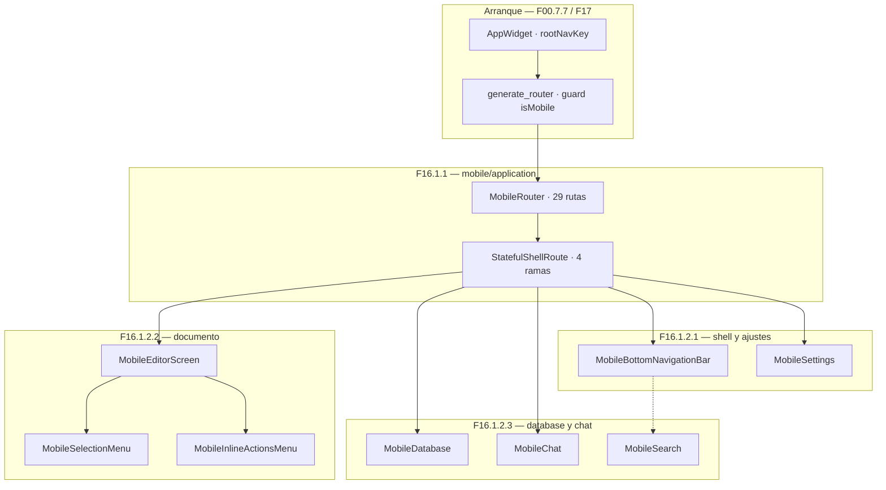
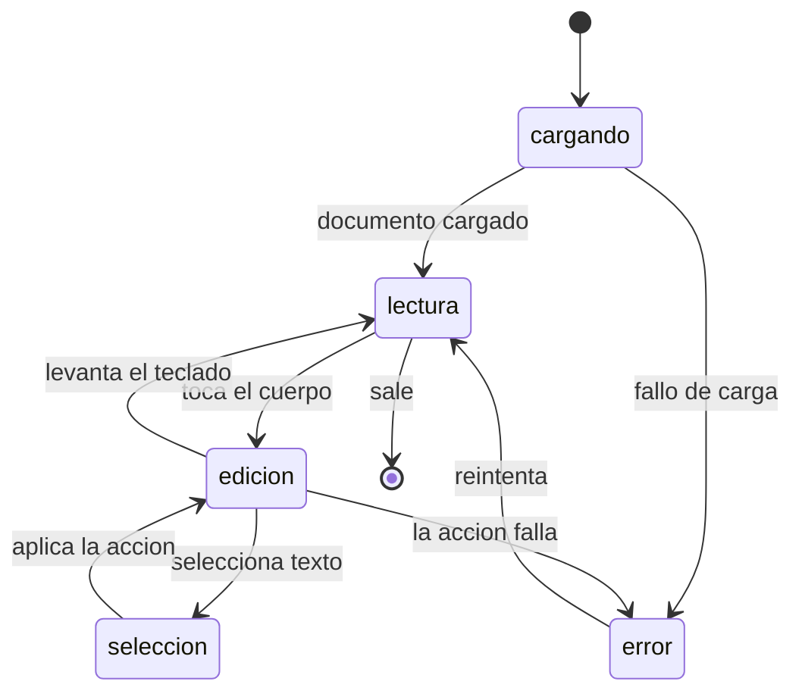

# F16.0 — Índice de la feature F16 (Mobile)

## 1. Índice de la feature F16 — Mobile

Este documento es el índice de la feature **F16 (Mobile)** y materializa la dependencia `F16.0` que declaran sus sub-unidades. No cubre ningún archivo: reparte los 184 ficheros de `lib/mobile/` entre tres capas y deja por escrito la corrección de scope que explica por qué existe una sub-unidad vacía.

La app tiene **dos superficies móviles distintas** que el ROADMAP trataba como una sola: el *shell* de la aplicación (`lib/mobile/`, con su router, sus tabs y sus páginas) y los plugins móviles del **editor** (`editor_plugins/mobile_*`), que no viven en `lib/mobile/` y que el triage asignó a `F01.6.4`. Esa discrepancia es la razón de ser de `F16.2`.

## 2. Mapa de sub-unidades

| Unidad | Capa | Ficheros | Contenido |
|---|---|---:|---|
| `F16.1.1` | Aplicación | 6 | `mobile_router.dart` y los blocs base (vista, notificación, estilo de página, recientes, perfil) |
| `F16.1.2.1` | Presentación | 98 | Shell, Ajustes móvil, home, favoritos, page items, bottom sheet y widgets |
| `F16.1.2.2` | Presentación | 9 | Página de documento móvil, editor móvil, selection menu e inline actions |
| `F16.1.2.3` | Presentación | 71 | Database, chat, búsqueda, notificaciones y base del `presentation/` móvil |
| `F16.2` | Corrección de scope | 0 | `editor_plugins/mobile_*` viven en `F01.6.4` |

**Total: 184 archivos**, los 184 que el triage asignó a F16.

## 3. Correcciones de scope

1. **`F16.2` está vacía por diseño.** Los 17 ficheros de `editor_plugins/mobile_toolbar_v3/` y `editor_plugins/mobile_floating_toolbar/` están asignados a **`F01.6.4`** (51 archivos, verificado). La unidad se materializa con `ALWAYS_EMIT` (`SKILL/scripts/build_units.py`) para dejar constancia por escrito de la corrección, en vez de desaparecer del índice.
2. **El reparto original no era regenerable.** `F16.1.1` y `F16.1.2` existían solo en disco: `build_units.py` no las generaba, así que cualquier reconstrucción borraba ambas y devolvía una `F16.1` de 184 archivos. Ahora el corte es declarativo (`F16_SUBS`).
3. **El shell móvil no es una copia del de escritorio.** `F16.1.1` documenta que la decisión se toma en `appflowy/frontend/appflowy_flutter/lib/startup/tasks/generate_router.dart` con un guard `UniversalPlatform.isMobile` y un árbol de 29 rutas propias; `F16.1.2.2` documenta que el *editor*, en cambio, reutiliza el de escritorio con menú de selección e inline actions propios.

## 4. Modelo de navegación

El `mobile_router.dart` declara 29 rutas y se monta dentro de un `StatefulShellRoute` con cuatro ramas. `appflowy/frontend/appflowy_flutter/lib/startup/tasks/app_widget.dart:303` mantiene `AppGlobals.rootNavKey` y su `BlocListener` decide entre `TabsBloc` (escritorio) y `pushView` (móvil).

## 5. Eventos FFI

Ninguna de las cinco sub-unidades **define** eventos nuevos: todas invocan eventos ya declarados por `flowy-folder`, `flowy-user` y `flowy-document`. `F16.1.1` §4 tabula los 7 dispatch que consume.

## 6. Notificaciones

La sub-unidad `F16.1.2.3` contiene `mobile/presentation/notifications/**`, que instancian `NotificationReminderBloc` (definido en `F16.1.1`) para resolver vista y nodo a partir de cada recordatorio. El panel de escritorio está en `F15.1`.

## 7. BLoCs

`F16.1.1` documenta los 5 blocs de `lib/mobile/application/`; el resto de blocs de la capa de presentación están en `F16.1.2.*`.

## 8. Persistencia

Ninguna sub-unidad toca la persistencia: el móvil lee y escribe con los mismos servicios que el escritorio (`F05.2`, `F03.1`, `F02`). Lo móvil tiene su propio almacenamiento de preferencias, que queda cubierto por las utilidades transversales de `F17`.

## 9. Orden de lectura recomendado

1. `[[../../09-features/F16-mobile/1.1-mobile-lib-mobile-application-router-y-blocs-base.md]]` — el router y los blocs base.
2. `[[../../09-features/F16-mobile/1.2.1-mobile-presentation-shell-ajustes-home-favoritos-y-widgets.md]]` — el shell y Ajustes.
3. `[[../../09-features/F16-mobile/1.2.2-mobile-presentation-documento-editor-selection-menu-e-inline-actions.md]]` — documento y editor.
4. `[[../../09-features/F16-mobile/1.2.3-mobile-presentation-database-chat-busqueda-notificaciones-y-base.md]]` — database, chat y búsqueda.
5. `[[../../09-features/F16-mobile/2-mobile-editor-plugins-mobile.md]]` — la corrección de scope.

## 10. Diagrama de las tres capas

Muestra cómo el shell móvil monta el router, cómo cada rama del shell lleva a su propia capa de presentación, y dónde queda la página de documento, que es la única que comparte casi todo con el escritorio.

Lectura: `AppWidget` decide una sola vez, en el arranque, si la navegación es por tabs (escritorio) o por push de rutas (móvil). El `StatefulShellRoute` reparte el shell en cuatro ramas persistentes y cada rama monta su propia capa de presentación. La página de documento es la única que reutiliza casi toda la infraestructura del editor de escritorio y solo sustituye el menú de selección y las inline actions.

## 11. Máquina de estados del documento móvil

Muestra las transiciones de la página de documento en móvil: desde la carga hasta la lectura, pasando por la edición y el menú de selección, y de vuelta al inicio.

Lectura: la diferencia con el escritorio no está en los estados sino en las transiciones: el toque abre la edición directamente (no hay estado de "cursor por teclado" separado) y `seleccion` se alcanza desde la edición por gesto, no por clic. `error` es recuperable sin recargar el documento.

## 12. Archivos cubiertos

Ninguno. Esta unidad es un índice y no reclama ninguna fila de `OUT/_ledger/cobertura.csv`.

## 13. Reconciliación ROADMAP ↔ código

| Prometido por el ROADMAP | Realidad verificada |
|---|---|
| "B3.F16 — Mobile" | Correcto, pero el reparto original (`F16.1.1`/`F16.1.2`) no era regenerable y `F16.1.2` tenía 178 archivos, 4× el umbral de `AGENTS.md §8` |
| Mobile como una unidad | Son dos superficies: el shell (`lib/mobile/`) y los plugins del editor (`editor_plugins/mobile_*`, en `F01.6.4`) |

## 14. Recuento de etiquetas

| Etiqueta | Cantidad |
|---|---:|
| `[VERIFICADO]` | 15 |
| `[INFERIDO]` | 2 |
| `[NO DETERMINADO]` | 2 (delegadas a `F16.1.1` y `F16.1.2.2`) |

## 15. Verificación y pruebas

Suite propia en `OUT/_ledger/pruebas/B3.F16.0/`. Las pruebas de integración del runner móvil están en `F00.7.3` y las de escritorio en `F00.7.4`.

## 16. Riesgos técnicos detectados

1. **`UniversalPlatform` es una dependencia externa ausente en el snapshot**, así que el valor exacto de `isMobile` en la variante web no es verificable (`F16.1.1` §18).
2. **El menú de slash móvil asume vertical**: no hay ninguna rama por `MediaQuery` ni `OrientationBuilder` en los nueve ficheros de `F16.1.2.2`, y toda la lógica de volteo asume el parámetro `showAtTop`.

## 17. Rendimiento

La capa móvil carga los mismos widgets que el escritorio para todo lo que no sea navegación; la divergencia real está en `selection_menu` e `inline_actions`, que se reconstruyen para pantallas estrechas. No hay measurements en el snapshot.

## 18. Preguntas abiertas

1. ¿Existe una versión **web** de los menús móviles? La web cae en la rama de escritorio (`F16.1.2.2` §18).
2. ¿Quién consume `MobileSelectionMenuStyle` además del slash menu? (`F16.1.2.2` §18).

## 19. Relacionado con

- `[[../../09-features/F16-mobile/1.1-mobile-lib-mobile-application-router-y-blocs-base.md]]`, `[[../../09-features/F16-mobile/1.2.1-mobile-presentation-shell-ajustes-home-favoritos-y-widgets.md]]`, `[[../../09-features/F16-mobile/1.2.2-mobile-presentation-documento-editor-selection-menu-e-inline-actions.md]]`, `[[../../09-features/F16-mobile/1.2.3-mobile-presentation-database-chat-busqueda-notificaciones-y-base.md]]`, `[[../../09-features/F16-mobile/2-mobile-editor-plugins-mobile.md]]` — las sub-unidades.
- `[[../../09-features/F01-documentos-y-editor/6.4-toolbars-desktop-mobile-items-link.md]]` — los plugins móviles del editor.
- `[[../../09-features/F04-sidebar-favoritos-recientes-papelera-tabs-command-palette/F04-sidebar-favoritos-recientes-papelera-tabs-command-palette.md]]` — navegación de escritorio (el contrasting del routing móvil).
- `[[../../09-features/F15-notificaciones-in-app-y-recordatorios/1-notificaciones-y-recordatorios-dart-listeners-panel-date-picker.md]]` — notificaciones de escritorio, contrastadas con las móviles.