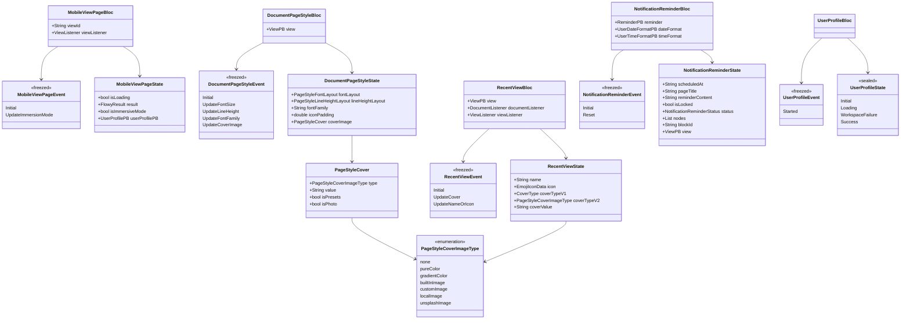
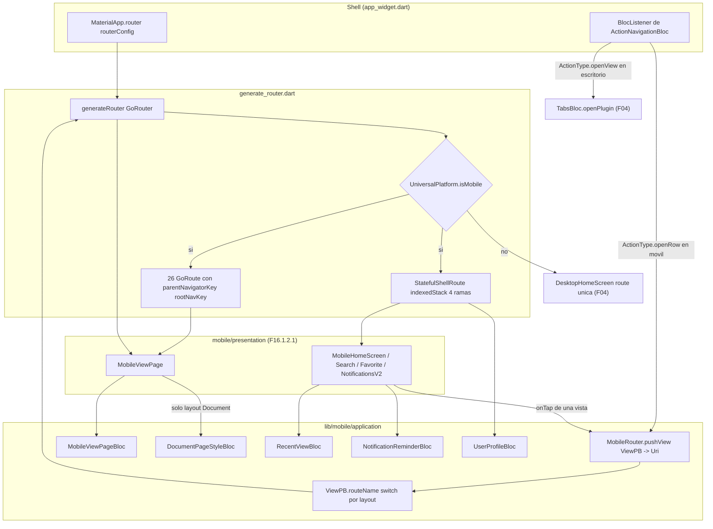
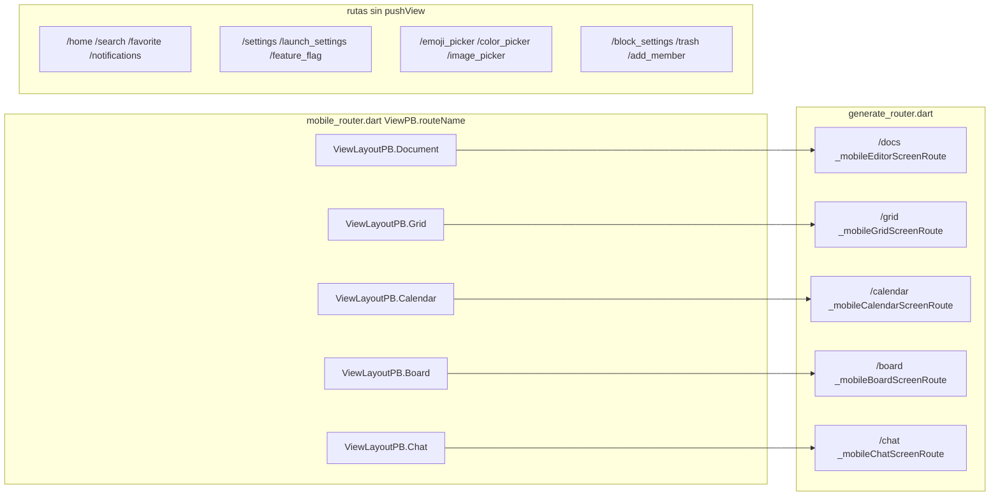
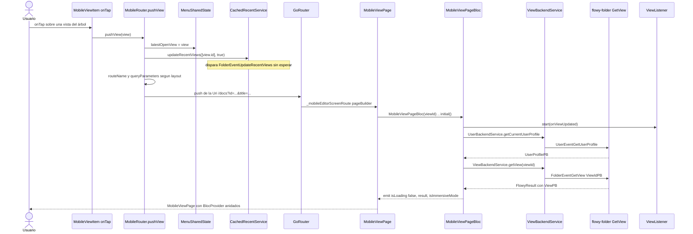
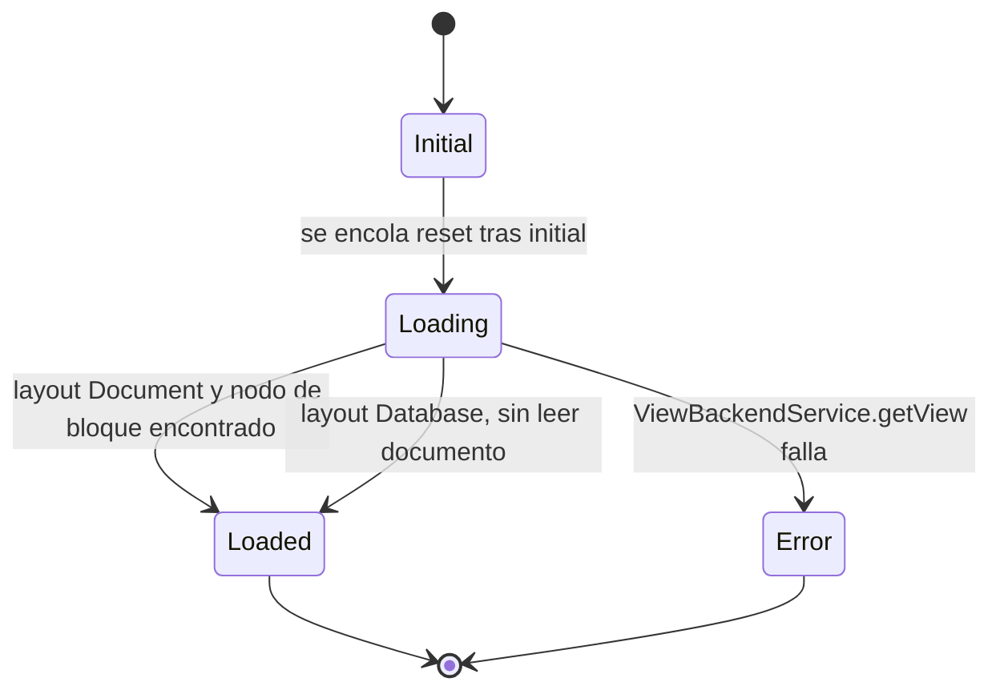

# F16.1.1 — Mobile: `lib/mobile/application` (router y blocs base)

## 1. Resumen

Este documento cubre los seis ficheros de la capa `application` de la app móvil, el directorio `appflowy/frontend/appflowy_flutter/lib/mobile/application/` del repo `appflowy`. Cinco de ellos son BLoCs (`MobileViewPageBloc`, `DocumentPageStyleBloc`, `RecentViewBloc`, `NotificationReminderBloc`, `UserProfileBloc`) que resuelven lo que la UI móvil necesita saber de una vista: su `ViewPB`, su estilo de página, su portada, el recordatorio asociado y el perfil del usuario. El sexto, `mobile_router.dart`, no es un BLoC sino una extensión `MobileRouter on BuildContext` con el único punto de entrada de navegación por vistas: `pushView`, que traduce un `ViewPB` a una ruta `go_router` y actualiza la lista de recientes. Las 29 rutas del árbol móvil se registran todas en un único fichero, `startup/tasks/generate_router.dart`, bajo el guard `if (UniversalPlatform.isMobile)`; este documento las tabula con su `path`, su builder y su línea exacta.

## 2. Alcance

**Incluye** los seis ficheros listados en `archivos_cubiertos`, leídos íntegros (1.119 líneas en total), más las referencias de solo lectura necesarias para cerrar las afirmaciones: el registro de rutas `appflowy/frontend/appflowy_flutter/lib/startup/tasks/generate_router.dart`, los servicios que los BLoCs invocan (`view_service.dart`, `user_service.dart`, `cached_recent_service.dart`, `document_service.dart`), los listeners de notificación (`view_listener.dart`, `document_listener.dart`, `recent_listener.dart`), el inyector `startup/deps_resolver.dart` y los ficheros donde se declara cada `routeName`.

**Corrección de scope declarada.** Los directorios `appflowy/frontend/appflowy_flutter/lib/plugins/document/presentation/editor_plugins/mobile_toolbar_v3/` y `appflowy/frontend/appflowy_flutter/lib/plugins/document/presentation/editor_plugins/mobile_floating_toolbar/` **no** pertenecen a F16: están asignados y ya verificados en la unidad `F01.6.4` ("Toolbars desktop, mobile, items y link"), que incluye entre otros `mobile_floating_toolbar/custom_mobile_floating_toolbar.dart` y los ficheros de `mobile_toolbar_v3/`. La unidad `F16.2` ("Mobile: `editor_plugins/mobile_*`") queda por tanto **vacía de archivos** en el ledger actual y existe solo como marcador del hueco de alcance que la corrección deja en F16; este documento no la rellena ni la duplica.

**Queda fuera y se referencia como ya documentado**: los widgets de presentación móvil que consumen estos BLoCs (`mobile/presentation/**`, 98 archivos en `F16.1.2.1`); la implementación del `go_router` de escritorio y `TabsBloc` (`[[../../09-features/F04-sidebar-favoritos-recientes-papelera-tabs-command-palette/F04-sidebar-favoritos-recientes-papelera-tabs-command-palette.md]]`); el motor de notificaciones y recordatorios completo (`[[../../09-features/F15-notificaciones-in-app-y-recordatorios/1-notificaciones-y-recordatorios-dart-listeners-panel-date-picker.md]]`); y los ficheros generados de dispatch, que no existen en este snapshot (ver §18).

## 3. Modelos de datos

Los cinco BLoCs siguen el patrón canónico del proyecto: clase `XBloc extends Bloc<XEvent, XState>` con `XEvent` y `XState` declarados como uniones `freezed` en el mismo fichero, mediante `part '<nombre>.freezed.dart'`. Los tipos que transportan son o bien entidades protobuf del SDK (`ViewPB`, `UserProfilePB`, `ReminderPB`, `UserDateFormatPB`, `UserTimeFormatPB`), o bien tipos Dart propios definidos aquí mismo (`PageStyleCover`, `PageStyleCoverImageType`, `PageStyleFontLayout`, `PageStyleLineHeightLayout`, `NotificationReminderStatus`, `EmojiIconData`).

La tabla siguiente es el inventario literal de la API pública de los seis ficheros.

| Fichero | Símbolo público | Tipo / supertipo | API expuesta (firma) | Línea |
|---|---|---|---|---|
| `appflowy/frontend/appflowy_flutter/lib/mobile/application/mobile_router.dart` | `extension MobileRouter on BuildContext` | extensión | `Future<void> pushView(ViewPB view, {Map<String, dynamic>? arguments, bool addInRecent, bool showMoreButton, String? fixedTitle, String? blockId, List<String>? tabs})` | `appflowy/frontend/appflowy_flutter/lib/mobile/application/mobile_router.dart:16` |
| `appflowy/frontend/appflowy_flutter/lib/mobile/application/mobile_router.dart` | `extension on ViewPB` (privado) | extensión | `String get routeName` · `Map<String, dynamic> queryParameters([Map<String, dynamic>? arguments])` | `appflowy/frontend/appflowy_flutter/lib/mobile/application/mobile_router.dart:53` |
| `appflowy/frontend/appflowy_flutter/lib/mobile/application/base/mobile_view_page_bloc.dart` | `MobileViewPageBloc` | `Bloc<MobileViewPageEvent, MobileViewPageState>` | `MobileViewPageBloc({required String viewId})` · `final String viewId` · `void _registerListeners()` · `bool _isImmersiveMode(ViewPB?)` | `appflowy/frontend/appflowy_flutter/lib/mobile/application/base/mobile_view_page_bloc.dart:14` |
| `appflowy/frontend/appflowy_flutter/lib/mobile/application/page_style/document_page_style_bloc.dart` | `DocumentPageStyleBloc` | `Bloc<DocumentPageStyleEvent, DocumentPageStyleState>` | `DocumentPageStyleBloc({required ViewPB view})` · `Future<void> updateLayoutObject()` · `String? decodeLayoutObject()` · `double calculateIconPadding(...)` · `double calculateIconScale(...)` | `appflowy/frontend/appflowy_flutter/lib/mobile/application/page_style/document_page_style_bloc.dart:15` |
| `appflowy/frontend/appflowy_flutter/lib/mobile/application/page_style/document_page_style_bloc.dart` | `PageStyleCover`, `PageStyleCoverImageType`, `PageStyleFontLayout`, `PageStyleLineHeightLayout` | `class` / `enum` | `PageStyleCover({required type, required value})`, `factory PageStyleCover.none()` · `builtInImagePath(String)` y `fromString(String)` estáticos en los tres enums | `appflowy/frontend/appflowy_flutter/lib/mobile/application/page_style/document_page_style_bloc.dart:415` |
| `appflowy/frontend/appflowy_flutter/lib/mobile/application/recent/recent_view_bloc.dart` | `RecentViewBloc` | `Bloc<RecentViewEvent, RecentViewState>` | `RecentViewBloc({required ViewPB view})` · `PageStyleCover? getCoverV2()` · `Future<(CoverType, String?)> getCoverV1()` | `appflowy/frontend/appflowy_flutter/lib/mobile/application/recent/recent_view_bloc.dart:14` |
| `appflowy/frontend/appflowy_flutter/lib/mobile/application/notification/notification_reminder_bloc.dart` | `NotificationReminderBloc` | `Bloc<NotificationReminderEvent, NotificationReminderState>` | `NotificationReminderBloc()` · `late final ReminderPB reminder` · `Node? _searchById(Node, String)` · `String _formatTimestamp(int, {...})` | `appflowy/frontend/appflowy_flutter/lib/mobile/application/notification/notification_reminder_bloc.dart:20` |
| `appflowy/frontend/appflowy_flutter/lib/mobile/application/notification/notification_reminder_bloc.dart` | `NotificationReminderStatus` | `enum` | `initial`, `loading`, `loaded`, `error` | `appflowy/frontend/appflowy_flutter/lib/mobile/application/notification/notification_reminder_bloc.dart:191` |
| `appflowy/frontend/appflowy_flutter/lib/mobile/application/user_profile/user_profile_bloc.dart` | `UserProfileBloc` | `Bloc<UserProfileEvent, UserProfileState>` | `UserProfileBloc()` · `Future<void> _initialize(Emitter<UserProfileState>)` | `appflowy/frontend/appflowy_flutter/lib/mobile/application/user_profile/user_profile_bloc.dart:11` |

El siguiente diagrama muestra el modelo de estados y eventos de los cinco BLoCs y la relación entre `RecentViewBloc` y `DocumentPageStyleBloc`, que comparten la definición de `PageStyleCover` (y de los tres enums de estilo) a través de un import cruzado.

Muestra: los cinco BLoCs, sus uniones de evento y estado, y el tipo `PageStyleCover` compartido entre el estilo de página y la vista reciente.

Lectura: los cinco BLoCs tienen exactamente la misma forma —una flecha hacia su unión de eventos y otra hacia su unión de estado— y ninguno comparte estado con otro. Lo único que cruza de fichero es `PageStyleCover` y su enum `PageStyleCoverImageType`, definidos en `document_page_style_bloc.dart` y consumidos por `recent_view_bloc.dart` (que además conserva un `coverTypeV1` de tipo `CoverType`, declarado en `appflowy/frontend/appflowy_flutter/lib/plugins/document/presentation/editor_plugins/header/document_cover_widget.dart:50`, y un `coverTypeV2` de tipo `PageStyleCoverImageType`). Esa convivencia de dos modelos de portada en el mismo estado es el mecanismo explícito de compatibilidad hacia atrás entre las versiones previa y posterior a 0.5.5 `[VERIFICADO]` (`appflowy/frontend/appflowy_flutter/lib/mobile/application/recent/recent_view_bloc.dart:141–146`).

## 4. Eventos FFI

Ninguno de los seis ficheros define eventos FFI: todos los disparos pasan por servicios compartidos ya existentes. La tabla traza, para cada llamada que sale de esta unidad, la clase de dispatch Dart que se genera en build, el payload protobuf, y el evento Rust correspondiente con su declaración en `event_map.rs`.

| Llamada desde esta unidad | Dispatch Dart (generado) | Payload de entrada | PB de salida | Evento Rust | `event_map.rs` |
|---|---|---|---|---|---|
| `ViewBackendService.getView(viewId)` — `appflowy/frontend/appflowy_flutter/lib/mobile/application/base/mobile_view_page_bloc.dart:29`, `appflowy/frontend/appflowy_flutter/lib/mobile/application/notification/notification_reminder_bloc.dart:105` | `FolderEventGetView` | `ViewIdPB` (`appflowy/frontend/appflowy_flutter/lib/workspace/application/view/view_service.dart:274`) | `ViewPB` | `FolderEvent::GetView = 11` | `appflowy/frontend/rust-lib/flowy-folder/src/event_map.rs:93` |
| `ViewBackendService.updateView(viewId, extra)` — `appflowy/frontend/appflowy_flutter/lib/mobile/application/page_style/document_page_style_bloc.dart:117` | `FolderEventUpdateView` | `UpdateViewPayloadPB` (`appflowy/frontend/appflowy_flutter/lib/workspace/application/view/view_service.dart:197`) | `ViewPB` | `FolderEvent::UpdateView = 12` | `appflowy/frontend/rust-lib/flowy-folder/src/event_map.rs:97` |
| `UserBackendService.getCurrentUserProfile()` — `appflowy/frontend/appflowy_flutter/lib/mobile/application/base/mobile_view_page_bloc.dart:27` | `UserEventGetUserProfile` | *(ninguno)* | `UserProfilePB` | `UserEvent::GetUserProfile = 4` | `appflowy/frontend/rust-lib/flowy-user/src/event_map.rs:109` |
| `FolderEventGetCurrentWorkspaceSetting()` — `appflowy/frontend/appflowy_flutter/lib/mobile/application/user_profile/user_profile_bloc.dart:23` | `FolderEventGetCurrentWorkspaceSetting` | *(ninguno)* | `WorkspaceLatestPB` | `FolderEvent::GetCurrentWorkspaceSetting = 1` | `appflowy/frontend/rust-lib/flowy-folder/src/event_map.rs:72` |
| `CachedRecentService.updateRecentViews([view.id], true)` — `appflowy/frontend/appflowy_flutter/lib/mobile/application/mobile_router.dart:28` | `FolderEventUpdateRecentViews` | `UpdateRecentViewPayloadPB` (`appflowy/frontend/appflowy_flutter/lib/workspace/application/recent/cached_recent_service.dart:65–70`) | *(void)* | `FolderEvent::UpdateRecentViews = 37` | `appflowy/frontend/rust-lib/flowy-folder/src/event_map.rs:179` |
| `DocumentService().openDocument(documentId: reminder.objectId)` — `appflowy/frontend/appflowy_flutter/lib/mobile/application/notification/notification_reminder_bloc.dart:116` | `DocumentEventOpenDocument` | `OpenDocumentPayloadPB` (`appflowy/frontend/appflowy_flutter/lib/plugins/document/application/document_service.dart:29`) | `DocumentDataPB` | `DocumentEvent::OpenDocument = 1` | `appflowy/frontend/rust-lib/flowy-document/src/event_map.rs:64` |

Lectura: la unidad **no** añade eventos nuevos al SDK; consume siete de los existentes, todos de los crates `flowy-folder`, `flowy-user` y `flowy-document`. El patrón es siempre el mismo: el BLoC resuelve un `FlowyResult<T, FlowyError>` y lo pliega con `.fold((s) => s, (f) => null)`, es decir, degrada a `null` en lugar de emitir un estado de error `[VERIFICADO]` (`appflowy/frontend/appflowy_flutter/lib/mobile/application/base/mobile_view_page_bloc.dart:26–31`).

Dos consecuencias de ese patrón merecen quedar registradas. Primera: `MobileViewPageBloc` y `NotificationReminderBloc` **no** distinguen "la vista no existe" de "falló la red" — ambos casos producen `result: null` y la UI muestra un espacio vacío, porque `mobile_view_page.dart` construye `SizedBox.shrink()` cuando `view == null` `[INFERIDO]`. Segunda: `UserProfileBloc` sí distingue el fallo, pero colapsa los dos eventos que dispara (`FolderEventGetCurrentWorkspaceSetting` y `AuthService.getUser`) en un único estado `workspaceFailure` `[VERIFICADO]` (`appflowy/frontend/appflowy_flutter/lib/mobile/application/user_profile/user_profile_bloc.dart:37–39`).

## 5. Notificaciones

Los tres BLoCs que representan estado vivo (`MobileViewPageBloc`, `RecentViewBloc`, y parcialmente `NotificationReminderBloc`) no hacen *polling*: se suscriben al `RustStreamReceiver` mediante listeners tipados. Ninguno registra un parser propio; los tres reutilizan los de la capa `workspace`.

| Notificación Rust | Emisor | Listener Dart | Efecto en esta unidad | Archivo:línea |
|---|---|---|---|---|
| `FolderNotification::DidUpdateView` (`= 10`) | `flowy-folder` | `ViewListener.start(onViewUpdated:)` | `MobileViewPageBloc` recalcula `isImmersiveMode`; `RecentViewBloc` actualiza nombre, icono y portada | `appflowy/frontend/appflowy_flutter/lib/mobile/application/base/mobile_view_page_bloc.dart:64–67`, `appflowy/frontend/appflowy_flutter/lib/mobile/application/recent/recent_view_bloc.dart:40–57` |
| `FolderNotification::DidUpdateChildViews` (`= 11`) | `flowy-folder` | `ViewListener.start(onViewChildViewsUpdated:)` | **No** se suscribe en esta unidad (el `pageBuilder` no lo conecta) | `appflowy/frontend/appflowy_flutter/lib/workspace/application/view/view_listener.dart:79` |
| `DocumentNotification::DidReceiveUpdate` (`= 1`) | `flowy-document` | `DocumentListener.start(onDocEventUpdate:)` | `RecentViewBloc` recomputa la portada v1 si el documento cambió y aún no hay `coverTypeV2` | `appflowy/frontend/appflowy_flutter/lib/mobile/application/recent/recent_view_bloc.dart:25–37` |
| `DocumentNotification::DidUpdateDocumentAwarenessState` (`= 4`) | `flowy-document` | `DocumentListener.start(onDocEventUpdate:)` | **No** se usa aquí; lo consume la capa de colaboradores | `appflowy/frontend/appflowy_flutter/lib/plugins/document/application/document_listener.dart:55` |
| `FolderNotification::DidUpdateWorkspaceSetting` (`= 4`) | `flowy-folder` | `RecentViewsListener` (id fijo `recent_views`) | Alimenta `CachedRecentService.notifier`, que `pushView` muta al abrir una vista | `appflowy/frontend/appflowy_flutter/lib/workspace/application/recent/recent_listener.dart:26–29` |

Lectura: la variante `DidUpdateView` es la notificación con más peso en esta unidad: la usan dos BLoCs distintos, cada uno con una interpretación diferente. `MobileViewPageBloc` la usa como **interruptor de presentación**: si la portada dejó de ser una imagen predefinida, la vista sale del modo inmersivo (`appflowy/frontend/appflowy_flutter/lib/mobile/application/base/mobile_view_page_bloc.dart:72–86`). `RecentViewBloc` la usa como **refresco de datos**: nombre, icono emoji y portada `[VERIFICADO]`.

Detalle de ciclo de vida: `ViewListener.start` setea un flag `_isDisposed` que hace que cualquier `start()` posterior sea un no-op con log de aviso, y `stop()` cancela la suscripción al stream (`appflowy/frontend/appflowy_flutter/lib/workspace/application/view/view_listener.dart:31`, `:43–46`, `:114–121`). Por eso `MobileViewPageBloc.close()` y `RecentViewBloc.close()` invocan `stop()` antes de `super.close()`.

## 6. BLoCs / Cubits

| Clase | Eventos (fábricas `freezed`) | Campos de estado | Servicios / listeners invocados | Archivo:línea |
|---|---|---|---|---|
| `MobileViewPageBloc` | `initial()`, `updateImmersionMode(bool)` | `isLoading`, `result`, `isImmersiveMode`, `userProfilePB` | `UserBackendService.getCurrentUserProfile()`, `ViewBackendService.getView()`, `ViewListener` | `appflowy/frontend/appflowy_flutter/lib/mobile/application/base/mobile_view_page_bloc.dart:14` |
| `DocumentPageStyleBloc` | `initial()`, `updateFont(...)`, `updateLineHeight(...)`, `updateFontFamily(String?)`, `updateCoverImage(...)` | `fontLayout`, `lineHeightLayout`, `fontFamily`, `iconPadding`, `coverImage` | `ViewBackendService.getView()`, `ViewBackendService.updateView()` | `appflowy/frontend/appflowy_flutter/lib/mobile/application/page_style/document_page_style_bloc.dart:15` |
| `RecentViewBloc` | `initial()`, `updateCover(CoverType, PageStyleCoverImageType?, String?)`, `updateNameOrIcon(String, EmojiIconData)` | `name`, `icon`, `coverTypeV1`, `coverTypeV2`, `coverValue` | `DocumentListener`, `ViewListener`, `ViewPB.cover`, `ViewPB.icon.toEmojiIconData()` | `appflowy/frontend/appflowy_flutter/lib/mobile/application/recent/recent_view_bloc.dart:14` |
| `NotificationReminderBloc` | `initial(ReminderPB, UserDateFormatPB, UserTimeFormatPB)`, `reset()` | `scheduledAt`, `pageTitle`, `reminderContent`, `isLocked`, `status`, `nodes`, `blockId`, `view` | `ViewBackendService.getView()`, `DocumentService().openDocument()`, `_searchById` recursivo | `appflowy/frontend/appflowy_flutter/lib/mobile/application/notification/notification_reminder_bloc.dart:20` |
| `UserProfileBloc` | `started()` | estados disjuntos: `initial`, `loading`, `workspaceFailure`, `success` | `FolderEventGetCurrentWorkspaceSetting()`, `getIt<AuthService>().getUser()` | `appflowy/frontend/appflowy_flutter/lib/mobile/application/user_profile/user_profile_bloc.dart:11` |

Cuatro BLoCs usan la unión `freezed` clásica (evento → campos de estado con `copyWith`); `UserProfileBloc` usa en cambio un **estado sellado** de variantes disjuntas (`initial`, `loading`, `workspaceFailure`, `success`), donde `success` es la única que transporta datos (`WorkspaceLatestPB` + `UserProfilePB`) `[VERIFICADO]` (`appflowy/frontend/appflowy_flutter/lib/mobile/application/user_profile/user_profile_bloc.dart:55–63`). La consecuencia práctica es que no existe `UserProfileState` "vacía con flags": o hay perfil y workspace, o hay un estado de fallo explícito.

`NotificationReminderBloc` es el único que se auto-dispara: `initial()` no emite nada, guarda el recordatorio y los formatos de fecha/hora en campos `late final`, y encola `reset()` (`appflowy/frontend/appflowy_flutter/lib/mobile/application/notification/notification_reminder_bloc.dart:25–31`). `reset()` es **público**: la UI lo reencola cuando el usuario cambia el idioma o el formato de fecha, y por eso los tres campos son mutables desde fuera `[VERIFICADO]` (`appflowy/frontend/appflowy_flutter/lib/mobile/application/notification/notification_reminder_bloc.dart:88–90`).

## 7. Servicios e inyección de dependencias

Solo tres de los seis ficheros tocan `get_it`, y lo hacen desde **dentro** de un método, no desde un constructor:

| Símbolo resuelto | Registro en `deps_resolver.dart` | Quién lo pide |
|---|---|---|
| `MenuSharedState` | `getIt.registerSingleton(MenuSharedState())` — `appflowy/frontend/appflowy_flutter/lib/startup/deps_resolver.dart:145` | `appflowy/frontend/appflowy_flutter/lib/mobile/application/mobile_router.dart:27` escribe `latestOpenView` |
| `CachedRecentService` | `getIt.registerLazySingleton<CachedRecentService>(() => CachedRecentService())` — `appflowy/frontend/appflowy_flutter/lib/startup/deps_resolver.dart:135` | `appflowy/frontend/appflowy_flutter/lib/mobile/application/mobile_router.dart:28` llama `updateRecentViews` |
| `AuthService` | `registerFactory<AuthService>` con `BackendAuthService` (local) o `AppFlowyCloudAuthService` (cloud), según `currentCloudType()` — `appflowy/frontend/appflowy_flutter/lib/startup/deps_resolver.dart:109–119` | `appflowy/frontend/appflowy_flutter/lib/mobile/application/user_profile/user_profile_bloc.dart:25` llama `getUser()` |

Los cuatro BLoCs restantes **no reciben dependencias por constructor**: `MobileViewPageBloc`, `DocumentPageStyleBloc` y `RecentViewBloc` reciben solo datos (`viewId` o `ViewPB`), y `NotificationReminderBloc` no recibe nada. Todos usan además servicios estáticos (`ViewBackendService.getView`, `ViewBackendService.updateView`, `DocumentService()`, `UserBackendService.getCurrentUserProfile`) en lugar de instancias inyectadas, lo que los hace imposibles de probar con dobles sin tocar la capa FFI `[VERIFICADO]` (`appflowy/frontend/appflowy_flutter/lib/mobile/application/page_style/document_page_style_bloc.dart:112–122`).

Detalle relevante para la lectura de esa tabla: `DocumentPageStyleBloc` **sí** declara un campo de instancia `final ViewBackendService viewBackendService = ViewBackendService();` en la línea 112, pero el método `updateLayoutObject` de las líneas 114–122 invoca el método **estático** `ViewBackendService.updateView(...)`. El campo existe y no se usa nunca `[VERIFICADO]` (`appflowy/frontend/appflowy_flutter/lib/mobile/application/page_style/document_page_style_bloc.dart:112`). Ver §13.

## 8. Persistencia

Ninguno de los seis ficheros escribe en SQLite ni en el KV store directamente. La persistencia de esta unidad es **indirecta**: `DocumentPageStyleBloc` serializa el estilo de página dentro del campo `extra` del `ViewPB`, que es el mismo blob JSON que Rust persiste en el collab del folder.

| Dato | Dónde vive | Clave JSON | Quién escribe | Quién lee |
|---|---|---|---|---|
| Tamaño de fuente, interlineado, familia y portada | `ViewPB.extra` (JSON) | `font_layout`, `line_height_layout`, `font`, `cover` (`appflowy/frontend/appflowy_flutter/lib/workspace/application/view/view_ext.dart:28–42`) | `DocumentPageStyleBloc.decodeLayoutObject()` → `ViewBackendService.updateView(extra:)` | `ViewPB.fontLayout`, `ViewPB.lineHeightLayout`, `ViewPB.cover` (`appflowy/frontend/appflowy_flutter/lib/workspace/application/view/view_ext.dart:252–272`) |
| Tipo y valor de portada | anidado en `extra.cover` | `type`, `value` (`appflowy/frontend/appflowy_flutter/lib/workspace/application/view/view_ext.dart:39–41`) | `_getSelectedCover()` y `decodeLayoutObject()` | `RecentViewBloc.getCoverV2()` (`appflowy/frontend/appflowy_flutter/lib/mobile/application/recent/recent_view_bloc.dart:120–122`) |
| Lista de vistas recientes | SQLite vía `CachedRecentService` (Rust `flowy-folder`) | — | `updateRecentViews` dispara `FolderEventUpdateRecentViews` | `CachedRecentService.notifier`, leído por la home móvil |
| Estado de la vista abierta | memoria (`ValueNotifier`) | — | `MenuSharedState.latestOpenView` | barra de contexto y hoja inferior móvil |

El patrón de escritura es siempre "optimista": `DocumentPageStyleBloc` hace `emit(...)` con el valor nuevo y después lanza `unawaited(updateLayoutObject())` (`appflowy/frontend/appflowy_flutter/lib/mobile/application/page_style/document_page_style_bloc.dart:62–105`). Si el `updateView` falla, **el usuario ve el cambio pero el disco no lo recibe** y no hay rollback ni estado de error. Además, `decodeLayoutObject()` hace `mergeMaps(oldValue, newValue)` (`appflowy/frontend/appflowy_flutter/lib/mobile/application/page_style/document_page_style_bloc.dart:141`), lo que preserva claves ajenas a los estilos (por ejemplo `is_pinned` o `space_icon_color`) sin perderlas al reescribir `[VERIFICADO]`.

La versión de datos que viaja por la URI del router es un caso aparte de persistencia en memoria: `pushView` serializa con `jsonEncode(arguments)` el diccionario de argumentos de la vista Grid (`appflowy/frontend/appflowy_flutter/lib/mobile/application/mobile_router.dart:83`), y `_mobileGridScreenRoute()` lo recupera con `jsonDecode(arguments)` (`appflowy/frontend/appflowy_flutter/lib/startup/tasks/generate_router.dart:644`). Es el único punto donde un router móvil pasa datos estructurados, y lo hace por query string.

## 9. Diagramas de flujo

El siguiente diagrama muestra la estructura completa de navegación móvil: quién decide el árbol de rutas, dónde se ramifica el guard de plataforma y qué BLoCs de esta unidad participan en cada salto.

Muestra: la cadena `MaterialApp.router` → `generateRouter` → guard de plataforma → `MobileBottomNavigationBar` / `pushView` → `MobileViewPage` → BLoCs de esta unidad.

Lectura: la navegación móvil tiene **un solo punto de entrada programático**, la extensión `MobileRouter.pushView`; el resto de transiciones son rutas declaradas estáticamente. `pushView` no llama a `GoRouter.of(context).push` con un widget, sino que construye una `Uri` a partir de `ViewPB.routeName` y de un mapa de query parameters, y delega en el `push` del `BuildContext` (`appflowy/frontend/appflowy_flutter/lib/mobile/application/mobile_router.dart:45–49`). Eso obliga a que **todos** los datos del destino viajen como string en la query: el `ViewPB` entero no se pasa, solo su `id` y su `name` `[VERIFICADO]`.

El diagrama siguiente muestra el router y sus destinos en horizontal, contrato por contrato entre `mobile_router.dart` y las declaraciones de `path` de `generate_router.dart`.

Muestra: la correspondencia uno a uno entre el `switch` de `ViewPB.layout` y las cinco rutas de contenido, más las rutas de ajustes y selectores que no pasan por `pushView`.

Lectura: el `switch` de `routeName` cubre los cinco `ViewLayoutPB` con caso explícito y lanza `UnimplementedError` en el `default` (`appflowy/frontend/appflowy_flutter/lib/mobile/application/mobile_router.dart:55–69`), de modo que un layout nuevo obliga a tocar este fichero además de registrar la ruta. El segundo `switch`, el de `queryParameters`, es casi simétrico pero añade `MobileGridScreen.viewArgs` con `jsonEncode(arguments)` solo para Grid (`appflowy/frontend/appflowy_flutter/lib/mobile/application/mobile_router.dart:79–84`). Las cuatro rutas de la derecha del diagrama se alcanzan con `context.push(Ruta.routeName)` directo desde los widgets y no pasan por `pushView`, por lo que **no actualizan la lista de recientes**.

### 9.1 Tabla completa de rutas del router móvil

Las 29 entradas siguientes están todas dentro del `if (UniversalPlatform.isMobile)` de `generateRouter`, invocado en `appflowy/frontend/appflowy_flutter/lib/startup/tasks/generate_router.dart:62–111`. La columna `path:` es la línea donde `GoRoute` declara la ruta; la columna `const routeName` es la línea donde el widget declara el string literal, verificada con `rg` sobre cada fichero.

| # | Fábrica | `path:` | Ruta | Builder | `const routeName` |
|---|---|---|---|---|---|
| 1 | `_mobileHomeScreenWithNavigationBarRoute` (rama 0) | `:170` | `/home` | `MobileHomeScreen` | `appflowy/frontend/appflowy_flutter/lib/mobile/presentation/home/mobile_home_page.dart:35` |
| 2 | `_mobileHomeScreenWithNavigationBarRoute` (rama 1) | `:182` | `/search` | `MobileSearchScreen` | `appflowy/frontend/appflowy_flutter/lib/mobile/presentation/search/mobile_search_page.dart:23` |
| 3 | `_mobileHomeScreenWithNavigationBarRoute` (rama 2) | `:194` | `/favorite` | `MobileFavoriteScreen` | `appflowy/frontend/appflowy_flutter/lib/mobile/presentation/favorite/mobile_favorite_page.dart:21` |
| 4 | `_mobileHomeScreenWithNavigationBarRoute` (rama 3) | `:206` | `/notifications` | `MobileNotificationsScreenV2` | `appflowy/frontend/appflowy_flutter/lib/mobile/presentation/notifications/mobile_notifications_screen.dart:20` |
| 5 | `_mobileEditorScreenRoute` | `:572` | `/docs` | `MobileDocumentScreen` | `appflowy/frontend/appflowy_flutter/lib/mobile/presentation/editor/mobile_editor_screen.dart:25` |
| 6 | `_mobileGridScreenRoute` | `:633` | `/grid` | `MobileGridScreen` | `appflowy/frontend/appflowy_flutter/lib/mobile/presentation/database/mobile_grid_screen.dart:19` |
| 7 | `_mobileBoardScreenRoute` | `:653` | `/board` | `MobileBoardScreen` | `appflowy/frontend/appflowy_flutter/lib/mobile/presentation/database/board/mobile_board_screen.dart:16` |
| 8 | `_mobileCalendarScreenRoute` | `:670` | `/calendar` | `MobileCalendarScreen` | `appflowy/frontend/appflowy_flutter/lib/mobile/presentation/database/mobile_calendar_screen.dart:16` |
| 9 | `_mobileChatScreenRoute` | `:618` | `/chat` | `MobileChatScreen` | `appflowy/frontend/appflowy_flutter/lib/mobile/presentation/chat/mobile_chat_screen.dart:16` |
| 10 | `_mobileCardDetailScreenRoute` | `:688` | `/MobileRowDetailPage` | `MobileRowDetailPage` | `appflowy/frontend/appflowy_flutter/lib/mobile/presentation/database/card/card_detail/mobile_card_detail_screen.dart:45` |
| 11 | `_mobileDateCellEditScreenRoute` | `:723` | `/edit_date_cell` | `MobileDateCellEditScreen` | `appflowy/frontend/appflowy_flutter/lib/mobile/presentation/database/date_picker/mobile_date_picker_screen.dart:24` |
| 12 | `_mobileNewPropertyPageRoute` | `:455` | `/new_property` | `MobileNewPropertyScreen` | `appflowy/frontend/appflowy_flutter/lib/mobile/presentation/database/field/mobile_create_field_screen.dart:21` |
| 13 | `_mobileEditPropertyPageRoute` | `:478` | `/edit_property` | `MobileEditPropertyScreen` | `appflowy/frontend/appflowy_flutter/lib/mobile/presentation/database/field/mobile_edit_field_screen.dart:22` |
| 14 | `_mobileCalendarEventsPageRoute` | `:495` | `/calendar_events` | `MobileCalendarEventsScreen` | `appflowy/frontend/appflowy_flutter/lib/mobile/presentation/database/mobile_calendar_events_screen.dart:29` |
| 15 | `_mobileHomeSettingPageRoute` | `:221` | `/settings` | `MobileHomeSettingPage` | `appflowy/frontend/appflowy_flutter/lib/mobile/presentation/home/mobile_home_setting_page.dart:28` |
| 16 | `_mobileHomeTrashPageRoute` | `:312` | `/trash` | `MobileHomeTrashPage` | `appflowy/frontend/appflowy_flutter/lib/mobile/presentation/home/mobile_home_trash_page.dart:17` |
| 17 | `_mobileLaunchSettingsPageRoute` | `:286` | `/launch_settings` | `MobileLaunchSettingsPage` | `appflowy/frontend/appflowy_flutter/lib/mobile/presentation/setting/launch_settings_page.dart:16` |
| 18 | `_mobileFeatureFlagPageRoute` | `:299` | `/feature_flag` | `FeatureFlagScreen` | `appflowy/frontend/appflowy_flutter/lib/workspace/presentation/settings/widgets/feature_flags/mobile_feature_flag_screen.dart:9` |
| 19 | `_mobileCloudSettingAppFlowyCloudPageRoute` | `:273` | `/AppFlowyCloudPage` | `AppFlowyCloudPage` | `appflowy/frontend/appflowy_flutter/lib/mobile/presentation/setting/cloud/appflowy_cloud_page.dart:12` |
| 20 | `_mobileEmojiPickerPageRoute` | `:346` | `/emoji_picker` | `MobileEmojiPickerScreen` | `appflowy/frontend/appflowy_flutter/lib/plugins/base/emoji/emoji_picker_screen.dart:24` |
| 21 | `_mobileColorPickerPageRoute` | `:388` | `/color_picker` | `MobileColorPickerScreen` | `appflowy/frontend/appflowy_flutter/lib/plugins/base/color/color_picker_screen.dart:13` |
| 22 | `_mobileImagePickerPageRoute` | `:403` | `/image_picker` | `MobileImagePickerScreen` | `appflowy/frontend/appflowy_flutter/lib/plugins/document/presentation/editor_plugins/image/image_picker_screen.dart:12` |
| 23 | `_mobileCodeLanguagePickerPageRoute` | `:416` | `/code_language_picker` | `MobileCodeLanguagePickerScreen` | `appflowy/frontend/appflowy_flutter/lib/plugins/document/presentation/editor_plugins/code_block/code_language_screen.dart:14` |
| 24 | `_mobileLanguagePickerPageRoute` | `:429` | `/language_picker` | `LanguagePickerScreen` | `appflowy/frontend/appflowy_flutter/lib/mobile/presentation/setting/language/language_picker_screen.dart:12` |
| 25 | `_mobileFontPickerPageRoute` | `:442` | `/font_picker` | `FontPickerScreen` | `appflowy/frontend/appflowy_flutter/lib/mobile/presentation/setting/font/font_picker_screen.dart:23` |
| 26 | `_mobileBlockSettingsPageRoute` | `:325` | `/block_settings` | `MobileBlockSettingsScreen` | `appflowy/frontend/appflowy_flutter/lib/plugins/document/presentation/editor_plugins/mobile_toolbar_item/mobile_block_settings_screen.dart:58` |
| 27 | `_mobileNotificationMultiSelectPageRoute` | `:234` | `/notifications_multi_select` | `MobileNotificationsMultiSelectScreen` | `appflowy/frontend/appflowy_flutter/lib/mobile/presentation/notifications/mobile_notifications_multiple_select_page.dart:12` |
| 28 | `_mobileInviteMembersPageRoute` | `:247` | `/invite_member` | `InviteMembersScreen` | `appflowy/frontend/appflowy_flutter/lib/mobile/presentation/setting/workspace/invite_members_screen.dart:33` |
| 29 | `_mobileAddMembersPageRoute` | `:260` | `/add_member` | `AddMembersScreen` | `appflowy/frontend/appflowy_flutter/lib/mobile/presentation/setting/workspace/add_members_screen.dart:28` |

Las rutas 1–4 viven dentro de un `StatefulShellRoute.indexedStack` (`appflowy/frontend/appflowy_flutter/lib/startup/tasks/generate_router.dart:133`) y son las únicas que **no** llevan `parentNavigatorKey: AppGlobals.rootNavKey`: se renderizan dentro del `StatefulNavigationShell` que construye `MobileBottomNavigationBar`, y por eso conservan cada una su pila y su estado al alternar pestañas. Las 25 restantes sí llevan `parentNavigatorKey` explícito, lo que las saca del shell y las monta sobre el navegador raíz `[VERIFICADO]` (`appflowy/frontend/appflowy_flutter/lib/startup/tasks/generate_router.dart:220`, `:573`).

Las cuatro rutas compartidas con escritorio y las cuatro exclusivamente de escritorio completan el cuadro: `/` (raíz con `redirect` que salta a `DesktopHomeScreen` solo si no es móvil, `appflowy/frontend/appflowy_flutter/lib/startup/tasks/generate_router.dart:745–756`), `SignInScreen.routeName`, `SkipLogInScreen.routeName`, `WorkspaceErrorScreen.routeName`, `WorkspaceStartScreen.routeName` y, en escritorio, `DesktopHomeScreen.routeName` = `/DesktopHomeScreen` (`appflowy/frontend/appflowy_flutter/lib/workspace/presentation/home/desktop_home_screen.dart:47`).

## 10. Diagramas de secuencia

El siguiente diagrama muestra el recorrido completo de abrir un documento desde la home móvil: el `onTap` dispara `pushView`, que actualiza dos singletons antes de navegar, el router resuelve la ruta, y el `pageBuilder` inyecta los BLoCs que esta unidad define.

Muestra: `pushView` → `MenuSharedState` / `CachedRecentService` → `GoRouter` → `MobileViewPage` → `MobileViewPageBloc` → FFI `GetView`.

Lectura: el orden importa. `MenuSharedState.latestOpenView` se escribe **antes** de navegar (`appflowy/frontend/appflowy_flutter/lib/mobile/application/mobile_router.dart:27`), de modo que la barra inferior y la hoja de acciones ya saben qué vista se está abriendo cuando se monta la pantalla; y `updateRecentViews` se lanza con `unawaited` (línea 28), así que la navegación no espera al FFI. El `pageBuilder` de `/docs` recupera `id` y `title` de `state.uri.queryParameters` y los pasa como parámetros del widget, nunca como `state.extra` (`appflowy/frontend/appflowy_flutter/lib/startup/tasks/generate_router.dart:574–611`) — a diferencia de las rutas de abajo (`MobileEditPropertyScreen`, `MobileCalendarEventsScreen`, `MobileRowDetailPage`), que sí usan `state.extra as Map<String, dynamic>`.

### 10.1 Diferencias con el routing de escritorio

En escritorio **no existe equivalente de `pushView`**. `go_router` declara una sola ruta de contenido, `DesktopHomeScreen.routeName`, y toda apertura de vista pasa por `TabsBloc`:

| Aspecto | Móvil | Escritorio |
|---|---|---|
| Árbol de rutas | 29 rutas bajo `if (UniversalPlatform.isMobile)` | 1 ruta (`/DesktopHomeScreen`) bajo `if (UniversalPlatform.isDesktop)` |
| Unidad de navegación | Una `GoRoute` por vista, en el `Navigator` raíz | Una pestaña de `TabsBloc`, gestionada por `HomeStack` |
| Parámetros | Query string de la `Uri` (`id`, `title`, `block_id`…) | `PluginArgumentKeys` en el `Plugin` (`selection`, `row_id`, `block_id`) |
| Apertura de una vista | `context.pushView(view)` | `getIt<TabsBloc>().openPlugin(view, arguments: {...})` |
| Guarda de estado | `StatefulShellRoute.indexedStack` (4 ramas) | Pila de pestañas con `HomeStackDelegate` |

El punto de bifurcación es un único `BlocListener<ActionNavigationBloc, ActionNavigationState>` en el shell: si la acción es `ActionType.openView` **y** `UniversalPlatform.isDesktop`, va a `TabsBloc.openPlugin`; si es `ActionType.openRow` **y** `UniversalPlatform.isMobile`, va a `pushView` con `{PluginArgumentKeys.rowId: rowId}` (`appflowy/frontend/appflowy_flutter/lib/startup/tasks/app_widget.dart:187–222`). Ambas ramas leen el mismo `ViewPB` y los mismos `ActionArgumentKeys`, lo que permite que una acción de IA o de deep link funcione en las dos plataformas sin duplicar lógica.

Detalle fino: `TabsBloc` mantiene además un histórico de "última vista abierta por plugin" con una ventana de deduplicación de 500 ms (`appflowy/frontend/appflowy_flutter/lib/workspace/application/tabs/tabs_bloc.dart:31–34`), mientras que `pushView` no deduplica en absoluto — dos toques seguidos sobre la misma vista apilan dos rutas. `[[../../09-features/F04-sidebar-favoritos-recientes-papelera-tabs-command-palette/F04-sidebar-favoritos-recientes-papelera-tabs-command-palette.md]]` cubre el lado de escritorio.

### 10.2 Cómo decide el shell entre UI móvil y UI de escritorio

La decisión se toma en **tres** puntos independientes, todos basados en `UniversalPlatform` del paquete `universal_platform` (`appflowy/frontend/appflowy_flutter/pubspec.yaml:139`):

1. **Qué rutas existen.** `generateRouter` construye el árbol con `if (UniversalPlatform.isDesktop) _desktopHomeScreenRoute()` y `if (UniversalPlatform.isMobile) ...[29 rutas]` (`appflowy/frontend/appflowy_flutter/lib/startup/tasks/generate_router.dart:60–111`). La lista de rutas se evalúa una vez, al arrancar.
2. **A dónde salta la raíz.** El `redirect` de `/` consulta `getIt<AuthService>().getUser()` y, si hay sesión, devuelve `DesktopHomeScreen.routeName` — pero **solo si no es móvil** (`appflowy/frontend/appflowy_flutter/lib/startup/tasks/generate_router.dart:746–756`). En móvil el redirect siempre devuelve `null` y se muestra el splash.
3. **Qué envuelve el router.** `MaterialApp.router.builder` envuelve el árbol en `CommandPalette` solo si `!UniversalPlatform.isMobile && FeatureFlag.search.isOn` (`appflowy/frontend/appflowy_flutter/lib/startup/tasks/app_widget.dart:265–274`), y `deps_resolver` registra `MobileAppearance()` o `DesktopAppearance()` según el mismo flag (`appflowy/frontend/appflowy_flutter/lib/startup/deps_resolver.dart:93`).

No hay un `if (isMobile) return MobileApp(); else return DesktopApp();` centralizado: son tres decisiones repartidas, y una cuarta más en el `BlocListener` de `ActionNavigationBloc` que ya se ha descrito. Esa dispersión es la razón por la que el `BlocListener` tiene que comprobar la plataforma *explícitamente* en cada rama y no pueda confiar en el árbol de rutas para filtrar.

## 11. Diagramas de estado

Los cuatro BLoCs con `copyWith` no tienen un ciclo de vida cerrado: sus estados son datos, no fases. El único con máquina de estados explícita es `NotificationReminderBloc`, cuyo `status` es un enum de cuatro valores declarado en `appflowy/frontend/appflowy_flutter/lib/mobile/application/notification/notification_reminder_bloc.dart:191–196`.

Muestra: las transiciones de `NotificationReminderStatus` tal y como las emite `NotificationReminderBloc.reset`.

Lectura: el enum declara `loading` pero **el código nunca emite `NotificationReminderStatus.loading`** — el constructor `initial()` construye el estado con `status` por defecto, que es `initial`, y el primer `emit` real salta directamente a `loaded` o a `error` (`appflowy/frontend/appflowy_flutter/lib/mobile/application/notification/notification_reminder_bloc.dart:41–82`). El valor `loading` queda como residuo de una versión anterior del bloc `[INFERIDO]`. La transición `Loading --> Loaded` para documentos está condicionada a que `_getContent` devuelva un nodo no nulo; si el `blockId` falta en `reminder.meta` o el documento no carga, el bloc queda **sin emitir nada** y el estado permanece en el inicial, lo que la UI renderiza como recordatorio sin contenido `[VERIFICADO]` (`appflowy/frontend/appflowy_flutter/lib/mobile/application/notification/notification_reminder_bloc.dart:109–133`).

El ciclo equivalente de `MobileViewPageBloc` es aún más simple: un único `emit` con `isLoading: false` en el evento `initial` y, después, emissions puntuales de `updateImmersionMode` mientras el listener de vista sigue vivo. Nunca vuelve a `isLoading: true`, y `close()` cancela el listener antes de cerrar el bloc (`appflowy/frontend/appflowy_flutter/lib/mobile/application/base/mobile_view_page_bloc.dart:56–60`).

## 12. Archivos cubiertos (del ledger)

| Fuente | Ruta | Capa | LOC | Estado |
|---|---|---|---|---|
| appflowy | `appflowy/frontend/appflowy_flutter/lib/mobile/application/base/mobile_view_page_bloc.dart` | bloc | 106 | verificado |
| appflowy | `appflowy/frontend/appflowy_flutter/lib/mobile/application/mobile_router.dart` | bloc | 106 | verificado |
| appflowy | `appflowy/frontend/appflowy_flutter/lib/mobile/application/notification/notification_reminder_bloc.dart` | bloc | 221 | verificado |
| appflowy | `appflowy/frontend/appflowy_flutter/lib/mobile/application/page_style/document_page_style_bloc.dart` | bloc | 456 | verificado |
| appflowy | `appflowy/frontend/appflowy_flutter/lib/mobile/application/recent/recent_view_bloc.dart` | bloc | 166 | verificado |
| appflowy | `appflowy/frontend/appflowy_flutter/lib/mobile/application/user_profile/user_profile_bloc.dart` | bloc | 64 | verificado |

Los seis ficheros están completos en el ledger de la unidad `F16.1.1` y los seis han sido leídos íntegros. El `capa: bloc` que el ledger asigna a `mobile_router.dart` es una imprecisión del clasificador: el fichero no declara ninguna clase `Bloc`/`Cubit` (el catálogo `blocs.json` devuelve 5 entradas para `mobile/application`, ninguna de ellas de este fichero); su API es una extensión sobre `BuildContext`.

## 13. Riesgos y casos límite

- **`pushView` ignora su propio parámetro `addInRecent`.** El método declara `bool addInRecent = true` (`appflowy/frontend/appflowy_flutter/lib/mobile/application/mobile_router.dart:20`) pero la llamada al servicio pasa el literal `true` (línea 28). Cualquier llamada que pase `addInRecent: false` abre igualmente la vista en el historial de recientes, sin señal de error. Consecuencia observable: la lista de recientes del home móvil crece con vistas que el usuario, en teoría, no quiso añadir `[VERIFICADO]`.

- **`pushView` no valida el layout antes de navegar.** `routeName` y `queryParameters` lanzan `UnimplementedError` para cualquier `ViewLayoutPB` fuera de los cinco casos (`appflowy/frontend/appflowy_flutter/lib/mobile/application/mobile_router.dart:68`, `:101–103`). Si el servidor devuelve un layout nuevo antes de que el cliente se actualice, el `UnimplementedError` sube por el `onTap` y la app muestra la pantalla de error global en lugar de un aviso `[INFERIDO]`.

- **Escritura de estilo sin reversión.** `DocumentPageStyleBloc` emite el estado nuevo antes de `unawaited(updateLayoutObject())`, y `updateLayoutObject` no comprueba el `FlowyResult` devuelto por `ViewBackendService.updateView` (`appflowy/frontend/appflowy_flutter/lib/mobile/application/page_style/document_page_style_bloc.dart:62–105`, `:114–122`). Un fallo de red deja la UI desincronizada del collab; la siguiente lectura de `ViewPB.extra` reverts el cambio solo cuando la vista se vuelva a abrir.

- **Fallo silencioso al decodificar `extra`.** `decodeLayoutObject()` captura la excepción de `jsonDecode` y hace `Log.error` (`appflowy/frontend/appflowy_flutter/lib/mobile/application/page_style/document_page_style_bloc.dart:126–131`), y el `initial` hace lo mismo (líneas 58–60). En ambos casos el bloc queda en su estado inicial sin emitir nada, así que la vista se abre con el estilo por defecto y el usuario no ve indicación de que su configuración se perdió.

- **Condición de carrera en `MobileViewPageBloc.initial()`.** Los listeners se registran **antes** de los dos `await` (`appflowy/frontend/appflowy_flutter/lib/mobile/application/base/mobile_view_page_bloc.dart:24–31`). Si `DidUpdateView` llega entre el registro y la resolución de `getView`, se encola `updateImmersionMode` con el valor antiguo y el `emit` posterior de `initial` lo sobrescribe con el valor recién leído, que puede ser el previo al evento. El listener de la vista gana la carrera, no el fetch.

- **`getCoverV1()` está muerto pero sigue tipado.** Devuelve siempre la tupla constante `(CoverType.none, null)` (`appflowy/frontend/appflowy_flutter/lib/mobile/application/recent/recent_view_bloc.dart:124–127`), pero `initial` la invoca en la rama else y `DocumentListener` la invoca en cada actualización de documento. La consecuencia observable es que `coverTypeV1` nunca sale de `none` y `coverTypeV2` es el único modelo realmente poblado.

- **Doble modelo de portada en el mismo estado.** `RecentViewState` mantiene `coverTypeV1` (`CoverType`, del plugin del documento) y `coverTypeV2` (`PageStyleCoverImageType`, de `lib/mobile/application`). La guarda `if (state.coverTypeV2 != null) return;` en el callback del `DocumentListener` (`appflowy/frontend/appflowy_flutter/lib/mobile/application/recent/recent_view_bloc.dart:26–28`) impide que el documento sobrescriba la portada v2, pero no protege contra el orden inverso.

- **Rutas parametrizadas que ignoran query parameters.** Las rutas 1–4 del `StatefulShellRoute` reciben `pageBuilder: (context, state) => MaterialExtendedPage(child: const MobileHomeScreen())` sin leer `state` (`appflowy/frontend/appflowy_flutter/lib/startup/tasks/generate_router.dart:171–175`), de modo que cualquier query string que se añada a `/home` o `/search` se descarta en silencio.

- **Rutas que exigen `state.extra` sin default.** `_mobileEditPropertyPageRoute`, `_mobileCalendarEventsPageRoute` y `_mobileCardDetailScreenRoute` hacen cast duro de `state.extra` (`appflowy/frontend/appflowy_flutter/lib/startup/tasks/generate_router.dart:480`, `:498`, `:690`). Un deep link o una restauración de estado que llegue sin `extra` produce un `TypeError` en vez de una pantalla de error; solo la ruta de la tarjeta tiene la guarda `if (extra == null) return SizedBox.shrink()` en modo debug.

## 14. Evidencias y etiquetas

Recuento sobre el documento completo:

| Etiqueta | Cantidad | Dónde se concentra |
|---|---|---|
| `[VERIFICADO]` | 15 etiquetadas | §3 (`PageStyleCover` compartido y doble modelo de portada), §4 (patrón de plegado de errores), §5 (los dos usos de `DidUpdateView`), §7 (los tres registros `get_it` y el campo muerto de `DocumentPageStyleBloc`), §9 (navegación por query string y `parentNavigatorKey`), §11 (el valor `loading` nunca emitido), §13 (los nueve riesgos) |
| `[INFERIDO]` | 4 | §4 (la UI cae en `SizedBox.shrink()` cuando el fetch devuelve `null`), §11 (`loading` como residuo de una versión anterior del bloc), §13 (efecto del `UnimplementedError` en pantalla) |
| `[NO DETERMINADO]` | 3 | §18 (dispatch generado ausente, consumo real de `WorkspaceLatestPB`, cobertura de tests en CI) |

Además de las afirmaciones etiquetadas, las tablas de §3, §4, §5, §6, §9.1 y §12 son tabulaciones con cita `ruta:línea` en cada fila, de modo que el número real de afirmaciones documentadas es de más de un siglo: 123 referencias validadas contra el inventario. Todas las citas llevan la ruta completa desde la raíz del repo con el prefijo `appflowy/` y línea o rango verificados con `validate_evidence.py`. Las afirmaciones sobre *ausencia* (no hay tests, no existe el dispatch generado en el snapshot) se enuncian como resultado de una búsqueda explícita y no llevan `ruta:línea` porque su evidencia es el resultado negativo del `rg`, no una línea de código.

## 15. Pruebas

`rg` sobre `appflowy/frontend/appflowy_flutter/test/` (que contiene `bloc_test/`, `unit_test/`, `widget_test/` y `util.dart`) y sobre `appflowy/frontend/appflowy_flutter/integration_test/` para los nombres `MobileViewPageBloc`, `DocumentPageStyleBloc`, `RecentViewBloc`, `NotificationReminderBloc`, `UserProfileBloc` y `pushView` devuelve **cero coincidencias** `[VERIFICADO]` (búsqueda exhaustiva sobre los dos árboles de test del paquete, 2026-10-20). Ninguno de los seis ficheros tiene test unitario, de bloc ni de widget asociado en este snapshot.

La ausencia es coherente con el diseño: los cinco BLoCs dependen de servicios estáticos que hablan por FFI (`ViewBackendService`, `UserBackendService`, `DocumentService`) y de `getIt`, de modo que un `blocTest` necesitaría un doble para la capa FFI completa. El único punto realmente testeable sin FFI es `DocumentPageStyleBloc.calculateIconPadding`, que es una función pura sobre dos enums (`appflowy/frontend/appflowy_flutter/lib/mobile/application/page_style/document_page_style_bloc.dart:147–167`) — y tampoco tiene test.

## 16. Métricas

| Métrica | Valor |
|---|---|
| Archivos del ledger | 6 (todos `appflowy`, todos capa `bloc`) |
| LOC total | 1.119 |
| LOC por fichero | `document_page_style_bloc.dart` 456 · `notification_reminder_bloc.dart` 221 · `recent_view_bloc.dart` 166 · `mobile_router.dart` 106 · `mobile_view_page_bloc.dart` 106 · `user_profile_bloc.dart` 64 |
| Clases `Bloc` | 5 |
| Extensiones | 2 (`MobileRouter` sobre `BuildContext`, y una extensión privada sobre `ViewPB`) |
| Uniones `freezed` de evento | 5 (13 fábricas de evento en total) |
| Estados | 4 con `copyWith` + 1 sellado de 4 variantes |
| Enums declarados | 3 (`PageStyleFontLayout`, `PageStyleLineHeightLayout`, `PageStyleCoverImageType`) + `NotificationReminderStatus` |
| Clases auxiliares declaradas | 1 (`PageStyleCover`) |
| Rutas móviles registradas | 29 (`StatefulShellRoute` con 4 ramas + 25 `GoRoute`) |
| Layouts mapeados por `pushView` | 5 |
| Dispatch FFI invocados | 7 |
| Notificaciones Rust escuchadas | 3 (`DidUpdateView`, `DidReceiveUpdate`, y la que dispara `RecentViewsListener`) |
| Dependencias `get_it` resueltas en la unidad | 3 |
| Diagramas Mermaid | 5 |

## 17. Pendientes

- Corregir la clasificación de capa del ledger para `appflowy/frontend/appflowy_flutter/lib/mobile/application/mobile_router.dart`: de `bloc` a `router` o `navegacion`. Hoy el catálogo `blocs.json` no lo reporta, pero la tabla de la unidad sí lo hace, y la discrepancia se repite en cualquier consulta que una por capa.
- Decidir si `F16.2` se completa con los ficheros de `editor_plugins/mobile_*` que no entran en `F01.6.4` (por ejemplo `mobile_toolbar_item/mobile_block_settings_screen.dart`, que sí se cita en §9.1 de este documento y que sí pertenece a la UI móvil) o si se cancela la unidad. La asignación actual deja `F16.2` con cero archivos.
- Revisar el parámetro muerto `addInRecent` de `pushView` (§13): o se propaga a `updateRecentViews`, o se elimina de la firma.
- Evaluar sustituir el `switch` de `ViewPB.routeName` por un mapa `ViewLayoutPB → routeName`, para que añadir un layout no exija tocar la extensión.
- Documentar `getCoverV1()` como código muerto o eliminarlo junto con la rama else de `RecentViewBloc.initial` (§13).

## 18. Preguntas abiertas

- `[NO DETERMINADO]` **Dispatch generado ausente.** Las clases Dart `FolderEventGetView`, `FolderEventUpdateView`, `UserEventGetUserProfile`, `FolderEventGetCurrentWorkspaceSetting`, `FolderEventUpdateRecentViews` y `DocumentEventOpenDocument` no existen en `SRC/`: se generan en build a partir de los derives `Flowy_Event` de Rust, y el árbol `appflowy/frontend/appflowy_flutter/lib/packages/appflowy_backend/lib/dispatch/` está vacío en este snapshot. En §4 se documentan por su **contrato Rust** (variante de `event_map.rs`, payload y PB de salida), que es verificable, pero no por su firma Dart. Queda pendiente el documento de codegen (`OUT/06-puente-flutter-rust/03-codegen.md`) para cerrar la firma exacta.
- `[NO DETERMINADO]` **Origen de `WorkspaceLatestPB` para `UserProfileBloc`.** `getIt<AuthService>().getUser()` devuelve `UserProfilePB` (`appflowy/frontend/appflowy_flutter/lib/user/application/auth/auth_service.dart:96`) y `FolderEventGetCurrentWorkspaceSetting()` devuelve `WorkspaceLatestPB`; el bloc los combina en `UserProfileState.success`. No se ha trazado qué campos de `WorkspaceLatestPB` consume realmente el `UserProfileBloc` más allá de reenviarlos como payload opaco al widget, porque esos widgets están asignados a `F16.1.2.1`.
- `[NO DETERMINADO]` **Cobertura de tests en CI.** La búsqueda en `test/` e `integration_test/` no encuentra referencias (§15), pero no se ha inspeccionado la configuración de `codemagic.yaml` ni los runners de integración para descartar que estos BLoCs se cubran de forma indirecta a través de `desktop_runner_*.dart` o de pruebas de humo que monten `MobileViewPage`.

## 19. Relacionado con

- `[[../../09-features/F16-mobile/0-indice-mobile-shell-de-la-app-editor-movil-y-capas-de-presentacion.md]]` — Índice de la feature F16 (shell móvil, editor móvil y capas de presentación); define el mapa de sub-unidades `F16.1.x` y `F16.2`.
- `[[../../09-features/F16-mobile/1.2.1-mobile-presentation-shell-ajustes-home-favoritos-y-widgets.md]]` — Mobile presentation: shell, ajustes, home, favoritos y widgets; contiene `MobileViewPage`, `mobile_bottom_navigation_bar.dart` y todos los widgets builders cuyo `routeName` se tabula en §9.1.
- `[[../../09-features/F04-sidebar-favoritos-recientes-papelera-tabs-command-palette/F04-sidebar-favoritos-recientes-papelera-tabs-command-palette.md]]` — Sidebar, favoritos, recientes, papelera, tabs y command palette; contiene `TabsBloc`, `HomeStack` y el `DesktopHomeScreen` que son el otro lado de la comparación de §10.1.
- `[[../../09-features/F15-notificaciones-in-app-y-recordatorios/1-notificaciones-y-recordatorios-dart-listeners-panel-date-picker.md]]` — Notificaciones y recordatorios (Dart): listeners, panel y date picker; contiene `RecentViewsListener`, el `ReminderBloc` raíz y los widgets que consumen `NotificationReminderBloc`.
- `[[../../09-features/F03-folder-workspaces-vistas/0.0-indice-folder-workspaces-vistas.md]]` — Folder, workspaces y vistas: `ViewPB`, `ViewExtKeys`, `ViewBackendService` y el `event_map.rs` de `flowy-folder` citado en §4 y §8.
- `[[../../09-features/F00-infraestructura-compartida-ffi-dispatch-errores-build-nativo/5.1-paquetes-dart-internos-appflowy-backend-lib-ffi-rust-stream-dispatch-generado.md]]` — Paquetes Dart internos (`appflowy_backend`): `RustStreamReceiver` y el dispatch generado que esta unidad consume.