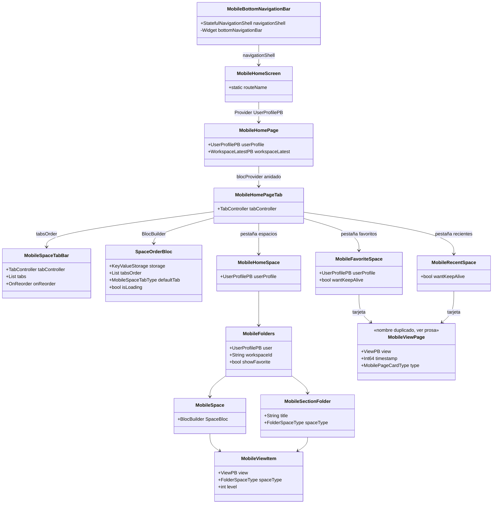
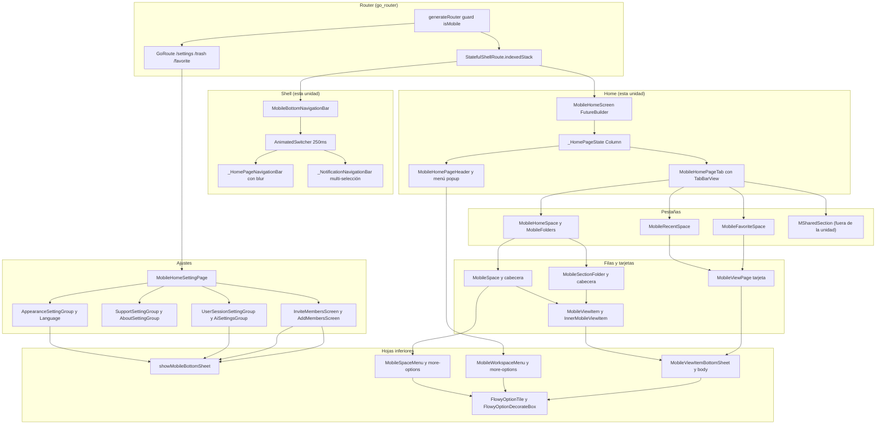
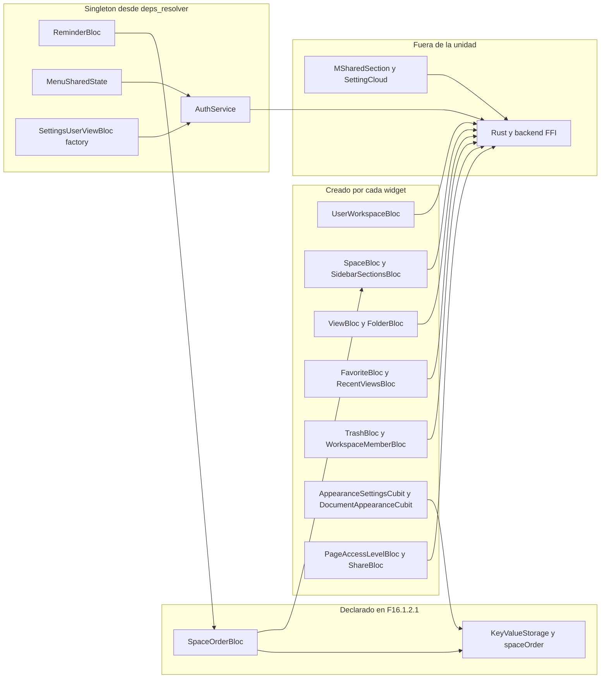
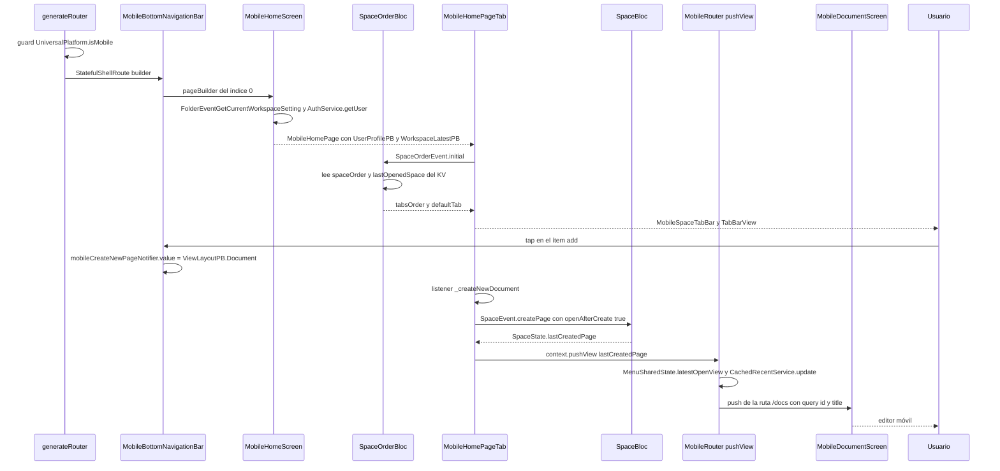
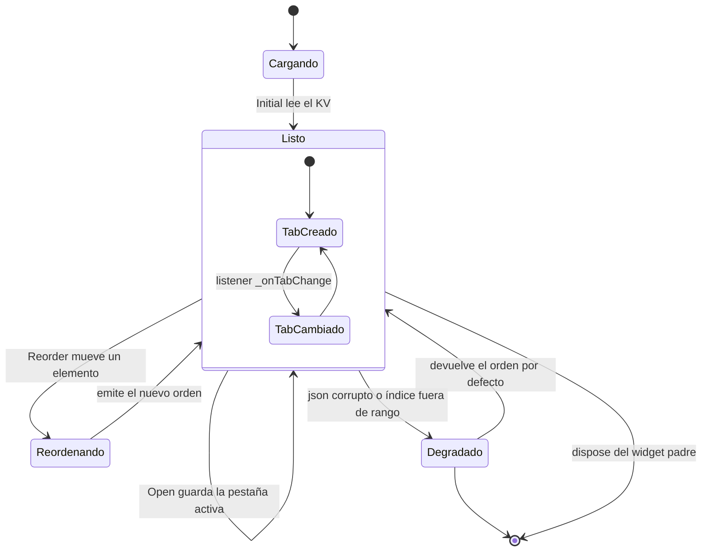

# F16.1.2.1 — Mobile presentation: shell, ajustes, home, favoritos y widgets

## 1. Resumen

Esta unidad documenta los 98 ficheros (13.016 líneas) de la capa de presentación móvil de AppFlowy que rodean a las vistas: el *shell* con barra inferior de navegación, la pantalla de inicio con sus cuatro pestañas (Espacios, Recientes, Favoritos, Compartidos), las páginas de ajustes, la pantalla de papelera y de favoritos, y —la mayor parte del volumen— el **kit de widgets y hojas inferiores** (`bottom_sheet/`, `widgets/`, `page_item/`) que reutilizan tanto el home como el editor y las celdas de base de datos. La arquitectura es de presentación pura: de los 98 ficheros, **97 son widgets** y solo uno declara un BLoC, `SpaceOrderBloc` (`appflowy/frontend/appflowy_flutter/lib/mobile/presentation/home/tab/space_order_bloc.dart:35`), que persiste el orden y la pestaña activa del home. Ninguno emite un evento FFI de dominio salvo tres llamadas puntuales a `FolderEvent` desde las pantallas raíz (`appflowy/frontend/appflowy_flutter/lib/mobile/presentation/home/mobile_home_page.dart:41`, `appflowy/frontend/appflowy_flutter/lib/mobile/presentation/home/mobile_home_page.dart:149` y `appflowy/frontend/appflowy_flutter/lib/mobile/presentation/favorite/mobile_favorite_page.dart:27`). Toda la lógica de negocio vive en BLoCs externos (`ViewBloc`, `SpaceBloc`, `FavoriteBloc`, `UserWorkspaceBloc`…) que estos widgets crean o consumen.

## 2. Alcance

**Incluye** los 98 ficheros listados en §12, leídos íntegros, más las lecturas de solo lectura necesarias para sostener las afirmaciones de integración: el registro de rutas `appflowy/frontend/appflowy_flutter/lib/startup/tasks/generate_router.dart`, el inyector `appflowy/frontend/appflowy_flutter/lib/startup/deps_resolver.dart`, la extensión de navegación `appflowy/frontend/appflowy_flutter/lib/mobile/application/mobile_router.dart:17`, el almacén KV `appflowy/frontend/appflowy_flutter/lib/core/config/kv.dart:3` y sus claves `appflowy/frontend/appflowy_flutter/lib/core/config/kv_keys.dart:96`, el `MenuSharedState` de `appflowy/frontend/appflowy_flutter/lib/workspace/presentation/home/menu/menu_shared_state.dart:4` y el listener de recordatorios `appflowy/frontend/appflowy_flutter/lib/user/application/reminder/reminder_listener.dart:58`.

**Corrección de scope declarada.** Los directorios `appflowy/frontend/appflowy_flutter/lib/plugins/document/presentation/editor_plugins/mobile_toolbar_v3/` y `appflowy/frontend/appflowy_flutter/lib/plugins/document/presentation/editor_plugins/mobile_floating_toolbar/` **no pertenecen a F16**: están asignados y ya verificados en `F01.6.4`. Esta unidad no los documenta ni los duplica, y por eso la unidad `F16.2` («Mobile: `editor_plugins/mobile_*`») queda como marcador de alcance vacío. Solo se los cita como **punto de contraste** donde el código de esta unidad los selecciona o los consume: el ítem de enlace de la toolbar móvil instancia `MobileBottomSheetEditLinkWidget` de esta unidad (`appflowy/frontend/appflowy_flutter/lib/plugins/document/presentation/editor_plugins/mobile_toolbar_v3/link_toolbar_item.dart:60`), y `MobileQuickActionButton`, que aquí se usa en `appflowy/frontend/appflowy_flutter/lib/mobile/presentation/bottom_sheet/bottom_sheet_view_page.dart:120`, se usa también en `appflowy/frontend/appflowy_flutter/lib/plugins/document/presentation/editor_plugins/mobile_toolbar_v3/add_attachment_item.dart:116`.

**Queda fuera y se referencia como ya documentado**: la página base `MobileViewPage` y su `MobileViewPageBloc` (`[[../../09-features/F16-mobile/1.2.3-mobile-presentation-database-chat-busqueda-notificaciones-y-base.md]]` y `[[../../09-features/F16-mobile/1.1-mobile-lib-mobile-application-router-y-blocs-base.md]]`); los BLoCs de dominio que estos widgets consumen (`ViewBloc` en `appflowy/frontend/appflowy_flutter/lib/workspace/application/view/view_bloc.dart:27`, `SpaceBloc` en `appflowy/frontend/appflowy_flutter/lib/workspace/application/sidebar/space/space_bloc.dart:65`, `FavoriteBloc` en `appflowy/frontend/appflowy_flutter/lib/workspace/application/favorite/favorite_bloc.dart:14`, `FolderBloc`, `SidebarSectionsBloc`, `RecentViewsBloc`, `TrashBloc`, `SettingsUserViewBloc`, `WorkspaceMemberBloc`, `SettingsAIBloc`, `PasswordBloc`, `SignInBloc` — todos en `[[../../09-features/F04-sidebar-favoritos-recientes-papelera-tabs-command-palette/F04-sidebar-favoritos-recientes-papelera-tabs-command-palette.md]]`, `[[../../09-features/F05-usuario-auth-sesion/1-usuario-appflowy-flutter-lib-user-dart.md]]` y `[[../../09-features/F09-ia/4-ia-editor-plugins-ai.md]]`); el widget `MSharedSection` de la pestaña Compartidos (`appflowy/frontend/appflowy_flutter/lib/features/shared_section/presentation/m_shared_section.dart`, `[[../../09-features/F05-usuario-auth-sesion/2-usuario-flowy-user-collab-user-rust-collab.md]]`); y el `SettingCloud` de escritorio reutilizado tal cual en `appflowy/frontend/appflowy_flutter/lib/mobile/presentation/setting/cloud/appflowy_cloud_page.dart:20`.

## 3. Modelos de datos

Los 98 ficheros no definen entidades de dominio: no hay tablas, ni `freezed` salvo en el único BLoC, ni modelos protobuf propios. Definen **tipos de presentación** agrupados en tres familias. (a) Enums de control de navegación y de acciones: `BottomNavigationBarActionType`, `BottomNavigationBarItemType` (`appflowy/frontend/appflowy_flutter/lib/mobile/presentation/mobile_bottom_navigation_bar.dart:25` y `:37`), `MobileSpaceTabType` (`appflowy/frontend/appflowy_flutter/lib/mobile/presentation/home/tab/space_order_bloc.dart:14`), `MobilePageCardType` (`appflowy/frontend/appflowy_flutter/lib/mobile/presentation/home/shared/mobile_page_card.dart:35`), `MobilePaneActionType` (`appflowy/frontend/appflowy_flutter/lib/mobile/presentation/bottom_sheet/default_mobile_action_pane.dart:20`), `MobileViewItemBottomSheetBodyAction` (`appflowy/frontend/appflowy_flutter/lib/mobile/presentation/bottom_sheet/bottom_sheet_view_item_body.dart:9`), `MobileViewBottomSheetBodyAction` (`appflowy/frontend/appflowy_flutter/lib/mobile/presentation/bottom_sheet/bottom_sheet_view_page.dart:16`), `FlowyOptionTileType` (`appflowy/frontend/appflowy_flutter/lib/mobile/presentation/widgets/flowy_option_tile.dart:7`) y `BlockActionBottomSheetType` (`appflowy/frontend/appflowy_flutter/lib/mobile/presentation/bottom_sheet/bottom_sheet_block_action_widget.dart:7`). (b) El modelo de estado real del BLoC: `SpaceOrderEvent` / `SpaceOrderState` (`appflowy/frontend/appflowy_flutter/lib/mobile/presentation/home/tab/space_order_bloc.dart:117` y `:124`). (c) Widgets parametrizados que no mantienen estado, salvo cinco `StatefulWidget` cuya única función es poseer un `TextEditingController` o un `FocusNode`: `_MobileSectionFolderHeaderState`, `_DisplaySizeSettingState`, `SelfHostUrlBottomSheetState`, `EditUsernameBottomSheetState` y `EditWorkspaceNameBottomSheetState`.

Hay tres **colisiones de nombre de clase** que solo se desambiguan por el import explícito y que conviene tener presentes al leer el código: `MobileViewPage` designa a la vez a la tarjeta de la lista de recientes (`appflowy/frontend/appflowy_flutter/lib/mobile/presentation/home/shared/mobile_page_card.dart:45`, un `StatelessWidget`) y a la página base de cualquier vista (`appflowy/frontend/appflowy_flutter/lib/mobile/presentation/base/mobile_view_page.dart:35`, un `StatefulWidget`); `BottomSheetHeader` designa a dos cabeceras distintas (`appflowy/frontend/appflowy_flutter/lib/mobile/presentation/bottom_sheet/show_mobile_bottom_sheet.dart:211` y `appflowy/frontend/appflowy_flutter/lib/mobile/presentation/bottom_sheet/bottom_sheet_header.dart:5`); y `LanguagePickerPage` está declarada dos veces, una en el selector de idioma (`appflowy/frontend/appflowy_flutter/lib/mobile/presentation/setting/language/language_picker_screen.dart:18`) y otra, con nombre heredado, dentro del selector de fuente (`appflowy/frontend/appflowy_flutter/lib/mobile/presentation/setting/font/font_picker_screen.dart:31`, que además es la clase que `FontPickerScreen` instancia en `:27`). El barril `appflowy/frontend/appflowy_flutter/lib/mobile/presentation/bottom_sheet/bottom_sheet.dart:1` solo exporta la primera versión de `BottomSheetHeader`, lo que evita el conflicto por construcción.

Muestra: la jerarquía de widgets del shell y del home, y el punto exacto en que cada BLoC de dominio entra en el árbol.

Lectura: la arquitectura del home es un árbol de `StatelessWidget` muy plano; el único nodo con estado propio del dominio visual es `_MobileHomePageTabState`, que posee el `TabController` (`appflowy/frontend/appflowy_flutter/lib/mobile/presentation/home/tab/mobile_space_tab.dart:41`). Todo lo demás son `Builder`/`BlocBuilder` que se reconstruyen cuando cambia el estado. `SpaceOrderBloc` es el único punto donde el home guarda algo entre sesiones, y lo hace en el KV, no en Rust.

## 4. Eventos FFI

**Ninguno de los 98 widgets emite eventos de dominio.** Todo el trabajo con el backend se delega en BLoCs externos. Hay exactamente tres llamadas `.send()` dentro de la unidad, y las tres son lecturas o escrituras triviales del *folder* launchadas desde las pantallas raíz:

| Evento | Input PB | Output PB | Handler Rust | Disparado en | Evidencia del evento |
|---|---|---|---|---|---|
| `FolderEvent::GetCurrentWorkspaceSetting` (índice 1) | — | `WorkspaceLatestPB` | `read_current_workspace_setting_handler` | `MobileHomeScreen.build`, primer future del `Future.wait` | `appflowy/frontend/appflowy_flutter/lib/mobile/presentation/home/mobile_home_page.dart:41`; `appflowy/frontend/appflowy_flutter/lib/mobile/presentation/favorite/mobile_favorite_page.dart:27` |
| `FolderEvent::GetCurrentWorkspaceSetting` (índice 1) | — | `WorkspaceLatestPB` | ídem | `MobileHomeSettingPage` no lo usa: llama a `getIt<AuthService>().getUser()` | `appflowy/frontend/appflowy_flutter/lib/mobile/presentation/home/mobile_home_setting_page.dart:38` |
| `FolderEvent::SetLatestView` (índice 21) | `ViewIdPB` | — | `set_latest_view_handler` | `_MobileHomePageState._onLatestViewChange`, al cambiar la vista abierta | `appflowy/frontend/appflowy_flutter/lib/mobile/presentation/home/mobile_home_page.dart:149` |

Los dos primeros se disparan **sin esperar**: el `FutureBuilder` de `MobileHomeScreen` muestra un `CircularProgressIndicator.adaptive()` mientras `FolderEventGetCurrentWorkspaceSetting().send()` y `getIt<AuthService>().getUser()` resuelven (`appflowy/frontend/appflowy_flutter/lib/mobile/presentation/home/mobile_home_page.dart:39–47`), y si cualquiera devuelve error se degrada a `WorkspaceFailedScreen` (`appflowy/frontend/appflowy_flutter/lib/mobile/presentation/home/mobile_home_page.dart:64–66`). El resto de eventos que gobiernan el contenido —crear vista, renombrar, duplicar, borrar, marcar favorito, mover a papelera— los emiten `ViewBloc`, `SpaceBloc`, `SidebarSectionsBloc`, `FavoriteBloc` y `TrashBloc`, documentados en `[[../../09-features/F04-sidebar-favoritos-recientes-papelera-tabs-command-palette/F04-sidebar-favoritos-recientes-papelera-tabs-command-palette.md]]` y `[[../../09-features/F05-usuario-auth-sesion/1-usuario-appflowy-flutter-lib-user-dart.md]]`.

## 5. Notificaciones

**Ninguno de los 98 ficheros se suscribe a `RustStreamReceiver` ni declara un `*_listener.dart`.** Todos los widgets de la unidad son consumidores finales: esperan a que los BLoCs hayantraducido las notificaciones de Rust a estado. El único efecto indirecto de una notificación Rust sobre esta capa es el punto rojo de la barra inferior, que se decide leyendo `ReminderBloc`:

| Notificación | Emisor (Rust) | Parser Dart | Efecto UI en esta unidad | Evidencia |
|---|---|---|---|---|
| `UserNotification::DidUpdateReminder` | `flowy-user` | `ReminderParser`, en `appflowy/frontend/appflowy_flutter/lib/user/application/reminder/reminder_listener.dart:58` | `_NotificationNavigationBarItemIcon` envuelve su icono en un `BlocBuilder<ReminderBloc, ReminderState>` y muestra `NumberedRedDot.mobile()` si algún recordatorio tiene `isRead == false` | `appflowy/frontend/appflowy_flutter/lib/mobile/presentation/mobile_bottom_navigation_bar.dart:182–215` |
| `FolderNotification::DidUpdateView` y `DidUpdateRecentViews` | `flowy-folder` | `ViewListener` / `RecentViewsBloc` | ninguna suscripción directa: los BLoCs ya actualizados redibujan la lista de la pestaña activa; si cambia la sección o el espacio se reconstruye la columna | `appflowy/frontend/appflowy_flutter/lib/mobile/presentation/home/mobile_folders.dart:33–53` |
| `FolderNotification::DidUpdateWorkspaceSetting` | `flowy-folder` | `WorkspaceListener` | `_HomePageState.listener` ignora el contenido y solo reacciona al **cambio de `workspaceId`**, reiniciando `CachedRecentService` y el `CommandPaletteBloc` | `appflowy/frontend/appflowy_flutter/lib/mobile/presentation/home/mobile_home_page.dart:167–189` |

Nótese que la tercera fila no es una suscripción sino un `BlocConsumer` con `buildWhen` restringido al identificador de workspace (`appflowy/frontend/appflowy_flutter/lib/mobile/presentation/home/mobile_home_page.dart:168–170`), lo que evita reconstruir el árbol entero de pestañas en cada notificación de workspace.

## 6. BLoCs / Cubits

De los 98 ficheros, **uno declara un BLoC** y ningún otro declara un Cubit. `SpaceOrderBloc` es además el único que persiste: lee y escribe dos claves del `KeyValueStorage` en vez de hablar con Rust.

| Clase | Eventos | Estados | Servicios | Dónde se crea | Evidencia |
|---|---|---|---|---|---|
| `SpaceOrderBloc` | `Initial`, `Open(int)`, `Reorder(int, int)` | `defaultTab`, `tabsOrder`, `isLoading` | `KeyValueStorage` (vía `getIt`) | `MultiBlocProvider` de `_HomePageState.build` | `appflowy/frontend/appflowy_flutter/lib/mobile/presentation/home/tab/space_order_bloc.dart:35`, `:117–122`, `:124–133`; creado en `appflowy/frontend/appflowy_flutter/lib/mobile/presentation/home/mobile_home_page.dart:214–217` |
| `UserWorkspaceBloc` | `initialize`, `fetchWorkspaces`, `openWorkspace`, `createWorkspace`, `renameWorkspace`, `deleteWorkspace`, `leaveWorkspace`, `updateWorkspaceIcon` | `currentWorkspace`, `workspaces`, `actionResult`, `isCollabWorkspaceOn` | `RustWorkspaceRepositoryImpl` | dos sitios: `MobileHomePage` (`appflowy/frontend/appflowy_flutter/lib/mobile/presentation/home/mobile_home_page.dart:124–131`) y `MobileHomeSettingPage` (`appflowy/frontend/appflowy_flutter/lib/mobile/presentation/home/mobile_home_setting_page.dart:77–83`) | clase en `appflowy/frontend/appflowy_flutter/lib/features/workspace/logic/workspace_bloc.dart:37` |
| `SpaceBloc`, `SidebarSectionsBloc`, `FavoriteBloc` | — | — | — | `MultiBlocProvider` anidado dentro de `_HomePageState.build`, ya filtrado por `workspaceId` | `appflowy/frontend/appflowy_flutter/lib/mobile/presentation/home/mobile_home_page.dart:212–245` |
| `ViewBloc` | — | — | — | uno por fila, en `MobileViewItem.build` y en `_Pages` de `MobileSpace` | `appflowy/frontend/appflowy_flutter/lib/mobile/presentation/page_item/mobile_view_item.dart:69–70`; `appflowy/frontend/appflowy_flutter/lib/mobile/presentation/home/space/mobile_space.dart:127–129` |
| `FolderBloc` | — | — | — | uno por sección, en `MobileSectionFolder` y `MobileFavoriteFolder` | `appflowy/frontend/appflowy_flutter/lib/mobile/presentation/home/section_folder/mobile_home_section_folder.dart:30–34`; `appflowy/frontend/appflowy_flutter/lib/mobile/presentation/home/favorite_folder/mobile_home_favorite_folder.dart:29–33` |
| `ReminderBloc` | `started`, `refresh`, `markAsRead`, `archive` | `reminders` | — | **no se crea aquí**: es un singleton de `getIt` reinyectado con `BlocProvider.value` | `appflowy/frontend/appflowy_flutter/lib/mobile/presentation/home/mobile_home_page.dart:136–138`; singleton en `appflowy/frontend/appflowy_flutter/lib/startup/deps_resolver.dart:160` |
| `TrashBloc`, `WorkspaceMemberBloc`, `SettingsUserViewBloc`, `PasswordBloc`, `SettingsAIBloc`, `PageAccessLevelBloc`, `RecentViewBloc`, `AppearanceSettingsCubit`, `DocumentAppearanceCubit`, `ShareBloc`, `MediaCellBloc` | — | — | — | creados por sus settings y por el `more` de cada fila | `appflowy/frontend/appflowy_flutter/lib/mobile/presentation/home/mobile_home_trash_page.dart:22`; `appflowy/frontend/appflowy_flutter/lib/mobile/presentation/bottom_sheet/default_mobile_action_pane.dart:133–137` |

La consecuencia arquitectónica es que **esta capa no posee estado**: todos los widgets son functors de un `BuildContext` y de listas de `ViewPB`. El único estado mutable no bloc de la unidad son seis `ValueNotifier` globales que actúan como bus de un solo disparo: `mobileCreateNewPageNotifier` (`appflowy/frontend/appflowy_flutter/lib/mobile/presentation/mobile_bottom_navigation_bar.dart:30`), `bottomNavigationBarType` (`:32`), `bottomNavigationBarItemType` (`:34`), `mCurrentWorkspace` (`appflowy/frontend/appflowy_flutter/lib/mobile/presentation/home/mobile_home_page.dart:85`), `mobileCreateNewAIChatNotifier` (`appflowy/frontend/appflowy_flutter/lib/mobile/presentation/home/tab/mobile_space_tab.dart:25`) y `mobileLeaveWorkspaceNotifier` (`appflowy/frontend/appflowy_flutter/lib/mobile/presentation/setting/workspace/invite_members_screen.dart:26`). Los tres últimos son *contadores* que se incrementan para que un listener de otra pantalla reaccione: la pantalla de salir del workspace no puede despachar el evento porque el `UserWorkspaceBloc` vive en el home.

## 7. Servicios e inyección de dependencias

La unidad no registra ningún servicio: **consume siete singletons/fábricas de `getIt`**, todos resueltos en `appflowy/frontend/appflowy_flutter/lib/startup/deps_resolver.dart`.

| Servicio | Registro | Uso en esta unidad | Evidencia del uso |
|---|---|---|---|
| `KeyValueStorage` → `DartKeyValue` | `registerFactory` en `appflowy/frontend/appflowy_flutter/lib/startup/deps_resolver.dart:51` | backing store de `SpaceOrderBloc` para el orden de pestañas y la última pestaña activa | `appflowy/frontend/appflowy_flutter/lib/mobile/presentation/home/tab/space_order_bloc.dart:66` |
| `ReminderBloc` | `registerSingleton` en `appflowy/frontend/appflowy_flutter/lib/startup/deps_resolver.dart:160` | punto rojo de no leídos, refresco al abrir la pestaña, marcar leídas y archivar en lote | `appflowy/frontend/appflowy_flutter/lib/mobile/presentation/mobile_bottom_navigation_bar.dart:183`, `:282`, `:363`, `:379` |
| `MenuSharedState` | `registerSingleton` en `appflowy/frontend/appflowy_flutter/lib/startup/deps_resolver.dart:145` | publicar la última vista abierta, que el home persiste con `FolderEventSetLatestView` | `appflowy/frontend/appflowy_flutter/lib/mobile/presentation/home/mobile_home_page.dart:109`, `:115`, `:145` |
| `AuthService` | `registerFactory` en `appflowy/frontend/appflowy_flutter/lib/startup/deps_resolver.dart:109` | `getUser()` para el perfil y `signOut()` en cerrar sesión y al cambiar de servidor | `appflowy/frontend/appflowy_flutter/lib/mobile/presentation/home/mobile_home_setting_page.dart:38`; `appflowy/frontend/appflowy_flutter/lib/mobile/presentation/setting/user_session_setting_group.dart:117` |
| `SettingsUserViewBloc` | `registerFactoryParam` en `appflowy/frontend/appflowy_flutter/lib/startup/deps_resolver.dart:179` | editar nombre y avatar del usuario | `appflowy/frontend/appflowy_flutter/lib/mobile/presentation/home/mobile_home_page_header.dart:34`; `appflowy/frontend/appflowy_flutter/lib/mobile/presentation/setting/personal_info/personal_info_setting_group.dart:32–36` |
| `SignInBloc` | `registerFactory` en `appflowy/frontend/appflowy_flutter/lib/startup/deps_resolver.dart:124` | solo si `showThirdPartyLogin` es `true`, que en el home móvil nunca lo es | `appflowy/frontend/appflowy_flutter/lib/mobile/presentation/setting/user_session_setting_group.dart:63–87` |
| `ClipboardService` | `registerFactory` en `appflowy/frontend/appflowy_flutter/lib/startup/deps_resolver.dart:87` | copiar el enlace de invitación al portapapeles | `appflowy/frontend/appflowy_flutter/lib/mobile/presentation/setting/workspace/invite_members_screen.dart:265` |
| `FlowyCacheManager` | `registerFactory` en `appflowy/frontend/appflowy_flutter/lib/startup/deps_resolver.dart:96` | "limpiar caché" borra cachés y ejecuta `WorkspaceDataManager.checkViewHealth` | `appflowy/frontend/appflowy_flutter/lib/mobile/presentation/setting/support_setting_group.dart:78–82` |

A eso se suman servicios estáticos que no pasan por `getIt`: `UserBackendService.getCurrentUserProfile()` y `getCurrentWorkspace()` (`appflowy/frontend/appflowy_flutter/lib/mobile/presentation/bottom_sheet/bottom_sheet_edit_link_widget.dart:346`, `appflowy/frontend/appflowy_flutter/lib/mobile/presentation/setting/workspace/add_members_screen.dart:57`), `ViewBackendService.getMentionPageStatus` (`appflowy/frontend/appflowy_flutter/lib/mobile/presentation/bottom_sheet/bottom_sheet_edit_link_widget.dart:395`), `PackageInfo.fromPlatform()` (`appflowy/frontend/appflowy_flutter/lib/mobile/presentation/setting/support_setting_group.dart:28`) y `WindowSizeManager` (`appflowy/frontend/appflowy_flutter/lib/mobile/presentation/setting/appearance/text_scale_setting.dart:29`). La apariencia, en cambio, **sí** se resuelve por plataforma en el inyector: `UniversalPlatform.isMobile ? MobileAppearance() : DesktopAppearance()` (`appflowy/frontend/appflowy_flutter/lib/startup/deps_resolver.dart:93`).

## 8. Persistencia

La unidad no abre SQLite, no lee snapshots de collab y no escribe ficheros de datos. Su única persistencia es de preferencias de interfaz, y se apoya en el `KeyValueStorage` que resuelve a `DartKeyValue`, es decir, `SharedPreferences` (`appflowy/frontend/appflowy_flutter/lib/core/config/kv.dart:14` y `:62`).

| Clave KV | Contenido | Escribe | Lee | Evidencia |
|---|---|---|---|---|
| `spaceOrder` | lista JSON de índices de `MobileSpaceTabType` | `SpaceOrderBloc._setTabsOrder` | `SpaceOrderBloc._getTabsOrder` | clave en `appflowy/frontend/appflowy_flutter/lib/core/config/kv_keys.dart:102`; escritura en `appflowy/frontend/appflowy_flutter/lib/mobile/presentation/home/tab/space_order_bloc.dart:109–114`; lectura en `:87–107` |
| `lastOpenedSpace` | índice de `MobileSpaceTabType` como `String` | `SpaceOrderBloc._setDefaultTab` | `SpaceOrderBloc._getDefaultTab` | clave en `appflowy/frontend/appflowy_flutter/lib/core/config/kv_keys.dart:96`; escritura en `appflowy/frontend/appflowy_flutter/lib/mobile/presentation/home/tab/space_order_bloc.dart:80–85`; lectura en `:68–78` |

Hay un tercer ajuste que se persiste **fuera del KV**: el factor de escala de la interfaz, que `DisplaySizeSetting` escribe con `WindowSizeManager.setScaleFactor` y aplica en caliente a `ScaledWidgetsFlutterBinding.instance.scaleFactor` (`appflowy/frontend/appflowy_flutter/lib/mobile/presentation/setting/appearance/text_scale_setting.dart:73–89`). Además hay dos escrituras de plataforma que no pasan por Dart: `SharedPreferences.setString` es el único punto de contacto de `spaceOrder` con disco, y el ajuste de URL self-hosted se resuelve leyendo las variables de entorno antes de reiniciar la app (`appflowy/frontend/appflowy_flutter/lib/mobile/presentation/setting/self_host/self_host_bottom_sheet.dart:84–96`).

## 9. Diagramas de flujo

Muestra: cómo se compone el shell móvil y por dónde entra el usuario en cada sub-área, con las capas separadas por responsabilidad.

Lectura: el shell son solo cuatro ramas del `StatefulShellRoute` (home, búsqueda, favoritos, notificaciones) envueltas en un `Scaffold` con `extendBody: true` (`appflowy/frontend/appflowy_flutter/lib/mobile/presentation/mobile_bottom_navigation_bar.dart:131–141`). La variante de la barra la decide un `ValueNotifier` global, no la ruta: si vale `notificationMultiSelect` la barra de cuatro iconos se sustituye por una de dos acciones y se anima con un `SlideTransition` de 250 ms (`:124–140`). Todo lo que cuelga del home pasa después por el kit de hojas inferiores, que es el verdadero cuello de botella de esta capa: `FlowyOptionTile` es el componente base de prácticamente todos los menús.

Muestra: quién es dueño de cada BLoC en esta capa y de dónde sale su estado, separando lo declarado aquí de lo importado.

Lectura: la única flecha de la unidad hacia el exterior de la app es `SpaceOrderBloc → KeyValueStorage`; todo lo demás son flechas **hacia** `Rust y backend FFI` que atraviesan BLoCs propiedad de otras unidades. `ReminderBloc` y `MenuSharedState` son los dos singletons que sobreviven al `dispose` de la pantalla y por eso tienen que inyectarse explícitamente con `BlocProvider.value` en lugar de crearse: el punto rojo debe seguir actualizándose con la app viva aunque el home se haya destruido (`appflowy/frontend/appflowy_flutter/lib/mobile/presentation/home/mobile_home_page.dart:136–138`).

## 10. Diagramas de secuencia

Muestra: el camino completo desde que la app arranca en móvil hasta que el usuario crea una página con el botón `+` de la barra inferior y el editor se abre.

Lectura: el patrón "crear" aparece dos veces con dos BLoCs distintos, y la condición depende de si existen espacios. Si `SpaceBloc` tiene espacios, `_createNewPage` despacha `SpaceEvent.createPage` y el `BlocListener<SpaceBloc>` de la propia tab abre la vista creada (`appflowy/frontend/appflowy_flutter/lib/mobile/presentation/home/tab/mobile_space_tab.dart:70–86`); si no hay espacios y el layout es documento, cae a `SidebarSectionsEvent.createRootViewInSection` contra la sección pública (`:212–221`), y si el layout es chat simplemente no hace nada. El paso de la pestaña a la lista de recientes es **explícito**: `MobileRouter.pushView` escribe en `MenuSharedState.latestOpenView` y en `CachedRecentService.updateRecentViews` antes de hacer el `push` (`appflowy/frontend/appflowy_flutter/lib/mobile/application/mobile_router.dart:29–30`).

## 11. Diagramas de estado

Muestra: el ciclo de vida del `SpaceOrderBloc` y del `TabController` que dependen, incluyendo la reconciliación del orden almacenado cuando llega una versión antigua.

Lectura: el estado inicial es `isLoading = true` (`appflowy/frontend/appflowy_flutter/lib/mobile/presentation/home/tab/space_order_bloc.dart:129`), y la tab se dibuja como `SizedBox.shrink()` mientras tanto (`appflowy/frontend/appflowy_flutter/lib/mobile/presentation/home/tab/mobile_space_tab.dart:107–109`). La reconciliación importante está en `_getTabsOrder`: si el orden guardado no contiene el índice de `MobileSpaceTabType.shared`, el bloc **lo añade** antes de deserializar (`:95–97`), lo que permite introducir una pestaña nueva sin invalidar las preferencias de los usuarios existentes. Cualquier excepción de deserialización —JSON corrupto o índice fuera de rango tras renombrar el enum— se traga y devuelve `MobileSpaceTabType.values` (`:104–106`), que es el mismo valor por defecto que se usa cuando no hay clave.

## 12. Archivos cubiertos (del ledger)

| # | Fuente | Ruta | Capa | LOC | Rol |
|---|---|---|---|---|---|
| 1 | appflowy | `appflowy/frontend/appflowy_flutter/lib/mobile/presentation/bottom_sheet/bottom_sheet.dart` | ui | 10 | Barrel del kit de hojas inferiores: exporta 9 de los 16 ficheros. |
| 2 | appflowy | `appflowy/frontend/appflowy_flutter/lib/mobile/presentation/bottom_sheet/bottom_sheet_action_widget.dart` | ui | 56 | Boton de accion con icono para hojas inferiores (papelera). |
| 3 | appflowy | `appflowy/frontend/appflowy_flutter/lib/mobile/presentation/bottom_sheet/bottom_sheet_add_new_page.dart` | ui | 80 | Hoja anadir pagina con los cinco layouts de vista. |
| 4 | appflowy | `appflowy/frontend/appflowy_flutter/lib/mobile/presentation/bottom_sheet/bottom_sheet_block_action_widget.dart` | ui | 78 | Hoja de acciones de bloque: insertar arriba/abajo, duplicar, borrar. |
| 5 | appflowy | `appflowy/frontend/appflowy_flutter/lib/mobile/presentation/bottom_sheet/bottom_sheet_buttons.dart` | ui | 107 | Botones de cabecera de hoja: cerrar, hecho, quitar y atras. |
| 6 | appflowy | `appflowy/frontend/appflowy_flutter/lib/mobile/presentation/bottom_sheet/bottom_sheet_drag_handler.dart` | ui | 20 | Handle de arrastre horizontal; sin consumidores en `lib/`. |
| 7 | appflowy | `appflowy/frontend/appflowy_flutter/lib/mobile/presentation/bottom_sheet/bottom_sheet_edit_link_widget.dart` | ui | 416 | Editor de enlaces en hoja; lo consume `mobile_toolbar_v3`. |
| 8 | appflowy | `appflowy/frontend/appflowy_flutter/lib/mobile/presentation/bottom_sheet/bottom_sheet_header.dart` | ui | 49 | Cabecera alternativa de hoja (titulo, cerrar y confirmar). |
| 9 | appflowy | `appflowy/frontend/appflowy_flutter/lib/mobile/presentation/bottom_sheet/bottom_sheet_media_upload.dart` | ui | 96 | Contenido de hoja para subir media a una celda de base de datos. |
| 10 | appflowy | `appflowy/frontend/appflowy_flutter/lib/mobile/presentation/bottom_sheet/bottom_sheet_rename_widget.dart` | ui | 78 | Renombrado en linea con campo de texto y boton Editar. |
| 11 | appflowy | `appflowy/frontend/appflowy_flutter/lib/mobile/presentation/bottom_sheet/bottom_sheet_view_item.dart` | ui | 152 | Hoja de vista con dos estados: acciones y renombrado. |
| 12 | appflowy | `appflowy/frontend/appflowy_flutter/lib/mobile/presentation/bottom_sheet/bottom_sheet_view_item_body.dart` | ui | 159 | Cuerpo de la hoja de vista; respeta el bloqueo de pagina. |
| 13 | appflowy | `appflowy/frontend/appflowy_flutter/lib/mobile/presentation/bottom_sheet/bottom_sheet_view_page.dart` | ui | 289 | Hoja de acciones de la pagina abierta; incluye publicar. |
| 14 | appflowy | `appflowy/frontend/appflowy_flutter/lib/mobile/presentation/bottom_sheet/default_mobile_action_pane.dart` | ui | 218 | Define `MobilePaneActionType` y `buildEndActionPane`. |
| 15 | appflowy | `appflowy/frontend/appflowy_flutter/lib/mobile/presentation/bottom_sheet/show_mobile_bottom_sheet.dart` | ui | 297 | `showMobileBottomSheet`: 26 parametros y calculo de padding. |
| 16 | appflowy | `appflowy/frontend/appflowy_flutter/lib/mobile/presentation/bottom_sheet/show_transition_bottom_sheet.dart` | ui | 346 | Hoja con transicion propia sobre el paquete `sheet`. |
| 17 | appflowy | `appflowy/frontend/appflowy_flutter/lib/mobile/presentation/favorite/mobile_favorite_folder.dart` | ui | 86 | Fila de favorito del arbol, sin arrastre y forzada a expandida. |
| 18 | appflowy | `appflowy/frontend/appflowy_flutter/lib/mobile/presentation/favorite/mobile_favorite_page.dart` | ui | 117 | Favoritos como pagina raiz del shell (rama 2). |
| 19 | appflowy | `appflowy/frontend/appflowy_flutter/lib/mobile/presentation/home/favorite_folder/favorite_space.dart` | ui | 129 | Pestana Favoritos del home: tarjetas o placeholder. |
| 20 | appflowy | `appflowy/frontend/appflowy_flutter/lib/mobile/presentation/home/favorite_folder/mobile_home_favorite_folder.dart` | ui | 85 | Lista de vistas de favoritos con `FolderBloc` propio. |
| 21 | appflowy | `appflowy/frontend/appflowy_flutter/lib/mobile/presentation/home/favorite_folder/mobile_home_favorite_folder_header.dart` | ui | 59 | Cabecera plegable de la seccion de favoritos. |
| 22 | appflowy | `appflowy/frontend/appflowy_flutter/lib/mobile/presentation/home/home.dart` | ui | 3 | Barrel de las tres pantallas del home. |
| 23 | appflowy | `appflowy/frontend/appflowy_flutter/lib/mobile/presentation/home/home_space/home_space.dart` | ui | 43 | Pestana Espacios: `MobileFolders` en un `SingleChildScrollView`. |
| 24 | appflowy | `appflowy/frontend/appflowy_flutter/lib/mobile/presentation/home/mobile_folders.dart` | ui | 115 | Lista de espacios o secciones, con `SlidableAutoCloseBehavior`. |
| 25 | appflowy | `appflowy/frontend/appflowy_flutter/lib/mobile/presentation/home/mobile_home_page.dart` | ui | 340 | Pantalla de inicio (rama 0 del shell) y `MobileHomePage`. |
| 26 | appflowy | `appflowy/frontend/appflowy_flutter/lib/mobile/presentation/home/mobile_home_page_header.dart` | ui | 254 | Cabecera del home: workspace, avatar y menu de ajustes. |
| 27 | appflowy | `appflowy/frontend/appflowy_flutter/lib/mobile/presentation/home/mobile_home_setting_page.dart` | ui | 121 | Pagina de ajustes del home (ruta `/settings`). |
| 28 | appflowy | `appflowy/frontend/appflowy_flutter/lib/mobile/presentation/home/mobile_home_trash_page.dart` | ui | 267 | Pantalla de papelera (ruta `/trash`). |
| 29 | appflowy | `appflowy/frontend/appflowy_flutter/lib/mobile/presentation/home/recent_folder/mobile_home_recent_views.dart` | ui | 141 | Recientes como tira horizontal; sin consumidores en `lib/`. |
| 30 | appflowy | `appflowy/frontend/appflowy_flutter/lib/mobile/presentation/home/recent_folder/mobile_recent_view.dart` | ui | 229 | Tarjeta cuadrada de reciente, con portada segun `CoverType`. |
| 31 | appflowy | `appflowy/frontend/appflowy_flutter/lib/mobile/presentation/home/recent_folder/recent_space.dart` | ui | 102 | Pestana Recientes del home: tarjetas con deslizador. |
| 32 | appflowy | `appflowy/frontend/appflowy_flutter/lib/mobile/presentation/home/section_folder/mobile_home_section_folder.dart` | ui | 132 | Lista de vistas de la seccion, con `FolderBloc` propio. |
| 33 | appflowy | `appflowy/frontend/appflowy_flutter/lib/mobile/presentation/home/section_folder/mobile_home_section_folder_header.dart` | ui | 78 | Cabecera de seccion con boton de anadir; expone una `Key` de test. |
| 34 | appflowy | `appflowy/frontend/appflowy_flutter/lib/mobile/presentation/home/setting/settings_popup_menu.dart` | ui | 168 | Menu popup de la cabecera: ajustes, miembros, papelera y soporte. |
| 35 | appflowy | `appflowy/frontend/appflowy_flutter/lib/mobile/presentation/home/shared/empty_placeholder.dart` | ui | 59 | Placeholder comun de listas vacias de recientes y favoritos. |
| 36 | appflowy | `appflowy/frontend/appflowy_flutter/lib/mobile/presentation/home/shared/mobile_page_card.dart` | ui | 421 | Tarjeta de reciente o favorito con `Slidable` y `RecentViewBloc`. |
| 37 | appflowy | `appflowy/frontend/appflowy_flutter/lib/mobile/presentation/home/space/constants.dart` | ui | 3 | Constantes del menu de espacios (altura de fila). |
| 38 | appflowy | `appflowy/frontend/appflowy_flutter/lib/mobile/presentation/home/space/manage_space_widget.dart` | ui | 53 | Fabrica del `ManageSpaceWidget` (nombre, permiso e icono). |
| 39 | appflowy | `appflowy/frontend/appflowy_flutter/lib/mobile/presentation/home/space/mobile_space.dart` | ui | 185 | Columna de vistas de un espacio, con `ViewBloc` propio. |
| 40 | appflowy | `appflowy/frontend/appflowy_flutter/lib/mobile/presentation/home/space/mobile_space_header.dart` | ui | 143 | Cabecera de espacio con icono, desplegable y boton de anadir. |
| 41 | appflowy | `appflowy/frontend/appflowy_flutter/lib/mobile/presentation/home/space/mobile_space_menu.dart` | ui | 496 | Menu de espacios; crea, renombra, duplica y borra. |
| 42 | appflowy | `appflowy/frontend/appflowy_flutter/lib/mobile/presentation/home/space/space_menu_bottom_sheet.dart` | ui | 99 | Hoja mas opciones de un espacio, segun `SpaceMoreActionType`. |
| 43 | appflowy | `appflowy/frontend/appflowy_flutter/lib/mobile/presentation/home/space/space_permission_bottom_sheet.dart` | ui | 53 | Hoja de permisos del espacio: publico o privado. |
| 44 | appflowy | `appflowy/frontend/appflowy_flutter/lib/mobile/presentation/home/space/widgets.dart` | ui | 389 | Nombre, permiso, color e icono del formulario de espacio. |
| 45 | appflowy | `appflowy/frontend/appflowy_flutter/lib/mobile/presentation/home/tab/_round_underline_tab_indicator.dart` | ui | 101 | Indicador de pestaña redondeado, con pintor propio. |
| 46 | appflowy | `appflowy/frontend/appflowy_flutter/lib/mobile/presentation/home/tab/_tab_bar.dart` | ui | 59 | Barra de pestanas reordenable sobre `ReorderableTabBar`. |
| 47 | appflowy | `appflowy/frontend/appflowy_flutter/lib/mobile/presentation/home/tab/ai_bubble_button.dart` | ui | 117 | Burbujas de entrada a IA: v1 tipo PIL y v2 circular. |
| 48 | appflowy | `appflowy/frontend/appflowy_flutter/lib/mobile/presentation/home/tab/mobile_space_tab.dart` | ui | 234 | Cuerpo de las cuatro pestanas y creacion rapida de paginas. |
| 49 | appflowy | `appflowy/frontend/appflowy_flutter/lib/mobile/presentation/home/tab/space_order_bloc.dart` | bloc | 133 | Unico BLoC de la unidad: orden y pestana activa del home. |
| 50 | appflowy | `appflowy/frontend/appflowy_flutter/lib/mobile/presentation/home/workspaces/create_workspace_menu.dart` | ui | 130 | Formulario de nombre de workspace con validacion. |
| 51 | appflowy | `appflowy/frontend/appflowy_flutter/lib/mobile/presentation/home/workspaces/workspace_menu_bottom_sheet.dart` | ui | 490 | Seleccion de workspace en hoja, con `WorkspaceMemberBloc` por fila. |
| 52 | appflowy | `appflowy/frontend/appflowy_flutter/lib/mobile/presentation/home/workspaces/workspace_more_options.dart` | ui | 106 | Hoja mas opciones de workspace: renombrar, borrar, salir. |
| 53 | appflowy | `appflowy/frontend/appflowy_flutter/lib/mobile/presentation/mobile_bottom_navigation_bar.dart` | ui | 404 | Barra inferior del shell: cuatro items, blur y conmutacion animada. |
| 54 | appflowy | `appflowy/frontend/appflowy_flutter/lib/mobile/presentation/page_item/mobile_slide_action_button.dart` | ui | 39 | Boton deslizante con `HapticFeedback.mediumImpact()`. |
| 55 | appflowy | `appflowy/frontend/appflowy_flutter/lib/mobile/presentation/page_item/mobile_view_item.dart` | ui | 353 | Fabrica de `MobileViewItem`, con recursion de hijos y arrastre. |
| 56 | appflowy | `appflowy/frontend/appflowy_flutter/lib/mobile/presentation/page_item/mobile_view_item_add_button.dart` | ui | 46 | Botones de anadir y de mas; sin consumidores en `lib/`. |
| 57 | appflowy | `appflowy/frontend/appflowy_flutter/lib/mobile/presentation/presentation.dart` | ui | 5 | Barrel de las cinco pantallas raiz del movil. |
| 58 | appflowy | `appflowy/frontend/appflowy_flutter/lib/mobile/presentation/root_placeholder_page.dart` | ui | 33 | Pantalla marcador de rama; sin consumidores en `lib/`. |
| 59 | appflowy | `appflowy/frontend/appflowy_flutter/lib/mobile/presentation/setting/about/about.dart` | ui | 1 | Barrel de la seccion about. |
| 60 | appflowy | `appflowy/frontend/appflowy_flutter/lib/mobile/presentation/setting/about/about_setting_group.dart` | ui | 58 | Aviso legal, version de la app y acceso a feature flags. |
| 61 | appflowy | `appflowy/frontend/appflowy_flutter/lib/mobile/presentation/setting/ai/ai_settings_group.dart` | ui | 90 | Ajustes de IA: seleccion de modelo LLM. |
| 62 | appflowy | `appflowy/frontend/appflowy_flutter/lib/mobile/presentation/setting/appearance/appearance_setting_group.dart` | ui | 27 | Grupo de ajustes de apariencia: cuatro items. |
| 63 | appflowy | `appflowy/frontend/appflowy_flutter/lib/mobile/presentation/setting/appearance/rtl_setting.dart` | ui | 92 | Ajuste de direccion de texto; sincroniza `DocumentAppearanceCubit`. |
| 64 | appflowy | `appflowy/frontend/appflowy_flutter/lib/mobile/presentation/setting/appearance/text_scale_setting.dart` | ui | 90 | Ajuste de tamano de letra via `WindowSizeManager` y binding escalado. |
| 65 | appflowy | `appflowy/frontend/appflowy_flutter/lib/mobile/presentation/setting/appearance/theme_setting.dart` | ui | 87 | Ajuste de tema: hoja con tres `FlowyOptionTile.checkbox`. |
| 66 | appflowy | `appflowy/frontend/appflowy_flutter/lib/mobile/presentation/setting/cloud/appflowy_cloud_page.dart` | ui | 28 | Pagina de ajustes de cloud que reutiliza `SettingCloud`. |
| 67 | appflowy | `appflowy/frontend/appflowy_flutter/lib/mobile/presentation/setting/cloud/cloud_setting_group.dart` | ui | 37 | Grupo de ajustes de cloud; navega a `AppFlowyCloudPage`. |
| 68 | appflowy | `appflowy/frontend/appflowy_flutter/lib/mobile/presentation/setting/font/font_picker_screen.dart` | ui | 145 | Selector de fuente con busqueda sobre `GoogleFonts.asMap()`. |
| 69 | appflowy | `appflowy/frontend/appflowy_flutter/lib/mobile/presentation/setting/font/font_setting.dart` | ui | 43 | Item de fuente; aplica el cambio y sincroniza el documento. |
| 70 | appflowy | `appflowy/frontend/appflowy_flutter/lib/mobile/presentation/setting/language/language_picker_screen.dart` | ui | 52 | Selector de idioma sobre `EasyLocalization.supportedLocales`. |
| 71 | appflowy | `appflowy/frontend/appflowy_flutter/lib/mobile/presentation/setting/language_setting_group.dart` | ui | 56 | Grupo de ajustes de idioma. |
| 72 | appflowy | `appflowy/frontend/appflowy_flutter/lib/mobile/presentation/setting/launch_settings_page.dart` | ui | 39 | Pagina de ajustes de arranque (ruta `/launch_settings`). |
| 73 | appflowy | `appflowy/frontend/appflowy_flutter/lib/mobile/presentation/setting/notifications_setting_group.dart` | ui | 40 | Grupo de notificaciones; el interruptor es estado local sin persistencia. |
| 74 | appflowy | `appflowy/frontend/appflowy_flutter/lib/mobile/presentation/setting/personal_info/edit_username_bottom_sheet.dart` | ui | 77 | Hoja de edicion del nombre de usuario con validacion. |
| 75 | appflowy | `appflowy/frontend/appflowy_flutter/lib/mobile/presentation/setting/personal_info/personal_info.dart` | ui | 2 | Barrel de la seccion de informacion personal. |
| 76 | appflowy | `appflowy/frontend/appflowy_flutter/lib/mobile/presentation/setting/personal_info/personal_info_setting_group.dart` | ui | 182 | Nombre, correo, contrasena o acceso a cloud. |
| 77 | appflowy | `appflowy/frontend/appflowy_flutter/lib/mobile/presentation/setting/self_host/self_host_bottom_sheet.dart` | ui | 99 | Hoja de edicion de la URL self-hosted; reinicia la app al guardar. |
| 78 | appflowy | `appflowy/frontend/appflowy_flutter/lib/mobile/presentation/setting/self_host_setting_group.dart` | ui | 123 | Grupo self-hosted: URL de cloud y dominio web. |
| 79 | appflowy | `appflowy/frontend/appflowy_flutter/lib/mobile/presentation/setting/setting.dart` | ui | 8 | Barrel de la seccion de ajustes. |
| 80 | appflowy | `appflowy/frontend/appflowy_flutter/lib/mobile/presentation/setting/support_setting_group.dart` | ui | 128 | Discord, reportar issue y limpiar cache. |
| 81 | appflowy | `appflowy/frontend/appflowy_flutter/lib/mobile/presentation/setting/user_session_setting_group.dart` | ui | 235 | Cerrar sesion y eliminar cuenta, con confirmacion Cupertino. |
| 82 | appflowy | `appflowy/frontend/appflowy_flutter/lib/mobile/presentation/setting/widgets/mobile_setting_group_widget.dart` | ui | 38 | Grupo de ajustes: titulo, lista de items y separador. |
| 83 | appflowy | `appflowy/frontend/appflowy_flutter/lib/mobile/presentation/setting/widgets/mobile_setting_item_widget.dart` | ui | 60 | Item de ajuste: `ListTile` con titulo, subtitulo y trailing. |
| 84 | appflowy | `appflowy/frontend/appflowy_flutter/lib/mobile/presentation/setting/widgets/mobile_setting_trailing.dart` | ui | 42 | Trailing de los items de ajuste (valor mas flecha). |
| 85 | appflowy | `appflowy/frontend/appflowy_flutter/lib/mobile/presentation/setting/widgets/widgets.dart` | ui | 2 | Barrel de `MobileSettingGroup` y `MobileSettingItem`. |
| 86 | appflowy | `appflowy/frontend/appflowy_flutter/lib/mobile/presentation/setting/workspace/add_members_screen.dart` | ui | 324 | Pantalla de anadir miembros con invitacion por enlace y correo. |
| 87 | appflowy | `appflowy/frontend/appflowy_flutter/lib/mobile/presentation/setting/workspace/invite_member_by_link.dart` | ui | 357 | Duplicado huerfano de `invite_members_screen.dart`; sin imports. |
| 88 | appflowy | `appflowy/frontend/appflowy_flutter/lib/mobile/presentation/setting/workspace/invite_members_screen.dart` | ui | 356 | Pantalla de miembros e invitacion por enlace. |
| 89 | appflowy | `appflowy/frontend/appflowy_flutter/lib/mobile/presentation/setting/workspace/member_list.dart` | ui | 200 | Tabla de miembros con deslizador de borrado. |
| 90 | appflowy | `appflowy/frontend/appflowy_flutter/lib/mobile/presentation/setting/workspace/workspace_setting_group.dart` | ui | 48 | Grupo de ajustes de workspace: numero de miembros. |
| 91 | appflowy | `appflowy/frontend/appflowy_flutter/lib/mobile/presentation/widgets/flowy_mobile_option_decorate_box.dart` | ui | 40 | Wrapper con bordes superior e inferior configurables. |
| 92 | appflowy | `appflowy/frontend/appflowy_flutter/lib/mobile/presentation/widgets/flowy_mobile_quick_action_button.dart` | ui | 71 | Boton de accion rapida; el mas reutilizado de la unidad. |
| 93 | appflowy | `appflowy/frontend/appflowy_flutter/lib/mobile/presentation/widgets/flowy_mobile_search_text_field.dart` | ui | 45 | Buscador Cupertino; usado tambien en base de datos. |
| 94 | appflowy | `appflowy/frontend/appflowy_flutter/lib/mobile/presentation/widgets/flowy_mobile_state_container.dart` | ui | 109 | Contenedor de estado vacio o de error con reporte en GitHub. |
| 95 | appflowy | `appflowy/frontend/appflowy_flutter/lib/mobile/presentation/widgets/flowy_option_tile.dart` | ui | 328 | Tile base de todos los menus; cuatro variantes de fabrica. |
| 96 | appflowy | `appflowy/frontend/appflowy_flutter/lib/mobile/presentation/widgets/navigation_bar_button.dart` | ui | 47 | Boton de la barra inferior en modo multi-seleccion. |
| 97 | appflowy | `appflowy/frontend/appflowy_flutter/lib/mobile/presentation/widgets/show_flowy_mobile_confirm_dialog.dart` | ui | 135 | Dialogos de confirmacion adaptativo y Cupertino. |
| 98 | appflowy | `appflowy/frontend/appflowy_flutter/lib/mobile/presentation/widgets/widgets.dart` | ui | 4 | Barrel de los cuatro widgets genericos de la unidad. |

## 13. Riesgos y casos límite

- **`SpaceOrderBloc` traga errores de deserialización sin señal**: `_getTabsOrder` y `_getDefaultTab` capturan cualquier excepción y devuelven el orden por defecto (`appflowy/frontend/appflowy_flutter/lib/mobile/presentation/home/tab/space_order_bloc.dart:75–77` y `:104–106`). Si el enum `MobileSpaceTabType` cambia de tamaño entre versiones —y su comentario `// DO NOT CHANGE THE ORDER` lo hace especialmente frágil (`appflowy/frontend/appflowy_flutter/lib/mobile/presentation/home/tab/space_order_bloc.dart:15`)— un índice guardado deja de ser válido y el home vuelve al orden canónico **sin avisar al usuario**.
- **Dos `InviteMembersScreen` declarados**: `appflowy/frontend/appflowy_flutter/lib/mobile/presentation/setting/workspace/invite_members_screen.dart:28` y `appflowy/frontend/appflowy_flutter/lib/mobile/presentation/setting/workspace/invite_member_by_link.dart:23` declaran la misma clase, la misma clase privada `_InviteMemberPage` y el mismo `mobileLeaveWorkspaceNotifier` (`:26` y `:21`). Solo el primero está registrado en el router (`appflowy/frontend/appflowy_flutter/lib/startup/tasks/generate_router.dart:245`); el segundo no tiene ningún import en todo `lib/`, es código muerto que además divergió: su `_LeaveWorkspaceButton.onRightButtonPressed` sí incrementa el notificador (`:352–353`), mientras que el del fichero vivo **no lo hace** (`appflowy/frontend/appflowy_flutter/lib/mobile/presentation/setting/workspace/add_members_screen.dart:321` deja el callback vacío), de modo que desde "Añadir miembros" el usuario confirma la salida pero no se ejecuta.
- **`assert` como validación en tiempo de desarrollo de `showMobileBottomSheet`**: la función exige que si no hay cabecera no se pase título ni botones, y prohíbe cerrar y retroceder a la vez (`appflowy/frontend/appflowy_flutter/lib/mobile/presentation/bottom_sheet/show_mobile_bottom_sheet.dart:64–68`). En release esas aserciones desaparecen y una llamada incoherente produce una hoja sin ningún botón de salida.
- **Altura fija de la barra de notificaciones**: `_NotificationNavigationBar` declara `height: 90` con un `// todo: use real height here` (`appflowy/frontend/appflowy_flutter/lib/mobile/presentation/mobile_bottom_navigation_bar.dart:304–311`), lo que reserva espacio fijo bajo el teclado o en barras de sistema altas.
- **Doble espacio de ancho al calculate el `extentRatio` de los `Slidable`**: `buildEndActionPane` divide `actions.length` por un `spaceRatio` que cada llamador fija a mano (`:206`), y los valores oscilan entre 3, 4 y 5 según cuántos botones haya (`appflowy/frontend/appflowy_flutter/lib/mobile/presentation/home/space/mobile_space.dart:174`, `appflowy/frontend/appflowy_flutter/lib/mobile/presentation/home/shared/mobile_page_card.dart:82`, `appflowy/frontend/appflowy_flutter/lib/mobile/presentation/home/favorite_folder/mobile_home_favorite_folder.dart:75`). Cualquier forgetting deja el pane más ancho que el conjunto de botones.
- **`_buildAuthor` está vacío**: la tarjeta de recientes y favoritos reserva el hueco del autor pero pinta cadena vacía (`appflowy/frontend/appflowy_flutter/lib/mobile/presentation/home/shared/mobile_page_card.dart:217–225`), por lo que el separador `FlowySvgs.dot_s` queda pegado al avatar sin texto entre medias (`:139`).
- **Icono de autor solo si es URL**: `_buildAvatar` exige `isURL(iconUrl)` y que el icono pertenezca al autor de la vista (`appflowy/frontend/appflowy_flutter/lib/mobile/presentation/home/shared/mobile_page_card.dart:146–154`); con iconos de emoji, que es lo habitual, el avatar nunca se muestra.
- **Test de escala desalineado con el widget**: el test `appflowy/frontend/appflowy_flutter/integration_test/mobile/settings/scale_factor_test.dart:25` busca el texto de `LocaleKeys.settings_appearance_fontScaleFactor`, mientras que el widget usa `LocaleKeys.settings_appearance_displaySize` (`appflowy/frontend/appflowy_flutter/lib/mobile/presentation/setting/appearance/text_scale_setting.dart:46`). La clave `settings_appearance_fontScaleFactor` no aparece en el catálogo de i18n (`OUT/_ledger/extract/misc.json`, 1.637 claves únicas), lo que sugiere que el test quedó desactualizado; además no está registrado en ningún runner (`appflowy/frontend/appflowy_flutter/integration_test/mobile_runner_1.dart:17–23` solo agrega `anonymous_sign_in`, `create_new_page`, `document_test_runner` y `default_text_direction`), por lo que ni siquiera se ejecuta.
- **Código muerto en la unidad**: `RootPlaceholderScreen` (`appflowy/frontend/appflowy_flutter/lib/mobile/presentation/root_placeholder_page.dart:5`), `MobileBottomSheetDragHandler` (`appflowy/frontend/appflowy_flutter/lib/mobile/presentation/bottom_sheet/bottom_sheet_drag_handler.dart:3`), `MobileViewAddButton` y `MobileViewMoreButton` (`appflowy/frontend/appflowy_flutter/lib/mobile/presentation/page_item/mobile_view_item_add_button.dart:6` y `:27`), `FloatingAIEntry` v1 (`appflowy/frontend/appflowy_flutter/lib/mobile/presentation/home/tab/ai_bubble_button.dart:11`, sustituida por `FloatingAIEntryV2` en `appflowy/frontend/appflowy_flutter/lib/mobile/presentation/home/tab/mobile_space_tab.dart:176`), `MobileHomeRecentFolder` (`appflowy/frontend/appflowy_flutter/lib/mobile/presentation/home/recent_folder/mobile_home_recent_views.dart:16`) y `BuildCardDecoration` (`appflowy/frontend/appflowy_flutter/lib/mobile/presentation/bottom_sheet/bottom_sheet_edit_link_widget.dart:403`) no tienen ninguna referencia en `lib/` ni en `integration_test/`.
- **Swipe para quitar de recientes sin `RecentViewsBloc` garantizado**: el botón `more` lee `context.read<RecentViewsBloc?>()` con tipo anulable (`appflowy/frontend/appflowy_flutter/lib/mobile/presentation/bottom_sheet/default_mobile_action_pane.dart:119`) y solo lo inyecta si existe, pero `MobileViewItemBottomSheet._removeFromRecent` lo lee sin `?` (`appflowy/frontend/appflowy_flutter/lib/mobile/presentation/bottom_sheet/bottom_sheet_view_item.dart:114`); la acción solo aparece para `MobilePageCardType.recent` (`:170`), donde sí está, pero el contrato no lo hace explícito.
- **Texto fijo sin traducir**: `CloudSettingGroup` usa literales `'Cloud settings'` y `'Cloud server'` (`appflowy/frontend/appflowy_flutter/lib/mobile/presentation/setting/cloud/cloud_setting_group.dart:23` y `:26`), `AddMembersScreen` el título `'Add members'` (`appflowy/frontend/appflowy_flutter/lib/mobile/presentation/setting/workspace/add_members_screen.dart:34`), `PersonalInfoSettingGroup` el ítem `'User name'` (`appflowy/frontend/appflowy_flutter/lib/mobile/presentation/setting/personal_info/personal_info_setting_group.dart:50`), `MobileMemberList` la cabecera `'Joined'` (`appflowy/frontend/appflowy_flutter/lib/mobile/presentation/setting/workspace/member_list.dart:44`) y `WorkspaceMenuMoreOptions` la etiqueta `'Invite'` (`appflowy/frontend/appflowy_flutter/lib/mobile/presentation/home/workspaces/workspace_more_options.dart:76`, con un comentario `// i18n` que reconoce la deuda).
- **`MobileHomeScreen` y `MobileFavoriteScreen` hacen el mismo `Future.wait`**: ambos repiten el `FolderEventGetCurrentWorkspaceSetting().send()` más `getIt<AuthService>().getUser()` y el mismo `FutureBuilder` (`appflowy/frontend/appflowy_flutter/lib/mobile/presentation/home/mobile_home_page.dart:39–43` frente a `appflowy/frontend/appflowy_flutter/lib/mobile/presentation/favorite/mobile_favorite_page.dart:26–29`), con la única diferencia del padding superior `Platform.isAndroid ? 8.0 : 0.0` (`appflowy/frontend/appflowy_flutter/lib/mobile/presentation/favorite/mobile_favorite_page.dart:100`).
- **`MobileViewPageBloc` se lee desde una hoja inferior**: `MobileViewBottomSheetBody._buildPublishActions` hace `context.read<MobileViewPageBloc>()` (`appflowy/frontend/appflowy_flutter/lib/mobile/presentation/bottom_sheet/bottom_sheet_view_page.dart:203`) confiando en que la hoja se abrió con `useRootNavigator: true` sobre la página que lo creó; si algún llamador lo abre desde otro contexto, la lectura falla en tiempo de ejecución.

## 14. Evidencias y etiquetas

Por defecto todas las afirmaciones de este documento son `[VERIFICADO]`: cada una lleva su referencia `ruta:línea` y el validador `validate_evidence.py` confirmó **155 referencias, 155 correctas, 0 errores**, contra `OUT/_ledger/inventario.json`. Sobre ese total hay **cuatro inferencias explícitas** y **cuatro cuestiones `[NO DETERMINADO]`**, estas últimas copiadas íntegras en §18.

Las cuatro inferencias se apoyan en estos puntos concretos. (a) Que el kit de `bottom_sheet/` sea la abstracción dominante de la capa y no un detalle de navegación: se deduce de que `FlowyOptionTile` aparezca en menús de espacios (`appflowy/frontend/appflowy_flutter/lib/mobile/presentation/home/space/space_menu_bottom_sheet.dart:38`), de workspaces (`appflowy/frontend/appflowy_flutter/lib/mobile/presentation/home/workspaces/workspace_more_options.dart:44`), de ajustes de apariencia (`appflowy/frontend/appflowy_flutter/lib/mobile/presentation/setting/appearance/theme_setting.dart:39`), de bloques (`appflowy/frontend/appflowy_flutter/lib/mobile/presentation/bottom_sheet/bottom_sheet_block_action_widget.dart:30`) y de selector de fuente (`appflowy/frontend/appflowy_flutter/lib/mobile/presentation/setting/font/font_picker_screen.dart:109`), es decir, cinco dominios sin relación entre sí. (b) Que la duplicación de `InviteMembersScreen` sea un descuido y no una variante: se deduce de que ambos ficheros declaren nombres idénticos de clase y de notificador, y de que solo uno esté en el router. (c) Que el patrón de "crear" del home sea deliberadamente bifurcado por espacios vs. secciones: se deduce de que la condición `SpaceBloc.state.spaces.isNotEmpty` esté escrita explícitamente antes de la rama de sección (`appflowy/frontend/appflowy_flutter/lib/mobile/presentation/home/tab/mobile_space_tab.dart:204`). (d) Que la reconciliación de `spaceOrder` con la pestaña `shared` (`appflowy/frontend/appflowy_flutter/lib/mobile/presentation/home/tab/space_order_bloc.dart:95–97`) sea una migración deliberada y no un efecto colateral: se deduce de que la comprobación sea explícita y de que el enum incluya un comentario `DO NOT CHANGE THE ORDER` en la línea inmediatamente anterior.

Ninguna referencia apunta a un archivo ajeno a `OUT/_ledger/inventario.json`, y todas las fuentes usadas —el repo `appflowy` y sus tres catálogos derivados— están presentes en `SRC/` y en `OUT/_ledger/extract/`.

## 15. Pruebas

La cobertura de esta capa es **exclusivamente de integración sobre dispositivo móvil**, y solo dos de los tres ficheros de test están registrados en un runner. `appflowy/frontend/appflowy_flutter/integration_test/mobile_runner_1.dart:17–23` agrega `anonymous_sign_in_test`, `create_new_page_test`, `document_test_runner` y `default_text_direction_test`.

| Fichero de test | Qué verifica | Registrado | Evidencia |
|---|---|---|---|
| `create_new_page_test.dart` | que al tocar el SVG `m_home_add_m` de la barra inferior se abra exactamente un `MobileDocumentScreen`, recorriendo así `mobileCreateNewPageNotifier` → `_createNewDocument` → `SpaceEvent.createPage` | sí | `appflowy/frontend/appflowy_flutter/integration_test/mobile/home_page/create_new_page_test.dart:16–23` |
| `default_text_direction_test.dart` | que el menú de ajustes del home (`HomePageSettingsPopupMenu`) lleve a la hoja de `FlowyOptionTile` con tres opciones LTR/RTL/AUTO, que elegir `auto` reescriba el texto y que el editor BIDIREccional se aplique de verdad comparando posiciones en pantalla | sí | `appflowy/frontend/appflowy_flutter/integration_test/mobile/settings/default_text_direction_test.dart:21–39`, `:71–79` |
| `scale_factor_test.dart` | que el `FontSizeStepper` del ajuste de tamaño de letra fije `appflowyScaleFactor` a cada valor entre 0.8 y 1.2 | **no** | `appflowy/frontend/appflowy_flutter/integration_test/mobile/settings/scale_factor_test.dart:29–46` |

**No hay ningún test unitario ni de widget** que importe los 98 ficheros: no existe cobertura de `SpaceOrderBloc` (que es lógica pura y trivial de testear), ni de `RoundUnderlineTabIndicator`, ni de `FlowyOptionTile`, ni de `MobileViewPage._formatTimestamp`, que contiene la única lógica de formato condicional no trivial de la unidad (`appflowy/frontend/appflowy_flutter/lib/mobile/presentation/home/shared/mobile_page_card.dart:245–274`). Tampoco hay cobertura de las acciones de hoja inferior: renombrar, duplicar, borrar, añadir/quitar de favoritos y el diálogo de confirmación de `_TrashActionAllButton` (`appflowy/frontend/appflowy_flutter/lib/mobile/presentation/home/mobile_home_trash_page.dart:136–179`) no tienen ningún test.

## 16. Métricas

| Métrica | Valor |
|---|---|
| Ficheros de la unidad | 98 (97 de capa `ui`, 1 de capa `bloc`) |
| LOC totales leídos | 13.016 |
| Ficheros por sub-área | 34 `home/`, 32 `setting/`, 16 `bottom_sheet/`, 8 `widgets/`, 3 en la raíz de `presentation/`, 3 `page_item/`, 2 `favorite/` |
| Ficheros que solo son `export` | 8 (`presentation.dart`, `home/home.dart`, `bottom_sheet/bottom_sheet.dart`, `widgets/widgets.dart`, `setting/setting.dart`, `setting/about/about.dart`, `setting/personal_info/personal_info.dart`, `setting/widgets/widgets.dart`) |
| Clases públicas declaradas | 112 |
| `StatefulWidget` de la unidad | 27 (28 declaraciones: `LanguagePickerPage` está duplicada) |
| Enums declarados | 15 |
| BLoCs declarados | 1 (`SpaceOrderBloc`) |
| Llamadas `.send()` (eventos FFI) en la unidad | 3, todas `FolderEvent` |
| Suscripciones a notificaciones Rust en la unidad | 0 |
| Servicios de `getIt` consumidos | 7 |
| Claves de KV leídas/escritas | 2 |
| Ficheros con código muerto detectado | 7 |
| Clases con nombre duplicado dentro de la unidad | 3 (`MobileViewPage`, `BottomSheetHeader`, `LanguagePickerPage`) |
| Bloques Mermaid | 5 (`classDiagram` en §3, dos `flowchart` en §9, `sequenceDiagram` en §10, `stateDiagram-v2` en §11) |
| Referencias `ruta:línea` | 155, todas válidas contra el inventario (0 errores) |
| Inferencias explícitas `[INFERIDO]` | 4 (desarrolladas en §14) |
| Cuestiones `[NO DETERMINADO]` | 4 (todas listadas en §18) |

## 17. Pendientes

- **Eliminar `invite_member_by_link.dart`**: el fichero está huérfano, duplica `InviteMembersScreen` a nivel de clase y de notificador, y su versión del botón de salir es la única que realmente incrementa `mobileLeaveWorkspaceNotifier`. Decidir cuál de las dos implementaciones es la buena y borrar la otra (o fusionarlas) elimina una fuente de divergencia silenciosa.
- **Migrar los literales fijos a i18n**: `'Cloud settings'`, `'Cloud server'`, `'Add members'`, `'User name'`, `'Joined'` y `'Invite'` son seis etiquetas visibles al usuario fuera de español/inglés.
- **Extraer la lógica de orden de pestañas a un servicio testeable**: `_getTabsOrder`, `_setTabsOrder`, `_getDefaultTab` y `_setDefaultTab` son funciones puras sobre un `KeyValueStorage`; con un `KeyValueStorage` en memoria daría cobertura de la reconciliación de `shared` y de los dos `catch` que hoy tragan excepciones.
- **Unificar el cálculo de `extentRatio`**: hoy cada llamador pasa su propio `spaceRatio` a `buildEndActionPane`; un `spaceRatio` derivado de `actions.length` eliminaría los tres valores mágicos (3, 4 y 5).
- **Poner los tests en un runner**: `scale_factor_test.dart` existe y es ilegible por el runner; o se registra (tras corregir la clave i18n) o se borra.
- **Vaciar o cerrar el kit reutilizable**: siete símbolos de la unidad no tienen consumidores. Si se conservan por API pública, conviene exportarlos desde `presentation.dart`; si no, borrarlos.

## 18. Preguntas abiertas

- `[NO DETERMINADO]` ¿Qué valor exacto devuelve `isAuthEnabled` y dónde se define? La condición que decide mostrar el grupo de ajustes de IA en `appflowy/frontend/appflowy_flutter/lib/mobile/presentation/home/mobile_home_setting_page.dart:100` depende de ese símbolo, que se importa transitivamente por `startup/startup.dart` pero no está declarado en ningún fichero bajo `lib/user/`. Pendiente de revisar el paquete `flowy_infra` en `pubspec.lock`.
- `[NO DETERMINADO]` ¿Existe realmente la clave i18n `settings_appearance_fontScaleFactor`? El test de escala la referencia (`appflowy/frontend/appflowy_flutter/integration_test/mobile/settings/scale_factor_test.dart:25`) pero no aparece entre las 1.637 claves únicas del catálogo `OUT/_ledger/extract/misc.json`, mientras que `settings_appearance_displaySize` sí aparece con dos usos. Como `lib/generated/locale_keys.g.dart` no está presente en `SRC/`, no se puede confirmar si el fichero generado aún declara ese símbolo y, por tanto, si el test llega a compilar.
- `[NO DETERMINADO]` ¿Quién consume `RoundUnderlineTabIndicator` desde `appflowy/frontend/appflowy_flutter/lib/mobile/presentation/home/tab/_round_underline_tab_indicator.dart:3` fuera de esta unidad? Se ha verificado su uso en `MobileSpaceTabBar` (`appflowy/frontend/appflowy_flutter/lib/mobile/presentation/home/tab/_tab_bar.dart:48`), en `NotificationTabBar` (`appflowy/frontend/appflowy_flutter/lib/workspace/presentation/notifications/widgets/notification_tab_bar.dart:62`), en `ShareMenu` (`appflowy/frontend/appflowy_flutter/lib/plugins/shared/share/share_menu.dart:113`) y en el selector de iconos (`appflowy/frontend/appflowy_flutter/lib/shared/icon_emoji_picker/tab.dart:63`), pero no está claro cuál de ellos es el propietario canónico ni si debería vivir en un paquete compartido.
- `[NO DETERMINADO]` ¿Existe una variante *web* del shell? Las cuatro ramas del `StatefulShellRoute` solo se registran bajo `if (UniversalPlatform.isMobile)` (`appflowy/frontend/appflowy_flutter/lib/startup/tasks/generate_router.dart:62`), pero no se ha encontrado en este snapshot ninguna rama `UniversalPlatform.isWeb` que confirme que la web usa deliberadamente el shell de escritorio (`DesktopHomeScreen`).

## 19. Relacionado con

- `[[../../09-features/F16-mobile/1.1-mobile-lib-mobile-application-router-y-blocs-base.md]]` — Mobile `lib/mobile/application`: `MobileRouter.pushView` que esta unidad invoca al abrir cualquier vista, y el `MobileViewPageBloc` que `MobileViewBottomSheetBody` lee para decidir si muestra acciones de publicación.
- `[[../../09-features/F16-mobile/1.2.2-mobile-presentation-documento-editor-selection-menu-e-inline-actions.md]]` — Mobile presentation: documento, editor, selection menu e inline actions; comparte con esta unidad el patrón "widgets puros sobre `EditorState`" y es donde se declara la corrección de scope que deja vacía `[[../../09-features/F16-mobile/2-mobile-editor-plugins-mobile.md]]`.
- `[[../../09-features/F16-mobile/1.2.3-mobile-presentation-database-chat-busqueda-notificaciones-y-base.md]]` — Mobile presentation: base, database, chat, búsqueda y notificaciones; contiene la `MobileViewPage` base con la que colisiona el nombre de la tarjeta de esta unidad, la pantalla de notificaciones que define `mSelectedNotificationIds` (`appflowy/frontend/appflowy_flutter/lib/mobile/presentation/notifications/mobile_notifications_screen.dart:14`) y las vistas de base de datos que consumen `showTransitionMobileBottomSheet`.
- `[[../../09-features/F16-mobile/2-mobile-editor-plugins-mobile.md]]` — Marcador de alcance para `editor_plugins/mobile_*`; queda vacío tras la corrección de scope que asigna esas carpetas a `[[../../09-features/F01-documentos-y-editor/6.4-toolbars-desktop-mobile-items-link.md]]`.
- `[[../../09-features/F04-sidebar-favoritos-recientes-papelera-tabs-command-palette/F04-sidebar-favoritos-recientes-papelera-tabs-command-palette.md]]` — Favoritos, recientes y vistas: `FavoriteBloc`, `RecentViewsBloc`, `ViewBloc`, `FolderBloc`, `SpaceBloc` y `SidebarSectionsBloc`, que esta unidad solo crea y escucha.
- `[[../../09-features/F05-usuario-auth-sesion/1-usuario-appflowy-flutter-lib-user-dart.md]]` — Workspaces: `UserWorkspaceBloc` y el repositorio `RustWorkspaceRepositoryImpl` que el home y los ajustes consumen.
- `[[../../09-features/F05-usuario-auth-sesion/2-usuario-flowy-user-collab-user-rust-collab.md]]` — Sección compartida: el `MSharedSection` que ocupa la cuarta pestaña del home.
- `[[../../09-features/F09-ia/4-ia-editor-plugins-ai.md]]` — Ajustes de IA: `SettingsAIBloc` y el selector de modelo que esta unidad presenta en `AiSettingsGroup`.
- `[[../../09-features/F01-documentos-y-editor/6.4-toolbars-desktop-mobile-items-link.md]]` — Toolbars desktop y mobile: `mobile_toolbar_v3` y `mobile_floating_toolbar`, que consumen `MobileBottomSheetEditLinkWidget` y `MobileQuickActionButton` de esta unidad.