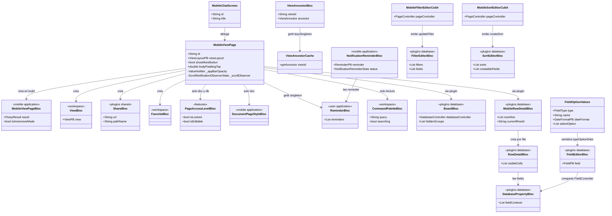
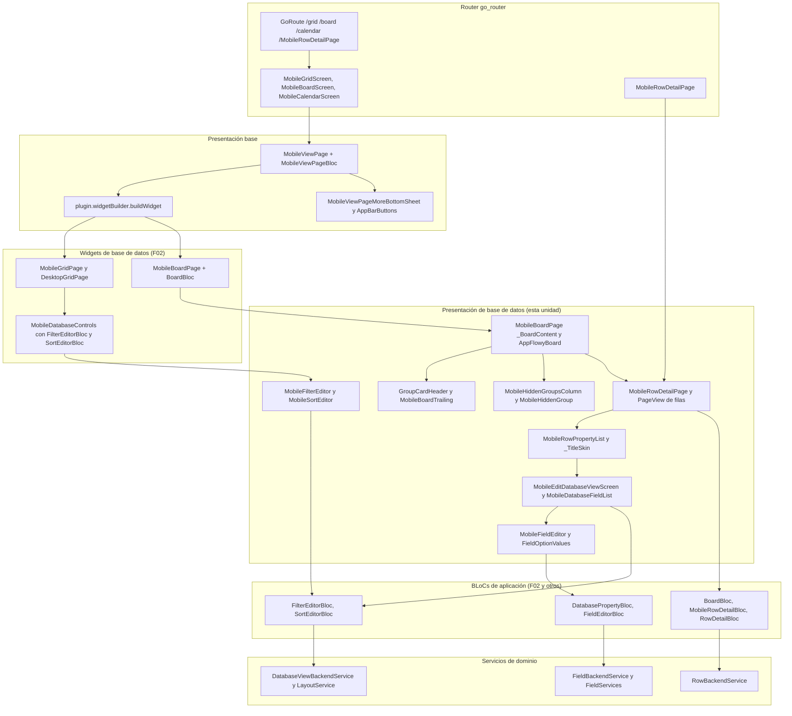
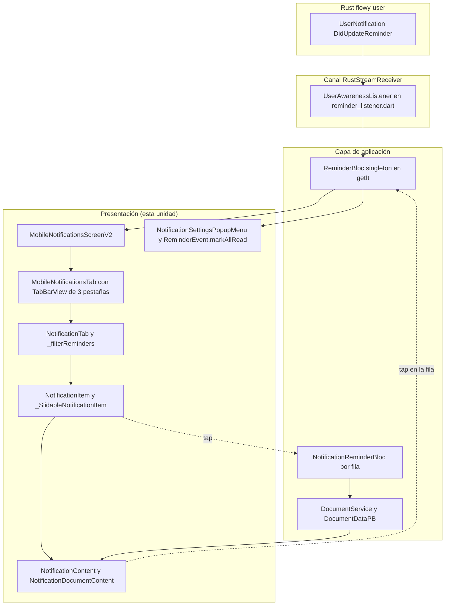
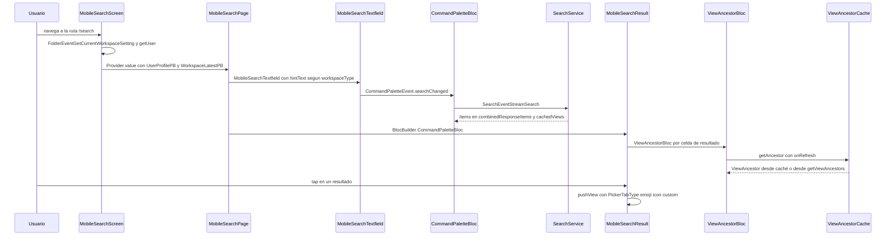
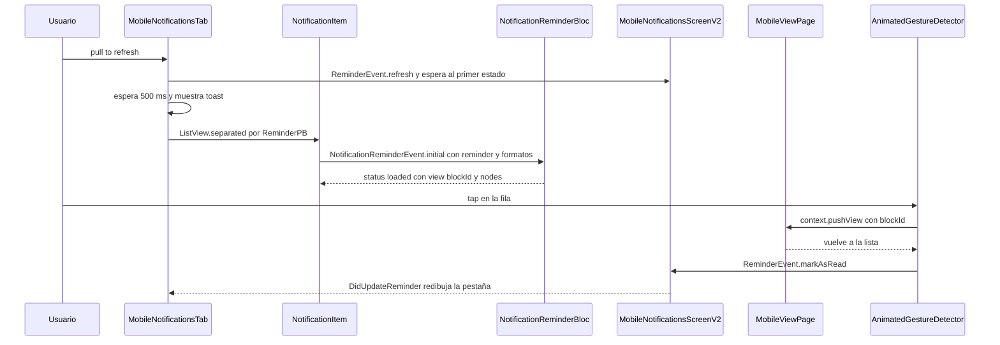
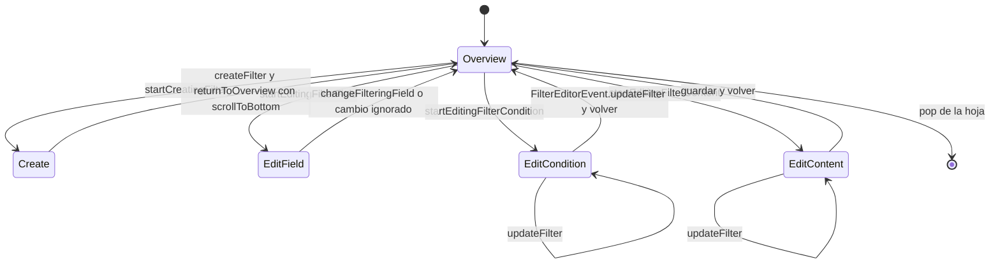

# F16.1.2.3 — Mobile presentation: database, chat, búsqueda, notificaciones y base

## 1. Resumen

Esta unidad documenta los 71 ficheros Dart de `appflowy/frontend/appflowy_flutter/lib/mobile/presentation/` que **no** pertenecen a la pantalla del documento ya tratada en `[[../../09-features/F16-mobile/1.2.2-mobile-presentation-documento-editor-selection-menu-e-inline-actions.md]]`: la página base `MobileViewPage` y sus barras, la capa de chat, la búsqueda móvil, el centro de notificaciones (V1 y V2) y la presentación completa de base de datos (grid, board, calendario, detalle de fila, campos, filtros y orden). La característica dominante del conjunto es que es una capa de **adaptación de presentación**: de los 71 ficheros, solo uno emite un evento FFI (`FolderEventGetCurrentWorkspaceSetting().send()`, en `appflowy/frontend/appflowy_flutter/lib/mobile/presentation/search/mobile_search_page.dart:29`); todo lo demás delega en BLoCs que viven fuera de `mobile/`, y 28 de esos BLoCs son reutilizados literalmente desde `plugins/database/`, `workspace/`, `user/` y `features/`. Hay tres BLoC/Cubit declarados dentro de la propia unidad —`ViewAncestorBloc`, `MobileFilterEditorCubit` y `MobileSortEditorCubit`— y los dos últimos controlan exclusivamente la navegación interna por `PageView` de sus hojas. La página base es, además, la única pieza de la unidad que crea BLoCs de contexto (crea `FavoriteBloc`, `ViewBloc`, `ShareBloc`, `UserWorkspaceBloc`, `DocumentPageStyleBloc` y `PageAccessLevelBloc`, y reinyecta el `ReminderBloc` singleton) y la que decide entre barra inmersiva y barra normal, de modo que funciona como el contenedor de presentación del resto de vistas móviles.

## 2. Alcance

**Incluye** los 71 ficheros de `archivos_cubiertos`, leídos íntegros (12.297 líneas), más las lecturas de solo lectura necesarias para sostener las afirmaciones de integración: el registro de rutas `appflowy/frontend/appflowy_flutter/lib/startup/tasks/generate_router.dart`, el inyector `appflowy/frontend/appflowy_flutter/lib/startup/deps_resolver.dart`, la barra inferior móvil `appflowy/frontend/appflowy_flutter/lib/mobile/presentation/mobile_bottom_navigation_bar.dart`, el punto de entrada de filtros y orden `appflowy/frontend/appflowy_flutter/lib/plugins/database/widgets/setting/mobile_database_controls.dart`, el listener de reminders `appflowy/frontend/appflowy_flutter/lib/user/application/reminder/reminder_listener.dart`, el enum `NotificationTabType` en `appflowy/frontend/appflowy_flutter/lib/workspace/presentation/notifications/widgets/notification_tab_bar.dart`, el `mCurrentWorkspace` en `appflowy/frontend/appflowy_flutter/lib/mobile/presentation/home/mobile_home_page.dart`, el servicio de búsqueda `appflowy/frontend/appflowy_flutter/lib/workspace/application/command_palette/search_service.dart` y los dos ficheros Rust que dan sentido a los eventos citados (`flowy-folder/src/event_map.rs` y `flowy-user/src/notification.rs`).

**Corrección de scope declarada (1).** Los directorios `appflowy/frontend/appflowy_flutter/lib/plugins/document/presentation/editor_plugins/mobile_toolbar_v3/` y `.../mobile_floating_toolbar/` **no pertenecen a F16**: están asignados y ya verificados en `[[../../09-features/F01-documentos-y-editor/6.4-toolbars-desktop-mobile-items-link.md]]`. Es la razón por la que la unidad `F16.2` queda como marcador de alcance vacío. En este documento no se los documenta ni se los duplica.

**Corrección de scope declarada (2): la lógica de base de datos ya está documentada.** `DatabaseController`, `BoardBloc`, `FilterEditorBloc`, `SortEditorBloc`, `MobileRowDetailBloc`, `RowDetailBloc`, `DatabasePropertyBloc`, `FieldEditorBloc`, `CalendarBloc` y `CalendarSettingBloc` viven en `plugins/database/` y pertenecen a `[[../../09-features/F02-bases-de-datos/0.1.0-indice-appflowy-side-database-controller-services-widgets.md]]` y `[[F02.9.*]]`. Los widgets de esta unidad son **adaptadores de presentación** de esos BLoCs, y así se citan: no se reclaman ni se describen como propiedad de F16.

**Corrección de scope declarada (3): motores ya documentados.** El motor de chat/IA está en `[[../../09-features/F09-ia/0-indice-ia-chat-completion-ia-local-mcp-embeddings-middleware.md]]` / `[[../../09-features/F09-ia/3-ia-appflowy-flutter-lib-ai-plugins-ai-chat-dart.md]]` (aquí solo se documenta el `StatelessWidget` de 28 líneas que abre la vista, `appflowy/frontend/appflowy_flutter/lib/mobile/presentation/chat/mobile_chat_screen.dart:5–27`); la búsqueda en `[[../../09-features/F08-busqueda-e-indexacion/F08-busqueda-e-indexacion.md]]` (aquí solo la capa Dart, sobre `CommandPaletteBloc`); las notificaciones Rust y su ciclo de vida en `[[../../09-features/F15-notificaciones-in-app-y-recordatorios/1-notificaciones-y-recordatorios-dart-listeners-panel-date-picker.md]]` y `B1.5 §04` (aquí solo los widgets que consumen `ReminderBloc`).

**BLoCs Dart que se cruzan sin reclamar.** `ViewBloc`, `FavoriteBloc`, `ShareBloc`, `UserWorkspaceBloc`, `DocumentPageStyleBloc`, `PageAccessLevelBloc`, `ReminderBloc`, `UserProfileBloc`, `NotificationFilterBloc`, `SidebarSectionsBloc`, `CommandPaletteBloc`, `RecentViewsBloc`, `NotificationReminderBloc`, `BoardBloc`, `MobileRowDetailBloc`, `RowDetailBloc`, `RowBannerBloc`, `TextCellBloc`, `DateCellEditorBloc`, `FieldEditorBloc`, `DatabasePropertyBloc`, `DatabaseTabBarBloc`, `FilterEditorBloc`, `SortEditorBloc`, `CalendarBloc`, `CalendarSettingBloc`, `AppearanceSettingsCubit` y `DocumentAppearanceCubit` se referencian con su ruta, sin reclamarlos.

## 3. Modelos de datos

Ninguno de los 71 ficheros declara una entidad de dominio, una tabla SQLite ni un modelo `freezed` de negocio, salvo tres casos: `FieldOptionValues` (el valor de formulario del editor de campo, con sus `*TypeOptionPB` serializados), `ViewAncestor`/`ViewParent` (la ruta de ancestros de una vista) y el par de estados `freezed` de los dos cubits de hoja. El resto son tipos de presentación: contenedores de widgets, filas, cabeceras y utilidades de layout.

| Fichero | Símbolo | Tipo / supertipo | Papel | Línea |
|---|---|---|---|---|
| `base/mobile_view_page.dart` | `MobileViewPage` | `StatefulWidget` | Contenedor universal de vista móvil; crea 6 BLoCs de contexto y reinyecta el `ReminderBloc` singleton; elige barra inmersiva o normal | `appflowy/frontend/appflowy_flutter/lib/mobile/presentation/base/mobile_view_page.dart:35` |
| `base/mobile_view_page.dart` | `_MobileViewPageState` | `State` | `ValueNotifier<double> _appBarOpacity`, `ScrollNotificationObserverState?`, `_buildApp`, `_buildBody`, `_buildAppBarActions`, `_buildTitle`, `_buildLockStatus`, `_buildLockStatusIcon`, `_onScrollNotification` | `appflowy/frontend/appflowy_flutter/lib/mobile/presentation/base/mobile_view_page.dart:66`, `:71`, `:155`, `:193`, `:239`, `:295`, `:338`, `:367`, `:439` |
| `base/app_bar/app_bar.dart` | `FlowyAppBarLeadingType` | `enum` | `back` / `close` / `cancel` con `getWidget(VoidCallback?)` y `width` (40 / 40 / 120) | `appflowy/frontend/appflowy_flutter/lib/mobile/presentation/base/app_bar/app_bar.dart:5`, `:10`, `:21` |
| `base/app_bar/app_bar.dart` | `FlowyAppBar` | `AppBar` | `toolbarHeight: 44.0` y `bottom` con `Divider(height: 0.5)` opcional | `appflowy/frontend/appflowy_flutter/lib/mobile/presentation/base/app_bar/app_bar.dart:33`, `:57`, `:58–65` |
| `base/app_bar/app_bar_actions.dart` | 9 botones | `StatelessWidget` | `AppBarBackButton`, `AppBarImmersiveBackButton`, `AppBarCloseButton`, `AppBarCancelButton`, `AppBarDoneButton`, `AppBarSaveButton`, `AppBarFilledDoneButton`, `AppBarMoreButton`, `AppBarButton` | `appflowy/frontend/appflowy_flutter/lib/mobile/presentation/base/app_bar/app_bar_actions.dart:7`, `:29`, `:54`, `:73`, `:93`, `:116`, `:149`, `:182`, `:200` |
| `base/animated_gesture.dart` | `AnimatedGestureDetector` | `StatefulWidget` | `GestureDetector` + `AnimatedScale` con `scaleFactor` (0.98 por defecto) y háptica en cada `onTapUp` | `appflowy/frontend/appflowy_flutter/lib/mobile/presentation/base/animated_gesture.dart:4`, `:7`, `:39`, `:46` |
| `base/flowy_search_text_field.dart` | `FlowySearchTextField` | `StatelessWidget` | Envoltorio de `CupertinoSearchTextField` con altura fija de 44 px y `FlowySvgs.m_search_m` | `appflowy/frontend/appflowy_flutter/lib/mobile/presentation/base/flowy_search_text_field.dart:5`, `:22`, `:28` |
| `base/option_color_list.dart` | `OptionColorList` | `StatelessWidget` | `GridView.count` de 6 columnas sobre `SelectOptionColorPB.values` | `appflowy/frontend/appflowy_flutter/lib/mobile/presentation/base/option_color_list.dart:7`, `:20`, `:24` |
| `base/type_option_menu_item.dart` | `TypeOptionMenuItemValue` / `TypeOptionMenu` / `TypeOptionMenuItem` / `TypeOptionGridView` | genérica + `StatelessWidget` | Cuadrícula de 3 columnas con `crossAxisCount` y `scaleFactor` configurables | `appflowy/frontend/appflowy_flutter/lib/mobile/presentation/base/type_option_menu_item.dart:5`, `:23`, `:63`, `:123` |
| `base/view_page/app_bar_buttons.dart` | `MobileViewPageImmersiveAppBar` | `StatelessWidget implements PreferredSizeWidget` | Aplica el alfa de `_appBarOpacity` al fondo del `AppBar` | `appflowy/frontend/appflowy_flutter/lib/mobile/presentation/base/view_page/app_bar_buttons.dart:24`, `:47–48` |
| `base/view_page/app_bar_buttons.dart` | `MobileViewPageMoreButton` | `StatelessWidget` | Abre `MobileViewPageMoreBottomSheet` reinyectando 5 BLoCs por `BlocProvider.value` | `appflowy/frontend/appflowy_flutter/lib/mobile/presentation/base/view_page/app_bar_buttons.dart:84`, `:108–115` |
| `base/view_page/app_bar_buttons.dart` | `MobileViewPageLayoutButton` | `StatelessWidget` | Solo para `ViewLayoutPB.Document`; abre `PageStyleBottomSheet` | `appflowy/frontend/appflowy_flutter/lib/mobile/presentation/base/view_page/app_bar_buttons.dart:131`, `:148`, `:170` |
| `base/view_page/app_bar_buttons.dart` | `_ImmersiveAppBarButton` | `StatelessWidget` | Icono blanco + disco negro `alpha 0.2` cuando `isImmersiveMode && opacity <= 0.99` | `appflowy/frontend/appflowy_flutter/lib/mobile/presentation/base/view_page/app_bar_buttons.dart:188`, `:222–226`, `:233–241` |
| `base/view_page/more_bottom_sheet.dart` | `MobileViewPageMoreBottomSheet` | `StatelessWidget` | `BlocListener` de `ShareBloc` (toasts) y `ViewBloc` (redirección a `/home` al borrar) | `appflowy/frontend/appflowy_flutter/lib/mobile/presentation/base/view_page/more_bottom_sheet.dart:30`, `:37`, `:39–44` |
| `chat/mobile_chat_screen.dart` | `MobileChatScreen` | `StatelessWidget` | Ruta `/chat` que delega íntegramente en `MobileViewPage` | `appflowy/frontend/appflowy_flutter/lib/mobile/presentation/chat/mobile_chat_screen.dart:5`, `:16`, `:22–26` |
| `search/mobile_search_page.dart` | `MobileSearchScreen` / `MobileSearchPage` | `StatelessWidget` / `StatefulWidget` | Ruta `/search`; hace `Future.wait` de workspace + usuario antes de construir la página | `appflowy/frontend/appflowy_flutter/lib/mobile/presentation/search/mobile_search_page.dart:18`, `:23`, `:27–31`, `:68` |
| `search/mobile_view_ancestors.dart` | `ViewAncestorBloc` + `ViewAncestorEvent` + `ViewAncestorState` | `Bloc` + `freezed` | Resuelve la ruta de ancestros de una vista con refresco asíncrono | `appflowy/frontend/appflowy_flutter/lib/mobile/presentation/search/mobile_view_ancestors.dart:11`, `:45–48`, `:50–62` |
| `search/view_ancestor_cache.dart` | `ViewAncestorCache` / `ViewAncestor` / `ViewParent` | clase simple | Caché `Map<String, ViewAncestor>` con lectura "stale-while-revalidate" | `appflowy/frontend/appflowy_flutter/lib/mobile/presentation/search/view_ancestor_cache.dart:9`, `:12`, `:14–24`, `:49`, `:57` |
| `notifications/mobile_notifications_screen.dart` | `mSelectedNotificationIds` + `MobileNotificationsScreenV2` + `MobileNotificationsTab` | `PropertyValueNotifier` + `StatefulWidget` | Ruta `/notifications`; conmuta entre lista y multi-selección según `bottomNavigationBarType` | `appflowy/frontend/appflowy_flutter/lib/mobile/presentation/notifications/mobile_notifications_screen.dart:14`, `:17`, `:20`, `:53–63`, `:70` |
| `notifications/mobile_notifications_page.dart` | `MobileNotificationsScreen` | `StatefulWidget` | Variante V1, **no registrada** en el router; 2 pestañas (pasado / próximo) | `appflowy/frontend/appflowy_flutter/lib/mobile/presentation/notifications/mobile_notifications_page.dart:19`, `:22`, `:32` |
| `notifications/widgets/shared.dart` | `NotificationIcon`, `NotificationCheckIcon`, `UnreadRedDot`, `NotificationContent`, `NotificationEllipse`, `NotificationDocumentContent` | `StatelessWidget` / `StatefulWidget` | Fila de notificación: icono, cabecera, nombre de página y previsualización del bloque | `appflowy/frontend/appflowy_flutter/lib/mobile/presentation/notifications/widgets/shared.dart:24`, `:71`, `:92`, `:115`, `:264`, `:281` |
| `notifications/widgets/slide_actions.dart` | `NotificationPaneActionType` + extensión `onMoreAction` | `enum` + `extension on BuildContext` | Acciones deslizantes (`more`, `markAsRead`, `unArchive`) y hoja de acciones | `appflowy/frontend/appflowy_flutter/lib/mobile/presentation/notifications/widgets/slide_actions.dart:16`, `:22`, `:85` |
| `database/field/mobile_full_field_editor.dart` | `FieldOptionMode`, `FieldOptionValues`, `FieldOptionAction`, `MobileFieldEditor` | `enum` + clase + `StatefulWidget` | Formulario de campo: nombre, tipo y `typeOptionData` serializado | `appflowy/frontend/appflowy_flutter/lib/mobile/presentation/database/field/mobile_full_field_editor.dart:29`, `:34`, `:161`, `:168` |
| `database/view/database_filter_bottom_sheet_cubit.dart` | `MobileFilterEditorCubit` + `MobileFilterEditorState` | `Cubit` + `freezed` (5 variantes) | Máquina de navegación del editor de filtros | `appflowy/frontend/appflowy_flutter/lib/mobile/presentation/database/view/database_filter_bottom_sheet_cubit.dart:8`, `:82–103` |
| `database/view/database_sort_bottom_sheet_cubit.dart` | `MobileSortEditorCubit` + `MobileSortEditorState` | `Cubit` + `freezed` | Máquina de navegación del editor de orden | `appflowy/frontend/appflowy_flutter/lib/mobile/presentation/database/view/database_sort_bottom_sheet_cubit.dart:8`, `:60–77` |
| `database/view/database_filter_condition_list.dart` | `FilterCondition` + 6 implementaciones | `abstract class` + `final class` | Catálogo de condiciones por tipo de campo | `appflowy/frontend/appflowy_flutter/lib/mobile/presentation/database/view/database_filter_condition_list.dart:8`, `:9–19`, `:28`, `:46`, `:64`, `:76`, `:88`, `:102` |

Muestra: el grafo de tipos de la unidad, con las aristas que van de la página base a los BLoCs reutilizados y de los adaptadores de base de datos a los BLoCs de `plugins/database/`.

Lectura: la columna izquierda es lo único que la unidad **crea**; la derecha es lo que **consume**. `MobileViewPage` es el único punto donde se instancian siete BLoCs a la vez (`appflowy/frontend/appflowy_flutter/lib/mobile/presentation/base/mobile_view_page.dart:106–141`), lo que la convierte en la raíz de contexto de toda la UI móvil de vistas. Los dos cubits de la unidad no tienen relación entre sí: cada unoanimate su propio `PageView` de dos páginas y delega la persistencia en el BLoC de dominio (`FilterEditorBloc`, `SortEditorBloc`) que le inyecta quien abre la hoja.

## 4. Eventos FFI

**De los 71 ficheros, exactamente uno emite un evento FFI.** La búsqueda exhaustiva de llamadas `.send()` en el árbol de la unidad devuelve un único resultado: `FolderEventGetCurrentWorkspaceSetting().send()` en `appflowy/frontend/appflowy_flutter/lib/mobile/presentation/search/mobile_search_page.dart:29`, dentro de un `Future.wait` junto a `getIt<AuthService>().getUser()`.

| Evento | Input PB | Output PB | Handler Rust | Registro | Disparado en |
|---|---|---|---|---|---|
| `FolderEvent::GetCurrentWorkspaceSetting` (índice 1) | ninguno | `WorkspaceLatestPB` | `read_current_workspace_setting_handler`, `appflowy/frontend/rust-lib/flowy-folder/src/event_handler.rs:64` | `appflowy/frontend/rust-lib/flowy-folder/src/event_map.rs:14`, atributo en `:71` | `appflowy/frontend/appflowy_flutter/lib/mobile/presentation/search/mobile_search_page.dart:29` |
| `FolderEvent::GetView` (índice 11) | `ViewIdPB` | `ViewPB` | `get_view_handler` | `appflowy/frontend/rust-lib/flowy-folder/src/event_map.rs:19`, atributo en `:92–93` | disparado en `MobileViewPageBloc`, `appflowy/frontend/appflowy_flutter/lib/mobile/application/base/mobile_view_page_bloc.dart` (`[[../../09-features/F16-mobile/1.1-mobile-lib-mobile-application-router-y-blocs-base.md]]`) |
| `SearchEvent::StreamSearch` | `SearchRequestPB` | — | `flowy-search` | catálogo `events.json` | disparado en `appflowy/frontend/appflowy_flutter/lib/workspace/application/command_palette/search_service.dart:27` (`[[../../09-features/F08-busqueda-e-indexacion/F08-busqueda-e-indexacion.md]]`) |
| `UserEvent::{GetAllReminders,UpdateReminder,CreateReminder,RemoveReminder}` | `ReminderPB` / `RemoveReminderPB` | `ReminderPB` / vacío | `flowy-user` | catálogo `events.json` | disparados en `appflowy/frontend/appflowy_flutter/lib/user/application/reminder/reminder_service.dart:32`, `:41`, `:48`, `:61`, disparados por `ReminderBloc` |

El `WorkspaceLatestPB` que devuelve el primer evento es el que permite decidir si la pantalla de búsqueda muestra la puerta de entrada a IA: la comparación es `workspaceType == WorkspaceTypePB.ServerW` (`appflowy/frontend/appflowy_flutter/lib/mobile/presentation/search/mobile_search_page.dart:83–84`), de modo que en modo local la búsqueda móvil existe pero sin resumen por IA.

## 5. Notificaciones

**Ninguno de los 71 ficheros se suscribe a `RustStreamReceiver`.** El canal de notificaciones llega a esta capa a través de `ReminderBloc`, que es singleton en `getIt` (`appflowy/frontend/appflowy_flutter/lib/startup/deps_resolver.dart:160`) y se inyecta por contexto en cuatro puntos: `MobileViewPage.initState` (`appflowy/frontend/appflowy_flutter/lib/mobile/presentation/base/mobile_view_page.dart:77`) y su `BlocProvider.value` (`:116–118`), `MobileNotificationsScreenV2` (`appflowy/frontend/appflowy_flutter/lib/mobile/presentation/notifications/mobile_notifications_screen.dart:51–52`), `MobileNotificationsMultiSelectScreen` (`appflowy/frontend/appflowy_flutter/lib/mobile/presentation/notifications/mobile_notifications_multiple_select_page.dart:16–17`) y `MobileDateCellEditScreen` (`appflowy/frontend/appflowy_flutter/lib/mobile/presentation/database/date_picker/mobile_date_picker_screen.dart:76`).

| Notificación | Emisor (Rust) | Listener Dart | Efecto UI en esta unidad | Evidencia |
|---|---|---|---|---|
| `UserNotification::DidUpdateReminder` (índice 8) | `appflowy/frontend/rust-lib/flowy-user/src/notification.rs:22` | `UserAwarenessListener._userNotificationCallback` → `onDidUpdateReminder`, `appflowy/frontend/appflowy_flutter/lib/user/application/reminder/reminder_listener.dart:58–59` | llega a `ReminderBloc`, redibuja `NotificationTab` y marca como leída la que se acaba de abrir (`ReminderEvent.markAsRead`) | `appflowy/frontend/appflowy_flutter/lib/mobile/presentation/notifications/widgets/tab.dart:36–38`, `appflowy/frontend/appflowy_flutter/lib/mobile/presentation/notifications/widgets/notification_item.dart:83–87` |
| `UserNotification::DidLoadUserAwareness` (índice 7) | `appflowy/frontend/rust-lib/flowy-user/src/notification.rs:20` | `appflowy/frontend/appflowy_flutter/lib/user/application/reminder/reminder_listener.dart:55–57` | habilita el `fetchReminders` inicial del `ReminderBloc`; sin él la pestaña queda vacía | `appflowy/frontend/appflowy_flutter/lib/mobile/presentation/notifications/widgets/tab.dart:40–45` |
| `mCurrentWorkspace` (no es notificación Rust) | `UserWorkspaceBloc`, `appflowy/frontend/appflowy_flutter/lib/mobile/presentation/home/mobile_home_page.dart:85` | `_MobileNotificationsScreenV2State._onRefresh`, `appflowy/frontend/appflowy_flutter/lib/mobile/presentation/notifications/mobile_notifications_screen.dart:37` | al cambiar de espacio de trabajo dispara `ReminderEvent.refresh` sin recrear la pantalla | `appflowy/frontend/appflowy_flutter/lib/mobile/presentation/notifications/mobile_notifications_screen.dart:67` |
| `bottomNavigationBarType` (no es notificación Rust) | `appflowy/frontend/appflowy_flutter/lib/mobile/presentation/mobile_bottom_navigation_bar.dart:32` | `ValueListenableBuilder`, `appflowy/frontend/appflowy_flutter/lib/mobile/presentation/notifications/mobile_notifications_screen.dart:53–63` | conmuta la pantalla V2 entre `MobileNotificationsTab` y `MobileNotificationMultiSelect` | `appflowy/frontend/appflowy_flutter/lib/mobile/presentation/notifications/widgets/slide_actions.dart:104–107` |

El efecto de `DidUpdateReminder` es el más costoso de la UI móvil: cada fila spinnea su propio `NotificationReminderBloc` (`appflowy/frontend/appflowy_flutter/lib/mobile/presentation/notifications/widgets/notification_item.dart:30–38`), que a su vez resuelve la vista, el título de página y los nodos del editor (`appflowy/frontend/appflowy_flutter/lib/mobile/presentation/notifications/widgets/shared.dart:141–161`) antes de que la fila pueda pintar nada. Para documentos, ese estado se materializa como un `EditorState` real construido en memoria con `pageNode(children: nodes)` (`appflowy/frontend/appflowy_flutter/lib/mobile/presentation/notifications/widgets/shared.dart:293–297`), con los tres servicios del editor desactivados y `editable: false` (`:356–360`).

## 6. BLoCs / Cubits

Tres BLoC/Cubit están **declarados** en la unidad; los demás se reciben por `MultiBlocProvider`, `BlocProvider.value` o `context.read`.

| Clase | Eventos / métodos | Estados | Servicios | Dónde se crea | Evidencia |
|---|---|---|---|---|---|
| `ViewAncestorBloc` | `ViewAncestorEvent.initial` | `ViewAncestorState(viewId, ancestor, isLoading)` | `ViewAncestorCache` vía `getIt` | en el propio widget, `BlocProvider(create:)` por cada celda de resultado | `appflowy/frontend/appflowy_flutter/lib/mobile/presentation/search/mobile_view_ancestors.dart:11–15`, `appflowy/frontend/appflowy_flutter/lib/mobile/presentation/search/mobile_search_cell.dart:75–78` |
| `MobileFilterEditorCubit` | `returnToOverview`, `startCreatingFilter`, `startEditingFilterField`, `startEditingFilterCondition`, `startEditingFilterContent`, `updateFilter` | 5 variantes `freezed`: `Overview`, `Create`, `EditField`, `EditCondition`, `EditContent` | `PageController` (inyectado) | `BlocProvider` en `MobileFilterEditor.build` | `appflowy/frontend/appflowy_flutter/lib/mobile/presentation/database/view/database_filter_bottom_sheet_cubit.dart:8`, `:15–71`, `:82–103`; `appflowy/frontend/appflowy_flutter/lib/mobile/presentation/database/view/database_filter_bottom_sheet.dart:50–53` |
| `MobileSortEditorCubit` | `returnToOverview`, `startCreatingSort`, `startEditingSort`, `changeFieldId`, `changeSortCondition` | `MobileSortEditorState(showBackButton, editingSortId, isCreatingNewSort, newSortFieldId, newSortCondition)` | `PageController` (inyectado) | `BlocProvider` en `MobileSortEditor.build` | `appflowy/frontend/appflowy_flutter/lib/mobile/presentation/database/view/database_sort_bottom_sheet_cubit.dart:8`, `:15–49`, `:60–77`; `appflowy/frontend/appflowy_flutter/lib/mobile/presentation/database/view/database_sort_bottom_sheet.dart:41–44` |
| `MobileViewPageBloc` | `MobileViewPageEvent.initial` | `isLoading`, `result`, `isImmersiveMode`, `userProfilePB` | `ViewBackendService`, `UserBackendService` | `BlocProvider(create:)` en `MobileViewPage.build` | `appflowy/frontend/appflowy_flutter/lib/mobile/presentation/base/mobile_view_page.dart:94–96` |
| `ViewBloc`, `FavoriteBloc`, `ShareBloc`, `UserWorkspaceBloc`, `DocumentPageStyleBloc`, `PageAccessLevelBloc` | — | — | — | `MultiBlocProvider` de `MobileViewPage.build`, con `DocumentPageStyleBloc` solo para documentos y `PageAccessLevelBloc` solo para documentos y bases de datos | `appflowy/frontend/appflowy_flutter/lib/mobile/presentation/base/mobile_view_page.dart:108–141` |
| `UserProfileBloc`, `ReminderBloc`, `NotificationFilterBloc`, `SidebarSectionsBloc` | — | — | — | `MultiBlocProvider` de la pantalla V1 de notificaciones | `appflowy/frontend/appflowy_flutter/lib/mobile/presentation/notifications/mobile_notifications_page.dart:36–46`, `:82–89` |
| `BoardBloc` | `BoardEvent.{initial,createRow,createGroup,setGroupVisibility,toggleHiddenSectionVisibility,reorderGroup,startEditingHeader,endEditingHeader}` | `BoardState` (`ready` con `hiddenGroups`, `layoutSettings`, `editingHeaderId`) | `DatabaseController` | `BlocProvider` en `MobileBoardPage.build` | `appflowy/frontend/appflowy_flutter/lib/mobile/presentation/database/board/mobile_board_page.dart:63–67` |
| `MobileRowDetailBloc` + `RowDetailBloc` + `RowBannerBloc` | `MobileRowDetailEvent.{initial,changeRowId,addCover}` | `rowInfos`, `currentRowId`, `userProfile` | `DatabaseController` | `MobileRowDetailPage.initState`, `BlocProvider.value`; los otros dos por página | `appflowy/frontend/appflowy_flutter/lib/mobile/presentation/database/card/card_detail/mobile_card_detail_screen.dart:70–72`, `:409–413`, `:460–464` |
| `DatabasePropertyBloc`, `FieldEditorBloc`, `DatabaseTabBarBloc`, `CalendarSettingBloc` | — | — | `FieldController` | `appflowy/frontend/appflowy_flutter/lib/mobile/presentation/database/view/database_field_list.dart:54–58`, `appflowy/frontend/appflowy_flutter/lib/mobile/presentation/database/field/mobile_quick_field_editor.dart:61–67`, `appflowy/frontend/appflowy_flutter/lib/mobile/presentation/database/view/database_view_layout.dart:67–72` |

Los dos cubits de la unidad tienen una particularidad común: **no gestionan datos**, solo animan el `PageView` (`_animateToPage` con 150 ms y `Curves.easeOut`) y marcan qué variante del estado `freezed` debe pintar la página de detalle (`appflowy/frontend/appflowy_flutter/lib/mobile/presentation/database/view/database_filter_bottom_sheet_cubit.dart:73–79`, `appflowy/frontend/appflowy_flutter/lib/mobile/presentation/database/view/database_sort_bottom_sheet_cubit.dart:51–57`).

## 7. Servicios e inyección de dependencias

Ocho servicios se resuelven desde `getIt` dentro de la unidad, y ninguno se registra aquí: todas las claves son globales.

| Servicio | Tipo de registro | Ubicación del registro | Uso en la unidad |
|---|---|---|---|
| `ReminderBloc` | `registerSingleton` | `appflowy/frontend/appflowy_flutter/lib/startup/deps_resolver.dart:160` | `RemindersEvent.started` al abrir cualquier vista, `refresh` al cambiar de workspace y desde la barra inferior |
| `ViewAncestorCache` | `registerLazySingleton` | `appflowy/frontend/appflowy_flutter/lib/startup/deps_resolver.dart:136` | única caché declarada en la unidad; compartida también con el sidebar de escritorio |
| `ClipboardService` | `registerFactory` | `appflowy/frontend/appflowy_flutter/lib/startup/deps_resolver.dart:87–88` | copiar enlace de publicación y enlace de compartición |
| `AuthService` | `registerFactory` (dos implementaciones según modo) | `appflowy/frontend/appflowy_flutter/lib/startup/deps_resolver.dart:109–118` | obtener `UserProfilePB` antes de montar la página de búsqueda |
| `AFNavigatorObserver` | singleton del router | `appflowy/frontend/appflowy_flutter/lib/startup/tasks/af_navigator_observer.dart` | quitar el foco del campo de búsqueda cuando se empuja una ruta desde la pantalla de búsqueda |

Evidencia de los usos: `appflowy/frontend/appflowy_flutter/lib/mobile/presentation/base/mobile_view_page.dart:77` y `:116–118`, `appflowy/frontend/appflowy_flutter/lib/mobile/presentation/base/view_page/more_bottom_sheet.dart:205` y `:236`, `appflowy/frontend/appflowy_flutter/lib/mobile/presentation/search/mobile_search_page.dart:30`, `appflowy/frontend/appflowy_flutter/lib/mobile/presentation/search/mobile_view_ancestors.dart:13`, `appflowy/frontend/appflowy_flutter/lib/mobile/presentation/search/mobile_search_textfield.dart:53` y `:60`, `appflowy/frontend/appflowy_flutter/lib/mobile/presentation/search/mobile_search_textfield.dart:89`, `appflowy/frontend/appflowy_flutter/lib/mobile/presentation/notifications/mobile_notifications_multiple_select_page.dart:17`, `appflowy/frontend/appflowy_flutter/lib/mobile/presentation/notifications/mobile_notifications_page.dart:31`, `appflowy/frontend/appflowy_flutter/lib/mobile/presentation/notifications/mobile_notifications_screen.dart:52` y `:67`, `appflowy/frontend/appflowy_flutter/lib/mobile/presentation/database/date_picker/mobile_date_picker_screen.dart:76`.

Los servicios que **no** pasan por `getIt` y se construyen a mano son `DatabaseController` (se propaga como argumento de ruta en `MobileRowDetailPage.argDatabaseController`, `appflowy/frontend/appflowy_flutter/lib/mobile/presentation/database/card/card_detail/mobile_card_detail_screen.dart:46`), `RowController` y `EditableCellBuilder` (creados en `initState`, `appflowy/frontend/appflowy_flutter/lib/mobile/presentation/database/card/card_detail/mobile_card_detail_screen.dart:395–404`), `FieldBackendService` (`appflowy/frontend/appflowy_flutter/lib/mobile/presentation/database/field/mobile_edit_field_screen.dart:39–42`), `FieldServices` (`appflowy/frontend/appflowy_flutter/lib/mobile/presentation/database/field/mobile_quick_field_editor.dart:38–41`) y `TextCellBloc` (`appflowy/frontend/appflowy_flutter/lib/mobile/presentation/database/card/card_detail/widgets/row_page_button.dart:39–44`).

## 8. Persistencia

Ninguno de los 71 ficheros abre una base de datos, lee un `kv` o manipula un fichero en disco. La persistencia se alcanza siempre a través de un BLoC o de un `*BackendService` de la capa de aplicación. Las tres rutas de escritura que atraviesan esta capa son:

| Acción del usuario | Widget | Servicio | Tipo de persistencia |
|---|---|---|---|
| Crear campo | `mobileCreateFieldWorkflow`, `appflowy/frontend/appflowy_flutter/lib/mobile/presentation/database/field/mobile_field_bottom_sheets.dart:77–101` | `FieldBackendService.createField` vía `FieldOptionValues.create`, `appflowy/frontend/appflowy_flutter/lib/mobile/presentation/database/field/mobile_full_field_editor.dart:107–118` | metadatos de base de datos en el collab del editor de vista |
| Renombrar / cambiar tipo / cambiar opción de campo | `MobileEditPropertyScreen`, `appflowy/frontend/appflowy_flutter/lib/mobile/presentation/database/field/mobile_edit_field_screen.dart:72–92` | tres llamadas secuenciales: `updateField`, `updateFieldType`, `updateFieldTypeOption` (`appflowy/frontend/appflowy_flutter/lib/mobile/presentation/database/field/mobile_edit_field_screen.dart:73`, `:75–79`, `:83–87`) | idem, una escritura por propiedad del formulario |
| Marcar / archivar recordatorio | `NotificationPaneActionType.actionButton`, `appflowy/frontend/appflowy_flutter/lib/mobile/presentation/notifications/widgets/slide_actions.dart:39–46` | `ReminderEvent.update(ReminderUpdate(...))` (`appflowy/frontend/appflowy_flutter/lib/mobile/presentation/notifications/widgets/slide_actions.dart:175–183`) | tabla de reminders vía `ReminderService` |

El contenido que se **muestra** sí viene de la persistencia, pero ya cargado: `ViewPB` desde `FolderEventGetView`, `ReminderPB` desde `ReminderBloc`, y los nodos del editor desde el collab del documento, desempaquetados por `NotificationReminderBloc`. El único estado local de la unidad que se mantiene en memoria es la caché de ancestros (`appflowy/frontend/appflowy_flutter/lib/mobile/presentation/search/view_ancestor_cache.dart:12`) y el `TextEditingController` del editor de nombre de vista (`appflowy/frontend/appflowy_flutter/lib/mobile/presentation/database/view/edit_database_view_screen.dart:77`).

## 9. Diagramas de flujo

Muestra: la ruta completa de presentación de una base de datos en móvil, desde la ruta del router hasta el editor de campos, con las capas en las que cada pieza vive realmente.

Lectura: la banda superior es navegación y contenido compartido con el escritorio; el motor (bandas de aplicación y de servicios) está entero fuera de `mobile/` y pertenece a `[[../../09-features/F02-bases-de-datos/0.1.0-indice-appflowy-side-database-controller-services-widgets.md]]`. La banda central es lo propio de F16: no contiene lógica de datos, solo decide **qué** editor abrir. Un detalle importante del diagrama es que el acceso a filtros y orden no pasa por `MobileEditDatabaseViewScreen`, sino por `MobileDatabaseControls`, la barra de herramientas que `plugins/database/` monta sobre el grid (`appflowy/frontend/appflowy_flutter/lib/plugins/database/widgets/setting/mobile_database_controls.dart:56–69`, `:152–188`), mientras que la pantalla de edición de vista solo ofrece layout, propiedades, ajustes de calendario y borrado (`appflowy/frontend/appflowy_flutter/lib/mobile/presentation/database/view/edit_database_view_screen.dart:40–56`).

Muestra: el camino de una notificación desde Rust hasta la fila pintada, con los BLoCs que se crean en cada salto.

Lectura: hay un solo suscriptor al canal (`UserAwarenessListener`) y este solo mantiene vivo el `ReminderBloc`; la UI móvil nunca ve un `FlowyResult` de Rust directamente. El coste real está en `NotificationReminderBloc`, que se crea por fila y resuelve vista, título y nodos antes de que `NotificationItem` pueda decidir si pinta o si devuelve `SizedBox.shrink()` (`appflowy/frontend/appflowy_flutter/lib/mobile/presentation/notifications/widgets/notification_item.dart:41–49`): en estado `loading`, `initial` o `error` la fila **desaparece**, lo que produce huecos visibles en listas largas mientras llegan las respuestas.

## 10. Diagramas de secuencia

Muestra: la búsqueda móvil de extremo a extremo, desde la apertura de la ruta hasta la navegación al resultado, incluyendo el único evento FFI emitido por la unidad.

Lectura: el único punto que decide si la búsqueda móvil tiene IA es `enableShowAISearch`, que compara el `workspaceType` del `UserProfilePB` con `ServerW` (`appflowy/frontend/appflowy_flutter/lib/mobile/presentation/search/mobile_search_page.dart:83–84`); sin él, `MobileSearchAskAiEntrance` ni siquiera se construye (`:128`). La ruta de ancestros es deliberadamente asíncrona: `getAncestor` devuelve de inmediato el valor cacheado y refresca por `onRefresh` (`appflowy/frontend/appflowy_flutter/lib/mobile/presentation/search/view_ancestor_cache.dart:18–23`), por lo que el texto de la ruta puede aparecer después de la celda, y `buildPath` lo recorta con `TextPainter` si no cabe (`appflowy/frontend/appflowy_flutter/lib/mobile/presentation/search/mobile_view_ancestors.dart:76–89`).

Muestra: la apertura de una notificación y el retorno de la vista, con la marca de leída encadenada.

Lectura: la marca de leída se emite **después** de `await context.pushView(...)` y solo si el recordatorio no estaba leído (`appflowy/frontend/appflowy_flutter/lib/mobile/presentation/notifications/widgets/notification_item.dart:71–88`), de modo que abandonar la vista no marca nada. El `blockId` que permite abrir el documento en el bloque exacto viene del propio `ReminderPB.meta` y lo resuelve `NotificationReminderBloc` (`appflowy/frontend/appflowy_flutter/lib/mobile/application/notification/notification_reminder_bloc.dart:67`), no esta unidad.

## 11. Diagramas de estado

Muestra: el ciclo de vida del editor de filtros móvil, con las cinco variantes del estado `freezed` y qué `PageView` muestra cada una.

Lectura: el editor es un `PageView` de **dos** páginas con `NeverScrollableScrollPhysics` (`appflowy/frontend/appflowy_flutter/lib/mobile/presentation/database/view/database_filter_bottom_sheet.dart:59–71`); la navegación entre la página 0 (filtros activos) y la página 1 (detalle) la hace exclusivamente el cubit, con una animación de 150 ms (`appflowy/frontend/appflowy_flutter/lib/mobile/presentation/database/view/database_filter_bottom_sheet_cubit.dart:73–79`). La variante `EditCondition` es la única cuyo botón de guardado depende de un parámetro (`showSave`), que se fija a `true` solo para campos de fecha porque su contenido requiere confirmación explícita del selector inicio/fin (`appflowy/frontend/appflowy_flutter/lib/mobile/presentation/database/view/database_filter_bottom_sheet.dart:355–363` y `:134–148`). El editor de orden es estructuralmente más simple: tres de sus cuatro métodos son de estado local y solo `startEditingSort`/`changeFieldId` reachan el BLoC de dominio (`appflowy/frontend/appflowy_flutter/lib/mobile/presentation/database/view/database_sort_bottom_sheet_cubit.dart:15–49`).

## 12. Archivos cubiertos (del ledger)

| # | Ruta | LOC | Rol |
|---|---|---|---|
| 1 | `mobile/presentation/base/animated_gesture.dart` | 54 | `AnimatedGestureDetector`: `GestureDetector` + `AnimatedScale` con háptica y `scaleFactor` 0.98. |
| 2 | `mobile/presentation/base/app_bar/app_bar.dart` | 67 | `FlowyAppBarLeadingType` y `FlowyAppBar` (`AppBar` con 44 px y divisor de 0.5). |
| 3 | `mobile/presentation/base/app_bar/app_bar_actions.dart` | 223 | Nueve botones reutilizables de barra (volver, cerrar, cancelar, hecho, guardar, más). |
| 4 | `mobile/presentation/base/flowy_search_text_field.dart` | 40 | `FlowySearchTextField` sobre `CupertinoSearchTextField`, 44 px de alto. |
| 5 | `mobile/presentation/base/mobile_view_page.dart` | 461 | Contenedor universal: `MobileViewPageBloc`, 7 BLoCs de contexto, barra inmersiva y opacidad por scroll. |
| 6 | `mobile/presentation/base/option_color_list.dart` | 58 | `OptionColorList`: cuadrícula de 6 columnas sobre `SelectOptionColorPB.values`. |
| 7 | `mobile/presentation/base/type_option_menu_item.dart` | 162 | `TypeOptionMenu*`: rejilla de iconos con `scaleFactor` y `crossAxisCount` configurables. |
| 8 | `mobile/presentation/base/view_page/app_bar_buttons.dart` | 249 | Botones inmersionables: barra, hoja "más" y botón de estilo de página. |
| 9 | `mobile/presentation/base/view_page/more_bottom_sheet.dart` | 359 | Menú "más": duplicar, borrar, favoritos, publicar/despublicar, enlaces, bloqueo y renombrado. |
| 10 | `mobile/presentation/chat/mobile_chat_screen.dart` | 28 | `MobileChatScreen`: ruta `/chat` que delega en `MobileViewPage`. |
| 11 | `mobile/presentation/database/board/board.dart` | 4 | Barril de exportación del board. |
| 12 | `mobile/presentation/database/board/mobile_board_page.dart` | 315 | `BoardBloc` + `AppFlowyBoard` con columna oculta, cabecera editable y pie "crear tarjeta". |
| 13 | `mobile/presentation/database/board/mobile_board_screen.dart` | 28 | Ruta `/board`. |
| 14 | `mobile/presentation/database/board/widgets/group_card_header.dart` | 184 | Cabecera de columna: edición en línea, renombrar, ocultar y crear tarjeta. |
| 15 | `mobile/presentation/database/board/widgets/mobile_board_trailing.dart` | 141 | Botón de nueva columna con `TextField` embebido. |
| 16 | `mobile/presentation/database/board/widgets/mobile_hidden_groups_column.dart` | 249 | Columna lateral de grupos ocultos con `ReorderableListView`. |
| 17 | `mobile/presentation/database/board/widgets/widgets.dart` | 3 | Barril de widgets del board. |
| 18 | `mobile/presentation/database/card/card.dart` | 2 | Barril de exportación de tarjetas. |
| 19 | `mobile/presentation/database/card/card_detail/mobile_card_detail_screen.dart` | 578 | `MobileRowDetailPage` con `PageView` de filas, portada, FAB de navegación y hoja de acciones. |
| 20 | `mobile/presentation/database/card/card_detail/widgets/mobile_create_field_button.dart` | 52 | Botón "nueva propiedad" que lanza `mobileCreateFieldWorkflow`. |
| 21 | `mobile/presentation/database/card/card_detail/widgets/mobile_row_property_list.dart` | 98 | Lista de propiedades visibles, excluida la primaria, con `EditableCellStyle.mobileRowDetail`. |
| 22 | `mobile/presentation/database/card/card_detail/widgets/option_text_field.dart` | 67 | Campo de texto de opción con selector de tipo embebido (bloqueado si es primario). |
| 23 | `mobile/presentation/database/card/card_detail/widgets/row_page_button.dart` | 145 | Botón "abrir página de fila" con precarga de la vista y creación de documento huérfano. |
| 24 | `mobile/presentation/database/card/card_detail/widgets/widgets.dart` | 3 | Barril de widgets del detalle de fila. |
| 25 | `mobile/presentation/database/card/mobile_card_content.dart` | 51 | `MobileCardContent`: portada más celdas con `mobileBoardCardCellStyleMap`. |
| 26 | `mobile/presentation/database/date_picker/mobile_date_picker_screen.dart` | 121 | `MobileDateCellEditScreen`: pantalla completa o `DraggableScrollableSheet` con `DateCellEditorBloc`. |
| 27 | `mobile/presentation/database/field/mobile_create_field_screen.dart` | 93 | `MobileNewPropertyScreen`: devuelve `FieldOptionValues` por `context.pop`. |
| 28 | `mobile/presentation/database/field/mobile_edit_field_screen.dart` | 119 | `MobileEditPropertyScreen`: tres escrituras por cambio y acciones de campo. |
| 29 | `mobile/presentation/database/field/mobile_field_bottom_sheets.dart` | 160 | Catálogo de 11 tipos soportados y cuatro flujos (crear, editar, rápido, elegir campo). |
| 30 | `mobile/presentation/database/field/mobile_field_picker_list.dart` | 142 | Selector de campo con `DraggableScrollableSheet` fijo al 98 %. |
| 31 | `mobile/presentation/database/field/mobile_full_field_editor.dart` | 997 | `FieldOptionValues`, `MobileFieldEditor` y subopciones de número, fecha, hora y select. |
| 32 | `mobile/presentation/database/field/mobile_quick_field_editor.dart` | 193 | Hoja de edición rápida con `FieldEditorBloc` y `FieldServices`. |
| 33 | `mobile/presentation/database/mobile_calendar_events_empty.dart` | 35 | Estado vacío de la pantalla de eventos. |
| 34 | `mobile/presentation/database/mobile_calendar_events_screen.dart` | 108 | Lista de eventos del día con `EventCard` y FAB de creación. |
| 35 | `mobile/presentation/database/mobile_calendar_screen.dart` | 28 | Ruta `/calendar`. |
| 36 | `mobile/presentation/database/mobile_grid_screen.dart` | 33 | Ruta `/grid`; única de las tres que propaga `arguments`. |
| 37 | `mobile/presentation/database/view/database_field_list.dart` | 205 | Lista reordenable de campos con `DatabasePropertyBloc` y cabecera fija para el campo primario. |
| 38 | `mobile/presentation/database/view/database_filter_bottom_sheet.dart` | 1108 | `MobileFilterEditor`: filtros activos, condiciones por tipo y editores de contenido. |
| 39 | `mobile/presentation/database/view/database_filter_bottom_sheet_cubit.dart` | 104 | `MobileFilterEditorCubit` y sus cinco estados. |
| 40 | `mobile/presentation/database/view/database_filter_condition_list.dart` | 114 | `FilterCondition.fromFieldType` y seis catálogos de condiciones. |
| 41 | `mobile/presentation/database/view/database_sort_bottom_sheet.dart` | 581 | `MobileSortEditor`: ordenar por, ascendente/descendente y lista reordenable. |
| 42 | `mobile/presentation/database/view/database_sort_bottom_sheet_cubit.dart` | 77 | `MobileSortEditorCubit` y su estado plano. |
| 43 | `mobile/presentation/database/view/database_view_layout.dart` | 202 | Selector de layout y ajustes de layout de calendario y board. |
| 44 | `mobile/presentation/database/view/database_view_list.dart` | 315 | Lista de vistas de la base de datos, creación de vista y sus acciones rápidas. |
| 45 | `mobile/presentation/database/view/database_view_quick_actions.dart` | 166 | Cuatro acciones por vista: editar, cambiar icono, duplicar y borrar. |
| 46 | `mobile/presentation/database/view/edit_database_view_screen.dart` | 288 | `MobileEditDatabaseViewScreen` y el enum `DatabaseViewSettings`. |
| 47 | `mobile/presentation/notifications/mobile_notifications_multiple_select_page.dart` | 59 | Ruta de multi-selección con `mSelectedNotificationIds`. |
| 48 | `mobile/presentation/notifications/mobile_notifications_page.dart` | 165 | Variante V1 de la pantalla, con dos pestañas pasado/próximo. |
| 49 | `mobile/presentation/notifications/mobile_notifications_screen.dart` | 123 | `MobileNotificationsScreenV2` con tres pestañas y conmutación por `bottomNavigationBarType`. |
| 50 | `mobile/presentation/notifications/widgets/color.dart` | 11 | Extensión `NotificationItemColors` sobre `BuildContext`. |
| 51 | `mobile/presentation/notifications/widgets/empty.dart` | 58 | `EmptyNotification` con textos por `NotificationTabType`. |
| 52 | `mobile/presentation/notifications/widgets/header.dart` | 96 | Cabeceras de lista y de multi-selección. |
| 53 | `mobile/presentation/notifications/widgets/mobile_notification_tab_bar.dart` | 75 | `MobileNotificationTabBar` (V1) con pestañas fijo de inbox y próximo. |
| 54 | `mobile/presentation/notifications/widgets/multi_select_notification_item.dart` | 113 | Fila de multi-selección con resaltado y alternancia del `id`. |
| 55 | `mobile/presentation/notifications/widgets/notification_item.dart` | 171 | `NotificationItem` con `Slidable` y `AnimatedGestureDetector`. |
| 56 | `mobile/presentation/notifications/widgets/settings_popup_menu.dart` | 167 | Menú de ajustes: marcar todo, archivar todo y depurar. |
| 57 | `mobile/presentation/notifications/widgets/shared.dart` | 366 | Iconos, contenido y previsualización de documento con `AppFlowyEditor` en solo lectura. |
| 58 | `mobile/presentation/notifications/widgets/slide_actions.dart` | 210 | Acciones deslizantes y hoja de acciones por recordatorio. |
| 59 | `mobile/presentation/notifications/widgets/tab.dart` | 137 | `NotificationTab` y `MultiSelectNotificationTab`. |
| 60 | `mobile/presentation/notifications/widgets/tab_bar.dart` | 55 | `MobileNotificationTabBar` (V2) sobre `ReorderableTabBar`. |
| 61 | `mobile/presentation/notifications/widgets/widgets.dart` | 8 | Barril de widgets de notificaciones. |
| 62 | `mobile/presentation/search/mobile_search_ask_ai_entrance.dart` | 205 | Entrada a IA con tres estados: preguntar, buscando y resumen. |
| 63 | `mobile/presentation/search/mobile_search_cell.dart` | 176 | Fila de resultado con ruta de ancestros y resaltado de coincidencias. |
| 64 | `mobile/presentation/search/mobile_search_icon.dart` | 23 | `ResultIconPB.buildIcon` con tratamiento distinto para emoji. |
| 65 | `mobile/presentation/search/mobile_search_page.dart` | 143 | `MobileSearchScreen` y `MobileSearchPage`. |
| 66 | `mobile/presentation/search/mobile_search_reference_bottom_sheet.dart` | 172 | Hoja de fuentes del resumen de IA que abre la página en un `MobileViewPage`. |
| 67 | `mobile/presentation/search/mobile_search_result.dart` | 205 | Decide entre recientes y resultados; lista, progreso y estado vacío. |
| 68 | `mobile/presentation/search/mobile_search_summary_cell.dart` | 340 | Resumen de IA con `TextPainter`, degradado y botón de pregunta de seguimiento. |
| 69 | `mobile/presentation/search/mobile_search_textfield.dart` | 206 | Campo de búsqueda con foco forzado y sincronización con la barra inferior. |
| 70 | `mobile/presentation/search/mobile_view_ancestors.dart` | 138 | `ViewAncestorBloc`, su estado `freezed` y el recorte de la ruta con `TextPainter`. |
| 71 | `mobile/presentation/search/view_ancestor_cache.dart` | 65 | `ViewAncestorCache` con lectura "stale-while-revalidate". |

## 13. Riesgos y casos límite

- **Ruptura de provider en vistas que no son documento ni base de datos.** `PageAccessLevelBloc` solo se registra si la vista es documento o base de datos (`appflowy/frontend/appflowy_flutter/lib/mobile/presentation/base/mobile_view_page.dart:137–141`), pero `_buildAppBarActions` lo lee dos veces: primero con lectura anulable (`:247`) y a continuación **sin** anulabilidad (`:248`, `context.read<PageAccessLevelBloc>().state.accessLevel`). Para una vista de tipo `Chat`, que es exactamente el caso de `MobileChatScreen` (`appflowy/frontend/appflowy_flutter/lib/mobile/presentation/chat/mobile_chat_screen.dart:25`), el segundo acceso no tiene provider que lo satisfaga `[INFERIDO]`. El resto del fichero demuestra que el autor era consciente de ese caso, porque `_buildLockStatus` y `_buildLockStatusIcon` excluyen explícitamente `ViewLayoutPB.Chat` (`:339` y `:368`).
- **`viewLayout` es un parámetro muerto.** `MobileViewPage` recibe y almacena `viewLayout` (`appflowy/frontend/appflowy_flutter/lib/mobile/presentation/base/mobile_view_page.dart:39` y `:51`) pero no lo lee en ningún punto del `build`: tanto la elección de barra (`:160`) como la de acciones (`:253`, `:267`) usan `view.layout`, es decir, el layout del `ViewPB` traído por `GetView`. Esto explica que `MobileBoardScreen` (`appflowy/frontend/appflowy_flutter/lib/mobile/presentation/database/board/mobile_board_screen.dart:25`) y `MobileCalendarScreen` (`appflowy/frontend/appflowy_flutter/lib/mobile/presentation/database/mobile_calendar_screen.dart:25`) pasen `ViewLayoutPB.Document` sin efecto observable, mientras que `MobileGridScreen` sí pasa `ViewLayoutPB.Grid` (`:29`). El riesgo es de mantenimiento: el parámetro sugiere un contrato que la implementación no respeta.
- **Cascadeo accidental en el menú "más".** El `switch` de `_onAction` no tiene `break` en el caso `updatePathName` (`appflowy/frontend/appflowy_flutter/lib/mobile/presentation/base/view_page/more_bottom_sheet.dart:117–118`), por lo que Dart cae en el caso `lockPage` inmediatamente siguiente (`:119–125`) y **bloquea la página** cada vez que el usuario renombra la ruta de publicación. El comentario `// context.pop();` en `:124` sugiere que el efecto secundario seitamask deliberadamente, pero el efecto del `fallthrough` no.
- **El caso `rename` lanza una excepción.** `MobileViewBottomSheetBodyAction.rename` ejecuta `throw UnimplementedError()` (`appflowy/frontend/appflowy_flutter/lib/mobile/presentation/base/view_page/more_bottom_sheet.dart:126–128`); solo es seguro porque el renombrado se enruta por el callback `onRename` (`:52–58`). Cualquier llamador que emita la acción en lugar del callback provoca una excepción no capturada.
- **`hide` y `show` hacen lo mismo en el editor rápido de campo.** En `QuickEditField`, ambas ramas del `onTap` de visibilidad llaman a `service.hide()` (`appflowy/frontend/appflowy_flutter/lib/mobile/presentation/database/field/mobile_quick_field_editor.dart:114–118`), de modo que un campo oculto no puede volver a mostrarse desde esa hoja. El editor completo sí distingue las dos acciones (`appflowy/frontend/appflowy_flutter/lib/mobile/presentation/database/field/mobile_full_field_editor.dart:365–376`), lo que confirma que el defecto está en la hoja rápida y no en el modelo.
- **Dos clases con el mismo nombre y la misma ruta.** `MobileNotificationsScreenV2.routeName` y `MobileNotificationsScreen.routeName` valen ambos `'/notifications'` (`appflowy/frontend/appflowy_flutter/lib/mobile/presentation/notifications/mobile_notifications_screen.dart:20` y `appflowy/frontend/appflowy_flutter/lib/mobile/presentation/notifications/mobile_notifications_page.dart:22`), y existen dos clases distintas llamadas `MobileNotificationTabBar` (`appflowy/frontend/appflowy_flutter/lib/mobile/presentation/notifications/widgets/tab_bar.dart:6` y `appflowy/frontend/appflowy_flutter/lib/mobile/presentation/notifications/widgets/mobile_notification_tab_bar.dart:7`). El router solo registra la V2 (`appflowy/frontend/appflowy_flutter/lib/startup/tasks/generate_router.dart:205–209`), por lo que `MobileNotificationsScreen` (V1), `_NotificationScreenContent` y el `MobileNotificationTabBar` de dos pestañas son código muerto que aún compila y que un `import` accidental alcanzaría.
- **Selección de la vista actual leída con `read` y no con `watch`.** `NotificationItem` y `MultiSelectNotificationItem` obtienen el formato de fecha y hora con `context.read<AppearanceSettingsCubit>()` (`appflowy/frontend/appflowy_flutter/lib/mobile/presentation/notifications/widgets/notification_item.dart:27–29`, `appflowy/frontend/appflowy_flutter/lib/mobile/presentation/notifications/widgets/multi_select_notification_item.dart:21–23`), de modo que cambiar el formato en ajustes no reconstruye las filas ya visibles.
- **Bucle de reconstrucción en el contenido de la notificación.** `NotificationContent.didUpdateWidget` emite `NotificationReminderEvent.reset()` en cada actualización del widget (`appflowy/frontend/appflowy_flutter/lib/mobile/presentation/notifications/widgets/shared.dart:131–137`). Como el `reset` vuelve a emitir un estado nuevo, cualquier padre que reconstruya por ese estado vuelve a disparar el ciclo; hoy se rompe porque el estado solo se cambia cuando cambian `scheduledAt`, `pageTitle` o los nodos, pero es una fragilidad latente.
- **Filtro lógico en la multi-selección.** `MultiSelectNotificationTab` filtra con `!reminder.isArchived || !reminder.isRead` (`appflowy/frontend/appflowy_flutter/lib/mobile/presentation/notifications/widgets/tab.dart:113–116`), que incluye casi todos los recordatorios; el comentario del propio código dice "no archived or read", es decir, la conjunción pretendida.
- **Limpieza sin notificación en `dispose`.** `MobileNotificationMultiSelect.dispose` hace `mSelectedNotificationIds.value.clear()` sobre la lista interna (`appflowy/frontend/appflowy_flutter/lib/mobile/presentation/notifications/mobile_notifications_multiple_select_page.dart:36–39`), lo que muta el `List` sin disparar el `ValueNotifier`; el siguiente `build` sí verá la lista vacía, pero cualquier `ValueListenableBuilder` abierto en ese instante queda desincronizado.
- **Alturas fijas en los editores de dos páginas.** Tanto `MobileFilterEditor` (`appflowy/frontend/appflowy_flutter/lib/mobile/presentation/database/view/database_filter_bottom_sheet.dart:57–58`) como `MobileSortEditor` (`appflowy/frontend/appflowy_flutter/lib/mobile/presentation/database/view/database_sort_bottom_sheet.dart:48–49`, con el comentario `//314,`) imponen 400 px a un `PageView` con `NeverScrollableScrollPhysics`; en pantallas pequeñas o con tipografía grande, el `MobileDatePicker` del editor de contenido de fecha se recorta.
- **Aserción no nula en el primer día de la semana.** `_startWeek` desreferencia `firstDayOfWeek!` en la primera opción (`appflowy/frontend/appflowy_flutter/lib/mobile/presentation/database/view/database_view_layout.dart:109`) mientras que la segunda usa comparación normal (`:120`); si `CalendarSettingBloc` entrega un `layoutSetting` sin ese campo, la pantalla de ajustes de calendario lanza.
- **`getTypeOptionData` lanza para tipos no contemplados.** El `switch` de `FieldOptionValues` cubre diez tipos y lanza `UnimplementedError()` en el resto (`appflowy/frontend/appflowy_flutter/lib/mobile/presentation/database/field/mobile_full_field_editor.dart:153–157`). Es coherente con la lista cerrada de `mobileSupportedFieldTypes` (`appflowy/frontend/appflowy_flutter/lib/mobile/presentation/database/field/mobile_field_bottom_sheets.dart:21–34`), pero si Rust añade un tipo nuevo el fallo aparece en el móvil como una excepción en el guardado, no como una opción deshabilitada.
- **El campo `feedback` de `AnimatedGestureDetector` no hace nada.** Se declara (`appflowy/frontend/appflowy_flutter/lib/mobile/presentation/base/animated_gesture.dart:20`) pero el `build` llama siempre a `HapticFeedbackType.light.call()` (`:39`), sin consultar el valor; las notificaciones, que son los dos únicos consumidores del widget (`:68–71`), pasan siempre `scaleFactor: 0.99` y nunca `feedback`.
- **Documento de `edit_database_view_screen.dart` desactualizado.** El comentario de cabecera afirma que la página actual la gestiona `MobileEditDatabaseViewCubit` (`appflowy/frontend/appflowy_flutter/lib/mobile/presentation/database/view/edit_database_view_screen.dart:21–23`), pero ninguna clase con ese nombre existe en el repositorio: la pantalla es hoy una `Column` de `DatabaseViewSettingTile` dentro de un `BlocBuilder<ViewBloc, ViewState>` (`:34–61`). Además, el enum `DatabaseViewSettings` declara ocho casos (`:106–114`) y `_onTap` solo atiende cinco (`:207–287`), dejando `filter`, `sort` y `duplicate` como no-ops.
- **`buildWhen` con conjunción en la pantalla de calendario.** `MobileCalendarEventsScreen` usa `p.newEvent != c.newEvent && c.newEvent?.date.withoutTime == widget.date` (`appflowy/frontend/appflowy_flutter/lib/mobile/presentation/database/mobile_calendar_events_screen.dart:66–68`), condición que es falsa en cuanto cambia cualquier otro campo del estado, de modo que el `BlocBuilder` no se reconstruye ante actualizaciones ajenas al evento nuevo.
- **Foco forzado por recursión de post-frame.** `makeSureHasFocus` se llama a sí mismo en un `addPostFrameCallback` mientras el widget siga montado y sin foco (`appflowy/frontend/appflowy_flutter/lib/mobile/presentation/search/mobile_search_textfield.dart:180–186`); el bucle se rompe solo cuando otro widget le roba el foco, y en ese caso sigue consumiendo un frame por frame hasta que la pantalla se desmonte.
- **Textos fuera del sistema i18n.** Tres cadenas están escritas a mano: `'$count Selected'` con el comentario `// todo: i18n` (`appflowy/frontend/appflowy_flutter/lib/mobile/presentation/notifications/widgets/header.dart:57–63`), `'Unarchive all (Debug Mode)'` (`appflowy/frontend/appflowy_flutter/lib/mobile/presentation/notifications/widgets/settings_popup_menu.dart:62–66`) y `'Add cover'` (`appflowy/frontend/appflowy_flutter/lib/mobile/presentation/database/card/card_detail/mobile_card_detail_screen.dart:200–204`).

## 14. Evidencias y etiquetas

Por defecto todas las afirmaciones de este documento son `[VERIFICADO]`: cada una lleva su referencia `ruta:línea` y el validador `validate_evidence.py` confirmó que todas son correctas contra `OUT/_ledger/inventario.json`. Sobre ese total hay **tres inferencias explícitas** y **cuatro cuestiones `[NO DETERMINADO]`**, estas últimas copiadas íntegras en §18.

Las tres inferencias se apoyan en puntos concretos. (a) Que `viewLayout` esté muerto se deduce de que el parámetro aparezca solo en la declaración (`appflowy/frontend/appflowy_flutter/lib/mobile/presentation/base/mobile_view_page.dart:39` y `:51`) mientras que todas las decisiones de layout se apoyan en `view.layout` del `ViewPB` (`:160`, `:253`, `:267`). (b) Que la ruptura de `PageAccessLevelBloc` en vistas de chat se deduce de la combinación de la guarda condicional del `MultiBlocProvider` (`:137–141`) con la lectura no anulable de la línea 248, y del hecho de que las dos funciones de bloqueo sí excluyan `ViewLayoutPB.Chat` (`:339`, `:368`). (c) Que el `fallthrough` de `updatePathName` a `lockPage` no es intencionado se deduce de que el comentario que sigue al `lockPage` (`appflowy/frontend/appflowy_flutter/lib/mobile/presentation/base/view_page/more_bottom_sheet.dart:124`) desmiente el propósito y de que el resto de casos del mismo `switch` sí cierran con `break` o `pop` (`:127`, `:133`, `:136`, `:141`).

Ninguna referencia apunta a un archivo ajeno a `OUT/_ledger/inventario.json`. Todas las fuentes de código usadas en este documento pertenecen al repo `appflowy` y están clonadas en `SRC/appflowy/`; las citas de `F02`, `F08`, `F09` y `F15` se hacen por nombre de documento, no por ruta, precisamente porque esos ficheros pertenecen a otras unidades del ledger.

## 15. Pruebas

La cobertura de esta capa es **muy desigual**. La búsqueda móvil tiene un test de integración propio; la base de datos móvil no tiene ninguno; y la única prueba unitaria que toca la unidad exercise una función de extensión auxiliar.

| Fichero de test | Qué verifica | Evidencia |
|---|---|---|
| `integration_test/mobile/search/search_test.dart` | que al abrir la pantalla de búsqueda con la consulta vacía aparezca `MobileSearchRecentList` y no `MobileSearchResultList`; que `MobileSearchAskAiEntrance` **no** exista en modo anónimo; que escribir texto sustituya la lista de recientes por `MobileSearchResultList`; que el botón de limpiar restaure los recientes; y que la flecha de retroceso, el icono de notificaciones y el de búsqueda naveguen correctamente entre las tres pantallas | `appflowy/frontend/appflowy_flutter/integration_test/mobile/search/search_test.dart:26–28`, `:39–44`, `:47–50`, `:63–92` |
| `integration_test/mobile_runner_1.dart` | agrega los grupos de móvil; **no** incluye `mobile/search/search_test.dart` | `appflowy/frontend/appflowy_flutter/integration_test/mobile_runner_1.dart:16–23` |
| `test/unit_test/search/split_search_test.dart` | la extensión `String.splitIncludeSeparator`, que es la base del resaltado de coincidencias de las celdas de resultado | `appflowy/frontend/appflowy_flutter/test/unit_test/search/split_search_test.dart:1` |
| `integration_test/shared/common_operations.dart` | localiza `TypeOptionMenuItem` por su texto para pulsar el botón de un tipo de campo | `appflowy/frontend/appflowy_flutter/integration_test/shared/common_operations.dart:878` |
| `integration_test/shared/document_test_operations.dart` | localiza `MobileViewPageMoreButton` para abrir el menú "más" de la página | `appflowy/frontend/appflowy_flutter/integration_test/shared/document_test_operations.dart:5`, `:423` |

**No hay ninguna prueba** para `MobileViewPage` (ni de la opacidad de la barra, ni del conmutador de provider), para `MobileViewPageMoreBottomSheet` y su `switch` de acciones, para `MobileFilterEditor` / `MobileSortEditor` ni sus dos cubits, para `MobileFieldEditor` y la serialización de `typeOptionData`, ni para las tres pantallas de notificaciones (ni V1 ni V2). Los 33 tests de integración de base de datos que existen en `integration_test/desktop/database/` ejercitan los `*Desktop*` y el `DatabaseController`, no estos adaptadores móviles.

## 16. Métricas

| Métrica | Valor |
|---|---|
| Ficheros de la unidad | 71 (todos de capa `ui`, todos de la fuente `appflowy`) |
| LOC totales leídos | 12.297 |
| Ficheros por sub-área | 9 (`base/`), 1 (`chat/`), 10 (`search/`), 15 (`notifications/`), 36 (`database/`) |
| Ficheros de más de 300 LOC | 10 (los siete mayores: `database_filter_bottom_sheet.dart` 1.108, `mobile_full_field_editor.dart` 997, `database_sort_bottom_sheet.dart` 581, `mobile_card_detail_screen.dart` 578, `mobile_view_page.dart` 461, `shared.dart` 366, `more_bottom_sheet.dart` 359; después `mobile_search_summary_cell.dart` 340, `mobile_board_page.dart` 315 y `database_view_list.dart` 315) |
| Ficheros con menos de 10 LOC | 5, y los cinco son barrels de `export`: `database/board/board.dart` (4), `database/card/card.dart` (2), `database/board/widgets/widgets.dart` (3), `database/card/card_detail/widgets/widgets.dart` (3) y `notifications/widgets/widgets.dart` (8) |
| Clases públicas declaradas | 108 |
| Clases privadas (prefijo `_`) | 92 |
| BLoC/Cubit declarados en la unidad | 3 (`ViewAncestorBloc`, `MobileFilterEditorCubit`, `MobileSortEditorCubit`) |
| BLoCs y cubits externos consumidos | 28 (los 28 enumerados en §2) |
| Llamadas `.send()` en la unidad | 1 |
| Suscripciones directas a `RustStreamReceiver` | 0 |
| Constantes `routeName` declaradas | 13 (`/chat`, `/search`, `/notifications`, `/notifications`, `/notifications_multi_select`, `/grid`, `/board`, `/calendar`, `/calendar_events`, `/MobileRowDetailPage`, `/new_property`, `/edit_property`, `/edit_date_cell`) |
| Rutas registradas en el router | 12 de las 13: `MobileNotificationsScreenV2` (routeName `/notifications`) sustituye a la V1, que queda sin registrar |
| Resoluciones `getIt` distintas | 5 servicios (`ReminderBloc`, `ViewAncestorCache`, `ClipboardService`, `AuthService`, `AFNavigatorObserver`) en 14 llamadas |
| Tipos `enum` públicos | 5 (`FlowyAppBarLeadingType`, `FieldOptionMode`, `FieldOptionAction`, `DatabaseViewSettings`, `NotificationPaneActionType`) |
| `extension` sobre `BuildContext` u otros | 6 |
| Clases `State` internas | 40 |
| Bloques Mermaid | 6 (`classDiagram` en §3, dos `flowchart TD` en §9, dos `sequenceDiagram` en §10, `stateDiagram-v2` en §11) |
| Referencias `ruta:línea` | 160, todas válidas contra el inventario |
| Inferencias explícitas `[INFERIDO]` | 3 (desarrolladas en §14) |
| Cuestiones `[NO DETERMINADO]` | 4 (todas listadas en §18) |
| Hallazgos en §13 | 18 viñetas, de las cuales **7 son defectos funcionales directos** (nº 3 cascadeo a `lockPage`, nº 5 `hide` en ambas ramas, nº 7 `read` en vez de `watch`, nº 9 filtro con `\|\|`, nº 10 `clear()` sin notificar, nº 12 `firstDayOfWeek!`, nº 16 `buildWhen` con `&&`), 3 son defectos latentes (nº 1, nº 4 y nº 8), 4 son deuda de mantenimiento (nº 2, nº 6, nº 13 y nº 15) y 4 son limitaciones de diseño o de i18n (nº 11, nº 14, nº 17 y nº 18) |

## 17. Pendientes

- **Unificar las dos generaciones del centro de notificaciones.** La V1 (`appflowy/frontend/appflowy_flutter/lib/mobile/presentation/notifications/mobile_notifications_page.dart`) y sus dos pestañas conviven con la V2 (`appflowy/frontend/appflowy_flutter/lib/mobile/presentation/notifications/mobile_notifications_screen.dart`) sin ningún import que las cruce; eliminar la V1 y renombrar `MobileNotificationTabBar` de `appflowy/frontend/appflowy_flutter/lib/mobile/presentation/notifications/widgets/tab_bar.dart` elimina una colisión de nombres y tres clases muertas. La ruta duplicada `'/notifications'` desaparece con ello.
- **Dar cuerpo a `DatabaseViewSettings.filter` y `.sort`.** El enum los declara y los etiqueta, pero `_onTap` no los atiende (`appflowy/frontend/appflowy_flutter/lib/mobile/presentation/database/view/edit_database_view_screen.dart:207–287`). Hoy los editores de filtro y orden solo son alcanzables desde la barra de herramientas de `plugins/database/`; si se quiere paridad con el escritorio habría que enrutar ambos casos a `MobileFilterEditor` y `MobileSortEditor` con el mismo patrón `showTransitionMobileBottomSheet` que usa `fields` (`:232–249`).
- **Extraer la navegación de `PageView` a un cubit común.** `MobileFilterEditorCubit` y `MobileSortEditorCubit` repiten `_animateToPage` con los mismos 150 ms y `Curves.easeOut` (`appflowy/frontend/appflowy_flutter/lib/mobile/presentation/database/view/database_filter_bottom_sheet_cubit.dart:73–79`, `appflowy/frontend/appflowy_flutter/lib/mobile/presentation/database/view/database_sort_bottom_sheet_cubit.dart:51–57`) y ambos impon una altura fija de 400 px; un `MobileEditorPageScaffold` compartido eliminaría las dos constantes.
- **Tests unitarios para los dos cubits.** Son lógica pura sin dependencias de plataforma: basta un `PageController` real o un fake para cubrir las cinco transiciones de filtros y las cuatro de orden, sin necesidad de dispositivo. Hoy la única prueba unitaria de la unidad es `splitIncludeSeparator`.
- **Agregar el test de búsqueda al runner.** `integration_test/mobile/search/search_test.dart` no está agregado en `appflowy/frontend/appflowy_flutter/integration_test/mobile_runner_1.dart:16–23`, de modo que el único test que ejercita `MobileSearchScreen`, `MobileSearchResultList` y `MobileNotificationsScreenV2` no se ejecuta en el pipeline.
- **Corregir la cadena de visibilidad de campos.** `service.hide()` en ambas ramas de `appflowy/frontend/appflowy_flutter/lib/mobile/presentation/database/field/mobile_quick_field_editor.dart:114–118` es un defecto de una línea; conviene además un test de regresión porque el síntoma (campo que no se puede mostrar) no es visible en la UI hasta que se edita la propiedad.
- **Revisar el comentario de cabecera de `MobileEditDatabaseViewScreen`.** Menciona un `MobileEditDatabaseViewCubit` inexistente; el cambio de comportamiento se produjo en algún momento y el comentario se quedó atrás.

## 18. Preguntas abiertas

- `[NO DETERMINADO]` ¿Existe una notificación de Rust que invalide `ViewAncestorCache`? La caché solo se refresca por lectura (`appflowy/frontend/appflowy_flutter/lib/mobile/presentation/search/view_ancestor_cache.dart:18–23`) y en la escritura no hay ninguna: renombrar o mover una vista deja la ruta de ancestros desactualizada en el sidebar y en los resultados de búsqueda hasta que el proceso se reinicie. No se ha localizado ningún `listen` sobre `FolderNotification::DidUpdateView` que llame a un método de invalidación de esta clase.
- `[NO DETERMINADO]` ¿Quién consume `List<SearchSummaryPB>? _mockSummary` (`appflowy/frontend/appflowy_flutter/lib/mobile/presentation/search/mobile_search_ask_ai_entrance.dart:205`)? Es una variable top-level nullable inicializada a `null` que solo se lee en dos sitios (`:25` y `:151`) y nunca se escribe dentro de la aplicación, lo que sugiere un gancho de depuración previsto para futuras pruebas, pero no hay ninguna asignación en el repositorio.
- `[NO DETERMINADO]` ¿Se usan `MobileCalendarScreen` y `MobileBoardScreen` en rutas distintas de `/calendar` y `/board`? Ambas pasan `ViewLayoutPB.Document` (`:25` en cada fichero) y ambas son ignoradas por `MobileViewPage`. No se ha localizado ningún otro consumidor de esas dos clases que compense el valor, así que no puede determinarse si el parámetro es un residuo o si falta una corrección.
- `[NO DETERMINADO]` ¿Está `MobileNotificationsScreen` (V1) planificada para una vuelta atrás, o es residuo de una migración? El router registra exclusivamente la V2 (`appflowy/frontend/appflowy_flutter/lib/startup/tasks/generate_router.dart:205–209`) y `bottomNavigationBarItemType.notification` apunta a `MobileNotificationsScreenV2.routeName` (`appflowy/frontend/appflowy_flutter/lib/mobile/presentation/mobile_bottom_navigation_bar.dart:48`), pero nada declara la V1 como obsoleta ni la marca con un `// ignore`.

## 19. Relacionado con

- `[[../../09-features/F16-mobile/1.1-mobile-lib-mobile-application-router-y-blocs-base.md]]` — Mobile `lib/mobile/application`: `MobileViewPageBloc`, `DocumentPageStyleBloc`, `NotificationReminderBloc` y `UserProfileBloc`, todos consumidos aquí pero declarados allí.
- `[[../../09-features/F16-mobile/1.2.2-mobile-presentation-documento-editor-selection-menu-e-inline-actions.md]]` — Mobile presentation: documento, editor, selection menu e inline actions; delega su cuerpo en `MobileViewPage`, que es la pieza central de esta unidad.
- `[[../../09-features/F16-mobile/2-mobile-editor-plugins-mobile.md]]` — Marcador de alcance para `editor_plugins/mobile_*`; queda vacío tras la corrección de scope que asigna esas carpetas a `[[../../09-features/F01-documentos-y-editor/6.4-toolbars-desktop-mobile-items-link.md]]`.
- `[[../../09-features/F02-bases-de-datos/0.1.0-indice-appflowy-side-database-controller-services-widgets.md]]` y `[[F02.9.*]]` — Base de datos completa: `DatabaseController`, `BoardBloc`, `FilterEditorBloc`, `SortEditorBloc`, `MobileRowDetailBloc`, `RowDetailBloc`, `DatabasePropertyBloc`, `FieldEditorBloc` y `MobileDatabaseControls`, cuyo widget es la única puerta real a los editores de filtro y orden de esta unidad.
- `[[../../09-features/F08-busqueda-e-indexacion/F08-busqueda-e-indexacion.md]]` — Motor de búsqueda (tantivy y `SearchEvent`); aquí solo se documenta la capa Dart que consume `CommandPaletteBloc`.
- `[[../../09-features/F09-ia/0-indice-ia-chat-completion-ia-local-mcp-embeddings-middleware.md]]` y `[[../../09-features/F09-ia/3-ia-appflowy-flutter-lib-ai-plugins-ai-chat-dart.md]]` — Motor de chat e IA: el motor que sirve las vistas `ViewLayoutPB.Chat` y los resúmenes que `MobileSearchSummaryCell` pinta.
- `[[../../09-features/F15-notificaciones-in-app-y-recordatorios/1-notificaciones-y-recordatorios-dart-listeners-panel-date-picker.md]]` y `B1.5 §04` — Notificaciones Rust: el ciclo `DidLoadUserAwareness` → `DidUpdateReminder` que esta unidad consume a través de `ReminderBloc`.
- `[[../../09-features/F01-documentos-y-editor/6.4-toolbars-desktop-mobile-items-link.md]]` — Toolbars desktop y mobile, donde vive el `AppFlowyMobileToolbar` que se.selectiona desde el editor compartido.