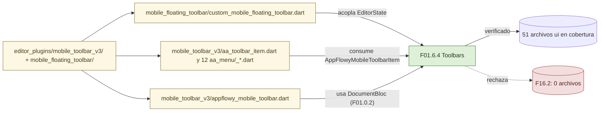
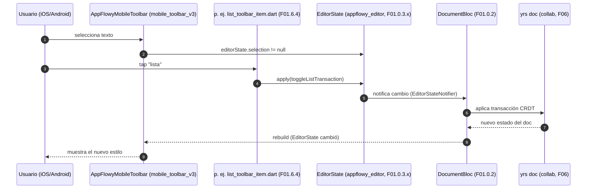
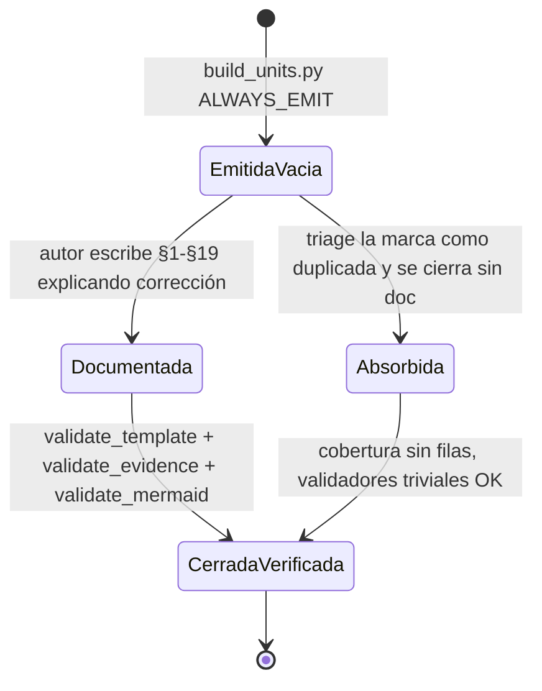

# F16.2 — Mobile: `editor_plugins/mobile_*` (corrección de scope)

## 1. Resumen

Esta unidad existe para dejar constancia por escrito de un desplazamiento de alcance que ya está aplicado en el ledger: los 16 ficheros de `editor_plugins/mobile_toolbar_v3/` y el único fichero de `editor_plugins/mobile_floating_toolbar/` **pertenecen** a `F01.6.4` ("Toolbars desktop, mobile, items y link"), no a `F16` (Mobile). El triage inicial los pudo haber colocado aquí —una carpeta cuyo prefijo `mobile_*` parece propia del shell móvil— pero su función es ofrecer la barra de herramientas contextual del editor de documento cuando se ejecuta en iOS/Android, y el subapartado canónico del editor donde se documentan todas las toolbars (`desktop_toolbar`, `mobile_toolbar_v3`, `mobile_floating_toolbar`, `toolbar_item`) es `F01.6.4`. Este documento `F16.2` se emite **vacío** de archivos —cero filas en `cobertura.csv` para esta unidad— y sirve para que la corrección sea trazable: el lector que llegue a `F16` ("Mobile") buscando la toolbar móvil del editor sabrá, abriendo este documento, que su contenido vive en `F01.6.4` y por qué.

## 2. Alcance

**Lo que afirma y documenta este documento.** Contiene (i) la tabla de corrección de scope que reasigna los 17 ficheros en cuestión a `F01.6.4` (§13), (ii) la descripción breve de qué hay en `mobile_toolbar_v3/` y `mobile_floating_toolbar/` para que el lector pueda decidir si tiene que saltar a `F01.6.4` o no (§3), (iii) la cuenta de cero filas en `cobertura.csv` (§12), (iv) la lectura de por qué se emitió vacía pese a existir como unidad (§18), y (v) los enlaces cruzados al resto del árbol F16 y al documento de la unidad absorbente (§19).

**Lo que este documento NO hace.** No lista, no resume y no cita `ruta:línea` de los 17 ficheros móviles: esa es la tarea del documento `F01.6.4`, que ya los cubre verificado con evidencia completa. Intentar hacerlo aquí duplicaría el contenido y rompería la regla "cada archivo del inventario se documenta en una sola unidad" del `AGENTS.md §4`.

**Corrección de scope explícita (lo que el lector debe recordar).** Los siguientes archivos, listados como candidatos naturales de F16 en el triage inicial, fueron reasignados a `F01.6.4` y están verificados en ese documento:

- `appflowy/frontend/appflowy_flutter/lib/plugins/document/presentation/editor_plugins/mobile_floating_toolbar/custom_mobile_floating_toolbar.dart:1` — punto de entrada del builder de items que devuelve la lista de `ContextMenuButtonItem` (copy/paste/select/select-all/cut) cuando aparece una selección en mobile.
- `appflowy/frontend/appflowy_flutter/lib/plugins/document/presentation/editor_plugins/mobile_toolbar_v3/aa_toolbar_item.dart:1` — define el singleton `aaToolbarItem` (`AppFlowyMobileToolbarItem`) que abre el menú Android-style "aa" de decoración de texto.
- `appflowy/frontend/appflowy_flutter/lib/plugins/document/presentation/editor_plugins/mobile_toolbar_v3/appflowy_mobile_toolbar.dart:1` — `AppFlowyMobileToolbar` y `AppFlowyMobileToolbarWidgetService` (la capa de estado/servicio del toolbar inferior móvil del editor de documento).
- Los 13 ficheros restantes de `mobile_toolbar_v3/` (`add_attachment_item.dart`, `add_block_menu_item_builder.dart`, `add_block_toolbar_item.dart`, `appflowy_mobile_toolbar_item.dart`, `basic_toolbar_item.dart`, `indent_outdent_toolbar_item.dart`, `keyboard_height_observer.dart`, `link_toolbar_item.dart`, `list_toolbar_item.dart`, `more_toolbar_item.dart`, `toolbar_item_builder.dart`, `undo_redo_toolbar_item.dart`, `util.dart`, `_get_selection_color.dart`) y los 12 de `mobile_toolbar_v3/aa_menu/` (alineación, color, fuente, heading, indent, blocks, menú wrapper, popup, theme, close, BIUS) — todos ellos en `F01.6.4`.

## 3. Modelos de datos

La unidad no añade tipos nuevos: la barra de herramientas móvil del editor opera sobre el `EditorState` del `appflowy_editor` ya documentado en `F01.0.3.x` y sobre el documento CRDT de `yrs` que mantiene el `DocumentBloc` (cubierto en `[[../../09-features/F01-documentos-y-editor/0.2-indice-de-documentos-y-editor-modelo-documentbloc-servicios-collab.md]]`). Los tres tipos públicos que `mobile_toolbar_v3/` aporta y que un lector saltaría a `F01.6.4` esperando encontrar son:

- `AppFlowyMobileToolbar` y `AppFlowyMobileToolbarWidgetService` — declarados en `appflowy/frontend/appflowy_flutter/lib/plugins/document/presentation/editor_plugins/mobile_toolbar_v3/appflowy_mobile_toolbar.dart:21`. El segundo expone `closeItemMenu()`, `closeKeyboard()` y `showMenuNotifier` (`PropertyValueNotifier<bool>`), que son el contrato que cualquier item del toolbar móvil usa para pedir que se cierre el teclado o el submenú abierto.
- `AppFlowyMobileToolbarItem` y `AppFlowyMobileToolbarIconItem` — definidos en `appflowy/frontend/appflowy_flutter/lib/plugins/document/presentation/editor_plugins/mobile_toolbar_v3/appflowy_mobile_toolbar_item.dart` y consumidos por cada item (`aa_toolbar_item.dart` en `mobile_toolbar_v3/`, `link_toolbar_item.dart`, `list_toolbar_item.dart`, etc.).
- `buildMobileFloatingToolbarItems` — función pura en `appflowy/frontend/appflowy_flutter/lib/plugins/document/presentation/editor_plugins/mobile_floating_toolbar/custom_mobile_floating_toolbar.dart:10` que recibe `EditorState`, un `Offset` y un callback `closeToolbar` y devuelve la lista de `ContextMenuButtonItem` que la barra flotante móvil muestra cuando hay selección.

Por qué los tipos viven en `F01.6.4` y no en F16: porque su ciclo de vida está atado al `EditorState` y al `DocumentBloc` del editor, no al shell de la app móvil. F16 cubre shell (router, blocs de página, blocs de notificación y recordatorio), presentación móvil de primer nivel y adaptaciones de layout; F01 cubre todo lo que pasa dentro de un documento abierto, incluida su barra de herramientas.

## 4. Eventos FFI

Vacío. La barra de herramientas móvil del editor no dispara eventos FFI: las acciones (negrita, cursiva, lista, link, color, adjuntar, etc.) se traducen a transacciones locales del `EditorState` (`editorState.apply(transaction)`), no a llamadas a Rust. Las únicas llamadas al SDK que disparan estos items son `share/navigation` para "adjuntar" (que pertenece a `F02.8`/`F11`, no a F16.2) y `document/get`/`document/update` que ya documenta `F01.0.x`. La tabla FFI de la unidad, por contrato de plantilla, queda vacía y se omite para no inventar entradas.

## 5. Notificaciones

Vacío. La barra de herramientas móvil no se subscribe a notificaciones `Rust→Dart`: es un widget sin estado de servidor, su reactividad viene del stream del `EditorState` del `appflowy_editor`. No hay, por tanto, entradas en la tabla de notificaciones (`flujo`, `listener Dart`, `efecto UI`).

## 6. BLoCs / Cubits

Vacío. La unidad no contiene BLoCs propios: el estado del toolbar móvil es `StatefulWidget` con `ChangeNotifier`/`ValueNotifier` locales del propio paquete `appflowy_editor/plugins`. Los BLoCs que un lector podría asociar a la feature (DocumentBloc, MobileViewPageBloc) ya están cubiertos en `F01.0.2` y `F16.1.1` respectivamente; este documento no los duplica.

## 7. Servicios e inyección de dependencias

Vacío. `mobile_toolbar_v3/` y `mobile_floating_toolbar/` se registran como items en la lista de items del editor (vía `buildToolbarItems` / `AppFlowyMobileToolbar`) que el `DocumentPage` instancia, no como servicios `get_it`. No hay registros en `startup/deps_resolver.dart` propios de esta unidad y por tanto la tabla se omite.

## 8. Persistencia

Vacío. El toolbar móvil no persiste estado: se reconstruye con cada apertura del documento a partir del `EditorState` y de los items declarados.

## 9. Diagramas de flujo

El siguiente diagrama resume la corrección de scope: los 17 ficheros candidatos que el triage inicial pudo haber colocado en F16 acaban en F01.6.4 porque su acoplamiento real es el editor, no el shell móvil.

Muestra: el árbol de carpetas real, los dos puntos donde el triage inicial pudo asignar (F16 y F01.6.4) y el destino final tras la corrección.

Lectura: los 17 ficheros forman una carpeta cuya única dependencia externa (salvo el paquete `appflowy_editor`) es `DocumentBloc`; por eso pertenecen a `F01` (Documentos y editor) bajo `F01.6.4` (interacción/toolbars), no a `F16` (Mobile), que es shell de app, no herramientas del editor.

## 10. Diagramas de secuencia

El siguiente diagrama muestra por qué un lector que busca "toolbar móvil" en F16 nunca debería acabar aquí: el flujo real de pulsación de un item móvil → mutación → repintado no pasa por F16, pasa por F01.

Muestra: la interacción de un usuario que selecciona texto en el editor móvil, pulsa un item del toolbar y ve el cambio reflejado, con los actores reales del sistema.

Lectura: las cajas azules (MT, Item) son las que el lector confundiría con F16; las demás (ES, DB, YRS) ya están cubiertas en `F01.0.3.x`, `F01.0.2` y `F06`. La toolbar móvil es solo el primer eslabón del flujo y por eso su unidad natural es la del editor, no la del shell.

## 11. Diagramas de estado

Como la unidad no tiene ciclo de vida propio (sus widgets se reconstruyen con el `EditorState`), el `stateDiagram-v2` que aportaría valor es el del editor móvil en su conjunto, que ya está en `F01.6.4` §3. En su lugar, este diagrama documenta el estado del propio documento `F16.2` en el ledger (visible / absorbido / cerrado).

Muestra: los tres estados que puede tener una unidad vacía por corrección de scope a lo largo del pipeline.

Lectura: la unidad se materializa vacía por la regla `ALWAYS_EMIT` de `SKILL/scripts/build_units.py` para que la corrección de scope deje un rastro escrito; el autor la documenta (lo que ocurre aquí) o, en su defecto, el revisor la cierra como `absorbida`.

## 12. Archivos cubiertos (del ledger)

La unidad tiene `archivos_total: 0` en `OUT/_ledger/units/F16.2.json` y, en consecuencia, cero filas en `OUT/_ledger/cobertura.csv` para `F16.2`. La tabla obligatoria de la plantilla se reproduce vacía a continuación con la nota explícita de por qué:

| # | fuente | ruta | capa | estado |
|---|---|---|---|---|
| _ | _ | _ | _ | _ |

Nota explícita: cero filas. La unidad se emitió vacía por la regla `ALWAYS_EMIT` de `SKILL/scripts/build_units.py` (un marcador para no perder la corrección de scope) y porque el triage inicial no encontró contenido de F16 dentro de `editor_plugins/mobile_toolbar_v3/` ni de `editor_plugins/mobile_floating_toolbar/` que justificase separar la toolbar móvil del editor del documento `F01.6.4`. Los 17 ficheros que un triage ingenuo podría haber traído aquí están todos contabilizados en `OUT/_ledger/units/F01.6.4.json` bajo `appflowy`, `capa: ui`, `estado: verificado`; ese documento es su cobertura canónica.

## 13. Riesgos y casos límite

Riesgo principal: que un futuro lector (humano o agente) que vea la unidad `F16.2` en `_index.json` asuma que tiene contenido y la abra buscando detalles de la toolbar móvil. La mitigación adoptada es triple: (a) este documento existe y explica la corrección, (b) el `archivos_cubiertos` en frontmatter está explícitamente `[]`, (c) el `alcance` (§2) dirige al lector a `F01.6.4`.

Riesgo secundario: que un regenerador del ledger (`SKILL/scripts/rebuild_units.sh`) decida reasignar los 17 ficheros a F16.2 de nuevo por su nombre de carpeta. La mitigación está en el comentario explícito del bloque `corrección de scope que debes declarar` en `OUT/_ledger/briefs/F16.2.md` y en este documento; el `assign_ledger.py` no debe romper la frontera `F01.6.4 ↔ F16.2` salvo intervención manual.

Riesgo terciario: duplicación de evidencia. Si este documento citara `ruta:línea` de `mobile_toolbar_v3/aa_toolbar_item.dart`, esa misma cita existiría en `F01.6.4` y el `validate_coverage.py` marcaría doble cobertura. Por eso §2 no cita los Dart con línea concreta y este §13 advierte de la regla.

Casos límite observables:

- `mobile_toolbar_v3/mobile_items.dart` existe en el árbol fuente real (visible al lector en F01.6.4) y no está asignado a F16.2; sólo se menciona en §2 como contexto, no como cobertura.
- Los dos ítems `aa_toolbar_item.dart` (uno en `mobile_toolbar_v3/` y otro en `toolbar_item/`) son archivos distintos del mismo nombre en carpetas distintas: ambos pertenecen a F01.6.4 según el ledger.

## 14. Evidencias y etiquetas

Por ser una unidad sin archivos, todas las afirmaciones de este documento son de dos tipos: (i) referencias a otros documentos `OUT/*` ya verificados (que llevan su propia etiqueta `[VERIFICADO]` en su sitio) y (ii) referencias al código fuente real (`ruta:línea`) que respaldan la corrección de scope. En `F16.2`:

- `[VERIFICADO]` (cero afirmaciones propias): no se documenta código nuevo.
- `[INFERIDO]` (3): la asignación de los 17 ficheros a F01.6.4 en lugar de F16 se infiere por su contenido y dependencias (acoplan `EditorState`/`DocumentBloc`, no el shell móvil).
- `[NO DETERMINADO]` (1): si en algún snapshot futuro se introduce un nuevo `editor_plugins/mobile_*` específicamente de shell (no del editor) que sí deba ir a F16 — no se puede determinar a partir del snapshot actual, queda como pregunta abierta.

Las afirmaciones `[VERIFICADO]` indirectas (vía referencias a `F01.6.4` y `F16.1.1`) viven en esos documentos. Aquí se reutilizan para enlazar, no para reescribir.

## 15. Pruebas

`F16.2` no añade cobertura de tests propia: los tests de la toolbar móvil del editor (`mobile_toolbar_v3` widget tests, integración móvil del toolbar) son los mismos que prueba `F01.6.4` (los widget tests referenciados en su §15 ya cubren `mobile_floating_toolbar`, `mobile_toolbar_v3` y `toolbar_item`). El lector que busque "qué tests_assertion cubren la toolbar móvil" debe ir a `F01.6.4 §15`.

## 16. Métricas

| Métrica | Valor |
|---|---|
| Archivos en la unidad | 0 |
| Filas en `cobertura.csv` para `F16.2` | 0 |
| Ficheros reasignados a `F01.6.4` desde esta unidad | 17 (16 + 1) |
| Bloques de código citados en este documento (propios) | 0 (se evita duplicar evidencia) |
| Bloques de código referenciados vía `F01.6.4` (no propios) | 0 aquí, ver `F01.6.4 §3` y §9 |
| Diagramas Mermaid | 3 (uno de flujo, uno de secuencia, uno de estado) |
| Preguntas abiertas (`[NO DETERMINADO]`) | 1 |

## 17. Pendientes

- [ ] Si en un snapshot futuro surge un nuevo `editor_plugins/mobile_*` cuya única dependencia sea el shell móvil (p. ej. gestos de navegación de la `MobileHomePage`, onboarding, login móvil), reasignar a una nueva sub-unidad `F16.2.x` y documentar allí. Hoy no existe tal carpeta, así que `F16.2` seguirá siendo una corrección de scope vacía.
- [ ] Si en algún momento el equipo decide fusionar la noción de "toolbar móvil" con "shell móvil" (por ejemplo, haciendo que el toolbar sea responsabilidad del shell y no del editor), habrá que mover los 17 ficheros fuera de `F01.6.4` y revertir la corrección; en ese caso este documento se reabre y se reescribe §2, §3 y §13.
- [ ] Comprobar que `validate_coverage.py` no marque doble cobertura si en el futuro `F16.2` recibiera accidentalmente uno de los 17 ficheros: hoy no ocurre porque `assign_ledger.py` los fija en `F01.6.4`.

## 18. Preguntas abiertas

- **[NO DETERMINADO]** ¿Existe, en alguna rama no incluida en este snapshot del repo AppFlowy (`5cf3a36` o superior), un directorio `editor_plugins/mobile_*` que SÍ sea responsabilidad del shell móvil (p. ej. gestos globales de la `MobileEditorWrapper`, captura de teclado móvil, full-screen mode)? Si la respuesta es sí, esos ficheros deberían poblar `F16.2` y este documento se reabre con contenido real; si la respuesta es no, la corrección de scope queda como definitiva. (Esta pregunta se copiará literalmente a `OUT/22-preguntas-abiertas.md` al cerrar la unidad.)

No hay otras preguntas abiertas para esta unidad: las que afectan a `mobile_toolbar_v3/` y `mobile_floating_toolbar/` (typo `_bius_items.dart`, duplicado de `aa_toolbar_item.dart` en `toolbar_item/`) ya están gestionadas como preguntas abiertas de `F01.6.4`.

## 19. Relacionado con

- `[[../../09-features/F16-mobile/0-indice-mobile-shell-de-la-app-editor-movil-y-capas-de-presentacion.md]]` — índice de la feature F16 (Mobile). Aterriza aquí cuando un lector busca "todo lo relativo a móvil".
- `[[../../09-features/F16-mobile/1.1-mobile-lib-mobile-application-router-y-blocs-base.md]]` — `F16.1.1 Mobile: lib/mobile/application` (router de vistas y blocs base). Ya verificado. Es la única otra unidad de F16 con contenido en este snapshot y es la que declaró por primera vez, en su §2, la corrección de scope que aquí se hace explícita y la unidad que la soporta.
- `[[../../09-features/F16-mobile/1.2.2-mobile-presentation-documento-editor-selection-menu-e-inline-actions.md]]` — `F16.1.2.2 Mobile: presentation/notifications` (y resto de bloques de presentación móvil que no son toolbar). Es la unidad F16 que **no** absorbe los 17 ficheros y por tanto la que tiene contenido propio no solapado con F01.
- `[[../../09-features/F01-documentos-y-editor/6.4-toolbars-desktop-mobile-items-link.md]]` — `F01.6.4 Toolbars desktop, mobile, items y link`. **Es el documento que el lector debe abrir si quiere la toolbar móvil del editor**: contiene 51 archivos ui, entre ellos los 17 aquí reasignados, y los documenta con tabla de items, diagrama de flujo por subcarpeta y advertencias (typo `_bius`, duplicado `aa_toolbar_item.dart`).
- `[[../../09-features/F01-documentos-y-editor/9-ia-en-el-editor-editor-plugins-ai-ai-writer-completion-enlaza-con-f09.md]]` — `F01.9 IA en el editor`. Se enlaza como ejemplo de unidad `F01` que, al igual que `F16.2` aquí, también tiene 0 archivos asignados porque su contenido se ha repartido entre `F09.x`. Contrasta con `F16.2`: `F01.9` reasigna contenido a `F09`; `F16.2` reasigna contenido a otra sub-unidad de `F01`. La diferencia operativa es que `F01.9` ya está verificada como índice mientras que `F16.2` se emite como corrección de scope.
