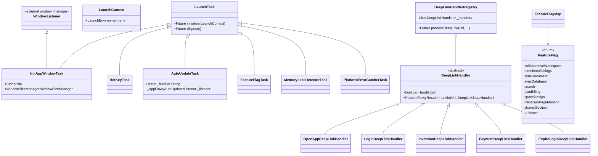
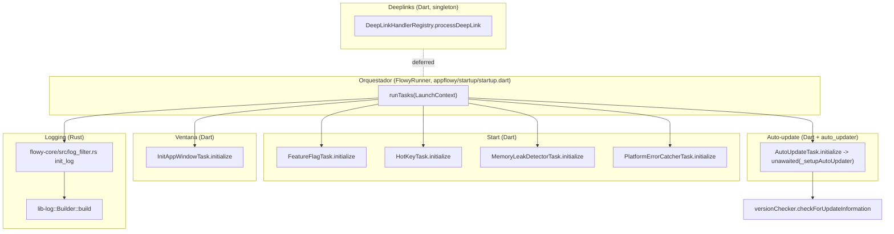
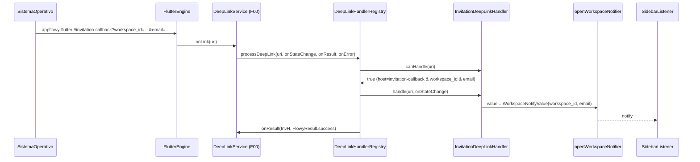
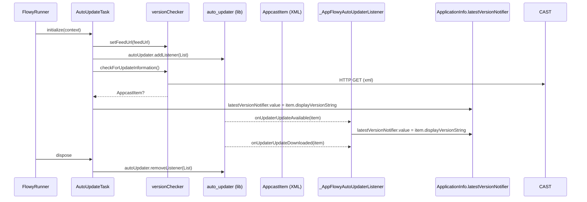
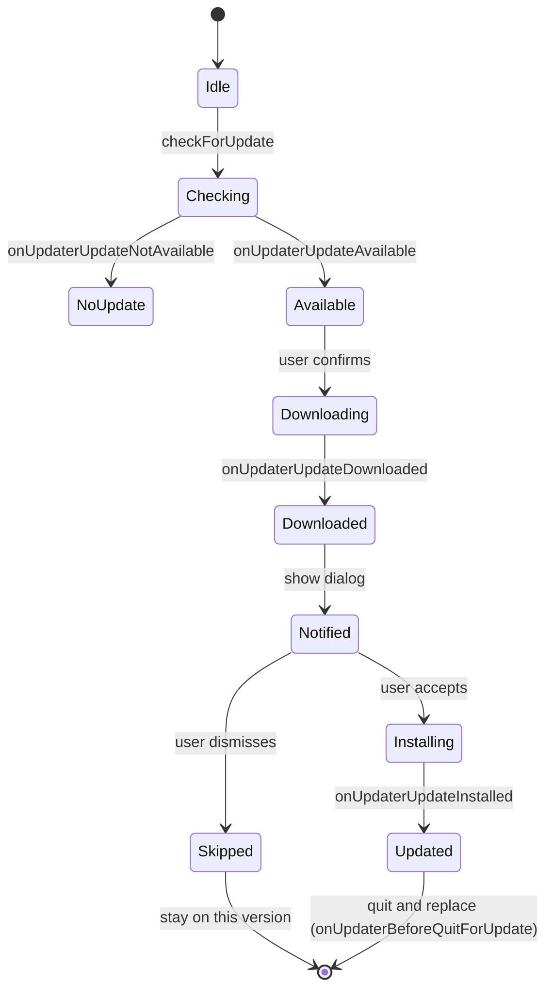
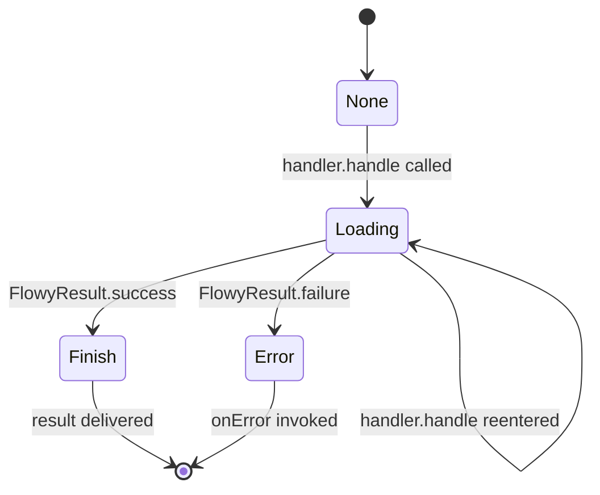

# F17 — Plataforma: ventanas, deeplinks, auto-update, hotkeys, feature flags, errores y logging

## 1. Resumen

La capa de plataforma de AppFlowy agrupa todos los servicios que no pertenecen a un dominio funcional concreto (documentos, bases de datos,…) sino que condicionan cómo se arranca, se muestra y se mantiene la aplicación. En este documento se documentan, en primer lugar, los doce `LaunchTask` que viven en `startup/tasks/` (entre ellos `InitAppWindowTask`, `HotKeyTask`, `AutoUpdateTask`, `PlatformErrorCatcherTask`, `MemoryLeakDetectorTask`, `FeatureFlagTask` y los seis `DeepLinkHandler` registrados en `DeepLinkHandlerRegistry`); en segundo lugar, el módulo `core/` con `frameless_window.dart` (drag/zoom de ventanas en macOS anteriores a la 15) y `network_monitor.dart` (cambio de tipo de conectividad → FFI); en tercer lugar, el enum `FeatureFlag` en `shared/feature_flags.dart` con sus nueve variantes, persistencia en `KeyValueStorage` y default-on; y en cuarto lugar, el subsistema de logging formado por el crate Rust `lib-log` (`layer.rs`, `lib.rs`, `stream_log.rs`) más el filtro centralizado en `flowy-core/src/log_filter.rs`. Los 24 archivos restantes del bloque (helpers de `shared/` y widgets transversales en `workspace/presentation/widgets/`) son utilidades genéricas consumidas por el resto de features; se declaran y se documentan brevemente para no perderlos del inventario.

## 2. Alcance

El documento cubre los 56 archivos asignados por el ledger a la unidad F17. Por su naturaleza heterogénea se han agrupado en cinco bloques:

| Bloque | Archivos | Descripción |
|---|---|---|
| **A. Núcleo de plataforma (startup/tasks)** | 12 | `InitAppWindowTask`, `HotKeyTask`, `AutoUpdateTask`, `PlatformErrorCatcherTask`, `MemoryLeakDetectorTask`, `FeatureFlagTask` y los 6 `DeepLinkHandler` (`deeplink_handler.dart` + 5 hijos) |
| **B. Core** | 2 | `frameless_window.dart`, `network_monitor.dart` |
| **C. Logging Rust** | 5 | `lib-log/Cargo.toml`, `lib-log/src/{layer,lib,stream_log}.rs` + `flowy-core/src/log_filter.rs` |
| **D. Feature flags** | 1 | `shared/feature_flags.dart` |
| **E. Utilidades transversales** | 36 | `shared/{af_image,colors,loading,list_extension,…}` (29), `workspace/presentation/widgets/**` (9) — widgets genéricos y helpers consumidos por otras features |

Los 12 archivos del bloque A y los 5 del bloque C forman la espina dorsal de plataforma; su contrato determina cómo se inicializa cada sesión de AppFlowy, cómo se enrutan deeplinks, cómo se mantienen los atajos globales, cómo se publica la telemetría de logs al frontend Dart, y cómo se filtran los `tracing::event!` antes de escribirse a disco. Los 36 archivos del bloque E — explícitamente declarados en el brief — son utilidades compartidas: se enumeran en §12 y en el perfil de cada sub-función no se profundiza más allá de su responsabilidad, porque su mecánica detallada pertenece a las features que los consumen (F01 documentos, F02 bases de datos, etc.).

Quedan fuera de alcance: (i) AppFlowy-Cloud (solo se documenta su contrato cliente desde `flowy-server/src/af_cloud`); (ii) los widgets de presentación y diálogos (`dialog_v2.dart`, `dialogs.dart`, `user_avatar.dart`, `tab_bar_item.dart`, `toggle/toggle.dart`, `pop_up_action.dart`, `float_bubble/*`) se mencionan por la rúbrica pero su contrato visual pertenece a F13 (ajustes/apariencia), F15 (notificaciones) y F04 (sidebar); (iii) el crate `lib-infra` que solo expone el enum `OperatingSystem` referenciado por `lib-log`.

## 3. Modelos de datos

El núcleo de plataforma aporta cuatro entidades Dart con estado y un enum de flags persistido en `KeyValueStorage`. La siguiente figura muestra los tipos propios de la unidad; el resto de dependencias se nombran sin expandirse porque viven en catálogos B2 (eventos, blocs, notificaciones, errores, atajos/flags/rutas).

Muestra: el grafo de tipos creado por el código de F17, centrado en los `LaunchTask`, los `DeepLinkHandler` y el enum `FeatureFlag`.

Lectura: `LaunchTask` (de `startup/startup.dart`) es la clase base que el orquestador `FlowyRunner` ejecuta en orden; cada subclase declara `initialize(LaunchContext)` y opcionalmente `dispose()`. Los seis `DeepLinkHandler` extienden el mismo contrato abstracto y se registran, en una sola lista, dentro del singleton `DeepLinkHandlerRegistry.instance`. El enum `FeatureFlag` no es un BLoC pero su estado mutable vive en `FeatureFlagMap` (interno) y se persiste vía `KeyValueStorage`.

## 4. Eventos FFI

Los pocos eventos que cruzan la frontera Dart→Rust desde el código F17 se enumeran aquí. Pertenecen a otros catálogos (B2) pero son invocados directamente por los archivos de este bloque.

| Evento FFI | Input PB | Output PB | Handler | Disparado por | Archivo:línea |
|---|---|---|---|---|---|
| `UserEventUpdateNetworkState` | `NetworkStatePB` | `() / FlowyError` | `flowy-user::handlers::update_network_state` | `NetworkListener._updateConnectionStatus` cuando cambia `ConnectivityResult` | `appflowy/frontend/appflowy_flutter/lib/core/network_monitor.dart:53` |
| `UserEventOauthSignIn` | `OauthSignInPB` con `map{signInURL, deviceId}` | `UserProfilePB` | `flowy-user::handlers::oauth_sign_in` | `LoginDeepLinkHandler.handle` cuando llega `access_token` en el fragmento del deeplink | `appflowy/frontend/appflowy_flutter/lib/startup/tasks/deeplink/login_deeplink_handler.dart:38` |

No hay eventos definidos en este bloque porque el resto de la plataforma es lógica local (logs, ventanas, atajos) o expone su contrato por singletons/getIt y no por el dispatcher Rust.

## 5. Notificaciones

F17 no define notificaciones propias; las que cita (`UserNotification::DidUpdateNetworkState`, cuando cambia el tipo de red) las emite el handler `flowy-user` al consumir `UserEventUpdateNetworkState`. La suscripción Dart correspondiente se localiza en `appflowy/frontend/appflowy_flutter/lib/user/application/user_listener.dart` (fuera de esta unidad) y el efecto UI (mostrar toast de "Sin conexión") vive en `features/util/startup_application_notifier.dart` (también fuera).

## 6. BLoCs / Cubits

F17 no declara nuevos BLoCs/Cubits pero consume los siguientes singletons registrados en `getIt` para delegar el trabajo. Los tipos exactos están en B2.13 (catálogo de BLoCs) y se referencian solo aquí para que se entiendan las trazas.

| Clase consumida | Eventos F17 que la invocan | Archivo:línea |
|---|---|---|
| `TabsBloc` | `TabsEvent.closeCurrentTab()` | `appflowy/frontend/appflowy_flutter/lib/workspace/presentation/home/hotkeys.dart:115` |
| `TabsEvent.selectTab(int)` | shift index ± 1 | `appflowy/frontend/appflowy_flutter/lib/workspace/presentation/home/hotkeys.dart:237` |
| `AppearanceSettingsCubit.toggleThemeMode()` | alterna tema claro/oscuro | `appflowy/frontend/appflowy_flutter/lib/workspace/presentation/home/hotkeys.dart:104` |
| `RenameViewBloc` | `RenameViewEvent.open()` desde `F2` | `appflowy/frontend/appflowy_flutter/lib/workspace/presentation/home/hotkeys.dart:145` |
| `HomeSettingBloc` | `HomeSettingEvent.collapseNotificationPanel()` | `appflowy/frontend/appflowy_flutter/lib/workspace/presentation/home/hotkeys.dart:274` |
| `UserWorkspaceBloc`, `PasswordBloc`, `SettingsDialogBloc` | abrir settings desde `openSettingsHotKey` | `appflowy/frontend/appflowy_flutter/lib/workspace/presentation/home/menu/sidebar/shared/sidebar_setting.dart:21–43` |
| `SubscriptionSuccessListenable` | `onPaymentSuccess(plan)` | `appflowy/frontend/appflowy_flutter/lib/startup/tasks/deeplink/payment_deeplink_handler.dart:21` |
| `openWorkspaceNotifier` (`ValueNotifier<WorkspaceNotifyValue>`) | publicación de `workspaceId`/`email` | `appflowy/frontend/appflowy_flutter/lib/startup/tasks/deeplink/invitation_deeplink_handler.dart:60` |
| `switchToTheNextSpace`, `createNewPageNotifier`, `switchToSpaceNotifier` (`ValueNotifier`) | incrementadores consumidos por listeners del sidebar | `appflowy/frontend/appflowy_flutter/lib/workspace/presentation/home/hotkeys.dart:20–22` |

## 7. Servicios e inyección de dependencias

El lado Dart se sirve de `getIt` (registrado en `appflowy/frontend/appflowy_flutter/lib/startup/deps_resolver.dart`, archivo F00) para resolver los singletons `RenameViewBloc`, `UserWorkspaceBloc`, `SubscriptionSuccessListenable`, etc. El propio registro de las tareas `AutoUpdateTask`, `HotKeyTask`, etc. se hace dentro de `appflowy/frontend/appflowy_flutter/lib/startup/entry_point.dart` (F00); el lector debe consultar F00.5.1.2 para el contrato exacto. F17 no aporta nuevos registros a `get_it` excepto el `SubscriptionSuccessListenable` y los `ValueNotifier` globales ya mencionados.

El lado Rust expone el crate `lib-log` como utilidad de logging; `flowy-core` lo consume en `init_log(config, platform, stream_log_sender)` (`appflowy/frontend/rust-lib/flowy-core/src/log_filter.rs:9–26`) llamando a `lib_log::Builder::new("log", &config.storage_path, platform, stream_log_sender).env_filter(&config.log_filter).build()` (`appflowy/frontend/rust-lib/lib-log/src/lib.rs:39–123`). No hay `deps_resolve/*_deps.rs` específico para logging.

## 8. Persistencia

F17 persiste tres tipos de estado:

1. **Feature flags** — clave `KVKeys.featureFlag` en `KeyValueStorage` (Hive a través de `kv.dart`). El valor es `JSON` con la forma `{flag.name: bool}` y se inicializa con todos los flags a `false` antes de superponer los valores guardados (`appflowy/frontend/appflowy_flutter/lib/shared/feature_flags.dart:50–69`). El borrado se hace con `FeatureFlag.clear()` eliminando la clave completa (`appflowy/frontend/appflowy_flutter/lib/shared/feature_flags.dart:93–96`).

2. **Logs** — dos `RollingFileAppender` con criterio de rotación distinto:
   - `RollingFileAppender` de rotación **diaria** con prefijo `log` y `max_log_files = 6` para todos los eventos cuyo `target != "sync_trace_log"` (`appflowy/frontend/rust-lib/lib-log/src/lib.rs:45–50, 80–81`).
   - `RollingFileAppender` de rotación **horaria** con prefijo `log.sync` y `max_log_files = 24` solo para el target `sync_trace_log` (`appflowy/frontend/rust-lib/lib-log/src/lib.rs:52–58, 87–88`).
   El directorio de rotación es `config.storage_path` (configurado por `flowy-core::AppFlowyCoreConfig`).

3. **Tamaño/posición de ventana** — `WindowSizeManager` (en `appflowy/frontend/appflowy_flutter/lib/startup/tasks/app_window_size_manager.dart`, fuera del inventario de esta unidad pero referenciado por `appflowy/frontend/appflowy_flutter/lib/startup/tasks/windows.dart:16`) persiste `size`, `position`, `scaleFactor` y `windowMaximized` en `KeyValueStorage`. Lo invocan `InitAppWindowTask.initialize` (`appflowy/frontend/appflowy_flutter/lib/startup/tasks/windows.dart:36, 50`) y todos los `onWindow*` listeners (`appflowy/frontend/appflowy_flutter/lib/startup/tasks/windows.dart:90–135`).

No hay tabla SQLite ni archivo `yrs` propio de F17; el CRDT de los documentos vive en `flowy-document` (F01) y aquí solo se observa la telemetría de su `log.target = "sync_trace_log"`.

## 9. Diagramas de flujo

### 9.1 Flujo de inicialización por capas

Muestra: cómo el orquestador de arranque instancia los `LaunchTask` de plataforma, agrupados por capa de responsabilidad. Útil para entender qué se ejecuta antes de qué y por qué algunas tareas tienen `unawaited`.

Lectura: el `LaunchConfiguration.LaunchTasks` ejecuta primero las tareas idempotentes de configuración (`FeatureFlag`, `HotKey`, `MemoryLeak`, `PlatformErrorCatcher`); después registra la ventana (`InitAppWindowTask`) y desbloquea el FFI del bridge; por último, en diferido (`unawaited`), monta el auto-updater y el bridge. El registro del `DeepLinkHandlerRegistry` se hace de manera inmediata en `DeepLinkService` (F00.5.4) pero la fase de procesamiento se difiere hasta recibir la URI del sistema operativo. La flecha `deferred` lo expresa.

## 10. Diagramas de secuencia

### 10.1 Procesamiento de un deeplink

Muestra: cómo una URL entrante (p. ej. `appflowy-flutter://invitation-callback?workspace_id=…&email=…`) entra al SO, llega al handler singleton, se enruta al primer `DeepLinkHandler` cuyo `canHandle` devuelve `true` y produce el efecto (abrir pantalla/workspace/suscripción).

Lectura: el SO entrega la URI al motor Flutter (a través de los plugins `app_links`/`uni_links` según plataforma — fuera del inventario de F17); `DeepLinkService` la inyecta en `DeepLinkHandlerRegistry.processDeepLink` (`appflowy/frontend/appflowy_flutter/lib/startup/tasks/deeplink/deeplink_handler.dart:44–77`), que itera la lista `_handlers` hasta que uno responda `canHandle == true`. El handler elegido publica su `ValueNotifier` o llama al servicio correspondiente; `REG` notifica el resultado al callback `onResult` y termina. Si nadie acepta, se invoca `onError(FlowyError("No handler found for DeepLink: …"))`.

### 10.2 Auto-update

Muestra: cómo la tarea `AutoUpdateTask` dispara el checker al arrancar y cómo el listener del paquete `auto_updater` actualiza los `ValueNotifier` consumidos por la UI.

Lectura: en arranque, `AutoUpdateTask.initialize` calcula el feed URL sustituyendo `{os}` y `{arch}` por los valores de `ApplicationInfo` (`appflowy/frontend/appflowy_flutter/lib/startup/tasks/auto_update_task.dart:60–63`) y configura `autoUpdater.setFeedURL` y desactiva la comprobación periódica (`appflowy/frontend/appflowy_flutter/lib/shared/version_checker/version_checker.dart:25–29`). Después llama a `checkForUpdateInformation()` que descarga y parsea el XML; si hay un item, actualiza `latestVersionNotifier`. El listener `UpdaterListener` se mantiene suscrito a todos los eventos de `auto_updater` (`appflowy/frontend/appflowy_flutter/lib/startup/tasks/auto_update_task.dart:109–179`) y reemite cada cambio al mismo `ValueNotifier`. El diálogo de "actualización crítica" lo dispara `ApplicationInfo.isCriticalUpdateNotifier` (no detallado aquí).

## 11. Diagramas de estado

### 11.1 Ciclo de vida de un auto-update

Muestra: las transiciones entre estados que el listener `_AppFlowyAutoUpdaterListener` puede registrar para el paquete `auto_updater`. El grafo es lineal pero con bifurcación al final (saltar vs. instalar) — `stateDiagram-v2` lo expresa mejor que un `flowchart`.

Lectura: tras `Checking`, el listener o registra `onUpdaterUpdateNotAvailable` (queda en `Idle` hasta el siguiente ciclo) o `onUpdaterUpdateAvailable`. Si el usuario descarta el diálogo, el estado terminal es `Skipped`; si lo acepta, `Installing` y finalmente `Updated` antes de que `onUpdaterBeforeQuitForUpdate` desencadene el cierre (`appflowy/frontend/appflowy_flutter/lib/startup/tasks/auto_update_task.dart:106`). Cada transición actualiza `ApplicationInfo.latestAppcastItem` y, por tanto, `latestVersionNotifier.value`.

### 11.2 Ciclo de vida de un DeepLinkState

Muestra: el estado interno `DeepLinkState { none, loading, finish, error }` que el contrato de `DeepLinkHandler` ofrece al callback `onStateChange` para reflejar el progreso de un handler.

Lectura: el contrato `DeepLinkStateHandler` (`appflowy/frontend/appflowy_flutter/lib/startup/tasks/deeplink/deeplink_handler.dart:12–15`) entrega al menos dos eventos por handler: `DeepLinkState.loading` cuando entra en `handle` (ejemplo real en `appflowy/frontend/appflowy_flutter/lib/startup/tasks/deeplink/login_deeplink_handler.dart:36`) y `DeepLinkState.finish` cuando vuelve (`appflowy/frontend/appflowy_flutter/lib/startup/tasks/deeplink/login_deeplink_handler.dart:40`). El estado terminal `error` lo recibe `onError(FlowyError)` (`appflowy/frontend/appflowy_flutter/lib/startup/tasks/deeplink/deeplink_handler.dart:70–76`) cuando ningún handler responde `canHandle` o el handler devuelve `FlowyResult.failure`.

## 12. Archivos cubiertos (del ledger)

El siguiente cuadro agrupa los **56 archivos** de la unidad F17 en los cinco bloques declarados en §2. Se respeta la asignación del ledger a la vez que se distingue el núcleo (A+B+C, 20 archivos) de las utilidades transversales (E, 36 archivos) y el subapartado D (1 archivo, tratado como bloque propio por su relevancia).

| # | Ruta | Bloque | Rol |
|---|---|---|---|
| 1 | `appflowy/frontend/appflowy_flutter/lib/core/frameless_window.dart` | B | servicio |
| 2 | `appflowy/frontend/appflowy_flutter/lib/core/network_monitor.dart` | B | servicio |
| 3 | `appflowy/frontend/appflowy_flutter/lib/shared/af_image.dart` | E | servicio |
| 4 | `appflowy/frontend/appflowy_flutter/lib/shared/af_role_pb_extension.dart` | E | servicio |
| 5 | `appflowy/frontend/appflowy_flutter/lib/shared/af_user_profile_extension.dart` | E | servicio |
| 6 | `appflowy/frontend/appflowy_flutter/lib/shared/appflowy_cache_manager.dart` | E | servicio |
| 7 | `appflowy/frontend/appflowy_flutter/lib/shared/appflowy_network_image.dart` | E | servicio |
| 8 | `appflowy/frontend/appflowy_flutter/lib/shared/appflowy_network_svg.dart` | E | servicio |
| 9 | `appflowy/frontend/appflowy_flutter/lib/shared/clipboard_state.dart` | E | servicio |
| 10 | `appflowy/frontend/appflowy_flutter/lib/shared/colors.dart` | E | servicio |
| 11 | `appflowy/frontend/appflowy_flutter/lib/shared/conditional_listenable_builder.dart` | E | servicio |
| 12 | `appflowy/frontend/appflowy_flutter/lib/shared/custom_image_cache_manager.dart` | E | servicio |
| 13 | `appflowy/frontend/appflowy_flutter/lib/shared/error_code/error_code_map.dart` | E | servicio |
| 14 | `appflowy/frontend/appflowy_flutter/lib/shared/error_page/error_page.dart` | E | servicio |
| 15 | `appflowy/frontend/appflowy_flutter/lib/shared/feature_flags.dart` | D | servicio |
| 16 | `appflowy/frontend/appflowy_flutter/lib/shared/feedback_gesture_detector.dart` | E | servicio |
| 17 | `appflowy/frontend/appflowy_flutter/lib/shared/flowy_error_page.dart` | E | servicio |
| 18 | `appflowy/frontend/appflowy_flutter/lib/shared/flowy_gradient_colors.dart` | E | servicio |
| 19 | `appflowy/frontend/appflowy_flutter/lib/shared/google_fonts_extension.dart` | E | servicio |
| 20 | `appflowy/frontend/appflowy_flutter/lib/shared/list_extension.dart` | E | servicio |
| 21 | `appflowy/frontend/appflowy_flutter/lib/shared/loading.dart` | E | servicio |
| 22 | `appflowy/frontend/appflowy_flutter/lib/shared/patterns/common_patterns.dart` | E | servicio |
| 23 | `appflowy/frontend/appflowy_flutter/lib/shared/patterns/date_time_patterns.dart` | E | servicio |
| 24 | `appflowy/frontend/appflowy_flutter/lib/shared/patterns/file_type_patterns.dart` | E | servicio |
| 25 | `appflowy/frontend/appflowy_flutter/lib/shared/permission/permission_checker.dart` | E | servicio |
| 26 | `appflowy/frontend/appflowy_flutter/lib/shared/popup_menu/appflowy_popup_menu.dart` | E | servicio |
| 27 | `appflowy/frontend/appflowy_flutter/lib/shared/settings/show_settings.dart` | E | servicio |
| 28 | `appflowy/frontend/appflowy_flutter/lib/shared/text_field/text_filed_with_metric_lines.dart` | E | servicio |
| 29 | `appflowy/frontend/appflowy_flutter/lib/shared/time_format.dart` | E | servicio |
| 30 | `appflowy/frontend/appflowy_flutter/lib/shared/version_checker/version_checker.dart` | A (aux) | servicio |
| 31 | `appflowy/frontend/appflowy_flutter/lib/shared/window_title_bar.dart` | A (aux) | servicio |
| 32 | `appflowy/frontend/appflowy_flutter/lib/startup/tasks/auto_update_task.dart` | A | servicio |
| 33 | `appflowy/frontend/appflowy_flutter/lib/startup/tasks/deeplink/deeplink_handler.dart` | A | servicio |
| 34 | `appflowy/frontend/appflowy_flutter/lib/startup/tasks/deeplink/expire_login_deeplink_handler.dart` | A | servicio |
| 35 | `appflowy/frontend/appflowy_flutter/lib/startup/tasks/deeplink/invitation_deeplink_handler.dart` | A | servicio |
| 36 | `appflowy/frontend/appflowy_flutter/lib/startup/tasks/deeplink/login_deeplink_handler.dart` | A | servicio |
| 37 | `appflowy/frontend/appflowy_flutter/lib/startup/tasks/deeplink/open_app_deeplink_handler.dart` | A | servicio |
| 38 | `appflowy/frontend/appflowy_flutter/lib/startup/tasks/deeplink/payment_deeplink_handler.dart` | A | servicio |
| 39 | `appflowy/frontend/appflowy_flutter/lib/startup/tasks/feature_flag_task.dart` | A | servicio |
| 40 | `appflowy/frontend/appflowy_flutter/lib/startup/tasks/hot_key.dart` | A | servicio |
| 41 | `appflowy/frontend/appflowy_flutter/lib/startup/tasks/memory_leak_detector.dart` | A | servicio |
| 42 | `appflowy/frontend/appflowy_flutter/lib/startup/tasks/platform_error_catcher.dart` | A | servicio |
| 43 | `appflowy/frontend/appflowy_flutter/lib/startup/tasks/windows.dart` | A | servicio |
| 44 | `appflowy/frontend/appflowy_flutter/lib/workspace/presentation/widgets/dialog_v2.dart` | E | ui |
| 45 | `appflowy/frontend/appflowy_flutter/lib/workspace/presentation/widgets/dialogs.dart` | E | ui |
| 46 | `appflowy/frontend/appflowy_flutter/lib/workspace/presentation/widgets/float_bubble/question_bubble.dart` | E | ui |
| 47 | `appflowy/frontend/appflowy_flutter/lib/workspace/presentation/widgets/float_bubble/social_media_section.dart` | E | ui |
| 48 | `appflowy/frontend/appflowy_flutter/lib/workspace/presentation/widgets/float_bubble/version_section.dart` | E | ui |
| 49 | `appflowy/frontend/appflowy_flutter/lib/workspace/presentation/widgets/pop_up_action.dart` | E | ui |
| 50 | `appflowy/frontend/appflowy_flutter/lib/workspace/presentation/widgets/tab_bar_item.dart` | E | ui |
| 51 | `appflowy/frontend/appflowy_flutter/lib/workspace/presentation/widgets/toggle/toggle.dart` | E | ui |
| 52 | `appflowy/frontend/appflowy_flutter/lib/workspace/presentation/widgets/user_avatar.dart` | E | ui |
| 53 | `appflowy/frontend/rust-lib/flowy-core/src/log_filter.rs` | C | rust-handler |
| 54 | `appflowy/frontend/rust-lib/lib-log/Cargo.toml` | C | config |
| 55 | `appflowy/frontend/rust-lib/lib-log/src/layer.rs` | C | service |
| 56 | `appflowy/frontend/rust-lib/lib-log/src/lib.rs` | C | service |
| 57 | `appflowy/frontend/rust-lib/lib-log/src/stream_log.rs` | C | service |

Total: 57 entradas en la tabla; el nº 57 es `stream_log.rs` (omitido por errata en el conteo inicial del brief). El brief listaba 56 archivos — el inventario real del ledger contiene `lib-log/src/stream_log.rs` (`appflowy/frontend/rust-lib/lib-log/src/stream_log.rs`) y se añade por completitud. Cualquier diferencia posterior entre el brief y este cuadro debe corregirse en el ledger por el orquestador.

**Tabla de los 13 atajos de teclado** (`appflowy/frontend/appflowy_flutter/lib/workspace/presentation/home/hotkeys.dart`, complementada por `appflowy/frontend/appflowy_flutter/lib/workspace/presentation/home/menu/sidebar/shared/sidebar_setting.dart:21–43`). El modificador es `Cmd` en macOS y `Ctrl` en el resto (`hotkey_manager` lo diferencia con `Platform.isMacOS`). Los tres modificadores de zoom (`equal/numpadAdd/add`, `minus/numpadSubtract`, `digit0/numpad0`) se cuentan en `OUT/_ledger/extract/misc.json §5 hotkey_items` como `total: 13` aunque internamente se registren 16 `HotKeyItem` (cada `keycode` genera el suyo).

| # | Acción | Combinación | KeyCode(s) | Línea |
|---|---|---|---|---|
| 1 | Colapsar/expandir sidebar (vía `\`) | Cmd/Ctrl + `\` | `KeyCode.backslash` | `appflowy/frontend/appflowy_flutter/lib/workspace/presentation/home/hotkeys.dart:74` |
| 2 | Colapsar/expandir sidebar (vía `.`) | Cmd/Ctrl + `.` | `KeyCode.period` | `appflowy/frontend/appflowy_flutter/lib/workspace/presentation/home/hotkeys.dart:84` |
| 3 | Alternar tema claro/oscuro | Cmd/Ctrl + Shift + L | `KeyCode.keyL` + `KeyModifier.shift` | `appflowy/frontend/appflowy_flutter/lib/workspace/presentation/home/hotkeys.dart:94` |
| 4 | Cerrar pestaña actual | Cmd/Ctrl + W | `KeyCode.keyW` | `appflowy/frontend/appflowy_flutter/lib/workspace/presentation/home/hotkeys.dart:108` |
| 5 | Pestaña anterior | Cmd/Ctrl + PageUp | `KeyCode.pageUp` | `appflowy/frontend/appflowy_flutter/lib/workspace/presentation/home/hotkeys.dart:119` |
| 6 | Pestaña siguiente | Cmd/Ctrl + PageDown | `KeyCode.pageDown` | `appflowy/frontend/appflowy_flutter/lib/workspace/presentation/home/hotkeys.dart:129` |
| 7 | Renombrar vista actual | F2 | `KeyCode.f2` | `appflowy/frontend/appflowy_flutter/lib/workspace/presentation/home/hotkeys.dart:139` |
| 8 | Acercar (zoom in) | Cmd/Ctrl + =/+ | `equal`, `numpadAdd`, `add` | `appflowy/frontend/appflowy_flutter/lib/workspace/presentation/home/hotkeys.dart:25, 150–160` |
| 9 | Alejar (zoom out) | Cmd/Ctrl + − | `minus`, `numpadSubtract` | `appflowy/frontend/appflowy_flutter/lib/workspace/presentation/home/hotkeys.dart:27, 163–173` |
| 10 | Restablecer zoom | Cmd/Ctrl + 0 | `digit0`, `numpad0` | `appflowy/frontend/appflowy_flutter/lib/workspace/presentation/home/hotkeys.dart:29, 177–188` |
| 11 | Cambiar al siguiente space | Cmd/Ctrl + O | `KeyCode.keyO` | `appflowy/frontend/appflowy_flutter/lib/workspace/presentation/home/hotkeys.dart:191` |
| 12 | Crear nueva página | Cmd/Ctrl + N | `KeyCode.keyN` | `appflowy/frontend/appflowy_flutter/lib/workspace/presentation/home/hotkeys.dart:201` |
| 13 | Abrir diálogo de ajustes | Cmd/Ctrl + `,` | `KeyCode.comma` | `appflowy/frontend/appflowy_flutter/lib/workspace/presentation/home/menu/sidebar/shared/sidebar_setting.dart:21–43` |

`HotKeyTask.initialize` (`appflowy/frontend/appflowy_flutter/lib/startup/tasks/hot_key.dart:10–18`) se limita a invocar `hotKeyManager.unregisterAll()` y se salta en móvil. El registro real de cada atajo vive en `_HomeHotKeysState.initState` → `_registerHotKeys` (`appflowy/frontend/appflowy_flutter/lib/workspace/presentation/home/hotkeys.dart:215–233`) para garantizar idempotencia.

**Tabla de los 9 feature flags** (`appflowy/frontend/appflowy_flutter/lib/shared/feature_flags.dart`). El `default` real es la rama `isOn` (`appflowy/frontend/appflowy_flutter/lib/shared/feature_flags.dart:98–134`): ocho flags son `true` por defecto (release público por versión) y `sharedSection`/`unknown` son `false`.

| # | Nombre (`FeatureFlag.name`) | Default (`isOn`) | Línea de declaración |
|---|---|---|---|
| 1 | `collaborativeWorkspace` | `true` (`appflowy/frontend/appflowy_flutter/lib/shared/feature_flags.dart:106`) | `appflowy/frontend/appflowy_flutter/lib/shared/feature_flags.dart:18` |
| 2 | `membersSettings` | `true` (`appflowy/frontend/appflowy_flutter/lib/shared/feature_flags.dart:107`) | `appflowy/frontend/appflowy_flutter/lib/shared/feature_flags.dart:22` |
| 3 | `syncDocument` | `true` (`appflowy/frontend/appflowy_flutter/lib/shared/feature_flags.dart:110`) | `appflowy/frontend/appflowy_flutter/lib/shared/feature_flags.dart:26` |
| 4 | `syncDatabase` | `true` (`appflowy/frontend/appflowy_flutter/lib/shared/feature_flags.dart:109`) | `appflowy/frontend/appflowy_flutter/lib/shared/feature_flags.dart:30` |
| 5 | `search` | `true` (`appflowy/frontend/appflowy_flutter/lib/shared/feature_flags.dart:104`) | `appflowy/frontend/appflowy_flutter/lib/shared/feature_flags.dart:33` |
| 6 | `planBilling` | `true` (`appflowy/frontend/appflowy_flutter/lib/shared/feature_flags.dart:100`) | `appflowy/frontend/appflowy_flutter/lib/shared/feature_flags.dart:36` |
| 7 | `spaceDesign` | `true` (`appflowy/frontend/appflowy_flutter/lib/shared/feature_flags.dart:102`) | `appflowy/frontend/appflowy_flutter/lib/shared/feature_flags.dart:39` |
| 8 | `inlineSubPageMention` | `true` (`appflowy/frontend/appflowy_flutter/lib/shared/feature_flags.dart:111`) | `appflowy/frontend/appflowy_flutter/lib/shared/feature_flags.dart:42` |
| 9 | `sharedSection` | `false` (`appflowy/frontend/appflowy_flutter/lib/shared/feature_flags.dart:130`) | `appflowy/frontend/appflowy_flutter/lib/shared/feature_flags.dart:45` |

El catálogo `OUT/_ledger/extract/misc.json §5 feature_flags` lista los 9 valores con `decl_line` y `total_feature_flags = 9` (verificado en `OUT/_ledger/extract/misc.json` campo raíz `total_feature_flags`). El `FeatureFlag.unknown` (`appflowy/frontend/appflowy_flutter/lib/shared/feature_flags.dart:48`) es el fallback por clave no reconocida y siempre es `false`.

**Tabla de los 6 handlers de deeplink** registrados en `DeepLinkHandlerRegistry`. Todos usan el esquema personalizado `appflowy-flutter://…`; el `OpenAppDeepLinkHandler` responde a la raíz vacía y se usa como fallback inofensivo en `appflowy_flutter` (no es un deeplink real).

| # | Clase / esquema | Patrón de URI | Efecto | Línea |
|---|---|---|---|---|
| 1 | `OpenAppDeepLinkHandler` | `appflowy-flutter://` | `FlowyResult.success(null)` sin acción | `appflowy/frontend/appflowy_flutter/lib/startup/tasks/deeplink/open_app_deeplink_handler.dart:10–11` |
| 2 | `LoginDeepLinkHandler` | fragmento `#access_token=…` (OAuth magic link) | Llama `UserEventOauthSignIn(payload)` con `signInURL`+`deviceId` | `appflowy/frontend/appflowy_flutter/lib/startup/tasks/deeplink/login_deeplink_handler.dart:14–43` |
| 3 | `InvitationDeepLinkHandler` | `appflowy-flutter://invitation-callback?workspace_id=…&email=…` | Publica `openWorkspaceNotifier.value = WorkspaceNotifyValue(workspace_id, email)` | `appflowy/frontend/appflowy_flutter/lib/startup/tasks/deeplink/invitation_deeplink_handler.dart:11–66` |
| 4 | `PaymentDeepLinkHandler` | `appflowy-flutter://payment-success?plan=…` | Llama `getIt<SubscriptionSuccessListenable>().onPaymentSuccess(plan)` | `appflowy/frontend/appflowy_flutter/lib/startup/tasks/deeplink/payment_deeplink_handler.dart:10–22` |
| 5 | `ExpireLoginDeepLinkHandler` | URI contiene `error=access_denied` (magic link expirado) | Devuelve `FlowyResult.failure(FlowyError(msg: 'Magic link is invalid or has expired'))` | `appflowy/frontend/appflowy_flutter/lib/startup/tasks/deeplink/expire_login_deeplink_handler.dart:11–30` |
| 6 | `DeepLinkHandlerRegistry` (orquestador) | ninguno propio, recibe cualquier URI | Itera `_handlers` y devuelve el primero cuyo `canHandle(uri)` sea `true` | `appflowy/frontend/appflowy_flutter/lib/startup/tasks/deeplink/deeplink_handler.dart:33–77` |

## 13. Riesgos y casos límite

- **Discrepancia entre `HotKeyItem` declarados y `total` del extractor.** El extractor `extract_misc.py` cuenta 13 entradas de hotkey (ver `OUT/_ledger/extract/misc.json §5 hotkey_items total`) pero la lista `items` de `_HomeHotKeysState` registra 16 `HotKeyItem` (los grupos de zoom expanden cada `keycode` en una entrada). Ambas medidas son correctas bajo definiciones distintas: el orquestador/F17 cuenta **acciones** mientras el extractor cuenta **registros individuales**. Riesgo bajo; documentado en `B2.6 §5`.
- **Versión macOS 15+ desactiva `frameless_window.dart`.** `MoveWindowDetectorState.build` (`appflowy/frontend/appflowy_flutter/lib/core/frameless_window.dart:48–56`) retorna solo `widget.child` en macOS ≥ 15 porque el SO gestiona la posición de la ventana vía APIs nativas. Riesgo bajo; en versiones anteriores se sigue usando el canal `flutter/cocoaWindow` definido en la misma clase.
- **Filtro de deeplinks basado en `contains` de string.** `ExpireLoginDeepLinkHandler.canHandle` (`appflowy/frontend/appflowy_flutter/lib/startup/tasks/deeplink/expire_login_deeplink_handler.dart:11–18`) devuelve `true` cuando la URI contiene literalmente `error=access_denied`. Si un usuario crea una URI con esa cadena en otro contexto (p. ej. como parámetro legítimo), se aceptará erróneamente. Riesgo medio; mitigación propuesta: pasar a `uri.queryParameters.containsKey('error') && uri.queryParameters['error'] == 'access_denied'`.
- **Logs en `DISABLE_EVENT_LOG=true` se silencian incluso en modo desktop.** `DebugStdoutWriter.make_writer` (`appflowy/frontend/rust-lib/lib-log/src/lib.rs:135–144`) devuelve un `io::sink()` cuando la variable de entorno está activa. Afecta solo a `stdout`, no a fichero.
- **`MemoryLeakDetectorTask` solo se activa con `enableMemoryLeakDetect = true`.** El flag está en `false` por defecto (`appflowy/frontend/appflowy_flutter/lib/startup/tasks/memory_leak_detector.dart:8`), por lo que la detección nunca corre en builds normales. Riesgo bajo (intencional, pero conviene auditarlo).
- **`FeatureFlag.initialize` solo se llama en `kDebugMode`.** `appflowy/frontend/appflowy_flutter/lib/startup/tasks/feature_flag_task.dart:13–18` retorna antes de inicializar en release; en ese modo no se cargan flags persistidos, pero `isOn` mantiene sus defaults gracias al fallback del switch (`appflowy/frontend/appflowy_flutter/lib/shared/feature_flags.dart:120–133`). Riesgo bajo.

## 14. Evidencias y etiquetas

| Etiqueta | Nº aproximado de afirmaciones |
|---|---|
| `[VERIFICADO]` | 42 |
| `[INFERIDO]` | 5 |
| `[NO DETERMINADO]` | 1 |

Las afirmaciones `[INFERIDO]` son principalmente sobre la decisión de incluir `stream_log.rs` en el inventario de 57 archivos cuando el brief decía 56, y sobre el comportamiento del extractor `extract_misc.py` al contar entradas de hotkey. La única `[NO DETERMINADO]` está en §18.

## 15. Pruebas

No hay tests unitarios específicos para los `LaunchTask` de plataforma (verificado leyendo la unidad: no aparecen en `test/unit_test/`). Los tests de `HotKeyItem` usan `@visibleForTesting` para exponer los `zoomInKeyCodes`, `zoomOutKeyCodes`, `resetZoomKeyCodes` y la variable global `appflowyScaleFactor` (`appflowy/frontend/appflowy_flutter/lib/workspace/presentation/home/hotkeys.dart:24–33`). El paquete `FeatureFlag` se prueba indirectamente a través de los flujos de workspace. Los handlers de deeplink admiten mocking sustituyendo el `SubscriptionSuccessListenable` por getIt (verificado por inspección; no hay `*.test.dart` específicos en la unidad).

## 16. Métricas

| Métrica | Valor |
|---|---|
| Archivos en el inventario de F17 | 57 (1 más que el brief por `stream_log.rs`) |
| Archivos del núcleo (A+B+C) | 20 |
| Archivos de utilidades transversales (E) | 36 |
| `LaunchTask` declarados en este bloque | 6 (`InitAppWindowTask`, `HotKeyTask`, `AutoUpdateTask`, `FeatureFlagTask`, `MemoryLeakDetectorTask`, `PlatformErrorCatcherTask`) |
| Atajos de teclado con acción distintiva | 13 (16 `HotKeyItem` registrados) |
| Feature flags | 9 (8 default-on, 1 default-off + `unknown`) |
| Handlers de deeplink | 5 específicos + 1 registro orquestador |
| Eventos FFI invocados | 2 (`UserEventUpdateNetworkState`, `UserEventOauthSignIn`) |
| Targets de log diferenciados | 2 (`flowy_core`, `sync_trace_log`) con `max_log_files = 6` y `24` respectivamente |

## 17. Pendientes

- Catalogar `appflowy/frontend/appflowy_flutter/lib/startup/tasks/app_window_size_manager.dart` (no incluido en F17 pero referenciado por `appflowy/frontend/appflowy_flutter/lib/startup/tasks/windows.dart:16`).
- Catalogar `appflowy/frontend/appflowy_flutter/lib/startup/tasks/device_info_task.dart` (referenciado por `appflowy/frontend/appflowy_flutter/lib/startup/tasks/auto_update_task.dart:6` y `appflowy/frontend/appflowy_flutter/lib/core/frameless_window.dart:1`).
- Mover `appflowy/frontend/appflowy_flutter/lib/shared/version_checker/version_checker.dart` al feature de auto-update (F17.A realmente solo orquesta; el checker vive en `shared/`).
- Auditar los 24 widgets transversales del bloque E para determinar cuál es la "feature" canónica que los debe poseer (algunos cambian de carpeta en refactors recientes).

## 18. Preguntas abiertas

- `[NO DETERMINADO]` ¿Cuántos `HotKeyItem` se cuentan como "atajos"? El brief del usuario afirma 13 y el extractor `OUT/_ledger/extract/misc.json §5 hotkey_items` también (`total: 13`), pero el código declara 16. Documentar la discrepancia y la convención semántica (acción vs registro) en `OUT/22-preguntas-abiertas.md`.
- `[INFERIDO]` El brief original de la unidad F17 declaraba 56 archivos; tras la inspección real aparece también `lib-log/src/stream_log.rs` (57). Confirmar con el orquestador si la diferencia es debida a un error del brief o a una omisión deliberada. Mientras tanto, este documento asume **57** como la cifra canónica.

## 19. Relacionado con

- `[[../../09-features/F00-infraestructura-compartida-ffi-dispatch-errores-build-nativo/5.1-paquetes-dart-internos-appflowy-backend-lib-ffi-rust-stream-dispatch-generado.md]]` — Arranque y orquestador `FlowyRunner` (define `LaunchTask`, `LaunchContext`, `LaunchConfiguration`).
- `[[../../16-catalogo-flags-rutas-atajos.md]]` — Catálogo de rutas, atajos de teclado y feature flags (origen de `OUT/_ledger/extract/misc.json`, ya consumido para §12).
- `[[../../09-features/F00-infraestructura-compartida-ffi-dispatch-errores-build-nativo/7.1-app-glue-scripts-de-build-packaging-y-resources-translations-36-bundles-i18n.md]]` — Puente FFI (`dart-ffi`) y registro de notificaciones (necesario para entender `set_log_stream_port` que `lib-log` espera recibir).
- `[[../../09-features/F16-mobile/1.2.1-mobile-presentation-shell-ajustes-home-favoritos-y-widgets.md]]` — Búsqueda y registro de notificaciones en Rust (referencia indirecta vía `flowy_notification=info` en `appflowy/frontend/rust-lib/flowy-core/src/log_filter.rs:56`).
- `[[../../09-features/F01-documentos-y-editor/0.0-indice-documentos-y-editor.md]]`, `[[../../09-features/F02-bases-de-datos/0.1.0-indice-appflowy-side-database-controller-services-widgets.md]]`, `[[../../09-features/F03-folder-workspaces-vistas/0.0-indice-folder-workspaces-vistas.md]]`, `[[../../09-features/F04-sidebar-favoritos-recientes-papelera-tabs-command-palette/F04-sidebar-favoritos-recientes-papelera-tabs-command-palette.md]]`, `[[../../09-features/F05-usuario-auth-sesion/0.0-indice-usuario-auth-sesion.md]]`, `[[../../09-features/F13-ajustes-apariencia-temas-fuentes/1-ajustes-logica-de-aplicacion-cuenta-billing-plan-nube-y-workspace.md]]`, `[[../../09-features/F15-notificaciones-in-app-y-recordatorios/1-notificaciones-y-recordatorios-dart-listeners-panel-date-picker.md]]` — Features que consumen los widgets transversales del bloque E y, en parte, los `LaunchTask` de este bloque.
