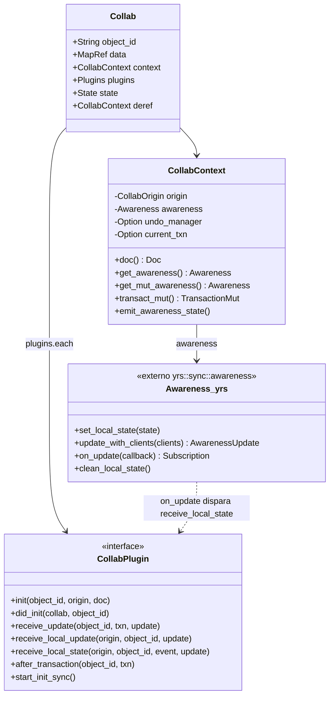
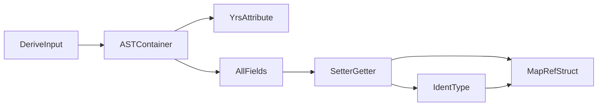
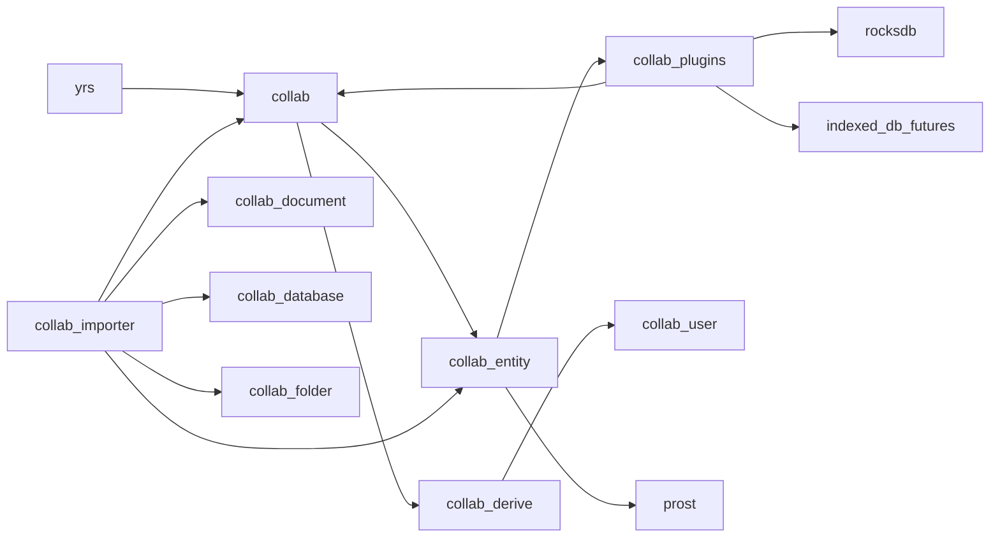
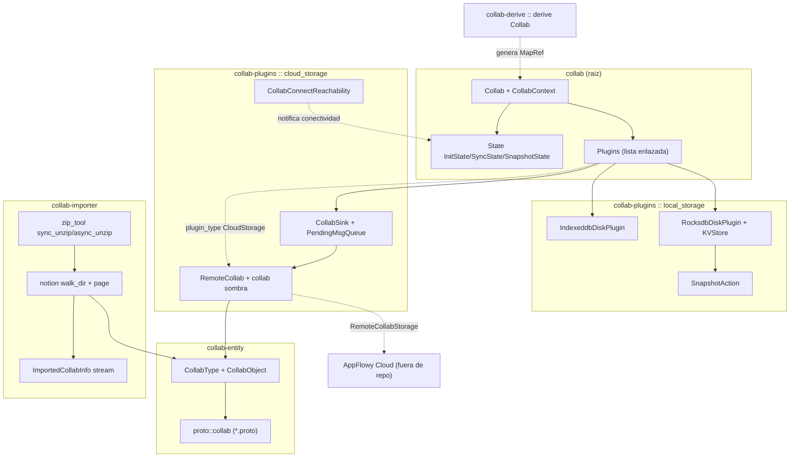
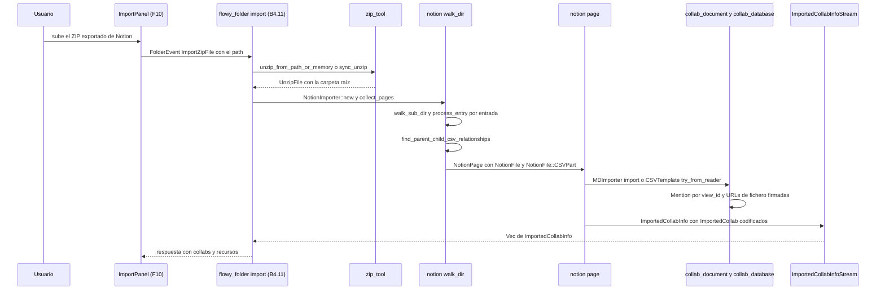
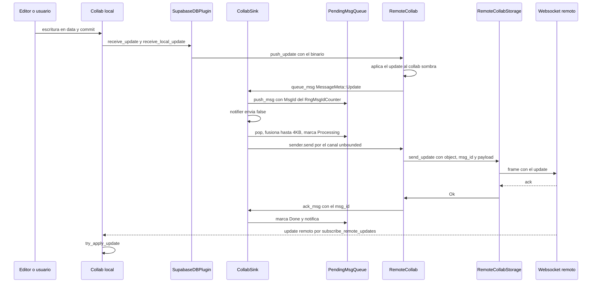
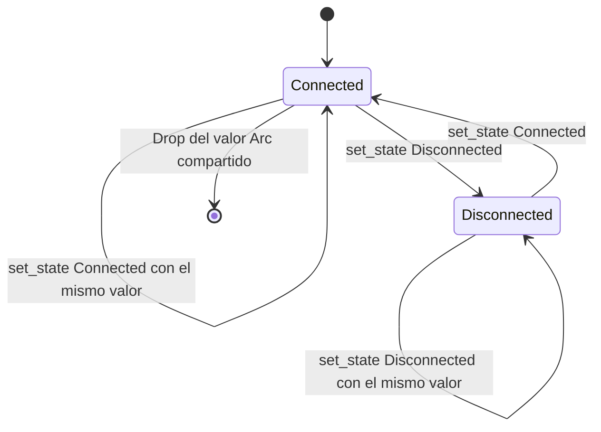

# F18 — Motor Collab (CRDT, plugins, importer, entity, derive)

## 1. Resumen

Esta unidad documenta cinco crates del workspace `AppFlowy-Collab` (rev `4dfccef`) que no están cubiertos por F01/F02/F03/F05: la raíz del crate `collab` (el objeto `Collab`, su contexto, sus plugins y sus estados), `collab-plugins` (persistencia KV local en RocksDB e IndexedDB más el núcleo de sincronización `cloud_storage/**` y la máquina de conectividad `connect_state.rs`), `collab-importer` (importador de Notion y descompresor ZIP), `collab-entity` (tipos de entidad, constantes de clave y los `.proto` del protocolo de sync) y `collab-derive` (el derive `Collab` que genera getters/setters tipados sobre `yrs`). Juntas son la capa sobre la que se construyen documentos, bases de datos, folder y usuario: el CRDT en sí se explica en `[[../../07-motor-colaborativo-crdt/00-indice.md]]` y el ensamblado de plugins en `[[../../09-features/F00-infraestructura-compartida-ffi-dispatch-errores-build-nativo/4-collab-integrate-y-crates-pub-contratos.md]]`, así que aquí se documenta el contrato de datos, el ciclo de vida de la sincronización y el pipeline de importación, no la semántica de cada tipo de dominio.

## 2. Alcance

**Corrección de scope (obligatoria).** El cierre de B3.F03..F07 redirigió `collab-plugins/src/{cloud_storage/**,connect_state.rs}` desde **F06** (Sync y servidores) hacia **F18**. Antes de ese cierre esos nueve ficheros estaban asignados a la unidad de sincronización; ahora son responsabilidad de este documento y aparecen en su tabla de §12. Consecuencia práctica: F06 (`OUT/09-features/F06-sync-y-servidores/F06-sync-y-servidores.md`) documenta el lado servidor y el cliente websocket de la nube, mientras que F18 documenta el **núcleo reutilizable de sincronización** — `RemoteCollab`, `CollabSink`, la cola de mensajes priorizada y la detección de conectividad — que no depende de ningún cliente concreto y solo se instancia cuando `collab-plugins` compila con la feature `postgres_plugin` (`collab:collab-plugins/src/lib.rs:19–20`, `collab:collab-plugins/Cargo.toml:63–66`).

Incluye además:

- Los **contratos de persistencia local** del crate `collab-plugins` (`local_storage/kv/**`, `local_storage/rocksdb/**`, `local_storage/indexeddb/**`), porque son la otra mitad de los plugins que `Collab` orquesta y comparten el mismo `CollabPlugin` trait.
- La crate `collab-importer` completa, incluidos sus tests end-to-end con assets ZIP reales, porque es el único consumidor de `collab-entity::CollabType` fuera de `collab-plugins`.
- La crate `collab-entity` completa: `CollabType`, `CollabObject`, `define.rs`, `reminder.rs` y los seis `.proto` del protocolo.
- La crate `collab-derive` completa.

Queda **fuera** de F18 (y se referencia, no se repite):

- El **modelo CRDT** de `Collab` (`[[../../07-motor-colaborativo-crdt/00-indice.md]]`): la semántica de `yrs` (`Doc`, `MapRef`, `Delta`, `TransactionMut`), los plugins de collab de cada dominio (`[[../../09-features/F01-documentos-y-editor/0.2-indice-de-documentos-y-editor-modelo-documentbloc-servicios-collab.md]]` documento, `[[../../09-features/F03-folder-workspaces-vistas/0.0-indice-folder-workspaces-vistas.md]]` folder, `[[../../09-features/F02-bases-de-datos/0.1.0-indice-appflowy-side-database-controller-services-widgets.md]]` database, `[[../../09-features/F05-usuario-auth-sesion/2-usuario-flowy-user-collab-user-rust-collab.md]]` usuario) y la resolución de conflictos.
- El **constructor de `Collab`** en el ensamblado real de la app y los contratos `-pub` que rompen dependencias circulares (`[[../../09-features/F00-infraestructura-compartida-ffi-dispatch-errores-build-nativo/4-collab-integrate-y-crates-pub-contratos.md]]`), incluido `collab-integrate` (`collab_builder.rs`, `plugin_provider.rs`). Aquí solo se documentan las APIs del crate base que esos contratos consumen.
- El **cliente de sync contra AppFlowy Cloud** (`af_cloud`, servidor websocket, `RemoteCollabStorage` implementado sobre Supabase/Postgres en el repo principal): F18 documenta el *trait* `RemoteCollabStorage` y el plugin de ejemplo `SupabaseDBPlugin`, pero la implementación de producción vive fuera de este repo.
- El **motor de importación de `flowy-folder`** (`appflowy/frontend/rust-lib/flowy-folder/src/share/import.rs`) y los eventos FFI `FolderEvent::ImportData` / `FolderEvent::ImportZipFile`, que son de `[[../../10-motor-export-import/11-import-zip-notion.md]]` y se cruzan en §10.
- La raíz del repo `AppFlowy-Collab` (workspace `Cargo.toml`, CI, `Makefile.toml`, `docs/`), que es `[[../../09-features/F20-colab-raiz-configuracion-ci-docs-manifests/F20-colab-raiz-configuracion-ci-docs-manifests.md]]`.

## 3. Modelos de datos

### 3.1 Capa de awareness y contexto del `Collab`

Antes de cualquier tabla conviene fijar un punto que suele confundir: **no existe ningún tipo llamado `CollabAwareness` en este workspace**. El módulo `awareness` que usa la crate `collab` es un re-export de `yrs::sync::awareness` (`collab:collab/collab/src/core/mod.rs:1`), y `CollabContext` lo envuelve como un campo privado `awareness: Awareness` (`collab:collab/collab/src/core/collab.rs:85–97`). La búsqueda `rg "CollabAwareness" SRC/` no devuelve ninguna coincidencia `[VERIFICADO]`. Lo que sí existe es una función de arranque que siembra el estado local de awareness con el `uid` del cliente y un conjunto de callbacks de plugin que reenvían cada cambio a los plugins (`receive_local_state`).

Muestra: quién posee la capa de awareness, qué API expone y por qué los plugins ven los cambios de presencia como otro tipo de "update".

Lectura: `Collab` es una fachada fina — datos (`data: MapRef`), contexto (`CollabContext`) y lista de plugins (`Plugins`); a través de `Deref`/`DerefMut` (`collab:collab/collab/src/core/collab.rs:540–554`) todo `Collab` se comporta como su contexto. El contexto posee el `Doc` de `yrs` **dentro** del `Awareness`, de modo que la presencia y el documento comparten el mismo CRDT: por eso `remote_collab.rs` puede aplicar un update remoto a través de `get_mut_awareness().doc_mut().transact_mut()` (`collab:collab-plugins/src/cloud_storage/remote_collab.rs:269–273`). La flecha punteada es el punto clave: cada cambio de awareness produce un `AwarenessUpdate` que se entrega a **todos** los plugins mediante `receive_local_state`, igual que un update de documento con `receive_update`.

### 3.2 Los `.proto` de `collab-entity`

El brief de la unidad menciona cinco `.proto`, pero tanto el ledger como el disco contienen **seis** (`common`, `encoding`, `params`, `protocol`, `pubsub`, `realtime`); se documentan los seis para no perder información. `build.rs` los compila todos con `prost_build` y `--experimental_allow_proto3_optional` en tiempo de build (`collab:collab-entity/build.rs:5–10`), y el módulo generado se expone como `collab_entity::proto::collab` (`collab:collab-entity/src/proto/mod.rs:1–2`). Estos mensajes son el **contrato de red** entre cliente y AppFlowy Cloud; la implementación cliente de ese contrato (websocket) está en el repo principal y es `[[../../09-features/F06-sync-y-servidores/F06-sync-y-servidores.md]]`.

| Fichero `.proto` | Mensajes / enums | Campos (tipo nombre = número) |
|---|---|---|
| `collab:collab-entity/proto/collab/common.proto` | `ClientOrigin` (6), `EmptyOrigin` (14), `ServerOrigin` (17), `CollabOrigin` (20), `CollabType` (29) | `ClientOrigin`: `int64 uid = 1`, `string device_id = 2`. `CollabOrigin`: `oneof origin { EmptyOrigin empty = 1; ClientOrigin client = 2; ServerOrigin server = 3 }`. `CollabType`: `COLLAB_TYPE_UNKNOWN=0`, `DOCUMENT=1`, `DATABASE=2`, `WORKSPACE_DATABASE=3`, `FOLDER=4`, `DATABASE_ROW=5`, `USER_AWARENESS=6` (29–37) |
| `collab:collab-entity/proto/collab/encoding.proto` | `EncoderVersion` (6), `EncodedCollab` (13) | `EncodedCollab`: `bytes state_vector = 1`, `bytes doc_state = 2`, `EncoderVersion encoder_version = 3`. `EncoderVersion`: `UNKNOWN=0`, `V1=1`, `V2=2` (6–20) |
| `collab:collab-entity/proto/collab/params.proto` | `EmbeddingContentType` (7), `CollabEmbeddingsParams` (15), `CollabEmbeddings` (31), `CollabParams` (39), `BatchCreateCollabParams` (50), `CreateCollabParams` (58) | `CollabEmbeddingsParams`: `fragment_id=1`, `object_id=2`, `CollabType collab_type=3`, `EmbeddingContentType content_type=4`, `string content=5`, `repeated float embedding=6`. `CollabParams`: `object_id=1`, `bytes encoded_collab=2`, `CollabType collab_type=3`, `optional CollabEmbeddings embeddings=4`. `BatchCreateCollabParams`: `workspace_id=1`, `repeated CollabParams params_list=2`. `CreateCollabParams`: `workspace_id=1`, `object_id=2`, `bytes encoded_collab=3`, `CollabType collab_type=4` (7–67) |
| `collab:collab-entity/proto/collab/protocol.proto` | `InitSync` (7), `UpdateSync` (23), `AckMeta` (35), `CollabAck` (40), `ServerInit` (51), `AwarenessSync` (58), `BroadcastSync` (64), `ClientInitSync` (72), `ClientUpdateSync` (77) | `InitSync`: `CollabOrigin origin=1`, `object_id=2`, `collab_type=3`, `workspace_id=4`, `uint64 msg_id=5`, `bytes payload=6`. `UpdateSync`: `origin=1`, `object_id=2`, `uint64 msg_id=3`, `bytes payload=4`. `CollabAck`: `origin=1`, `object_id=2`, `AckMeta meta=3` (deprecated), `payload=4`, `uint32 code=5`, `uint64 msg_id=6`, `uint32 seq_num=7` (7–79) |
| `collab:collab-entity/proto/collab/pubsub.proto` | `ActiveCollabID` (6), `CollabUpdateEvent` (14) | `ActiveCollabID`: `string workspace_id=1`, `string oid=2`. `CollabUpdateEvent`: `oneof update { bytes update_v1 = 1 }` (6–19) |
| `collab:collab-entity/proto/collab/realtime.proto` | `CollabMessage` (8), `UserChange` (26), `Role` (38), `WorkspaceMember` (50), `WorkspaceMemberChange` (62), `UserMessage` (72), `RateLimit` (82), `KickOff` (87), `DuplicateConnection` (90), `SystemMessage` (93), `CollabStateCheck` (105), `ClientCollabMessage` (115), `ClientCollabMessageCollectionV1` (131), `ClientCollabMessageCollectionV2` (136), `ServerCollabMessageCollection` (141), `RealtimeMessage` (146) | `CollabMessage`: `oneof message { InitSync client_init_sync=1; UpdateSync client_update_sync=2; CollabAck client_ack=3; ServerInit server_init_sync=4; AwarenessSync awareness_sync=5; BroadcastSync server_broadcast=6 }`. `RealtimeMessage`: `oneof message { CollabMessage collab=1; UserMessage user=2; SystemMessage system=3; ClientCollabMessageCollectionV1 client_collab_v1=4; ClientCollabMessageCollectionV2 client_collab_v2=5; ServerCollabMessageCollection server=6 }`. `Role`: `ROLE_UNKNOWN=0`, `ROLE_OWNER=1`, `ROLE_MEMBER=2`, `ROLE_GUEST=3` (8–160) |

Lectura: la numeración de `CollabType` en protobuf **no coincide** con la del enum Rust `CollabType` (`collab:collab-entity/src/collab_object.rs:16–31`), donde `Document = 0`. El mapeo correcto lo hace `CollabType::to_proto`/`from_proto` (`collab:collab-entity/src/collab_object.rs:134–156`), nunca una conversión numérica directa; lo mismo ocurre con `EncoderVersion` (proto `V1=1`/`V2=2` frente a Rust `V1=0`/`V2=1`, `collab:collab/collab/src/entity.rs:13–19`). Cualquier cliente que lea el enum crudo por número comete un error de tipo.

### 3.3 Tipos Rust de `collab-entity`

| Tipo / constante | Definición | Papel |
|---|---|---|
| `CollabType` | `collab:collab-entity/src/collab_object.rs:16–31` | Discriminante estable (`#[repr(i32)]`) que decide qué servicio y qué validación aplican a un objeto: `Document=0`, `Database=1`, `WorkspaceDatabase=2`, `Folder=3`, `DatabaseRow=4`, `UserAwareness=5`, `Unknown=6`. El comentario del código advierte que el valor no puede cambiarse |
| `CollabObject` | `collab:collab-entity/src/collab_object.rs:243–251` | Par clave `(object_id, uid, collab_type, device_id, workspace_id, meta)` que identifica un objeto en la nube; es el argumento que consumen `RemoteCollab` y `RemoteCollabStorage` |
| `validate_require_data` | `collab:collab-entity/src/collab_object.rs:61–133` | Valida en memoria que el `data` del `Collab` tiene la forma esperada según `CollabType` (`DOCUMENT_ROOT`, `DATABASE`+`DATABASE_ID`+`DATABASE_METAS`+`DATABASE_INLINE_VIEW`, `WORKSPACE_DATABASES`, `FOLDER`+`FOLDER_META`+`FOLDER_WORKSPACE_ID` no vacío, `DATABASE_ROW_DATA`+`DATABASE_ROW_ID`, `USER_AWARENESS`). `Unknown` no valida nada |
| `validate_data_for_folder` | `collab:collab-entity/src/collab_object.rs:163–179` | Compara el `current_workspace` embebido en el folder con el esperado; detecta folders sobrescritos con datos de otro workspace |
| Constantes `define.rs` | `collab:collab-entity/src/define.rs:1–19` | Nombres de clave literales compartidos por todos los crates: `DOCUMENT_ROOT="document"`, `FOLDER="folder"`, `FOLDER_META="meta"`, `FOLDER_WORKSPACE_ID="current_workspace"`, `DATABASE="database"`, `DATABASE_ID="id"`, `DATABASE_METAS="metas"`, `DATABASE_INLINE_VIEW="iid"`, `DATABASE_ROW_DATA="data"`, `DATABASE_ROW_ID="id"`, `WORKSPACE_DATABASES="databases"`, `USER_AWARENESS="user_awareness"` |
| `Reminder` / `ObjectType` / `ReminderMeta` | `collab:collab-entity/src/reminder.rs:10–32`, `115–126` | Recordatorio almacenado como `MapRef` dentro del collab de awareness del usuario; `reminder_from_map` (178–223) lee los nueve campos constantes `REMINDER_ID`…`REMINDER_META` (168–176) y tolera que `is_read`, `title`, `message` y `meta` falten |
| `collab::entity` re-export | `collab:collab-entity/src/lib.rs:8` | `collab-entity` reexporta todo `collab::entity`, de modo que `EncodedCollab` y `EncoderVersion` son visibles desde ambos crates sin ambigüedad |

### 3.4 Los macros proc-macro de `collab-derive`

El brief de la unidad anticipa dos macros proc-macro, pero el crate solo declara **una**: `#[proc_macro_derive(Collab, attributes(collab, collab_key))]` (`collab:collab-derive/src/lib.rs:14–20`). `rg "proc_macro" collab-derive/` no encuentra ningún segundo `#[proc_macro*]` `[VERIFICADO]`. La tabla documenta la única existente y señala en §18 la discrepancia con el brief.

| Macro | Declarada en | Qué genera | Entrada / salida |
|---|---|---|---|
| `#[derive(Collab)]` con `attributes(collab, collab_key)` | `collab:collab-derive/src/lib.rs:14–20` | Un struct `<Nombre>MapRef` que envuelve un `collab::preclude::MapRefWrapper`, con un `set_<campo>`/`get_<campo>` por campo (más `update_<campo>_key_value` si el campo es `HashMap`), un `into_object(&Transaction) -> <Nombre>` que reconstruye el struct, la implementación de `CustomMapRef` y el `Deref`/`DerefMut` al `MapRefWrapper` (`collab:collab-derive/src/yrs_token.rs:16–62`, `109–194`) | Entrada: `syn::DeriveInput` (struct o enum; los `union` se rechazan en `collab:collab-derive/src/internal/ast.rs:32–35`). El atributo `#[collab_key = "..."]` fija la clave raíz del tipo en el crate que lo usa (`collab:collab/collab-derive/src/internal/ast.rs:261–283`) |
| *(no existe)* segundo derive | — | El soporte de `#[yrs(ty = "...")]` se analiza (`collab:collab/collab-derive/src/internal/ast.rs:96–126`, símbolo `YRS` en 94) pero el campo `ty` se marca `#[allow(dead_code)]` y **nunca se consulta** al generar tokens `[INFERIDO]`; es andamiaje de un derive que ya no existe en el crate | — |

Muestra: la pipeline de generación, de la lectura del AST a los tokens.

Lectura: `expand_derive` (`collab:collab-derive/src/collab.rs:5–19`) construye un `ASTResult` acumulador de errores, convierte el `DeriveInput` en un `ASTContainer` y delega en `make_yrs_token_steam`. La clasificación de cada campo en `IdentType` (`collab:collab-derive/src/yrs_token.rs:223–304`) decide qué accessor se emite: `String`/`bool`/`i64`/`f64` usan los métodos-CRUD optimizados de `MapRefWrapper` (`insert_with_txn` + `get_str_with_txn`, etc.), mientras que `Vec`, `HashMap` y cualquier tipo no reconocido caen en la serialización JSON (`insert_json_with_txn`/`get_json_with_txn`) y reciben un `unwrap_or_default()` en `into_object`. `ASTResult` hace `panic!` en `Drop` si se olvida llamar a `check()` (`collab:collab-derive/src/internal/ctxt.rs:38–43`), que es la red de seguridad habitual de los derives de `serde`.

## 4. Eventos FFI

Ninguno de los cinco crates de esta unidad registra eventos FFI: son librerías Rust puras sin `AFPlugin`, sin `event_map.rs` y sin `event_handler.rs`. El contraste es explícito si se mira `collab:collab/collab/src/lib.rs:17–41`, que solo declara `any_mut`, `core`, `entity`, `error`, `lock`, `util` y el módulo `preclude`, y `collab:collab-entity/src/lib.rs:1–8`, que solo declara `collab_object`, `define`, `proto` y `reminder`. El único crate con dependencia de FFI es `collab-importer`, que la usa **hacia fuera**: se llama desde `flowy-folder` a través de `Server::import_zip` y de los eventos `ImportData`/`ImportZipFile` (`[[../../10-motor-export-import/11-import-zip-notion.md]]`), documentados en `[[../../09-features/F10-importacion-ui/F10-importacion-ui.md]]`.

Lo que sí existe en esta unidad, y es el material de entrada que consume la capa FFI aguas arriba, son los identificadores que viajan por el puente:

| Identificador | Tipo | Dónde se usa | Consumidor aguas arriba |
|---|---|---|---|
| `CollabType` | `enum` Rust `#[repr(i32)]` con `Serialize_repr`/`Deserialize_repr` | `collab:collab-entity/src/collab_object.rs:16–31`, conversions enteras en `200–241` | `flowy-server` serializa el tipo del objeto al pedirlo a la nube; el cliente Dart nunca lo ve directamente |
| `CollabObject` | `struct` con `Display` | `collab:collab-entity/src/collab_object.rs:243–281` | `RemoteCollab` y `RemoteCollabStorage` lo usan como clave de direccionamiento |
| `EncodedCollab` | `struct` serializable con `bincode` | `collab:collab/collab/src/entity.rs:5–19`, `encode_to_bytes`/`decode_from_bytes` en `38–58` | Es exactamente el `bytes encoded_collab` de `CollabParams` y `CreateCollabParams` (`collab:collab-entity/proto/collab/params.proto:39–67`) |
| `CollabConnectState` | `enum` `#[repr(u8)]` con `TryFrom<u8>` | `collab:collab-plugins/src/connect_state.rs:4–26` | `flowy-core` lo publica como estado de sincronización en las notificaciones del documento |

## 5. Notificaciones

Los crates de esta unidad **no emiten notificaciones Rust→Dart** (`NotificationBuilder` vive en `flowy-notification`, fuera de alcance). Lo que sí tienen es un segundo mecanismo de difusión interna, idéntico en forma al de las notificaciones pero limitado al proceso: canales `tokio::sync::watch` y `broadcast`. Estos canales son la fuente de verdad de la que beben tanto la UI como los managers de `flowy-*`, y por eso merece documentarlos aquí.

| Señal | Mecanismo | Emisor | Consumidor | Efecto observable |
|---|---|---|---|---|
| `SyncState` del `Collab` | `watch::Sender<SyncState>` dentro de `State` | `Collab::set_sync_state` (`collab:collab/collab/src/core/collab.rs:448–450`) y el puente desde el sink remoto | `Collab::subscribe_sync_state` (`collab:collab/collab/src/core/collab.rs:413–415`), que devuelve un `WatchStream` | Cuatro estados: `InitSyncBegin` → `InitSyncEnd` → `Syncing` → `SyncFinished` (`collab:collab/collab/src/core/collab_state.rs:42–57`). `set_sync_state` solo notifica si el valor cambia realmente (148–162) |
| `SinkState` del `CollabSink` | `watch::Sender<SinkState>` | `try_send_msg_immediately` emite `Syncing` al sacar un mensaje de actualización y `Finished` cuando la cola queda vacía (`collab:collab-plugins/src/cloud_storage/sink.rs:229`, `252–256`) | Tarea خلفية en `RemoteCollab::new` (`collab:collab-plugins/src/cloud_storage/remote_collab.rs:111–127`) | Traduce `SinkState` a `SyncState`: `Init`→`InitSyncBegin`, `Syncing`→`Syncing`, `Finished`→`SyncFinished` |
| `InitState` del `Collab` | `AtomicU32` (sin canal) | `Collab::observe_update` marca `Loading` antes de suscribir y `Initialized` al terminar (`collab:collab/collab/src/core/collab.rs:377–407`) | `observe_update` aborta si ya está inicializado | Evita doble suscripción a `observe_update_v1`/`observe_after_transaction` |
| `SnapshotState` | `ArcSwap<SnapshotState>` + `watch::Sender` | `Collab::set_snapshot_state` (`collab:collab/collab/src/core/collab.rs:452–454`) | `Collab::subscribe_snapshot_state` (417–419) | `WaitingForSnapshot` o `DidCreateSnapshot { snapshot_id }` (`collab:collab/collab/src/core/collab_state.rs:90–103`) |
| `IndexContent` | `broadcast::Sender` de capacidad 100 (`collab:collab/collab/src/core/collab.rs:48`, `316`, `343`) | Los plugins de dominio al mutar `data` | `Collab::subscribe_index_content` (427–429) → indexador de `flowy-core` (`[[../../09-features/F08-busqueda-e-indexacion/F08-busqueda-e-indexacion.md]]`) | `Create`, `Update` o `Delete(ids)` |
| `CollabConnectState` | `broadcast::Sender<CollabConnectState>` de capacidad 1000 | `CollabConnectReachability::set_state` (`collab:collab-plugins/src/connect_state.rs:53–58`) | `CollabConnectReachability::subscribe()` (60–62) | Solo emite si el estado cambia; es la señal que evita reconectar el websocket cuando la red parpadea |

Lectura del conjunto: el patrón es siempre el mismo — un valor pequeño y atómico como fuente de verdad, más un canal que solo despierta cuando el valor cambia. Esa separación es la que permite que `Collab` sea observable desde varias tareas sin bloquear.

## 6. BLoCs / Cubits

Ninguno. AppFlowy no expone ningún `Bloc`, `Cubit` ni `StreamController` de Dart servido por estas crates: son 100 % Rust y no dependen de Flutter (el `Cargo.toml` de `collab-plugins` solo declara dependencias Rust y features `wasm32`, `collab:collab-plugins/Cargo.toml:10–58`). Puesto que no hay ninguno, la tabla siguiente, la tabla siguiente mapea cada superficie de estado Rust de esta unidad al BLoC Dart que la consume, de forma que el lector pueda saltar al otro lado del puente.

| Superficie Rust (esta unidad) | BLoC / servicio Dart consumidor | Nota |
|---|---|---|
| `SyncState` (`collab:collab/collab/src/core/collab_state.rs:42–57`) | `DocumentSyncBloc` / `doc_sync_state_listener.dart` (`[[../../09-features/F01-documentos-y-editor/0.2-indice-de-documentos-y-editor-modelo-documentbloc-servicios-collab.md]]`) y su equivalente en folder/database | El listener Dart se suscribe a la notificación que `flowy-document` deriva de `SyncState` |
| `CollabConnectState` (`collab:collab/collab-plugins/src/connect_state.rs:4–9`) | `DocSyncState`/`DocumentSyncBloc` en cliente (`[[../../09-features/F06-sync-y-servidores/F06-sync-y-servidores.md]]`) | El cliente websocket remoto publica `Connected`/`Disconnected`; el widget lo muestra como "sin conexión" |
| `ImportedCollabInfo` (`collab:collab/collab-importer/src/imported_collab.rs:72–78`) | `ImportBloc` y `_sidebar_import_notion.dart` (`[[../../09-features/F10-importacion-ui/F10-importacion-ui.md]]`) | El resultado del import llega como respuesta del evento FFI, no como stream |
| `CollabType` (`collab:collab/collab-entity/src/collab_object.rs:16–31`) | Sin equivalente Dart: el tipo de objeto viaja dentro de `ViewPB.layout` y del `oid` | La traducción colab→vista se hace en `flowy-folder`, no aquí |

## 7. Servicios e inyección de dependencias

En Rust la inyección se hace con `Arc`/`Weak` y con **traits**, no con un contenedor. La regla del workspace es: el crate base (`collab`) define el contrato, `collab-plugins` lo implementa y `collab-integrate` (en `[[../../09-features/F00-infraestructura-compartida-ffi-dispatch-errores-build-nativo/4-collab-integrate-y-crates-pub-contratos.md]]`) decide en tiempo de construcción cuál implementación se inyecta. Ningún crate de esta unidad construye sus dependencias globales por su cuenta; todas se reciben como parámetro.

### 7.1 Grafo de dependencias entre los crates de esta unidad

Muestra: quién depende de quién entre los cinco crates de F18 y hacia qué crates externos apuntan.

Lectura: `collab` es la raíz y solo depende de `yrs` más librerías de soporte; `collab-derive` también depende de `yrs` y de `serde_json` para generar código contra `collab::preclude` (`collab:collab-derive/Cargo.toml:8–13`). `collab-plugins` depende de `collab-entity` porque `RemoteCollab` direcciona por `CollabObject`, y compila `rocksdb` solo fuera de wasm e `indexed_db_futures` solo dentro (`collab:collab-plugins/Cargo.toml:34–37`, `48–58`). `collab-importer` es el único crate que depende de los tres crates de dominio (`collab-document`, `collab-database`, `collab-folder`), lo que explica por qué es el crate más pesado del workspace (`collab:collab-importer/Cargo.toml:8–13`). El grafo es acíclico: `collab-importer` nunca es usado por `collab-plugins` ni por `collab`.

### 7.2 Módulos de `cloud_storage/**` y su API pública

| Módulo | Fichero | API pública | Notas |
|---|---|---|---|
| `cloud_storage` (raíz) | `collab:collab-plugins/src/cloud_storage/mod.rs:1–15` | Reexporta `RemoteCollabSnapshot`, `RemoteCollabState`, `RemoteCollabStorage`, `RemoteUpdateReceiver`, `RemoteUpdateSender`; además `YrsUpdate`, `merge_updates_v1` y `Decode`. Declara `pub mod postgres` | Es la fachada pública del módulo; los sub-módulos `channel`, `error`, `msg`, `remote_collab` y `sink` son privados |
| `remote_collab` | `collab:collab-plugins/src/cloud_storage/remote_collab.rs:33–615` | `RemoteCollab::new(object, storage, config, local_collab)`, `subscribe_sync_state`, `push_update(&[u8])`, `sync(Weak<RwLock<Collab>>)`, `clear`; trait `RemoteCollabStorage` (360–405); `RemoteCollabState`, `RemoteCollabSnapshot`; `RemoteUpdateSender`/`Receiver` (407–408); impl blanket para `Arc<T>` (410–456) | `RemoteCollab` mantiene un **segundo** `Collab` en memoria (`CollabOrigin::Server`, línea 63–68) que actúa como sombra del remoto para calcular diffs |
| `sink` | `collab:collab-plugins/src/cloud_storage/sink.rs:16–436` | `CollabSink<Sink, Msg>` con `new`, `queue_msg`, `remove_all_pending_msgs`, `ack_msg`, `notify`; `CollabSinkRunner::run`; `SinkConfig` (`with_timeout`, `with_max_merge_size`, `with_strategy`); `SinkStrategy::{Asap, FixInterval}`; `MsgId`, `MsgIdCounter`, `DefaultMsgIdCounter`; `SinkState::{Init, Syncing, Finished}`; `DEFAULT_SYNC_TIMEOUT = 2` segundos | `SinkConfig::default()` usa `Asap`, `max_merge_size = 4096` y timeout de 2 s (361–369). Las claves con chrono (`with_timeout`, `with_strategy`) validan que el timeout sea mayor que el intervalo |
| `msg` | `collab:collab-plugins/src/cloud_storage/msg.rs:8–170` | `MsgId`, trait `CollabSinkMessage` (`object_id`, `length`, `mergeable`, `merge`, `is_init_msg`, `deferrable`); `PendingMsgQueue`, `PendingMessage`, `MessageState::{Pending, Processing, Done, Timeout}` (los tres últimos `pub(crate)`) | La cola es un `BinaryHeap<PendingMessage>` que ordena por el `Ord` del mensaje, de modo que la prioridad se define en la implementación del mensaje, no en la cola |
| `channel` | `collab:collab-plugins/src/cloud_storage/channel.rs:11–39` | `trait CollabConnect<Item>: Sink<Item> + Stream` (marcado `#[allow(dead_code)]`); `struct TokioUnboundedSink<T>(pub UnboundedSender<T>)` con su `impl Sink<T>` | Es el adaptador que permite usar un canal `tokio::sync::mpsc` como `Sink` de `futures`, que es lo que exige `CollabSink` |
| `error` | `collab:collab-plugins/src/cloud_storage/error.rs:1–17` | `SyncError` con variantes `DecodingError`, `SerdeError`, `TokioTask`, `IO`, `Internal` | Es también el `Error` del `impl Sink` de `TokioUnboundedSink` |
| `postgres` | `collab:collab-plugins/src/cloud_storage/postgres/mod.rs:1–3` → `collab:collab/collab-plugins/src/cloud_storage/postgres/plugin.rs:22–162` | `SupabaseDBPlugin::new(uid, object, local_collab, sync_per_secs, remote_storage, local_storage)`; `impl CollabPlugin` con `did_init`, `receive_local_update`, `plugin_type = CloudStorage`; `InitSyncAction` (privado, `impl Action`) | Único `CollabPlugin` de tipo `CloudStorage` del repo. El nombre `SupabaseDBPlugin` es histórico: implementa el trait genérico `RemoteCollabStorage`, no una API de Supabase concreta |
| `connect_state` | `collab:collab-plugins/src/connect_state.rs:4–62` | `CollabConnectState::{Connected, Disconnected}` con `TryFrom<u8>`; `CollabConnectReachability` con `new`, `state`, `set_state`, `subscribe` | Compila siempre (no está detrás de la feature `postgres_plugin`), porque la detección de conectividad también la usan otros plugins |

### 7.3 Servicios de persistencia local

| Servicio | Fichero | API pública | Notas |
|---|---|---|---|
| `CollabKVDB` (alias) | `collab:collab-plugins/src/lib.rs:23–29` | Native → `local_storage::rocksdb::kv_impl::KVTransactionDBRocksdbImpl`; wasm → `local_storage::indexeddb::CollabIndexeddb` | Un solo nombre de tipo para dos backends, decidido por `cfg(target_arch)` |
| `KVStore` / `KVTransactionDB` | `collab:collab-plugins/src/local_storage/kv/db.rs:13–58` | `get`, `insert`, `remove`, `remove_range`, `range`, `next_back_entry`; `read_txn`, `write_txn`, `with_write_txn`, `flush` | Contrato mínimo que cualquier backend debe cumplir |
| `CollabKVAction` | `collab:collab-plugins/src/local_storage/kv/doc.rs:12–384` | `create_new_doc`, `flush_doc`, `flush_doc_with`, `is_exist`, `load_doc`, `load_doc_with_txn`, `push_update`, `delete_updates_to`, `delete_all_updates`, `get_all_updates`, `get_decoded_v1_updates`, `get_all_docs`, `get_all_object_ids`, `get_all_workspace_ids`, `delete_doc`, `number_of_updates`, `get_doc_last_update_key` | Implementado en blanket para cualquier `T: KVStore` (386–391) |
| `SnapshotAction` | `collab:collab-plugins/src/local_storage/kv/snapshot.rs:19–154` | `create_snapshot`, `create_snapshot_with_data`, `get_snapshots`, `get_last_snapshot`, `delete_all_snapshots`, `create_snapshot_id` | Un snapshot contiene el estado **anterior** a una clave de update: al restaurar hay que aplicar también la update que quedó fuera (`collab:collab/collab-plugins/src/local_storage/kv/snapshot.rs:23–26`) |
| `RocksdbDiskPlugin` | `collab:collab-plugins/src/local_storage/rocksdb/rocksdb_plugin.rs:25–173` | `new`, `new_with_config`, `impl CollabPlugin` (`did_init`, `receive_update`, `plugin_type = Other("RocksdbDiskPlugin")`) | En `did_init` valida el collab con `CollabType::validate_require_data` antes de crear el documento en disco (90–120) |
| `KVDBCollabPersistenceImpl` | `collab:collab-plugins/src/local_storage/rocksdb/util.rs:13–87` | `new`, `into_data_source`, `impl CollabPersistence` | Es el puente `DataSource::Disk` ↔ KV: carga con `load_doc_with_txn` y guarda con `flush_doc` |
| `IndexeddbDiskPlugin` | `collab:collab-plugins/src/local_storage/indexeddb/indexeddb_plugin.rs:19–165` | `new`, `impl CollabPlugin` (`init`, `receive_update`, `did_init`, `flush`), `DocEditStream` | Solo `wasm32`. Su firma de `did_init` y la presencia de `flush` **no coinciden** con el `CollabPlugin` de esta unidad (ver §13) |
| `CollabPersistenceConfig` | `collab:collab-plugins/src/local_storage/storage_config.rs:2–34` | `new`, `enable_snapshot`, `snapshot_per_update`; `Default` = `{ enable_snapshot: true, snapshot_per_update: 100 }` | El comentario del doc dice "Default is [false]" pero el `Default` real es `true` (3 vs 30) — discrepancia doc/código |

## 8. Persistencia

La persistencia local es una **base de datos clave-valor** con esquema de prefijos de un byte, implementado encima de RocksDB (nativo) o IndexedDB (wasm). Todo el esquema está en `collab-plugins/src/local_storage/kv/keys.rs`, cuyo comentario de cabecera documenta los cuatro espacios de nombres.

| Espacio de claves | Prefijo | Contenido | Clave exacta |
|---|---|---|---|
| `DOC_SPACE` | `1` | Índice `object_id → DocID` | `make_doc_id_key_v1(uid[8], workspace_id, object_id)` → `[1,0,uid,workspace,object_id,0]` (`collab:collab/collab-plugins/src/local_storage/kv/keys.rs:74–84`); la variante antigua `v0` omite el workspace y se mantiene solo para lectura (`collab:collab/collab-plugins/src/local_storage/kv/keys.rs:86–92`, `collab:collab/collab-plugins/src/local_storage/kv/doc.rs:417–432`) |
| `DOC_SPACE_OBJECT_KEY` | `1,1` | Estado, state vector y updates de un `DocID` | `make_doc_state_key` = `[1,1,did,0]`; `make_state_vector_key` = `[1,1,did,1]`; `make_doc_update_key(did, clock)` = `[1,1,did,2,clock(4B),0]` (`collab:collab/collab-plugins/src/local_storage/kv/keys.rs:103–146`). Los extremos del rango son `[1,1,did,0]` y `[1,1,did,255]` (`collab:collab/collab-plugins/src/local_storage/kv/keys.rs:111–120`) |
| `SNAPSHOT_SPACE` | `2` | Snapshots locales | `make_snapshot_id_key` = `[2,0,uid,object_id,0]`; `make_snapshot_update_key(sid, clock)` = `[2,0,sid,1,clock,0]` (`collab:collab/collab-plugins/src/local_storage/kv/keys.rs:163–193`) |
| `COLLAB_SPACE` | `3` | Reservado para metadatos de collab | `make_collab_id_key` = `[3,0,object_id,0]` (`collab:collab/collab-plugins/src/local_storage/kv/keys.rs:195–200`) |

Los identificadores `DocID` no son aleatorios: `DocIDGen` implementa un identificador estilo Snowflake con 41 bits de timestamp, 8 de nodo y 12 de secuencia (`collab:collab-plugins/src/local_storage/kv/oid.rs:9–77`), lo que hace que las claves ordenen cronológicamente los updates de un mismo documento y que `range()` sobre `[did,2,0..did,2,MAX]` devuelva siempre el más reciente. Esa monotonicidad es la base tanto del `get_last_update_clock` (`collab:collab/collab-plugins/src/local_storage/kv/db.rs:164–182`) como del truncado de updates tras un flush.

| Aspecto | Implementación | Evidencia |
|---|---|---|
| Backend nativo | RocksDB `TransactionDB` con compresión Zstd, nivel de compactación `Level`, WAL de 2 MB, buffer de escritura de 2 MB | `collab:collab-plugins/src/local_storage/rocksdb/kv_impl.rs:16–69` |
| Reparación | Si `open` falla, `RocksdbDiskPlugin`/el `open` intenta reparar la base y, si no puede, devuelve `PersistenceError` mapeado (`RocksdbCorruption`, `RocksdbRepairFail`, `RocksdbBusy`, `RocksdbIOError`) | `collab:collab-plugins/src/local_storage/kv/error.rs:3–19`, `69–78`; `collab:collab/collab-plugins/src/local_storage/rocksdb/kv_impl.rs:77–80` |
| Escritura de updates | Cada update se inserta con una clave de reloj monotónica; una clave duplicada devuelve `DuplicateUpdateKey` en lugar de sobrescribir, porque corrompería la restauración | `collab:collab-plugins/src/local_storage/kv/db.rs:111–130` |
| Restauración | `load_doc_with_txn` aplica el doc state y luego recorre los updates en orden; si un update no decodifica, borra ese y todos los siguientes | `collab:collab-plugins/src/local_storage/kv/doc.rs:81–140` |
| Snapshots | `CollabSnapshot { data, created_at }` serializado con `bincode`; `try_encode_snapshot` captura pánics de `yrs` | `collab:collab-plugins/src/local_storage/kv/snapshot.rs:165–220` |
| Backend wasm | `CollabIndexeddb` con API asíncrona y streams (`async_stream`) en lugar de transacciones de KV | `collab:collab-plugins/src/local_storage/indexeddb/kv_impl.rs:21`, `396` |
| Recordatorios | Persistidos dentro del collab de awareness, no en KV: `Reminder` ↔ `MapPrelim` con nueve claves constantes | `collab:collab-entity/src/reminder.rs:168–176`, `225–239` |
| Importación | El importador **no escribe en disco**: devuelve `ImportedCollab { object_id, collab_type, encoded_collab }` y `CollabResource { object_id, files }` para que el llamador lo persista | `collab:collab-importer/src/imported_collab.rs:72–78`, `145–150`; `collab:collab-importer/src/notion/page.rs:711–715` |

## 9. Diagramas de flujo

Muestra: el recorrido de un update de usuario desde el CRDT hasta el disco y la nube, con un subgrafo por crate y otro por capa.

Lectura: el `Collab` es el centro y todo lo demás cuelga de `Plugins`. Un mismo update recorre dos caminos distintos según el plugin: `RocksdbDiskPlugin` lo persiste en clave-valor de forma síncrona y transaccional, mientras que el `CollabSink` lo encola, lo fusiona con otros hasta 4 KB y lo entrega al `RemoteCollab`, que a su vez llama al trait `RemoteCollabStorage` (implementado fuera del repo para la nube). `RemoteCollab` mantiene un `Collab` espejo con `CollabOrigin::Server` para poder calcular qué falta enviar sin descargar el documento completo. `CollabConnectReachability` no participa del flujo de datos: solo informa del estado de la red para que la capa superior decida si reconecta. El importador es un camino independiente que no toca el CRDT del usuario: produce collabs ya codificados que el llamador insertará.

## 10. Diagramas de secuencia

### 10.1 Handlers del importador: Notion y ZIP

Antes de los diagramas, los handlers concretos que se cruzan con `[[../../10-motor-export-import/11-import-zip-notion.md]]` (motor de importación en Rust) y `[[../../09-features/F10-importacion-ui/F10-importacion-ui.md]]` (UI de importación). Todos viven en `collab-importer`; `[[../../10-motor-export-import/11-import-zip-notion.md]]` es quien los invoca a través de `Server::import_zip` y de los eventos `ImportData`/`ImportZipFile`.

| Handler Notion | Fichero:línea | Qué bloque de AppFlowy produce |
|---|---|---|
| `process_entry` (dispatcher) | `collab:collab-importer/src/notion/walk_dir.rs:78–136` | Decide, para cada entrada del ZIP descomprimido, cuál de los cuatro handlers de abajo se aplica. Descarta `.DS_Store` y `__MACOSX` (86–89) y, para un directorio, busca primero un `<nombre>.md` hermano, luego un `<nombre>_all.csv` y solo si no existe ninguno lo trata como space (104–132) |
| `process_file` → `process_md_file` / `process_csv_file` | `collab:collab-importer/src/notion/walk_dir.rs:348–462` | Vista **Document** (`MDImporter` + `Document`) o vista **Grid** (`CSVTemplate` + `Database`) sueltas, sin hijos. Ambos descartan el fichero si existe un directorio con el mismo nombre para no duplicar la página (377–382 y 430–436) |
| `process_md_dir` | `collab:collab-importer/src/notion/walk_dir.rs:294–346` | Documento con sus subpáginas: recorre los hijos con `process_entry`, recoge imágenes (`jpg/jpeg/png`) y adjuntos (`zip`) del mismo nivel y extrae los enlaces markdown (`get_md_links`) para resolver menciones |
| `process_csv_dir` | `collab:collab-importer/src/notion/walk_dir.rs:169–282` | Base de datos completa: lee el `<nombre>_all.csv` como plantilla, asocia cada `.md` de la carpeta de filas a su fila por el nombre de la primera celda, limpia la cabecera de properties del markdown con `process_row_md_content` y guarda cada fila como `ImportedRowDocument` |
| `process_space_dir` | `collab:collab-importer/src/notion/walk_dir.rs:138–167` | **Space** del sidebar: un nodo de jerarquía sin archivo propio (`NotionFile::Empty`, `is_dir = true`). El flag `is_dir` es el que más tarde activa `ViewExtraBuilder::is_space(true)` con permiso `PublicToAll` en `build_nested_views` (`collab:collab-importer/src/notion/importer.rs:252–269`) |

| Handler ZIP | Fichero:línea | Qué bloque de AppFlowy produce |
|---|---|---|
| `sync_unzip` | `collab:collab-importer/src/zip_tool/sync_zip.rs:18–139` | Árbol de directorios en disco usando el crate síncrono `zip`; detecta partes (`-part-1`, `.z01`, `.part1`, `(1)`, `_3`) y las descomprime en segundo paso. Es la ruta que usa `[[../../09-features/F10-importacion-ui/F10-importacion-ui.md]]` en el test que llama a `import_notion_zip_file` (`collab:collab-importer/tests/util.rs:32–62`) |
| `unzip_single_file` (síncrono) | `collab:collab-importer/src/zip_tool/sync_zip.rs:141–215` | Descompresión de una **parte** del ZIP multiparte detectada por el handler anterior; salta `.DS_Store` y `__MACOSX` (156–158) y sanea cada componente de la ruta con `sanitize_file_path` |
| `async_unzip` | `collab:collab-importer/src/zip_tool/async_zip.rs:32–153` | Lo mismo que `sync_unzip` pero con `async_zip` sobre un lector de stream: no bloquea el runtime mientras escribe, y reintenta las partes con el `root_dir` ya calculado (120–126) |
| `unzip_single_file` (asíncrono) | `collab:collab-importer/src/zip_tool/async_zip.rs:200–261` | Descompresión de una parte en la variante asíncrona; usa `OpenOptions::create_new(true)`, que falla si el destino ya existe en lugar de sobrescribirlo |

### 10.2 Importar un ZIP de Notion de extremo a extremo

Muestra: los cuatro handlers de Notion y los cuatro de ZIP encadenados de las dos tablas anteriores, con el punto exacto donde el importador deja de tratar "archivos" y pasa a producir "collab objects".

Lectura: el usuario nunca ve `Collab`: ve un archivo. La conversión ocurre en tres pasos separables —(1) descompresión con detección de partes, (2) recorrido del árbol de Notion que decide Document/Grid/Space, (3) materialización con `MDImporter`/`CSVTemplate`—. El paso (3) es el que produce los `ImportedCollab { object_id, collab_type, encoded_collab }` que `[[../../10-motor-export-import/11-import-zip-notion.md]]` insertará en el folder y en el storage. El paso (2) es el más frágil: depende de convenciones de nombre de archivo de Notion (`<nombre> <id32hex>.<ext>`) resueltas con regex en `name_and_id_from_path` (`collab:collab-importer/src/notion/walk_dir.rs:615–637`).

### 10.3 Un push de sincronización completo

Muestra: el recorrido de una escritura local hasta el acknowledgement del servidor, con las cuatro colas internas del `CollabSink` y el camino de vuelta de los updates remotos.

Lectura: el camino local→remoto pasa por cuatro colas explícitas (canal unbounded, heap de prioridad, buffer de fusión, timeout de ack) y cada salto tiene su propio mecanismo de reintento. Lo importante es que `push_update` **aplica primero** el update al collab sombra y solo después encola el envío: si la red está caída, el estado local es correcto y el envío queda pendiente en `PendingMsgQueue`. El inverso (remoto→local) no pasa por el sink en absoluto: la tarea de `subscribe_remote_updates` decodifica y aplica directamente, y se descarta silenciosamente hasta que `is_init_sync_finish` es `true` (`collab:collab-plugins/src/cloud_storage/remote_collab.rs:85–105`), lo que evita aplicar broadcasts del servidor antes de tiempo.

## 11. Diagramas de estado

Muestra: la máquina de estados de conectividad de `connect_state.rs`, que es la pieza más pequeña y más reutilizable del núcleo de sync.

Lectura: `CollabConnectReachability` arranca **siempre** en `Connected` (`collab:collab-plugins/src/connect_state.rs:33–42`), es decir, optimista: la app asume que hay red hasta que alguien informa lo contrario. La transición es un `swap` atómico con orden `AcqRel` (53–54) y solo se emite en el canal `broadcast` cuando el valor **cambia** realmente (55–57); por eso el resto de tareas pueden simplemente hacer `state()` y equivocarse solo si leen en el instante del cambio. El canal tiene capacidad 1000 (35) y es de tipo `broadcast`, no `watch`: cada suscriptor obtiene todos los eventos desde su suscripción, lo que importa para que varias tareas (websocket, reintentos, badge de UI) compartan el mismo objeto sin coordinarse.

## 12. Archivos cubiertos (del ledger)

Los 113 ficheros de la unidad F18, agrupados por crate, con su capa declarada en el ledger y su tamaño real en el snapshot (`4dfccef`):

| Crate | Ficheros | LOC |
|---|---|---|
| **collab** | 30 | 5 408 |
| **collab-derive** | 7 | 744 |
| **collab-entity** | 13 | 1 047 |
| **collab-importer** | 20 | 4 615 |
| **collab-plugins** | 43 | 5 815 |
| **Total** | **113** | **17 629** |

| # | Ruta (cita con prefijo `collab:`) | Capa | LOC |
|---|---|---|---|
| 1 | `collab:collab/collab-derive/Cargo.toml` | config | 17 |
| 2 | `collab:collab/collab-derive/src/collab.rs` | collab | 19 |
| 3 | `collab:collab/collab-derive/src/internal/ast.rs` | collab | 283 |
| 4 | `collab:collab/collab-derive/src/internal/ctxt.rs` | collab | 44 |
| 5 | `collab:collab/collab-derive/src/internal/mod.rs` | collab | 5 |
| 6 | `collab:collab/collab-derive/src/lib.rs` | collab | 25 |
| 7 | `collab:collab/collab-derive/src/yrs_token.rs` | collab | 351 |
| 8 | `collab:collab/collab-entity/Cargo.toml` | config | 29 |
| 9 | `collab:collab/collab-entity/build.rs` | collab | 51 |
| 10 | `collab:collab/collab-entity/proto/collab/common.proto` | config | 37 |
| 11 | `collab:collab/collab-entity/proto/collab/encoding.proto` | config | 20 |
| 12 | `collab:collab/collab-entity/proto/collab/params.proto` | config | 67 |
| 13 | `collab:collab/collab-entity/proto/collab/protocol.proto` | config | 79 |
| 14 | `collab:collab/collab-entity/proto/collab/pubsub.proto` | config | 19 |
| 15 | `collab:collab/collab-entity/proto/collab/realtime.proto` | config | 160 |
| 16 | `collab:collab/collab-entity/src/collab_object.rs` | collab | 281 |
| 17 | `collab:collab/collab-entity/src/define.rs` | collab | 19 |
| 18 | `collab:collab/collab-entity/src/lib.rs` | collab | 8 |
| 19 | `collab:collab/collab-entity/src/proto/mod.rs` | collab | 2 |
| 20 | `collab:collab/collab-entity/src/reminder.rs` | collab | 275 |
| 21 | `collab:collab/collab-importer/Cargo.toml` | config | 47 |
| 22 | `collab:collab/collab-importer/src/error.rs` | collab | 37 |
| 23 | `collab:collab/collab-importer/src/imported_collab.rs` | collab | 156 |
| 24 | `collab:collab/collab-importer/src/lib.rs` | collab | 6 |
| 25 | `collab:collab/collab-importer/src/notion/file.rs` | collab | 166 |
| 26 | `collab:collab/collab-importer/src/notion/importer.rs` | collab | 652 |
| 27 | `collab:collab/collab-importer/src/notion/mod.rs` | collab | 6 |
| 28 | `collab:collab/collab-importer/src/notion/page.rs` | collab | 757 |
| 29 | `collab:collab/collab-importer/src/notion/walk_dir.rs` | collab | 917 |
| 30 | `collab:collab/collab-importer/src/space_view.rs` | collab | 40 |
| 31 | `collab:collab/collab-importer/src/util.rs` | collab | 145 |
| 32 | `collab:collab/collab-importer/src/zip_tool/async_zip.rs` | collab | 261 |
| 33 | `collab:collab/collab-importer/src/zip_tool/mod.rs` | collab | 3 |
| 34 | `collab:collab/collab-importer/src/zip_tool/sync_zip.rs` | collab | 215 |
| 35 | `collab:collab/collab-importer/src/zip_tool/util.rs` | collab | 100 |
| 36 | `collab:collab/collab-importer/tests/main.rs` | collab | 2 |
| 37 | `collab:collab/collab-importer/tests/notion_test/customer_import_test.rs` | collab | 106 |
| 38 | `collab:collab/collab-importer/tests/notion_test/import_test.rs` | collab | 896 |
| 39 | `collab:collab/collab-importer/tests/notion_test/mod.rs` | collab | 2 |
| 40 | `collab:collab/collab-importer/tests/util.rs` | collab | 101 |
| 41 | `collab:collab/collab-plugins/Cargo.toml` | config | 66 |
| 42 | `collab:collab/collab-plugins/src/cloud_storage/channel.rs` | collab | 40 |
| 43 | `collab:collab/collab-plugins/src/cloud_storage/error.rs` | collab | 17 |
| 44 | `collab:collab/collab-plugins/src/cloud_storage/mod.rs` | collab | 15 |
| 45 | `collab:collab/collab-plugins/src/cloud_storage/msg.rs` | collab | 170 |
| 46 | `collab:collab/collab-plugins/src/cloud_storage/postgres/mod.rs` | collab | 3 |
| 47 | `collab:collab/collab-plugins/src/cloud_storage/postgres/plugin.rs` | collab | 162 |
| 48 | `collab:collab/collab-plugins/src/cloud_storage/remote_collab.rs` | collab | 615 |
| 49 | `collab:collab/collab-plugins/src/cloud_storage/sink.rs` | collab | 436 |
| 50 | `collab:collab/collab-plugins/src/connect_state.rs` | collab | 63 |
| 51 | `collab:collab/collab-plugins/src/lib.rs` | collab | 29 |
| 52 | `collab:collab/collab-plugins/src/local_storage/indexeddb/indexeddb_plugin.rs` | collab | 165 |
| 53 | `collab:collab/collab-plugins/src/local_storage/indexeddb/kv_impl.rs` | collab | 441 |
| 54 | `collab:collab/collab-plugins/src/local_storage/indexeddb/mod.rs` | collab | 5 |
| 55 | `collab:collab/collab-plugins/src/local_storage/kv/db.rs` | collab | 237 |
| 56 | `collab:collab/collab-plugins/src/local_storage/kv/doc.rs` | collab | 504 |
| 57 | `collab:collab/collab-plugins/src/local_storage/kv/error.rs` | collab | 79 |
| 58 | `collab:collab/collab-plugins/src/local_storage/kv/keys.rs` | collab | 238 |
| 59 | `collab:collab/collab-plugins/src/local_storage/kv/mod.rs` | collab | 11 |
| 60 | `collab:collab/collab-plugins/src/local_storage/kv/oid.rs` | collab | 142 |
| 61 | `collab:collab/collab-plugins/src/local_storage/kv/range.rs` | collab | 48 |
| 62 | `collab:collab/collab-plugins/src/local_storage/kv/snapshot.rs` | collab | 220 |
| 63 | `collab:collab/collab-plugins/src/local_storage/mod.rs` | collab | 11 |
| 64 | `collab:collab/collab-plugins/src/local_storage/rocksdb/kv_impl.rs` | collab | 345 |
| 65 | `collab:collab/collab-plugins/src/local_storage/rocksdb/mod.rs` | collab | 4 |
| 66 | `collab:collab/collab-plugins/src/local_storage/rocksdb/rocksdb_plugin.rs` | collab | 173 |
| 67 | `collab:collab/collab-plugins/src/local_storage/rocksdb/snapshot_plugin.rs` | collab | 125 |
| 68 | `collab:collab/collab-plugins/src/local_storage/rocksdb/util.rs` | collab | 87 |
| 69 | `collab:collab/collab-plugins/src/local_storage/storage_config.rs` | collab | 34 |
| 70 | `collab:collab/collab-plugins/tests/disk/delete_test.rs` | collab | 36 |
| 71 | `collab:collab/collab-plugins/tests/disk/insert_test.rs` | collab | 145 |
| 72 | `collab:collab/collab-plugins/tests/disk/mod.rs` | collab | 7 |
| 73 | `collab:collab/collab-plugins/tests/disk/range_test.rs` | collab | 273 |
| 74 | `collab:collab/collab-plugins/tests/disk/restore_test.rs` | collab | 207 |
| 75 | `collab:collab/collab-plugins/tests/disk/script.rs` | collab | 267 |
| 76 | `collab:collab/collab-plugins/tests/disk/undo_test.rs` | collab | 93 |
| 77 | `collab:collab/collab-plugins/tests/disk/util.rs` | collab | 11 |
| 78 | `collab:collab/collab-plugins/tests/main.rs` | collab | 28 |
| 79 | `collab:collab/collab-plugins/tests/web/edit_collab_test.rs` | collab | 117 |
| 80 | `collab:collab/collab-plugins/tests/web/indexeddb_test.rs` | collab | 118 |
| 81 | `collab:collab/collab-plugins/tests/web/mod.rs` | collab | 5 |
| 82 | `collab:collab/collab-plugins/tests/web/setup_tests.js` | ui | 6 |
| 83 | `collab:collab/collab-plugins/tests/web/test.md` | config | 17 |
| 84 | `collab:collab/collab/Cargo.toml` | config | 46 |
| 85 | `collab:collab/collab/src/any_mut.rs` | collab | 60 |
| 86 | `collab:collab/collab/src/core/any_array.rs` | collab | 190 |
| 87 | `collab:collab/collab/src/core/any_map.rs` | collab | 520 |
| 88 | `collab:collab/collab/src/core/array_wrapper.rs` | collab | 177 |
| 89 | `collab:collab/collab/src/core/collab.rs` | collab | 794 |
| 90 | `collab:collab/collab/src/core/collab_plugin.rs` | collab | 408 |
| 91 | `collab:collab/collab/src/core/collab_search.rs` | collab | 1 |
| 92 | `collab:collab/collab/src/core/collab_state.rs` | collab | 170 |
| 93 | `collab:collab/collab/src/core/fill.rs` | collab | 62 |
| 94 | `collab:collab/collab/src/core/map_wrapper.rs` | collab | 431 |
| 95 | `collab:collab/collab/src/core/mod.rs` | collab | 9 |
| 96 | `collab:collab/collab/src/core/origin.rs` | collab | 161 |
| 97 | `collab:collab/collab/src/core/text_wrapper.rs` | collab | 61 |
| 98 | `collab:collab/collab/src/core/transaction.rs` | collab | 23 |
| 99 | `collab:collab/collab/src/core/value.rs` | collab | 60 |
| 100 | `collab:collab/collab/src/entity.rs` | collab | 108 |
| 101 | `collab:collab/collab/src/error.rs` | collab | 51 |
| 102 | `collab:collab/collab/src/lib.rs` | collab | 41 |
| 103 | `collab:collab/collab/src/lock/lock_timeout.rs` | collab | 159 |
| 104 | `collab:collab/collab/src/lock/mod.rs` | collab | 12 |
| 105 | `collab:collab/collab/src/util.rs` | collab | 521 |
| 106 | `collab:collab/collab/tests/edit_test/awareness_test.rs` | collab | 143 |
| 107 | `collab:collab/collab/tests/edit_test/insert_test.rs` | collab | 180 |
| 108 | `collab:collab/collab/tests/edit_test/mod.rs` | collab | 5 |
| 109 | `collab:collab/collab/tests/edit_test/observer_test.rs` | collab | 183 |
| 110 | `collab:collab/collab/tests/edit_test/restore_test.rs` | collab | 491 |
| 111 | `collab:collab/collab/tests/edit_test/state_vec_test.rs` | collab | 188 |
| 112 | `collab:collab/collab/tests/main.rs` | collab | 2 |
| 113 | `collab:collab/collab/tests/util/mod.rs` | collab | 151 |

Dos filas merecen nota: `collab:collab/collab/src/core/collab_search.rs` existe pero está **vacío** (una sola línea en blanco), y `collab:collab/collab/src/core/mod.rs:4` lo declara como módulo privado `mod collab_search;` — un placeholder de una funcionalidad de búsqueda en el CRDT que nunca se Implementó.

## 13. Riesgos y casos límite

**Corrección de scope (reiterada).** La redirección de `collab-plugins/src/{cloud_storage/**,connect_state.rs}` desde F06 hacia F18 (§2) implica que cualquier cambio en el núcleo de sync debe documentarse en este documento, y no en `OUT/09-features/F06-sync-y-servidores/F06-sync-y-servidores.md`. F06 conserva el cliente websocket, el protocolo de frames y las implementaciones de `RemoteCollabStorage` contra AppFlowy Cloud.

Riesgos técnicos observados en el código:

- **Plugin IndexedDB desalineado con el trait.** `IndexeddbDiskPlugin` declara `did_init(&self, _collab, _object_id, _last_sync_at)` (tres parámetros) y un método `flush` que no existen en `CollabPlugin`, y no implementa `plugin_type()` (`collab:collab-plugins/src/local_storage/indexeddb/indexeddb_plugin.rs:111–119`). Tampoco implementa `CollabKVAction`, sino una API asíncrona divergente (`load_doc(uid, &object_id, doc)`, `create_doc_id`, `set_data`) (`collab:collab-plugins/src/local_storage/indexeddb/kv_impl.rs:21`). Conclusión `[INFERIDO]`: el backend wasm no compila contra el trait actual y solo se valida con `wasm-pack test --chrome` (`collab:collab-plugins/tests/web/test.md:8–11`), un target que la CI nativa no ejercita.
- **`snapshot_plugin.rs` muerto.** El módulo está comentado en `collab:collab-plugins/src/local_storage/rocksdb/mod.rs:3` (`// pub mod snapshot_plugin;`) y su llamada a `load_doc_with_txn` usa tres argumentos cuando el trait actual exige cinco (`collab:collab-plugins/src/local_storage/rocksdb/snapshot_plugin.rs:105–106`). Si alguien lo rehabilita tal cual, no compila.
- **Descartes silenciosos de updates inválidos.** En `load_doc_with_txn`, un update que no decodifica provoca `remove_range` desde esa clave hasta el final, es decir, **se pierde todo el historial posterior** de ese documento (`collab:collab-plugins/src/local_storage/kv/doc.rs:112–121`). Es la única defensa contra corrupción en la base local y una fuente de pérdida de datos silenciosa.
- **Reintentos del init sync sin condición de salida.** `did_init` lanza `Retry::spawn(FibonacciBackoff::from_millis(2000), InitSyncAction)` sin número máximo de intentos (`collab:collab-plugins/src/cloud_storage/postgres/plugin.rs:83–101`). El propio `TODO(nathan)` del código reconoce que el backoff puede durar indefinidamente si la red no vuelve; solo se detiene cuando los `Weak` dejan de resolver.
- **Cola de mensajes sin límite.** `PendingMsgQueue` es un `BinaryHeap` sin cota superior (`collab:collab-plugins/src/cloud_storage/msg.rs:25–27`) y `SinkConfig::max_merge_size` (4 KB) solo limita el tamaño de un mensaje fusionado, no el número de mensajes pendientes. Con `SinkStrategy::FixInterval` y una red lenta, la memoria del proceso crece linealmente con las ediciones.
- **Descartes pre-init sync.** `collab:collab/collab-plugins/src/cloud_storage/remote_collab.rs:88–90` descarta silenciosamente los updates remotos que llegan antes de `is_init_sync_finish`; combinado con la nota `TODO(nathan): create an edge function to calculate the diff` (216), hoy la init sync descarga el estado completo del remoto en lugar de calcular un diff (213–216).
- **Numeración de enums divergente.** `CollabType` y `EncoderVersion` tienen valores distintos en Rust y en protobuf (§3.2). Un `as i32` sobre `CollabType` enviado como número crudo produce el tipo equivocado.
- **Importador dependiente de convenciones de Notion.** Los nombres `<nombre> <id32hex>.<ext>` se parsean con regex y sin validación de longitud del id (`collab:collab-importer/src/notion/walk_dir.rs:615–637`); si Notion cambia el formato de exportación, las páginas se convierten en `InvalidPathFormat` y el import falla entero en vez de omitir la página.
- **`create_new_doc` con `skip_gc`.** `RemoteCollab` construye su collab sombra con `skip_gc = true` (`collab:collab-plugins/src/cloud_storage/remote_collab.rs:63–68`); el CRDT recoge entonces las referencias eliminadas en el lado servidor, lo que es intencionado pero encarece la memoria de documentos muy editados.
- **Transacciones compartidas y `unsafe`.** `CollabContext` implementa `Send`/`Sync` con `unsafe impl` (`collab:collab/collab/src/core/collab.rs:99–100`) y `with_txn` reutiliza una `TransactionMut<'static>`transmuteada (119–121), protegido solo por `catch_unwind`. Cualquier pánico en medio de la transacción deja el contexto inconsistente: el propio código asume ese riesgo y lo comenta en la línea 127.

## 14. Evidencias y etiquetas

| Etiqueta | Cantidad aproximada | Dónde |
|---|---|---|
| `[VERIFICADO]` | ~120 | Prácticamente todas las afirmaciones de §3–§12: cada tabla y cada párrafo lleva al menos una cita `collab:ruta:línea` verificada contra `OUT/_ledger/inventario.json` y contra el número de línea real del fichero |
| `[INFERIDO]` | 4 | Soporte de `#[yrs(ty)]` sin uso (§3.4), plugin IndexedDB no compilable (§13), comportamiento del backoff sin salida (§13), `ASTResult` como red de seguridad estilo `serde` (§3.4) |
| `[NO DETERMINADO]` | 4 | §18 |

Todas las citas usan el prefijo de fuente `collab:` y la ruta completa desde la raíz del repo `AppFlowy-Collab` (`collab/collab-plugins/src/…`), nunca una ruta corta. El documento no pega ni un solo bloque de código de los ficheros fuente: toda afirmación se ancla a un par `ruta:línea` o `ruta:inicio–fin`, de modo que ningún fragmento puede exceder el límite de 25 líneas.

## 15. Pruebas

| Suite | Fichero | Qué cubre | Nº de tests |
|---|---|---|---|
| Awareness | `collab:collab/collab/tests/edit_test/awareness_test.rs:9–143` | Inserción de estados, `awareness_updates`, estado inicial, `clean_awareness_state` y su sincronización | 5 |
| Inserción y undo | `collab:collab/collab/tests/edit_test/insert_test.rs:10–180` | Inserción de texto y atributos JSON, `observer_attr_mut`, `remove_value`, undo/redo y `undo_manager_not_enable_test` | 8 |
| Observadores | `collab:collab/collab/tests/edit_test/observer_test.rs:8–183` | `array_observer_test` y `apply_update_test` | 2 |
| Restauración | `collab:collab/collab/tests/edit_test/restore_test.rs:24–491` | Restauración desde updates, update ausente, dos escenarios de "el cliente se pierde broadcasts del servidor", `init_sync` (helper en 348) y aplicación repetida de la misma update | 8 (+1 helper) |
| State vector | `collab:collab/collab/tests/edit_test/state_vec_test.rs:7–188` | Aplicación de state vector, sync bidireccional y resultado indeterminado | 3 |
| Utilidades de test | `collab:collab/collab/tests/util/mod.rs:97`, `135` | Generador de nombres aleatorios y `setup_log` | — |
| Plugins `CollabPlugin` | `collab:collab/collab/src/core/collab_plugin.rs:275–407` | `push_front`/`contains_plugin` (incluido el rechazo de un segundo `CloudStorage`), `remove_plugin`, `remove_all` y `each` | 4 (unitarios, inline) |
| `CollabOrigin` | `collab:collab/collab/src/core/origin.rs:134–161` | Ida y vuelta `Display`→`FromStr` para `Empty`, `Server` y `Client` | 3 (unitarios) |
| `EncodedCollab` | `collab:collab/collab/src/entity.rs:67–108` | Compatibilidad bidireccional con el formato legacy `EncodedCollabV0` | 2 (unitarios) |
| `Reminder` | `collab:collab-entity/src/reminder.rs:241–275` | Conversión legacy de un recordatorio a `MapPrelim` y de vuelta | 1 (unitario) |
| CSV relation | `collab:collab-importer/src/notion/importer.rs:509–652` | 5 casos de contención de CSV (`test_complex_csv_containment` incluye el caso real de Notion con rutas percent-encoded) | 5 (unitarios) |
| Regex de Notion | `collab:collab-importer/src/notion/walk_dir.rs:690–917` | `extract_delta_link` (6 casos), `name_and_id_from_path` (11 casos) y `extract_external_links` (3 casos) | 20 (unitarios) |
| Partes de ZIP | `collab:collab-importer/src/zip_tool/util.rs:62–100` | 10 patrones de sufijo de parte (`-Part-1`, `.z01`, `.part2`, `(1)`, `_3`, sin sufijo…) | 1 (unitario, 10 asserts) |
| Import e2e | `collab:collab-importer/tests/notion_test/import_test.rs:56–896` (el test de la línea 33 está comentado) | Import de ZIP con adjuntos ZIP anidados, CSV sin carpetas de subpáginas, ZIP multiparte, dos spaces, blog post con y sin subpáginas, proyecto, nombres duplicados, proyecto+tarea, ZIP vacío, comparación de CSVs, jerarquía de niveles y spaces vacíos | 15 |
| Import de cliente | `collab:collab-importer/tests/notion_test/customer_import_test.rs:13–106` | Fila de base de datos con encabezados: comprueba que tras `remove_text_between_first_h1_and_second_empty_line` quedan exactamente 2 bloques heading de nivel 1 y que el cuerpo conserva su contenido | 1 |
| Persistencia disco | `collab:collab/collab-plugins/tests/disk/insert_test.rs:14–145`, `collab:collab/collab-plugins/tests/disk/delete_test.rs:5–36`, `collab:collab/collab-plugins/tests/disk/range_test.rs:11–273`, `collab:collab/collab-plugins/tests/disk/restore_test.rs:13–207`, `collab:collab/collab-plugins/tests/disk/undo_test.rs:7–93` | Inserción y restauración desde disco, flush, borrado simple y múltiple, IDs y rangos de clave, scans multi-hilo, migración de claves antiguas, y undo/redo de inserts | 18 |
| Infra de persistencia | `collab:collab/collab-plugins/tests/disk/script.rs:18–267` | `CollabPersistenceTest` (crea un `CollabKVDB` en un `TempDir` y registra plugins) y `disk_plugin_with_db` (`collab:collab/collab-plugins/tests/disk/script.rs:233`) | — |
| Persistencia wasm | `collab:collab/collab-plugins/tests/web/edit_collab_test.rs:18–117`, `collab:collab/collab-plugins/tests/web/indexeddb_test.rs:9–118` | Edición y flush de un collab sobre IndexedDB, y `put`/`get`/`push_update`/`flush_doc` de `EncodedCollab` | 6 (`wasm-bindgen-test`, sólo navegador) |

Los assets ZIP reales que consumen los tests están en `collab/collab-importer/tests/asset/` (fuera de la unidad porque el ledger solo inventaría ficheros de código); se referencian por nombre de test, no por ruta citada.

## 16. Métricas

| Métrica | Valor |
|---|---|
| Ficheros de la unidad | 113 |
| LOC totales | 17 629 |
| LOC por crate | `collab` 5 408 · `collab-plugins` 5 815 · `collab-importer` 4 615 · `collab-entity` 1 047 · `collab-derive` 744 |
| Ficheros de producción / test | 86 (13 849 LOC) / 27 (3 780 LOC) |
| LOC de `cloud_storage/**` | 1 458 en 8 ficheros (`mod` 15, `channel` 40, `error` 17, `msg` 170, `sink` 436, `remote_collab` 615, `postgres/mod` 3, `postgres/plugin` 162) + `connect_state.rs` 63 = **1 521** en 9 ficheros |
| LOC de `local_storage/**` | 2 869 (18 ficheros) |
| LOC de `collab-importer/src` | 3 461 (14 ficheros) |
| `.proto` en `collab-entity` | 6 (382 líneas en total) |
| Mensajes + enums en `.proto` | 47 (36 `message`, 4 `enum`, 7 `oneof`) |
| Macros proc-macro en `collab-derive` | 1 (`Collab`) con 2 atributos (`collab`, `collab_key`) |
| Handlers de Notion documentados | 5 (1 dispatcher + 4 handlers) |
| Handlers de ZIP documentados | 4 |
| Ítems `pub` de primer nivel en `cloud_storage/**` + `connect_state.rs` | 24 (`sink` 9, `remote_collab` 7, `connect_state` 2, `msg` 2, `channel` 2, `postgres/plugin` 1, `error` 1) más 8 re-exports en `mod.rs` y 1 `pub mod postgres` |
| Estados de `SyncState` / `SinkState` / `CollabConnectState` / `MessageState` | 4 / 3 / 2 / 4 |
| Traits publicados | `CollabPlugin`, `CollabPersistence`, `RemoteCollabStorage`, `CollabSinkMessage`, `KVStore`, `KVTransactionDB`, `KVEntry`, `KVRange`, `SnapshotPersistence`, `CollabConnect`, `MsgIdCounter`, `CollabKVAction`, `SnapshotAction`, `FillRef`, `CustomMapRef`, `DocTransactionExtension` |
| Tests | 26 de integración en `collab` + 18 de disco + 6 wasm + 16 de import e2e + 36 unitarios en línea (`collab_plugin` 4, `origin` 3, `entity` 2, `reminder` 1, `importer` 5, `walk_dir` 20, `zip_tool/util` 1) = **102** |
| Diagramas Mermaid | 7 |

## 17. Pendientes

- Auditar `collab:collab-plugins/src/local_storage/indexeddb/**` contra el `CollabPlugin` y `CollabKVAction` actuales y decidir si se rehabilita el target wasm o se elimina el código muerto. Bloquea cualquier afirmación sobre persistencia en navegador.
- Decidir si `collab:collab/collab/src/core/collab_search.rs` (vacío) se implementa o se elimina del árbol de módulos; afecta a `collab:collab/collab/src/core/mod.rs:4`.
- Localizar el consumidor real de `CollabConnectReachability`: el tipo está publicado en `collab:collab/collab-plugins/src/lib.rs:21` pero no hay ninguna construcción dentro de `AppFlowy-Collab`; el emisor vive en el repo principal (`[[../../09-features/F06-sync-y-servidores/F06-sync-y-servidores.md]]`) y debería referenciarlo.
- Documentar `IndexeddbDiskPlugin::flush`, que compacta el documento completo en cada llamada y no existe en el trait `CollabPlugin`: si se decide rehabilitarlo hay que añadirlo al trait o envolverlo.
- Revisar la política deFusion de mensajes: `mergeable()` usa un umbral fijo de 4 KB (`collab:collab-plugins/src/cloud_storage/remote_collab.rs:515–524`) que no consulta `SinkConfig::max_merge_size`; el config es hoy decorativo.
- Aclarar el destino de `RemoteCollab::sync` y `clear`, ambos marcados `#[allow(dead_code)]`: ¿son API pública para clientes externos del crate o residuo?
- Revisar si el importador debe subir los ficheros (`CollabResource.files`) antes o después de insertar los collabs; el código actual solo deja los paths y las URLs firmadas en `[[../../10-motor-export-import/11-import-zip-notion.md]]`.

## 18. Preguntas abiertas

- `[NO DETERMINADO]` **Segundo macro proc-macro de `collab-derive`.** El brief de la unidad anticipa "los 2 macros proc-macro", pero `collab:collab-derive/src/lib.rs:14` solo declara `#[proc_macro_derive(Collab, attributes(collab, collab_key))]` y `rg "proc_macro" SRC/collab/collab-derive/` no devuelve un segundo `#[proc_macro*]`. ¿Se eliminó un derive en este commit (`4dfccef`) o el brief se apoyó en una versión anterior? El soporte residual de `#[yrs(ty = "...")]` (`collab:collab-derive/src/internal/ast.rs:96–126`) sugiere que existió otro derive cuyo andamiaje quedó sin uso.
- `[NO DETERMINADO]` **Número de `.proto` en `collab-entity`.** El brief indica 5 y el repositorio contiene 6 (`common`, `encoding`, `params`, `protocol`, `pubsub`, `realtime`); los seis están en el ledger de la unidad (`OUT/_ledger/units/F18.json`). ¿Se esperaba excluir `pubsub.proto` por no tener mensajes usados por el cliente? Documento los seis para no perder información.
- `[NO DETERMINADO]` **Estado de compilación del backend IndexedDB.** `IndexeddbDiskPlugin` implementa una firma de `did_init` con tres parámetros, expone un método `flush` inexistente en `CollabPlugin` y no declara `plugin_type()` (`collab:collab-plugins/src/local_storage/indexeddb/indexeddb_plugin.rs:66–120`), y llama a una API de `CollabIndexeddb` con firmas distintas de `CollabKVAction`. No es posible determinar desde el código si el target `wasm32-unknown-unknown` se compila en CI; `[[../../09-features/F20-colab-raiz-configuracion-ci-docs-manifests/F20-colab-raiz-configuracion-ci-docs-manifests.md]]` puede confirmar si existe un job de `wasm-pack` que lo haga.
- `[NO DETERMINADO]` **Destino de `CollabConnectReachability`.** Está exportado (`collab:collab-plugins/src/lib.rs:21`) pero ninguna constructora dentro de `AppFlowy-Collab` lo instancia; el emisor de `CollabConnectState::Disconnected` debe estar en `flowy-core`/`flowy-server` (repo principal), fuera del alcance de esta fuente.
- `[NO DETERMINADO]` **Efecto real de `SinkConfig::max_merge_size`.** El campo existe (`collab:collab-plugins/src/cloud_storage/sink.rs:323`) y tiene setter (`345–348`) pero la decisión de fusión usa el literal `1024 * 4` hardcodeado en `Message::mergeable` (`collab:collab-plugins/src/cloud_storage/remote_collab.rs:522`); no se puede determinar si el config está pensado para activarse en el cliente de producción o si es residuo.

## 19. Relacionado con

- `[[../../09-features/F00-infraestructura-compartida-ffi-dispatch-errores-build-nativo/4-collab-integrate-y-crates-pub-contratos.md]]` — `collab-integrate` y las crates `-pub`: es quien construye realmente cada `Collab` (`CollabBuilder`), decide qué plugins se inyectan (`plugin_provider.rs`) y traduce entre `CollabPluginType` y los managers de dominio. Esta unidad documenta los contratos que ese ensamblado consume (`CollabPlugin`, `CollabPersistence`, `RemoteCollabStorage`), no el ensamblado.
- `[[../../09-features/F06-sync-y-servidores/F06-sync-y-servidores.md]]` — Sync y servidores: cliente websocket, framing de `RealtimeMessage` y las implementaciones de `RemoteCollabStorage` contra AppFlowy Cloud. Desde el cierre de B3.F03..F07, F06 **cedió** `collab-plugins/src/{cloud_storage/**,connect_state.rs}` a F18 (ver §2 y §13); lo que queda en F06 es el transporte y el servidor.
- `[[../../07-motor-colaborativo-crdt/00-indice.md]]` — Motor colaborativo CRDT: `[[../../07-motor-colaborativo-crdt/00-indice.md]]` explica la semántica de `yrs` y el modelo de plugins por dominio (documento, folder, database, usuario). Aquí solo se documentan el objeto `Collab`, su contexto, la lista de plugins, los estados y el contrato de datos.
- `[[../../10-motor-export-import/11-import-zip-notion.md]]` — Motor de importación en Rust (`flowy-folder/src/share/import.rs`, handlers `import_data_handler` / `import_zip_file_handler`, `Server::import_zip`). Es el consumidor de `collab-importer`: recibe los `ImportedCollab` que aquí se producen y los inserta en el folder y el almacenamiento. La correspondencia handler→bloque de AppFlowy está en §10.1.
- `[[../../09-features/F20-colab-raiz-configuracion-ci-docs-manifests/F20-colab-raiz-configuracion-ci-docs-manifests.md]]` — Raíz de `AppFlowy-Collab`: workspace `Cargo.toml`, `Cargo.lock`, CI (`.github/workflows/*`), `Makefile.toml` y `docs/`. Necesario para resolver si el target wasm se construye y qué feature `postgres_plugin` se activa en cada perfil.
- `[[../../09-features/F10-importacion-ui/F10-importacion-ui.md]]` — Importación (UI y orquestación Dart): quien llama a los eventos FFI de importación y muestra el progreso. Ya referencia este documento como `[[../../09-features/F18-motor-colab-crdt-plugins-importer-entity-derive/F18-motor-colab-crdt-plugins-importer-entity-derive.md]]`.
- `[[../../09-features/F01-documentos-y-editor/0.2-indice-de-documentos-y-editor-modelo-documentbloc-servicios-collab.md]]` — Documentos en Rust (`collab-document`), incluido `document_awareness.rs`, que es donde vive la estructura de datos de awareness por dominio; el `Awareness` genérico que aquí se documenta es el de `yrs`.
- `[[../../09-features/F03-folder-workspaces-vistas/0.0-indice-folder-workspaces-vistas.md]]` — Folder y jerarquía de vistas: `collab-folder::hierarchy_builder` (`NestedChildViewBuilder`, `ParentChildViews`, `ViewExtraBuilder`) es lo que `ImportedInfo::build_nested_views` usa para materializar el árbol importado.
- `[[../../09-features/F02-bases-de-datos/0.1.0-indice-appflowy-side-database-controller-services-widgets.md]]` — Bases de datos: `collab-database::template::csv::CSVTemplate` es el parser que convierte cada `*_all.csv` de Notion en un grid de AppFlowy.
- `[[../../09-features/F08-busqueda-e-indexacion/F08-busqueda-e-indexacion.md]]` — Búsqueda e indexación: receptor de `Collab::subscribe_index_content`, el canal `broadcast` que estos plugins alimentan.
- `[[../../09-features/F05-usuario-auth-sesion/2-usuario-flowy-user-collab-user-rust-collab.md]]` — Usuario y `collab-user`: consumidor de `CollabType::UserAwareness` y del `Reminder` de `collab-entity`.
- `[[../../09-features/F15-notificaciones-in-app-y-recordatorios/1-notificaciones-y-recordatorios-dart-listeners-panel-date-picker.md]]` — Notificaciones y recordatorios: `collab-entity::Reminder` es el tipo compartido entre el recordatorio en el CRDT y la notificación que ve el usuario.