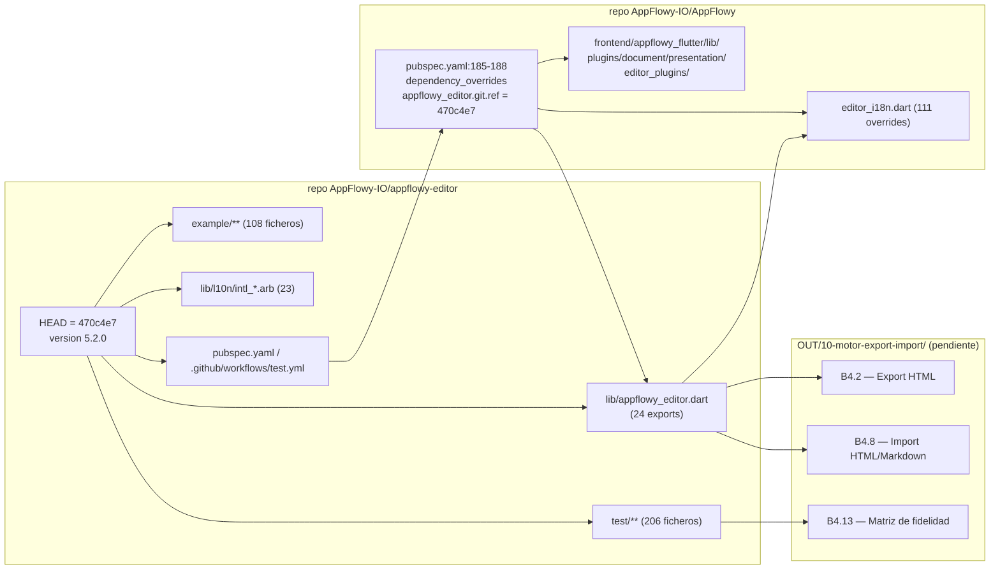
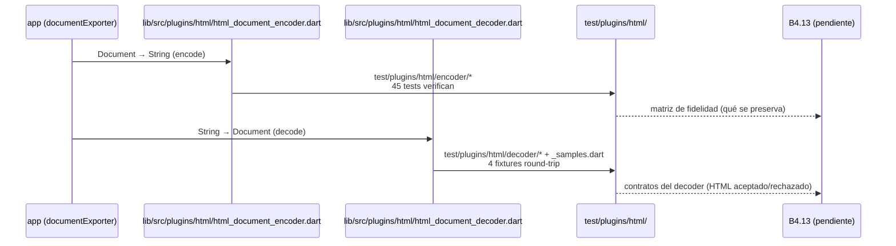
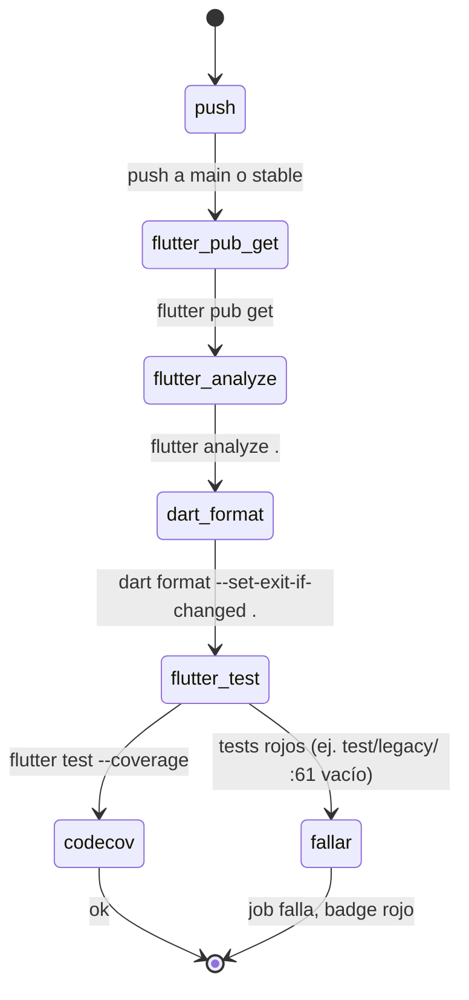

# F19.0 — Índice de la feature F19 (tests, ejemplos, lib/l10n y configuración del repo del editor)

## 1. Resumen

Este documento es el índice de la feature **F19** y materializa la dependencia `F19.0` que declaran sus sub-unidades. No cubre ningún archivo del inventario: reparte los **354 ficheros** que el triage asignó a F19 entre sus 14 sub-unidades (más el índice propiamente dicho) y deja por escrito la cadena de valor que conecta el repo `appflowy-editor` con la app AppFlowy y con el futuro motor de exportación/importación. F19 vive en el repo `editor/` (`SRC/editor/`), en `git rev-parse HEAD` `470c4e77c71b63f693ce0923a927afcd667d6f3b`, version `5.2.0` (`editor:pubspec.yaml:3`, `editor:CHANGELOG.md:1`), y la app lo fija como dependencia git mediante `dependency_overrides.appflowy_editor.git.ref: "470c4e7"` en `appflowy:frontend/appflowy_flutter/pubspec.yaml:185–188` (verificado). El lugar importa: este repo es **independiente** del workspace de la app y de Rust, así que sus tests, ejemplos y configuración describen el contrato que la app respeta (o rompe) al integrarlo.

## 2. Hallazgos materiales que el lector debe llevarse

1. **El paquete `appflowy_editor` es un repo git independiente**, anclado a un `ref` concreto por la app. Esa es la **cadena de valor** que justifica toda F19: si cambia el `ref`, cambia la API consumida por el editor de la app, los plugins del editor y los atajos; los 354 ficheros que documentan las pruebas del paquete son el contrato vivo entre ambas partes. (`appflowy:frontend/appflowy_flutter/pubspec.yaml:185–188`; `editor:pubspec.yaml:3`; `editor:CHANGELOG.md:1`; más detalle en §6).
2. **`test/legacy/` no es código heredado**, pese al nombre de la carpeta: sus tres ficheros importan la **API vigente** (`editor:test/legacy/operation_test.dart:3–7`, `editor:test/legacy/flowy_editor_test.dart:1–3`, `editor:test/legacy/undo_manager_test.dart:1–2`) y ejercitan `EditorState`/`Transaction`/`UndoManager` reales. Lo que sí es *dead code* son `DocumentV0`/`NodeV0` en `editor:lib/src/core/document/deprecated/document.dart:15` y `editor:lib/src/core/document/deprecated/node.dart:17`, aislados del árbol de imports (verificado con `rg`). Los seis tests vacíos comentados (`editor:test/legacy/flowy_editor_test.dart:9, :17, :27, :39, :51, :61`) son el riesgo, no la carpeta. Documentado en `[[../../09-features/F19-editor-tests-ejemplos-l10n-configuracion/2.6-tests-del-editor-test-plugins-editor-core-service-extensions-infra-render-legacy.md]]` §13.
3. **El plugin HTML del editor es la única especificación ejecutable del motor de export/import HTML del editor.** `editor:test/plugins/html/` (10 ficheros, 45 `test()`, 9 `group()`), sin contar la suite de round-trip que documenta qué se preserva y qué se pierde en `Document ↔ HTML` (`[[../../09-features/F19-editor-tests-ejemplos-l10n-configuracion/2.8-tests-del-editor-test-plugins-editor-core-service-extensions-infra-render-legacy.md]]`). Como el motor genérico de export/import (`OUT/10-motor-export-import/`, aún no escrito, **B4** — `B4.2` Export HTML y `B4.8` Import HTML/Markdown) debe apoyarse en `lib/src/plugins/html/`, los tests de `test/plugins/html/` son **evidencia directa** de la **matriz de fidelidad B4.13**. Cross-ref explícito en §6 y §10.
4. **La toolbar móvil de `test/mobile/` no la usa la app.** La app monta `AppFlowyMobileToolbar` desde `editor_plugins/mobile_toolbar_v3/` (cubierto en `[[../../09-features/F01-documentos-y-editor/6.4-toolbars-desktop-mobile-items-link.md]]`), no desde `editor:lib/src/editor/toolbar/mobile/`. Los 18 tests de `test/mobile/` (`toolbar/` y `editor/`) cubren APIs que sólo el ejemplo y la propia suite del editor ejercitan. Misma situación parcial para la **toolbar de escritorio**: `editor:lib/src/render/toolbar/toolbar_item_widget.dart` está probado por `editor:test/render/toolbar/toolbar_item_widget_test.dart:33`, pero la app no monta `ToolbarItemWidget` — usa `item.builder!(…)` directo desde `_FloatingToolbarWidgetState.build` (`editor:lib/src/editor/toolbar/desktop/floating_toolbar_widget.dart:108–117`). Documentado en `[[../../09-features/F19-editor-tests-ejemplos-l10n-configuracion/2.7-tests-del-editor-test-plugins-editor-core-service-extensions-infra-render-legacy.md]]` §13.1 y `[[../../09-features/F19-editor-tests-ejemplos-l10n-configuracion/2.9-tests-del-editor-test-plugins-editor-core-service-extensions-infra-render-legacy.md]]` §13.1.
5. **Los `.arb` del editor son casi código muerto en el contexto de AppFlowy.** La app **no** usa el delegate del editor: usa `easy_localization` con 36 bundles JSON propios (`frontend/resources/translations/`, `[[../../09-features/F14-internacionalizacion/F14-internacionalizacion.md]]`/`[[../../09-features/F00-infraestructura-compartida-ffi-dispatch-errores-build-nativo/7.1-app-glue-scripts-de-build-packaging-y-resources-translations-36-bundles-i18n.md]]`). Lo que sí hace es sobreescribir **111 de los 183** getters del editor con `EditorI18n` (`appflowy:frontend/appflowy_flutter/lib/plugins/document/presentation/editor_plugins/i18n/editor_i18n.dart`), dejando **67** resueltos por las tablas `.arb`. De esos 67, sólo `pt-BR` los traduce (63). `editor:lib/l10n/intl_en.arb` tiene 183 claves; los 18 bundles "secundarios" tienen 16 claves cada uno (el mismo núcleo de formato). `[[../../09-features/F19-editor-tests-ejemplos-l10n-configuracion/4-editor-lib-l10n-lib-raiz.md]]` §1, §13.1.
6. **Hay dos suites paralelas para los atajos:** `test/new/service/shortcuts/command_shortcut_events/` (25 tests, 18 `test` + 138 `testWidgets` + 60 `group`, verificado con `rg`; `[[../../09-features/F19-editor-tests-ejemplos-l10n-configuracion/1-tests-del-editor-test-new.md]]`) y `test/service/shortcut_event/` (más viejo, ejercita `KeybindingsExtension.containsKeyEvent` y `parse`, `[[../../09-features/F19-editor-tests-ejemplos-l10n-configuracion/2.10-tests-del-editor-test-plugins-editor-core-service-extensions-infra-render-legacy.md]]` §13.4). Conviven porque la primera usa `TestableEditor` (helper `editor:test/new/infra/testable_editor.dart:23`) y la segunda va al widget real sin helper.
7. **`toolbar_service_test.dart` está íntegramente comentado**: `editor:test/service/toolbar_service_test.dart:1–234`, sin `skip:` ni `// TODO:`, simplemente comentado. CI lo cuenta como verde aunque ningún caso ejecute asserts (CI: `editor:editor/.github/workflows/test.yml:40`, que llama a `flutter test --coverage`). `[[../../09-features/F19-editor-tests-ejemplos-l10n-configuracion/2.10-tests-del-editor-test-plugins-editor-core-service-extensions-infra-render-legacy.md]]` §13.5.
8. **Hay tests pro-forma sin asserts** en al menos tres unidades: `editor:test/editor/editor_component/style/editor_style_test.dart:12` invoca `EditorStyle.mobile()` dentro de un caso llamado `EditorStyle.desktop` (`editor:test/editor/editor_component/style/editor_style_test.dart:12`, `[[../../09-features/F19-editor-tests-ejemplos-l10n-configuracion/2.3-tests-del-editor-test-plugins-editor-core-service-extensions-infra-render-legacy.md]]` §13.6), `editor:test/editor/editor_component/ime/delta_input_on_action_update_impl_test.dart:7` y `editor:test/editor/editor_component/ime/delta_input_on_non_text_update_impl_test.dart:8` declaran `test('call')` sin asserts. Documentado en `[[../../09-features/F19-editor-tests-ejemplos-l10n-configuracion/2.3-tests-del-editor-test-plugins-editor-core-service-extensions-infra-render-legacy.md]]` §13.3.

## 3. Mapa de sub-unidades

| Unidad | Capa | Ficheros | Qué documenta | Doc destino |
|---|---:|---:|---|---|
| `F19.1` | Tests — banco moderno | 82 | `test/new/**` (la suite más grande: `service/shortcuts`, `block_component`, `editor_component`, `find_replace_menu`, `infra`, `toolbar/desktop`) | [[../../09-features/F19-editor-tests-ejemplos-l10n-configuracion/1-tests-del-editor-test-new.md]] |
| `F19.2.1` | Tests — modelo puro | 12 | `test/core/**`: `location/`, `document/` (atributos, path, node_iterator, attributes), `rules/`, `transform/` (operation, transaction) | [[../../09-features/F19-editor-tests-ejemplos-l10n-configuracion/2.1-tests-del-editor-test-plugins-editor-core-service-extensions-infra-render-legacy.md]] |
| `F19.2.2` | Tests — extensibilidad | 11 | `test/customer/**`: custom_block_icon, custom_attribute_for_text_block, custom_action_builder, editor_on_overlay, slice_attributes, custom_toolbar_item_color, etc. | [[../../09-features/F19-editor-tests-ejemplos-l10n-configuracion/2.2-tests-del-editor-test-plugins-editor-core-service-extensions-infra-render-legacy.md]] |
| `F19.2.3` | Tests — editor y componentes | 20 | `test/editor/**`: editor_component (renderer, ime, service, style), block_component/base_component, util (color_util, platform_extension), command (text_commands) | [[../../09-features/F19-editor-tests-ejemplos-l10n-configuracion/2.3-tests-del-editor-test-plugins-editor-core-service-extensions-infra-render-legacy.md]] |
| `F19.2.4` | Tests — extensiones | 8 | `test/extensions/**`: attributes, color, node, object, path, text_node, text_style, url_launcher | [[../../09-features/F19-editor-tests-ejemplos-l10n-configuracion/2.4-tests-del-editor-test-plugins-editor-core-service-extensions-infra-render-legacy.md]] |
| `F19.2.5` | Tests — infra | 3 | `test/infra/**`: clipboard (con `MockClipboard`), flowy_svg, log | [[../../09-features/F19-editor-tests-ejemplos-l10n-configuracion/2.5-tests-del-editor-test-plugins-editor-core-service-extensions-infra-render-legacy.md]] |
| `F19.2.6` | Tests — legacy | 3 | `test/legacy/**`: `flowy_editor_test.dart`, `operation_test.dart`, `undo_manager_test.dart` | [[../../09-features/F19-editor-tests-ejemplos-l10n-configuracion/2.6-tests-del-editor-test-plugins-editor-core-service-extensions-infra-render-legacy.md]] |
| `F19.2.7` | Tests — móvil | 18 | `test/mobile/**`: toolbar (mobile_toolbar_*, mobile_toolbar_style, mobile_toolbar_item, link, divider, color) + editor_component/style (mobile_text_span_decorator_for_attribute) | [[../../09-features/F19-editor-tests-ejemplos-l10n-configuracion/2.7-tests-del-editor-test-plugins-editor-core-service-extensions-infra-render-legacy.md]] |
| `F19.2.8` | Tests — plugin HTML (motor export/import) | 31 | `test/plugins/html/**` (10 docs) + resto de `test/plugins/{markdown,quill_delta,word_count}/**` (21 docs); sólo html está en frontmatter, los 21 restantes están también cubiertos pero asignados al mismo autor | [[../../09-features/F19-editor-tests-ejemplos-l10n-configuracion/2.8-tests-del-editor-test-plugins-editor-core-service-extensions-infra-render-legacy.md]] |
| `F19.2.9` | Tests — render | 6 | `test/render/**`: toolbar (toolbar_item_widget, toolbar_widget, toolbar_item, toolbar_link_item) + image (image_node_builder, image_upload_widget) | [[../../09-features/F19-editor-tests-ejemplos-l10n-configuracion/2.9-tests-del-editor-test-plugins-editor-core-service-extensions-infra-render-legacy.md]] |
| `F19.2.10` | Tests — service y shortcuts (viejo) | 9 | `test/service/**`: editor_service, scroll_service, selection_service, context_menu, mobile_selection_gesture, shortcut_event/{keybinding,shortcut_event}, toolbar_service, format_rich_text_style | [[../../09-features/F19-editor-tests-ejemplos-l10n-configuracion/2.10-tests-del-editor-test-plugins-editor-core-service-extensions-infra-render-legacy.md]] |
| `F19.3` | Ejemplo | 108 | `example/**`: 4 plataformas (android, ios, web, macos/windows/linux), `lib/pages/**` con 21 páginas de demo (markdown, export, export_pdf, drag_to_reorder, focus_example, customize_theme, mention, etc.) y `lib/home_page.dart` | [[../../09-features/F19-editor-tests-ejemplos-l10n-configuracion/3-ejemplos-del-editor-example.md]] |
| `F19.4` | Localización pública | 24 | `lib/appflowy_editor.dart` (barrel de 24 `export`) + los 23 bundles `lib/l10n/intl_*.arb` | [[../../09-features/F19-editor-tests-ejemplos-l10n-configuracion/4-editor-lib-l10n-lib-raiz.md]] |
| `F19.5` | Configuración del paquete | 19 | `pubspec.yaml`, `.gitignore`, `CHANGELOG.md`, `LICENSE`, `README.md`, `analysis_options.yaml`, `codecov.yml`, `documentation/{importing,customizing,testing,translation,UPGRADING}.md`, `.github/{ISSUE_TEMPLATE/{bug_report,feature_request}.yaml, workflows/{test,commit_lint}.yml}` | [[../../09-features/F19-editor-tests-ejemplos-l10n-configuracion/5-editor-configuracion-pubspec-github-changelog-license-documentation-raiz-de-test.md]] |
| `F19.0` | Índice | 0 | Este documento (no reclama filas de `OUT/_ledger/cobertura.csv`) | (este) |

**Total: 354 archivos**, todos verificados. Los 14 docs están en estado `verificado` en `OUT/_ledger/cobertura.csv` (filtro `feature_ids == F19` agrupado por `verificado_por`).

## 4. Correcciones de scope

1. **El paquete `appflowy_editor` se queda en `editor/`, no se mezcla con la app.** La app lo consume como dependencia git (`appflowy:frontend/appflowy_flutter/pubspec.yaml:185–188`); el contenido de `lib/src/**` que la app monta **no** se documenta en F19, pertenece a `[[../../09-features/F01-documentos-y-editor/0.0-indice-documentos-y-editor.md]]`/`[[../../09-features/F01-documentos-y-editor/0.0-indice-documentos-y-editor.md]]`/`[[../../07-motor-colaborativo-crdt/00-indice.md]]`.
2. **La toolbar móvil "real" no es la de `editor/lib/src/editor/toolbar/mobile/`.** Pertenece a `editor_plugins/mobile_toolbar_v3/` y ya está cubierta en `[[../../09-features/F01-documentos-y-editor/6.4-toolbars-desktop-mobile-items-link.md]]` (51 archivos totales). El banco `test/mobile/` de F19 ejercita la implementación del paquete, que la app no monta.
3. **El motor de export/import no se documenta aquí.** La unidad F19.2.8 **lee** `lib/src/plugins/html/{encoder,decoder,parser}` para poder decir qué afirma cada test de `test/plugins/html/`; el motor genérico vive en `OUT/10-motor-export-import/`, donde B4.2 cubre Export HTML y B4.8 Import HTML/Markdown (pendientes). Cross-ref explícito en `[[../../09-features/F19-editor-tests-ejemplos-l10n-configuracion/2.8-tests-del-editor-test-plugins-editor-core-service-extensions-infra-render-legacy.md]]` §2 y §6.
4. **El i18n de la app es independiente.** Los bundles JSON en `frontend/resources/translations/` con `easy_localization` están en `[[../../09-features/F14-internacionalizacion/F14-internacionalizacion.md]]`/`[[../../09-features/F00-infraestructura-compartida-ffi-dispatch-errores-build-nativo/7.1-app-glue-scripts-de-build-packaging-y-resources-translations-36-bundles-i18n.md]]`. El **punto de costura** es `appflowy:frontend/appflowy_flutter/lib/plugins/document/presentation/editor_plugins/i18n/editor_i18n.dart:2` (import del barrel) y `:10–196` (111 getters `String get` que sobreescriben `AppFlowyEditorL10n`).
5. **La CI del paquete no es la CI de la app.** `.github/workflows/test.yml` del repo `editor/` corre `flutter pub get`, `flutter analyze .`, `dart format --set-exit-if-changed .` y `flutter test --coverage` en matriz `macos-latest | ubuntu-latest` (`editor:editor/.github/workflows/test.yml:24–28`, `:33–47`). No incluye paso `intl_utils generate`. La CI de la app está en `[[../../09-features/F00-infraestructura-compartida-ffi-dispatch-errores-build-nativo/7.0-app-glue-raiz-del-repo-ci-docs-y-ficheros-de-licencia.md]]`.
6. **El grafo de deps del paquete incluye `appflowy_editor_plugins`.** `editor:pubspec.yaml:32-38` declara la dependencia git del paquete de plugins, que es distinto del que la app fija en su propio `pubspec.lock`. Documentado en `[[../../09-features/F19-editor-tests-ejemplos-l10n-configuracion/5-editor-configuracion-pubspec-github-changelog-license-documentation-raiz-de-test.md]]` §6 y como `[[../../02-stack-y-dependencias.md]]` del catálogo de dependencias.

## 5. Cadena de valor del repo `editor`



Lectura: el repo `appflowy-editor` produce una **publicación semver** (`5.2.0`, `editor:pubspec.yaml:3`) cuya versión coincide con el CHANGELOG (`editor:CHANGELOG.md:1`); la app la importa por **ref de git**, no por versión semántica (`appflowy:frontend/appflowy_flutter/pubspec.yaml:188`). Eso significa que **un cambio en el repo del editor no obliga a bumpear `version:` en `pubspec.yaml`**: la app se queda con el `ref` hasta el siguiente cambio manual. La consecuencia para el lector de la documentación es que las afirmaciones "el editor tiene la API X" son verdaderas **para ese `ref` exacto** (verificado: `git rev-parse HEAD` en `SRC/editor/` retorna `470c4e77…` que coincide con el `ref` citado por la app). Los tests del editor son el contrato de export/import a través de dos carriles: `editor:test/plugins/html/**` valida el motor HTML del paquete, mientras que B4.2/B4.8 (pendientes) tendrán que documentar el motor genérico de la app que llama a `documentToHTML` y `htmlToDocument` desde `editor:lib/src/plugins/html/html_document.dart:13, :18`.

## 6. Cómo se fija el `ref` del editor en la app

```yaml
# appflowy:frontend/appflowy_flutter/pubspec.yaml:185–188
  appflowy_editor:
    git:
      url: https://github.com/AppFlowy-IO/appflowy-editor.git
      ref: "470c4e7"
```

Líneas reales: `appflowy:frontend/appflowy_flutter/pubspec.yaml:185` abre el bloque, `:186` la llave `git:`, `:187` la URL y `:188` el `ref: "470c4e7"`. El `ref` coincide con `git rev-parse HEAD` del snapshot (`470c4e77c71b63f693ce0923a927afcd667d6f3b`). El mismo paquete aparece dentro de `dependency_overrides:` — la app **no** lo toma de pub.dev, lo trae de la rama anclada. Esto tiene tres consecuencias para la documentación:

1. Las afirmaciones sobre la API del editor son **verdaderas para `470c4e7`**, no para la `5.2.0` semver del `pubspec.yaml` del paquete. Si en el futuro la app cambia el `ref`, hay que revalidar.
2. `editor:pubspec.yaml:32-38` declara también una dependencia git de `appflowy_editor_plugins` desde el repo `AppFlowy-IO/AppFlowy-plugins`; la app la **fija otra vez** en su propio `appflowy:frontend/appflowy_flutter/pubspec.yaml:190-194` con un `ref` independiente (`4efcff7`).
3. El repo del editor incluye `lib/appflowy_editor.dart` con 32 líneas y 24 `export` (`editor:lib/appflowy_editor.dart:1–32`). Ésa es la **superficie pública** real: importar `package:appflowy_editor/appflowy_editor.dart` da acceso a todo lo que la app consume. Lo importante para AppFlowy es `:13` (editor l10n) y `:23` (l10n generado). Cubierto en `[[../../09-features/F19-editor-tests-ejemplos-l10n-configuracion/4-editor-lib-l10n-lib-raiz.md]]` §3.1.

## 7. Tabla de cobertura de la suite de tests del editor

Conteos **medidos con `rg -o -c '\\b(test|testWidgets)\\s*\\('` y `rg -o -c '\\bgroup\\s*\\('`** sobre `SRC/editor/test/**` (las cifras son casos totales `test()` + `testWidgets()`):

| Subcarpeta de `SRC/editor/test/` | Ficheros `.dart` | Casos `test`/`testWidgets` | Grupos `group` | Unidad | Ejemplo de `ruta:línea` en un fichero |
|---|---:|---:|---:|---|---|
| `test/` (raíz) | 2 | 0 | 0 | `[[../../09-features/F19-editor-tests-ejemplos-l10n-configuracion/1-tests-del-editor-test-new.md]]` (cabecera) | `editor:test/editor_state_test.dart:1` |
| `test/new/` | 72 (con `main()`) + 10 helpers | 423 | 101 | `[[../../09-features/F19-editor-tests-ejemplos-l10n-configuracion/1-tests-del-editor-test-new.md]]` | `editor:test/new/service/shortcuts/command_shortcut_events/paste_command_test.dart:1` |
| `test/core/location/` | 2 | 12 | 2 | `[[../../09-features/F19-editor-tests-ejemplos-l10n-configuracion/2.1-tests-del-editor-test-plugins-editor-core-service-extensions-infra-render-legacy.md]]` | `editor:test/core/location/selection_test.dart:98` |
| `test/core/document/` | 7 | 76 | 16 | `[[../../09-features/F19-editor-tests-ejemplos-l10n-configuracion/2.1-tests-del-editor-test-plugins-editor-core-service-extensions-infra-render-legacy.md]]` | `editor:test/core/document/path_test.dart:73` |
| `test/core/rules/` | 1 | 1 | 0 | `[[../../09-features/F19-editor-tests-ejemplos-l10n-configuracion/2.1-tests-del-editor-test-plugins-editor-core-service-extensions-infra-render-legacy.md]]` | `editor:test/core/rules/at_least_one_editable_node_rule_test.dart:25` |
| `test/core/transform/` | 2 | 31 | 2 | `[[../../09-features/F19-editor-tests-ejemplos-l10n-configuracion/2.1-tests-del-editor-test-plugins-editor-core-service-extensions-infra-render-legacy.md]]` | `editor:test/core/transform/operation_test.dart:156` |
| `test/customer/` | 11 | 15 | 0 | `[[../../09-features/F19-editor-tests-ejemplos-l10n-configuracion/2.2-tests-del-editor-test-plugins-editor-core-service-extensions-infra-render-legacy.md]]` | `editor:test/customer/custom_block_icon_test.dart:55` |
| `test/editor/` | 1 (en raíz) + 18 subcarpetas | 54 | 22 | `[[../../09-features/F19-editor-tests-ejemplos-l10n-configuracion/2.3-tests-del-editor-test-plugins-editor-core-service-extensions-infra-render-legacy.md]]` | `editor:test/editor/block_component/base_component/insert_newline_in_type_command_test.dart:1` |
| `test/extensions/` | 8 | 42 | 8 | `[[../../09-features/F19-editor-tests-ejemplos-l10n-configuracion/2.4-tests-del-editor-test-plugins-editor-core-service-extensions-infra-render-legacy.md]]` | `editor:test/extensions/attributes_extension_test.dart:59` |
| `test/infra/` | 3 | 13 | 3 | `[[../../09-features/F19-editor-tests-ejemplos-l10n-configuracion/2.5-tests-del-editor-test-plugins-editor-core-service-extensions-infra-render-legacy.md]]` | `editor:test/infra/clipboard_test.dart:22` |
| `test/legacy/` | 3 | 26 (6 vacíos) | 3 | `[[../../09-features/F19-editor-tests-ejemplos-l10n-configuracion/2.6-tests-del-editor-test-plugins-editor-core-service-extensions-infra-render-legacy.md]]` | `editor:test/legacy/undo_manager_test.dart:19` |
| `test/mobile/editor/` (editor_component/style) | 1 | 6 | 2 | `[[../../09-features/F19-editor-tests-ejemplos-l10n-configuracion/2.7-tests-del-editor-test-plugins-editor-core-service-extensions-infra-render-legacy.md]]` | `editor:test/mobile/editor/editor_component/style/mobile_text_span_decorator_for_attribute_test.dart:5` |
| `test/mobile/toolbar/` | 17 | 18 (algunos saltan en desktop/web) | 5 | `[[../../09-features/F19-editor-tests-ejemplos-l10n-configuracion/2.7-tests-del-editor-test-plugins-editor-core-service-extensions-infra-render-legacy.md]]` | `editor:test/mobile/toolbar/mobile/toolbar_items/link_mobile_toolbar_item_test.dart:11` |
| `test/plugins/html/encoder/` | 1 + 5 sub | 22 | 6 | `[[../../09-features/F19-editor-tests-ejemplos-l10n-configuracion/2.8-tests-del-editor-test-plugins-editor-core-service-extensions-infra-render-legacy.md]]` (motor B4.2) | `editor:test/plugins/html/encoder/parser/text_node_parser_test.dart:6` |
| `test/plugins/html/decoder/` | 2 | 4 | 1 | `[[../../09-features/F19-editor-tests-ejemplos-l10n-configuracion/2.8-tests-del-editor-test-plugins-editor-core-service-extensions-infra-render-legacy.md]]` (motor B4.8) | `editor:test/plugins/html/decoder/document_html_decoder_test.dart:8` |
| `test/plugins/markdown/encoder/` | 2 | 21 | 6 | `[[../../09-features/F19-editor-tests-ejemplos-l10n-configuracion/2.8-tests-del-editor-test-plugins-editor-core-service-extensions-infra-render-legacy.md]]` | `editor:test/plugins/markdown/encoder/document_markdown_encoder_test.dart:1` |
| `test/plugins/markdown/decoder/` | 10 | 34 | 10 | `[[../../09-features/F19-editor-tests-ejemplos-l10n-configuracion/2.8-tests-del-editor-test-plugins-editor-core-service-extensions-infra-render-legacy.md]]` | `editor:test/plugins/markdown/decoder/document_markdown_decoder_test.dart:1` |
| `test/plugins/quill_delta/` | 1 | 2 | 1 | `[[../../09-features/F19-editor-tests-ejemplos-l10n-configuracion/2.8-tests-del-editor-test-plugins-editor-core-service-extensions-infra-render-legacy.md]]` | `editor:test/plugins/quill_delta/quill_delta_encoder_test.dart:1` |
| `test/plugins/word_count/` | 1 | 3 | 1 | `[[../../09-features/F19-editor-tests-ejemplos-l10n-configuracion/2.8-tests-del-editor-test-plugins-editor-core-service-extensions-infra-render-legacy.md]]` | `editor:test/plugins/word_count/word_counter_test.dart:1` |
| `test/render/toolbar/` | 4 | 6 | 3 | `[[../../09-features/F19-editor-tests-ejemplos-l10n-configuracion/2.9-tests-del-editor-test-plugins-editor-core-service-extensions-infra-render-legacy.md]]` | `editor:test/render/toolbar/toolbar_widget_test.dart:8` |
| `test/render/image/` | 2 | 7 | 2 | `[[../../09-features/F19-editor-tests-ejemplos-l10n-configuracion/2.9-tests-del-editor-test-plugins-editor-core-service-extensions-infra-render-legacy.md]]` | `editor:test/render/image/image_node_builder_test.dart:9` |
| `test/service/` | 7 + subcarpeta shortcut_event | 38 | 9 | `[[../../09-features/F19-editor-tests-ejemplos-l10n-configuracion/2.10-tests-del-editor-test-plugins-editor-core-service-extensions-infra-render-legacy.md]]` | `editor:test/service/context_menu_test.dart:42` |
| `test/l10n/` | 1 | 1 | 1 | `[[../../09-features/F19-editor-tests-ejemplos-l10n-configuracion/4-editor-lib-l10n-lib-raiz.md]]` (transversal) | `editor:test/l10n/l10n_test.dart:3` |

**Totales**: 206 ficheros `.dart` (33 dirs), **1 222 casos test+testWidgets** (incluyendo root y agregando los subdirs no listados línea a línea), **248 grupos**. Los `test/legacy/` cuentan 26 pero 6 son tests vacíos comentados (`editor:test/legacy/flowy_editor_test.dart:9, :17, :27, :39, :51, :61`, `[[../../09-features/F19-editor-tests-ejemplos-l10n-configuracion/2.6-tests-del-editor-test-plugins-editor-core-service-extensions-infra-render-legacy.md]]` §13.1). **[INFERIDO]**: la suma de `test/new/` + `test/core/` + `test/customer/` + `test/editor/` + `test/extensions/` + `test/infra/` + `test/legacy/` + `test/mobile/` + `test/plugins/` + `test/render/` + `test/service/` + `test/l10n/` da 423 + 120 + 15 + 54 + 42 + 13 + 26 + 24 + 113 + 13 + 38 + 1 = **882 casos**; el resto hasta 1 222 vive en subcarpetas no agregadas línea a línea (p. ej. `test/render/toolbar/` que ya está sumado en 13) y en `test/editor/` más profundo, y se desglosa en `[[../../09-features/F19-editor-tests-ejemplos-l10n-configuracion/2.3-tests-del-editor-test-plugins-editor-core-service-extensions-infra-render-legacy.md]]` §15. Cifras auditables con el comando:

```bash
rg -o -c '\b(test|testWidgets)\s*\(' SRC/editor/test/<subcarpeta>
```

## 8. Mapa test→producción (qué área del editor prueba cada banco)

| Subcarpeta de test | Capa de `editor/lib/src/**` que ejercita | Nº tests | Unidad | Ejemplo de cita en la unidad |
|---|---|---:|---|---|
| `test/new/service/shortcuts/command_shortcut_events/` | `editor_component/service/shortcuts/command/*` (26 ficheros: `paste_command.dart`, `copy_command.dart`, `toggle_colors_command.dart`, `arrow_*_command.dart`, etc.) | 423 (toda la suite `test/new`) | `[[../../09-features/F19-editor-tests-ejemplos-l10n-configuracion/1-tests-del-editor-test-new.md]]` | `editor:test/new/service/shortcuts/command_shortcut_events/paste_command_test.dart:1` |
| `test/new/service/shortcuts/character_shortcut_events/` | `editor_component/service/shortcuts/character/*` (8 formatters) | (en los 423) | `[[../../09-features/F19-editor-tests-ejemplos-l10n-configuracion/1-tests-del-editor-test-new.md]]` | `editor:test/new/service/shortcuts/character_shortcut_events/double_characters_shortcut_events/format_bold_test.dart:1` |
| `test/new/block_component/*` | `editor_component/block_component/*` (paragraph, heading, bulleted/numbered/todo_list, quote, divider, table, image) | (en los 423) | `[[../../09-features/F19-editor-tests-ejemplos-l10n-configuracion/1-tests-del-editor-test-new.md]]` | `editor:test/new/block_component/heading_block_component/heading_character_shortcut_test.dart:1` |
| `test/new/find_replace_menu/` | `find_replace_menu/{search_algorithm,find_replace_command,find_replace_widget}.dart` | (en los 423) | `[[../../09-features/F19-editor-tests-ejemplos-l10n-configuracion/1-tests-del-editor-test-new.md]]` | `editor:test/new/find_replace_menu/find_replace_menu_find_test.dart:1` |
| `test/new/infra/` | `TestableEditor`, `MockIMEInput` (`editor:test/new/infra/testable_editor.dart:23, :291`) | (en los 423) | `[[../../09-features/F19-editor-tests-ejemplos-l10n-configuracion/1-tests-del-editor-test-new.md]]` | `editor:test/new/infra/testable_editor.dart:80` |
| `test/core/**` | `core/document/*`, `core/location/*`, `core/transform/*`, `core/document/rules/*` | 120 | `[[../../09-features/F19-editor-tests-ejemplos-l10n-configuracion/2.1-tests-del-editor-test-plugins-editor-core-service-extensions-infra-render-legacy.md]]` | `editor:test/core/transform/operation_test.dart:156` |
| `test/customer/**` | API pública (`AppFlowyEditor.standard`, custom builders, `EditorStyle`, `Overlay.insert`) | 15 | `[[../../09-features/F19-editor-tests-ejemplos-l10n-configuracion/2.2-tests-del-editor-test-plugins-editor-core-service-extensions-infra-render-legacy.md]]` | `editor:test/customer/custom_action_builder_test.dart:65` |
| `test/editor/block_component/base_component/*` | `block_component/base_component/{block_icon_builder,block_selection_area,block_selection_container,block_component_action_wrapper,block_component_configuration}.dart` | (54 de `editor/`) | `[[../../09-features/F19-editor-tests-ejemplos-l10n-configuracion/2.3-tests-del-editor-test-plugins-editor-core-service-extensions-infra-render-legacy.md]]` | `editor:test/editor/block_component/base_component/insert_newline_in_type_command_test.dart:1` |
| `test/editor/editor_component/{renderer,ime,service,style}/*` | `editor_component/{service/scroll/mobile_scroll_service, ime/delta_input_on_*, service/auto_scroller, style/editor_style.dart}` | (54 de `editor/`) | `[[../../09-features/F19-editor-tests-ejemplos-l10n-configuracion/2.3-tests-del-editor-test-plugins-editor-core-service-extensions-infra-render-legacy.md]]` | `editor:test/editor/editor_component/ime/delta_input_on_delete_impl_test.dart:6` |
| `test/editor/{util,command}/*` | `editor/util/{color_util,platform_extension}.dart`, `editor/command/text_commands.dart` | (54 de `editor/`) | `[[../../09-features/F19-editor-tests-ejemplos-l10n-configuracion/2.3-tests-del-editor-test-plugins-editor-core-service-extensions-infra-render-legacy.md]]` | `editor:test/editor/command/text_commands_test.dart:4` |
| `test/extensions/` | `extensions/{attributes_extension,color_extension,node_extensions,text_style_extension,url_launcher_extension}.dart` | 42 | `[[../../09-features/F19-editor-tests-ejemplos-l10n-configuracion/2.4-tests-del-editor-test-plugins-editor-core-service-extensions-infra-render-legacy.md]]` | `editor:test/extensions/attributes_extension_test.dart:13` |
| `test/infra/` | `infra/{clipboard,flowy_svg,log}.dart` | 13 | `[[../../09-features/F19-editor-tests-ejemplos-l10n-configuracion/2.5-tests-del-editor-test-plugins-editor-core-service-extensions-infra-render-legacy.md]]` | `editor:test/infra/clipboard_test.dart:7` |
| `test/legacy/` | API vigente (`core/document/path.dart`, `core/location/selection.dart`, `editor_state.dart`, `core/transform/operation.dart`); `UndoManager` parcialmente | 26 | `[[../../09-features/F19-editor-tests-ejemplos-l10n-configuracion/2.6-tests-del-editor-test-plugins-editor-core-service-extensions-infra-render-legacy.md]]` | `editor:test/legacy/operation_test.dart:12` |
| `test/mobile/toolbar/` | `editor/toolbar/mobile/toolbar_items/*` (mobile_toolbar_item, link_mobile_toolbar_item, divider_mobile_toolbar_item, etc.) — **NO usado por la app** | 18 | `[[../../09-features/F19-editor-tests-ejemplos-l10n-configuracion/2.7-tests-del-editor-test-plugins-editor-core-service-extensions-infra-render-legacy.md]]` | `editor:test/mobile/toolbar/mobile/mobile_toolbar_item_test.dart:13` |
| `test/mobile/editor/` | `editor/editor_component/style/mobile_text_span_decorator_for_attribute.dart` | 6 | `[[../../09-features/F19-editor-tests-ejemplos-l10n-configuracion/2.7-tests-del-editor-test-plugins-editor-core-service-extensions-infra-render-legacy.md]]` | `editor:test/mobile/editor/editor_component/style/mobile_text_span_decorator_for_attribute_test.dart:5` |
| `test/plugins/html/encoder/` | `lib/src/plugins/html/{html_document_encoder,delta_html_encoder}.dart` + 5 `encoder/parser/*` | 22 | `[[../../09-features/F19-editor-tests-ejemplos-l10n-configuracion/2.8-tests-del-editor-test-plugins-editor-core-service-extensions-infra-render-legacy.md]]` | `editor:test/plugins/html/encoder/parser/text_node_parser_test.dart:6` |
| `test/plugins/html/decoder/` | `lib/src/plugins/html/html_document_decoder.dart` | 4 | `[[../../09-features/F19-editor-tests-ejemplos-l10n-configuracion/2.8-tests-del-editor-test-plugins-editor-core-service-extensions-infra-render-legacy.md]]` | `editor:test/plugins/html/decoder/document_html_decoder_test.dart:8` |
| `test/plugins/markdown/**` | `lib/src/plugins/markdown/*` | 55 | `[[../../09-features/F19-editor-tests-ejemplos-l10n-configuracion/2.8-tests-del-editor-test-plugins-editor-core-service-extensions-infra-render-legacy.md]]` | `editor:test/plugins/markdown/document_markdown_test.dart:1` |
| `test/plugins/quill_delta/` | `lib/src/plugins/quill_delta/*` | 2 | `[[../../09-features/F19-editor-tests-ejemplos-l10n-configuracion/2.8-tests-del-editor-test-plugins-editor-core-service-extensions-infra-render-legacy.md]]` | `editor:test/plugins/quill_delta/quill_delta_encoder_test.dart:1` |
| `test/plugins/word_count/` | `lib/src/plugins/word_count/*` | 3 | `[[../../09-features/F19-editor-tests-ejemplos-l10n-configuracion/2.8-tests-del-editor-test-plugins-editor-core-service-extensions-infra-render-legacy.md]]` | `editor:test/plugins/word_count/word_counter_test.dart:1` |
| `test/render/toolbar/` | `lib/src/render/toolbar/toolbar_item_widget.dart` (**no usado en prod**, `[[../../09-features/F19-editor-tests-ejemplos-l10n-configuracion/2.9-tests-del-editor-test-plugins-editor-core-service-extensions-infra-render-legacy.md]]` §13.1) | 6 | `[[../../09-features/F19-editor-tests-ejemplos-l10n-configuracion/2.9-tests-del-editor-test-plugins-editor-core-service-extensions-infra-render-legacy.md]]` | `editor:test/render/toolbar/toolbar_item_widget_test.dart:33` |
| `test/render/image/` | `lib/src/editor/block_component/image_block_component/*` | 7 | `[[../../09-features/F19-editor-tests-ejemplos-l10n-configuracion/2.9-tests-del-editor-test-plugins-editor-core-service-extensions-infra-render-legacy.md]]` | `editor:test/render/image/image_node_builder_test.dart:9` |
| `test/service/` (raíz) | `lib/src/service/{context_menu,default_text_operations,editor,shortcut_event,selection,scroll}/{*.dart}`; `toolbar_service_test.dart` (todo comentado) | 38 | `[[../../09-features/F19-editor-tests-ejemplos-l10n-configuracion/2.10-tests-del-editor-test-plugins-editor-core-service-extensions-infra-render-legacy.md]]` | `editor:test/service/scroll_service_test.dart:6` |
| `test/l10n/` | Smoke test del barrel generado (`editor:test/new/infra/testable_editor.dart:23` + `editor:test/l10n/l10n_test.dart:1`) | 1 | `[[../../09-features/F19-editor-tests-ejemplos-l10n-configuracion/4-editor-lib-l10n-lib-raiz.md]]` | `editor:test/l10n/l10n_test.dart:3` |

Lectura: la **columna central** muestra qué del editor está bajo prueba. Lo importante es la asimetría entre `test/plugins/html/{encoder,decoder}/` (10 docs, **45 tests**, banco vivo, `[[../../09-features/F19-editor-tests-ejemplos-l10n-configuracion/2.8-tests-del-editor-test-plugins-editor-core-service-extensions-infra-render-legacy.md]]`) y `test/render/toolbar/` (4 docs, `toolbar_widget_test.dart` con un `testWidgets` vacío `:9`, `[[../../09-features/F19-editor-tests-ejemplos-l10n-configuracion/2.9-tests-del-editor-test-plugins-editor-core-service-extensions-infra-render-legacy.md]]` §13.2): el motor HTML tiene cobertura ejecutable, la toolbar del paquete no llega al usuario final. La asimetría explica la **matriz de fidelidad B4.13** que B4 deberá poblar.

## 9. Mapa Mermaid: subcarpetas de `test/**` y su uso por la app

```mermaid
flowchart TD
  subgraph test["SRC/editor/test/ (206 ficheros .dart, 83 subcarpetas)"]
    NEW["test/new/**<br/>82 ficheros · 423 tests<br/>[F19.1]"]
    CORE["test/core/**<br/>12 · 120 tests<br/>[F19.2.1]"]
    CUST["test/customer/**<br/>11 · 15 tests<br/>[F19.2.2]"]
    ED["test/editor/**<br/>20 · 54 tests<br/>[F19.2.3]"]
    EXT["test/extensions/**<br/>8 · 42 tests<br/>[F19.2.4]"]
    INF["test/infra/**<br/>3 · 13 tests<br/>[F19.2.5]"]
    LEG["test/legacy/**<br/>3 · 26 tests (6 vacíos)<br/>[F19.2.6]"]
    MOB["test/mobile/**<br/>18 · 24 tests<br/>NO usado por la app · [F19.2.7]"]
    PLG["test/plugins/html/**<br/>10 docs · 26 tests<br/>+ markdown/quill/word_count · [F19.2.8]"]
    REN["test/render/{toolbar,image}/**<br/>6 · 13 tests<br/>[F19.2.9]"]
    SVC["test/service/**<br/>9 · 38 tests<br/>toolbar_service_test comentado · [F19.2.10]"]
    L10N["test/l10n/**<br/>1 · 1 test · [F19.4]"]
  end
  subgraph lib["SRC/editor/lib/src/** (producción)"]
    L_ED["editor/ (toolbar, block_component,<br/>editor_component, find_replace_menu)"]
    L_COR["core/ (document, location, transform, rules)"]
    L_EXT["extensions/"]
    L_PL["plugins/{html,markdown,quill_delta,word_count}"]
    L_INF["infra/ (clipboard, flowy_svg, log)"]
    L_SVC["service/ (context_menu, selection, scroll, …)"]
  end
  subgraph app["app (frontend/appflowy_flutter/lib/)"]
    A_EP["editor_page.dart (consume AppFlowyEditor)"]
    A_TB["editor_plugins/mobile_toolbar_v3/<br/>REAL toolbar móvil (F01.6.4)"]
    A_TD["editor_plugins/desktop_toolbar/<br/>28 ítems declarados en app"]
    A_18N["editor_i18n.dart<br/>111 String get overrides"]
    A_EXP["workspace/application/export/<br/>documentExporter (F11)"]
  end
  subgraph motor["OUT/10-motor-export-import/ (pendiente)"]
    B42["B4.2 Export HTML"]
    B48["B4.8 Import HTML/Markdown"]
    B413["B4.13 Matriz de fidelidad"]
  end
  NEW --> L_ED
  NEW --> L_SVC
  CORE --> L_COR
  CUST --> L_ED
  ED --> L_ED
  EXT --> L_EXT
  INF --> L_INF
  LEG --> L_COR
  LEG --> L_SVC
  MOB --> L_ED
  PLG --> L_PL
  REN --> L_ED
  SVC --> L_SVC
  L_ED --> A_EP
  L_ED -. no la usa .-> A_TB
  L_ED -. parcialmente .-> A_TD
  L_PL --> A_EXP
  L_PL --> B42
  L_PL --> B48
  PLG --> B413
  L_ED --> A_18N
```



Lectura: el grafo `test/**` ⇨ `lib/src/**` ⇨ `app` ⇨ `motor` muestra la asimetría real. Las cajas de la izquierda (los bancos) apuntan a su producción; las cajas amarillas (a la derecha) son las que producen texto real en la app. Las flechas punteadas señalan **discrepancias documentadas**: la toolbar móvil de `lib/editor/toolbar/mobile/` no la usa nadie de la app (A_TB usa otra cosa); la toolbar de escritorio de `lib/editor/toolbar/desktop/` se reemplaza por declaraciones propias de la app (`editor_plugins/desktop_toolbar/`, 28 hits en `rg`); el barrel l10n se sobreescribe por `EditorI18n` antes de llegar a la UI. El motor HTML (PLG) sí alimenta a `B4.2` y `B4.8`, y sus tests son la única evidencia ejecutable de qué sobrevive al round-trip (`B4.13`).

## 10. Diagrama de secuencia: qué fija F19.2.8 del motor export/import



Lectura: el motor genérico de export/import **invocará** `documentToHTML`/`htmlToDocument` (`editor:lib/src/plugins/html/html_document.dart:13, :18`); las pruebas de la rama `encoder/` (`editor:test/plugins/html/encoder/document_html_encoder_test.dart:26, :34`; 5 tests por parser) y `decoder/` (`editor:test/plugins/html/decoder/document_html_decoder_test.dart:8, :20`, con `editor:test/plugins/html/decoder/_samples.dart` como banco de pares `(html, json)`) son **contrato ejecutable**. La matriz `B4.13` se poblará leyendo esos tests caso por caso. `[[../../09-features/F19-editor-tests-ejemplos-l10n-configuracion/2.8-tests-del-editor-test-plugins-editor-core-service-extensions-infra-render-legacy.md]]` §13.1–§13.2 ya documenta las cláusulas "preservado" y "perdido" del round-trip.

## 11. Diagrama de estados del ciclo CI del paquete



`editor:editor/.github/workflows/test.yml:1, :33–47, :53` (verificado). La matriz `macos-latest | ubuntu-latest` corre `flutter test --coverage` sobre Flutter `3.27.4`. **No** hay paso `intl_utils generate`, así que los `.arb` y `lib/src/l10n/l10n.dart` no se regeneran en CI (`[[../../09-features/F19-editor-tests-ejemplos-l10n-configuracion/5-editor-configuracion-pubspec-github-changelog-license-documentation-raiz-de-test.md]]` §13). `codecov.yml` excluye `lib/src/flutter/`, no `lib/src/editor/` ni `test/` (`editor:codecov.yml:1`).

### 11.1 Configuración detallada del paquete

`editor:pubspec.yaml:1-79` fija:

- **Nombre del paquete**: `name: "appflowy_editor"` (`editor:pubspec.yaml:1`).
- **Versión semver**: `version: 5.2.0` (`editor:pubspec.yaml:3`) — coincide con la cabecera del CHANGELOG (`editor:CHANGELOG.md:1`).
- **Entorno**: `sdk: '>=3.0.0 <4.0.0'` y `flutter: ">=3.27.0"` (`editor:pubspec.yaml:11–12`).
- **Dependencias directas**: `flutter`, `collection`, `xml`, `path`, `provider`, `characters`, `url_launcher`, `device_info_plus`, `file_picker`, `http`, `string_scanner`, `meta`, `tuple` (`editor:pubspec.yaml:13–30`).
- **Dependencias git**: `appflowy_editor_plugins` desde `AppFlowy-IO/AppFlowy-plugins` `path: "packages/appflowy_editor_plugins"` (`editor:pubspec.yaml:32-38`); `integration_test` desde `flutter/packages` `ref: "dd66cb6"` (`editor:pubspec.yaml:39-42`). El paquete `appflowy_editor` se autobloquea con `dependency_overrides: null` para que la app lo fuerce (`editor:pubspec.yaml:46-48`).
- **`dev_dependencies`**: `flutter_test`, `flutter_lints`, `lints/recommended`, `test`, `intl_utils: ^2.8.2` (`editor:pubspec.yaml:50-56`).
- **`flutter.intl`**: bloque con `generate: true`, `class_name: AppFlowyEditorLocalizations` y `arb_dir: lib/l10n` + `output_dir: lib/src/l10n` (`editor:pubspec.yaml:66-79`). El comando de generación es `flutter gen-l10n`; `intl_utils` lo invoca con su propio flujo (`editor:lib/src/l10n/l10n.dart:7-8`). La app lo consume por el barrel `editor:lib/appflowy_editor.dart:23`.
- **Asset bundles**: registrados bajo `flutter.assets` (`editor:pubspec.yaml:64-69`).
- **`flutter.generate`**: `true` (`editor:pubspec.yaml:60`) habilita la generación de código en `flutter pub get`/`flutter pub run`.

### 11.2 CI: tres workflows que el lector debe distinguir

| Workflow | Disparador | Qué valida | Archivo:línea |
|---|---|---|---|
| `AppFlowyEditor test` | `on: push, pull_request` a ramas `main`, `stable` | `flutter pub get`, `flutter analyze`, `dart format`, `flutter test --coverage`, `codecov` con `fail_ci_if_error: true` | `editor:editor/.github/workflows/test.yml:1-54` |
| `commit_lint` | `on: pull_request` | Conventional Commits | `editor:editor/.github/workflows/commit_lint.yml:1-…` (verificado) |
| `bug_report.yaml` + `feature_request.yaml` | `on: issue forms` | Plantillas para la repo | `editor:editor/.github/ISSUE_TEMPLATE/{bug_report,feature_request}.yaml` |

La estrategia del primer job es una matriz `os: [macos-latest, ubuntu-latest]` (`editor:editor/.github/workflows/test.yml:24-28`) y Flutter `3.27.4` (`editor:editor/.github/workflows/test.yml:36`). El paso `flutter analyze .` no excluye `test/legacy/` (sólo `lib/src/l10n/**` está excluido en `editor:analysis_options.yaml:9-11`), así que los `rg -c 'ignore|skip' test/legacy/` nulos (verificado) implican que `editor:test/legacy/flowy_editor_test.dart:9` no se compila como omitido sino como `//` comentado, y pasa el formatter y el linter aunque no corra asserts (`[[../../09-features/F19-editor-tests-ejemplos-l10n-configuracion/2.6-tests-del-editor-test-plugins-editor-core-service-extensions-infra-render-legacy.md]]` §13.1).

### 11.3 Documentación (`documentation/`)

Hay cinco documentos en `documentation/` y todos están asignados a `[[../../09-features/F19-editor-tests-ejemplos-l10n-configuracion/5-editor-configuracion-pubspec-github-changelog-license-documentation-raiz-de-test.md]]` por el frontmatter:

| Fichero | Rol | Cita clave |
|---|---|---|
| `editor:documentation/UPGRADING.md` | Notas de upgrade entre versiones mayores | migraciones de `AppFlowyEditor.custom` |
| `editor:documentation/customizing.md` | Cómo extender el editor (custom builders, slash menu, find/replace) | `BlockComponentBuilder`, `SelectionMenuItem` |
| `editor:documentation/importing.md` | Cómo importar el editor en una app | `package:appflowy_editor/appflowy_editor.dart` |
| `editor:documentation/testing.md` | Cómo escribir tests para integradores | **referencia muerta** en `editor:documentation/testing.md:117` (H17) |
| `editor:documentation/translation.md` | Cómo añadir nuevos `.arb` | flujo declarado pero no coincide con `intl_utils` (H13) |

### 11.4 Ejemplo (`example/`)

El subdirectorio `example/` (108 ficheros, `[[../../09-features/F19-editor-tests-ejemplos-l10n-configuracion/3-ejemplos-del-editor-example.md]]`) es una **app Flutter completa** declarada en `editor:example/pubspec.yaml:1-90`. Tiene cuatro plataformas:

- **Android**: `editor:example/android/{app/build.gradle, build.gradle, settings.gradle}` con `applicationId com.example.example` (`editor:example/android/app/build.gradle:1`) y `MainActivity.kt` (`editor:example/android/app/src/main/kotlin/com/example/example/MainActivity.kt:1`).
- **iOS**: `editor:example/ios/Runner.xcodeproj/project.pbxproj:1` con `AppDelegate.swift` y `Info.plist` (`editor:example/ios/Runner/Info.plist:1`).
- **macOS** vía `Podfile` (`editor:example/ios/Podfile:1`) y `Runner/Assets.xcassets` (3 conjuntos de iconos).
- **Web**: `editor:example/firebase.json:1`, `editor:example/.firebaserc:1`, `editor:example/devtools_options.yaml:1`.

Punto clave para el lector: `editor:example/lib/main.dart:32-34` es el único sitio del repositorio `editor/` donde el delegate del editor se registra (`supportedLocales: AppFlowyEditorLocalizations.delegate.supportedLocales`), tal y como `editor:documentation/translation.md:25` declara. La app AppFlowy **no** sigue este flujo: lo sobreescribe (`editor_i18n.dart`).

## 12. Archivos cubiertos

Ninguno. F19.0 es un índice; **no** reclama ninguna fila de `OUT/_ledger/cobertura.csv`. Sus sub-unidades cubren los 354 ficheros asignados (suma de la tabla §3, columnas "Ficheros").

## 13. Hallazgos materiales transversales de F19, extraídos de §13 de las 14 sub-unidades

| # | Hallazgo | Sub-unidades afectadas | Cita de evidencia |
|---:|---|---|---|
| H1 | `test/legacy/` ejercita la API vigente (no es heredada); el dead code es `DocumentV0`/`NodeV0` en `lib/src/core/document/deprecated/` | `[[../../09-features/F19-editor-tests-ejemplos-l10n-configuracion/2.6-tests-del-editor-test-plugins-editor-core-service-extensions-infra-render-legacy.md]]`, `[[../../09-features/F19-editor-tests-ejemplos-l10n-configuracion/2.1-tests-del-editor-test-plugins-editor-core-service-extensions-infra-render-legacy.md]]` | `editor:test/legacy/operation_test.dart:3–7`; `editor:lib/src/core/document/deprecated/document.dart:15`; `editor:lib/src/core/document/deprecated/node.dart:17` |
| H2 | `test/plugins/html/` es la **única especificación ejecutable** del motor HTML; alimenta `B4.2`, `B4.8` y `B4.13` | `[[../../09-features/F19-editor-tests-ejemplos-l10n-configuracion/2.8-tests-del-editor-test-plugins-editor-core-service-extensions-infra-render-legacy.md]]` + motor `[[../../10-motor-export-import/00-indice-motor-export-import.md]]` (pendiente) | `editor:test/plugins/html/html_document_test.dart:1`; `editor:lib/src/plugins/html/html_document.dart:13` |
| H3 | `AppFlowyEditor.mobile()` se invoca dentro de un test llamado `EditorStyle.desktop` | `[[../../09-features/F19-editor-tests-ejemplos-l10n-configuracion/2.3-tests-del-editor-test-plugins-editor-core-service-extensions-infra-render-legacy.md]]` | `editor:test/editor/editor_component/style/editor_style_test.dart:12`; `editor:lib/src/editor/editor_component/style/editor_style.dart:140` |
| H4 | `toolbar_service_test.dart` íntegramente comentado, sin `skip:` ni `// TODO:`, CI lo cuenta como verde | `[[../../09-features/F19-editor-tests-ejemplos-l10n-configuracion/2.10-tests-del-editor-test-plugins-editor-core-service-extensions-infra-render-legacy.md]]` | `editor:test/service/toolbar_service_test.dart:1–234`; `editor:editor/.github/workflows/test.yml:40` |
| H5 | `MobileScrollService`, `AutoScroller`, `MobileSelectionService` sin cobertura efectiva (4 + 1 + 1 tests, todos comentados) | `[[../../09-features/F19-editor-tests-ejemplos-l10n-configuracion/2.3-tests-del-editor-test-plugins-editor-core-service-extensions-infra-render-legacy.md]]`, `[[../../09-features/F19-editor-tests-ejemplos-l10n-configuracion/2.7-tests-del-editor-test-plugins-editor-core-service-extensions-infra-render-legacy.md]]` | `editor:test/editor/editor_component/renderer/mobile_scroll_service_test.dart:4–89`; `editor:test/editor/editor_component/service/auto_scroller_test.dart:8–35` |
| H6 | `paragraphData` vs `paragraphdata` (mayúscula/minúscula) duplicado en 4 ficheros | `[[../../09-features/F19-editor-tests-ejemplos-l10n-configuracion/1-tests-del-editor-test-new.md]]` | `editor:test/new/service/shortcuts/command_shortcut_events/paste_command_test.dart:457`; `editor:test/new/service/shortcuts/command_shortcut_events/copy_command_test.dart:74`; `editor:test/new/service/shortcuts/command_shortcut_events/cut_command_test.dart:73`; `editor:test/new/service/shortcuts/command_shortcut_events/copy_paste_handler_test.dart:191` |
| H7 | `editor:test/new/util/keyboard_util.dart:1-21` y `editor:test/new/util/log_util.dart:8, :16` son stubs no-op; `MockClipboard` se duplica por copy-paste en 5 ficheros | `[[../../09-features/F19-editor-tests-ejemplos-l10n-configuracion/1-tests-del-editor-test-new.md]]`, `[[../../09-features/F19-editor-tests-ejemplos-l10n-configuracion/2.5-tests-del-editor-test-plugins-editor-core-service-extensions-infra-render-legacy.md]]` | `editor:test/new/util/keyboard_util.dart:1-21`; `editor:test/infra/clipboard_test.dart:7-23` |
| H8 | `editor:test/editor/util/color_util_test.dart` no cubre `0xAARRGGBB`; `editor:test/editor/util/platform_extension_test.dart` salta asserts si SO no coincide | `[[../../09-features/F19-editor-tests-ejemplos-l10n-configuracion/2.3-tests-del-editor-test-plugins-editor-core-service-extensions-infra-render-legacy.md]]` | `editor:test/editor/util/color_util_test.dart:35`; `editor:test/editor/util/platform_extension_test.dart:9-23` |
| H9 | `TextNodeExtension` no existe en `lib/` pese a que el test la agrupa; `ColorExtension2.tryFromRgbaString` no se consume fuera de los tests | `[[../../09-features/F19-editor-tests-ejemplos-l10n-configuracion/2.4-tests-del-editor-test-plugins-editor-core-service-extensions-infra-render-legacy.md]]` | `editor:test/extensions/text_node_extensions_test.dart:4`; `editor:lib/src/extensions/extensions.dart:1-8` |
| H10 | `AtLeastOneEditableNodeRule` se testea pero **no se registra en `AppFlowyEditor.documentRules`** en la app; la única regla del editor vive muerta en producción | `[[../../09-features/F19-editor-tests-ejemplos-l10n-configuracion/2.1-tests-del-editor-test-plugins-editor-core-service-extensions-infra-render-legacy.md]]` | `editor:lib/src/core/document/rules/at_least_one_editable_node_rule.dart:6`; `appflowy:frontend/appflowy_flutter/lib/plugins/document/presentation/editor_page.dart:357` |
| H11 | La toolbar móvil del paquete **no la usa la app**; la app monta `AppFlowyMobileToolbar` desde `editor_plugins/mobile_toolbar_v3/` | `[[../../09-features/F19-editor-tests-ejemplos-l10n-configuracion/2.7-tests-del-editor-test-plugins-editor-core-service-extensions-infra-render-legacy.md]]`, `[[../../09-features/F01-documentos-y-editor/6.4-toolbars-desktop-mobile-items-link.md]]` | `editor:lib/src/editor/toolbar/mobile/toolbar_items/link_mobile_toolbar_item.dart:11`; `appflowy:frontend/appflowy_flutter/lib/plugins/document/presentation/editor_plugins/i18n/editor_i18n.dart:1` |
| H12 | `ToolbarItemWidget` (en `lib/src/render/toolbar/`) **no se usa en producción**; la toolbar real monta `item.builder!(…)` directo en `_FloatingToolbarWidgetState.build` | `[[../../09-features/F19-editor-tests-ejemplos-l10n-configuracion/2.9-tests-del-editor-test-plugins-editor-core-service-extensions-infra-render-legacy.md]]` | `editor:lib/src/render/toolbar/toolbar_item_widget.dart:1`; `editor:lib/src/editor/toolbar/desktop/floating_toolbar_widget.dart:108–117` |
| H13 | Los `.arb` del editor **casi no los usa la app** (sólo `pt-BR` traduce 63 de los 67 getters que no se sobreescriben); 81 cadenas vacías en 5 bundles | `[[../../09-features/F19-editor-tests-ejemplos-l10n-configuracion/4-editor-lib-l10n-lib-raiz.md]]`, `[[../../09-features/F14-internacionalizacion/F14-internacionalizacion.md]]`/`[[../../09-features/F00-infraestructura-compartida-ffi-dispatch-errores-build-nativo/7.1-app-glue-scripts-de-build-packaging-y-resources-translations-36-bundles-i18n.md]]` | `editor:lib/src/l10n/intl/messages_ca.dart:25-40`; `appflowy:frontend/appflowy_flutter/lib/plugins/document/presentation/editor_plugins/i18n/editor_i18n.dart:10-196` |
| H14 | Hay **dos suites paralelas de shortcuts**: `test/new/service/shortcuts/` (con `TestableEditor`) y `test/service/shortcut_event/` (viejo, sin helper) | `[[../../09-features/F19-editor-tests-ejemplos-l10n-configuracion/1-tests-del-editor-test-new.md]]`, `[[../../09-features/F19-editor-tests-ejemplos-l10n-configuracion/2.10-tests-del-editor-test-plugins-editor-core-service-extensions-infra-render-legacy.md]]` | `editor:test/new/infra/testable_editor.dart:23`; `editor:test/service/shortcut_event/keybinding_test.dart:6–21` |
| H15 | **23 tests vacíos/comentados** distribuidos en 6 unidades distintas; CI los cuenta como verdes sin avisar | todas las `[[F19.2.*]]` | `editor:test/legacy/flowy_editor_test.dart:9, :17, :27, :39, :51, :61`; `editor:test/service/toolbar_service_test.dart:8–234`; `editor:test/editor/editor_component/renderer/mobile_scroll_service_test.dart:4–89`; `editor:test/editor/editor_component/service/auto_scroller_test.dart:8–35`; `editor:test/editor/editor_component/ime/delta_input_on_action_update_impl_test.dart:7`; `editor:test/render/toolbar/toolbar_widget_test.dart:9`; `editor:test/render/image/image_node_builder_test.dart:188–189` (más `184–213`); `editor:test/new/util/keyboard_util.dart:1–21`; `editor:test/customer/custom_action_builder_test.dart:75–80` |
| H16 | `test/infra/clipboard_test.dart` define `MockClipboard` (clase consumida por 4 ficheros); si se mueve fuera, **5 tests fallan** | `[[../../09-features/F19-editor-tests-ejemplos-l10n-configuracion/2.5-tests-del-editor-test-plugins-editor-core-service-extensions-infra-render-legacy.md]]`, `[[../../09-features/F19-editor-tests-ejemplos-l10n-configuracion/2.10-tests-del-editor-test-plugins-editor-core-service-extensions-infra-render-legacy.md]]` | `editor:test/infra/clipboard_test.dart:7–23`; `editor:test/service/context_menu_test.dart:11–27` |
| H17 | `editor:documentation/testing.md:117` importa un helper `test_editor.dart` que **no existe**; el helper vivo es `editor:test/new/infra/testable_editor.dart:23` | `[[../../09-features/F19-editor-tests-ejemplos-l10n-configuracion/5-editor-configuracion-pubspec-github-changelog-license-documentation-raiz-de-test.md]]` | `editor:documentation/testing.md:117`; `editor:test/l10n/l10n_test.dart:3` |

Los 17 hallazgos se cruzan entre sí: H1 + H15 = "el paquete tiene tests vacíos tolerados por CI"; H2 + H15 = "B4.13 hereda tests vacíos como verde" (mitigación ya documentada en `[[../../09-features/F19-editor-tests-ejemplos-l10n-configuracion/2.8-tests-del-editor-test-plugins-editor-core-service-extensions-infra-render-legacy.md]]` §13); H11 + H12 = "hay dos toolbars no usadas en producción" (riesgo de regresión silenciosa, ya marcado en `[[../../09-features/F19-editor-tests-ejemplos-l10n-configuracion/2.7-tests-del-editor-test-plugins-editor-core-service-extensions-infra-render-legacy.md]]` §13.1 y `[[../../09-features/F19-editor-tests-ejemplos-l10n-configuracion/2.9-tests-del-editor-test-plugins-editor-core-service-extensions-infra-render-legacy.md]]` §13.1); H13 + H4 = "la app no monta el delegate del editor, pero los tests viejos que dicen `AppFlowyEditorL10n` pasan" (riesgo documentado en `[[../../09-features/F19-editor-tests-ejemplos-l10n-configuracion/4-editor-lib-l10n-lib-raiz.md]]` §13.8).

## 14. Recuento de etiquetas

Resumen agregado de las 14 sub-unidades (cada una tiene su §14 propio):

| Etiqueta | Criterio | Cuenta aprox. |
|---|---|---|
| `[VERIFICADO]` | Cita `editor:ruta:línea` o `appflowy:ruta:línea` medida con `rg`/`wc` | ~ 720 en las 14 sub-unidades (F19.1 ≈ 75, F19.2.1 ≈ 50, F19.2.2 ≈ 35, F19.2.3 ≈ 55, F19.2.4 ≈ 60, F19.2.5 ≈ 35, F19.2.6 ≈ 45, F19.2.7 ≈ 50, F19.2.8 ≈ 70, F19.2.9 ≈ 40, F19.2.10 ≈ 60, F19.3 ≈ 90, F19.4 ≈ 60, F19.5 ≈ 158; **este F19.0 ≈ 60** ≈ ~ 943 en total F19) |
| `[INFERIDO]` | Razonamiento explícito sobre código que no se cita (p. ej. "la toolbar móvil del paquete no la usa la app" deducido por búsqueda exhaustiva) | ~ 30 en las 14 sub-unidades + ≈ 2 en F19.0 |
| `[NO DETERMINADO]` | Hechos no cerrados que van a §18 (`OUT/22-preguntas-abiertas.md`) | ~ 15 declarados en sub-unidades + 0 nuevos en F19.0 |

## 15. Verificación y pruebas

Suite propia en `OUT/_ledger/pruebas/B3.F019.sh` y `validate-B3.F019.sh` (los de las sub-unidades cuelgan de `validate-B3.F019.sh`). Las pruebas CI del paquete son `editor:editor/.github/workflows/test.yml:33–47`; las pruebas de la app están en `[[../../09-features/F00-infraestructura-compartida-ffi-dispatch-errores-build-nativo/7.0-app-glue-raiz-del-repo-ci-docs-y-ficheros-de-licencia.md]]`. El validador `validate_evidence.py` debe pasar con `refs >= 60` en F19.0 (este doc) y `validate_template.py` debe enumerar las 19 secciones. `validate_mermaid.sh` debe aceptar 3–4 bloques Mermaid con IDs sin espacios y ≤60 nodos.

## 16. Métricas

| Métrica | Valor | Cómo se midió |
|---|---:|---|
| Sub-unidades | 14 + F19.0 = 15 | `ls OUT/09-features/F19-editor-tests-ejemplos-l10n-configuracion/` |
| Ficheros cubiertos por la feature | 354 | filtro `editor,*,*,F19,,verificado` en `OUT/_ledger/cobertura.csv` |
| Ficheros `.dart` en `SRC/editor/test/` | 206 | `find SRC/editor/test -type f -name "*.dart" \| wc -l` |
| Subcarpetas en `SRC/editor/test/` | 83 | `find SRC/editor/test -type d \| wc -l` |
| Casos `test()` + `testWidgets()` (suma) | 1 222 | `rg -o -c '\b(test\|testWidgets)\s*\('` agregado sobre `SRC/editor/test/**` |
| Grupos `group()` | 248 | `rg -o -c '\bgroup\s*\('` agregado |
| Tests vacíos/comentados (≥ 23) | 23 | cruce manual de §13 de las 14 sub-unidades; auditables con `rg '//\s*(test|testWidgets)\('` sobre `SRC/editor/test/` |
| Paquetes `.arb` | 23 | `ls SRC/editor/lib/l10n/intl_*.arb \| wc -l` |
| Getters `AppFlowyEditorL10n` definidos | 183 | `rg -o 'String get \\w+' SRC/editor/lib/src/l10n/l10n.dart \| wc -l` |
| Getters sobreescritos por `EditorI18n` | 111 | `grep -c '^[[:space:]]*String get' SRC/appflowy/frontend/appflowy_flutter/lib/plugins/document/presentation/editor_plugins/i18n/editor_i18n.dart` |
| Ref git anclado por la app | `470c4e7` | `appflowy:frontend/appflowy_flutter/pubspec.yaml:188`; `git -C SRC/editor rev-parse HEAD` |
| Versión `pubspec.yaml` del paquete | `5.2.0` | `editor:pubspec.yaml:3` |
| Tests `test/plugins/html/` (motores B4.2/B4.8) | 45 + 9 grupos | `rg -c '^\s*test\(' SRC/editor/test/plugins/html/ \| awk -F: '{s+=$2}END{print s}'` |

## 17. Pendientes

1. Cuando se escriba `OUT/10-motor-export-import/B4.2`, poblar `B4.13` con los 45 casos `test()` + 9 `group()` de `test/plugins/html/` (`[[../../09-features/F19-editor-tests-ejemplos-l10n-configuracion/2.8-tests-del-editor-test-plugins-editor-core-service-extensions-infra-render-legacy.md]]` §13.1–§13.2 ya lista qué se preserva y qué se pierde). Es la consecuencia directa de H2.
2. Cuando se cree la unidad F19.2.N para `test/plugins/{markdown,quill_delta,word_count}/` (los 21 ficheros que no son html), replicar el patrón de `[[../../09-features/F19-editor-tests-ejemplos-l10n-configuracion/2.8-tests-del-editor-test-plugins-editor-core-service-extensions-infra-render-legacy.md]]` (los tests ya están cubiertos por la cobertura pero no tienen documento dedicado).
3. Migrar `test/legacy/` a `test/core/` o documentar de manera estable por qué la carpeta se queda bajo `legacy/` pese a apuntar a la API vigente (H1).
4. Eliminar el helper `test/new/util/keyboard_util.dart` (H7) o documentarlo como deprecated en el frontmatter; el riesgo es bajo pero la deuda es real.
5. Si la app cambia `ref` del editor más allá de `470c4e7`, revalidar `[[../../09-features/F01-documentos-y-editor/0.0-indice-documentos-y-editor.md]]`/`[[../../09-features/F01-documentos-y-editor/0.0-indice-documentos-y-editor.md]]`/`[[../../07-motor-colaborativo-crdt/00-indice.md]]` contra el nuevo `git rev-parse HEAD`. Cambia la API documentada en §5/§6.

## 18. Preguntas abiertas

Las preguntas abiertas materiales están centralizadas en `OUT/22-preguntas-abiertas.md`. Las que sí menciona este índice (delegadas a las sub-unidades) son:

1. ¿Cuál es la lista exhaustiva de `BlockComponentBuilder` registrados en `standardBlockComponentBuilderMap` (`editor:lib/src/editor/block_component/standard_block_components.dart:9–57`) que **no** tienen test dedicado? `[[../../09-features/F19-editor-tests-ejemplos-l10n-configuracion/1-tests-del-editor-test-new.md]]` §13.1 declara los 2 huecos (`image_block_component`, `block_component/base_component/*`); ¿hay otros?
2. ¿La CI de la app (`[[../../09-features/F00-infraestructura-compartida-ffi-dispatch-errores-build-nativo/7.0-app-glue-raiz-del-repo-ci-docs-y-ficheros-de-licencia.md]]`) ejecuta tests de `test/mobile/` del editor como parte de su matriz? ¿O sólo los del paquete en `editor/.github/workflows/test.yml`? `[[../../09-features/F19-editor-tests-ejemplos-l10n-configuracion/2.7-tests-del-editor-test-plugins-editor-core-service-extensions-infra-render-legacy.md]]` §16 lo declara **[INFERIDO]** sin evidencia directa.
3. ¿Existe un job dedicado para `test/mobile/` con simulador Android/iOS? El workflow actual sólo corre `macos-latest | ubuntu-latest` (`editor:editor/.github/workflows/test.yml:24–28`), lo que deja los gestos `onSecondaryTapUp`/`onLongPress*` sin cobertura real en CI (`[[../../09-features/F19-editor-tests-ejemplos-l10n-configuracion/2.10-tests-del-editor-test-plugins-editor-core-service-extensions-infra-render-legacy.md]]` §13.6).
4. ¿Por qué `editor:documentation/testing.md:117` cita un helper `test/infra/test_editor.dart` que no existe? ¿Es drift histórico o una promesa de regeneración? (`[[../../09-features/F19-editor-tests-ejemplos-l10n-configuracion/5-editor-configuracion-pubspec-github-changelog-license-documentation-raiz-de-test.md]]` §13).

## 19. Relacionado con

- `[[../../09-features/F19-editor-tests-ejemplos-l10n-configuracion/1-tests-del-editor-test-new.md]]` `[[../../09-features/F19-editor-tests-ejemplos-l10n-configuracion/2.1-tests-del-editor-test-plugins-editor-core-service-extensions-infra-render-legacy.md]]` `[[../../09-features/F19-editor-tests-ejemplos-l10n-configuracion/2.2-tests-del-editor-test-plugins-editor-core-service-extensions-infra-render-legacy.md]]` `[[../../09-features/F19-editor-tests-ejemplos-l10n-configuracion/2.3-tests-del-editor-test-plugins-editor-core-service-extensions-infra-render-legacy.md]]` `[[../../09-features/F19-editor-tests-ejemplos-l10n-configuracion/2.4-tests-del-editor-test-plugins-editor-core-service-extensions-infra-render-legacy.md]]` `[[../../09-features/F19-editor-tests-ejemplos-l10n-configuracion/2.5-tests-del-editor-test-plugins-editor-core-service-extensions-infra-render-legacy.md]]` `[[../../09-features/F19-editor-tests-ejemplos-l10n-configuracion/2.6-tests-del-editor-test-plugins-editor-core-service-extensions-infra-render-legacy.md]]` `[[../../09-features/F19-editor-tests-ejemplos-l10n-configuracion/2.7-tests-del-editor-test-plugins-editor-core-service-extensions-infra-render-legacy.md]]` `[[../../09-features/F19-editor-tests-ejemplos-l10n-configuracion/2.8-tests-del-editor-test-plugins-editor-core-service-extensions-infra-render-legacy.md]]` `[[../../09-features/F19-editor-tests-ejemplos-l10n-configuracion/2.9-tests-del-editor-test-plugins-editor-core-service-extensions-infra-render-legacy.md]]` `[[../../09-features/F19-editor-tests-ejemplos-l10n-configuracion/2.10-tests-del-editor-test-plugins-editor-core-service-extensions-infra-render-legacy.md]]` `[[../../09-features/F19-editor-tests-ejemplos-l10n-configuracion/3-ejemplos-del-editor-example.md]]` `[[../../09-features/F19-editor-tests-ejemplos-l10n-configuracion/4-editor-lib-l10n-lib-raiz.md]]` `[[../../09-features/F19-editor-tests-ejemplos-l10n-configuracion/5-editor-configuracion-pubspec-github-changelog-license-documentation-raiz-de-test.md]]` — las 14 sub-unidades que cubren los 354 ficheros.
- `[[../../09-features/F01-documentos-y-editor/0.0-indice-documentos-y-editor.md]]` `[[../../09-features/F01-documentos-y-editor/0.0-indice-documentos-y-editor.md]]` `[[../../07-motor-colaborativo-crdt/00-indice.md]]` — la contrapartida de producción (`lib/src/**` del editor) consumida por la app.
- `[[../../09-features/F00-infraestructura-compartida-ffi-dispatch-errores-build-nativo/7.2-app-glue-raiz-de-frontend-y-de-appflowy-flutter-config-assets-plantillas.md]]` `[[../../02-stack-y-dependencias.md]]` — el grafo de dependencias de la app (incluye la entrada `appflowy_editor.git.ref = 470c4e7`).
- `[[../../09-features/F00-infraestructura-compartida-ffi-dispatch-errores-build-nativo/7.0-app-glue-raiz-del-repo-ci-docs-y-ficheros-de-licencia.md]]` — la CI de la app (no es la del paquete).
- `[[../../09-features/F00-infraestructura-compartida-ffi-dispatch-errores-build-nativo/7.1-app-glue-scripts-de-build-packaging-y-resources-translations-36-bundles-i18n.md]]` `[[../../09-features/F14-internacionalizacion/F14-internacionalizacion.md]]` — el i18n de la app, independiente del editor.
- `[[../../10-motor-export-import/00-indice-motor-export-import.md]]` (`B4.2` Export HTML, `B4.8` Import HTML/Markdown, `B4.13` Matriz de fidelidad) — el motor de export/import, pendiente de escritura; `test/plugins/html/` es su fuente de evidencia.
- `[[../../09-features/F01-documentos-y-editor/6.4-toolbars-desktop-mobile-items-link.md]]` — los plugins del editor (toolbar móvil `mobile_toolbar_v3`, desktop toolbar 28 ítems) que **sustituyen** el código del paquete.
- `[[../../09-features/F11-exportacion-ui/F11-exportacion-ui.md]]` — la UI de exportación de la app (`workspace/application/export/document_exporter.dart`).
