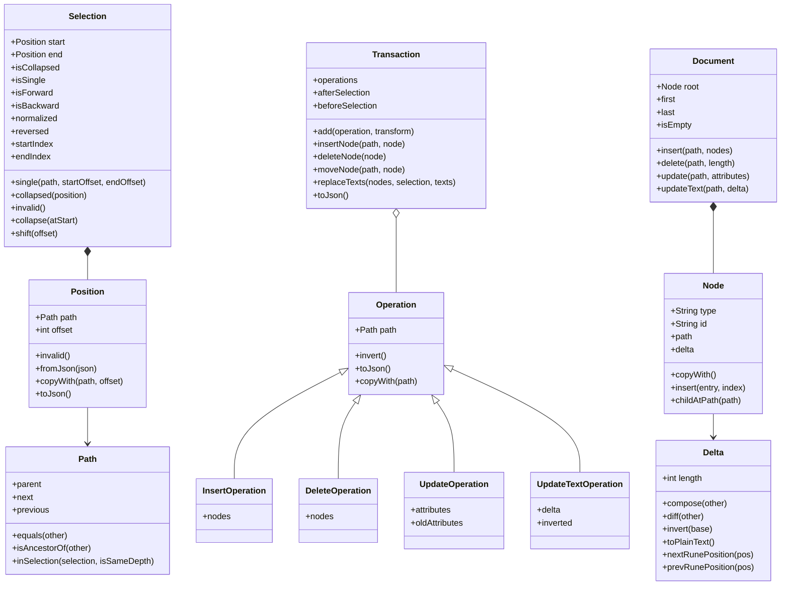
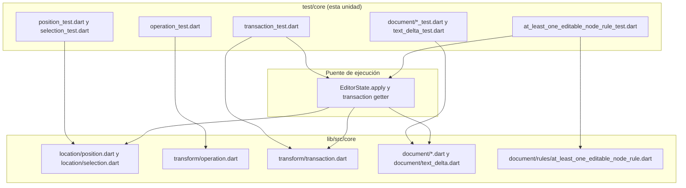
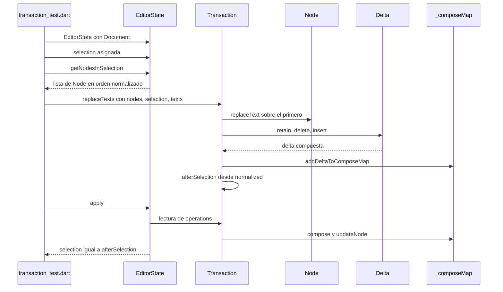
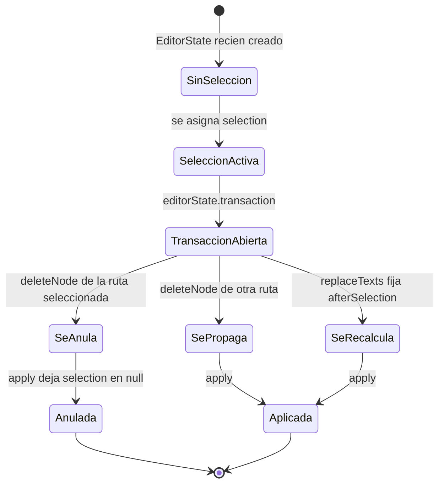

# F19.2.1 — Tests del editor: `test/core/` (location, rules, transform, document)

## 1. Resumen

Esta unidad cubre los 12 ficheros de `editor/test/core/`, el árbol de tests que ejerce el **modelo puro** del editor `appflowy_editor`: `Path`, `Position`, `Selection`, `Document`, `Node`, `NodeIterator`, `Delta`, `Attributes`, `diff`, `Operation` y `Transaction`, más la única regla de documento (`AtLeastOneEditableNodeRule`). Son 2 453 líneas, 120 casos `test()`/`testWidgets()` y 20 `group()` `[VERIFICADO]` (medido con `rg -c` sobre los 12 ficheros). Ninguno monta un widget de producción salvo dos casos que usan `testWidgets` sin necesitarlo; la mayoría opera sobre un `EditorState` real construido a mano. Este es el contrato que el resto del editor —slash menu, menú en línea, handlers de transacción— consume, así que sus aserciones fijan invariantes de los que dependen `[[../../09-features/F01-documentos-y-editor/6.1-slash-menu-elementos.md]]`, `[[../../09-features/F16-mobile/1.2.2-mobile-presentation-documento-editor-selection-menu-e-inline-actions.md]]` y `[[../../09-features/F01-documentos-y-editor/8-infraestructura-del-editor-transaction-handler-block-transaction-handler-migrati.md]]`.

## 2. Alcance

**Dentro**: los 12 ficheros listados en el frontmatter, que son la totalidad de `test/core/` (el árbol tiene exactamente 12 entradas en el inventario, verificado sobre `OUT/_ledger/inventario.json`).

**Fuera y hacia dónde va cada cosa**:

| Elemento | Motivo de exclusión | Unidad destino |
|---|---|---|
| `test/new/**` (82 ficheros) | Banco de tests moderno, helpers compartidos | `[[../../09-features/F19-editor-tests-ejemplos-l10n-configuracion/1-tests-del-editor-test-new.md]]` |
| `test/customer/**` (11) | Fixtures de cliente | `[[../../09-features/F19-editor-tests-ejemplos-l10n-configuracion/2.2-tests-del-editor-test-plugins-editor-core-service-extensions-infra-render-legacy.md]]` |
| `test/editor/**` (20) | Tests de `EditorState` y componentes | `[[../../09-features/F19-editor-tests-ejemplos-l10n-configuracion/2.3-tests-del-editor-test-plugins-editor-core-service-extensions-infra-render-legacy.md]]` |
| `test/extensions/**` (8) | Extensiones Dart sobre `Node`/`Position` | `[[../../09-features/F19-editor-tests-ejemplos-l10n-configuracion/2.4-tests-del-editor-test-plugins-editor-core-service-extensions-infra-render-legacy.md]]` |
| `test/infra/**` (3) | Clipboard, logging | `[[../../09-features/F19-editor-tests-ejemplos-l10n-configuracion/2.5-tests-del-editor-test-plugins-editor-core-service-extensions-infra-render-legacy.md]]` |
| `test/legacy/**` (3) | API heredada (`TextNode`, `Document.empty`) | `[[../../09-features/F19-editor-tests-ejemplos-l10n-configuracion/2.6-tests-del-editor-test-plugins-editor-core-service-extensions-infra-render-legacy.md]]` |
| `test/mobile/**` (18) | Servicios de selección móvil | `[[../../09-features/F19-editor-tests-ejemplos-l10n-configuracion/2.7-tests-del-editor-test-plugins-editor-core-service-extensions-infra-render-legacy.md]]` |
| `test/plugins/**` (31) | Atajos y comandos por bloque | `[[../../09-features/F19-editor-tests-ejemplos-l10n-configuracion/2.8-tests-del-editor-test-plugins-editor-core-service-extensions-infra-render-legacy.md]]` |
| `test/render/**` (6) | Widgets de selección/render | `[[../../09-features/F19-editor-tests-ejemplos-l10n-configuracion/2.9-tests-del-editor-test-plugins-editor-core-service-extensions-infra-render-legacy.md]]` |
| `test/service/**` (9) | IME, teclado, scroll | `[[../../09-features/F19-editor-tests-ejemplos-l10n-configuracion/2.10-tests-del-editor-test-plugins-editor-core-service-extensions-infra-render-legacy.md]]` |
| `example/**` | App de ejemplo del editor | `[[../../09-features/F19-editor-tests-ejemplos-l10n-configuracion/3-ejemplos-del-editor-example.md]]` |
| `lib/l10n/**` y raíz de `lib/` | Localización | `[[../../09-features/F19-editor-tests-ejemplos-l10n-configuracion/4-editor-lib-l10n-lib-raiz.md]]` |
| `pubspec.yaml`, `.github/workflows/test.yml`, raíz de `test/` | Configuración y CI | `[[../../09-features/F19-editor-tests-ejemplos-l10n-configuracion/5-editor-configuracion-pubspec-github-changelog-license-documentation-raiz-de-test.md]]` |

Correcciones de scope declaradas: (a) la unidad **no** cubre ningún fichero de `test/new/**` aunque `transaction_test.dart` importe `../../new/util/util.dart` (`editor:test/core/transform/transaction_test.dart:4`), es decir consume helpers de `[[../../09-features/F19-editor-tests-ejemplos-l10n-configuracion/1-tests-del-editor-test-new.md]]` sin duplicarlos; (b) el modelo `Node`/`Delta`/`Transaction` que estos tests ejercitan está documentado como producción en `[[../../09-features/F01-documentos-y-editor/0.0-indice-documentos-y-editor.md]]` y `[[../../07-motor-colaborativo-crdt/00-indice.md]]`, aquí sólo se documenta **la superficie que los tests fijan**; (c) el uso real del editor en la app y sus plugins vive en `[[../../09-features/F01-documentos-y-editor/0.0-indice-documentos-y-editor.md]]`/`[[../../09-features/F16-mobile/0-indice-mobile-shell-de-la-app-editor-movil-y-capas-de-presentacion.md]]`.

## 3. Modelos de datos

Los tipos bajo prueba viven en `editor/lib/src/core/`, un árbol puro de Dart re-exportado por `editor:lib/src/core/core.dart:1–16` (16 entradas, sin dependencias de Flutter: los únicos enlaces externos son `package:collection`, para `DeepCollectionEquality` en `diff.dart`, y `nanoid`, para los identificadores de nodo en `node.dart`).

*Diagrama: el modelo puro que `test/core/` somete a prueba.* Lectura: `Path` es un `List<int>` (alias, `editor:lib/src/core/document/path.dart:6`) que se compara lexicográficamente con operadores redefinidos (`editor:lib/src/core/document/path.dart:13–61`); `Position` lo envuelve con un `offset` (`editor:lib/src/core/location/position.dart:3–10`); `Selection` es **direccional** por diseño —el propio doc-comment declara que `forward` significa "el final va antes que el inicio" (`editor:lib/src/core/location/selection.dart:4–10`)— y todo consumidor debe pasar por `normalized` antes de calcular longitudes (`editor:lib/src/core/location/selection.dart:86–97`). Encima, `Operation` es una clase *sealed* con cuatro subtipos cerrados (`editor:lib/src/core/transform/operation.dart:5`) y `Transaction` los acumula más dos selecciones (`before`/`after`). `Document` y `Node` son el árbol; `Node.delta` se materializa bajo demanda leyendo el atributo `'delta'` (`editor:lib/src/core/document/node.dart:234–239`).

### 3.1 `Position` — API fijada por `position_test.dart`

Cinco casos (`editor:test/core/location/position_test.dart:8`, `:15`, `:23`, `:30`, `:50`). Fijan cuatro invariantes: (1) `Position.invalid()` es el centinela `path = [-1], offset = -1` (`editor:lib/src/core/location/position.dart:12–14`), que ningún otro código debe comparar como posición válida; (2) `operator ==` es **estructural**, no referencial, y `hashCode` es consistente con él —`Object.hash(offset, Object.hashAll(path))` (`editor:lib/src/core/location/position.dart:27–36`); (3) el formato de `toString()` es exactamente `'path = $path, offset = $offset'` (`editor:lib/src/core/location/position.dart:39`), formato del que dependen los mensajes de error; (4) `copyWith` sólo sustituye lo que se le pasa (`editor:lib/src/core/location/position.dart:41–46`) y `toJson`/`fromJson` son simétricos con las claves `'path'` y `'offset'` (`editor:lib/src/core/location/position.dart:16–24`, `:48–53`). Caso límite cubierto: `editor:test/core/location/position_test.dart:50` decodifica un JSON real con `jsonDecode` y comprueba `path.first`, es decir la forma en que una posición se materializa desde un atributo serializado; el consumidor real de esa vía es el bloque de IA, que reconstruye la selección con `Selection.fromJson` (`appflowy:frontend/appflowy_flutter/lib/plugins/document/presentation/editor_plugins/ai/operations/ai_writer_node_extension.dart:19`, cubierto en `[[../../09-features/F01-documentos-y-editor/9-ia-en-el-editor-editor-plugins-ai-ai-writer-completion-enlaza-con-f09.md]]`/`[[../../09-features/F09-ia/4-ia-editor-plugins-ai.md]]`).

### 3.2 `Selection` — API fijada por `selection_test.dart`

Siete casos (`editor:test/core/location/selection_test.dart:8`, `:15`, `:27`, `:52`, `:67`, `:82`, `:98`). Las invariantes que se pueden declarar `[VERIFICADO]` a partir del código y las aserciones son:

- **Direccionalidad**: con `start.path = [0,1,2]` y `end.path = [1,2,3]`, `isBackward` es `true` y el `Selection` con extremos intercambiados tiene `isForward` (`editor:lib/src/core/location/selection.dart:78–83`), comprobado en `editor:test/core/location/selection_test.dart:52–65`. `reversed` intercambia extremos (`editor:lib/src/core/location/selection.dart:89`) y `normalized` devuelve una selección ya orientada hacia delante (`editor:lib/src/core/location/selection.dart:86`), ambas asercionadas en la misma línea del test.
- **Longitud medida sobre la selección normalizada**: `startIndex`/`endIndex` leen de `normalized` (`editor:lib/src/core/location/selection.dart:92–95`); el test usa dos posiciones con `offset: 3` y comprueba que ambos índices valen 3 (`editor:test/core/location/selection_test.dart:63–64`), es decir que la normalización no altera el offset.
- **Colapso explícito**: `collapse(atStart: true)` fija `end = start` y `collapse(atStart: false)` fija `start = end` (`editor:lib/src/core/location/selection.dart:103–109`), verificado en `editor:test/core/location/selection_test.dart:67–80`.
- **Constructores equivalentes**: `Selection(start: p, end: p)` debe ser igual a `Selection.collapsed(p)` y compartir `hashCode` (`editor:test/core/location/selection_test.dart:29–32`); `Selection.single(...)` sin `endOffset` también colapsa (`editor:lib/src/core/location/selection.dart:31–36`), comprobado en `editor:test/core/location/selection_test.dart:46–49`.
- **Round-trip JSON**: `toJson` anida dos `Position` (`editor:lib/src/core/location/selection.dart:118–123`) y `fromJson` las reconstruye (`editor:lib/src/core/location/selection.dart:18–23`), verificado en `editor:test/core/location/selection_test.dart:82` y `:98`.

### 3.3 `Operation` — invierte, serializa y desplaza rutas

Trece casos (`editor:test/core/transform/operation_test.dart:6` … `:156`). La invariante central es la **involutividad del inverso**: `op.invert().invert() == op` para los cuatro subtipos (`editor:test/core/transform/operation_test.dart:57`, `:71`, `:90`, `:112`). El par `InsertOperation.invert() == DeleteOperation(path, nodes)` (`editor:lib/src/core/transform/operation.dart:43`) y `DeleteOperation.invert() == InsertOperation(path, nodes)` (`editor:lib/src/core/transform/operation.dart:90`) es lo que hace que undo/redo sea simétrico; `UpdateOperation.invert()` intercambia `attributes` y `oldAttributes` (`editor:lib/src/core/transform/operation.dart:142–146`) y `UpdateTextOperation.invert()` intercambia `delta` e `inverted` (`editor:lib/src/core/transform/operation.dart:201`). La serialización se fija con claves discriminantes `'insert'`, `'delete'`, `'update'`, `'update_text'` (`editor:lib/src/core/transform/operation.dart:48`, `:95`, `:151`, `:206`), que son las que el `TransactionAdapter` de la app consume al traducirlas a `BlockActionPB` (ver §8).

`Operation.fromJson()` **no existe como fábrica útil**: la clase base la declara `throw UnimplementedError()` (`editor:lib/src/core/transform/operation.dart:10`) y el test lo comprueba explícitamente (`editor:test/core/transform/operation_test.dart:6–8`), mientras que cada subtipo sí trae su `factory …fromJson` (`editor:lib/src/core/transform/operation.dart:32`, `:79`, `:127`, `:190`).

`transformOperation(a, b)` es la pieza que evita colisiones de rutas al encadenar operaciones en una misma transacción (`editor:lib/src/core/transform/operation.dart:255–272`); los cuatro casos finales del fichero la recorren (`:116`, `:130`, `:144`, `:156`) y cubren el desplazamiento por inserción (`:257`), el desplazamiento negativo por borrado (`:267`), el caso ancestro (`editor:lib/src/core/transform/operation.dart:261–265`) y el *fallback* que devuelve `b` intacto (`editor:lib/src/core/transform/operation.dart:271`). `transformPath` es la función que materializa ese desplazamiento (`editor:lib/src/core/transform/operation.dart:232–253`).

### 3.4 `Transaction` — la invariante de la selección

Dieciocho casos (`editor:test/core/transform/transaction_test.dart:8` … `:585`). La propiedad más importante que fijan es que **`afterSelection` nunca apunta a un nodo borrado y siempre se recalcula desde la selección normalizada**:

- `deleteNode` sólo propaga `beforeSelection` si la ruta del nodo borrado difiere de `beforeSelection.start.path` (`editor:lib/src/core/transform/transaction.dart:95–104`). El par de tests `editor:test/core/transform/transaction_test.dart:251` y `:286` demuestra las dos ramas: si se borra un nodo *no* seleccionado la selección se conserva intacta; si se borra el nodo seleccionado, `afterSelection` queda en `null` y `EditorState.apply` deja `selection = null` (`editor:lib/src/editor_state.dart:442–450`).
- `replaceTexts` despacha a tres ramas según `nodes.length` frente a `texts.length` (`editor:lib/src/core/transform/transaction.dart:381–413`) y las tres calculan `afterSelection` a partir de `normalized` (`editor:lib/src/core/transform/transaction.dart:496–500`, `:562–571`, `:652–661`). Los tests cubren los cinco casos de cardinalidad (`editor:test/core/transform/transaction_test.dart:104`, `:134`, `:162`, `:190`, `:217`) y tres de "selección posterior" con nodos anidados (`:464`, `:530`, `:585`), que son exactamente el contrato que necesita la edición multi-bloque.
- `Transaction.add` **transforma** cada operación nueva contra las ya presentes (`editor:lib/src/core/transform/transaction.dart:155–186`, en particular `:171–178`), fusiona `UpdateTextOperation` adyacentes sobre la misma ruta (`:159–169`) y descarta operaciones de texto vacías (`:179–181`). El test `set operations` (`editor:test/core/transform/transaction_test.dart:8–25`) comprueba que `operations` se puede leer y reasignar, y que `toJson` sólo incluye las claves con contenido (`editor:lib/src/core/transform/transaction.dart:136–148`), es decir devuelve `{}` para una transacción recién creada (`editor:test/core/transform/transaction_test.dart:92`).

### 3.5 `Delta`, `Attributes`, `diff` y el árbol

`text_delta_test.dart` es el fichero más denso de la unidad: 47 casos en 10 grupos (`editor:test/core/document/text_delta_test.dart:6–569`). Los grupos son `TextInsert`/`TextRetain`/`TextDelete` (igualdad y `hashCode`), `compose`, `invert`, `json`, `runes`, `attributes` y `diff`. Tres invariantes `[VERIFICADO]`:

- **Composabilidad con normalización**: los 19 casos del grupo `compose` (`:40–315`) enumeran las 9 combinaciones de `insert`/`retain`/`delete` más los casos límite de composition, inserción en medio del texto (`:227`), retain mayor que la longitud (`:261`) y las dos optimizaciones (`retain start`/`retain end`, `:268`, `:286`, `:298`). La implementación que las sustenta es `Delta.compose` con iteradores duales y optimizaciones explícitas (`editor:lib/src/core/document/text_delta.dart:333–399`).
- **Inversibilidad**: `base.compose(delta).compose(inverted) == base` en los tres casos `insert`, `delete`, `retain` (`editor:test/core/document/text_delta_test.dart:329`, `:342`, `:356`).
- **Unicode por runas, no por unidades UTF-16**: `nextRunePosition`/`prevRunePosition` (`editor:lib/src/core/document/text_delta.dart:566` y `:549`) se validan con emoji con ZWJ y con texto CJK/coreano (`editor:test/core/document/text_delta_test.dart:403–479`), incluyendo `prevRunePosition(0) == -1` (`:476–479`). Esto es lo que permite que las teclas de flecha y el menú en línea se comporten bien con emojis.

El resto de la unidad cubre el árbol: `Document.insert` devuelve `false` para rutas fuera de rango y `true` cuando la ruta ya existe (inserta *antes* del nodo existente) (`editor:lib/src/core/document/document.dart:103–125`, verificado en `editor:test/core/document/document_test.dart:6–24`); `Document.isEmpty` considera vacío un único párrafo con delta vacío o con `insert: ''` (`editor:lib/src/core/document/document.dart:177–193`, verificado en `editor:test/core/document/document_test.dart:89–154`); `Node.copyWith` genera **un `id` nuevo** (`editor:lib/src/core/document/node.dart:264–285`) y por eso los tests comparan `toJson()` y no identidad (que además excluye el `id`, `editor:lib/src/core/document/node.dart:241–257`); `Node.fromJson` lee los atributos de la clave `'data'` y **ignora** una `'delta'` suelta en el nivel superior (`editor:lib/src/core/document/node.dart:51–58`), que es justo lo que comprueba `editor:test/core/document/node_test.dart:179–199`; `Node.insert` acepta `index: -1` como "al principio" y satura índices mayores que la longitud (`editor:lib/src/core/document/node.dart:149–190`, verificado en `editor:test/core/document/node_test.dart:123–177`).

`diff_test.dart` (5 casos, `editor:test/core/document/diff_test.dart:29–185`) es el único puente entre el modelo de documentos y una transacción real: `diffDocuments` produce `Operation`s que se reinyectan con `EditorState.apply(transaction, isRemote: true)` (`editor:lib/src/editor_state.dart:398–418`), es decir por el mismo camino que una edición remota. Los casos de inserción y borrado continuos (`editor:test/core/document/diff_test.dart:107` y `:146`) verifican la fusión de operaciones contiguas de `diffNodes` (`editor:lib/src/core/document/diff.dart:49–103`).

## 4. Eventos FFI

Ninguno. Los 12 ficheros son Dart puro del repo `appflowy-editor` y no tocan `async_event` ni el dispatcher Rust. La traducción de `Operation`/`Transaction` a protobuf ocurre aguas arriba, en la app: `TransactionAdapter.apply(Transaction transaction, EditorState editorState)` (`appflowy:frontend/appflowy_flutter/lib/plugins/document/application/editor_transaction_adapter.dart:29`) llama a `transactionToBlockActions(transaction, editorState)` (`:54`) y de ahí salen los `BlockActionPB` que sí viajan por FFI. Catálogo completo en `OUT/11-catalogo-eventos-ffi.md` y detalle en `[[../../09-features/F01-documentos-y-editor/8-infraestructura-del-editor-transaction-handler-block-transaction-handler-migrati.md]]`.

## 5. Notificaciones

Ninguna propia. La única señal interna que los tests de `rules/` esperan es el `Stream<EditorTransactionValue>` que `EditorState` expone en `transactionStream` (`editor:lib/src/editor_state.dart:218`) y que alimenta el `before`/`after` de cada transacción (`:422`–`:437`). `AtLeastOneEditableNodeRule.shouldApply` sólo actúa en `TransactionTime.after` (`editor:lib/src/core/document/rules/at_least_one_editable_node_rule.dart:13–16`), y por eso su test necesita `await Future.delayed(const Duration(milliseconds: 100))` (`editor:test/core/rules/at_least_one_editable_node_rule_test.dart:25`) para dejar que el observer asíncrono dispare.

## 6. BLoCs / Cubits

Ninguno. El patrón de test es "estado real sin widget": `EditorState(document: document)` (`editor:lib/src/editor_state.dart:92`) y luego `await editorState.apply(transaction)` (`:398`). Sólo dos tests instancian el `DocumentRules` plumbing: el de `AtLeastOneEditableNodeRule` (`editor:test/core/rules/at_least_one_editable_node_rule_test.dart:19`) y, indirectamente, los de `transaction_test.dart`, que dependen de `_applyTransactionInLocal` (`editor:lib/src/editor_state.dart:686`) para materializar las operaciones. El `DocumentBloc`/`DocumentSyncBloc` de la app no aparece en esta unidad (ver `[[../../09-features/F01-documentos-y-editor/0.1-indice-de-documentos-y-editor-modelo-documentbloc-servicios-appflowy.md]]`).

## 7. Servicios e inyección de dependencias

No hay `get_it` ni contenedor: la dependencia se construye a mano en cada test. El "servicio" es `EditorState`, que resuelve internamente sus `InheritedWidget` de scroll/IME/teclado/selección sólo cuando hay widget; sin widget, `apply` funciona porque sólo toca `document`, `selection` y los streams de transacción (`editor:lib/src/editor_state.dart:398–456`). Los helpers compartidos vienen de `test/new/util/`: `Document.addParagraphs` (`editor:test/new/util/document_util.dart:6`) lo usan `editor:test/core/transform/transaction_test.dart:9`, `:105`, `:135`, `:163`, `:191` y `:218`, y `pageNode`, `paragraphNode`, `todoListNode` y `bulletedListNode` son fábricas de producción (`editor:lib/src/editor/editor_component/entry/page_block_component.dart:11`, `editor:lib/src/editor/block_component/paragraph_block_component/paragraph_block_component.dart:16`, `editor:lib/src/editor/block_component/todo_list_block_component/todo_list_block_component.dart:23`, `editor:lib/src/editor/block_component/bulleted_list_block_component/bulleted_list_block_component.dart:18`).

## 8. Persistencia

Ninguna. `test/core/` no toca SQLite, ni collab, ni fichero. Lo que sí se fija es el **contrato de salida** hacia la persistencia: `Transaction.toJson()` (`editor:lib/src/core/transform/transaction.dart:136–148`) es la serialización que el `TransactionAdapter` registra en log y traduce (`appflowy:frontend/appflowy_flutter/lib/plugins/document/application/editor_transaction_adapter.dart:29`–`:55`), y `Transaction.operations` se lee con efecto lateral: el getter compone los `Delta` pendientes antes de devolver la lista (`editor:lib/src/core/transform/transaction.dart:19–26`), lo que obliga a que el orden sea "leer `operations` → enviar" y explica el `markNeedsComposing` (`:48`).

## 9. Diagramas de flujo

El siguiente diagrama muestra qué fichero de test empuja qué fichero de producción, y qué papel juega el `EditorState` como puente compartido.

*Diagrama: acoplamiento test ↔ producción dentro de `test/core/`.* Lectura: `location/` y `transform/operation.dart` se prueban en aislamiento (puro, sin `EditorState`); `transaction_test.dart` y el test de la regla son los únicos que pasan por `EditorState.apply`, y por eso son los únicos que pueden comprobar el efecto agregado (dónde queda la selección y cómo queda el árbol). El único fichero que rompe la convención del resto es `text_delta_test.dart`, que importa `package:appflowy_editor/src/core/document/text_delta.dart` directamente (`editor:test/core/document/text_delta_test.dart:1–2`) aunque esos ficheros ya están exportados por el barrel (`editor:lib/appflowy_editor.dart:4` → `editor:lib/src/core/core.dart:1` y `:11`); acopla el test al layout interno del paquete en vez de a su API pública.

## 10. Diagramas de secuencia

La secuencia de un `replaceTexts` con más textos que nodos, tal y como la ejerce `editor:test/core/transform/transaction_test.dart:217`:

*Diagrama: el recorrido de un reemplazo multi-bloque.* Lectura: `replaceTexts` no muta nada directamente; acumula `Delta`s por nodo en `_composeMap` (`editor:lib/src/core/transform/transaction.dart:194`, `:440–443`), fija `afterSelection` y devuelve. La mutación ocurre cuando `EditorState.apply` lee `transaction.operations` (el getter compone antes de devolver, `editor:lib/src/core/transform/transaction.dart:19–26`) y `compose()` convierte cada cola en un `UpdateOperation` con `blockComponentDelta` (`editor:lib/src/core/transform/transaction.dart:416–438`). Los cinco tests de cardinalidad (`editor:test/core/transform/transaction_test.dart:104`, `:134`, `:162`, `:190`, `:217`) son la especificación ejecutable de esas tres ramas.

## 11. Diagramas de estado

Ciclo de la selección alrededor de una transacción de borrado, que es donde se concentran las aserciones más delicadas:

*Diagrama: los tres destinos posibles de `selection` tras aplicar una transacción de borrado.* Lectura: el estado `SeAnula` es el que garantiza la invariante "la selección nunca apunta a un nodo inexistente" y es exactamente lo que comprueba `editor:test/core/transform/transaction_test.dart:286–316`. `SeRecalcula` modela el caso en que la transacción escribe explícitamente `afterSelection`, que es el mecanismo que usan los tres tests "after selection" (`editor:test/core/transform/transaction_test.dart:464`, `:530`, `:585`) para fijar dónde queda el cursor tras un reemplazo que cambia el número de bloques.

## 12. Archivos cubiertos (del ledger)

Conteos medidos con `rg -c` sobre cada fichero; "qué verifica" resume el foco real de sus casos.

| Fichero | LOC | `test(` | `testWidgets(` | `group(` | Qué verifica exactamente |
|---|---:|---:|---:|---:|---|
| `editor/test/core/document/attributes_test.dart` | 90 | 3 (`:6`, `:37`, `:66`) | 0 | 1 (`:5`) | `composeAttributes` con y sin `keepNull` y con operandos nulos (`:16`–`:34`); `invertAttributes` en los cuatro sentidos (`:47`–`:64`); `hashAttributes` estable e inyectivo para claves distintas (`:78`–`:86`). El test `:66` se titula `hasAttributes` pero ejercita `hashAttributes`. |
| `editor/test/core/document/diff_test.dart` | 187 | 5 (`:29`, `:49`, `:78`, `:107`, `:146`) | 0 | 1 (`:8`) | `diffDocuments` produce exactamente una `Operation` para cambio de texto, para inserción simple, para borrado simple y para series contiguas de alta y baja, y que reaplicarla con `isRemote: true` reconstruye el documento destino (`:25`, `:42`–`:46`). |
| `editor/test/core/document/document_test.dart` | 233 | 10 (`:6`–`:229`) | 0 | 1 (`:5`) | `insert`/`delete`/`update`/`updateText` con rutas límite (`[-1]`, `[100]`, `[]`), round-trip `fromJson`/`toJson` (`:75`), `isEmpty` en sus cuatro formas (`:89`), y los accesores `first`/`last` incluyendo `null` en documento vacío (`:157`–`:231`). |
| `editor/test/core/document/node_iterator_test.dart` | 68 | 3 (`:6`, `:32`, `:56`) | 0 | 1 (`:5`) | Recorrido en orden visual sobre árbol de 3 niveles (`:6`, nombre de test vacío); `toList` con anidamiento profundo (`:32`); nodo colgante sin `endNode` (`:56`). |
| `editor/test/core/document/node_test.dart` | 201 | 5 (`:6`, `:51`, `:105`, `:123`, `:179`) | 0 | 1 (`:5`) | `toJson` con y sin hijos (`:13`–`:48`); `copyWith` genera identidad nueva en atributos e hijos (`:105`–`:121`); semántica de `insert` con `index` `-1`, `1000` y por defecto (`:123`); `fromJson` ignora `delta` fuera de `data` (`:179`). |
| `editor/test/core/document/path_test.dart` | 79 | 3 (`:6`, `:33`, `:73`) | 0 | 1 (`:5`) | Orden lexicográfico total de `List<int>` con prefijos (`:6`); `next`/`previous`/`parent` incluidos los casos vacío e índice 0 (`:33`); `isAncestorOf` (`:73`, nombrado `isParentOf`). |
| `editor/test/core/document/text_delta_test.dart` | 571 | 47 (`:8`–`:559`) | 0 | 10 (`:6`–`:494`) | Igualdad de `TextInsert`/`TextRetain`/`TextDelete` (3); 19 casos de `compose`; 3 de `invert`; 3 de JSON; 11 de avance y retroceso por runas con emoji y CJK; 1 de `composeAttributes` con nulos; 7 de `diff`. |
| `editor/test/core/location/position_test.dart` | 62 | 4 (`:8`–`:30`) | 1 (`:50`) | 1 (`:7`) | Centinela `invalid`, igualdad estructural y `hashCode`, formato exacto de `toString`, `copyWith` parcial y round-trip JSON. |
| `editor/test/core/location/selection_test.dart` | 119 | 6 (`:8`–`:82`) | 1 (`:98`) | 1 (`:7`) | `invalid`, `toString`, equivalencia `collapsed`/`single`, direccionalidad (`forward`/`backward`/`reversed`/`normalized`), colapso a inicio o fin, round-trip JSON. |
| `editor/test/core/rules/at_least_one_editable_node_rule_test.dart` | 31 | 1 (`:5`) | 0 | 0 | Borra los tres párrafos del documento y comprueba que la regla reinstala un párrafo y colapsa la selección (`:22`–`:27`). |
| `editor/test/core/transform/operation_test.dart` | 168 | 13 (`:6`–`:156`) | 0 | 1 (`:5`) | `Operation.fromJson` lanza `UnimplementedError`; `hashCode` de los 4 subtipos; `toJson`/`fromJson`/`invert().invert()`/`copyWith()` de los 4 subtipos; 4 casos de `transformOperation`. |
| `editor/test/core/transform/transaction_test.dart` | 644 | 18 (`:8`–`:585`) | 0 | 1 (`:7`) | `operations` legible/asignable y `toJson` incremental; `deleteNodes`; `moveNode`; las 5 cardinalidades de `replaceTexts`; propagación y anulación de selección al borrar; preservación de atributos al reemplazar texto; las 3 "after selection" con nodos anidados. |
| **Total** | **2 453** | **118** | **2** | **20** | |

## 13. Riesgos y casos límite

**Riesgos del código bajo prueba**:

1. `transformOperation` devuelve `null` cuando `a` es ancestro de `b` y ambos son borrados (`editor:lib/src/core/transform/operation.dart:261–262`), y `Transaction.add` descarta esa operación (`editor:lib/src/core/transform/transaction.dart:182–184`). **Ninguno de los 13 tests de `operation_test.dart` alcanza esa rama**: el caso "a and b is DeleteOperation" (`editor:test/core/transform/operation_test.dart:156`) usa `[1,0,1]` frente a `[1,0]`, donde `a.path.isAncestorOf(b.path)` es `false` por longitud (`editor:lib/src/core/document/path.dart:125–127`), así que cae en la rama opuesta. La anulación de una operación de borrado queda sin cobertura `[VERIFICADO]`.
2. `AtLeastOneEditableNodeRule` no está registrada en la app: `AppFlowyEditor` declara `documentRules` con valor por defecto `const []` (`editor:lib/src/editor/editor_component/service/editor.dart:49`, aplicado en `:387`) y las tres instancias de `AppFlowyEditor` de la app —incluida la del editor de página (`appflowy:frontend/appflowy_flutter/lib/plugins/document/presentation/editor_page.dart:357`)— no pasan ese parámetro. Una búsqueda de `AtLeastOneEditableNodeRule` sobre `SRC/editor` y `SRC/appflowy/frontend/appflowy_flutter/lib` sólo devuelve su declaración (`editor:lib/src/core/document/rules/at_least_one_editable_node_rule.dart:6`) y su test (`editor:test/core/rules/at_least_one_editable_node_rule_test.dart:6`) `[VERIFICADO]`. Es decir: la única regla de documento se testea pero no se usa en producción.
3. `Selection.shift` (`editor:lib/src/core/location/selection.dart:125`) y `Selection.length` (`editor:lib/src/core/location/selection.dart:97`) no aparecen en ningún `expect` de `selection_test.dart`, pese a que `shift` es imprescindible para desplazar la selección cuando el texto anterior cambia de longitud. `[VERIFICADO]`.
4. `Path.nextNPath`, `Path.previousNPath`, `Path.child` e `Path.inSelection` (`editor:lib/src/core/document/path.dart:74`, `:100`, `:85`, `:137`) no se prueban directamente aquí; sólo se ejercitan de rebote dentro de las ramas de reemplazo de texto —`previousNPath` en `replaceTextsWithMoreNodes` (`editor:lib/src/core/transform/transaction.dart:565`) y `nextNPath` en `replaceTextsWithLessNodes` (`:655`)—, mientras que `child` e `inSelection` no se usan en ningún camino probado. `[VERIFICADO]`.
5. `diffAttributes` (`editor:lib/src/core/document/attributes.dart:55`) e `isAttributesEqual` (`editor:lib/src/core/document/attributes.dart:8`) no tienen ningún test en esta unidad. `[VERIFICADO]`.

**Riesgos del propio banco de tests**:

6. `editor:test/core/rules/at_least_one_editable_node_rule_test.dart:25` depende de `Future.delayed(100 ms)` para el observer asíncrono: es un test potencialmente inestable en CI.
7. Dos tests usan `testWidgets` sin widget alguno (`editor:test/core/location/position_test.dart:50` y `editor:test/core/location/selection_test.dart:98`): sólo `jsonDecode`, paginan más lento y no aportan nada al cover de `SelectionService`.
8. Nombres de test que no corresponden a la API ejercida: `hasAttributes` (`editor:test/core/document/attributes_test.dart:67`) no existe en el código —sólo `hashAttributes`; `isParentOf` (`editor:test/core/document/path_test.dart:73`) invoca `Path.isAncestorOf`, mientras que el `isParentOf` real es una extensión de `Node` (`editor:lib/src/extensions/node_extensions.dart:125`) usada por `EditorState.getSelectedNodes` (`editor:lib/src/editor_state.dart:502`). Y `editor:test/core/document/node_iterator_test.dart:6` declara `test('')` sin nombre.
9. `operation_test.dart` fabrica `Node(type: 'example')` y `UpdateTextOperation` con `Delta()` vacíos que no corresponden a ningún `BlockComponent` registrado (`editor:test/core/transform/operation_test.dart:44`, `:36`): el modelo puro se prueba de forma válida, pero esos casos no cubren el contrato `validate` de los bloques (`editor:lib/src/editor/block_component/paragraph_block_component/paragraph_block_component.dart:67`), que queda para `[[../../09-features/F19-editor-tests-ejemplos-l10n-configuracion/2.8-tests-del-editor-test-plugins-editor-core-service-extensions-infra-render-legacy.md]]`.

**Correcciones de scope reiteradas**: esta unidad no cubre el resto de `test/` (ver la tabla de §2) ni `lib/src/core/legacy/built_in_attribute_keys.dart` ni `deprecated/` (API heredada → `[[../../09-features/F19-editor-tests-ejemplos-l10n-configuracion/2.6-tests-del-editor-test-plugins-editor-core-service-extensions-infra-render-legacy.md]]`). El comportamiento de `Node`/`Delta`/`Transaction` en la app pertenece a `[[../../09-features/F01-documentos-y-editor/0.0-indice-documentos-y-editor.md]]`/`[[../../07-motor-colaborativo-crdt/00-indice.md]]`, y su consumo por la UI a `[[../../09-features/F01-documentos-y-editor/0.0-indice-documentos-y-editor.md]]`/`[[../../09-features/F16-mobile/0-indice-mobile-shell-de-la-app-editor-movil-y-capas-de-presentacion.md]]`.

## 14. Evidencias y etiquetas

- `[VERIFICADO]`: la totalidad de las afirmaciones estructurales (firma, línea, conteo y comportamiento) — cada cita `editor:…:línea` o `appflowy:…:línea` fue cotejada contra el fichero real, y los 12 ficheros de la unidad se leyeron íntegros.
- `[INFERIDO]`: 0. Ninguna afirmación del documento depende de razonamiento: los conteos de `test()`/`group()` y los cruces test↔consumidor se obtuvieron con `rg`/`sed` sobre el árbol de fuentes, no por lectura de documentación oficial.
- `[NO DETERMINADO]`: 2 (ver §18).

## 15. Pruebas

Cómo se ejecutan estos tests: el workflow `AppFlowyEditor test` lanza `flutter pub get`, `flutter analyze .`, `dart format --set-exit-if-changed .` y `flutter test --coverage` sobre Flutter 3.27.4, en macOS y Ubuntu, y sube la cobertura a Codecov con `fail_ci_if_error: true` (`editor:editor/.github/workflows/test.yml:33–47`); `codecov.yml` excluye `lib/src/flutter/` de la métrica (`editor:codecov.yml:1`). **No se ha ejecutado `flutter test` en esta unidad** (AGENTS.md §11): todas las afirmaciones provienen de lectura de código.

Los tests de esta unidad se ejecutan sin widget en su mayoría; sólo los que usan `EditorState` dependen de la inicialización de Flutter del paquete de test. La dependencia cruzada con `[[../../09-features/F19-editor-tests-ejemplos-l10n-configuracion/1-tests-del-editor-test-new.md]]` es real: `editor:test/core/transform/transaction_test.dart:4` importa `test/new/util/util.dart`, así que si esa unidad cambia los helpers, estos tests se rompen.

## 16. Métricas

| Métrica | Valor | Cómo se midió |
|---|---:|---|
| Ficheros cubiertos | 12 | brief `F19.2.1` |
| LOC de la unidad | 2 453 | `wc -l` sobre los 12 ficheros |
| Casos `test()` | 118 | `rg -c '^\s*test\('` por fichero y suma |
| Casos `testWidgets()` | 2 | `rg -c '^\s*testWidgets\('` |
| `group()` | 20 | `rg -c '^\s*group\('` |
| Ficheros de producción inspeccionados | 24 | 14 en `editor:lib/src/core/` (incluido el barrel `core.dart`), `editor_state.dart`, 7 en `editor:lib/src/editor/**` (servicio de editor, slash command, factory de página y de tres bloques) y 2 en `editor:lib/src/extensions/` y `editor:lib/src/editor/block_component/` |
| Tests que instancian `EditorState` | 3 de 12 ficheros | `transaction_test.dart`, `diff_test.dart`, `at_least_one_editable_node_rule_test.dart` |
| Superficie de producción sin cobertura en la unidad | 7 miembros | ver §13.3–§13.5 |

## 17. Pendientes

- [ ] Cubrir la rama `transformOperation → null` (borrado de ancestro) con un test explícito: hoy ningún fichero la ejerce.
- [ ] Renombrar los tests `hasAttributes`, `isParentOf` y `test('')` para que coincidan con la API real (`hashAttributes`, `Path.isAncestorOf`, y un nombre descriptivo).
- [ ] Añadir cobertura de `Selection.shift`, `Selection.length`, `Path.inSelection` y `diffAttributes`.
- [ ] Decidir si `AtLeastOneEditableNodeRule` debe registrarse en `AppFlowyEditor(documentRules: …)` de la app o retirarse de `lib/`.
- [ ] Sustituir el `Future.delayed(100 ms)` del test de la regla por una espera determinista sobre `transactionStream`.
- [ ] Convertir los dos `testWidgets` de `location/` en `test` puros.

## 18. Preguntas abiertas

- **F19.2.1-a**: ¿la ausencia de `AtLeastOneEditableNodeRule` en la app es intencionada (la regla quedó como API pública para integradores) o es una regresión? Sólo consta que `AppFlowyEditor` la admite (`editor:lib/src/editor/editor_component/service/editor.dart:232`) y que nadie la pasa `[NO DETERMINADO]`.
- **F19.2.1-b**: ¿la rama `a.path.isAncestorOf(b.path)` de `transformOperation` (`editor:lib/src/core/transform/operation.dart:261`) tiene alguna garantía externa —por ejemplo del lado del `TransactionAdapter` o del servidor— que haga seguro descartar la operación anulada? No se ha encontrado ninguna `[NO DETERMINADO]`.

## 19. Relacionado con

- `[[../../09-features/F19-editor-tests-ejemplos-l10n-configuracion/1-tests-del-editor-test-new.md]]` — tests de `test/new/**` y helpers (`addParagraphs`) que consume esta unidad.
- `[[../../09-features/F19-editor-tests-ejemplos-l10n-configuracion/2.2-tests-del-editor-test-plugins-editor-core-service-extensions-infra-render-legacy.md]]`–`[[../../09-features/F19-editor-tests-ejemplos-l10n-configuracion/2.10-tests-del-editor-test-plugins-editor-core-service-extensions-infra-render-legacy.md]]` — el resto de `test/**` del editor.
- `[[../../09-features/F19-editor-tests-ejemplos-l10n-configuracion/3-ejemplos-del-editor-example.md]]` — `example/`; `[[../../09-features/F19-editor-tests-ejemplos-l10n-configuracion/4-editor-lib-l10n-lib-raiz.md]]` — `lib/l10n`; `[[../../09-features/F19-editor-tests-ejemplos-l10n-configuracion/5-editor-configuracion-pubspec-github-changelog-license-documentation-raiz-de-test.md]]` — `pubspec` y CI.
- `[[../../09-features/F01-documentos-y-editor/0.0-indice-documentos-y-editor.md]]` — modelo `Node`/`Delta`/`Transaction` del editor en producción.
- `[[../../09-features/F01-documentos-y-editor/0.3.1-editor-core-estado-bloques-infraestructura.md]]` — inventario de `lib/src/` del editor (incluye `lib/src/core/**`).
- `[[../../09-features/F01-documentos-y-editor/6.1-slash-menu-elementos.md]]` — slash menu: consume `selection.start.path`, `isCollapsed` y `deleteSelection` justo lo que fija `location/selection_test.dart` (`editor:lib/src/editor/editor_component/service/shortcuts/character/slash_command.dart:69`–`:96`).
- `[[../../09-features/F16-mobile/1.2.2-mobile-presentation-documento-editor-selection-menu-e-inline-actions.md]]` — menú en línea: usa `selection.isCollapsed`, `copyWith` y `startIndex`/`endIndex` (`appflowy:frontend/appflowy_flutter/lib/plugins/inline_actions/widgets/inline_actions_handler.dart:320`–`:321`, `:341`, `:352`–`:357`).
- `[[../../09-features/F01-documentos-y-editor/8-infraestructura-del-editor-transaction-handler-block-transaction-handler-migrati.md]]` — handlers y adaptador de transacción: `TransactionAdapter.apply` (`appflowy:frontend/appflowy_flutter/lib/plugins/document/application/editor_transaction_adapter.dart:29`) consume lo que `transaction_test.dart` y `operation_test.dart` fijan.
- `[[../../07-motor-colaborativo-crdt/00-indice.md]]` — modelo de collab y awareness, contraparte de `Position` en Rust.
- `OUT/22-preguntas-abiertas.md` — destino de las dos preguntas de §18.