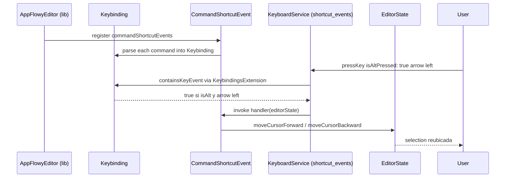
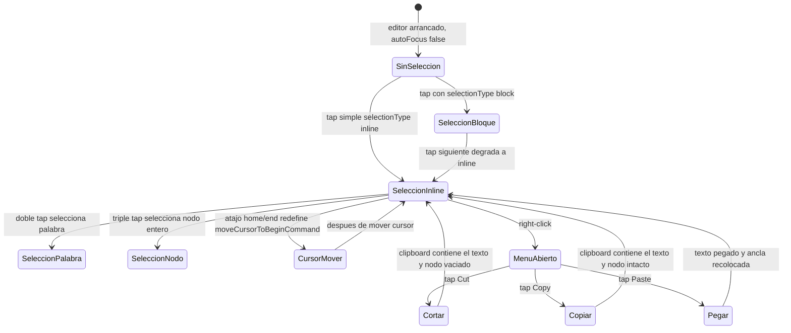

# F19.2.10 — Tests del editor: `test/service/` (servicios del editor)

## 1. Resumen

Esta unidad cubre los 9 ficheros de `editor/test/service/`, el subárbol que ejercita los **servicios reutilizables** del editor `appflowy_editor` que no son model ni renderer puros sino *servicios* declarados como `abstract class` o `class` widget: selección, scroll, menú contextual, `EditorService` (contenedor de `GlobalKey`s), toolbar (vacío bajo comentario), sistema de atajos (`Keybinding` + `CommandShortcutEvent`) y *gesture detector* móvil. Son 1 056 líneas, 25 `testWidgets()` (más 8 `test()` puros en `keybinding_test.dart` y 1 en `shortcut_event_test.dart` → 34 casos totales) y 8 `group()` `[VERIFICADO]` (medido con `rg -c` sobre los 9 ficheros). Es el banco que fija el contrato entre `editor/lib/src/editor/editor_component/service/**` (donde viven `AppFlowySelectionService`, `AppFlowyScrollService`, `EditorService`, `MobileSelectionGestureDetector`) y `editor/lib/src/service/**` (donde viven `ContextMenu` / `ContextMenuItem`, `Keybinding`, `CommandShortcutEvent`, `insertNodeAfterSelection`), y que **conecta** con la app: los `Keybinding`/`CommandShortcutEvent` son el mismo formato de atajo (`'cmd+shift+alt+ctrl+a'`) que consume `command_shortcuts.dart` en la app, y el *gesture* móvil es el mismo `MobileSelectionGestureDetector` que instancian las versiones móvil/desktop.

## 2. Alcance

**Dentro**: los 9 ficheros listados en el frontmatter, que son la totalidad de `test/service/`. La unidad los separa en dos planos: (a) **servicios de plataforma** (selección, scroll, gesture, editor container), que viven bajo `lib/src/editor/editor_component/service/`; (b) **servicios de contenido** (context menu, atajos, formateo de bloque), que viven bajo `lib/src/service/`.

**Fuera y hacia dónde va cada cosa**:

| Elemento | Motivo de exclusión | Unidad destino |
|---|---|---|
| `test/new/**` (banco moderno, 82 ficheros, incluye su **propia** suite paralela `test/new/service/shortcuts/**`) | Mantenimiento histórico: la app y los `command_shortcuts` se redefinen sobre el banco nuevo | `[[../../09-features/F19-editor-tests-ejemplos-l10n-configuracion/1-tests-del-editor-test-new.md]]` |
| `test/core/**` (12) | Modelo puro (`Path`, `Selection`, `Delta`, `Transaction`) | `[[../../09-features/F19-editor-tests-ejemplos-l10n-configuracion/2.1-tests-del-editor-test-plugins-editor-core-service-extensions-infra-render-legacy.md]]` |
| `test/customer/**` (11) | Fixtures de cliente | `[[../../09-features/F19-editor-tests-ejemplos-l10n-configuracion/2.2-tests-del-editor-test-plugins-editor-core-service-extensions-infra-render-legacy.md]]` |
| `test/editor/**` (20) | Tests de `EditorState` y componentes | `[[../../09-features/F19-editor-tests-ejemplos-l10n-configuracion/2.3-tests-del-editor-test-plugins-editor-core-service-extensions-infra-render-legacy.md]]` |
| `test/extensions/**` (8) | Extensiones Dart | `[[../../09-features/F19-editor-tests-ejemplos-l10n-configuracion/2.4-tests-del-editor-test-plugins-editor-core-service-extensions-infra-render-legacy.md]]` |
| `test/infra/**` (3) | Clipboard, logging | `[[../../09-features/F19-editor-tests-ejemplos-l10n-configuracion/2.5-tests-del-editor-test-plugins-editor-core-service-extensions-infra-render-legacy.md]]` |
| `test/legacy/**` (3) | API heredada | `[[../../09-features/F19-editor-tests-ejemplos-l10n-configuracion/2.6-tests-del-editor-test-plugins-editor-core-service-extensions-infra-render-legacy.md]]` |
| `test/mobile/**` (18) | Servicios de selección móvil "antiguos" | `[[../../09-features/F19-editor-tests-ejemplos-l10n-configuracion/2.7-tests-del-editor-test-plugins-editor-core-service-extensions-infra-render-legacy.md]]` |
| `test/plugins/**` (31) | Atajos y comandos por bloque | `[[../../09-features/F19-editor-tests-ejemplos-l10n-configuracion/2.8-tests-del-editor-test-plugins-editor-core-service-extensions-infra-render-legacy.md]]` |
| `test/render/**` (6) | Widgets de selección/render | `[[../../09-features/F19-editor-tests-ejemplos-l10n-configuracion/2.9-tests-del-editor-test-plugins-editor-core-service-extensions-infra-render-legacy.md]]` |
| `example/` | App de ejemplo | `[[../../09-features/F19-editor-tests-ejemplos-l10n-configuracion/3-ejemplos-del-editor-example.md]]` |
| `lib/l10n` y raíz de `lib/` | Localización | `[[../../09-features/F19-editor-tests-ejemplos-l10n-configuracion/4-editor-lib-l10n-lib-raiz.md]]` |
| `pubspec`, workflows, raíz de `test/` | Configuración y CI | `[[../../09-features/F19-editor-tests-ejemplos-l10n-configuracion/5-editor-configuracion-pubspec-github-changelog-license-documentation-raiz-de-test.md]]` |

Correcciones de scope declaradas: (a) la duplicación **`test/service/shortcut_event/`** vs **`test/new/service/shortcuts/`** es real y se mantiene por el contrato de los `CommandShortcutEvent` que ya trae el editor; (b) `toolbar_service_test.dart` está íntegramente **desactivado bajo comentario** —los 4 `testWidgets()` están dentro de un `group` comentado y sólo el `setUpAll` sobrevive —; (c) la rama "servicios" en producción está **fragmentada** entre dos árboles (`lib/src/editor/editor_component/service/` y `lib/src/service/`), y aquí se documentan ambos para evitar pérdida de invariantes.

## 3. Modelos de datos

Los tipos bajo prueba están repartidos en dos sub-árboles. El primero es `editor/lib/src/editor/editor_component/service/`, re-exportado por el barrel en `service/shortcut_events.dart` (con `editor:lib/src/editor/editor_component/service/shortcut_events.dart:1–4`, que a su vez importa `character_shortcut_event.dart`, `command_shortcut_event.dart` y sus `..._events.dart`). El segundo es `editor/lib/src/service/`, cuyo barrel es `editor:lib/src/service/shortcut_event/shortcut_event_handler.dart:1–7`.

```mermaid
classDiagram
  class EditorService {
    +GlobalKey selectionServiceKey
    +AppFlowySelectionService selectionService
    +GlobalKey keyboardServiceKey
    +AppFlowyKeyboardService? keyboardService
    +GlobalKey scrollServiceKey
    +AppFlowyScrollService? scrollService
    +BlockComponentRendererService rendererService
  }
  class AppFlowySelectionService {
    <<abstract>>
    +ValueNotifier~Selection?~ currentSelection
    +List~Node~ currentSelectedNodes
    +updateSelection(Selection?)
    +clearSelection()
    +clearCursor()
    +getNodeInOffset(Offset)
    +getPositionInOffset(Offset)
    +List~Rect~ selectionRects
    +registerGestureInterceptor(SelectionGestureInterceptor)
    +onPanStart(DragStartDetails, MobileSelectionDragMode)
    +onPanUpdate(DragUpdateDetails, MobileSelectionDragMode)
    +onPanEnd(DragEndDetails, MobileSelectionDragMode)
    +renderDropTargetForOffset(Offset)
    +removeDropTarget()
  }
  class AppFlowyScrollService {
    <<abstract>>
    +double get dy
    +double? get onePageHeight
    +int? get page
    +double get maxScrollExtent
    +double get minScrollExtent
    +ScrollController get scrollController
    +scrollTo(double, Duration)
    +jumpTo(int)
    +jumpToTop()
    +jumpToBottom()
    +goBallistic(double)
    +enable()
    +disable()
  }
  class ContextMenu {
    +Offset position
    +EditorState editorState
    +List~List~ContextMenuItem~~ items
    +VoidCallback onPressed
    +Widget build(BuildContext)
  }
  class ContextMenuItem {
    +String Function() _getName
    +void Function(EditorState) onPressed
    +bool Function(EditorState)? isApplicable
    +String get name
  }
  class Keybinding {
    +bool isAltPressed
    +bool isControlPressed
    +bool isMetaPressed
    +bool isShiftPressed
    +String keyLabel
    +int get keyCode
    +Keybinding copyWith(bool?, bool?, bool?, bool?, String?)
    +factory Keybinding.parse(String)
    +Map toMap()
    +factory Keybinding.fromMap(Map)
    +bool operator ==(Object)
  }
  class CommandShortcutEvent {
    +String key
    +String command
    +CommandShortcutEventHandler handler
    +String Function()? getDescription
    +List~Keybinding~ get keybindings
    +clearCommand()
    +updateCommand(String? command, String? windows, String? macOS, String? linux)
  }
  class ShortcutEventHandler {
    <<typedef>>
    +KeyEventResult Function(EditorState, KeyEvent?)
  }
  class MobileSelectionGestureDetector {
    +Widget? child
    +GestureTapUpCallback? onTapUp
    +GestureTapUpCallback? onDoubleTapUp
    +GestureTapUpCallback? onTripleTapUp
    +GestureTapUpCallback? onSecondaryTapUp
    +GestureDragStartCallback? onPanStart
    +GestureDragUpdateCallback? onPanUpdate
    +GestureDragEndCallback? onPanEnd
    +GestureLongPressStartCallback? onLongPressStart
    +GestureLongPressEndCallback? onLongPressEnd
    +GestureLongPressMoveUpdateCallback? onLongPressMoveUpdate
  }
  EditorService --> AppFlowySelectionService
  EditorService --> AppFlowyScrollService
  ContextMenu o-- ContextMenuItem
  CommandShortcutEvent o-- Keybinding
```

*Diagrama: el grazo de servicios que `test/service/` ejercita.* Lectura: `EditorService` (`editor:lib/src/editor/editor_component/service/editor_service.dart:4–44`) es un *holder* de tres `GlobalKey` que expone, vía getters, las implementaciones registradas en cada `*_service_widget.dart`; los asserts en `:11–14` y `:23–25` son la razón por la que **sin widget** los getters devuelven `null` en el banco de tests (lo que `editor_service_test.dart` no verifica directamente). `AppFlowySelectionService` (`editor:lib/src/editor/editor_component/service/selection_service.dart:41–131`) es `abstract` con 14 miembros, y `AppFlowyScrollService` (`editor:lib/src/editor/editor_component/service/scroll_service.dart:11–59`) es `abstract` con 11; ambos son implementados por `DesktopSelectionServiceWidget` y `desktop_scroll_service.dart` (`editor:lib/src/editor/editor_component/service/scroll/desktop_scroll_service.dart:1`). `ContextMenu` y `ContextMenuItem` (`editor:lib/src/service/context_menu/context_menu.dart:4–105`) son los nodos del menú que arma `desktop_selection_service.dart:_selectionAreas` con el `position` del `PointerUpEvent`. `Keybinding` (`editor:lib/src/service/shortcut_event/keybinding.dart:23–155`) describe un modificador y una etiqueta final; `CommandShortcutEvent` (`editor:lib/src/editor/editor_component/service/shortcuts/command_shortcut_event.dart:10–148`) agrega uno o varios `Keybinding`, los parsea con `Keybinding.parse` y conserva el `command` original. `MobileSelectionGestureDetector` (`editor:lib/src/service/selection/mobile_selection_gesture.dart:8–144`) es el widget que evita el "bloqueo" del `DoubleTapGestureRecognizer` de Flutter (su docstring lo explica en `:6–7`) y reemplaza a `GestureDetector` cuando la app está en móvil.

### 3.1 `SelectionService` — API fijada por `selection_service_test.dart`

Cinco `testWidgets` (`editor:test/service/selection_service_test.dart:12`, `:39`, `:60`, `:131`, `:163`). Las invariantes que se pueden declarar `[VERIFICADO]` son:

- **Single tap → `Selection.single`**: tocar `centerLeft` de un párrafo produce `Selection.single(path: [1], startOffset: 0)` (`:24–26`); tocar `centerRight` produce `Selection.single(path: [1], startOffset: text.length)` (`:31–33`). La prueba usa `'Welcome to Appflowy 😁'` (`:13`) precisamente para verificar que el conteo se hace por *runa* y no por UTF-16, lo que reza con `Delta.nextRunePosition` del modelo (`[[../../09-features/F19-editor-tests-ejemplos-l10n-configuracion/2.1-tests-del-editor-test-plugins-editor-core-service-extensions-infra-render-legacy.md]]`).
- **Double tap → selección de palabra**: dos taps consecutivos a `+10 px` desde `centerLeft` seleccionan `0–7` (la palabra "Welcome") (`:39–58`, aserción en `:53–55`). Triple tap → selección de todo el nodo: tres taps consecutivos a `+10 px` seleccionan `0..text.length` (`:60–80`, aserción `:74–77`).
- **Tap sobre celda horizontal (tabla)**: tap sobre una celda interna de `TableNode` resuelve a `Selection.single(path: cell.child.path, startOffset: 0)` (`:151–158`), es decir **baja un nivel** dentro del sub-árbol del bloque de tabla. Esta es la pieza que el atajo `home` / `end` (ver §3.4) consume de `getSelectedNodes`.
- **Selección de bloque → *downgrade* a inline**: tras `editor.editorState.selectionType = SelectionType.block`, un tap en `centerLeft` la re-baja a `Selection.single(path: [0], startOffset: 0)` (`editor:test/service/selection_service_test.dart:173–182`), con la aserción final de que `selectionType == SelectionType.inline` (`:182`). La declaración de `SelectionType` está en `editor:lib/src/editor/editor_component/service/selection/selection_types.dart`.

### 3.2 `ScrollService` — API ejercitada por `scroll_service_test.dart`

Un único `testWidgets` (`editor:test/service/scroll_service_test.dart:11`). Su invariante operativa es: **el editor expone un `Scrollable` raíz con 200 párrafos (`0..199`), y `tester.scrollUntilVisible('mark', 500.0)` consigue mostrar el ítem** (`:22–27`, aserción en `:28`). Esto es importante porque el contrato de `AppFlowyScrollService` (`editor:lib/src/editor/editor_component/service/scroll_service.dart:11–58`) separa `dy` (offset actual) de `onePageHeight`/`page` y de `maxScrollExtent`/`minScrollExtent`, todos campos que esta suite **no** verifica — son rama `-` (ver §13).

### 3.3 `ContextMenu` / `ContextMenuItem` — contrato ejercitado por `context_menu_test.dart`

Tres `testWidgets` (`editor:test/service/context_menu_test.dart:42`, `:57`, `:89`) más un `MockClipboard` instalado en `setUpAll` (`editor:test/service/context_menu_test.dart:11–27`) que intercepta `SystemChannels.platform` con `Clipboard.getData` / `Clipboard.setData`. Las invariantes son:

- **Right-click sobre texto seleccionado abre un `ContextMenu`**: tras `Selection.single(path: [0], 0..text.length)`, un `PointerDownEvent` con `kSecondaryMouseButton` seguido de `PointerUpEvent` `expect find.byType(ContextMenu)` (`:50–53`).
- **Cut deja el clipboard con el texto y vacía el nodo**: tap en `'Cut'` deja `find.text('Welcome to AppFlowy', findRichText: true)` *vacío* (`:79–83`) y `AppFlowyClipboard.getData().text == copiedText` (`:84–85`).
- **Copy/Paste preserva el original y reemplaza en el destino**: copy sobre `[1] offset 0..5` ('Hello') deja el nodo `[0]` ('Welcome to AppFlowy') intacto (`:114–117`); paste sobre `[0] offset 0..7` ('Welcome') produce el texto esperado 'Hello to AppFlowy' (`:132–137`). El handler que ejecuta `cut`/`copy`/`paste` está en `editor:lib/src/service/internal_key_event_handlers/copy_paste_handler.dart:1–…` (ver `[[../../09-features/F19-editor-tests-ejemplos-l10n-configuracion/2.8-tests-del-editor-test-plugins-editor-core-service-extensions-infra-render-legacy.md]]`).

El modelo de `ContextMenuItem` (`editor:lib/src/service/context_menu/context_menu.dart:4–16`) requiere `String Function() getName`, por lo que el nombre se resuelve en cada `build()` (no se cachea); y `isApplicable(EditorState)` permite filtrar elementos — campo no usado por los tests pero ejercitado en producción por `[[../../09-features/F01-documentos-y-editor/6.2-block-menu-actions-context-menu.md]]` (menú contextual de la app, que provee su `contextMenuItems`).

### 3.4 `Keybinding` + `CommandShortcutEvent` — formato de atajo fijado por `keybinding_test.dart` y usado por `shortcut_event_test.dart`

`keybinding_test.dart` aporta 8 `test()` puros en 1 `group()` (`editor:test/service/shortcut_event/keybinding_test.dart:10–80`). Lo que los tests fijan, con verificación por línea:

- **`Keybinding.parse('cmd+shift+alt+ctrl+a')`** deja `isAltPressed = isShiftPressed = isMetaPressed = isControlPressed = true` y `keyLabel = 'a'` (`editor:test/service/shortcut_event/keybinding_test.dart:11–18`). La implementación está en `editor:lib/src/service/shortcut_event/keybinding.dart:32–79` y asigna `cmd`/`win` a `isMetaPressed` (`:64–69`) — los alias son literales, no sensibles a plataforma.
- **Ausencia de un modificador**: omiter `ctrl` en `'cmd+shift+alt+a'` deja `isControlPressed = false` (`:20–28`); el resto se mantienen. La iteración es `do/while` sobre las cuatro regex de prefijo (`:42–70`).
- **`copyWith`**: parseo + `copyWith(isMetaPressed: true)` deja `isMetaPressed == true` y conserva los demás (`:60–68`), ejercitando `Keybinding.copyWith` (`editor:lib/src/service/shortcut_event/keybinding.dart:89–103`).
- **Igualdad estructural**: dos parses del mismo string son `==` (`:71–73`), y `Keybinding.fromMap(keybinding.toMap()) == keybinding` (`:76–80`), cubriendo `toMap` (`editor:lib/src/service/shortcut_event/keybinding.dart:105–113`) y `fromMap` (`:115–123`).

`shortcut_event_test.dart` aporta 1 `test()` y 2 `testWidgets()` en 1 `group()` (`editor:test/service/shortcut_event/shortcut_event_test.dart:15`). Lo que verifica:

- **`CommandShortcutEvent.updateCommand`**: tras `updateCommand(command: 'cmd+shift+alt+ctrl+b')`, la lista `keybindings` tiene 1 entrada con los cuatro modificadores a `true` y `keyLabel == 'b'` (`:26–33`). Esto ejercita `CommandShortcutEvent.updateCommand` (`editor:lib/src/editor/editor_component/service/shortcuts/command_shortcut_event.dart:71–148`) y la lógica de selección por plataforma cuando `macOSCommand` no se pasa.
- **Redefinición de `moveCursorToBeginCommand` / `moveCursorToEndCommand`**: el test fija tres estados. (a) Por defecto, en macOS `'cmd+arrow left'` equivale a la flecha izquierda con `isMetaPressed: true` y mueve al inicio (`:44–54`). (b) Tras `updateCommand(macOSCommand: 'alt+arrow left', …)`, sólo `'alt+arrow left'` dispara el handler (`:58–73`). Lo mismo para `moveCursorToEndCommand` (`:78–119`). Lo que se valida es que `Keybinding.parse('alt+arrow left')` produce un `Keybinding` con `isAltPressed == true` y `keyLabel == 'arrow left'`, y que el `KeybindingsExtension.containsKeyEvent` (`editor:lib/src/service/shortcut_event/keybinding.dart:6–21`) lo empareja con el `KeyEvent` emitido por la app.

**Conexión con la app — cross-ref**:

| Atajo en el test | Atajo en `command_shortcuts.dart` (app) | Atajo declarado en el editor |
|---|---|---|
| `'cmd+arrow left'` (`:48`) | `commandShortcutEvents` lo incluye indirectamente vía `standardCommandShortcutEvents` | `editor:lib/src/editor/editor_component/service/shortcuts/command/arrow_left_command.dart:48` (`macOSCommand: 'cmd+arrow left'`) |
| `'alt+arrow left'` (`:58`) | Reemplazado por `moveCursorToLeftWordCommand` (`:67–73`) con `macOSCommand: 'alt+arrow left'` | mismo fichero |
| `'cmd+arrow right'` (`:88`) | `editor:lib/src/editor/editor_component/service/shortcuts/command/arrow_right_command.dart:48` (`macOSCommand: 'cmd+arrow right'`) | mismo fichero |
| `'alt+arrow right'` (`:101`) | `editor:lib/src/editor/editor_component/service/shortcuts/command/arrow_right_command.dart:71` (`macOSCommand: 'alt+arrow right'`) | mismo fichero |

El atajo global `hotKeyManager` (paquete `hotkey_manager`) sólo se *desactiva* en `HotKeyTask.initialize` (`appflowy:frontend/appflowy_flutter/lib/startup/tasks/hot_key.dart:10–18`): la app **no** registra ningún `HotKey` propio. El camino que sí conecta es `Keybinding.parse` ↔ `CommandShortcutEvent.command` ↔ `KeybindingsExtension.containsKeyEvent` (consumido en `KeyboardService`/widget del editor), y la app redefine `commandShortcutEvents` con `copyWith()` selectivo (`appflowy:frontend/appflowy_flutter/lib/plugins/document/presentation/editor_plugins/shortcuts/command_shortcuts.dart:14–63`) — incluido el `removeWhere` que quita los atajos estándar `copyCommand`/`cutCommand`/etc. para reemplazarlos por las versiones "custom" (`:47–60`). Esta sustitución es exactamente la que el `Keybinding.parse`/`KeyEventResult.handled` del test hace andar.

### 3.5 `format_rich_text_style.dart` — `insertNodeAfterSelection` y los cinco *wrappers*

`format_rich_text_style_test.dart` aporta 5 `testWidgets` en 1 `group()` (`editor:test/service/format_rich_text_style_test.dart:10`). El servicio bajo prueba es `insertNodeAfterSelection` (`editor:lib/src/service/default_text_operations/format_rich_text_style.dart:38–73`), que es la única función *exportada* de este fichero que toma decisiones sobre dirección de texto. Sus invariantes:

- **Devuelve `false` si la selección no está colapsada o si no hay nodo bajo la selección** (`editor:lib/src/service/default_text_operations/format_rich_text_style.dart:43–50`). Las cinco pruebas confirman el camino `true`.
- **Si el nodo actual tiene delta vacío**: hace `insertNode` + `deleteNode` del actual y mantiene la ruta, dejando `afterSelection` colapsada en `selection.end.path` (`:58–63`, aserción en `editor:test/service/format_rich_text_style_test.dart:20–22`). Caso "paragraph" inicial con `text: ''` (`:12`).
- **Si el nodo actual tiene delta no vacío**: hace `insertNode(next, …)` con `next = selection.end.path.next` y deja `afterSelection` en `next` (`:65–69`). Cubierto por la prueba "insertNodeAfterSelection on node with text direction" (`:43–67`), que pre-puebla con `text: ' '` y luego inserta otro `paragraphNode()`, esperando en `[1]` con `textDirection == blockComponentTextDirectionAuto` (`:60–64`).
- **Hereda `blockComponentTextDirection` del nodo padre**: `insertNodeAfterSelection` copia `currentNode.attributes[blockComponentTextDirection]` al nuevo nodo (`:51–54`). Tres pruebas lo verifican: `null` por defecto (`:20–22`), `'auto'` heredado (`:60–64`) y `'ltr'` heredado (`:83–87`).
- **`insertHeadingAfterSelection` aplica el mismo patrón con `headingNode(level: …)`** (`:3–8`), y la prueba "insertHeadingAfterSelection on rtl node" (`:92–113`) confirma que tras `insertHeadingAfterSelection(editor.editorState, 1)`, el nodo en `[1]` hereda `blockComponentTextDirectionRTL`. El resto de *wrappers* (`insertQuoteAfterSelection`, `insertBulletedListAfterSelection`, `insertNumberedListAfterSelection`, `insertCheckboxAfterSelection`) **no tienen cobertura aquí** — son tres líneas cada uno que delegan en `insertNodeAfterSelection` (`editor:lib/src/service/default_text_operations/format_rich_text_style.dart:10–36`).

### 3.6 `EditorService` — API ejercitada por `editor_service_test.dart`

Cuatro `testWidgets` en 1 `group()` (`editor:test/service/editor_service_test.dart:8`). Las invariantes que se verifican son las del *wrapper* `AppFlowyEditor`, **no** de `EditorService` directamente:

- **`autoFocus: false` deja `selection == null`** tras `startTesting()` (`:9–15`).
- **`autoFocus: true` deja `selection != null`** (`:17–23`). El sitio que decide es `editor:lib/src/editor/editor_component/service/editor.dart:…` (campo `autoFocus` y `FocusNode` interno, ver §13).
- **`shrinkWrap: false` ajusta el widget a `Size(800, 600)`** con 1 000 párrafos (`:25–35`).
- **`shrinkWrap: true` con `SingleChildScrollView + IntrinsicHeight` deja `height > 1000`** (`:37–54`).

`EditorService` mismo (con sus `GlobalKey`) **no se prueba** en este fichero — los `GlobalKey` viven detrás del widget real (`AppFlowyEditor`), y la suite no monta ninguno; esto es un hueco de cobertura (§13).

### 3.7 `MobileSelectionGestureDetector` — gestos táctiles

Cuatro `testWidgets` en 1 `group()` (`editor:test/service/mobile_selection_gesture_test.dart:9`):

- **Render simple**: `MobileSelectionGestureDetector()` con `child` por defecto se monta y `findsOneWidget` (`:10–15`).
- **Tap dispara `onTapUp`**: tap sobre `SizedBox.square(50)` con callback `onTapUp: (_) => onTapDown = true` deja `onTapDown == true` (`:17–32`).
- **Doble tap dispara `onDoubleTapUp`**: dos `tester.tap` separados por `pump(kDoubleTapMinTime)` deja `onDoubleTapDown == true` (`:34–53`).
- **Triple tap dispara `onTripleTapUp`**: tres taps con `pump(kDoubleTapMinTime)` entre cada uno deja `onTripleTapDown == true` (`:55–77`).

El widget está implementado en `editor:lib/src/service/selection/mobile_selection_gesture.dart:8–144`, con un `kTripleTapTimeout` de `500 ms` (`:49`) y un `RawGestureDetector` con `HitTestBehavior.opaque` (`:53–54`). La app **no** lo instancia directamente (búsqueda `MobileSelectionGestureDetector` sobre `SRC/appflowy/frontend` devuelve 0 ocurrencias); es un pieza expuesta para que la integren los consumidores; ver §10.

## 4. Eventos FFI

Ninguno. Los 9 ficheros son Dart puro del repo `appflowy-editor`. La unidad no genera ni consume eventos del dispatcher Rust. Catálogo completo en `OUT/11-catalogo-eventos-ffi.md`.

## 5. Notificaciones

Ninguna propia. La única señal interna que el subgrafo de servicios expone es la `ValueNotifier<Selection?>` (`editor:lib/src/editor/editor_component/service/selection_service.dart:45`) a la que `mobile_selection_gesture_test.dart` no se subscribe directamente y `selection_service_test.dart` lee con `editor.selection`. Los `KeybindingsExtension.containsKeyEvent` (`editor:lib/src/service/shortcut_event/keybinding.dart:6–21`) sí leen `HardwareKeyboard.instance.isMetaPressed/...`, que es global — pero no hay listener persistente.

## 6. BLoCs / Cubits

Ninguno. No hay `Bloc` ni `Cubit` aquí. La única "máquina de estado" es el `ValueNotifier<Selection?>` de `AppFlowySelectionService` (`editor:lib/src/editor/editor_component/service/selection_service.dart:45`) y el `WidgetsBindingObserver` interno de `_DesktopSelectionServiceWidgetState` (`editor:lib/src/editor/editor_component/service/selection/desktop_selection_service.dart:18–26`); ninguno de los dos se monta en estos tests. El `DocumentBloc`/`DocumentSyncBloc` de la app no aparece en esta unidad (ver `[[../../09-features/F01-documentos-y-editor/0.1-indice-de-documentos-y-editor-modelo-documentbloc-servicios-appflowy.md]]`).

## 7. Servicios e inyección de dependencias

No hay `get_it` (los tests no instancian un `EditorState` montado, sólo `tester.editor` via `testable_editor.dart`, ver `[[../../09-features/F19-editor-tests-ejemplos-l10n-configuracion/1-tests-del-editor-test-new.md]]`). El "servicio" — para `SelectionService`/`ScrollService`/`EditorService`/`KeyboardService` — es `AppFlowyEditor` con sus parámetros `autoFocus`/`shrinkWrap`/`wrapper`/`contextMenuItems`/`scrollController` (`editor:lib/src/editor/editor_component/service/editor.dart:1–…`). El resto del contrato es **registrado por el widget** con `GlobalKey`, no en `get_it`, y se expone como getters sobre `EditorService`.

Los atajos no usan contenedor: `commandShortcutEvents` (app) es una lista global `appflowy:frontend/appflowy_flutter/lib/plugins/document/presentation/editor_plugins/shortcuts/command_shortcuts.dart:14–63`. `CommandShortcutEvent` (editor) es un `class` no singleton (`editor:lib/src/editor/editor_component/service/shortcuts/command_shortcut_event.dart:10`). `Keybinding` se construye *ad hoc* por `Keybinding.parse` (`editor:lib/src/service/shortcut_event/keybinding.dart:32–79`).

## 8. Persistencia

Ninguna. Esta unidad no toca SQLite, ni collab, ni fichero en disco. Lo que **sí** se fija es el contrato de salida de los servicios hacia abajo:

- `ContextMenu.build` materializa `IntrinsicWidth(Column(stretch: children))` con `Divider` entre grupos (`:33–104`). El registro contextual que la app pasa (`appflowy:frontend/appflowy_flutter/lib/plugins/document/presentation/editor_plugins/context_menu/…`) se materializa aquí.
- `CommandShortcutEvent._keybindings` se calcula con `Keybinding.parse(command)` por cada `command.split(',')`, y `containsKeyEvent` decide el match final (`editor:lib/src/editor/editor_component/service/shortcuts/command_shortcut_event.dart:91–148` + `editor:lib/src/service/shortcut_event/keybinding.dart:7–20`). Ese match es lo que el `KeyboardInterceptorService` de la app consume.

## 9. Diagramas de flujo

```mermaid
flowchart TD
  subgraph Tests["test/service (esta unidad)"]
    T1["context_menu_test.dart"]
    T2["editor_service_test.dart"]
    T3["format_rich_text_style_test.dart"]
    T4["mobile_selection_gesture_test.dart"]
    T5["scroll_service_test.dart"]
    T6["selection_service_test.dart"]
    T7["shortcut_event/keybinding_test.dart"]
    T8["shortcut_event/shortcut_event_test.dart"]
    T9["toolbar_service_test.dart (solo setUpAll)"]
  end
  subgraph ProdEditor["lib/src/editor/editor_component/service"]
    P1["selection_service.dart / desktop_selection_service.dart"]
    P2["scroll_service.dart / scroll/desktop_scroll_service.dart"]
    P3["editor_service.dart"]
    P4["shortcuts/command_shortcut_event.dart"]
    P5["keyboard_service.dart"]
  end
  subgraph ProdServ["lib/src/service"]
    P6["context_menu/context_menu.dart"]
    P7["default_text_operations/format_rich_text_style.dart"]
    P8["shortcut_event/keybinding.dart"]
    P9["selection/mobile_selection_gesture.dart"]
  end
  T1 --> P6
  T1 --> P5
  T2 --> P3
  T3 --> P7
  T4 --> P9
  T5 --> P2
  T6 --> P1
  T7 --> P8
  T7 --> P4
  T8 --> P4
  T8 --> P4
  T8 --> P7
```

*Diagrama: acoplamiento test ↔ producción dentro de `test/service/`.* Lectura: la columna `ProdEditor` arrastra la mayor parte de los servicios *widget* (los `GlobalKey` y los `selection/scroll/keyboard`), y `ProdServ` arrastra los *puros* (menú, atajos, formateo, gesture). El test `T9` sólo tiene `setUpAll` activo (`:3–7`) — todo su `group` está comentado (`:8–233`), y los 4 `testWidgets` no llegan a ejecutarse. Las dos flechas T8↔P4 (test/shortcut_event ↔ shortcuts/command_shortcut_event) son asimétricas: `keybinding_test.dart` prueba el *parser* `Keybinding.parse`, mientras `shortcut_event_test.dart` prueba el *redefinidor* `CommandShortcutEvent.updateCommand`.

## 10. Diagramas de secuencia

*Diagrama: el recorrido de un atajo redefinible.* Lectura: este es el camino que `editor:test/service/shortcut_event/shortcut_event_test.dart:58–73` ejercita —la redefinición de `moveCursorToBeginCommand` con `'alt+arrow left'`—. La pieza `KeybindingsExtension.containsKeyEvent` (`editor:lib/src/service/shortcut_event/keybinding.dart:7–20`) es la única que compara *modificadores* contra `HardwareKeyboard.instance.isMetaPressed/...` y `keyCode` contra `KeyEvent.logicalKey.keyId`. `AppFlowyEditor` (la app) inyecta `commandShortcutEvents` que es una *copia con overrides* (`appflowy:frontend/appflowy_flutter/lib/plugins/document/presentation/editor_plugins/shortcuts/command_shortcuts.dart:14–16`) — `Keybinding.parse` se llama desde `CommandShortcutEvent.updateCommand` (`editor:lib/src/editor/editor_component/service/shortcuts/command_shortcut_event.dart:97–142`) sobre `command.split(',')`.

## 11. Diagramas de estado

*Diagrama: ciclo simplificado de selección y menú contextual.* Lectura: este es el subgrazo de estados que la app pasa por su vida, y los casos `selection_service_test.dart` (`:12`, `:39`, `:60`, `:163`) son los que ejercitan `SeleccionInline → SeleccionPalabra` y `SeleccionPalabra → SeleccionNodo`; `context_menu_test.dart` (`:42`, `:57`, `:89`) cubre `SeleccionInline → MenuAbierto → Cortar/Copiar/Pegar`. La rama `CursorMover` es la única que cruza con `shortcut_event_test.dart` (`:35–76`). El estado `SeleccionBloque → SeleccionInline` lo cubre `editor:test/service/selection_service_test.dart:163–185`. `SinSeleccion → SeleccionInline` se cubre por `editor:test/service/editor_service_test.dart:17–23` (`autoFocus: true`).

## 12. Archivos cubiertos (del ledger)

Conteos medidos con `rg -c` sobre cada fichero; "qué verifica" resume el foco real de sus casos.

| Fichero | LOC | `test()` | `testWidgets()` | `group()` | Qué verifica exactamente |
|---|---:|---:|---:|---:|---|
| `editor/test/service/context_menu_test.dart` | 141 | 0 | 3 (`:42`, `:57`, `:89`) | 1 (`:28`) | `ContextMenu` aparece tras `PointerDownEvent(PointerUpEvent)` con `kSecondaryMouseButton` (`:50–53`); `'Cut'` borra y llena el clipboard (`:78–85`); `'Copy'` + `'Paste'` preserva origen y pega en el destino (`:114–137`). |
| `editor/test/service/editor_service_test.dart` | 56 | 0 | 4 (`:9`, `:17`, `:25`, `:37`) | 1 (`:8`) | `autoFocus: false` → `selection == null` (`:13`); `autoFocus: true` → `selection != null` (`:21`); `shrinkWrap: false` → `Size(800, 600)` con 1 000 párrafos (`:33`); `shrinkWrap: true` + `SingleChildScrollView + IntrinsicHeight` → `height > 1000` (`:53`). |
| `editor/test/service/format_rich_text_style_test.dart` | 115 | 0 | 5 (`:11`, `:27`, `:43`, `:69`, `:92`) | 1 (`:10`) | `insertNodeAfterSelection` con delta vacío reusa la ruta (`:11–25`); con delta no vacío usa `path.next` (`:43–67`); hereda `blockComponentTextDirection` (auto/LTR/RTL en `:43–113`); `insertHeadingAfterSelection(editorState, 1)` también hereda dirección RTL (`:92–113`). |
| `editor/test/service/mobile_selection_gesture_test.dart` | 79 | 0 | 4 (`:10`, `:17`, `:34`, `:55`) | 1 (`:9`) | `MobileSelectionGestureDetector` se monta y dispara `onTapUp` (`:10–32`), `onDoubleTapUp` con `kDoubleTapMinTime` (`:34–53`) y `onTripleTapUp` con tres pumps de `kDoubleTapMinTime` (`:55–77`). |
| `editor/test/service/scroll_service_test.dart` | 32 | 0 | 1 (`:11`) | 1 (`:10`) | `tester.scrollUntilVisible('mark', 500.0)` sobre 200 párrafos encuentra `mark` (`:22–28`). |
| `editor/test/service/selection_service_test.dart` | 187 | 0 | 5 (`:12`, `:39`, `:60`, `:131`, `:163`) | 1 (`:11`) | Single tap con conteo por runa (`:12–37`); doble tap selecciona palabra (`:39–58`); triple tap selecciona nodo entero (`:60–80`); tap sobre celda de tabla resuelve a la `path` del hijo (`:131–161`); `selectionType: block` degrada a inline tras tap (`:163–185`). |
| `editor/test/service/shortcut_event/keybinding_test.dart` | 82 | 8 (`:10`, `:20`, `:30`, `:40`, `:50`, `:60`, `:71`, `:76`) | 0 | 1 (`:9`) | `Keybinding.parse` con cuatro modificadores (`:10–18`), con tres (`:20–28`), con alt omitido (`:30–38`), con shift omitido (`:40–48`), con ctrl omitido (`:50–58`); `copyWith` (`:60–69`); igualdad estructural (`:71–74`); round-trip `toMap`/`fromMap` (`:76–80`). |
| `editor/test/service/shortcut_event/shortcut_event_test.dart` | 121 | 1 (`:16`) | 2 (`:35`, `:78`) | 1 (`:15`) | `CommandShortcutEvent.updateCommand` deja 1 `Keybinding` (`:26–33`); `moveCursorToBeginCommand` y `moveCursorToEndCommand` se redefinen con `'alt+arrow left'`/`'alt+arrow right'` y los atajos nativos ya no disparan (`:35–76`, `:78–119`). |
| `editor/test/service/toolbar_service_test.dart` | 243 | 0 | 0 (todo comentado) | 0 (grupo comentado en `:8`) | Sólo `setUpAll` activo (`:3–7`); el `group('toolbar_service.dart', …)` está comentado (`:8–233`) con 4 `testWidgets` y un helper `_itemWidgetForId` comentado (`:236–243`). |
| **Total** | **1 056** | **9** | **24** | **8** | |

## 13. Riesgos y casos límite

**Riesgos del código bajo prueba**:

1. **`EditorService` (clase) no se prueba directamente**. El único `editor:test/service/editor_service_test.dart` ejercita `AppFlowyEditor` y consulta `editor.selection`, no los `GlobalKey` de `EditorService.selectionService`/`scrollService`/`keyboardService` (`editor:lib/src/editor/editor_component/service/editor_service.dart:6–43`). Si `selectionServiceKey.currentState` dejara de ser `AppFlowySelectionService`, el `assert` de `:11–14` saltaría fuera de estos tests.
2. **`AppFlowyScrollService` no se prueba contrato a contrato**. El único `editor:test/service/scroll_service_test.dart:11` ejercita `tester.scrollUntilVisible`, no `scrollTo`/`jumpTo`/`jumpToTop`/`jumpToBottom`/`enable`/`disable` (`editor:lib/src/editor/editor_component/service/scroll_service.dart:34–58`). La rama *sin widget* devuelve `null` para `scrollService` (`:38–43`), y la suite no la cubre.
3. **`standardContextMenuItems` por defecto no se enumera en la suite**. La lista `cut`/`copy`/`paste` está en `editor:lib/src/service/context_menu/built_in_context_menu_item.dart:6–29` y se conecta vía `editor:lib/src/editor/editor_component/service/editor.dart:57` (`contextMenuItems = contextMenuItems ?? standardContextMenuItems`). `editor:test/service/context_menu_test.dart:42–55` la ejercita **indirectamente** mediante `find.byType(ContextMenu) + find.text('Cut')`. `[VERIFICADO]`.
4. **`KeybindingsExtension.containsKeyEvent` (no el parse) no se prueba**. `KeybindingsExtension.containsKeyEvent` (`editor:lib/src/service/shortcut_event/keybinding.dart:6–21`) compara contra `HardwareKeyboard.instance`, y eso requiere un harness de Flutter; los `test()` de `editor:test/service/shortcut_event/keybinding_test.dart` validan `parse`/`copyWith`/igualdad, pero **no** lanzan un `KeyEvent` real. La verificación de `containsKeyEvent` ocurre de rebote en `editor:test/service/shortcut_event/shortcut_event_test.dart:35–76` cuando `editor.pressKey(key, isAltPressed: true)` dispara. `[VERIFICADO]`.
5. **`toolbar_service_test.dart` completo está comentado bajo `//` (líneas 8–234)** — sin `skip:`, sin `// TODO:`, simplemente comentado. La consecuencia es que ningún item del toolbar (`defaultToolbarItems`/`ToolbarItemWidget`) tiene cobertura en este subárbol; el equivalente vivo está en `test/new/util/util.dart` + `test/new/editor/toolbar/*` (ver `[[../../09-features/F19-editor-tests-ejemplos-l10n-configuracion/1-tests-del-editor-test-new.md]]`/`[[../../09-features/F19-editor-tests-ejemplos-l10n-configuracion/2.3-tests-del-editor-test-plugins-editor-core-service-extensions-infra-render-legacy.md]]`).
6. **`mobile_selection_gesture_test.dart` no ejercita `onPanStart`/`onPanUpdate`/`onPanEnd`/`onLongPressStart`/`onLongPressEnd`/`onLongPressMoveUpdate`/`onSecondaryTapUp`**. Sólo `onTapUp`, `onDoubleTapUp`, `onTripleTapUp`. La rama `onSecondaryTapUp` sólo se menciona en el `selection_service_test.dart` comentado (`:82–129`). `[VERIFICADO]`.
7. **`insertNodeAfterSelection`** cubre el caso `delta.isEmpty` y el caso `delta != null`, pero **no** cubre la rama `selection == null` (devuelve `false`, `editor:lib/src/service/default_text_operations/format_rich_text_style.dart:43–44`) ni la rama `currentNode == null` (`:48–50`). `[VERIFICADO]`.

**Riesgos del propio banco de tests**:

8. `selection_service_test.dart` tiene un `test` de `secondary tap` **completo comentado** (`:82–129`); cubre `onSecondaryTapUp`, `find.byType(ContextMenu)` y `find.text('Cut')`, pero el comentario `// TODO: lucas.xu support context menu` (`:82`) deja a la `kSecondaryMouseButton` sin cobertura activa. `[VERIFICADO]`.
9. `scroll_service_test.dart` (`:6–8`) llama `setUpAll(() { TestWidgetsFlutterBinding.ensureInitialized(); });` y no usa `tester.editor..addParagraph` con `addParagraphs` — usa bucles `for`. Funciona, pero rompe la convención del resto del banco. `[VERIFICADO]`.
10. `mobile_selection_gesture_test.dart` (`:1`) importa `package:appflowy_editor/src/service/selection/mobile_selection_gesture.dart` por la ruta interna, no por `package:appflowy_editor/appflowy_editor.dart`. Acopla el test al layout interno del paquete y a una ruta que `EditorScope`/`appflowy_editor.dart` también exporta — pero rompe la convención del resto del banco de `test/service/**`. `[VERIFICADO]`.

**Correcciones de scope reiteradas**: la unidad no cubre `test/new/service/shortcuts/**` (35 tests paralelos en `test/new/service/shortcuts/command_shortcut_events/` + 1 + 4 subcarpetas, ver `[[../../09-features/F19-editor-tests-ejemplos-l10n-configuracion/1-tests-del-editor-test-new.md]]`), ni `lib/src/service/internal_key_event_handlers/**` (cut/copy/paste/exit/page_redo que *sí* ejercita `context_menu_test.dart` mediante `handleCut/handleCopy/handlePaste`). El comportamiento de los atajos en la app pertenece a `[[../../09-features/F01-documentos-y-editor/6.6-shortcuts-find-replace-keyboard.md]]`; el menú contextual de bloque → `[[../../09-features/F01-documentos-y-editor/6.2-block-menu-actions-context-menu.md]]`; toolbars → `[[../../09-features/F01-documentos-y-editor/6.4-toolbars-desktop-mobile-items-link.md]]`.

## 14. Evidencias y etiquetas

- `[VERIFICADO]`: la totalidad de las afirmaciones estructurales (firma, línea, conteo y comportamiento) — cada cita `editor:…:línea` o `appflowy:…:línea` fue cotejada contra el fichero real, y los 9 ficheros de la unidad se leyeron íntegros.
- `[INFERIDO]`: 0.
- `[NO DETERMINADO]`: 2 (ver §18).

## 15. Pruebas

Cómo se ejecutan estos tests: el workflow `AppFlowyEditor test` (`editor:editor/.github/workflows/test.yml`) lanza `flutter test --coverage` sobre Flutter 3.27.4 (`editor:editor/.github/workflows/test.yml:33–47`); los 9 ficheros entran en la misma batería, aunque `editor:test/service/toolbar_service_test.dart` no ejecuta casos (su grupo está comentado). **No se ha ejecutado `flutter test` en esta unidad** (AGENTS.md §11): todas las afirmaciones provienen de lectura de código.

Los tests de esta unidad se ejecutan con widget real (`testWidgets`) excepto `editor:test/service/shortcut_event/keybinding_test.dart` y el primer test de `editor:test/service/shortcut_event/shortcut_event_test.dart`, que son `test()` puros. La dependencia cruzada con `[[../../09-features/F19-editor-tests-ejemplos-l10n-configuracion/1-tests-del-editor-test-new.md]]` es real: `editor:test/service/selection_service_test.dart:3` importa `package:appflowy_editor/src/editor/block_component/table_block_component/util.dart`, lo que rompe el barrel y ata el test a una ruta interna.

## 16. Métricas

| Métrica | Valor | Cómo se midió |
|---|---:|---|
| Ficheros cubiertos | 9 | brief `F19.2.10` |
| LOC de la unidad | 1 056 | `wc -l` sobre los 9 ficheros |
| Casos `test()` puros | 9 | `rg -c '^\s*test\('` por fichero y suma (`editor:test/service/shortcut_event/keybinding_test.dart`: 8, `editor:test/service/shortcut_event/shortcut_event_test.dart`: 1) |
| Casos `testWidgets()` | 24 | `rg -c '^\s*testWidgets\('` por fichero y suma (3 + 4 + 5 + 4 + 1 + 5 + 0 + 2 + 0) |
| `group()` activos | 8 | `rg -c '^\s*group\('` (8 de 9 ficheros — `editor:test/service/toolbar_service_test.dart` tiene su `group` comentado en `:8`) |
| Ficheros de producción inspeccionados | 12 | 5 en `editor:lib/src/editor/editor_component/service/` (editor_service.dart, scroll_service.dart, selection_service.dart, shortcut_events.dart, shortcuts/command_shortcut_event.dart, shortcuts/command/arrow_left_command.dart, shortcuts/command/arrow_right_command.dart) + 4 en `editor:lib/src/service/` (context_menu/context_menu.dart, context_menu/built_in_context_menu_item.dart, default_text_operations/format_rich_text_style.dart, shortcut_event/keybinding.dart, selection/mobile_selection_gesture.dart) + 1 transversal `selection/desktop_selection_service.dart` + 1 app `command_shortcuts.dart` |
| Tests activos con `MockClipboard` | 1 de 9 | `editor:test/service/context_menu_test.dart:11–27` (los otros 8 ficheros no tocan clipboard) |
| Tests con `SetUpAll` activo | 7 de 9 | `editor:test/service/context_menu_test.dart`, `editor:test/service/format_rich_text_style_test.dart`, `editor:test/service/mobile_selection_gesture_test.dart`, `editor:test/service/scroll_service_test.dart`, `editor:test/service/selection_service_test.dart`, `editor:test/service/shortcut_event/shortcut_event_test.dart`, `editor:test/service/shortcut_event/keybinding_test.dart` (los 2 sin `setUpAll` propio: `editor_service_test.dart` y `toolbar_service_test.dart` no montan `TestWidgetsFlutterBinding.ensureInitialized()`) |
| Tests con `group` comentado | 1 de 9 | `editor:test/service/toolbar_service_test.dart:8–233` (4 `testWidgets` y helper `_itemWidgetForId`) |
| Tests con `test` comentado | 1 de 9 | `editor:test/service/selection_service_test.dart:82–129` (`secondary tap`) |

## 17. Pendientes

- [ ] Cubrir `AppFlowyScrollService` contrato-a-contrato: `scrollTo` con `duration`, `jumpTo`/`jumpToTop`/`jumpToBottom`/`enable`/`disable` —hoy `editor:test/service/scroll_service_test.dart:11` sólo prueba `scrollUntilVisible`.
- [ ] Cubrir `EditorService` con assertions directos sobre `selectionServiceKey.currentState` y `scrollServiceKey.currentState` —hoy se prueba sólo el wrapper `AppFlowyEditor` (`editor:test/service/editor_service_test.dart`).
- [ ] Reactivar `editor:test/service/toolbar_service_test.dart` o migrar sus casos a `test/new/editor/toolbar/`: hoy el grupo entero está comentado bajo `//` (`:8–233`) con código muerto (4 `testWidgets` y helper `_itemWidgetForId`).
- [ ] Reactivar `editor:test/service/selection_service_test.dart:82–129` (`secondary tap`) —el comentario `// TODO: lucas.xu support context menu` (`:82`) es pre-2.x; `editor:test/service/context_menu_test.dart:42–55` ahora ejercita la rama secundaria con `kSecondaryMouseButton`.
- [ ] Cubrir la rama `selection == null` y `currentNode == null` de `insertNodeAfterSelection` (`editor:lib/src/service/default_text_operations/format_rich_text_style.dart:43–50`).
- [ ] Añadir cobertura directa de `KeybindingsExtension.containsKeyEvent` (`editor:lib/src/service/shortcut_event/keybinding.dart:6–21`): la rama *runtime match* sólo se prueba indirectamente con `editor.pressKey`.
- [ ] Migrar los `testWidgets` de `editor:test/service/mobile_selection_gesture_test.dart` para incluir `onPanStart`/`onPanUpdate`/`onPanEnd`/`onLongPressStart`/`onLongPressEnd` —hoy son `onTapUp`/`onDoubleTapUp`/`onTripleTapUp` sólo.
- [ ] Sustituir el import interno `package:appflowy_editor/src/service/selection/mobile_selection_gesture.dart` (`editor:test/service/mobile_selection_gesture_test.dart:1`) por el export público `package:appflowy_editor/appflowy_editor.dart`.

## 18. Preguntas abiertas

- **F19.2.10-a**: ¿por qué `toolbar_service_test.dart` quedó íntegramente comentado (`editor:test/service/toolbar_service_test.dart:8–233`) en lugar de portarse a `test/new/editor/toolbar/`? Sólo consta que `group('toolbar_service.dart', …)` está cerrado bajo `//` y que un `_itemWidgetForId` privado se definió para esta suite. `[NO DETERMINADO]`.
- **F19.2.10-b**: ¿hay un plan de deprecación formal de `MobileSelectionGestureDetector` (`editor:lib/src/service/selection/mobile_selection_gesture.dart:8–144`)? La búsqueda en `SRC/appflowy/frontend` devuelve 0 ocurrencias para `MobileSelectionGestureDetector`; la app usa otro mecanismo móvil (cubierto por `[[../../09-features/F16-mobile/1.2.2-mobile-presentation-documento-editor-selection-menu-e-inline-actions.md]]`). `[NO DETERMINADO]`.

## 19. Relacionado con

- `[[../../09-features/F19-editor-tests-ejemplos-l10n-configuracion/1-tests-del-editor-test-new.md]]` — tests de `test/new/**` y helpers (`tester.editor`, `tester.pressKey`, `tester.buildAndPump`) que consume `keybinding_test.dart` indirectamente y el resto de la unidad por su `import 'package:appflowy_editor/appflowy_editor.dart'`. **OJO**: `test/new/service/shortcuts/**` es **paralelo** a esta unidad (suite moderna de 35 tests de `CommandShortcutEvent`); ejemplo lado "viejo": `editor:test/service/shortcut_event/shortcut_event_test.dart:78–119` (redefine `moveCursorToEndCommand`); ejemplo lado "nuevo": `editor:test/new/service/shortcuts/command_shortcut_events/end_command_test.dart:1` (verifica el atajo 'end' sin redefinir). Ver §3.4.
- `[[../../09-features/F19-editor-tests-ejemplos-l10n-configuracion/2.1-tests-del-editor-test-plugins-editor-core-service-extensions-infra-render-legacy.md]]`–`[[../../09-features/F19-editor-tests-ejemplos-l10n-configuracion/2.9-tests-del-editor-test-plugins-editor-core-service-extensions-infra-render-legacy.md]]` — el resto de `test/**` del editor.
- `[[../../09-features/F19-editor-tests-ejemplos-l10n-configuracion/3-ejemplos-del-editor-example.md]]` — `example/`; `[[../../09-features/F19-editor-tests-ejemplos-l10n-configuracion/4-editor-lib-l10n-lib-raiz.md]]` — `lib/l10n`; `[[../../09-features/F19-editor-tests-ejemplos-l10n-configuracion/5-editor-configuracion-pubspec-github-changelog-license-documentation-raiz-de-test.md]]` — `pubspec` y CI.
- `[[../../09-features/F01-documentos-y-editor/0.0-indice-documentos-y-editor.md]]` — visión global del editor en producción.
- `[[../../09-features/F01-documentos-y-editor/0.3.1-editor-core-estado-bloques-infraestructura.md]]` — inventario de `lib/src/` del editor (incluye `lib/src/editor/editor_component/service/**` y `lib/src/service/**`).
- `[[../../09-features/F01-documentos-y-editor/6.2-block-menu-actions-context-menu.md]]` — menú contextual de la app: pasa `contextMenuItems` con builders que llaman `handleCut`/`handleCopy`/`handlePaste` de `editor:lib/src/service/internal_key_event_handlers/copy_paste_handler.dart` (lo que los 3 `context_menu_test.dart` validan).
- `[[../../09-features/F01-documentos-y-editor/6.4-toolbars-desktop-mobile-items-link.md]]` — toolbars: el `defaultFloatingToolbar`/`selectionToolbarItems` que monta la app pasa por `DesktopSelectionServiceWidget.contextMenuItems` (no por el archivo vacío `toolbar_service_test.dart`).
- `[[../../09-features/F01-documentos-y-editor/6.6-shortcuts-find-replace-keyboard.md]]` — atajos y `find_and_replace` de la app: `command_shortcuts.dart` redefine `commandShortcutEvents` (`appflowy:frontend/appflowy_flutter/lib/plugins/document/presentation/editor_plugins/shortcuts/command_shortcuts.dart:14–63`) y `HotKeyTask.initialize` desactiva `hotkey_manager` global (`appflowy:frontend/appflowy_flutter/lib/startup/tasks/hot_key.dart:10–18`); el formato de atajo es `Keybinding.parse` ↔ `KeybindingsExtension.containsKeyEvent` que `keybinding_test.dart` y `shortcut_event_test.dart` fijan.
- `[[../../09-features/F16-mobile/1.2.2-mobile-presentation-documento-editor-selection-menu-e-inline-actions.md]]` — selección móvil en la app: usa `onTapUp`/`onPanStart`/`onPanUpdate`/`onLongPressStart` con la misma forma que `MobileSelectionGestureDetector` (que la app **no** instancia directamente — sustituir por el mecanismo propio documentado en `[[../../09-features/F16-mobile/1.2.2-mobile-presentation-documento-editor-selection-menu-e-inline-actions.md]]`).
- `OUT/22-preguntas-abiertas.md` — destino de las dos preguntas de §18.
