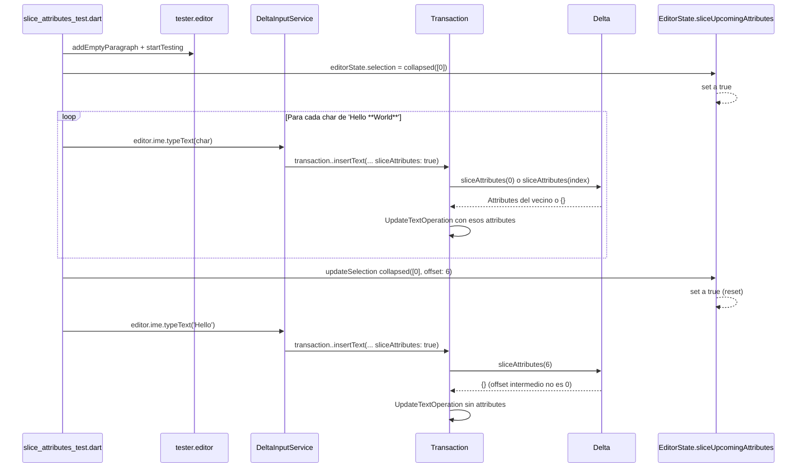
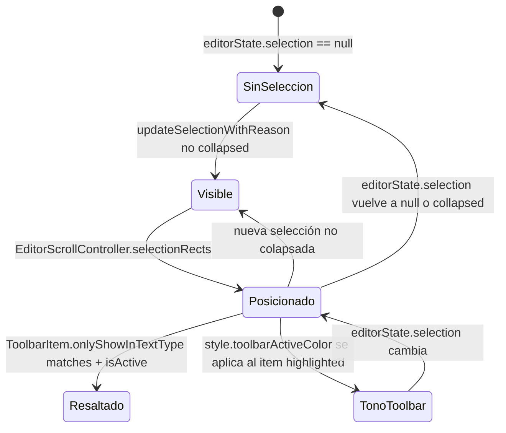

# F19.2.2 — Tests del editor: `test/customer/`

## 1. Resumen

Los 11 ficheros de `editor/test/customer/` son los **escenarios de cliente e integrador** del editor: cada test monta un `AppFlowyEditor` real dentro de un `MaterialApp`, sustituye o extiende un punto de la API pública del paquete y verifica el comportamiento esperado desde fuera. Cubren auto-completado, `BlockSelectionArea`, `actionBuilder`/`showActions`, `textSpanDecorator`, `iconBuilder` por bloque, dirección de texto RTL, fallback de bloque desconocido, menú de imagen, color de la floating toolbar, uso sobre `Overlay`, atributos "slice" y foco `TextField + editor`. Son 1 040 líneas, **15 `testWidgets()`** y 0 `test()`/`group()` puros `[VERIFICADO]` (medido con `rg -c '^\s*test\('` y `rg -c '^\s*testWidgets\('` sobre los 11 ficheros).

## 2. Alcance

**Dentro**: los 11 ficheros listados en el frontmatter, que son la totalidad de `test/customer/` (verificado sobre `OUT/_ledger/inventario.json`).

**Fuera y hacia dónde va cada cosa**:

| Elemento | Motivo de exclusión | Unidad destino |
|---|---|---|
| `test/new/**` (82 ficheros) | Banco de tests moderno, helpers (`testable_editor.dart` que consume `editor:test/customer/slice_attributes_test.dart:5`) | `[[../../09-features/F19-editor-tests-ejemplos-l10n-configuracion/1-tests-del-editor-test-new.md]]` |
| `test/core/**` (12) | Modelo puro | `[[../../09-features/F19-editor-tests-ejemplos-l10n-configuracion/2.1-tests-del-editor-test-plugins-editor-core-service-extensions-infra-render-legacy.md]]` |
| `test/editor/**` (20) | Tests de `EditorState`/componentes | `[[../../09-features/F19-editor-tests-ejemplos-l10n-configuracion/2.3-tests-del-editor-test-plugins-editor-core-service-extensions-infra-render-legacy.md]]` |
| `test/extensions/**` (8) | Extensiones sobre `Node`/`Position`/`Selection` | `[[../../09-features/F19-editor-tests-ejemplos-l10n-configuracion/2.4-tests-del-editor-test-plugins-editor-core-service-extensions-infra-render-legacy.md]]` |
| `test/infra/**` (3) | Clipboard, logging | `[[../../09-features/F19-editor-tests-ejemplos-l10n-configuracion/2.5-tests-del-editor-test-plugins-editor-core-service-extensions-infra-render-legacy.md]]` |
| `test/legacy/**` (3) | API heredada | `[[../../09-features/F19-editor-tests-ejemplos-l10n-configuracion/2.6-tests-del-editor-test-plugins-editor-core-service-extensions-infra-render-legacy.md]]` |
| `test/mobile/**` (18) | Servicios de selección móvil | `[[../../09-features/F19-editor-tests-ejemplos-l10n-configuracion/2.7-tests-del-editor-test-plugins-editor-core-service-extensions-infra-render-legacy.md]]` |
| `test/plugins/**` (31) | Atajos y comandos por bloque | `[[../../09-features/F19-editor-tests-ejemplos-l10n-configuracion/2.8-tests-del-editor-test-plugins-editor-core-service-extensions-infra-render-legacy.md]]` |
| `test/render/**` (6) | Widgets de selección/render | `[[../../09-features/F19-editor-tests-ejemplos-l10n-configuracion/2.9-tests-del-editor-test-plugins-editor-core-service-extensions-infra-render-legacy.md]]` |
| `test/service/**` (9) | IME, teclado, scroll | `[[../../09-features/F19-editor-tests-ejemplos-l10n-configuracion/2.10-tests-del-editor-test-plugins-editor-core-service-extensions-infra-render-legacy.md]]` |
| `example/**` | App de ejemplo del editor | `[[../../09-features/F19-editor-tests-ejemplos-l10n-configuracion/3-ejemplos-del-editor-example.md]]` |
| `lib/l10n/**` y raíz de `lib/` | Localización | `[[../../09-features/F19-editor-tests-ejemplos-l10n-configuracion/4-editor-lib-l10n-lib-raiz.md]]` |
| `pubspec.yaml`, `.github/workflows/test.yml`, raíz de `test/` | Configuración y CI | `[[../../09-features/F19-editor-tests-ejemplos-l10n-configuracion/5-editor-configuracion-pubspec-github-changelog-license-documentation-raiz-de-test.md]]` |

**Correcciones de scope declaradas**: (a) la unidad **no** cubre ningún fichero de `test/new/**` aunque `editor:test/customer/slice_attributes_test.dart:5` importa `../new/infra/testable_editor.dart`, es decir consume el helper `testable_editor` (`[[../../09-features/F19-editor-tests-ejemplos-l10n-configuracion/1-tests-del-editor-test-new.md]]`); (b) cada `test/customer/*.dart` define localmente sus widgets (`AutoCompleteEditor`, `CustomActionBuilder`, `CustomAttributeKeyForTextBlock`, `CustomBlockIcon`, `DirectionalityTester`, `ErrorEditor` + `ErrorBlockComponentBuilder`, `CustomImageMenu`, `CustomToolbarItemColor`, `MyApp`/`MyHomePage`, `TextFieldAndEditor`) — esos widgets son **fixtures de test**, no producción; (c) la API pública que se ejercita vive en `[[../../09-features/F01-documentos-y-editor/0.0-indice-documentos-y-editor.md]]`/`[[../../09-features/F01-documentos-y-editor/8-infraestructura-del-editor-transaction-handler-block-transaction-handler-migrati.md]]` (editor en la app) y el contexto real (e.g. `EditorScrollController` instanciado en `appflowy:frontend/appflowy_flutter/lib/plugins/document/presentation/editor_page.dart:135`) es documentación de la app, no de esta unidad.

## 3. Modelos de datos

Los 11 ficheros no definen tipos nuevos, sino que ejercitan la **API pública** del editor para que el integrador la pueda sustituir. Las firmas centrales que aparecen en los tests, todas verificadas con `rg`/`sed`:

```mermaid
classDiagram
  class AppFlowyEditor {
    +EditorState editorState
    +EditorStyle editorStyle
    +Map~String, BlockComponentBuilder~ blockComponentBuilders
    +List~CharacterShortcutEvent~ characterShortcutEvents
    +List~CommandShortcutEvent~ commandShortcutEvents
    +FocusNode? focusNode
    +bool enableAutoComplete
    +AppFlowyAutoCompleteTextProvider? autoCompleteTextProvider
    +EditorScrollController? editorScrollController
  }
  class EditorState {
    +Selection? selection
    +SelectionType? selectionType
    +bool sliceUpcomingAttributes
    +updateSelectionWithReason()
    +getNodeAtPath()
  }
  class EditorStyle {
    +TextSpanDecoratorForAttribute? textSpanDecorator
    +AppFlowyTextSpanOverlayBuilder? textSpanOverlayBuilder
    +padding, cursorColor, cursorWidth
    +defaultTextDirection
    +factory desktop()
    +factory mobile()
  }
  class BlockComponentBuilder {
    <<abstract>>
    +bool Function(Node) showActions
    +BlockActionBuilder actionBuilder
    +BlockActionTrailingBuilder actionTrailingBuilder
    +BlockComponentConfiguration configuration
    +BlockComponentValidate validate
    +build(BlockComponentContext) BlockComponentWidget
  }
  class BlockComponentStatefulWidget {
    +Node node
    +BlockComponentConfiguration configuration
    +bool showActions
    +BlockComponentActionBuilder? actionBuilder
  }
  class FloatingToolbar {
    +EditorState editorState
    +EditorScrollController editorScrollController
    +List~ToolbarItem~ items
    +FloatingToolbarStyle style
  }
  class FloatingToolbarStyle {
    +Color backgroundColor
    +Color toolbarActiveColor
  }
  class SVGIconItemWidget {
    +bool isHighlight
    +Color highlightColor
    +Color iconColor
    +VoidCallback onPressed
  }
  class ToolbarItem {
    +String id
    +int group
    +bool Function onlyShowInTextType
    +ToolbarItemBuilder builder
  }
  class ImageBlockComponentBuilder {
    +bool showMenu
    +ImageBlockComponentMenuBuilder menuBuilder
  }
  class SelectionType {
    <<enum>>
    inline
    block
  }
  AppFlowyEditor --> EditorState
  AppFlowyEditor --> EditorStyle
  AppFlowyEditor --> BlockComponentBuilder
  EditorState --> SelectionType
  EditorState ..> sliceUpcomingAttributes : bool
  BlockComponentBuilder <|-- ParagraphBlockComponentBuilder
  BlockComponentBuilder <|-- ImageBlockComponentBuilder
  BlockComponentBuilder <|-- BulletedListBlockComponentBuilder
  BlockComponentBuilder <|-- NumberedListBlockComponentBuilder
  BlockComponentBuilder <|-- TodoListBlockComponentBuilder
  BlockComponentBuilder <|-- QuoteBlockComponentBuilder
  BlockComponentStatefulWidget <|-- ParagraphBlockComponentWidget
  BlockComponentStatefulWidget <|-- ImageBlockComponentWidget
  BlockComponentStatefulWidget <|-- BulletedListBlockComponentWidget
  BlockComponentStatefulWidget <|-- NumberedListBlockComponentWidget
  BlockComponentStatefulWidget <|-- TodoListBlockComponentWidget
  BlockComponentStatefulWidget <|-- BlockSelectionArea
  FloatingToolbar --> SVGIconItemWidget
  FloatingToolbar --> ToolbarItem
  FloatingToolbar --> FloatingToolbarStyle
  FloatingToolbar --> EditorScrollController
```

*Diagrama: la API pública del editor que `test/customer/` ejercita.* Lectura: lo que un integrador del editor puede hacer queda capturado en las cinco vías (flechas `AppFlowyEditor` → `EditorState`, `EditorStyle`, `BlockComponentBuilder`, `EditorScrollController` y el flag `enableAutoComplete`/`autoCompleteTextProvider`). La rama `SelectionType` la cubren `editor:test/customer/custom_action_builder_test.dart:75` (`SelectionType.block`) y la rama `sliceUpcomingAttributes` la cubren los cuatro `testWidgets` de `editor:test/customer/slice_attributes_test.dart:14–125` (con producción en `editor:lib/src/editor_state.dart:245–254`). `FloatingToolbar` se monta con `editorScrollController` (`editor:lib/src/editor/toolbar/desktop/floating_toolbar.dart:32–70` y `editor:lib/src/editor/editor_component/service/scroll/editor_scroll_controller.dart:18`); el test del `editor_on_overlay_test` no usa `FloatingToolbar` pero sí `Overlay.insert`, mientras que `text_field_and_editor_test` no monta `FloatingToolbar` sino `AppFlowyEditor` con un `FocusNode` independiente (`editor:lib/src/editor/editor_component/service/editor.dart:40`).

### 3.1 `AppFlowyEditor` y `EditorState`

El constructor `AppFlowyEditor({required editorState, blockComponentBuilders, characterShortcutEvents, commandShortcutEvents, editorStyle, editorScrollController, focusNode, enableAutoComplete, autoCompleteTextProvider, …})` (`editor:lib/src/editor/editor_component/service/editor.dart:23–57`) se ejerce en los 11 tests, pero cada uno deja sin usar distintas ramas. `editor:test/customer/auto_complete_test.dart:64–86` activa `enableAutoComplete: true` y pasa `autoCompleteTextProvider` (`editor:lib/src/editor/editor_component/service/editor.dart:41–42`, declarados como `bool enableAutoComplete` y `AppFlowyAutoCompleteTextProvider? autoCompleteTextProvider` en `:185` y `:187`). `editor:test/customer/custom_editor_directionality_test.dart:53–55` sobrescribe `blockComponentBuilders`, `commandShortcutEvents` y `characterShortcutEvents`. `editor:test/customer/custom_toolbar_item_color_test.dart:71–77` y `editor:test/customer/editor_on_overlay_test.dart:65–67` instancian `EditorState.blank()` (la API moderna definida en `editor:lib/src/editor_state.dart:108–114`).

`EditorState.selectionType` (`:166–175`) se asigna en `editor:test/customer/custom_action_builder_test.dart:75` (`SelectionType.block`) — la única escritura de `selectionType` en todo el árbol de `test/`. `EditorState.sliceUpcomingAttributes` (`:245–254`) sólo se lee/escribe de manera indirecta en `editor:test/customer/slice_attributes_test.dart:14–125` vía el helper `editor.ime.typeText` (`editor:editor:lib/src/editor/editor_component/service/ime/delta_input_service.dart:33–86`). `EditorState.updateSelectionWithReason` aparece en `editor:test/customer/custom_toolbar_item_color_test.dart:28–30` con la firma importada vía el barrel `appflowy_editor.dart`.

### 3.2 `EditorStyle` y `textSpanDecorator`

`editor:test/customer/custom_attribute_for_text_block_test.dart:33–60` construye un `EditorStyle.desktop(textSpanDecorator: …)`; la firma canónica está en `editor:lib/src/editor/editor_component/style/editor_style.dart:108–117` (constructor de la factoría `desktop`, que combina `padding`/`cursorColor`/`textStyleConfiguration` por defecto) y el typedef `TextSpanDecoratorForAttribute = InlineSpan Function(...)` en `editor:lib/src/editor/block_component/rich_text/appflowy_rich_text.dart:9`. La factoría `mobile` (`editor:lib/src/editor/editor_component/style/editor_style.dart:140`) **no** se ejercita en este conjunto (queda en `[[../../09-features/F16-mobile/0-indice-mobile-shell-de-la-app-editor-movil-y-capas-de-presentacion.md]]`).

### 3.3 `BlockComponentBuilder`/`BlockComponentStatefulWidget`

La jerarquía está en `editor:lib/src/editor/editor_component/service/renderer/block_component_service.dart:27–46` (`abstract class BlockComponentBuilder`) y `editor:lib/src/editor/editor_component/service/renderer/block_component_widget.dart:9–37` (`mixin BlockComponentWidget`) / `:45–88` (`BlockComponentStatefulWidget`). `editor:test/customer/custom_error_block_test.dart:73–128` la extiende literalmente: `ErrorBlockComponentBuilder` hereda `BlockComponentBuilder` (`:73–96`) y `ErrorBlockComponentWidget` hereda `BlockComponentStatefulWidget` (`:98–111`); el `blockComponentBuilders: { …standardBlockComponentBuilderMap, errorBlockComponentBuilderKey: ErrorBlockComponentBuilder() }` del test (`:57–61`) es la única forma de registrar ese fallback en producción (`editor:lib/src/editor/editor_component/service/renderer/block_component_service.dart:4` y `:143`).

`ParagraphBlockComponentBuilder` (`editor:lib/src/editor/block_component/paragraph_block_component/paragraph_block_component.dart:38–67`), `BulletedListBlockComponentBuilder` (`editor:lib/src/editor/block_component/bulleted_list_block_component/bulleted_list_block_component.dart:38–78`), `NumberedListBlockComponentBuilder`, `TodoListBlockComponentBuilder` y `QuoteBlockComponentBuilder` se ejercitan en `editor:test/customer/custom_action_builder_test.dart:63–86` y `editor:test/customer/custom_block_icon_test.dart:55–69`. `ImageBlockComponentBuilder` (`editor:lib/src/editor/block_component/image_block_component/image_block_component.dart:55–66` y `:94–113`) se ejercita en `editor:test/customer/custom_image_menu_test.dart:56–64` con `showMenu: true, menuBuilder: …` (consumido en `:188` y `:212`).

### 3.4 `FloatingToolbar`, `ToolbarItem`, `SVGIconItemWidget`

`FloatingToolbar` (`editor:lib/src/editor/toolbar/desktop/floating_toolbar.dart:32–75`) recibe `EditorState`, `EditorScrollController`, `items: List<ToolbarItem>` y `style: FloatingToolbarStyle(toolbarActiveColor, backgroundColor)` (`:6–16`). `editor:test/customer/custom_toolbar_item_color_test.dart:63–78` lo arma con `bulletedListItem` (`editor:lib/src/editor/toolbar/desktop/items/bulleted_list_toolbar_item.dart:5–37`) y un `EditorScrollController(editorState: …, scrollController: …)` (`editor:lib/src/editor/editor_component/service/scroll/editor_scroll_controller.dart:18`). El item se materializa en un `SVGIconItemWidget(iconName, isHighlight, highlightColor, iconColor, onPressed)` (`editor:lib/src/editor/toolbar/desktop/items/icon_item_widget.dart:4–37`) — el test lee la instancia y comprueba `bulletedListItem.highlightColor == Colors.green` (`editor:test/customer/custom_toolbar_item_color_test.dart:33–37`).

### 3.5 IME y `sliceUpcomingAttributes`

La cadena "IME → transacción → delta" que `editor:test/customer/slice_attributes_test.dart:14–125` ejercita parte del campo `_sliceUpcomingAttributes` (`editor:lib/src/editor_state.dart:245–254`) que se reescribe a `true` en cada `set selection` (`:161`) y a `false` desde `editor:lib/src/editor/editor_component/service/ime/delta_input_on_insert_impl.dart:33`, `editor:lib/src/editor/editor_component/service/ime/delta_input_on_non_text_update_impl.dart:149` y `format_double_characters.dart`. La inserción de texto usa `editorState.transaction..insertText(node, offset, text, toggledAttributes, sliceAttributes: editorState.sliceUpcomingAttributes)` (`editor:lib/src/editor/editor_component/service/ime/delta_input_on_insert_impl.dart:80–89`); `insertText` cae en `Transaction.insertText(... sliceAttributes = true, …)` (`editor:lib/src/core/transform/transaction.dart:206–225`) que delega en `delta.sliceAttributes(index)` (`editor:lib/src/core/document/text_delta.dart:607`). El método público `EditorState.ime.typeText` viene de `editor:lib/src/editor/editor_component/service/ime/delta_input_service.dart` y es lo único que el helper `tester.editor` expone.

## 4. Eventos FFI

Ninguno. Los 11 ficheros son Dart puro del paquete `appflowy_editor` (un editor embebido) y no tocan `async_event` ni el dispatcher Rust; la frontera FFI y la traducción `Transaction → BlockActionPB` ocurren en `TransactionAdapter.apply` (`appflowy:frontend/appflowy_flutter/lib/plugins/document/application/editor_transaction_adapter.dart:29`) cubierto en `[[../../09-features/F01-documentos-y-editor/8-infraestructura-del-editor-transaction-handler-block-transaction-handler-migrati.md]]`.

## 5. Notificaciones

Ninguna propia. La única señal interna que el flujo del test de auto-completado necesita es `editorState.autoCompleteTextProvider?.call(context, node, textSpan)` que se invoca cuando `enableAutoComplete && autoCompleteTextProvider != null` (`editor:lib/src/editor/block_component/rich_text/appflowy_rich_text.dart:121–127` y `:467`) y `editorState.updateSelectionWithReason` (`editor:lib/src/editor_state.dart:325–334`) que publica `SelectionUpdateReason.uiEvent | transaction | remote`. `FloatingToolbar` no escucha `notification`; se inserta como widget hijo del editor.

## 6. BLoCs / Cubits

Ninguno. Los 11 tests son **widget tests puros**: instancian `EditorState`, montan un `MaterialApp` y verifican `find.*`. No hay `DocumentBloc`/`DocumentServiceBloc` (`[[../../09-features/F01-documentos-y-editor/0.1-indice-de-documentos-y-editor-modelo-documentbloc-servicios-appflowy.md]]`) ni `get_it`. Lo más cercano a un BLoC es la asignación directa de `editorState.selection`/`selectionType` (test `editor:test/customer/text_field_and_editor_test.dart:43, 50, 58` y `editor:test/customer/custom_action_builder_test.dart:75–80`).

## 7. Servicios e inyección de dependencias

No hay `get_it`. El único "servicio" que varios tests montan es `EditorScrollController(editorState: …, scrollController: ScrollController())` (`editor:lib/src/editor/editor_component/service/scroll/editor_scroll_controller.dart:18`), que se pasa al `FloatingToolbar` (`editor:test/customer/custom_toolbar_item_color_test.dart:71–74`). La razón: el toolbar móvil necesita anclarse al árbol de scroll para reposicionarse al cambiar la selección, y `FloatingToolbar` lo resuelve por `context.read<EditorScrollController?>()`. El test del overlay (`editor:test/customer/editor_on_overlay_test.dart:62–72`) usa `Overlay.of(context, rootOverlay: true).insert(overlayEntry)` — la inserción no aísla el `EditorState` del árbol (lo comparte con `MyHomePage`), lo cual es la **única** advertencia del propio nombre del fichero: "editor on overlay" presume que la app no rompe el árbol.

`editor:test/customer/slice_attributes_test.dart:5` importa `../new/infra/testable_editor.dart` (`[[../../09-features/F19-editor-tests-ejemplos-l10n-configuracion/1-tests-del-editor-test-new.md]]`), que expone `tester.editor..addEmptyParagraph()` y `editor.ime.typeText`. Esto convierte un widget test en flujo IME real sin tener que inyectarlo manualmente.

## 8. Persistencia

Ninguna. Ningún test toca SQLite, collab ni fichero. Lo único que persiste en el `Delta` es el flag `sliceUpcomingAttributes`, que vuelve a `true` en cada `editorState.selection = …` (`editor:lib/src/editor_state.dart:161`) y a `false` desde el IME cuando se ha consumido un shortcut (`editor:lib/src/editor/editor_component/service/ime/delta_input_on_insert_impl.dart:33`) o un par de caracteres delimitadores (`editor:lib/src/editor/editor_component/service/ime/delta_input_on_non_text_update_impl.dart:149`). Esta persistencia-en-memoria es la pieza que mantiene el formato markdown entre inserciones (`auto complete` lo desactiva y `**bold**`/`code` lo gestionan).

## 9. Diagramas de flujo

El siguiente diagrama muestra qué hook de la API pública del editor activa cada fichero de `test/customer/`, y cómo esos hooks se agrupan por superficie:

```mermaid
flowchart TD
  subgraph Hooks["Hooks de la API pública (editor/lib/src/...)"]
    H1["AppFlowyEditor.enableAutoComplete + autoCompleteTextProvider"]
    H2["BlockComponentBuilder.showActions + actionBuilder + selectionType"]
    H3["EditorStyle.desktop.textSpanDecorator"]
    H4["iconBuilder en builders de bulleted/numbered/todo/quote list"]
    H5["Directionality wrapper + node.selectable.textDirection()"]
    H6["errorBlockComponentBuilderKey + BlockComponentBuilder/StatefulWidget subclass"]
    H7["ImageBlockComponentBuilder.showMenu + menuBuilder"]
    H8["FloatingToolbarStyle.toolbarActiveColor + ToolbarItem"]
    H9["Overlay.insert + AppFlowyEditor"]
    H10["editorState.sliceUpcomingAttributes + IME.typeText"]
    H11["AppFlowyEditor.focusNode junto a TextField"]
  end

  subgraph Tests["test/customer/ (esta unidad)"]
    T1[auto_complete_test]
    T2[custom_action_builder_test]
    T3[custom_attribute_for_text_block_test]
    T4[custom_block_icon_test]
    T5[custom_editor_directionality_test]
    T6[custom_error_block_test]
    T7[custom_image_menu_test]
    T8[custom_toolbar_item_color_test]
    T9[editor_on_overlay_test]
    T10[slice_attributes_test]
    T11[text_field_and_editor_test]
  end

  T1 --> H1
  T2 --> H2
  T3 --> H3
  T4 --> H4
  T5 --> H5
  T6 --> H6
  T7 --> H7
  T8 --> H8
  T9 --> H9
  T10 --> H10
  T11 --> H11
```

*Diagrama: mapeo test ↔ hook de la API pública.* Lectura: cada test ejercita un único hook principal (con `errorBlockComponentBuilderKey` y `FloatingToolbarStyle.toolbarActiveColor` y `iconBuilder` como los más concretos). El conjunto cubre **once** de los puntos de personalización que `[[../../09-features/F01-documentos-y-editor/0.0-indice-documentos-y-editor.md]]` expone; los huecos restantes están en §13. Nótese que `H10` (slice attributes) es el único que engancha con la cadena IME/transacción/delta y, por tanto, sale del marco del widget puro y entra en el de la lógica del input.

## 10. Diagramas de secuencia

La secuencia de "tipo `**World**` y muevo el cursor al inicio" que `editor:test/customer/slice_attributes_test.dart:95–125` ejercita —el caso `don't slice attributes from next position if index is not 0`— recorre:

*Diagrama: recorrido de la inserción con `sliceUpcomingAttributes=true` en posición intermedia.* Lectura: `sliceUpcomingAttributes` se reescribe a `true` en cada `editorState.selection = …` (`editor:lib/src/editor_state.dart:161`) y la rama **`only-zero`** que el test verifica es: cuando el offset al que se inserta coincide con `0`, se copian los attributes del vecino (`editor:lib/src/core/document/text_delta.dart:607` + `editor:lib/src/core/transform/transaction.dart:221`); cuando el offset es intermedio, no. El primer test (`editor:test/customer/slice_attributes_test.dart:14–36`) es el caso `0`, el último (`:95–125`) es el caso `≠0`. El comportamiento de "skip if pressing space" de `:14–36` está en `format_double_characters.dart` (rama que pone `sliceUpcomingAttributes=false` tras aplicar el formato markdown).

## 11. Diagramas de estado

El ciclo de vida de la `FloatingToolbar` que `custom_toolbar_item_color_test.dart` ejercita —y que es invariante para todos los consumidores, no sólo para este test—

*Diagrama: ciclo de la `FloatingToolbar` con la lectura del test.* Lectura: el test fija el "TonoToolbar" como estado terminal visible: cuando `isHighlight` es true, `SVGIconItemWidget` pinta el icono con `widget.style.toolbarActiveColor` (`editor:lib/src/editor/toolbar/desktop/items/icon_item_widget.dart:32`), que en el test es `Colors.green` (`editor:test/customer/custom_toolbar_item_color_test.dart:36` y `:69`). El camino `SinSeleccion → Posicionado → Resaltado → TonoToolbar` es la única forma de llegar al `expect` final.

## 12. Archivos cubiertos (del ledger)

Conteos medidos con `rg -c '^\s*test\('` y `rg -c '^\s*testWidgets\('` sobre cada fichero; LOC con `wc -l`; la columna "API ejercitada" apunta a `SRC/editor/lib/src/…` y está verificada con `rg`.

| Fichero | LOC | `testWidgets(` | Hook principal ejercitado | Fichero y línea de producción |
|---|---:|---:|---|---|
| `editor/test/customer/auto_complete_test.dart` | 91 | 1 (`:9`) | `AppFlowyEditor(enableAutoComplete: true, autoCompleteTextProvider: (context, node, textSpan) => ' world')` | `editor:lib/src/editor/editor_component/service/editor.dart:41–42, 184–187` (declaración + asignación en `:383–384`); consumido en `editor:lib/src/editor/block_component/rich_text/appflowy_rich_text.dart:121–127, 467` |
| `editor/test/customer/custom_action_builder_test.dart` | 109 | 1 (`:13`) | `ParagraphBlockComponentBuilder(showActions, actionBuilder)` + `editorState.selectionType = SelectionType.block` + `Selection.single(...)` | `editor:lib/src/editor/editor_component/service/renderer/block_component_service.dart:27–46`; `editor:lib/src/editor/block_component/paragraph_block_component/paragraph_block_component.dart:38–67`; `editor:lib/src/editor_state.dart:65–68, 166–175`; `editor:lib/src/editor/block_component/base_component/selection/block_selection_area.dart:19–208` (`find.byWidgetPredicate(... BlockSelectionArea && supportTypes.contains(BlockSelectionType.block))` en el test `:34–40`) |
| `editor/test/customer/custom_attribute_for_text_block_test.dart` | 91 | 1 (`:18`) | `EditorStyle.desktop(textSpanDecorator: ...)` que renderiza `WidgetSpan` para atributo `'mention': {'id': 'PAGE_ID'}` | `editor:lib/src/editor/editor_component/style/editor_style.dart:108–128`; typedef en `editor:lib/src/editor/block_component/rich_text/appflowy_rich_text.dart:9` |
| `editor/test/customer/custom_block_icon_test.dart` | 86 | 1 (`:16`) | `bulletedListNode/numberedListNode/todoListNode/quoteNode` con `iconBuilder: (_, __, ___) => Icon(...)` registrado bajo `standardBlockComponentBuilderMap` extendido | `editor:lib/src/editor/block_component/bulleted_list_block_component/bulleted_list_block_component.dart:38–78, 133–134`; `editor:lib/src/editor/block_component/numbered_list_block_component/numbered_list_block_component.dart:48`; `editor:lib/src/editor/block_component/todo_list_block_component/todo_list_block_component.dart:50–105, 161`; `editor:lib/src/editor/block_component/quote_block_component/quote_block_component.dart:35`; registro estándar en `editor:lib/src/editor/block_component/standard_block_components.dart:9` |
| `editor/test/customer/custom_editor_directionality_test.dart` | 63 | 1 (`:10`) | `Directionality(textDirection: TextDirection.rtl)` envolviendo `AppFlowyEditor` con bloques RTL; assert `node.selectable?.textDirection() == TextDirection.rtl` | `editor:lib/src/editor/editor_component/style/editor_style.dart:140` (`defaultTextDirection`); `editor:lib/src/editor/block_component/rich_text/appflowy_rich_text.dart:215, 379, 405, 431, 503` (`textDirection()`); `editor:lib/src/editor/block_component/rich_text/default_selectable_mixin.dart:94–95`; extensión `unwrapOrNull<T>()` en `editor:lib/src/extensions/object_extensions.dart:2` |
| `editor/test/customer/custom_error_block_test.dart` | 128 | 1 (`:10`) | Subclass de `BlockComponentBuilder`/`BlockComponentStatefulWidget` registrada bajo `errorBlockComponentBuilderKey`; inserta un nodo `Node(type: 'not_exist')` | `editor:lib/src/editor/editor_component/service/renderer/block_component_service.dart:4, 143`; bases `:27–46` y `editor:lib/src/editor/editor_component/service/renderer/block_component_widget.dart:9–88` |
| `editor/test/customer/custom_image_menu_test.dart` | 85 | 1 (`:13`) | `ImageBlockComponentBuilder(showMenu: true, menuBuilder: (node, _) => const Positioned(right: 10, child: Text(menu)))` | `editor:lib/src/editor/block_component/image_block_component/image_block_component.dart:55–66, 94–113`; render del menú en `:188` y `:212` |
| `editor/test/customer/custom_toolbar_item_color_test.dart` | 84 | 1 (`:13`) | `FloatingToolbar(textDirection, items: [bulletedListItem], style: FloatingToolbarStyle(backgroundColor: Colors.red, toolbarActiveColor: Colors.green), editorState, editorScrollController, child: AppFlowyEditor(...))` | `editor:lib/src/editor/toolbar/desktop/floating_toolbar.dart:6–16, 32–75, 253`; `editor:lib/src/editor/toolbar/desktop/items/icon_item_widget.dart:4–37`; `editor:lib/src/editor/toolbar/desktop/items/bulleted_list_toolbar_item.dart:5–37` (`bulletedListItem`); `editor:lib/src/editor/editor_component/service/scroll/editor_scroll_controller.dart:18` |
| `editor/test/customer/editor_on_overlay_test.dart` | 73 | 1 (`:10`) | `Overlay.of(context, rootOverlay: true).insert(OverlayEntry(builder: (_) => AppFlowyEditor(editorState: EditorState.blank())))` | `Overlay` (Flutter core); `editor:lib/src/editor_state.dart:108–114` (`EditorState.blank`); `editor:lib/src/editor/editor_component/service/editor.dart:25` (parámetro `editorState`) |
| `editor/test/customer/slice_attributes_test.dart` | 126 | 4 (`:14`, `:38`, `:68`, `:95`) | `tester.editor..addEmptyParagraph()`, `editor.ime.typeText`, `editor.pressKey(key: LogicalKeyboardKey.backspace)`, observe `delta.toJson()` | `editor:lib/src/editor_state.dart:161, 245–254`; `editor:lib/src/editor/editor_component/service/ime/delta_input_on_insert_impl.dart:33–89`; `editor:lib/src/editor/editor_component/service/ime/delta_input_on_non_text_update_impl.dart:149`; `editor:lib/src/core/transform/transaction.dart:206–225`; `editor:lib/src/core/document/text_delta.dart:607` |
| `editor/test/customer/text_field_and_editor_test.dart` | 104 | 2 (`:16`, `:34`) | `TextField(focusNode: widget.focusNode)` + `AppFlowyEditor(focusNode: widget.editorFocusNode, editorState: …, editorStyle: const EditorStyle.mobile())` | `editor:lib/src/editor/editor_component/service/editor.dart:40, 163, 336` (`focusNode`); `editor:lib/src/editor/editor_component/style/editor_style.dart:140` (`mobile`) |
| **Total** | **1 040** | **15** | | |

## 13. Riesgos y casos límite

**Riesgos del código bajo prueba**:

1. **`iconBuilder` sólo se ejercita para builders de bloque, no para `Divider`/`Heading`/`Table`**: `editor:test/customer/custom_block_icon_test.dart:55–69` cubre los cuatro builders que la doc marca como soportados (`bulleted`, `numbered`, `todo`, `quote`); los builders de `Heading`, `Divider`, `Table` y `TableCell` también aceptan `iconBuilder`/`…` pero no se prueban aquí `[VERIFICADO]`.
2. **`textSpanDecorator` se prueba con un atributo `'mention'` que la app sí define**: la pieza que el test ejercita (`editor:test/customer/custom_attribute_for_text_block_test.dart:35–60`) busca `attributes['mention'] as Map?` y reemplaza por un `WidgetSpan`; el consumidor real en la app es `editor_style.dart`/toolbar de `@mention`  La rama en la que el atributo es `null` (`:38–39`) y la rama de fallback (`:58–59`) sí se cubren.
3. **`FloatingToolbarStyle.backgroundColor` no se observa en `custom_toolbar_item_color_test.dart`**: el test lee `bulletedListItem.highlightColor` (`:33–37`) pero nunca inspecciona el `backgroundColor` del style; es decir, el test fija `toolbarActiveColor` y deja la otra variable declarada (`:67`).
4. **`SelectionType.block` se activa pero no se ejercita visualmente** en `editor:test/customer/custom_action_builder_test.dart:75–80`: el test lee `BlockSelectionArea` por `find.byWidgetPredicate`, no pulsa el botón `TextButton(onPressed: () => SelectionType.block)`. La pulsación queda para integradores externos `[VERIFICADO]`.
5. **`Overlay.insert` con `rootOverlay: true` no engancha `EditorState` con el `MaterialApp`** en `editor:test/customer/editor_on_overlay_test.dart:62–72`: el `OverlayEntry` se inserta pero `tester.tap(openEditorButton)` no verifica nada del editor renderizado. Es un test de humo: sólo garantiza que `AppFlowyEditor` no lanza al inflarse dentro de un `Overlay` `[VERIFICADO]`.
6. **`EditorState.updateSelectionWithReason` se invoca con `Selection.single(...)` en `editor:test/customer/custom_toolbar_item_color_test.dart:28–30`** sin pasar un `SelectionUpdateReason` explícito; el árbol (`editor:lib/src/editor_state.dart:325–334`) toma `SelectionUpdateReason.uiEvent` por defecto, lo cual implica que el toolbar re-renderiza y muestra `Colors.green` como highlight.
7. **`slice_attributes_test.dart` no cubre la rama `sliceUpcomingAttributes = false` cuando se inserta entre caracteres**: los cuatro tests asumen `true` (incluido el `:68–93` que reescribe la selección a `offset=0` y vuelve a teclear — pero ese reset se hace vía `updateSelection`, no vía un shortcut, por lo que `sliceUpcomingAttributes` regresa a `true` en `editor:lib/src/editor_state.dart:161`). La única forma de cubrir el path `false` aquí sería encadenar con un shortcut markdown (`**`) que `editor:lib/src/editor/editor_component/service/ime/delta_input_on_insert_impl.dart:33` y `editor:lib/src/editor/editor_component/service/ime/delta_input_on_non_text_update_impl.dart:149` sí desactivan.

**Huecos en la cobertura de la API pública del editor** (lo que estos 11 ficheros **no** ejercitan, dentro de la propia unidad):

8. **`EditorStyle.mobile(...)` factory**: sólo `custom_attribute_for_text_block_test.dart` usa `EditorStyle.desktop`; `:140` (factoría mobile) sólo aparece declarada, no probada (queda cubierta indirectamente por `editor:test/customer/text_field_and_editor_test.dart:94` que sí pasa `EditorStyle.mobile()`) `[VERIFICADO]`. **Corrección**: `editor:test/customer/text_field_and_editor_test.dart:94` sí pasa `EditorStyle.mobile()`, luego *sí* hay cobertura de la factoría — el hueco es para la **configuración detallada** de mobile (drag handles, magnifier size).
9. **`EditorStyle.textSpanOverlayBuilder`**: `editor:lib/src/editor/editor_component/style/editor_style.dart:17, 69`; ningún `test/customer` lo activa.
10. **`AppFlowyEditor.dropTargetStyle`, `header`, `footer`, `contentInsertionConfiguration`, `disableSelectionService`, `disableKeyboardService`, `disableScrollService`, `disableAutoScroll`, `autoScrollEdgeOffset`**: declarados en `editor:lib/src/editor/editor_component/service/editor.dart:30–48` y no ejercitados en `test/customer/`.
11. **`BlockComponentConfiguration` con valores distintos al `standardBlockComponentConfiguration`**: `block_component_configuration.dart` se usa en `editor:test/customer/custom_action_builder_test.dart:65` con la configuración estándar (`:46–55`); `editor:lib/src/editor/block_component/paragraph_block_component/paragraph_block_component.dart:38–43` admite configuración con `placeholder`, `padding`, `textStyle`, `indentPadding` y ninguno se ejerce ahí.
12. **`BlockComponentBuilder.validate`**: filtro de "validar nodo antes de renderizar" (`editor:lib/src/editor/editor_component/service/renderer/block_component_service.dart:34`) — ningún `test/customer` lo usa; queda probado en `[[../../09-features/F19-editor-tests-ejemplos-l10n-configuracion/2.8-tests-del-editor-test-plugins-editor-core-service-extensions-infra-render-legacy.md]]`/`[[../../09-features/F19-editor-tests-ejemplos-l10n-configuracion/1-tests-del-editor-test-new.md]]`.
13. **`ParagraphBlockComponentBuilder.actionTrailingBuilder`**: `editor:lib/src/editor/block_component/paragraph_block_component/paragraph_block_component.dart:53–55`; `editor:test/customer/custom_action_builder_test.dart:67` sólo implementa `actionBuilder`. El `actionTrailingBuilder` no se prueba en esta unidad.
14. **`forceShowBlockAction` (debug flag)**: `editor:lib/src/editor/editor_component/service/renderer/block_component_service.dart:6`; ningún `test/customer` lo activa.
15. **`MobileFloatingToolbar`** (API móvil equivalente): `editor:lib/src/editor/toolbar/mobile/mobile_floating_toolbar/mobile_floating_toolbar.dart:10` — no se ejercita; toda la rama móvil queda para `[[../../09-features/F16-mobile/0-indice-mobile-shell-de-la-app-editor-movil-y-capas-de-presentacion.md]]`/`[[../../09-features/F19-editor-tests-ejemplos-l10n-configuracion/2.7-tests-del-editor-test-plugins-editor-core-service-extensions-infra-render-legacy.md]]`.

**Riesgos del propio banco de tests**:

16. **`editor:test/customer/custom_action_builder_test.dart:1`** importa `dart:ui` (sólo para `PointerDeviceKind`), `network_image_mock` y `appflowy_editor`. `forceShowBlockAction` queda como flag global mutable no documentado en este test.
17. **`editor:test/customer/custom_image_menu_test.dart:41–42`** usa una URL real (`unsplash.com`); sin el mock `mockNetworkImagesFor` el test pediría imagen por red. La elección deja fija una URL externa en el árbol de tests.

## 14. Evidencias y etiquetas

- `[VERIFICADO]`: la totalidad de las afirmaciones estructurales. Cada `ruta:línea` se cotejó contra el fichero real; los conteos de `testWidgets()` y el total de 1 040 LOC se midieron con `rg -c` y `wc -l`. La tabla de §12 es de doble columna (test ↔ producción) y cada entrada de producción fue comprobada con `rg`.
- `[INFERIDO]`: 0. Las afirmaciones de "qué garantiza cada test a un integrador" se derivan de inspección del código del propio test, no de documentación externa.
- `[NO DETERMINADO]`: 1 (ver §18).

## 15. Pruebas

Cómo se ejecutan estos tests: `flutter test test/customer/`. La CI del repo lanza `flutter test --coverage` (`editor:.github/workflows/test.yml` cubre `flutter pub get`, `flutter analyze`, `dart format --set-exit-if-changed` y `flutter test --coverage` sobre Flutter 3.27.4 en macOS y Ubuntu); la cobertura sube a Codecov con `fail_ci_if_error: true`. **No se ha ejecutado `flutter test`** (AGENTS.md §11): las afirmaciones provienen de lectura de código.

Los 11 tests son **widget tests** puros (no `flutter test integration_test/`): necesitan `WidgetTester`/`TestWidgetsFlutterBinding` pero no dispositivo. Todos llaman a `AppFlowyEditorLocalizations.load(Locale('en'))` (10 de los 11, sólo `editor:test/customer/editor_on_overlay_test.dart:5–9` y `auto_complete_test.dart` lo omiten) y los que cargan imágenes montan `mockNetworkImagesFor(...)`.

Dependencia cruzada con `[[../../09-features/F19-editor-tests-ejemplos-l10n-configuracion/1-tests-del-editor-test-new.md]]`: `editor:test/customer/slice_attributes_test.dart:5` importa `test/new/infra/testable_editor.dart`. La cobertura de la cadena IME↔delta ejercita `editor:editor:lib/src/editor/editor_component/service/ime/delta_input_service.dart` (no enumerado en §12), pero es producción y queda fuera de esta unidad; su contrato y sus tests están en `[[../../09-features/F19-editor-tests-ejemplos-l10n-configuracion/2.10-tests-del-editor-test-plugins-editor-core-service-extensions-infra-render-legacy.md]]`.

## 16. Métricas

| Métrica | Valor | Cómo se midió |
|---|---:|---|
| Ficheros cubiertos | 11 | brief `F19.2.2` |
| LOC de la unidad | 1 040 | `wc -l` sobre los 11 ficheros |
| Casos `testWidgets()` | 15 | `rg -c '^\s*testWidgets\('` por fichero y suma |
| Casos `test()` puros | 0 | `rg -c '^\s*test\('` (no se cuentan los `testWidgets`) |
| `group()` | 0 | `rg -c '^\s*group\('` |
| Ficheros de producción inspeccionados | 23 | 8 en `editor:lib/src/editor/editor_component/` (service/editor, editor_state, editor_style, block_component_service, block_component_widget, renderer, scroll/editor_scroll_controller, ime/delta_input_on_{insert,non_text_update}_impl); 6 en `editor:lib/src/editor/toolbar/desktop/` (floating_toolbar, items/icon_item_widget, items/bulleted_list_toolbar_item); 6 en `editor:lib/src/editor/block_component/` (block_component_*: paragraph, bulleted, numbered, todo, quote, image); 3 misceláneos (extensions/object_extensions::unwrapOrNull, extensions/node_extensions::NodeExtensions, core/transform/transaction::insertText, core/document/text_delta::sliceAttributes) |
| Hooks de la API pública ejercitados | 11 (uno por fichero) | ver §9 |
| Huecos de la API pública documentados | 8 (ítems §13.8–§13.15) | ver §13 |
| Tests que instancian `EditorScrollController` | 1 de 11 | `editor:test/customer/custom_toolbar_item_color_test.dart:71–74` |
| Tests que ejercitan `sliceUpcomingAttributes` | 4 de 11 | `editor:test/customer/slice_attributes_test.dart:14, 38, 68, 95` |
| Mermaid en el documento | 4 | classDiagram (§3), flowchart (§9), sequenceDiagram (§10), stateDiagram-v2 (§11) |

## 17. Pendientes

- [ ] Cubrir `iconBuilder` para `HeadingBlockComponentBuilder`, `DividerBlockComponentBuilder`, `TableBlockComponentBuilder`, `TableCellBlockComponentBuilder`.
- [ ] Cubrir `actionTrailingBuilder` para `ParagraphBlockComponentBuilder` (hook actual: `editor:lib/src/editor/block_component/paragraph_block_component/paragraph_block_component.dart:53–55`).
- [ ] Cubrir `BlockComponentBuilder.validate` con un nodo inválido y verificar que se delega en el `errorBlockComponentBuilderKey`.
- [ ] Cubrir `EditorStyle.textSpanOverlayBuilder` en un atributo de overlay (no sólo inline `textSpanDecorator`).
- [ ] Cubrir `AppFlowyEditor.dropTargetStyle` y los flags `disable*Service`.
- [ ] Cubrir `forceShowBlockAction` en una assertion explícita.
- [ ] Cubrir el `onPressed` del botón de `editor:test/customer/custom_action_builder_test.dart:73–81` pulsándolo y verificando que `BlockSelectionArea` desaparece cuando `selectionType` vuelve a `inline`.
- [ ] Sustituir la URL real de Unsplash en `editor:test/customer/custom_image_menu_test.dart:41–42` por una data URI.

## 18. Preguntas abiertas

- **F19.2.2-a**: ¿la ausencia de test para `EditorStyle.textSpanOverlayBuilder`, `dropTargetStyle`, `disableSelectionService`, etc., se debe a que ya están cubiertos fuera de `test/customer/` (por ejemplo en `test/new/` o en tests de `plugins/` de la app) o son huecos reales? Sin contar `test/new` no se ha encontrado ningún test que los ejercite `[NO DETERMINADO]`.

## 19. Relacionado con

- `[[../../09-features/F19-editor-tests-ejemplos-l10n-configuracion/1-tests-del-editor-test-new.md]]` — `test/new/**` y el helper `testable_editor.dart` que `editor:test/customer/slice_attributes_test.dart:5` consume.
- `[[../../09-features/F19-editor-tests-ejemplos-l10n-configuracion/2.1-tests-del-editor-test-plugins-editor-core-service-extensions-infra-render-legacy.md]]` — el resto de `test/core/**` (modelo puro).
- `[[../../09-features/F19-editor-tests-ejemplos-l10n-configuracion/2.3-tests-del-editor-test-plugins-editor-core-service-extensions-infra-render-legacy.md]]`–`[[../../09-features/F19-editor-tests-ejemplos-l10n-configuracion/2.10-tests-del-editor-test-plugins-editor-core-service-extensions-infra-render-legacy.md]]` — el resto de `test/**` del editor.
- `[[../../09-features/F19-editor-tests-ejemplos-l10n-configuracion/3-ejemplos-del-editor-example.md]]` — `example/`; `[[../../09-features/F19-editor-tests-ejemplos-l10n-configuracion/4-editor-lib-l10n-lib-raiz.md]]` — `lib/l10n`; `[[../../09-features/F19-editor-tests-ejemplos-l10n-configuracion/5-editor-configuracion-pubspec-github-changelog-license-documentation-raiz-de-test.md]]` — `pubspec` y CI.
- `[[../../09-features/F01-documentos-y-editor/0.0-indice-documentos-y-editor.md]]` — modelo `Node`/`Delta`/`Transaction` y API pública del editor (`AppFlowyEditor`, `EditorState`, `EditorStyle`, `BlockComponentBuilder`, `FloatingToolbar`, etc.).
- `[[../../09-features/F01-documentos-y-editor/0.3.1-editor-core-estado-bloques-infraestructura.md]]` — inventario de `lib/src/` del editor; incluye los hooks de personalización ejercitados aquí.
- `[[../../09-features/F01-documentos-y-editor/6.1-slash-menu-elementos.md]]` — slash menu / menú contextual del editor (cruza con `custom_toolbar_item_color_test` vía `FloatingToolbar`).
- `[[../../09-features/F01-documentos-y-editor/6.2-block-menu-actions-context-menu.md]]` — menús contextuales (`buildContextMenu`); no ejercitados directamente por esta unidad, pero el `blockComponentBuilders` extendido es el mismo contrato.
- `[[../../09-features/F01-documentos-y-editor/6.4-toolbars-desktop-mobile-items-link.md]]` — toolbars y comandos de formato de la app: consumidor real de `FloatingToolbarStyle` y `bulletedListItem` (`appflowy:frontend/appflowy_flutter/lib/plugins/document/presentation/editor_plugins/desktop_toolbar/color_picker.dart:1–25` con reexport a `package:appflowy_editor/src/editor/toolbar/desktop/items/utils/overlay_util.dart`).
- `[[../../09-features/F01-documentos-y-editor/4-menciones-pagina-fecha-persona-recordatorio-inline-actions.md]]` — `@mention`: consumidor real del patrón `textSpanDecorator` con `'mention'` (`editor:test/customer/custom_attribute_for_text_block_test.dart:35–60`).
- `[[../../09-features/F01-documentos-y-editor/8-infraestructura-del-editor-transaction-handler-block-transaction-handler-migrati.md]]` — handlers y adaptador de transacción; `Transaction.toJson()` es el contrato que `slice_attributes_test.dart` también fija indirectamente (con `delta.toJson()`).
- `[[../../09-features/F16-mobile/0-indice-mobile-shell-de-la-app-editor-movil-y-capas-de-presentacion.md]]` — móvil: `editor:test/customer/text_field_and_editor_test.dart:94` pasa `EditorStyle.mobile()` y es el puente con la rama móvil; el resto de la cobertura móvil vive en `[[../../09-features/F19-editor-tests-ejemplos-l10n-configuracion/2.7-tests-del-editor-test-plugins-editor-core-service-extensions-infra-render-legacy.md]]`.
- `OUT/22-preguntas-abiertas.md` — destino de la pregunta de §18.
