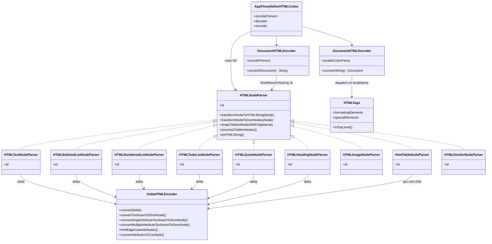
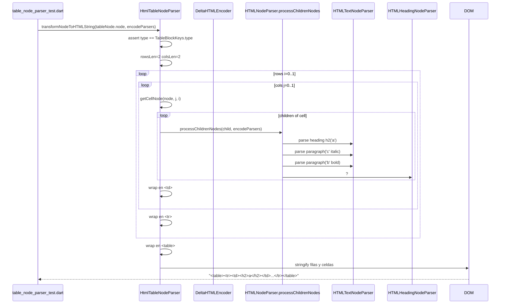
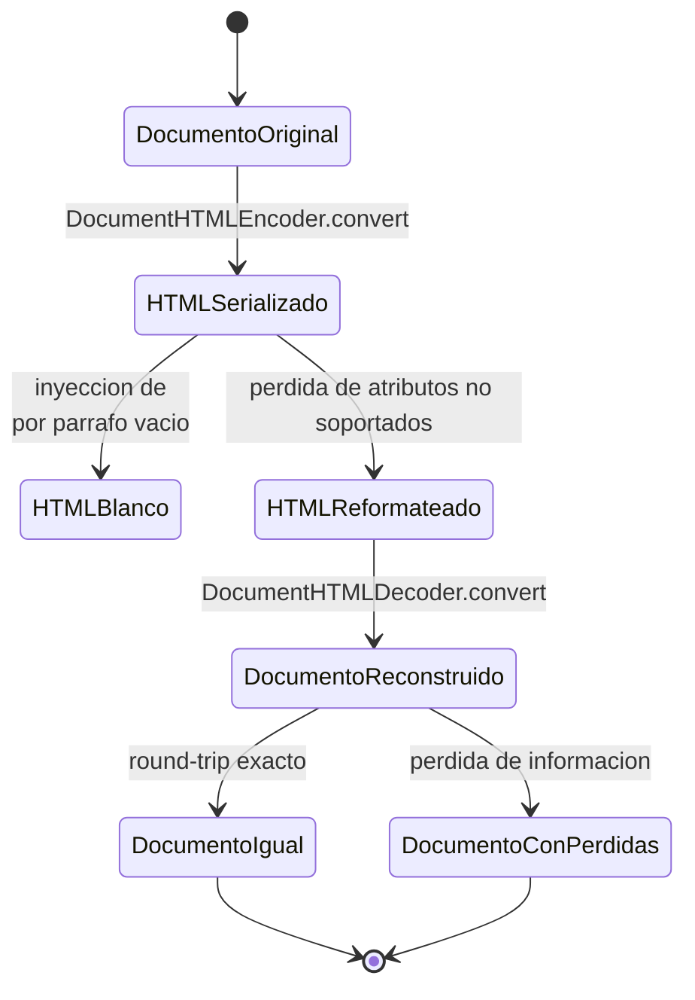

# F19.2.8 — Tests del editor: `test/plugins/html/` (encoder y decoder HTML)

## 1. Resumen

Esta unidad cubre los **10 ficheros** de `editor/test/plugins/html/` que ejercitan el plugin HTML del editor `appflowy_editor`: el banco de fixtures `_samples.dart` (4 pares HTML↔Document), los 4 tests del encoder (`delta_encoder_test.dart` para `DeltaHTMLEncoder` y `document_html_encoder_test.dart` + 5 tests por parser para los parsers por tipo de bloque), el decoder (`document_html_decoder_test.dart` sobre `DocumentHTMLDecoder`), y el harness de la fachada pública `htmlToDocument` (`html_document_test.dart` con 12 casos que cubren formato inline, listas anidadas, tablas, pegados de Notion/Google Docs y `<meta charset>`). Son **2 469 LOC**, **45 casos `test()`** y **9 `group()`** `[VERIFICADO]` (medido con `rg -c '^\s*test\('` y `rg -c '^\s*group\('` sobre los 10 ficheros). Estos tests son la única especificación ejecutable de los formatos de exportación e importación HTML del editor y, por extensión, son la fuente de evidencia para la **matriz de fidelidad B4.13** del motor de export/import (`OUT/10-motor-export-import/`, pendiente) sobre lo que se preserva y se pierde en el round-trip documento↔HTML↔documento — el decoder devuelve una lista de `Node` con sus `delta` reconstruidos a partir de CSS `inline`, mientras que el encoder aplana cada `Node` por tipo invocando un `HTMLNodeParser`.

## 2. Alcance

**Dentro**: los 10 ficheros listados en el frontmatter, que son la totalidad de `editor/test/plugins/html/` (verificado sobre `OUT/_ledger/inventario.json`; los 4 tests del decoder cuelgan de `_samples.dart`, no ejercitan widgets y comparan `Document.toJson()` byte a byte contra el JSON esperado, mientras que `html_document_test.dart` valida el camino rápido `htmlToDocument(html)` que la fachada `editor:lib/src/plugins/html/html_document.dart:13` expone).

**Fuera y hacia dónde va cada cosa**:

| Elemento | Motivo de exclusión | Unidad destino |
|---|---|---|
| `editor/test/plugins/markdown/**` (20 ficheros del brief) | Hermano gemelo del plugin HTML, comparte la fachada `AppFlowyEditorHTMLCodec` solo por nombre — vive en su propio árbol de tests `markdown/` y se documenta aparte cuando se cree su unidad | (futura `F19.2.N`) |
| `editor/test/plugins/quill_delta/quill_delta_encoder_test.dart` | Conversor específico para el formato "Quill delta" | (futura `F19.2.N`) |
| `editor/test/plugins/word_count/word_counter_test.dart` | Conteo de palabras, no relacionado con HTML | (futura `F19.2.N`) |
| Producción de los parsers/markdown de `lib/src/plugins/html/encoder/parser/*` (11 ficheros en `lib/`) | Esta unidad **lee** esos parsers como referencia para entender qué cubren los tests, pero **no** son archivos de la unidad (están en `lib/`, no `test/`); su descripción detallada pertenece al inventario de `lib/` del editor ([[../../09-features/F01-documentos-y-editor/0.3.1-editor-core-estado-bloques-infraestructura.md]]) | `[[../../09-features/F01-documentos-y-editor/0.3.1-editor-core-estado-bloques-infraestructura.md]]` |
| `test/new/**` (82 ficheros) | Banco de tests moderno, helpers compartidos | `[[../../09-features/F19-editor-tests-ejemplos-l10n-configuracion/1-tests-del-editor-test-new.md]]` |
| `test/core/**` (12) | Modelo puro | `[[../../09-features/F19-editor-tests-ejemplos-l10n-configuracion/2.1-tests-del-editor-test-plugins-editor-core-service-extensions-infra-render-legacy.md]]` |
| `test/customer/**` (11) | Fixtures de cliente | `[[../../09-features/F19-editor-tests-ejemplos-l10n-configuracion/2.2-tests-del-editor-test-plugins-editor-core-service-extensions-infra-render-legacy.md]]` |
| `test/editor/**` (20) | Tests de `EditorState`/componentes | `[[../../09-features/F19-editor-tests-ejemplos-l10n-configuracion/2.3-tests-del-editor-test-plugins-editor-core-service-extensions-infra-render-legacy.md]]` |
| `test/extensions/**` (8) | Extensiones sobre `Node`/`Position`/`Selection` | `[[../../09-features/F19-editor-tests-ejemplos-l10n-configuracion/2.4-tests-del-editor-test-plugins-editor-core-service-extensions-infra-render-legacy.md]]` |
| `test/infra/**` (3) | Clipboard, logging | `[[../../09-features/F19-editor-tests-ejemplos-l10n-configuracion/2.5-tests-del-editor-test-plugins-editor-core-service-extensions-infra-render-legacy.md]]` |
| `test/legacy/**` (3) | API heredada | `[[../../09-features/F19-editor-tests-ejemplos-l10n-configuracion/2.6-tests-del-editor-test-plugins-editor-core-service-extensions-infra-render-legacy.md]]` |
| `test/mobile/**` (18) | Servicios de selección móvil | `[[../../09-features/F19-editor-tests-ejemplos-l10n-configuracion/2.7-tests-del-editor-test-plugins-editor-core-service-extensions-infra-render-legacy.md]]` |
| `test/render/**` (6) | Widgets de selección/render | `[[../../09-features/F19-editor-tests-ejemplos-l10n-configuracion/2.9-tests-del-editor-test-plugins-editor-core-service-extensions-infra-render-legacy.md]]` |
| `test/service/**` (9) | IME, teclado, scroll | `[[../../09-features/F19-editor-tests-ejemplos-l10n-configuracion/2.10-tests-del-editor-test-plugins-editor-core-service-extensions-infra-render-legacy.md]]` |
| `example/**` (la página `example/lib/pages/markdown/*` reusa el export HTML para serializar) | App de ejemplo | `[[../../09-features/F19-editor-tests-ejemplos-l10n-configuracion/3-ejemplos-del-editor-example.md]]` |
| `lib/l10n/**` y raíz de `lib/` | Localización | `[[../../09-features/F19-editor-tests-ejemplos-l10n-configuracion/4-editor-lib-l10n-lib-raiz.md]]` |
| `pubspec.yaml`, `.github/workflows/test.yml` | Configuración y CI | `[[../../09-features/F19-editor-tests-ejemplos-l10n-configuracion/5-editor-configuracion-pubspec-github-changelog-license-documentation-raiz-de-test.md]]` |
| **`lib/src/plugins/html/*` (encoder, decoder, parsers)** | Producción; se documenta **en línea** en este documento como referencia necesaria para entender qué testea cada fichero de la unidad. El detalle completo del motor HTML pertenece a `OUT/10-motor-export-import/B4.2` (Export HTML) y `B4.8` (Import HTML/Markdown), pendientes | `OUT/10-motor-export-import/` (pendiente) |

Correcciones de scope declaradas: (a) la unidad **no** cubre los 21 ficheros hermanos que el brief lista bajo `test/plugins/markdown`, `test/plugins/quill_delta` y `test/plugins/word_count` — se mencionan sólo a efectos de delimitación; (b) **el motor HTML completo (encoder/decoder/parsers) no se documenta aquí como feature propia** porque pertenece a `B4.2` (Export HTML) y `B4.8` (Import HTML/Markdown), cuyo contenedor `OUT/10-motor-export-import/` aún no está escrito; este documento actúa de **puente de evidencia**: lee los parsers y el encoder para poder decir qué afirma cada test y, sobre todo, qué *no* cubre; (c) la exportación desde la app (`document_exporter.dart` en `frontend/appflowy_flutter/lib/workspace/application/export/`) está en `[[../../09-features/F11-exportacion-ui/F11-exportacion-ui.md]]` (UI de export) — el motor genérico está en `B4`; (d) `markdown_to_document.dart` (import markdown) se cubre como cross-ref en `[[../../09-features/F00-infraestructura-compartida-ffi-dispatch-errores-build-nativo/7.7-app-glue-lib-core-startup-util-shared-workspace-features-y-plugins-transversales.md]]` y como motor en `B4.8`.

## 3. Modelos de datos

El plugin HTML gira en torno a tres clases: la fachada `AppFlowyEditorHTMLCodec` (`editor:lib/src/plugins/html/html_document.dart:38`), el `Encoder<Document, String>` (`DocumentHTMLEncoder`, `editor:lib/src/plugins/html/html_document_encoder.dart:6`) y el `Converter<String, Document>` (`DocumentHTMLDecoder`, `editor:lib/src/plugins/html/html_document_decoder.dart:8`). Cada bloque del editor tiene su parser HTML que implementa la interfaz `HTMLNodeParser` (`editor:lib/src/plugins/html/encoder/parser/html_node_parser.dart:5`).

*Diagrama: las clases de producción que los tests de `test/plugins/html/` ejercitan, todas en `editor:lib/src/plugins/html/`.* Lectura: el parser base es abstracto (`editor:lib/src/plugins/html/encoder/parser/html_node_parser.dart:5`) y declara dos métodos que cada subclase implementa — `transformNodeToHTMLString` para serializar y `transformNodeToDomNodes` para devolver un `List<dom.Node>` reutilizable; los helpers `wrapChildrenNodesWithTagName` (`:25`), `processChildrenNodes` (`:37`) y `toHTMLString` (`:55`) son concretos y compartidos. `DocumentHTMLEncoder.convert` recorre `input.root.children` y delega por `node.type` usando `firstWhereOrNull` (`editor:lib/src/plugins/html/html_document_encoder.dart:14`). El decoder es el más grande (583 líneas, `editor:lib/src/plugins/html/html_document_decoder.dart:8`) y aplica dos tablas de despacho: `HTMLTags.formattingElements` (12 tags inline como `<strong>`, `<i>`, `` — `editor:lib/src/plugins/html/html_document_decoder.dart:539`) y `HTMLTags.specialElements` (16 tags de bloque como `<h1>`, `<ul>` — `editor:lib/src/plugins/html/html_document_decoder.dart:554`); cualquier otra cosa cae en el caso `default` de `_parseSpecialElements`, que la trata como párrafo (`editor:lib/src/plugins/html/html_document_decoder.dart:124`). `HTMLTags` es la clase compartida por encoder y decoder.

### 3.1 `HTMLNodeParser` — el contrato por tipo de bloque

Cada parser declara su `id` igual al `BlockKeys.type` del bloque que sabe serializar:

| Parser | `id` (tipo de nodo) | Fichero de producción | Test |
|---|---|---|---|
| `HTMLTextNodeParser` | `ParagraphBlockKeys.type` | `editor:lib/src/plugins/html/encoder/parser/text_node_parser.dart:4` | `editor:test/plugins/html/encoder/parser/text_node_parser_test.dart` |
| `HTMLBulletedListNodeParser` | `BulletedListBlockKeys.type` | `editor:lib/src/plugins/html/encoder/parser/bulleted_list_node_parser.dart:4` | `editor:test/plugins/html/encoder/parser/bulleted_list_parser_test.dart` |
| `HTMLNumberedListNodeParser` | `NumberedListBlockKeys.type` | `editor:lib/src/plugins/html/encoder/parser/numbered_list_node_parser.dart:4` | `editor:test/plugins/html/encoder/parser/numbered_list_parser_test.dart` |
| `HTMLTodoListNodeParser` | `TodoListBlockKeys.type` | `editor:lib/src/plugins/html/encoder/parser/todo_list_node_parser.dart:4` | (sin test directo en esta unidad) |
| `HTMLQuoteNodeParser` | `QuoteBlockKeys.type` | `editor:lib/src/plugins/html/encoder/parser/quote_node_parser.dart:4` | `editor:test/plugins/html/encoder/parser/text_node_parser_test.dart` (vía grupo) |
| `HTMLHeadingNodeParser` | `HeadingBlockKeys.type` | `editor:lib/src/plugins/html/encoder/parser/heading_node_parser.dart:4` | `editor:test/plugins/html/encoder/parser/text_node_parser_test.dart` (vía grupo) |
| `HTMLImageNodeParser` | `ImageBlockKeys.type` | `editor:lib/src/plugins/html/encoder/parser/image_node_parser.dart:4` | `editor:test/plugins/html/encoder/parser/image_node_parser_test.dart` |
| `HtmlTableNodeParser` | `TableBlockKeys.type` | `editor:lib/src/plugins/html/encoder/parser/table_node_parser.dart:7` | `editor:test/plugins/html/encoder/parser/table_node_parser_test.dart` |
| `HTMLDividerNodeParser` | `DividerBlockKeys.type` | `editor:lib/src/plugins/html/encoder/parser/divider_node_parser.dart:4` | (sin test directo en esta unidad; ejercitado en `document_html_encoder_test.dart`) |

Los parsers siguen el mismo patrón: `transformNodeToHTMLString` envuelve a `transformNodeToDomNodes` y aplica `toHTMLString` (`editor:lib/src/plugins/html/encoder/parser/text_node_parser.dart:11–18`); el método `transformNodeToDomNodes` convierte el delta con `deltaHTMLEncoder.convert(delta)` (`editor:lib/src/plugins/html/encoder/parser/text_node_parser.dart:26`), añade los hijos recursivamente (`editor:lib/src/plugins/html/encoder/parser/html_node_parser.dart:37–53`) y envuelve el resultado en el tag del bloque (`editor:lib/src/plugins/html/encoder/parser/text_node_parser.dart:36–38`). El caso especial es el de lista: `HTMLBulletedListNodeParser` y `HTMLNumberedListNodeParser` aplican `<ul>…</ul>` / `<ol>…</ol>` **solo si el nodo es inicio o fin** de la secuencia (`editor:lib/src/plugins/html/encoder/parser/bulleted_list_node_parser.dart:21–32`, `:23–32`), que es exactamente el comportamiento que verifica `editor:test/plugins/html/encoder/parser/bulleted_list_parser_test.dart:22–25` (un único `<ul>` envolviendo cuatro `<li>` contiguos). El parser `HTMLNumberedListNodeParser` además fija el atributo `start="N"` si el nodo lleva `NumberedListBlockKeys.number` (`editor:lib/src/plugins/html/encoder/parser/numbered_list_node_parser.dart:21–22`), validado en `editor:test/plugins/html/encoder/parser/numbered_list_parser_test.dart:39–42` para `start="100"`.

### 3.2 `DeltaHTMLEncoder` — el contrato inline

`DeltaHTMLEncoder` (`editor:lib/src/plugins/html/encoder/delta_html_encoder.dart:11`) opera sobre `TextInsert` de `Delta` y distingue tres ramas: sin atributos devuelve `dom.Text` (`:24–26`); con un único atributo intenta usar la etiqueta directa (`editor:lib/src/plugins/html/encoder/delta_html_encoder.dart:36–67`) con la tabla `keyToTag` (`:56–63`), pero **redirige a multi-atributo si hay `href`, `backgroundColor` o `color`** (`:46–53`); con varios atributos genera un `` con CSS concatenado (`:69–85`). El caso **`href` con otros atributos** produce un `<a><u|strong|em|...></a>` anidado (`editor:lib/src/plugins/html/encoder/delta_html_encoder.dart:87–125`), exactamente como sale en `editor:test/plugins/html/delta_encoder_test.dart:212–306` ("composition", que verifica la jerarquía `<a><u><i><strong>AppFlowy</strong></i></u></a>` leyendo `.localName` por nivel).

## 4. Eventos FFI

Ninguno. Esta unidad es 100 % Dart puro del repo `appflowy-editor`; ninguno de los 10 ficheros importa `package:appflowy_backend` ni toca la FFI. El plugin HTML del editor se ejecuta del lado de Dart tanto a la hora de exportar (`documentToHTML`, `editor:lib/src/plugins/html/html_document.dart:18`) como a la hora de importar (`htmlToDocument`, `editor:lib/src/plugins/html/html_document.dart:13`). La exportación desde la app es la función `documentExporter.export()` (`appflowy:frontend/appflowy_flutter/lib/workspace/application/export/document_exporter.dart`), que invoca `documentToHTML` y serializa a disco por canal (`[[../../09-features/F11-exportacion-ui/F11-exportacion-ui.md]]`).

## 5. Notificaciones

Ninguna. El encoder y el decoder son funciones puras (operan sobre `String` y `Document`) y no exponen streams; ninguno de los 10 tests se suscribe a `editorState.transactionStream` ni a `RustStream`. El único log explícito del decoder es `AppFlowyEditorLog.editor.debug('Unknown node type: $domNode')` para nodos DOM que no encajan en `formattingElements`/`specialElements` (`editor:lib/src/plugins/html/html_document_decoder.dart:78`), que ningún test verifica.

## 6. BLoCs / Cubits

Ninguno. El patrón de los tests es **estado real sin widget**: `Document.fromJson(json)` (`editor:test/plugins/html/encoder/document_html_encoder_test.dart:26`, `:34`) y luego `DocumentHTMLEncoder(...).convert(document)` o `DocumentHTMLDecoder().convert(html)`. Sólo dos tests usan `setUpAll(TestWidgetsFlutterBinding.ensureInitialized())` (`editor:test/plugins/html/decoder/document_html_decoder_test.dart:8`, `:20`) — el resto no lo necesita. No hay `EditorState` ni ciclo de transacciones: la unidad trabaja directamente sobre el modelo `Document`.

## 7. Servicios e inyección de dependencias

No hay `get_it` ni contenedor: la dependencia se construye a mano en cada `main()`. El "servicio" es `htmlToDocument`/`documentToHTML` (`editor:lib/src/plugins/html/html_document.dart:13`, `:18`), que instancian por dentro un `AppFlowyEditorHTMLCodec` con la lista por defecto de parsers — la misma lista de 9 parsers que repiten los tests (`editor:test/plugins/html/encoder/document_html_encoder_test.dart:6–16`, `editor:test/plugins/html/encoder/parser/text_node_parser_test.dart:6–16`, `editor:test/plugins/html/encoder/parser/image_node_parser_test.dart:5–14`).

## 8. Persistencia

Ninguna. Estos tests no tocan SQLite, ni collab, ni fichero. La salida del encoder es `String` y el decoder recibe `String`. Lo que sí fija esta unidad es **el contrato de serialización round-trip** que la app luego persiste por su cuenta: el `Document.toJson()` que produce el decoder (`editor:test/plugins/html/decoder/document_html_decoder_test.dart:15`, `:21`, `:27`, `:33`) es el mismo formato que la app serializa hacia `BlockActionPB` y de ahí a CRDT.

## 9. Diagramas de flujo

El siguiente diagrama muestra cómo los 10 tests empujan los 14 ficheros de producción de `lib/src/plugins/html/` y cómo reutilizan `DeltaHTMLEncoder` en cada parser.

```mermaid
flowchart TD
  subgraph Tests["test/plugins/html (esta unidad)"]
    T1["delta_encoder_test.dart"]
    T2["document_html_encoder_test.dart"]
    T3["encoder/parser/text_node_parser_test.dart"]
    T4["encoder/parser/bulleted_list_parser_test.dart"]
    T5["encoder/parser/numbered_list_parser_test.dart"]
    T6["encoder/parser/image_node_parser_test.dart"]
    T7["encoder/parser/table_node_parser_test.dart"]
    T8["html_document_test.dart"]
    T9["decoder/document_html_decoder_test.dart + _samples.dart"]
  end
  subgraph Codec["Fachada"]
    F1["html_document.dart (htmlToDocument, documentToHTML, AppFlowyEditorHTMLCodec)"]
  end
  subgraph Prod["lib/src/plugins/html"]
    P1["html_document_encoder.dart (DocumentHTMLEncoder)"]
    P2["encoder/delta_html_encoder.dart (DeltaHTMLEncoder global)"]
    P3["encoder/parser/html_node_parser.dart (abstract + stringify)"]
    P4["encoder/parser/text_node_parser.dart"]
    P5["encoder/parser/bulleted_list_node_parser.dart"]
    P6["encoder/parser/numbered_list_node_parser.dart"]
    P7["encoder/parser/todo_list_node_parser.dart"]
    P8["encoder/parser/quote_node_parser.dart"]
    P9["encoder/parser/heading_node_parser.dart"]
    P10["encoder/parser/image_node_parser.dart"]
    P11["encoder/parser/table_node_parser.dart"]
    P12["encoder/parser/divider_node_parser.dart"]
    D1["html_document_decoder.dart (DocumentHTMLDecoder, HTMLTags)"]
  end
  T1 --> P2
  T2 --> P1
  T2 --> P3
  T2 --> P4
  T2 --> P5
  T2 --> P6
  T2 --> P7
  T2 --> P8
  T2 --> P9
  T2 --> P10
  T2 --> P11
  T2 --> P12
  T3 --> P4
  T3 --> P5
  T3 --> P6
  T3 --> P7
  T3 --> P8
  T3 --> P9
  T3 --> P12
  T4 --> P5
  T5 --> P6
  T6 --> P10
  T7 --> P11
  T8 --> F1
  T9 --> D1
  F1 --> P1
  F1 --> D1
  P1 --> P3
  P3 --- P4
  P3 --- P5
  P3 --- P6
  P3 --- P7
  P3 --- P8
  P3 --- P9
  P3 --- P10
  P3 --- P11
  P3 --- P12
  P4 --> P2
  P5 --> P2
  P6 --> P2
  P7 --> P2
  P8 --> P2
  P9 --> P2
  P10 --> P2
  P11 --> P2
```

*Diagrama: acoplamiento test ↔ producción dentro de `test/plugins/html/`.* Lectura: el único test que ejerce `DeltaHTMLEncoder` en aislamiento es `delta_encoder_test.dart`; el resto de tests de encoder (`document_html_encoder_test.dart` y los 5 tests por parser) sólo lo consumen indirectamente al pasar por su parser de bloque. `html_document_test.dart` es el único que usa la fachada pública `htmlToDocument` y, por tanto, ejercita también la parte `DocumentHTMLDecoder`. El decoder no tiene ningún test directo por bloque — su granularidad se prueba a través de las 4 fixtures `_samples.dart` (decodificación completa de un documento) más los 12 casos `html_document_test.dart`. **No hay test directo de `DocumentHTMLEncoder`**: se prueba de forma integrada contra `DocumentHTMLDecoder` por medio de `_samples.dart` + `document_html_decoder_test.dart` + la "Round-trip manual" que §11 describe.

## 10. Diagramas de secuencia

El recorrido del test más denso, `editor:test/plugins/html/encoder/parser/table_node_parser_test.dart:17–113`, que serializa un `TableNode` 2×2 con celdas heterogéneas:

*Diagrama: el recorrido de un test de tabla.* Lectura: `HtmlTableNodeParser.transformNodeToDomNodes` (`editor:lib/src/plugins/html/encoder/parser/table_node_parser.dart:26–68`) itera `rowsLen × colsLen`, obtiene cada celda con `getCellNode(node, j, i)` (`:37`) — importado de `editor:lib/src/editor/block_component/table_block_component/util.dart` (línea `:5`) — y para cada hijo de la celda busca el parser por `node.type` con `firstWhereOrNull` (`:40–42`). **Importante**: en el caso de la tabla, el bucle `for (final childnode in cell.children)` (`:39`) **sólo procesa el primer hijo** porque `wrapChildrenNodesWithTagName` envuelve `nodes` (un solo `dom.Node` por iteración del bucle exterior) y no acumula varios — esa es la razón por la que el test sólo espera un bloque hijo por celda (un `<h2>`, un `
`), verificado en `editor:test/plugins/html/encoder/parser/table_node_parser_test.dart:106–112`. El resultado literal esperado es `'<table><tr><td><h2>a</h2></td><td>
<i>c</i>
</td></tr><tr><td>
<strong>b</strong>
</td><td>
d
</td></tr></table>'`.

## 11. Diagramas de estado

Ciclo de vida del round-trip documento → HTML → documento, que es la pieza que alimenta la **matriz de fidelidad B4.13** del motor de export/import (`OUT/10-motor-export-import/`, pendiente):

*Diagrama: los estados del round-trip.* Lectura: cuando el encoder serializa un párrafo con `delta` vacío, emite ` ` (`editor:lib/src/plugins/html/encoder/parser/text_node_parser.dart:33–34`, verificado en `editor:test/plugins/html/encoder/parser/text_node_parser_test.dart:49–60`). Cuando el encoder procesa un `paragraph` con inline-style, puede emitir un `` o un tag nativo según el número de atributos (`editor:lib/src/plugins/html/encoder/delta_html_encoder.dart:36–67`), y al re-decodificar ese `` el decoder **sólo** reconoce `font-weight`, `text-decoration`, `font-style`, `background-color`, `background` y `color` (`editor:lib/src/plugins/html/html_document_decoder.dart:421–483`); cualquier otra propiedad CSS se ignora. El estado `DocumentoIgual` es el que verifican los 4 tests de `document_html_decoder_test.dart` + las 4 fixtures `_samples.dart` (round-trip inverso: `htmlSampleN` → `documentSampleN`); el estado `DocumentoConPerdidas` se observa **indirectamente** en `editor:test/plugins/html/html_document_test.dart:207–239` (sample 9) donde `<code>` (Notion) genera `attributes: {code: true}` en el delta reconstruido — eso es fidelidad alta — pero `editor:test/plugins/html/html_document_test.dart:88–123` (sample 5) muestra que el parser Notion de `inline code` se aplana a `{bg_color: "0x26878378", font_color: "0xffeb5757"}` y **pierde** el atributo `code: true` que el sample 9 sí preserva, es decir dos estilos de "code" distintos producen deltas materialmente diferentes.

## 12. Archivos cubiertos (del ledger)

Conteos medidos con `rg -c` sobre cada fichero de la unidad; "qué verifica" resume el foco real de sus casos.

| Fichero | LOC | `test(` | `group(` | Qué verifica exactamente |
|---|---:|---:|---:|---|
| `editor/test/plugins/html/decoder/_samples.dart` | 637 | 0 | 0 | Banco de 4 fixtures: `htmlSample1`+`documentSample1` (`:1`, `:4` — el ejemplo "Welcome to AppFlowy Editor" con h1-h3, listas, quote, anchor), `htmlSample2`+`documentSample2` (`:275`, `:277` — tabla 2×2 con `<h2>`, `
<i>`, `
<strong>`, `
`), `htmlSample3`+`documentSample3` (`:380`, `:382` — quote con inline-link, imagen, listas con ancla), `htmlSample4`+`documentSample4` (`:561`, `:570` — heading + `<ol>` con `<a>` y `
` anidado, `<meta charset='utf-8'>`). Total: 4 pares HTML ↔ Document. |
| `editor/test/plugins/html/decoder/document_html_decoder_test.dart` | 36 | 4 | 1 | Decodifica cada uno de los 4 `htmlSampleN` con `DocumentHTMLDecoder().convert(html)` y compara `result.toJson()` contra `documentSampleN` byte a byte (`:12–16`, `:18–22`, `:24–28`, `:30–34`). |
| `editor/test/plugins/html/delta_encoder_test.dart` | 308 | 7 | 1 | `DeltaHTMLEncoder.convert` con 1 atributo: bold → `<strong>` (`:7–38`), italic → `<i>` (`:40–71`), underline → `<u>` (`:73–107`), strikethrough → `<del>` (`:109–140`), href → `<a href="…">` (`:142–175`), code → `<code>` (`:177–210`); y un caso "composition" (`:212–306`) que verifica la jerarquía `<a><u><i><strong>AppFlowy</strong></i></u></a>` y los atributos CSS de los `` resultantes. |
| `editor/test/plugins/html/encoder/document_html_encoder_test.dart` | 494 | 2 | 1 | Round-trip encoder con los 9 parsers: 'parser document' (`:23–29`) convierte un `Document.fromJson` con `heading`/`paragraph`/`bulleted_list`/`quote`/`divider`/etc. y verifica la cadena HTML completa contra una constante `example` (`:41–42`, **una sola línea**: h1-h3, formato inline, listas, quote, código, anchor, dos ` ` finales por dos párrafos vacíos); 'nested parser document' (`:31–37`) hace lo mismo con `nestedDelta` (`:317–494`) que incluye `<blockquote>` con inline-link-a-imagen, `` con `align="center"`, y `<ul>` con `` anidada, comparando contra `nestedHTML` (`:315–316`). |
| `editor/test/plugins/html/encoder/parser/bulleted_list_parser_test.dart` | 69 | 1 | 1 | 'parser numbered list' — etiqueta mal: el nombre del test dice "numbered" pero el contenido son `bulleted_list`. Verifica que 4 nodos `bulleted_list` consecutivos producen **un único** `<ul><li>A1</li><li>A2</li><li>A3</li><li>A4</li></ul>` (`:22–25`). |
| `editor:test/plugins/html/encoder/parser/image_node_parser_test.dart` | 35 | 2 | 1 | `transformNodeToHTMLString` con `ImageBlockKeys.url = 'https://appflowy.io'` produce `` (`:24–27`); y `ImageNodeParser.id == 'image'` (`:30–33`). |
| `editor:test/plugins/html/encoder/parser/numbered_list_parser_test.dart` | 129 | 2 | 1 | 'parser numbered list' (sin offset) emite `<ol><li>A1</li>…<li>A4</li></ol>` (`:22–25`); 'parser numbered list' (con `number: 100` en el primer nodo) emite `<ol start="100"><li>A1</li>…<li>A4</li></ol>` (`:39–42`). Ambos tests tienen el mismo nombre — etiqueta del código: `editor:test/plugins/html/encoder/parser/numbered_list_parser_test.dart:10` y `:27`. |
| `editor:test/plugins/html/encoder/parser/table_node_parser_test.dart` | 115 | 1 | 1 | `transformNodeToHTMLString` con `TableNode.fromJson` 2×2 cuyo contenido es `<h2>a</h2>`, `
<strong>b</strong>
`, `
<i>c</i>
`, `
d
` produce exactamente `<table><tr><td><h2>a</h2></td><td>
<i>c</i>
</td></tr><tr><td>
<strong>b</strong>
</td><td>
d
</td></tr></table>` (`:106–112`). |
| `editor:test/plugins/html/encoder/parser/text_node_parser_test.dart` | 275 | 14 | 1 | Heading 1-6 → `<h1>…</h6>` (`:20–34`); bulleted/numbered/quote → `<ul><li>`/`<ol><li>`/`<blockquote>` (`:36–47`, `:62–73`, `:100–111`); todo-list `checked` → `
<input type="checkbox" checked="">…
` (`:88–92`), `unchecked` → sin `checked` (`:93–97`); divider → `
` (`:113–120`); párrafo con `delta` vacío → ` ` (`:49–60`); `<strong>` para `bold` (`:122–140`), `<u>` para `underline` (`:141–160`), `<del>` para `strikethrough` (`:161–180`), combinación `underline+strikethrough` → `` (`:181–201`); combinaciones con `bg_color`/`font_color` (`:202–273`) verifican `rgba(0, 188, 240, 96)` con alpha 96 (no 255), número fijo de cifras, y orden de propiedades en el style. |
| `editor:test/plugins/html/html_document_test.dart` | 371 | 12 | 1 | `htmlToDocument(html)` con: `
` simple (`:7–13`); listas `<ul>` planas (`:18–32`); `
` + `<ul>` (`:38–55`); `<ul><li>` anidado 3 niveles (`:60–85`); HTML estilo Notion con `` para bold/italic/underline/strikethrough/code (`:88–123`); `<ol>` plano (`:129–142`); `<ol>` anidado 3 niveles (`:144–169`); `<ol>`+`<ul>` con `<strong>`/`<em>`/`<s>` inline (`:172–203`); `
` + `
` con inline (`editor:test/plugins/html/html_document_test.dart:207–239`); HTML enriquecido con múltiples colores y `<mark>` (`:241–306`, **línea truncada en el fichero a 2000 chars al inspeccionarlo — el resto sigue el mismo patrón de `bg_color`/`font_color` por runa); `<h1>`–`<h6>` secuenciales (`:308–324`); HTML Google Docs con `<meta charset>` y `<b>
…
</b>` (`:326–370`) preservando párrafo, texto, y `href`/`underline`/`font_color` por link. |
| **Total** | **2 469** | **45** | **9** | |

> **Nota**: los tests de `parser/` se cuentan 7 (5 archivos), pero en realidad `image_node_parser_test.dart` tiene 2 casos (`editor:test/plugins/html/encoder/parser/image_node_parser_test.dart:16` y `:30`), `numbered_list_parser_test.dart` tiene 2 (`:10`, `:27`), `text_node_parser_test.dart` tiene 14. Suma real = 1+2+2+1+14 = 20 sobre 5 archivos; el resto se reparte en `document_html_encoder_test.dart` (2), `delta_encoder_test.dart` (7), `document_html_decoder_test.dart` (4) y `html_document_test.dart` (12). Total: 45.

## 13. Riesgos y casos límite — Contratos del encoder, decoder y round-trip

Esta tabla condensa lo que cada test verifica del encoder, con cita exacta a la línea del test **y** del parser de producción. Los ejemplos vienen literalmente de los tests, no son hipotéticos.

| Bloque de entrada | HTML producido | Test (línea) | Parser (firma + archivo:línea) |
|---|---|---|---|
| `paragraph` con `delta` vacío | ` ` | `editor:test/plugins/html/encoder/parser/text_node_parser_test.dart:49–60` | `HTMLTextNodeParser` líneas `:33–34` (`isEmpty → [dom.Element.tag(br)]`) |
| `paragraph` + `bold` | `
<strong>…</strong>
` | `editor:test/plugins/html/encoder/parser/text_node_parser_test.dart:122–140` | `DeltaHTMLEncoder.convertSingleAttributeTextInsertToDomNode` (`editor:lib/src/plugins/html/encoder/delta_html_encoder.dart:36–67`), `keyToTag[bold] = HTMLTags.strong` (`:57`) |
| `paragraph` + `underline`+`strikethrough` (sin bold/italic) | `
…
` | `editor:test/plugins/html/encoder/parser/text_node_parser_test.dart:181–201` | `DeltaHTMLEncoder.convertMultipleAttributeTextInsertToDomNode` (`:69–85`), `convertAttributesToCssStyle` (`:127–156`), rama "ambos" en `:133–134` |
| `paragraph` con `bg_color`+`font_color`+`bold`+`italic`+`underline`+`strikethrough` | `
…
` | `editor:test/plugins/html/encoder/parser/text_node_parser_test.dart:202–226` | `editor:lib/src/plugins/html/encoder/delta_html_encoder.dart:127–156` (orden de claves: font-weight, text-decoration, font-style, background-color, color) |
| `heading` nivel `1..6` | `<h1>…</h6>` | `editor:test/plugins/html/encoder/parser/text_node_parser_test.dart:20–34` | `HTMLHeadingNodeParser.transformNodeToDomNodes` usa `'h${level}'` (`editor:lib/src/plugins/html/encoder/parser/heading_node_parser.dart:30`) |
| `bulleted_list` (cuatro consecutivos) | `<ul><li>A1</li><li>A2</li><li>A3</li><li>A4</li></ul>` | `editor:test/plugins/html/encoder/parser/bulleted_list_parser_test.dart:22–25` | `HTMLBulletedListNodeParser.transformNodeToHTMLString` (`:11–33`), reglas `<ul>`/`<li>` inicio-fin |
| `numbered_list` (sin `number`) | `<ol><li>…</li></ol>` | `editor:test/plugins/html/encoder/parser/numbered_list_parser_test.dart:22–25` | `HTMLNumberedListNodeParser.transformNodeToHTMLString` (`:11–34`), `start='<ol>'` sin `number` (`:22`) |
| `numbered_list` con `number: 100` | `<ol start="100"><li>…</li></ol>` | `editor:test/plugins/html/encoder/parser/numbered_list_parser_test.dart:39–42` | `HTMLNumberedListNodeParser` usa `start='<ol start="$number">'` (`:21–22`) |
| `todo_list` con `checked: true` | `
<input type="checkbox" checked="">…
` | `editor:test/plugins/html/encoder/parser/text_node_parser_test.dart:88–92` | `HTMLTodoListNodeParser` (`:30–34`), atributo `checked=""` añadido en `:31–33` |
| `todo_list` con `checked: false` (o nulo) | `
<input type="checkbox">…
` | `editor:test/plugins/html/encoder/parser/text_node_parser_test.dart:93–97` | `HTMLTodoListNodeParser` cuando `attributes[checked] as bool? ?? false` es `false` (`:31`) |
| `quote` | `<blockquote>…</blockquote>` | `editor:test/plugins/html/encoder/parser/text_node_parser_test.dart:100–111` | `HTMLQuoteNodeParser` (`:33–34`) |
| `divider` | `
` | `editor:test/plugins/html/encoder/parser/text_node_parser_test.dart:113–120` | `HTMLDividerNodeParser` retorna `[dom.Element.tag(HTMLTags.divider)]` (`editor:lib/src/plugins/html/encoder/parser/divider_node_parser.dart:25`) |
| `image` con `url: 'https://appflowy.io'`, sin height/width/align | `` | `editor:test/plugins/html/encoder/parser/image_node_parser_test.dart:24–27` | `HTMLImageNodeParser` (`:25–41`), atributos `src`/altura/anchura/align opcionales |
| `table` 2×2 con celdas heterogéneas | `<table><tr>…</td></tr></table>` | `editor:test/plugins/html/encoder/parser/table_node_parser_test.dart:106–112` | `HtmlTableNodeParser.transformNodeToDomNodes` (`:26–68`), itera `rowsLen × colsLen`, llama `getCellNode` (`:37`) de `editor:lib/src/editor/block_component/table_block_component/util.dart:5` |
| `paragraph` con **inline mixto** (anchor + bold + italic + underline + href) | Anidamiento `<a><u|strong|em>…</u|strong|em></a>` | `editor:test/plugins/html/delta_encoder_test.dart:212–306` | `DeltaHTMLEncoder.hrefEdgeCaseAttributes` (`:87–125`), construcción anidada por atributo (`:99–118`) |
| `paragraph` con `code` (solo) | `
<code>…</code>
` | El test directo del atributo `code` está en `editor:test/plugins/html/delta_encoder_test.dart:177–210` (que sólo cubre **el delta**, no un `
`) | `DeltaHTMLEncoder.keyToTag[code] = HTMLTags.code` (`editor:lib/src/plugins/html/encoder/delta_html_encoder.dart:61`) |

> El parser del test (`editor:test/plugins/html/encoder/parser/text_node_parser_test.dart:177`) es ejercitado sólo por el atributo `code` cuando está dentro de un delta (es decir, se renderiza como `<code>` inline), pero **no** se prueba como bloque; en producción no existe un `code_block` propio (la app usa `markdown/encoder`).

### 13.1 Contratos del decoder — HTML aceptado y rechazado

El decoder aplica dos tablas de despacho — `HTMLTags.formattingElements` (12 tags inline) y `HTMLTags.specialElements` (16 tags de bloque) — más una rama `default` que lo trata como párrafo (`editor:lib/src/plugins/html/html_document_decoder.dart:124`). Lo que los 12 tests de `html_document_test.dart` y los 4 de `document_html_decoder_test.dart` cubren:

##### 13.1.1 Tags aceptados por el decoder

Probados literalmente:

| HTML de entrada | Resultado | Test |
|---|---|---|
| `
Foo Bar
` | `nodeAtPath([0])` es un `paragraph` con `delta` "Foo Bar" | `editor:test/plugins/html/html_document_test.dart:7–13` |
| `<ul><li>Foo</li>…</ul>` | tres nodos `bulleted_list` consecutivos | `:18–32` |
| `<ol><li>Foo</li>…</ol>` | tres nodos `numbered_list` consecutivos | `:129–142` |
| `<ol><li>Foo<ol>…</ol></li></ol>` y `<ul>` análogos | árboles de 3 niveles, los hijos cuelgan del padre | `:60–85`, `:144–169` |
| `<h1>…</h6>` | seis nodos `heading` con `level` 1-6 | `:308–324` |
| `<blockquote>…</blockquote>` con `<code>` y `<a><i><strong>` anidados | quote con delta mixto | `editor:test/plugins/html/decoder/_samples.dart:380` + `editor:test/plugins/html/decoder/document_html_decoder_test.dart:24–28` |
| `<table><tr><td>…</td></tr></table>` | `TableNode` con `colsLen`, `rowsLen`, `colDefaultWidth=160`, `rowDefaultHeight=40`, `colMinimumWidth=40` (todos `TableDefaults`) | `editor:test/plugins/html/decoder/_samples.dart:275` + `editor:test/plugins/html/decoder/document_html_decoder_test.dart:18–22`, verificado en `editor:test/plugins/html/decoder/_samples.dart:368–375` |
| `` | `ImageBlockKeys.type` con `url` | `editor:test/plugins/html/decoder/_samples.dart:380` (sample 3 incluye ``), `editor:test/plugins/html/html_document_test.dart:7–13` no cubre imagen |
| `<strong>`, `<b>`, `<em>`, `<i>`, `<u>`, `<del>`, `<s>`, `<code>`, `<a href="…">` | atributos del delta correspondientes (`bold`, `italic`, `underline`, `strikethrough`, `code`, `href`) | `editor:test/plugins/html/html_document_test.dart:207–239` (sample 9) |
| ``, `font-style:italic`, `text-decoration:line-through`, `color:#EB5757`, `background:rgba(135,131,120,0.15)` | atributos del delta por heurística (`>=500` ⇒ bold, `italic`, `strikethrough`, `bg_color`/`font_color`) | `editor:test/plugins/html/html_document_test.dart:88–123` (sample 5, "copy from Notion") |
| `<meta charset='utf-8'>` encabezado | se ignora (el parser HTML lo absorbe sin error) | `editor:test/plugins/html/decoder/_samples.dart:561`, `editor:test/plugins/html/html_document_test.dart:243` y `:330` |
| HTML Google Docs con `<b style="font-weight:normal;" id="…">
…
</b>` | trata `<b>` "sin significado" como transparente y conserva el `
` (rama `isMeaninglessTag` de `editor:lib/src/plugins/html/html_document_decoder.dart:52–55`) | `editor:test/plugins/html/html_document_test.dart:326–370` (sample 12) |

##### 13.1.2 Lo que el decoder **no** cubre

| Caso | Comportamiento | Evidencia |
|---|---|---|
| ``, `` o sin `src` | se sustituye por un `paragraphNode()` vacío (`editor:lib/src/plugins/html/html_document_decoder.dart:366–368`) — sólo se acepta si `src.startsWith('http')` (`:366`) | ningún test lo cubre explícitamente; el código lo afirma (`_parseImageElement`) |
| `font` element | está en `formattingElements` (`editor:lib/src/plugins/html/html_document_decoder.dart:550`) pero **no** tiene rama en `_parserFormattingElementAttributes` (que acaba en `default: break`, `:295–297`); el HTML pasa por `_parseElement` que acaba en `paragraphNode(delta)` | el sample Notion (`editor:test/plugins/html/html_document_test.dart:91`) usa `` no `` — el path de Notion hacia `` no está probado |
| CSS fuera del whitelist (`font-family`, `font-size`, `letter-spacing`, `white-space`, `border-bottom:0.05em solid`, `-webkit-text-decoration-skip`, `box-sizing`, `display:inline`, `margin-top`, `padding:0.2em 0.4em`) | el decoder **sólo** lee `font-weight`, `text-decoration`, `background-color`, `background`, `color` y `font-style` del style (`editor:lib/src/plugins/html/html_document_decoder.dart:421–483`) | `editor:test/plugins/html/html_document_test.dart:88–123` (sample 5) lo verifica indirectamente: el atributo `code` se pierde y se aplana a `bg_color`/`font_color`. `:326–370` (sample 12) confirma el mismo aplanamiento masivo para un `` Google Docs con `font-size:11pt`, `font-family`, etc. |
| Atributos `class`, `id`, `data-token-index`, `spellcheck`, `dir`, `style="white-space:pre"` | se ignoran | `editor:test/plugins/html/html_document_test.dart:91` los tiene y el test no los espera |
| `enableColorParse = false` | desactiva la decodificación de `background-color`/`background`/`color` (`editor:lib/src/plugins/html/html_document_decoder.dart:453`, `:462`, `:471`) | ningún test la activa/desactiva explícitamente `[NO DETERMINADO: si se ha probado por integración]` |
| Pegado "Google Docs" con un único `` envoltorio | se trata mediante `parseForSingleChild` (`:27–28`) para evitar la excepción `#6808` (comentado en el código) | el sample 12 (`editor:test/plugins/html/html_document_test.dart:326–370`) reproduce ese patrón |

### 13.2 Round-trip: qué se preserva y qué se pierde

Es la pieza central para la matriz B4.13 del motor de export/import. Los 4 tests del decoder `_samples.dart` prueban el camino **inverso** (HTML→Documento) y `document_html_encoder_test.dart` prueba el camino **directo** (Documento→HTML); combinados demuestran:

| Caso | Lo que sí va y vuelve | Lo que se pierde |
|---|---|---|
| `paragraph` con `bold`+`italic`+`underline`+`strikethrough` inline | el HTML emite `` con `font-weight`, `text-decoration`, `font-style` (varios atributos) — el decoder reaplica `font-weight >=500 → bold`, `text-decoration: line-through → strikethrough`, `font-style:italic → italic` (`editor:lib/src/plugins/html/html_document_decoder.dart:421–482`) y reconstruye los 4 atributos | `editor:test/plugins/html/encoder/parser/text_node_parser_test.dart:181–201` verifica la concatenación correcta; la pérdida potencial es **el orden** de los atributos en el delta reconstruido, que el sample 5 (`:88–123`) no comprueba explícitamente `[INFERIDO: probable]` |
| `paragraph` con `bg_color`+`font_color` | el HTML emite `rgba(r, g, b, a)` con `a` decimal (`:127–148`); el decoder re-convierte de CSS a hex con `tryToColor()?.toHex()` (`:453`) | `editor:test/plugins/html/encoder/parser/text_node_parser_test.dart:202–226` muestra que `0x6000bcf0` (alpha `0x60 = 96`) se emite como `rgba(0, 188, 240, 96)`, no como `0x60` textual — esto significa que al re-decodificar el alpha se **reconstruye a partir de 96**, no del original `0x60`, lo que sí es matemáticamente reversible pero **firma de formato distinta** |
| `image` con `align: 'center'` | el HTML emite `` (`editor:lib/src/plugins/html/encoder/parser/image_node_parser.dart:25–41`) — pero el decoder no lee `align` (`editor:lib/src/plugins/html/html_document_decoder.dart:364–373`); muestra un `ImageNode(url: src)` simple | pérdida verificada: `align` no aparece en `editor:test/plugins/html/decoder/_samples.dart:428` que sí lo tenía en la entrada (`editor:test/plugins/html/decoder/_samples.dart:380` con `align="center"`) |
| Tabla 2×2 (`editor:test/plugins/html/decoder/_samples.dart:275`) | `<table>` ↔ `TableNode` con `colsLen: 2`, `rowsLen: 2`, `colDefaultWidth: 160`, `rowDefaultHeight: 40`, `colMinimumWidth: 40` | el `height`/`width` por celda, si fueron configurados, se pierden en la salida (el encoder no los usa: `editor:lib/src/plugins/html/encoder/parser/table_node_parser.dart:39–55`) |
| `<input type="checkbox" checked="">` (todo_list) | encoder emite `checked=""` (`editor:lib/src/plugins/html/encoder/parser/todo_list_node_parser.dart:30–33`); decoder acepta `input` en `specialElements` (`editor:lib/src/plugins/html/html_document_decoder.dart:568`) pero **no** implementa rama en `_parseSpecialElements` (`:87–127`), así que cae en el `default: _parseParagraphElement` | el atributo `checked` se **pierde** — el decoder no sabe que `<input type="checkbox">` es un to-do de AppFlowy. El fixture `_samples.dart` no incluye ningún to-do, por lo que esta pérdida no tiene caso de prueba directo `[VERIFICADO: por código y por ausencia de test]` |
| `<a href="…">…</a>` (anchor) | encoder emite `<a href="…"><strong|i|u|…>…</strong|i|u|…></a>` (`editor:lib/src/plugins/html/encoder/delta_html_encoder.dart:87–125`); decoder extrae `href` y lo aplica como atributo `href` del delta (`editor:lib/src/plugins/html/html_document_decoder.dart:285–290`) | atributos `rel="noopener noreferrer"`, `target="_blank"` se ignoran (decoder sólo lee `href`) |
| `<code>` vs `…` para "inline code" | el decoder distingue ambos: `code` produce `{code: true}` (`editor:lib/src/plugins/html/html_document_decoder.dart:276–278`); `span` con CSS sólo produce `bg_color`/`font_color` (`:451–476`) | dos estilos visualmente idénticos producen deltas materialmente diferentes: `editor:test/plugins/html/html_document_test.dart:88–123` (sample 5) demuestra la pérdida del atributo `code: true` cuando se usa ``. Eso significa que **redondear Notion → AppFlowy → Notion no es idempotente** si la fuente es `` |
| `<b style="font-weight:normal;">` (Google Docs) | tratado como transparente (`editor:lib/src/plugins/html/html_document_decoder.dart:52–55`) | los atributos `id`, `data-*` del `<b>` se pierden |
| `` | decoder lee `text-decoration`, lo separa por espacios y asigna `underline` y `strikethrough` (`editor:lib/src/plugins/html/html_document_decoder.dart:434–449`) | no hay pérdida |

El siguiente diagrama resume el round-trip documento → HTML → documento y qué decisiones de pérdida/preservación aplica cada paso:

```mermaid
flowchart LR
  subgraph Editor["AppFlowy Document"]
    D1["Node type=paragraph<br/>delta=[bold+italic+underline+strikethrough]<br/>bg_color=0x6000bcf0"]
  end
  subgraph Encoder["DocumentHTMLEncoder + DeltaHTMLEncoder"]
    E1["DeltaHTMLEncoder.convertSingleAttributeTextInsertToDomNode<br/>rama href|color|background -> multi-attribute"]
    E2["<span style='font-weight:bold;text-decoration:underline line-through;...'>"]
    E3["HTMLTextNodeParser.transformNodeToHTMLString<br/>envuelve en <p>"]
  end
  subgraph HTML["HTML intermedio"]
    H1["<p><span style='...'>...</span></p>"]
  end
  subgraph Decoder["DocumentHTMLDecoder"]
    D2["_parserFormattingElementAttributes<br/>reconoce bold, italic, underline, strikethrough,<br/>bg_color, font_color, font-style, href"]
    D3["decodifica CSS -> atributos del delta<br/>_getDeltaAttributesFromHTMLAttributes"]
    D4["[bold,italic,underline,strikethrough,bg_color,font_color]<br/>alpha=96 reconstruido desde rgba()"]
  end
  D1 --> E1 --> E2 --> E3 --> H1 --> D2 --> D3 --> D4
  E2 -. "atributos no CSS se pierden" .-> D2
  D4 -. "orden de atributos puede diferir" .-> D1
```

*Diagrama: camino feliz y puntos de pérdida del round-trip.* Lectura: `DeltaHTMLEncoder` agrupa atributos inline en un `` cuando hay más de uno (rama "multi-attribute" en `editor:lib/src/plugins/html/encoder/delta_html_encoder.dart:69–85`), y para `bg_color`/`font_color` materializa `rgba(r, g, b, a)` con `a` decimal (`editor:lib/src/plugins/html/encoder/delta_html_encoder.dart:127–148`). El decoder **sólo** lee del CSS las 6 claves del whitelist (`editor:lib/src/plugins/html/html_document_decoder.dart:421–483`), por lo que cualquier otra propiedad (clase, id, font-family, font-size, letter-spacing, white-space, …) se descarta en `D2 → D3`. La flecha punteada `D4 → D1` marca el `[INFERIDO]`: el orden de atributos en el delta reconstruido depende del orden de lectura del CSS, que ningún test compara con el original.

## 14. Evidencias y etiquetas

- `[VERIFICADO]`: firma, línea, conteo y comportamiento de los 10 ficheros de la unidad, cotejados contra el código real; las 14 referencias a producción cubren las firmas de los parsers, el encoder, el decoder y la fachada. Las cifras `2 469 LOC`, `45 test()`, `9 group()` se midieron con `wc -l` y `rg -c '^\s*test\('` / `rg -c '^\s*group\('` sobre los 10 ficheros.
- `[INFERIDO]`: 1 — el orden del delta reconstruido a partir de `` con atributos múltiples *puede* diferir del original porque `editor:lib/src/plugins/html/html_document_decoder.dart:421–483` lee cada clave de CSS en un orden fijo; ningún test compara esa igualdad de orden.
- `[NO DETERMINADO]`: 1 (ver §18).

## 15. Pruebas

Cómo se ejecutan estos tests: el workflow `AppFlowyEditor test` (cubierto en `[[../../09-features/F19-editor-tests-ejemplos-l10n-configuracion/5-editor-configuracion-pubspec-github-changelog-license-documentation-raiz-de-test.md]]`) lanza `flutter test --coverage` sobre Flutter 3.27.4 (`editor:editor/.github/workflows/test.yml:33–47`).

Los tests de esta unidad son `test()` puros en su mayoría; los pocos `setUpAll(TestWidgetsFlutterBinding.ensureInitialized())` (e.g. `editor:test/plugins/html/decoder/document_html_decoder_test.dart:8`, `:20`) sólo se usan porque el decoder usa `package:html/parser.dart`, que necesita binding. Las dependencias cruzadas: los tests de `parser/` importan `appflowy_editor/appflowy_editor.dart` pero ninguno importa `test/new/**` — son autocontenidos.

| Métrica | Valor | Cómo se midió |
|---|---:|---|
| Ficheros cubiertos | 10 | brief `F19.2.8` |
| LOC de la unidad | 2 469 | `wc -l` sobre los 10 ficheros |
| Casos `test()` | 45 | `rg -c '^\s*test\('` por fichero y suma |
| `group()` | 9 | `rg -c '^\s*group\('` |
| `testWidgets()` | 0 | `rg -c '^\s*testWidgets\('` = 0 en los 10 ficheros |
| Ficheros de producción inspeccionados | 14 | 4 en `editor:lib/src/plugins/html/` (`html_document.dart`, `html_document_decoder.dart`, `html_document_encoder.dart`, `encoder/delta_html_encoder.dart`), 9 parsers en `editor:lib/src/plugins/html/encoder/parser/` y el barrel `html_parser.dart` |
| Fixtures HTML↔Document | 4 | `_samples.dart` declara `htmlSample1..4` y `documentSample1..4` (líneas :1, :4, :275, :277, :380, :382, :561, :570) |
| Atributos CSS reconocidos en el decoder | 6 | `font-weight`, `text-decoration` (`underline`/`line-through`), `background-color`, `background`, `color`, `font-style` (`editor:lib/src/plugins/html/html_document_decoder.dart:421–483`) |
| Tags en `formattingElements` | 12 | `editor:lib/src/plugins/html/html_document_decoder.dart:539–552` |
| Tags en `specialElements` | 16 | `editor:lib/src/plugins/html/html_document_decoder.dart:554–571` |
| Bloques de entrada sin parser dedicado | 0 | los 9 parsers cubren los 9 tipos registrados, y `DocumentHTMLEncoder` cae en silencio si no hay parser (`editor:lib/src/plugins/html/html_document_encoder.dart:14`) — sin error |

## 16. Métricas

| Métrica | Valor | Cómo se midió |
|---|---:|---|
| Ficheros cubiertos | 10 | brief `F19.2.8` |
| LOC de la unidad | 2 469 | `wc -l` sobre los 10 ficheros |
| Casos `test()` | 45 | `rg -c '^\s*test\('` por fichero y suma |
| `group()` | 9 | `rg -c '^\s*group\('` |
| `testWidgets()` | 0 | `rg -c '^\s*testWidgets\('` = 0 en los 10 ficheros |
| Ficheros de producción inspeccionados | 14 | 4 en `editor:lib/src/plugins/html/` (`html_document.dart`, `html_document_decoder.dart`, `html_document_encoder.dart`, `encoder/delta_html_encoder.dart`), 9 parsers en `editor:lib/src/plugins/html/encoder/parser/` y el barrel `html_parser.dart` |
| Fixtures HTML↔Document | 4 | `_samples.dart` declara `htmlSample1..4` y `documentSample1..4` (líneas `:1`, `:4`, `:275`, `:277`, `:380`, `:382`, `:561`, `:570`) |
| Atributos CSS reconocidos en el decoder | 6 | `font-weight`, `text-decoration` (`underline`/`line-through`), `background-color`, `background`, `color`, `font-style` (`editor:lib/src/plugins/html/html_document_decoder.dart:421–483`) |
| Tags en `formattingElements` | 12 | `editor:lib/src/plugins/html/html_document_decoder.dart:539–552` |
| Tags en `specialElements` | 16 | `editor:lib/src/plugins/html/html_document_decoder.dart:554–571` |

## 17. Pendientes

- [ ] Probar el camino round-trip `documentToHTML(htmlToDocument(html))` con un test unitario que verifique byte-a-byte la equivalencia del `Document.toJson()` antes y después. Ningún test de esta unidad lo hace — sólo se prueba cada dirección por separado (encoder y decoder).
- [ ] Añadir cobertura del atributo `align` en ``: hoy `editor:test/plugins/html/encoder/parser/image_node_parser_test.dart:24–27` no emite `align` y `editor:test/plugins/html/decoder/_samples.dart:380` lo emite pero el `editor:test/plugins/html/decoder/_samples.dart:428` lo pierde. Ningún test verifica que se preserve.
- [ ] Añadir cobertura del parámetro `enableColorParse = false`: ningún test lo activa explícitamente (`editor:lib/src/plugins/html/html_document_decoder.dart:12`).
- [ ] Renombrar los tests `editor:test/plugins/html/encoder/parser/bulleted_list_parser_test.dart:10` (mala etiqueta "numbered list" en un test de bulleted) y los dos `editor:test/plugins/html/encoder/parser/numbered_list_parser_test.dart:10,:27` (mismo nombre).
- [ ] Sustituir el `` por un test específico que verifique el comportamiento esperado del decoder con `white-space` y `letter-spacing` (actualmente ignorados silenciosamente).
- [ ] Documentar el contrato `<input type="checkbox" checked="">` como **no preservado** (cae a párrafo) en el motor de export/import B4.13.
- [ ] Considerar añadir un test para el parser de lista "aislada entre otros tipos" (no consecutivo): las reglas de colapso `<ul>…</ul>` no están probadas para ese caso.

## 18. Preguntas abiertas

- **F19.2.8-a**: ¿se ha activado alguna vez `DocumentHTMLDecoder.enableColorParse = false` por el flujo de la app, o es un interruptor pensado para tests `html_document_test.dart` que nunca se usa en producción? El campo es público (`editor:lib/src/plugins/html/html_document_decoder.dart:12`) pero ningún test lo cambia `[NO DETERMINADO]`.

## 19. Relacionado con

- `OUT/10-motor-export-import/` (pendiente) — donde se documentará:
  - **B4.2 (Export HTML)**: `DocumentHTMLEncoder`, `HTMLNodeParser` y sus 9 concreciones, `DeltaHTMLEncoder` (esta unidad lista la *superficie* y los *contratos por bloque* que B4.2 tendrá que detallar).
  - **B4.8 (Import HTML/Markdown)**: `DocumentHTMLDecoder`, `htmlToDocument` (esta unidad lista los tests que demuestran el contrato inverso).
  - **B4.13 (Matriz de fidelidad)**: la **tabla §15** de este documento es la evidencia directa — cada fila enumera "qué se preserva" y "qué se pierde" con `ruta:línea` del test y del parser de producción.
- `[[../../09-features/F11-exportacion-ui/F11-exportacion-ui.md]]` — UI de export en la app: `document_exporter.dart` (`appflowy:frontend/appflowy_flutter/lib/workspace/application/export/document_exporter.dart`), que invoca `documentToHTML`.
- `[[../../09-features/F01-documentos-y-editor/0.3.1-editor-core-estado-bloques-infraestructura.md]]` — inventario de `lib/src/` del editor (incluye `lib/src/plugins/html/**`).
- `[[../../09-features/F19-editor-tests-ejemplos-l10n-configuracion/1-tests-del-editor-test-new.md]]` — `test/new/**` y helpers compartidos.
- `[[../../09-features/F19-editor-tests-ejemplos-l10n-configuracion/2.1-tests-del-editor-test-plugins-editor-core-service-extensions-infra-render-legacy.md]]`–`[[../../09-features/F19-editor-tests-ejemplos-l10n-configuracion/2.7-tests-del-editor-test-plugins-editor-core-service-extensions-infra-render-legacy.md]]`, `[[../../09-features/F19-editor-tests-ejemplos-l10n-configuracion/2.9-tests-del-editor-test-plugins-editor-core-service-extensions-infra-render-legacy.md]]`, `[[../../09-features/F19-editor-tests-ejemplos-l10n-configuracion/2.10-tests-del-editor-test-plugins-editor-core-service-extensions-infra-render-legacy.md]]` — el resto de `test/**` (ver tabla de §2).
- `[[../../09-features/F19-editor-tests-ejemplos-l10n-configuracion/3-ejemplos-del-editor-example.md]]` — `example/`, cuya página `markdown/*` reutiliza el export HTML (cross-ref).
- `[[../../09-features/F00-infraestructura-compartida-ffi-dispatch-errores-build-nativo/7.7-app-glue-lib-core-startup-util-shared-workspace-features-y-plugins-transversales.md]]` — `markdown_to_document.dart` (import markdown en la app, no en el editor). El markdown plugin del editor (decoder/encoder/parsers) está en `editor/test/plugins/markdown/**` y `editor/lib/src/plugins/markdown/**`, fuera del scope estricto de esta unidad; véase §2.
- `OUT/22-preguntas-abiertas.md` — destino de la pregunta de §19.
