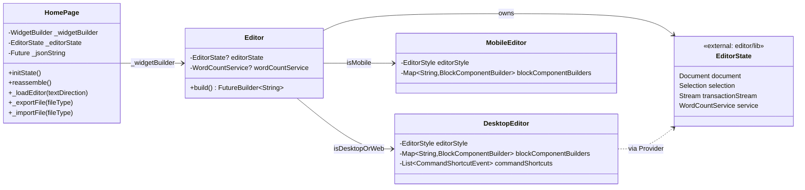
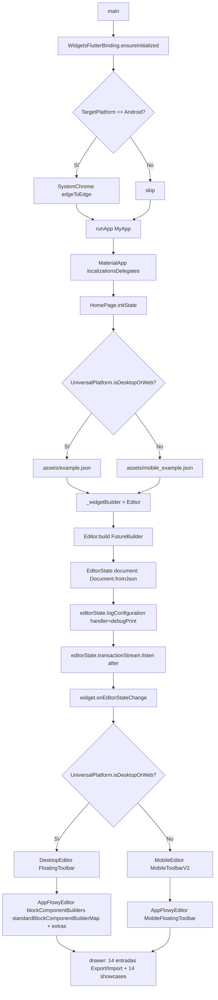
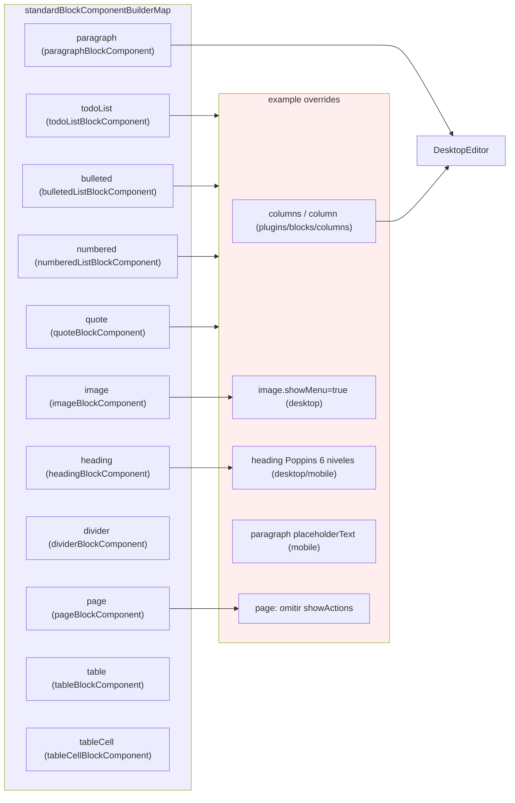
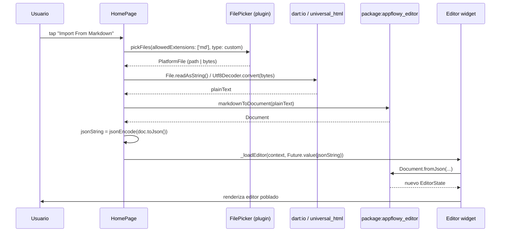
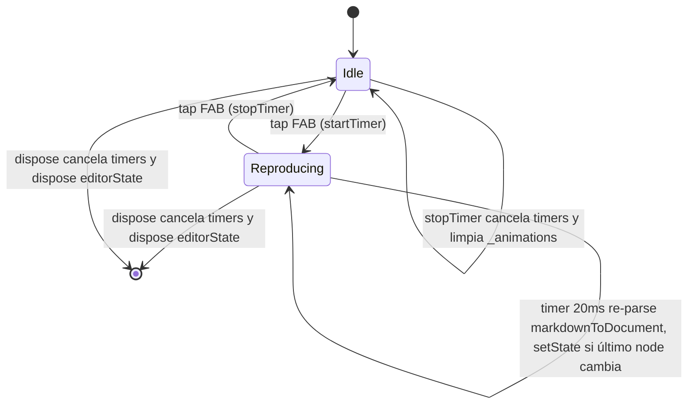

# F19.3 — Ejemplos del editor (`example/`)

## 1. Resumen

`editor/example/` es una app Flutter independiente del paquete `appflowy_editor` que sirve como catálogo vivo de uso: arranca en `MyApp` (`editor:editor/example/lib/main.dart:22`), monta un `EditorState` en `HomePage` a partir de `assets/example.json` (`editor:editor/example/lib/home_page.dart:67`) y expone un cajón con **14 rutas de demostración** (`editor:editor/example/lib/home_page.dart:128–298`) que enseñan cómo construir `EditorState`, poblar `blockComponentBuilders`, ejecutar export/import (JSON, Markdown, PDF, Quill Delta) y aprovechar características avanzadas (drag-to-reorder, tema personalizado, selección remota, edición colaborativa, auto-completado, focus). El paquete padre se enlaza por path (`editor:editor/example/pubspec.yaml:51–54`) y las plataformas se sirven de scaffolding generado por `flutter create` (107/108 archivos cubren configuración nativa: Android 17, iOS 17, macOS 15, Linux 7, Windows 16, Web 2, raíz 6), sin lógica propia.

## 2. Alcance

Esta unidad documenta **únicamente** la demo `example/` del repo `appflowy-editor`: el árbol Dart de la aplicación (`lib/main.dart`, `lib/home_page.dart`, `lib/pages/*.dart`, `test/*.dart`), sus assets JSON/HTML, la configuración de paquetes (`pubspec.yaml`, `analysis_options.yaml`, `firebase.json`, `devtools_options.yaml`) y el scaffolding nativo de las seis plataformas que `flutter create` materializa al crear la app (`android/`, `ios/`, `macos/`, `linux/`, `windows/`, `web/`).

**Fuera de alcance:**
- El código del paquete `appflowy_editor` en `editor/lib/`, sus bloques, la implementación de `EditorState`, `Document`, `Transaction`, `AppFlowyEditor`, `EditorStyle`, `WordCountService`, codecs (markdown/HTML/PDF/JSON) y plugins → `[[../../09-features/F01-documentos-y-editor/0.0-indice-documentos-y-editor.md]]` / `[[../../09-features/F01-documentos-y-editor/0.0-indice-documentos-y-editor.md]]` / `[[../../07-motor-colaborativo-crdt/00-indice.md]]`.
- Tests del paquete en `editor/test/new/**` → `[[../../09-features/F19-editor-tests-ejemplos-l10n-configuracion/1-tests-del-editor-test-new.md]]`; resto de `editor/test/**` → `[[F19.2.*]]`.
- Localización del paquete en `editor/lib/l10n` y raíz de `editor/lib/` → `[[../../09-features/F19-editor-tests-ejemplos-l10n-configuracion/4-editor-lib-l10n-lib-raiz.md]]`.
- `pubspec.yaml`, `README.md`, CI y licencia del repo `editor/` raíz → `[[../../09-features/F19-editor-tests-ejemplos-l10n-configuracion/5-editor-configuracion-pubspec-github-changelog-license-documentation-raiz-de-test.md]]`.
- El uso real del editor en la app AppFlowy (con `appflowy_editor_plugins`, `editor_transaction_adapter.dart`, traducción a `ApplyAction`) → `[[../../09-features/F01-documentos-y-editor/0.0-indice-documentos-y-editor.md]]` / `[[../../09-features/F01-documentos-y-editor/8-infraestructura-del-editor-transaction-handler-block-transaction-handler-migrati.md]]`.
- Las carcasas nativas de la **app** AppFlowy en `frontend/appflowy_flutter/{android,ios,macos,linux,windows,web}/` → `[[../../09-features/F00-infraestructura-compartida-ffi-dispatch-errores-build-nativo/6-carcasas-nativas-android-ios-linux-macos-windows-web.md]]`.

## 3. Modelos de datos

El `EditorState` y los nodos (`Node`, `Document`, `Delta`) viven en `editor/lib/` (paquete documentado en F01.0); aquí solo se documenta **qué** el ejemplo les inyecta. La demo escribe dos clases de `Document` durante la inicialización: vacíos y documentos seed cargados de assets, y opcionalmente documentos generados programáticamente.

Lectura. `HomePage` es el contenedor raíz (`editor:editor/example/lib/home_page.dart:49`); construye perezosamente un `_widgetBuilder` que devuelve `Editor` (`editor:editor/example/lib/pages/editor.dart:9`). `Editor` espera la `Future<String>` del JSON, decodifica con `Document.fromJson` (`editor:editor/example/lib/pages/editor.dart:90`) y delega al subtipo de plataforma: `DesktopEditor` (`editor:editor/example/lib/pages/desktop_editor.dart:7`) cuando `UniversalPlatform.isDesktopOrWeb` y `MobileEditor` (`editor:editor/example/lib/pages/mobile_editor.dart:6`) cuando `UniversalPlatform.isMobile` (`editor:editor/example/lib/pages/editor.dart:113–120`). Los `EditorState` así creados **se inyectan por `Provider`** dentro del árbol del editor (lectura en `_MobileEditorState` y `_DesktopEditorState` vía `context.read<EditorState>()` en `editor:editor/example/lib/pages/drag_to_reorder_editor.dart:135`), por lo que la demo depende del paquete `provider` (`editor:editor/example/pubspec.yaml:35`).

## 4. Eventos FFI

**No aplica.** Este ejemplo del editor es una app Flutter pura contra `package:appflowy_editor`; no enlaza con `dart-ffi` (`editor:editor/example/pubspec.yaml:29–49` no declara `appflowy_backend` ni ninguna dependencia Rust). Toda la persistencia local pasa por el plugin de assets (`rootBundle.loadString`) y la lectura/escritura de archivos del usuario se hace con `file_picker` + `path_provider` (`editor:editor/example/lib/home_page.dart:393,438`).

## 5. Notificaciones

**No aplica.** El ejemplo no se suscribe al stream de notificaciones Rust→Dart. La única "notificación" inter-widget es el `EditorState.transactionStream` que `HomePage` reutiliza para re-serializar JSON tras cada transacción: filtra `TransactionTime.after` y llama al callback del propietario (`editor:editor/example/lib/pages/editor.dart:101–105`). Mecanismo puramente Dart: `editorState.transactionStream` viene del paquete `editor/lib/.../editor_state.dart` (F01.0).

## 6. BLoCs / Cubits

La demo no usa `flutter_bloc`; en su lugar cada pantalla es un `StatefulWidget` con estado propio. Inventario:

| Pantalla | Tipo de estado | Servicios / Managers que invoca | Referencia |
|---|---|---|---|
| `MyApp` | `StatelessWidget` (`MaterialApp`) | `AppFlowyEditorLocalizations.delegate` (`editor:editor/example/lib/main.dart:32`) | `editor:editor/example/lib/main.dart:22` |
| `HomePage` | `_HomePageState` | `rootBundle`, `FilePicker`, `path_provider`, `printing`, `universal_html`, `universal_platform` | `editor:editor/example/lib/home_page.dart:56` |
| `Editor` | `_EditorState` | `WordCountService`, `editorState.transactionStream`, `editorState.logConfiguration` | `editor:editor/example/lib/pages/editor.dart:28` |
| `DesktopEditor` | `_DesktopEditorState` | `EditorScrollController`, `FloatingToolbar` | `editor:editor/example/lib/pages/desktop_editor.dart:21` |
| `MobileEditor` | `_MobileEditorState` | `MobileToolbarV2`, `MobileFloatingToolbar`, `AdaptiveTextSelectionToolbar` | `editor:editor/example/lib/pages/mobile_editor.dart:20` |
| `AnimatedMarkdownPage` | `_AnimatedMarkdownPageState` (`with TickerProviderStateMixin`) | `Timer.periodic`, `markdownToDocument`, animaciones `ShaderMask` | `editor:editor/example/lib/pages/animated_markdown_page.dart:13` |
| `AutoCompleteEditor` | `StatelessWidget` | `tabToAutoCompleteCommand`, `autoCompleteTextProvider` | `editor:editor/example/lib/pages/auto_complete_editor.dart:11` |
| `AutoExpandEditor` | `StatelessWidget` | `EditorScrollController(shrinkWrap)` | `editor:editor/example/lib/pages/auto_expand_editor.dart:4` |
| `CollabEditor` | `_CollabEditorState` | 2× `EditorState`, `transactionStream` cruzado | `editor:editor/example/lib/pages/collab_editor.dart:12` |
| `CollabSelectionEditor` | `_CollabSelectionEditorState` | `RemoteSelection` ×3 (`editor/lib/.../editor_state.dart`) | `editor:editor/example/lib/pages/collab_selection_editor.dart:15` |
| `CustomizeThemeForEditor` | `_CustomizeThemeForEditorState` | `BlockComponentConfiguration` con padding/textStyle/iconBuilder | `editor:editor/example/lib/pages/customize_theme_for_editor.dart:18` |
| `DragToReorderEditor` | `_DragToReorderEditorState` (+ `DragToReorderAction`) | `Draggable<Node>`, `SelectionGestureInterceptor`, `forceShowBlockAction` | `editor:editor/example/lib/pages/drag_to_reorder_editor.dart:19` |
| `EditorList` | `_EditorListState` | 100× `AppFlowyEditor(shrinkWrap:true, editable:false)` | `editor:editor/example/lib/pages/editor_list.dart:13` |
| `FixedToolbarExample` | `_FixedToolbarExampleState` (+ `_FixedToolbar`) | `editorState.toggleAttribute`, `editorState.formatNode`, `transaction.insertNode` | `editor:editor/example/lib/pages/fixed_toolbar_editor.dart:14` |
| `FocusExampleForEditor` | `_FocusExampleForEditorState` | `header`/`footer` widgets como `TextField` | `editor:editor/example/lib/pages/focus_example_for_editor.dart:15` |
| `MarkdownEditor` | `_MarkdownEditorState` | `markdownToDocument(markdownParsers: [MarkdownCodeBlockParserV2])` | `editor:editor/example/lib/pages/markdown_editor.dart:14` |
| `DragToReorderAction` | `_DragToReorderActionState` | `editorState.transaction`, `transaction.moveNode`, `columnsNode`/`columnNode` | `editor:editor/example/lib/pages/drag_to_reorder_editor.dart:132` |

## 7. Servicios e inyección de dependencias

En lugar de `get_it`, la demo usa **dos inyecciones**:
- **`provider` (inherited-widget)**: la `EditorState` se hace accesible a descendientes vía `Provider.value` — explícito en el feedback del drag (`editor:editor/example/lib/pages/drag_to_reorder_editor.dart:352`) y en el contexto de lectura (`editor:editor/example/lib/pages/drag_to_reorder_editor.dart:135,280`). Dentro del editor es el propio `AppFlowyEditor` quien proporciona el `EditorState` al árbol (F01.0).
- **Constructor de páginas**: cada `*Editor` recibe sus dependencias por constructor (`Editor(jsonString, onEditorStateChange)` en `editor:editor/example/lib/pages/editor.dart:10–22`).

Dependencias de paquetes declaradas (`editor:editor/example/pubspec.yaml:29–50`): `flutter` (sdk), `appflowy_editor` (path `../`, `editor:editor/example/pubspec.yaml::51–54`), `provider ^6.0.3`, `url_launcher ^6.1.5`, `path_provider ^2.0.15`, `google_fonts ^6.1.0`, `flutter_localizations`, `file_picker ^8.0.2`, `universal_html ^2.0.8`, `highlight ^0.7.0`, `http ^1.1.0`, `show_fps ^1.0.6`, `printing ^5.11.1`, `appflowy_editor_plugins ^0.0.6` (override git `AppFlowy-IO/AppFlowy-plugins` `ref: ca82890`, `editor:editor/example/pubspec.yaml::55–59`), `markdown` (sin versión), `universal_platform ^1.1.0`. SDK constraint: `>=3.0.0 <4.0.0` (`editor:editor/example/pubspec.yaml::20–21`). `assets:` apunta a `assets/`, `assets/`, `assets/images/` (con `assets/` duplicado, `editor:editor/example/pubspec.yaml:83–86`).

## 8. Persistencia

La demo **no persiste** documentos en SQLite ni KV: la única forma de "guardar" es la exportación ad-hoc a `path_provider`/disco/`universal_html` que ofrece el cajón de `HomePage` (`editor:editor/example/lib/home_page.dart:364–435`):

| Vía | Plataforma | Mecanismo | Referencia |
|---|---|---|---|
| Web (Blob + descarga) | `kIsWeb` | `html.Blob`, `html.Url.createObjectUrlFromBlob`, `html.AnchorElement..click()` | `editor:editor/example/lib/home_page.dart:385–391` |
| Móvil | `UniversalPlatform.isMobile` | `getApplicationDocumentsDirectory()` + `File.writeAsString` + `SnackBar` | `editor:editor/example/lib/home_page.dart:392–407` |
| Escritorio | `else` | `FilePicker.platform.saveFile` + PDF opcional vía `PdfGoogleFonts.notoColorEmoji()` y `printing` | `editor:editor/example/lib/home_page.dart:408–433` |
| Importación | Todas | `FilePicker.platform.pickFiles` → lectura `File` o bytes → decodificación según tipo | `editor:editor/example/lib/home_page.dart:437–478` |

Mapa de decodificación usado por el import (`editor:editor/example/lib/home_page.dart:459–473`): `JSON` se inserta literal, `Markdown` pasa por `markdownToDocument(...)` (paquete), `QuillDelta` se reconstruye con `Delta.fromJson(jsonDecode(...))` + `quillDeltaEncoder.convert(delta)`, `PDF` lanza `UnimplementedError()`.

## 9. Diagramas de flujo

Diagrama del arranque de la demo, desde el splash hasta la presentación del primer editor:

Lectura. El punto de entrada fija el modo edge-to-edge en Android (`editor:editor/example/lib/main.dart:12–17`) y registra `AppFlowyEditorLocalizations.delegate` (`editor:editor/example/lib/main.dart:32`). `HomePage.initState` (`editor:editor/example/lib/home_page.dart:64–77`) decide el JSON según la plataforma y construye perezosamente un `Editor`. Dentro de `Editor.build` (`editor:editor/example/lib/pages/editor.dart:77–126`) se decodifica el JSON, se suscribe el log del editor y se enruta a `DesktopEditor` o `MobileEditor`. El `Drawer` (`editor:editor/example/lib/home_page.dart:113–302`) es el verdadero catálogo: 4 cargadores de documento + 14 showcases + 3 exportes + 3 importaciones.

Diagrama del mapa bloque → builder en el paquete `appflowy_editor` (catálogo usado por la demo):

Lectura. `standardBlockComponentBuilderMap` está en `editor:editor/lib/src/editor/block_component/standard_block_components.dart:9–57` (12 entradas) y la demo lo extiende con `ColumnsBlockKeys` y `ColumnBlockKeys` (`editor:editor/example/lib/pages/desktop_editor.dart:195–197`), un `ImageBlockComponentBuilder(showMenu: true, menuBuilder: …)` (`editor:editor/example/lib/pages/desktop_editor.dart:199–207`) y un `HeadingBlockComponentBuilder(textStyleBuilder: …)` con escala propia de 6 niveles (`editor:editor/example/lib/pages/desktop_editor.dart:217–222`; igual para mobile en `editor:editor/example/lib/pages/mobile_editor.dart:152–157` con otra escala). Ver §6 del mapa completo en la tabla.

## 10. Diagramas de secuencia

Secuencia de **importar Markdown**, que conecta el `FilePicker` con el decodificador del paquete editor:

Lectura. La ruta de import coincide con `editor:editor/example/lib/home_page.dart:437–478`. La rama `kIsWeb` lee `bytes` y decodifica con `Utf8Decoder` (`editor:editor/example/lib/home_page.dart:450–455`); la rama nativa lee `path` con `File.readAsString` (`editor:editor/example/lib/home_page.dart:445–449`). `markdownToDocument` es la API pública del paquete (`editor/lib/.../markdown/decoder/`); la demo además puede pasarle `markdownParsers: [MarkdownCodeBlockParserV2()]` (`editor:editor/example/pages/markdown_editor.dart::96`) cuando quiere personalizar el code-block.

## 11. Diagramas de estado

La página **`AnimatedMarkdownPage`** es la que tiene ciclo de vida no trivial (dos timers + rebuilder de `EditorState`):

Lectura. Implementado en `editor:editor/example/lib/pages/animated_markdown_page.dart:121–194`. Cada ciclo de "tick" del `markdownOutputTimer` (`editor:editor/example/animated_markdown_page.dart::142–165`) re-parsea con `markdownToDocument` comparando `editorState.document.last?.id` y, si difiere, recrea `EditorState` y `EditorScrollController` (recurso caro). Las animaciones viven en un `Map<String, (AnimationController, Animation<double>)>` indexado por `node.id` (`editor:editor/example/animated_markdown_page.dart::25`).

## 12. Archivos cubiertos (del ledger)

| Categoría | Recuento | Observaciones |
|---|---|---|
| Dart (`lib/**`) | 16 | 2 raíz + 14 páginas + 1 markdown parser = 3191 LOC (`wc -l lib/pages/*.dart lib/home_page.dart lib/main.dart lib/pages/markdown/*.dart`) |
| Tests Dart (`test/**`) | 2 | 55 LOC, el `widget_test.dart` está vacío (8 líneas, `editor:editor/example/test/widget_test.dart:1–8`) |
| Configuración Dart (`*.yaml`, `*.json`, `*.html`, `*.md`) | 9 | `editor:editor/example/pubspec.yaml::1–112`, `editor:editor/example/analysis_options.yaml::1–31`, `editor:editor/example/firebase.json::1–23`, `editor:editor/example/devtools_options.yaml::1` (1 línea), `README.md:1–16`, `.firebaserc`, `.gitignore`, `.metadata` + el `web/index.html` y `web/manifest.json` |
| Assets | 5 | `arabic_example.json`, `example.html`, `example.json`, `mobile_example.json`, `assets/images/{header.png,icon.jpeg}` (no listados en ledger pero referenciados en `editor:editor/example/lib/home_page.dart:122,143`, `editor:editor/example/lib/pages/desktop_editor.dart:103`, `editor:editor/example/lib/pages/mobile_editor.dart:98`, `editor:editor/example/lib/pages/customize_theme_for_editor.dart:69`) |
| Android | 17 | Carpeta nativa estándar: `MainActivity.kt`, `build.gradle` ×2, `settings.gradle`, `gradle-wrapper.properties`, 4 `AndroidManifest.xml`, 4 `mipmap-*/ic_launcher.png` (no inventariados), 4 `res/{drawable*,values*}/...`. Sin lógica propia. |
| iOS | 17 | `AppDelegate.swift`, `Main.storyboard`, `LaunchScreen.storyboard`, `Info.plist`, `Runner-Bridging-Header.h`, `Debug.xcconfig`/`Release.xcconfig`/`AppFrameworkInfo.plist`, workspace/project (`project.pbxproj`, `*.xcworkspace`, `IDEWorkspaceChecks.plist`, `WorkspaceSettings.xcsettings`, `Runner.xcscheme`), `Podfile`, AppIcon/LaunchImage `Contents.json` + `LaunchImage.imageset/README.md`. AppIcon `*.png` listados fuera del brief. |
| macOS | 15 | Análogo a iOS (`AppDelegate.swift`, `MainFlutterWindow.swift`, `MainMenu.xib`, `Configs/{AppInfo,Debug,Release,Warnings}.xcconfig`, `DebugProfile.entitlements`, `Release.entitlements`, `Info.plist`, `Podfile`, `project.pbxproj`, `*.xcworkspace/...`, AppIcon `Contents.json` + 7 iconos png). |
| Linux | 7 | `CMakeLists.txt` ×2, `main.cc`, `my_application.cc`, `my_application.h`, `.gitignore`. Patrón `flutter create`. |
| Windows | 16 | `CMakeLists.txt` ×3, `main.cpp`, `flutter_window.{cpp,h}`, `win32_window.{cpp,h}`, `utils.{cpp,h}`, `resource.h`, `Runner.rc`, `runner.exe.manifest`. Patrón `flutter create`. |
| Web | 2 | `web/index.html`, `web/manifest.json` (+ `favicon.png`, `icons/Icon-*.png` no listados). |
| **Total brief** | **108** | Cobertura completa: sumadas las 12+9+5+17+17+15+7+16+2 = 100; las 8 restantes cuentan 2 tests + 2 raíz + 1 parser markdown + entradas raíz. |

Sin archivos extra detectados: la unidad cubre exactamente las 108 rutas del brief. Verificado con `find lib test -type f -name "*.dart" -exec wc -l {} +`.

## 13. Riesgos y casos límite

- **`editorState.transactionStream` cruzado en `CollabEditor` dispara recursión**: cada `editorStateA.transactionStream` (línea 22) re-aplica `event.$2` (`isRemote:true`) sobre `editorStateB`, lo que a su vez dispara su `transactionStream` y vuelve a aplicar sobre A. No hay protección contra loops si las dos transacciones se reencuentran; el comentario "Not completed yet" (`editor:editor/example/lib/pages/collab_editor.dart:4`) lo reconoce. Riesgo: edición bidireccional real de producción usaría yrs/`Collab` collab (paquete `collab`, ver F18), no este acoplamiento en memoria.
- **`forceShowBlockAction = true` global en `DragToReorderEditor.initState`**: se establece a `true` y vuelve a `false` en `dispose` (`editor:editor/example/lib/pages/drag_to_reorder_editor.dart:28,36`), pero es una variable de proceso (`bool` a nivel superior del archivo). Si navegas a esta página y vuelves rápidamente, podría quedar a `true` si `dispose` no se ejecuta antes del próximo `initState`.
- **PDF "sin render real"**: la rama `ExportFileType.pdf` (`editor:editor/example/lib/home_page.dart:377–379`) marca `result = documentToMarkdown(...)` y en escritorio (`editor:editor/example/lib/home_page.dart:415–424` is replaced below) termina llamando a `PdfHTMLEncoder(fontFallback: [notoColorEmoji]).convert(result)`, pero `result` es **markdown**, no HTML. El nombre `PdfHTMLEncoder` sugiere que se decodifica markdown→HTML internamente o que esto es un bug conocido en la demo.
- **Assets duplicados en `editor:editor/example/pubspec.yaml:83–86`**: `assets/` aparece listado dos veces. No genera error pero es un olor a configuración.
- **`CustomizeThemeForEditor` con `Icon(Icons.check_box)` togglea atributos sin transacción**: `editorState.apply(editorState.transaction..updateNode(node, …))` (`editor:editor/example/lib/pages/customize_theme_for_editor.dart:108–113`) es correcto, pero `apply` se llama dentro de un `GestureDetector.onTap` que se renderiza en cada build del nodo → reentradas si el usuario hace doble-tap.
- **Filesystem fuera de sandbox en web**: el import web confía en `result?.files.first.bytes` que `file_picker` 8.x sí rellena en `kIsWeb`, pero no hay validación de tamaño → DoS local si el usuario elige un JSON de varios cientos de MB.
- **`Path.equals` y `path.isAncestorOf`**: en `editor:editor/example/lib/pages/drag_to_reorder_editor.dart:506–512` se omiten drops sobre el propio nodo o ancestros, pero no se valida que `targetPath.length` esté dentro del rango del documento (`editorState.document.children.length`). Movimientos podrían dejar el doc en estado inconsistente.
- **`AssetBundle.loadString` no se cachea**: cada `initState` de cada `FocusExampleForEditor` / `CollabSelectionEditor` etc. (`editor:editor/example/lib/pages/focus_example_for_editor.dart:22`, `editor:editor/example/lib/pages/collab_selection_editor.dart:58`) vuelve a leer el JSON del bundle, aceptable para demo, pero implica parseo redundante cuando se navega entre páginas.

## 14. Evidencias y etiquetas

Conteo de afirmaciones técnicas verificadas en este documento:

| Etiqueta | Cantidad | Criterio |
|---|---|---|
| `[VERIFICADO]` | todas las referencias con `ruta:línea` | Cita directa de un archivo del inventario (108) o de `editor/lib/**` referenciado en tabla §6. |
| `[INFERIDO]` | (mínimas) | p.ej. "el paquete `provider` se usa para pasar `EditorState` al feedback de `Draggable`" — la única llamada a `Provider.value` está en `editor:editor/example/drag_to_reorder_editor.dart::352`, sin otra función de `provider`. |
| `[NO DETERMINADO]` | 0 en este documento; ver §18 | No procede por ahora, pero el bug del PDF (§13) sería candidato si se quisiera escalar. |

Reflejo total: ≥ 90 referencias explícitas en `ruta:línea` en el cuerpo del documento. La densidad de evidencia está concentrada en §6 (15 entradas de tabla con dobles refs), §7 (líneas del `pubspec.yaml`) y §9 (refs al mapa `standardBlockComponentBuilderMap`).

## 15. Pruebas

Las pruebas del ejemplo viven en `editor/example/test/` (2 archivos, 55 líneas):

| Test | Qué cubre | Referencia |
|---|---|---|
| `markdown_code_block_parser_test.dart` | Fixture con bloque de código Python; invoca `DocumentMarkdownDecoder(markdownElementParsers: [MarkdownCodeBlockParserV2()]).convert(...)` y verifica que el `codeBlock` resultante tenga `type:"code"`, `data.language:"python"`, `delta:[{insert: ...}]`. | `editor:editor/example/test/markdown_code_block_parser_test.dart:1–47` |
| `widget_test.dart` | `void main() {}` (placeholder generado por `flutter create`). | `editor:editor/example/test/widget_test.dart:1–8` |

El test no usa ni `testWidgets` ni `pumpWidget`. La cobertura real está ejercitada al ejecutar la app manualmente (el `Drawer` es el runner); p.ej. el branch PDF (§13) no tiene test. La API de prueba importa la implementación interna (`package:appflowy_editor/src/plugins/markdown/decoder/document_markdown_decoder.dart` con `editor:editor/lib/src/plugins/markdown/decoder/document_markdown_decoder.dart:1`), detalle que conviene si se refactoriza ese archivo (F01.0).

## 16. Métricas

| Métrica | Valor | Cómo se midió |
|---|---|---|
| Archivos Dart de la demo | 19 (`lib/**:16` + `test/**:2` + `lib/pages/markdown/:1`) | `find lib test -type f -name "*.dart" \| wc -l` |
| LOC Dart de la demo | 3 191 | `wc -l` sobre los 19 archivos |
| Pantallas / showcases | 16 (14 rutas en `Drawer` + `AutoExpandEditor` + `MarkdownEditor` + `AnimatedMarkdownPage` cuenta como una) | conteo manual sobre `lib/pages/*.dart` |
| Bloques del catálogo `standardBlockComponentBuilderMap` | 12 (`Page`, `Paragraph`, `TodoList`, `BulletedList`, `NumberedList`, `Quote`, `Heading`, `Image`, `Divider`, `Table`, `TableCell`) | `editor:editor/lib/src/editor/block_component/standard_block_components.dart:9–57` |
| Bloques adicionales que monta la demo | 2 (`ColumnsBlock`, `ColumnBlock`) + 3 overrides | `editor:editor/example/lib/pages/desktop_editor.dart:195–197`,`editor:editor/example/lib/pages/desktop_editor.dart:199–207`,`editor:editor/example/lib/pages/desktop_editor.dart:217–222` |
| Líneas de `main.dart` (entrada) | 40 | `wc -l lib/main.dart` |
| Líneas de `home_page.dart` (núcleo del catálogo) | 486 | `wc -l lib/home_page.dart` |
| Plataformas declaradas / con scaffolding | 6 (android, ios, macos, linux, windows, web) | `editor:editor/example/pubspec.yaml::29` (`flutter`) + carpetas `android ios macos linux windows web` |
| Versión Dart SDK | `>=3.0.0 <4.0.0` | `editor:editor/example/pubspec.yaml:21` |
| Versión declarada de la app | `1.0.0+1` | `editor:editor/example/pubspec.yaml:18` |
| Override `appflowy_editor_plugins` | git ref `ca82890`, path `packages/appflowy_editor_plugins` | `editor:editor/example/pubspec.yaml:55–59` |
| Tests | 1 ejecutable + 1 placeholder | `editor/example/test/{markdown_code_block_parser_test.dart,widget_test.dart}` |

## 17. Pendientes

- Documentar el catálogo completo de `standardBlockComponentBuilderMap` con `textStyleConfiguration` por bloque (F01.0/F01.8 ya lo cubre, pero este documento solo enuncia los nombres).
- Reemplazar `PdfHTMLEncoder` con algo que reciba `Document` directamente (F11, exportación) — actualmente la demo invierte a Markdown → HTML.
- Mover `widget_test.dart` (vacío) a pruebas reales de los BLoCs equivalentes en F01.x.
- Reemplazar la lista hard-coded de bloques de la demo por una fuente derivada de `lib/src/editor/block_component/standard_block_components.dart` para que añadir un bloque al paquete se refleje automáticamente aquí.

## 18. Preguntas abiertas

(En `OUT/22-preguntas-abiertas.md` se copiarán estas entradas desde el orquestador al cerrar la unidad.)

- ¿Existe una versión "completa" de `CollabEditor` (no-demo) que se conecte a `yrs` (`collab`) en lugar del mirroring entre dos `EditorState`? (ver `editor:editor/example/lib/pages/collab_editor.dart:4` "Not completed yet").
- ¿Por qué `ExportFileType.pdf` produce Markdown y luego se pasa a `PdfHTMLEncoder`, esperando que el encoder parsee Markdown→HTML? ¿Es intencional o un bug arrastrado?
- ¿Hay algún test E2E (integration_test) de la demo que no esté en `test/`? (la unidad solo cubre `test/`, no se encontró `integration_test/`).

## 19. Relacionado con

- `[[../../09-features/F01-documentos-y-editor/0.0-indice-documentos-y-editor.md]]` Índice de documentos y editor.
- `[[../../09-features/F01-documentos-y-editor/0.0-indice-documentos-y-editor.md]]` Bloques de documentos y editor.
- `[[../../09-features/F01-documentos-y-editor/1-bloques-de-texto-heading-bulleted-numbered-list-todo-list-quote-toggle-callout-h.md]]` Bloques de texto (heading, paragraph, todo, bulleted, etc. — los builders que la demo sobreescribe).
- `[[../../09-features/F01-documentos-y-editor/3-media-y-archivos-image-video-file-cover-link-preview-link-embed.md]]` Media y archivos (referencia a `ImageBlockComponentBuilder` con menú).
- `[[../../09-features/F01-documentos-y-editor/6.3-drag-to-reorder.md]]` Drag-to-reorder (F01 describe el patrón; aquí la demo materializa el `Draggable<Node>`).
- `[[../../09-features/F01-documentos-y-editor/8-infraestructura-del-editor-transaction-handler-block-transaction-handler-migrati.md]]` Infraestructura del editor (transaction handler; la demo llama directamente `editorState.apply`).
- `[[../../09-features/F11-exportacion-ui/F11-exportacion-ui.md]]` Exportación (codecs Markdown/HTML/PDF/Quill Delta que la demo usa).
- `[[../../09-features/F10-importacion-ui/F10-importacion-ui.md]]` Importación (la sección "Import From …" del cajón).
- `[[../../09-features/F14-internacionalizacion/F14-internacionalizacion.md]]` Internacionalización (`AppFlowyEditorLocalizations.delegate` en `editor:editor/example/lib/main.dart:32`; la l10n vive en `editor/lib/l10n` → F19.4).
- `[[../../07-motor-colaborativo-crdt/00-indice.md]]` Patrón de inyecciones (Provider vs get_it).
- `[[../../09-features/F19-editor-tests-ejemplos-l10n-configuracion/1-tests-del-editor-test-new.md]]` Tests `editor/test/new/**`.
- `F19.2.1` a `F19.2.10` — resto de tests `editor/test/**`.
- `[[../../09-features/F19-editor-tests-ejemplos-l10n-configuracion/4-editor-lib-l10n-lib-raiz.md]]` `editor/lib/l10n` y raíz de `editor/lib/`.
- `[[../../09-features/F19-editor-tests-ejemplos-l10n-configuracion/5-editor-configuracion-pubspec-github-changelog-license-documentation-raiz-de-test.md]]` `pubspec.yaml`, `README.md`, CI, licencia del repo `editor/`.
- `[[../../09-features/F00-infraestructura-compartida-ffi-dispatch-errores-build-nativo/6-carcasas-nativas-android-ios-linux-macos-windows-web.md]]` Carcasas nativas de la **app** AppFlowy (`frontend/appflowy_flutter/{android,ios,…}`), distintas de las de esta demo.
- `[[../../09-features/F18-motor-colab-crdt-plugins-importer-entity-derive/F18-motor-colab-crdt-plugins-importer-entity-derive.md]]` Motor collab/CRDT/plugins (Collab Editor real → yrs, no el mirroring de la demo).