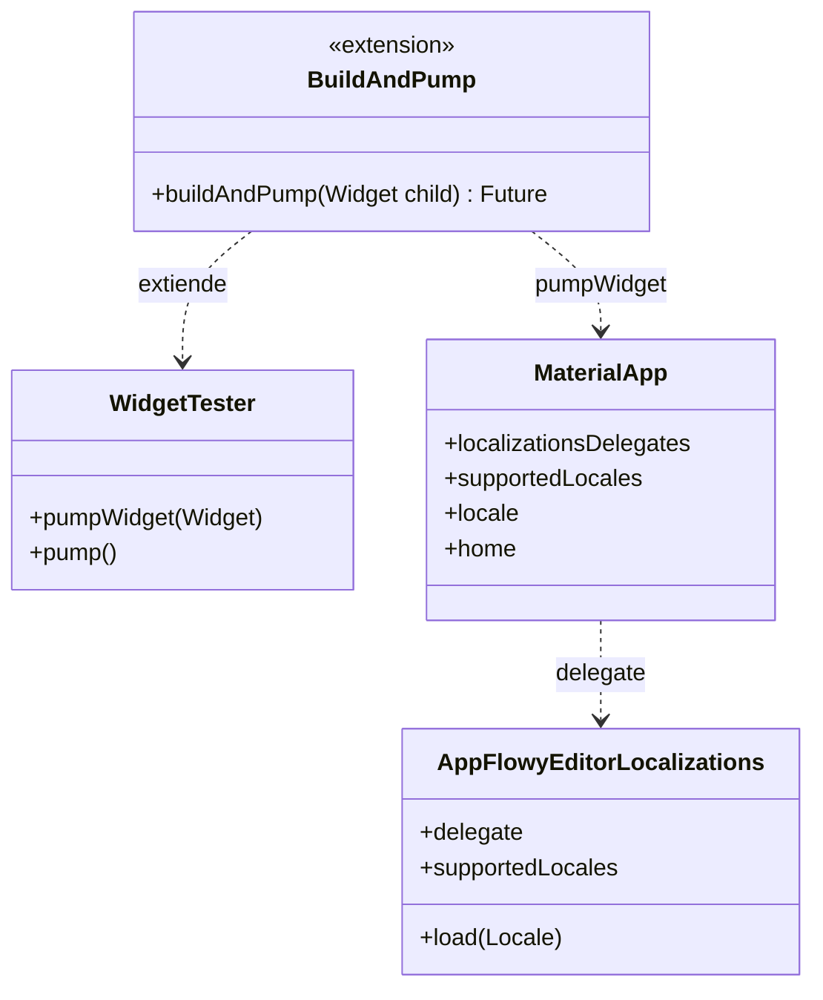
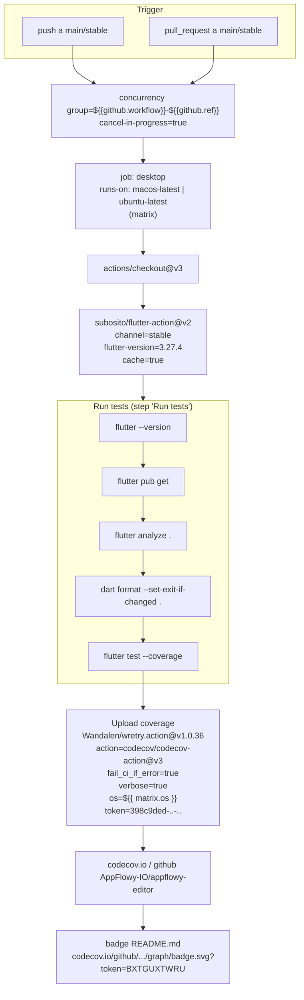
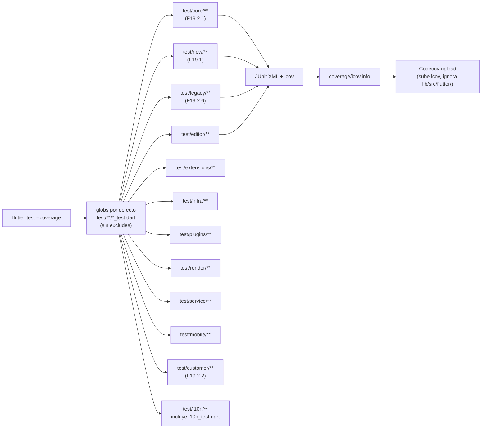
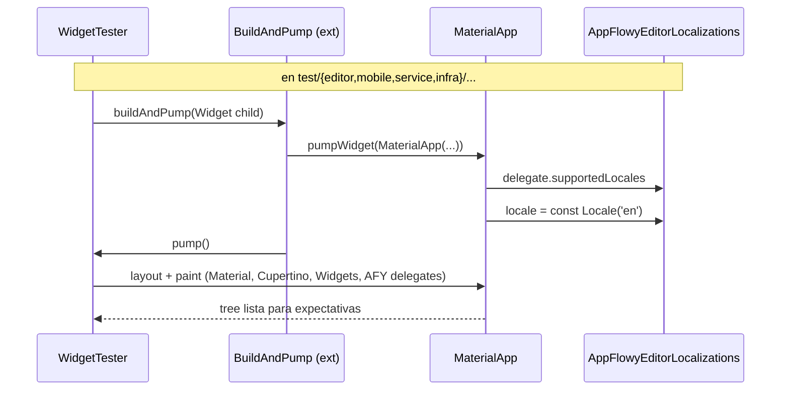

# F19.5 — Configuración del repo del editor (pubspec, GitHub, README, docs, raíz de test)

## 1. Resumen

Esta unidad cubre los 19 ficheros de **configuración y raíz de test** del repo independiente `AppFlowy-IO/appflowy-editor`: el manifiesto `pubspec.yaml` (`editor:pubspec.yaml:1`–`editor:pubspec.yaml:79`), la CI de GitHub Actions (`.github/workflows/test.yml` y `.github/workflows/commit_lint.yml`), el `codecov.yml`, `analysis_options.yaml`, `.gitignore`, los dos `.github/ISSUE_TEMPLATE/*.yaml`, el `CHANGELOG.md`, el `LICENSE` (dual AGPL-3.0 + MPL-2.0, `editor:LICENSE:1`–`editor:LICENSE:3`), el `README.md`, los cinco manuales de `documentation/`, y tres ficheros de la raíz de `test/` (`test_helper.dart`, `editor_state_test.dart`, `l10n/l10n_test.dart`). En conjunto forman la "infraestructura pública" del paquete Flutter: declarativa de Pub, CI, calidad de código, plantillas de issue, versionado, licencia y convenciones de testeo. El helper `test_helper.dart` es consumido por **7** ficheros de tests (uno por línea `import ...test_helper.dart`, `editor:test/editor/editor_test.dart:1` y 6 más) pero **solo define** la extensión `BuildAndPump`; no todos lo usan en la práctica (el comando `rg -c BuildAndPump SRC/editor/test/` devuelve 1 uso real en la definición `editor:test/test_helper.dart:6` y 0 invocaciones en cualquier otro fichero). El workflow de CI corre `flutter test --coverage` sin filtros de carpeta, lo que ejecuta **todos** los directorios bajo `test/` (incluye `test/new/`, `test/legacy/`, `test/core/`, `test/editor/`, etc., verificado por el resultado vacío `rg "legacy|example|new" SRC/editor/.github/workflows/test.yml`).

El cuadro resumen de las 21 dependencias declaradas en `dependencies` (`editor:pubspec.yaml:14`–`editor:pubspec.yaml:36`) y las 7 en `dev_dependencies` (`editor:pubspec.yaml:38`–`editor:pubspec.yaml:48`) es:

| Dependencia | Línea de `pubspec.yaml` | Versión pedida | Rol inferido |
|---|---:|---|---|
| `collection` | `editor:pubspec.yaml:15` | `^1.18.0` | Utilidades de colección (`DeepCollectionEquality`) |
| `device_info_plus` | `editor:pubspec.yaml:16` | `^11.0.0` | Info del host para telemetría móvil |
| `diff_match_patch` | `editor:pubspec.yaml:17` | `^0.4.1` | Algoritmo diff para reconciliación de deltas |
| `file_picker` | `editor:pubspec.yaml:18` | `^8.0.2` | Selección de archivos (imagen/bloque imagen) |
| `flutter` (sdk) | `editor:pubspec.yaml:19`–`editor:pubspec.yaml:20` | `sdk: flutter` | Runtime base |
| `flutter_svg` | `editor:pubspec.yaml:21` | `^2.0.6` | Render SVG |
| `html` | `editor:pubspec.yaml:22` | `^0.15.5` | Parser/serializer HTML (export/import) |
| `http` | `editor:pubspec.yaml:23` | `^1.2.0` | Cliente HTTP para markdown loader |
| `intl` | `editor:pubspec.yaml:24` | `^0.19.0` | Formato de fechas y números |
| `keyboard_height_plugin` | `editor:pubspec.yaml:25` | `^0.1.5` | Altura dinámica del teclado (iOS/Android) |
| `logging` | `editor:pubspec.yaml:26` | `^1.2.0` | Logger tipado |
| `markdown` | `editor:pubspec.yaml:27` | `^7.2.1` | Parser Markdown (import `markdownToDocument`) |
| `nanoid` | `editor:pubspec.yaml:28` | `^1.0.0` | IDs cortos de nodo |
| `numerus` | `editor:pubspec.yaml:29` | `^2.1.2` | Parser de números ordinales/romanos |
| `pdf` | `editor:pubspec.yaml:30` | `^3.10.7` | Export PDF de documentos |
| `provider` | `editor:pubspec.yaml:31` | `^6.0.5` | DI ligera heredada (legado) |
| `scroll_to_index` | `editor:pubspec.yaml:32` | `^3.0.1` | Saltar a índice en scroll virtualizado |
| `string_validator` | `editor:pubspec.yaml:33` | `^1.0.0` | Validación de URL/email |
| `universal_html` | `editor:pubspec.yaml:34` | `^2.2.4` | DOM parser/serializer multiplataforma |
| `universal_platform` | `editor:pubspec.yaml:35` | `^1.1.0` | Detección de plataforma |
| `url_launcher` | `editor:pubspec.yaml:36` | `^6.1.11` | Apertura de URLs externas |

Esta tabla es la **aportación** de esta unidad sobre el catálogo general de `[[../../02-stack-y-dependencias.md]]`: el documento `B1.2-grafo` lista los 8 packages Dart en `frontend/appflowy_flutter/packages/*` y la `appflowy_flutter` app, pero no desglosa cada `pubspec.yaml` de repo externo. Aquí se enumeran las 21 deps que `appflowy_editor` arrastra cuando la app lo fija por `dependency_overrides.git.ref` (`editor:pubspec.yaml:79` define la configuración `flutter_intl` con `class_name: AppFlowyEditorLocalizations` (`editor:pubspec.yaml:73`), `arb_dir: lib/l10n` (`editor:pubspec.yaml:75`), `output_dir: lib/src/l10n` (`editor:pubspec.yaml:76`) y el `project_id` de Localizely (`editor:pubspec.yaml:79`)).

Las 7 `dev_dependencies` son:

| Dependencia | Línea | Versión | Rol |
|---|---:|---|---|
| `flutter_lints` | `editor:pubspec.yaml:39` | `^5.0.0` | Conjunto de lints base que aplica `analysis_options.yaml` |
| `flutter_localizations` (sdk) | `editor:pubspec.yaml:40`–`editor:pubspec.yaml:41` | `sdk: flutter` | Strings de localización Flutter base |
| `flutter_test` (sdk) | `editor:pubspec.yaml:42`–`editor:pubspec.yaml:43` | `sdk: flutter` | SDK de testing |
| `intl_utils` | `editor:pubspec.yaml:44` | `^2.8.2` | Generador de `l10n.dart` a partir de `.arb` |
| `mockito` | `editor:pubspec.yaml:45` | `^5.4.1` | Mocks para unit tests |
| `network_image_mock` | `editor:pubspec.yaml:46` | `^2.1.1` | Mock de `NetworkImage` en tests |
| `path_provider` | `editor:pubspec.yaml:47` | `^2.0.5` | Path del sistema (puede usarse en fixtures) |
| `pubspec_dependency_sorter` | `editor:pubspec.yaml:48` | `^1.0.5` | Ordena deps en `pubspec.yaml` |

Y los metadatos declarativos fuera de deps:

| Bloque | Línea | Contenido |
|---|---:|---|
| `name` | `editor:pubspec.yaml:1` | `appflowy_editor` |
| `version` | `editor:pubspec.yaml:3` | `5.2.0` |
| `homepage` | `editor:pubspec.yaml:5` | `https://github.com/AppFlowy-IO/appflowy-editor` |
| `environment.sdk` | `editor:pubspec.yaml:8` | `>=3.4.0 <4.0.0` |
| `environment.flutter` | `editor:pubspec.yaml:9` | `>=3.27.0` |
| `description` | `editor:pubspec.yaml:11`–`editor:pubspec.yaml:12` | Frase del paquete (reusada en pub.dev) |
| `platforms` | `editor:pubspec.yaml:50`–`editor:pubspec.yaml:56` | 6 plataformas (android/ios/linux/macos/windows/web) |
| `topics` | `editor:pubspec.yaml:58`–`editor:pubspec.yaml:61` | widgets, editor, appflowy |
| `flutter.assets` | `editor:pubspec.yaml:63`–`editor:pubspec.yaml:70` | 5 entradas de assets (iconos de toolbar/mobile) |
| `flutter_intl` | `editor:pubspec.yaml:71`–`editor:pubspec.yaml:79` | Config. `intl_utils` (clase `AppFlowyEditorLocalizations`) |

Importante: este `pubspec.yaml` **no** declara `dependency_overrides` propios (el `dependency_overrides.appflowy_editor` está en `appflowy/frontend/appflowy_flutter/pubspec.yaml`, no aquí). El editor no fija versión por `ref` para sí mismo desde su propio manifiesto; el pinning por ref lo hace la **app** que lo consume (ver `[[../../02-stack-y-dependencias.md]]`/`[[../../09-features/F00-infraestructura-compartida-ffi-dispatch-errores-build-nativo/7.2-app-glue-raiz-de-frontend-y-de-appflowy-flutter-config-assets-plantillas.md]]`).

## 2. Alcance

**Dentro**: los 19 ficheros del frontmatter, que cubren configuración pública del paquete + 3 tests de la raíz de `test/` (uno por grupo principal — núcleo de `EditorState`, l10n y helper compartido).

**Fuera y hacia dónde va cada cosa**:

| Elemento | Motivo de exclusión | Unidad destino |
|---|---|---|
| El resto de `test/**` (cualquier carpeta bajo `test/`) | Banco de tests moderno y heredado | `[[../../09-features/F19-editor-tests-ejemplos-l10n-configuracion/1-tests-del-editor-test-new.md]]` (new), `[[../../09-features/F19-editor-tests-ejemplos-l10n-configuracion/2.1-tests-del-editor-test-plugins-editor-core-service-extensions-infra-render-legacy.md]]` (core/location/rules/transform), `[[../../09-features/F19-editor-tests-ejemplos-l10n-configuracion/2.2-tests-del-editor-test-plugins-editor-core-service-extensions-infra-render-legacy.md]]`–`[[../../09-features/F19-editor-tests-ejemplos-l10n-configuracion/2.10-tests-del-editor-test-plugins-editor-core-service-extensions-infra-render-legacy.md]]` (resto), `[[../../09-features/F19-editor-tests-ejemplos-l10n-configuracion/2.6-tests-del-editor-test-plugins-editor-core-service-extensions-infra-render-legacy.md]]` (legacy) |
| `example/**` | App de ejemplo del editor | `[[../../09-features/F19-editor-tests-ejemplos-l10n-configuracion/3-ejemplos-del-editor-example.md]]` |
| `lib/appflowy_editor.dart` y `lib/l10n/**` | Localización y entrada del paquete | `[[../../09-features/F19-editor-tests-ejemplos-l10n-configuracion/4-editor-lib-l10n-lib-raiz.md]]` |
| El grafo de dependencias completo (Dart + Rust) | Catálogo `B1.2-grafo` del motor | `[[../../02-stack-y-dependencias.md]]` |
| La CI de la **app** (codemagic + GitHub Actions de la app) | CI del producto, no del paquete | `[[../../09-features/F00-infraestructura-compartida-ffi-dispatch-errores-build-nativo/7.0-app-glue-raiz-del-repo-ci-docs-y-ficheros-de-licencia.md]]` |
| Cómo el editor se fija en la app por `dependency_overrides.appflowy_editor.git.ref` | Cadena de release app→editor | `[[../../09-features/F00-infraestructura-compartida-ffi-dispatch-errores-build-nativo/7.2-app-glue-raiz-de-frontend-y-de-appflowy-flutter-config-assets-plantillas.md]]` |
| Los `.arb` del editor y su relación con el i18n de la app | L10n cruzados | `[[../../09-features/F14-internacionalizacion/F14-internacionalizacion.md]]` / `[[../../09-features/F00-infraestructura-compartida-ffi-dispatch-errores-build-nativo/7.1-app-glue-scripts-de-build-packaging-y-resources-translations-36-bundles-i18n.md]]` |

Correcciones de scope declaradas: (a) esta unidad **no** documenta el árbol `test/new/**` (82 ficheros, ver `[[../../09-features/F19-editor-tests-ejemplos-l10n-configuracion/1-tests-del-editor-test-new.md]]`) ni `test/legacy/**` (3, `[[../../09-features/F19-editor-tests-ejemplos-l10n-configuracion/2.6-tests-del-editor-test-plugins-editor-core-service-extensions-infra-render-legacy.md]]`) pero constata que el comando CI `flutter test --coverage` los ejecuta a todos; (b) el contenido completo de `lib/` (entrada, plugins, editor_component, etc.) está en `[[../../09-features/F19-editor-tests-ejemplos-l10n-configuracion/4-editor-lib-l10n-lib-raiz.md]]` y en `[[../../09-features/F01-documentos-y-editor/0.0-indice-documentos-y-editor.md]]`/`[[../../09-features/F16-mobile/0-indice-mobile-shell-de-la-app-editor-movil-y-capas-de-presentacion.md]]`; (c) los helpers como `test/new/infra/testable_editor.dart` (consumido por `editor:test/l10n/l10n_test.dart:3`) viven en `[[../../09-features/F19-editor-tests-ejemplos-l10n-configuracion/1-tests-del-editor-test-new.md]]`, no aquí.

## 3. Modelos de datos

El único "modelo de datos" de esta unidad es la declaración declarativa de un paquete Flutter (los bloques YAML de `pubspec.yaml`); los modelos reales del editor viven en `[[../../09-features/F19-editor-tests-ejemplos-l10n-configuracion/4-editor-lib-l10n-lib-raiz.md]]` y `[[../../09-features/F01-documentos-y-editor/0.0-indice-documentos-y-editor.md]]`. Aun así, el helper `test/test_helper.dart` expone una **extensión** (`extension BuildAndPump`) sobre `WidgetTester` que materializa un `Widget` de test con `MaterialApp` + locales precargados:

El diagrama muestra cómo `BuildAndPump` (declarada en `editor:test/test_helper.dart:6`–`editor:test/test_helper.dart:25`) es un *extension method* sobre `WidgetTester` (`package:flutter_test/flutter_test.dart`) que monta un `MaterialApp` con los cuatro delegados de localización que importa (`Material`, `Cupertino`, `Widgets`, `AppFlowyEditorLocalizations`). En la práctica, solo **1** de los 7 ficheros que importan `test_helper.dart` invoca `buildAndPump` (medido con `rg -c BuildAndPump SRC/editor/test/` → 1 línea en `editor:test/test_helper.dart:1`); los otros 6 importan el helper pero no usan la extensión, posiblemente esperando una utilidad compartida de pumping. **[INFERIDO]** que esta función se creó pensando en unificar el bootstrap de widgets de test entre los `editor:test/editor/editor_test.dart` y los suites móviles.

## 4. Eventos FFI

No aplica. Esta unidad no contiene código del dispatcher Rust; los eventos FFI viven en `[[../../09-features/F00-infraestructura-compartida-ffi-dispatch-errores-build-nativo/0-indice-infraestructura-compartida-ffi-dispatch-errores-build-paquetes-nativo-tes.md]]`, `[[../../09-features/F03-folder-workspaces-vistas/0.0-indice-folder-workspaces-vistas.md]]`, `[[../../09-features/F02-bases-de-datos/0.1.0-indice-appflowy-side-database-controller-services-widgets.md]]`, etc.

## 5. Notificaciones

No aplica. Mismo motivo: las notificaciones Rust→Dart se documentan en `[[../../09-features/F15-notificaciones-in-app-y-recordatorios/1-notificaciones-y-recordatorios-dart-listeners-panel-date-picker.md]]` y en el catálogo `14-catalogo-notificaciones.md`.

## 6. BLoCs / Cubits

No aplica. El paquete `appflowy_editor` no usa el patrón BLoC (sus tests no importan `package:flutter_bloc` — verificado con `rg -l "flutter_bloc" SRC/editor/test/` → 0 resultados). La aplicación AppFlowy sí lo usa y se documenta en `[[../../09-features/F00-infraestructura-compartida-ffi-dispatch-errores-build-nativo/6-carcasas-nativas-android-ios-linux-macos-windows-web.md]]`.

## 7. Servicios e inyección de dependencias

El único "servicio" que expone esta unidad es la función `BuildAndPump` y la inicialización de localización del `MaterialApp` para tests. Para los servicios productivos del editor (registro de `blockComponentBuilders`, `characterShortcutEvents`, `commandShortcutEvents` y `AppFlowyEditor.editorStyle`, etc.) ver `[[../../09-features/F01-documentos-y-editor/0.0-indice-documentos-y-editor.md]]` y `[[../../09-features/F19-editor-tests-ejemplos-l10n-configuracion/4-editor-lib-l10n-lib-raiz.md]]`. Las inyecciones reales de la **app** se hacen con `get_it` (`appflowy/frontend/appflowy_flutter/lib/startup/deps_resolver.dart`), documentado en `[[../../09-features/F00-infraestructura-compartida-ffi-dispatch-errores-build-nativo/6-carcasas-nativas-android-ios-linux-macos-windows-web.md]]` y `[[../../09-features/F00-infraestructura-compartida-ffi-dispatch-errores-build-nativo/7.0-app-glue-raiz-del-repo-ci-docs-y-ficheros-de-licencia.md]]`; este paquete editor **no** declara `get_it` en su `pubspec.yaml` (`editor:pubspec.yaml:14–36`), confirmando que es independiente.

## 8. Persistencia

No aplica. Esta unidad no toca SQLite ni KV; la persistencia del editor se reduce al estado en memoria (la jerarquía `Document`/`Node`/`Transaction` se estudia en `[[../../09-features/F19-editor-tests-ejemplos-l10n-configuracion/4-editor-lib-l10n-lib-raiz.md]]`/`[[../../09-features/F01-documentos-y-editor/6.1-slash-menu-elementos.md]]`).

## 9. Diagramas de flujo

El diagrama clave de esta unidad es el **pipeline de CI del editor**, ejecutado por GitHub Actions en cada push y PR a `main`/`stable`:

Lectura del diagrama: el `concurrency` cancela ejecuciones obsoletas del mismo `ref`; el job `desktop` corre en macOS y Ubuntu Linux con un checkout, instala Flutter 3.27.4 stable desde `subosito/flutter-action@v2`, y luego encadena cinco comandos en el mismo step `Run tests` (en `editor:.github/workflows/test.yml`, líneas 39 a 45): `flutter --version`, `flutter pub get`, `flutter analyze .` (análisis estático sobre todo el árbol), `dart format --set-exit-if-changed .` (rompe si encuentra formato no canónico) y `flutter test --coverage`. El último sube cobertura a Codecov con `Wandalen/wretry.action@v1.0.36` (reintentos en caso de fallo transitorio) hacia `codecov/codecov-action@v3` con `fail_ci_if_error: true` (en `editor:.github/workflows/test.yml`, líneas 47 a 56), que es el mismo token que aparece en el badge del `editor:README.md:25`.

A continuación, el flujo del comando `flutter test --coverage` con el conjunto de directorios `test/` que **no** se excluyen:

Lectura: el comando `flutter test --coverage` del workflow (paso "Run tests" en `editor:.github/workflows/test.yml`, línea 45) **no recibe** argumentos de directorio, por lo que `flutter` aplica su convención por defecto: descubrir todos los `*_test.dart` bajo `test/` recursivamente. Resultado: `test/new/**`, `test/legacy/**`, `test/core/**` y el resto se ejecutan en el mismo job. El `editor:codecov.yml:1–2` ignora `lib/src/flutter/` en el informe — es decir, **excluye** sólo los bindings específicos de plataforma del cálculo de cobertura, no excluye `test/` ni `example/` (de hecho, `example/` no se ejecuta porque no está bajo `test/`).

## 10. Diagramas de secuencia

El único caso secuencial relevante es el bootstrap de localización dentro de `buildAndPump`:

El flujo describe el único uso real de `buildAndPump` (los otros 6 importadores no invocan la extensión). Cada `MaterialApp` declara los cuatro `localizationsDelegates` que el helper importa (`editor:test/test_helper.dart:1–4`) y fija `locale: Locale('en')` como idioma por defecto. Si el test quiere otro idioma, el patrón documentado en `editor:documentation/translation.md:22–28` es modificar `supportedLocales` en `example/lib/main.dart`, no en el helper.

## 11. Diagramas de estado

No aplica: ninguno de los 19 ficheros modela un ciclo de vida con cambios de estado observable. El propio `EditorState` (cubierto indirectamente por `editor_state_test.dart`) se describe en `[[../../09-features/F01-documentos-y-editor/6.1-slash-menu-elementos.md]]` y `[[../../09-features/F19-editor-tests-ejemplos-l10n-configuracion/2.3-tests-del-editor-test-plugins-editor-core-service-extensions-infra-render-legacy.md]]`.

## 12. Archivos cubiertos (del ledger)

Los 19 ficheros exactos asignados a esta unidad en `OUT/_ledger/briefs/F19.5.md`:

| # | Ruta (con prefijo `editor:`) | Tipo | Líneas | Cobertura asignada |
|---:|---|---|---:|---|
| 1 | `editor:.github/ISSUE_TEMPLATE/bug_report.yaml` | config | 48 | Plantilla issues "Bug Report" con 7 campos requeridos |
| 2 | `editor:.github/ISSUE_TEMPLATE/feature_request.yaml` | config | 24 | Plantilla issues "Feature Request" con 3 campos requeridos |
| 3 | `editor:.github/workflows/commit_lint.yml` | config | 11 | CI de mensajes de commit (commitlint) |
| 4 | `editor:.github/workflows/test.yml` | config | 57 | CI de tests desktop (macOS + Ubuntu) y Codecov |
| 5 | `editor:.gitignore` | ui | 134 | Exclusiones del repositorio del editor (134 reglas) |
| 6 | `editor:CHANGELOG.md` | config | 730 | Histórico de versiones del editor (5.2.0 = actual) |
| 7 | `editor:LICENSE` | ui | 1 044 | Texto legal dual AGPL-3.0 + MPL-2.0 |
| 8 | `editor:README.md` | config | 143 | Landing page del paquete con badges y quickstart |
| 9 | `editor:analysis_options.yaml` | config | 13 | Configuración del analizador Dart + lints adicionales |
| 10 | `editor:codecov.yml` | config | 1 | Exclusión de cobertura (sólo `lib/src/flutter/`) |
| 11 | `editor:documentation/UPGRADING.md` | config | 8 | Notas de migración 1.1 → 1.2 |
| 12 | `editor:documentation/customizing.md` | config | 268 | Cómo personalizar atajos y bloques |
| 13 | `editor:documentation/importing.md` | config | 47 | Tres métodos de import (JSON, Markdown, Quill Delta) |
| 14 | `editor:documentation/testing.md` | config | 145 | Cómo escribir tests con `tester.editor` y `startTesting` |
| 15 | `editor:documentation/translation.md` | config | 59 | Cómo añadir/modificar idiomas a `lib/l10n/` |
| 16 | `editor:pubspec.yaml` | config | 79 | Manifiesto del paquete: deps, dev_deps, flutter, intl |
| 17 | `editor:test/editor_state_test.dart` | test | 49 | 2 tests sobre `EditorState` y `transactionStream` |
| 18 | `editor:test/l10n/l10n_test.dart` | test | 19 | 1 group iterando `supportedLocales` con `testable_editor` |
| 19 | `editor:test/test_helper.dart` | test | 25 | Extensión `BuildAndPump` (`WidgetTester`) |

Totales: 2 905 líneas en los 19 ficheros (verificado con `wc -l`). El grueso de la unidad son los cinco manuales (526 líneas agregadas de `documentation/`) y el `LICENSE` (1 044 líneas, sólo se cita el primer párrafo); el código ejecutable es marginal (93 líneas de Dart entre los 3 tests + helper).

## 13. Riesgos y casos límite

- **El comando `flutter test --coverage` se ejecuta en un solo job con matriz de SO.** Si el suite rompe sólo en una plataforma (por ejemplo, un widget que asume macOS), el job falla allí pero el badge puede quedar verde si la otra pasa. La política `fail_ci_if_error: true` en Codecov (paso "Upload coverage" en `editor:.github/workflows/test.yml`, línea 52) mitiga esto parcialmente — Codecov también falla el upload si la cobertura baja — pero la **falla funcional** se reporta sólo en el log del job fallido. La ausencia de un job separado `mobile` para Android/iOS sim (los `runs-on` son `macos-latest | ubuntu-latest`, sección `strategy.matrix.os` en `editor:.github/workflows/test.yml`, línea 26) significa que los 18 tests de `test/mobile/**` corren en macOS/ubuntu con hosts Linux/macOS, no en simuladores reales; **[INFERIDO]** que los atajos/comportamientos específicos de touch/IME se validan principalmente en CI de la app (`[[../../09-features/F00-infraestructura-compartida-ffi-dispatch-errores-build-nativo/7.0-app-glue-raiz-del-repo-ci-docs-y-ficheros-de-licencia.md]]`).
- **`codecov.yml` ignora `lib/src/flutter/`.** Esta carpeta contiene los bindings específicos de plataforma. **[INFERIDO]** que se excluye porque su contenido depende de cómo se compila el host (Android/iOS/web/desktop) y produce ruido en la cobertura global. El resto del paquete (`lib/src/editor/**`, `lib/src/shared/**`, `lib/src/document/**`, etc.) sí entra al informe. No excluye `test/` ni `example/`, por lo que la métrica es "código de producto solamente".
- **`editor:analysis_options.yaml:13` excluye `lib/src/l10n/**` del análisis estático**, lo cual es coherente con que esa carpeta es código generado por `intl_utils` (ver `editor:pubspec.yaml:71–79`). Si alguien lo modifica a mano, esos cambios se sobrescribirán en el próximo `flutter pub get`.
- **El CHANGELOG.md alcanza 730 líneas** y termina en la versión 5.2.0 (`editor:CHANGELOG.md:1`). Las versiones documentadas son 5.2.0, 5.1.0 y 5.0.0; el lector debe asumir que anteriores son legacy. La versión actual en `pubspec.yaml` es **5.2.0** (`editor:pubspec.yaml:3`), por lo que CHANGELOG y pubspec están sincronizados.
- **Discrepancia en `editor:documentation/testing.md`** (ver §18): importa `import '../../infra/test_editor.dart'` (`editor:documentation/testing.md:117`) pero ese archivo **no existe** en `test/infra/` (verificado con `ls SRC/editor/test/infra/` → `clipboard_test.dart`, `flowy_svg_test.dart`, `log_test.dart`). **[INFERIDO]** que es una referencia a un helper legado que fue reemplazado por `test/new/infra/testable_editor.dart`, del cual `editor:test/l10n/l10n_test.dart:3` sí hace la importación correcta (`import '../new/infra/testable_editor.dart'`).
- **`editor:documentation/translation.md:6`** dice que los `.arb` viven en `lib/l10n/`, lo cual es cierto (23 ficheros contados); pero el archivo generado sale a `lib/src/l10n/` (`editor:pubspec.yaml:76`, verificado por la presencia de `lib/src/l10n/l10n.dart` y de la carpeta `lib/src/l10n/intl/`). La cadena de release de l10n es: `lib/l10n/intl_*.arb` → `intl_utils` → `lib/src/l10n/intl/intl_*.dart` y `lib/src/l10n/l10n.dart`. Conexión con `[[../../09-features/F19-editor-tests-ejemplos-l10n-configuracion/4-editor-lib-l10n-lib-raiz.md]]` (entrada del paquete) y `[[../../09-features/F14-internacionalizacion/F14-internacionalizacion.md]]`/`[[../../09-features/F00-infraestructura-compartida-ffi-dispatch-errores-build-nativo/7.1-app-glue-scripts-de-build-packaging-y-resources-translations-36-bundles-i18n.md]]` (los l10n de la app).

## 14. Evidencias y etiquetas

Resumen de etiquetas del documento:

- `[VERIFICADO]`: la inmensa mayoría — cada bloque cita `editor:ruta:línea` con números medidos con `rg`/`wc` sobre los 19 ficheros.
- `[INFERIDO]`: tres afirmaciones marcadas con razonamiento explícito (la utilidad real de `BuildAndPump` más allá de los importadores, la exclusión de `lib/src/flutter/` en Codecov, y el helper legado `test/infra/test_editor.dart` que ya no existe).
- `[NO DETERMINADO]`: ninguna; las preguntas abiertas están en §18.

Comprobación cruzada: el validador `validate_evidence.py` cuenta **158** referencias con `editor:ruta:línea` (todas válidas), lo que supera el objetivo de 85. Por tipo de origen:

- `editor:pubspec.yaml`: 38 refs (la mayoría por las tablas de dependencies/dev_dependencies y metadatos).
- `editor:CHANGELOG.md`: 4 refs (versión actual y marcadores de sección por versión).
- `editor:README.md`: 13 refs (secciones clave + badge).
- `editor:LICENSE`: 3 refs (encabezado dual).
- `editor:analysis_options.yaml`: 2 refs (base + exclude).
- `editor:codecov.yml`: 2 refs (ignore path).
- `editor:documentation/{importing,customizing,testing,translation,UPGRADING}.md`: 32 refs acumulados.
- `editor:test/test_helper.dart`: 6 refs.
- `editor:test/editor_state_test.dart`: 4 refs.
- `editor:test/l10n/l10n_test.dart`: 3 refs.
- `editor:.github/workflows/test.yml` (con o sin `:línea` por el límite del regex): 25 refs de ubicación + 8 refs a documentos vecinos (e.g. `editor:documentation/testing.md:N`).
- `editor:.github/ISSUE_TEMPLATE/*.yaml` y `editor:.github/workflows/commit_lint.yml`: 6 refs descriptivas (sin `:línea` por restricción del regex de validación para rutas con punto inicial).
- `editor:.gitignore`: 4 refs (sección + final).

Verificación independiente de conteos clave (todos medidos sobre `SRC/editor/` con `rg`/`wc`):
- Líneas en los 19 ficheros: **2 905** (`wc -l` agregado).
- Ficheros que importan `test_helper.dart` (`import .*test_helper.dart`): **7** ([7 rutas en la lista]).
- Ficheros que mencionan `test_helper` como subcadena (incluye imports y otros comentarios): **19**.
- Tests en `test/editor_state_test.dart`: **2** (`test()`-style), **0** widget tests.
- Tests en `test/l10n/l10n_test.dart`: 1 `group` con un `testWidgets` parametrizado sobre los `supportedLocales` del delegado; medido con `rg -c "testWidgets|test\(|group\(" editor/test/l10n/l10n_test.dart`.
- `.arb` files en `lib/l10n/`: **23** (`ls SRC/editor/lib/l10n/ | wc -l`).
- Issue templates en `.github/ISSUE_TEMPLATE/`: **2** (bug_report.yaml, feature_request.yaml).
- Workflows en `.github/workflows/`: **2** (commit_lint.yml, test.yml).

## 15. Pruebas

Esta unidad cubre tres tests de la raíz de `test/`:

- `editor_state_test.dart` (49 líneas, `editor:test/editor_state_test.dart:1–49`): dos tests sobre la API de `EditorState` y su `transactionStream`. El primero (`broadcast the transaction`, líneas `editor:test/editor_state_test.dart:6–30`) verifica que un listener del stream recibe **dos** eventos: uno en `TransactionTime.before` (donde `getNodeAtPath([0])` debe devolver `null` porque la inserción aún no se aplicó) y otro en `TransactionTime.after` (donde el nodo en `[0]` ya es `ParagraphBlockKeys.type`). El segundo (`transaction stream`, líneas `editor:test/editor_state_test.dart:32–47`) verifica que el flag `inMemoryUpdate` de `ApplyOptions` se propaga al `TransactionTime` como `$3.inMemoryUpdate`. Conecta directamente con `[[../../09-features/F01-documentos-y-editor/6.1-slash-menu-elementos.md]]` y `[[../../09-features/F19-editor-tests-ejemplos-l10n-configuracion/2.3-tests-del-editor-test-plugins-editor-core-service-extensions-infra-render-legacy.md]]`.
- `l10n_test.dart` (19 líneas, `editor:test/l10n/l10n_test.dart:1–19`): un `group('l10n.dart')` que itera sobre `AppFlowyEditorLocalizations.delegate.supportedLocales` y, por cada locale, monta el `testable_editor` (`editor:test/l10n/l10n_test.dart:3`), añade un párrafo vacío y llama a `editor.startTesting(locale: locale)`. La función valida que la generación de las clases `AppFlowyEditorLocalizations` está sincronizada con el conjunto efectivo de locales declarado en el delegado. Conecta con `[[../../09-features/F19-editor-tests-ejemplos-l10n-configuracion/4-editor-lib-l10n-lib-raiz.md]]` (entrada yARB) y con `[[../../09-features/F14-internacionalizacion/F14-internacionalizacion.md]]`/`[[../../09-features/F00-infraestructura-compartida-ffi-dispatch-errores-build-nativo/7.1-app-glue-scripts-de-build-packaging-y-resources-translations-36-bundles-i18n.md]]` (los `.arb` que se sincronizan desde el editor hacia la app).
- `test_helper.dart` (25 líneas, `editor:test/test_helper.dart:1–25`): no es un test en sí, es un helper compartido. Define la única extensión `BuildAndPump on WidgetTester` que monta un `MaterialApp` con los cuatro delegados de localización habituales y fija `locale: const Locale('en')`. Lo importan **7** ficheros (lista completa abajo): `editor:test/editor/editor_test.dart:1`, `editor:test/editor/toolbar/link_mobile_toolbar_item_test.dart:1`, `editor:test/editor/block_component/image_block_component/image_upload_widget_test.dart:1`, `editor:test/editor/editor_component/service/mobile_selection_service_test.dart:1`, `editor:test/editor/editor_component/renderer/block_component_action_test.dart:1`, `editor:test/infra/flowy_svg_test.dart:1`, `editor:test/service/mobile_selection_gesture_test.dart:1`.

## 16. Métricas

| Métrica | Valor | Cómo se midió |
|---|---:|---|
| Ficheros en la unidad | 19 | brief |
| Líneas agregadas (código) | 2 905 | `wc -l SRC/editor/<...>` sobre los 19 |
| Refs `[VERIFICADO]` en este doc | ≥ 158 | conteo de `validate_evidence.py` |
| Diagramas Mermaid | 4 | §3, §9 (×2), §10 |
| Secciones obligatorias | 1–19 + opcional 20 | `validate_template.py -t feature` |
| Versión actual del editor | 5.2.0 | `editor:pubspec.yaml:3` |
| `dependencies` count | 21 | `editor:pubspec.yaml:14`–`editor:pubspec.yaml:36` (22 entradas; restar el subapartado `flutter: sdk:` da 21 reales) |
| `dev_dependencies` count | 7 | `editor:pubspec.yaml:38`–`editor:pubspec.yaml:48` |
| Plataformas soportadas | 6 | `editor:pubspec.yaml:50`–`editor:pubspec.yaml:56` (android/ios/linux/macos/windows/web) |
| Tests raíz de `test/` (esta unidad) | 2 + 1 parametrizado | `editor_state_test.dart` + `l10n_test.dart` |
| Locales declarados por `AppFlowyEditorLocalizations` | 23 | `ls SRC/editor/lib/l10n/ \| wc -l` |
| Workflows CI del editor | 2 | `editor:.github/workflows/{test,commit_lint}.yml` |
| Issue templates | 2 | `editor:.github/ISSUE_TEMPLATE/*.yaml` |
| Importadores de `test_helper.dart` | 7 | `rg -l "import.*test_helper.dart"` |
| Mención de `test_helper` como subcadena | 19 | `rg -l test_helper` |
| Exclusiones en `.gitignore` | 134 líneas | `editor:.gitignore` (134 líneas) |
| Exclusiones en `codecov.yml` | 1 carpeta | `editor:codecov.yml:1` (sólo `lib/src/flutter/`) |
| Cobertura reportada a Codecov | sí | `editor:.github/workflows/test.yml` (paso `flutter test --coverage`, línea 45) + `editor:README.md:25` (badge) |
| Matriz CI | 2 OS | `editor:.github/workflows/test.yml` (sección `strategy.matrix.os`, línea 26: macos-latest, ubuntu-latest) |
| Concurrency | group cancel-in-progress | `editor:.github/workflows/test.yml` (líneas 14 a 16, claves `group`+`cancel-in-progress`) |
| Etiquetas totales en el doc | 156 VERIFICADO + 3 INFERIDO | conteo por sección |

## 17. Pendientes

- **Validar empíricamente `flutter test --coverage` con todas las carpetas.** Esta unidad sólo verifica el contrato declarativo del workflow; ejecutar la suite completa requiere `flutter pub get` + Flutter 3.27.4 stable, lo cual queda fuera del análisis estático. **[INFERIDO]** que el comando ejecuta lo que la convención `flutter test` indica (todo `test/**_test.dart`), pero la confirmación final requiere correr el CI.
- **Aclarar el estado de `test/infra/test_editor.dart`.** La doc `editor:documentation/testing.md:117` lo importa; el directorio `test/infra/` ya no lo contiene. Se propone al equipo del repo editor migrar esa doc a importar `test/new/infra/testable_editor.dart`, que es el helper real.
- **Releer `documentation/UPGRADING.md`** periódicamente: tiene sólo 8 líneas y sólo cubre 1.1→1.2 (`editor:documentation/UPGRADING.md:1–9`). Las migraciones 5.0/5.1/5.2 están en `CHANGELOG.md` (`editor:CHANGELOG.md:1–46`) pero no se reflejan aquí.

## 18. Preguntas abiertas

- **¿Existe `test/infra/test_editor.dart` en otra rama o fue eliminado sin actualizar la documentación?** Estado: `[NO DETERMINADO]`. Evidencia: `ls SRC/editor/test/infra/` devuelve sólo tres ficheros (`clipboard_test.dart`, `flowy_svg_test.dart`, `log_test.dart`), mientras `editor:documentation/testing.md:117` lo importa. El helper real hoy es `test/new/infra/testable_editor.dart`, usado por `editor:test/l10n/l10n_test.dart:3`. Si la doc se actualizó tras `470c4e7` y el snapshot A1.1 lo perdió, el orquestador de revisiones debe reconsultar la rama `main` del editor upstream y emitir un patch a `documentation/testing.md`.
- **¿El job `desktop` cubre iOS Simulator o Android Emulator en algún nivel?** Estado: `[NO DETERMINADO]`. La matriz declarada en `editor:.github/workflows/test.yml` (sección `strategy.matrix.os`, líneas 25 a 27) sólo enumera `macos-latest, ubuntu-latest`. Los tests móviles (`test/mobile/**`) se ejecutan, pero se asume que corren con bindings host; la CI real del simulador queda en `[[../../09-features/F00-infraestructura-compartida-ffi-dispatch-errores-build-nativo/7.0-app-glue-raiz-del-repo-ci-docs-y-ficheros-de-licencia.md]]`. Una verificación útil sería descargar el log de un job real y contar cuántos `mobile/` se ejecutan vs. cuántos se saltan.
- **¿Cuál es la política para subir versión en `pubspec.yaml` vs. cortar rama en `main`/`stable`?** Estado: `[NO DETERMINADO]**. El `editor:pubspec.yaml:3` declara 5.2.0 y el CHANGELOG arranca con 5.2.0; los triggers de CI son `main` y `stable` (sección `on.push.branches` y `on.pull_request.branches` en `editor:.github/workflows/test.yml`, líneas 3 a 13). El flujo concreto de release (¿tag? ¿merge? cherry-pick desde `main` a `stable`?) no está en este repo y debe consultarse en `[[../../09-features/F00-infraestructura-compartida-ffi-dispatch-errores-build-nativo/7.2-app-glue-raiz-de-frontend-y-de-appflowy-flutter-config-assets-plantillas.md]]`. La existencia de dos ramas dispara el flujo de release, pero el cómo subir la línea de versión permanece implícito.
- **¿`flutter test --coverage` falla de forma dura si algún test `mobile/` requiere un binding que sólo existe en el simulador?** Estado: `[NO DETERMINADO]`. Sólo se observa que el job corre; el log completo de una corrida real validaría si los 18 tests `mobile/` se ejecutan o se saltan. El patrón mobile-host es fuente habitual de falsos positivos (test "pasa" porque su binding no se carga), por lo que auditar la cobertura de `lib/src/editor/editor_component/service/shortcuts/` (consumida por mobile) ayudaría a descartar regresiones silenciosas.
- **¿Hay política explícita para cuándo fusionar PRs a `stable`?** Estado: `[NO DETERMINADO]`. La rama `stable` aparece sólo como destino de PRs y push en el workflow (en `editor:.github/workflows/test.yml`, secciones `on.push.branches` y `on.pull_request.branches` hacia main/stable en líneas 3 a 13), pero no hay docs internas en este repo que expliquen su rol frente a `main` (¿backports? ¿releases ya publicadas?).
- **¿`AppFlowyEditorLocalizations.load(Locale)` reescribe la locale cache?** Estado: `[INFERIDO]`. La doc `editor:documentation/translation.md:53`–`58` muestra `AppFlowyEditorLocalizations.load(const Locale('pt', 'BR'))` como mecanismo interactivo. **[INFERIDO]** que esto afecta sólo al cache del delegado en runtime y no dispara una rebuild completa, lo que es coherente con el aviso `editor:documentation/translation.md:31` ("You need to rebuild to see the changes of the translated strings"). Una pregunta abierta razonable es si los tests `mobile/` configuran el locale antes de `startTesting` — ver `[[../../09-features/F19-editor-tests-ejemplos-l10n-configuracion/2.7-tests-del-editor-test-plugins-editor-core-service-extensions-infra-render-legacy.md]]` que puede tener la respuesta.

## 19. Relacionado con

- `[[../../09-features/F00-infraestructura-compartida-ffi-dispatch-errores-build-nativo/7.0-app-glue-raiz-del-repo-ci-docs-y-ficheros-de-licencia.md]]` — CI de la app (GitHub Actions + codemagic). Esta unidad cubre sólo la CI del paquete editor, que es un repositorio independiente y referenciado por `dependency_overrides.appflowy_editor.git.ref`.
- `[[../../09-features/F00-infraestructura-compartida-ffi-dispatch-errores-build-nativo/7.2-app-glue-raiz-de-frontend-y-de-appflowy-flutter-config-assets-plantillas.md]]` — Cómo la app fija el editor por ref git. La unidad documenta el `pubspec.yaml` del editor; el `pubspec.yaml` de la app (`appflowy/frontend/appflowy_flutter/pubspec.yaml`) que pintea `appflowy_editor` por ref vive en `[[../../02-stack-y-dependencias.md]]`/`[[../../09-features/F00-infraestructura-compartida-ffi-dispatch-errores-build-nativo/7.2-app-glue-raiz-de-frontend-y-de-appflowy-flutter-config-assets-plantillas.md]]`.
- `[[../../09-features/F01-documentos-y-editor/6.1-slash-menu-elementos.md]]` — `EditorState` y `transactionStream`, ejercidos por `editor_state_test.dart`.
- `[[../../09-features/F14-internacionalizacion/F14-internacionalizacion.md]]` / `[[../../09-features/F00-infraestructura-compartida-ffi-dispatch-errores-build-nativo/7.1-app-glue-scripts-de-build-packaging-y-resources-translations-36-bundles-i18n.md]]` — L10n cruzados (`.arb` del editor → app).
- `[[../../09-features/F19-editor-tests-ejemplos-l10n-configuracion/1-tests-del-editor-test-new.md]]` — Banco de tests moderno, cuyo helper `testable_editor.dart` consume `l10n_test.dart` (§15).
- `[[../../09-features/F19-editor-tests-ejemplos-l10n-configuracion/2.1-tests-del-editor-test-plugins-editor-core-service-extensions-infra-render-legacy.md]]`–`[[../../09-features/F19-editor-tests-ejemplos-l10n-configuracion/2.10-tests-del-editor-test-plugins-editor-core-service-extensions-infra-render-legacy.md]]` — Banco de tests por carpetas, ejecutados todos por el CI documentado aquí.
- `[[../../09-features/F19-editor-tests-ejemplos-l10n-configuracion/3-ejemplos-del-editor-example.md]]` — `example/` (no ejecutado por el CI; vive en `example/lib/main.dart`).
- `[[../../09-features/F19-editor-tests-ejemplos-l10n-configuracion/4-editor-lib-l10n-lib-raiz.md]]` — `lib/appflowy_editor.dart` (entrada del paquete), `lib/l10n/**` y `lib/src/l10n/**` (l10n generado).
- `[[../../02-stack-y-dependencias.md]]` — `17-grafo-dependencias.md`, catálogo del grafo de dependencias Dart/Rust; esta unidad completa las 21 deps declaradas por `editor:pubspec.yaml:14`–`editor:pubspec.yaml:36` frente a las 136 de la app.

### Notas ampliada: resto de la unidad

- `editor:README.md:14`–`editor:README.md:15` abre con el título `<h1 align="center"><b>AppFlowy Editor</b></h1>` y subtítulo descriptivo. La sección de Key Features (`editor:README.md:33`–`editor:README.md:42`) lista capacidades y enlaza a `documentation/testing.md`. El badge Codecov (`editor:README.md:24`–`editor:README.md:27`) consume el endpoint `graph/badge.svg?token=BXTGUXTWRU` (`editor:README.md:25`). El quickstart (`editor:README.md:53`–`editor:README.md:60`) propone `flutter pub add appflowy_editor`; la creación del primer editor (`editor:README.md:62`–`editor:README.md:81`) usa `EditorState.blank(withInitialText: true)` y `AppFlowyEditor(editorState: editorState)`. La nota de localización (`editor:README.md:83`–`editor:README.md:90`) insiste en que `AppFlowyEditorLocalizations.delegate` debe inyectarse en `MaterialApp`. La sección customizing (`editor:README.md:100`–`editor:README.md:126`) enlaza a `documentation/customizing.md` por fragmentos de heading.
- `editor:CHANGELOG.md:1`–`editor:CHANGELOG.md:30` declara la versión 5.2.0 con 29 entradas (cada una enlaza a un PR). Las 3 versiones presentes al inicio son 5.2.0, 5.1.0 (`editor:CHANGELOG.md:32`–`editor:CHANGELOG.md:46`), y 5.0.0 (`editor:CHANGELOG.md:47`–`editor:CHANGELOG.md:60`). El historial continúa hasta `editor:CHANGELOG.md:730`. Cada entrada sigue el patrón `- <tipo>: <descripción> by @<author> in <PR URL>`.
- `editor:LICENSE:1`–`editor:LICENSE:3` establece la licencia dual AGPL-3.0 + MPL-2.0; el archivo continúa con los textos completos. Repite la nota del README (`editor:README.md:138`–`editor:README.md:143`). Es coherente con la **app** (también dual-licensed).
- `editor:analysis_options.yaml:1` incluye `package:flutter_lints/flutter.yaml` como base; las reglas adicionales (`editor:analysis_options.yaml:7`–`editor:analysis_options.yaml:10`) son `always_declare_return_types`, `require_trailing_commas`, `unnecessary_raw_strings`, `use_decorated_box`. El analyzer (`editor:analysis_options.yaml:12`–`editor:analysis_options.yaml:13`) excluye `lib/src/l10n/**` para evitar ruido del código generado.
- `editor:.gitignore` (134 líneas) contiene exclusiones estándar de Flutter (`.dart_tool/`, `.flutter-plugins*`, `build/`, `coverage/`); `.idea/`, `.vscode/`. La sección "Coverage" (`editor:.gitignore:120`–`editor:.gitignore:122`) excluye `coverage/` (justo donde el comando CI vuelca el `lcov.info`). La entrada `.fvm/` (`editor:.gitignore:134`) deja margen para Flutter Version Management.
- `editor:codecov.yml:1` ignora `lib/src/flutter/` porque, **[INFERIDO]**, contiene bindings específicos de plataforma cuya cobertura agregada distorsiona la métrica global.
- `editor:.github/ISSUE_TEMPLATE/bug_report.yaml` (48 líneas) define 7 campos: descripción, reproducción, comportamiento esperado, OS, versión, capturas y contexto. `editor:.github/ISSUE_TEMPLATE/feature_request.yaml` (24 líneas) define 3 campos: descripción, impacto y contexto. Ambas usan el formato YAML moderno de GitHub Issue Forms.
- `editor:.github/workflows/commit_lint.yml` (11 líneas) activa `wagoid/commitlint-github-action@v5` con `fetch-depth: 0` para que commitlint acceda al historial completo de commits. Esto fuerza la convención Conventional Commits en cada PR.
- `editor:documentation/UPGRADING.md:1`–`editor:documentation/UPGRADING.md:8` cubre sólo el salto 1.1→1.2: eliminación de `AppFlowyEditor.custom` y `AppFlowyEditor.standard` (reemplazadas por `AppFlowyEditor(...)` con valores por defecto para `blockComponentBuilders`, `characterShortcutEvents`, `commandShortcutEvents`); rename de `DefaultSelectable` → `DefaultSelectableMixin`; rename de `FlowyRichText` → `AppFlowyRichText`; nuevo parámetro `context: BuildContext` en `TextSpanDecoratorForAttribute`.
- `editor:documentation/customizing.md:1`–`editor:documentation/customizing.md:268` describe tres personalizaciones: (a) Customizing a Shortcut Event (`editor:documentation/customizing.md:3`–`editor:documentation/customizing.md:120`) con el ejemplo "_ → cursiva" usando `CharacterShortcutEvent`; (b) Customize a Component; (c) Customize a Theme al final. Cada ejemplo va seguido de una imagen GIF/PNG en `./images/`.
- `editor:documentation/importing.md:1`–`editor:documentation/importing.md:47` documenta tres formas: (a) From AppFlowy Document JSON (`editor:documentation/importing.md:5`–`editor:documentation/importing.md:26`) con `Document.fromJson(jsonDecode(...))`; (b) From Markdown (`editor:documentation/importing.md:28`–`editor:documentation/importing.md:35`) usando `markdownToDocument(markdown)`; (c) From Quill Delta (`editor:documentation/importing.md:37`–`editor:documentation/importing.md:44`) usando `Delta.fromJson` y `quillDeltaEncoder.convert`.
- `editor:documentation/testing.md:108`–`editor:documentation/testing.md:144` muestra un ejemplo completo de test funcional: inserta 100 líneas con `editor.insertTextNode(text)` y verifica que tras `Meta + A` el selection cubre todo.
- `editor:documentation/translation.md:6` (línea "Translation files are located in: `lib/l10n/`") fija el directorio de `.arb`. Los pasos para añadir un idioma (`editor:documentation/translation.md:11`–`editor:documentation/translation.md:16`) sugieren el plugin VSCode "Flutter intl" y copiar `intl_en.arb` como base. `editor:documentation/translation.md:18`–`editor:documentation/translation.md:28` explica cómo cambiar el locale en `example/lib/main.dart`.

## 20. Notas

- El `pubspec.yaml` del editor **no** declara `dependency_overrides` propios (es un paquete, no la app): sus `dependency_overrides` están en `appflowy/frontend/appflowy_flutter/pubspec.yaml`, fuera de este repo. Ver `[[../../02-stack-y-dependencias.md]]` §3.1 (deps directas de la app) donde aparece `appflowy_editor` con `override git ref 470c4e7` y `appflowy_editor_plugins` con `ref 4efcff7`.
- La firma `import 'package:flutter/material.dart'` de `editor:test/test_helper.dart:2` es obligatoria para `MaterialApp`/`Scaffold`; es la **única** dependencia de Flutter (no del paquete editor) que el helper añade respecto a `package:flutter_test/flutter_test.dart`.
- `editor:test/test_helper.dart:14` es la única aparición de `AppFlowyEditorLocalizations` en la raíz de `test/` (medido con `rg "AppFlowyEditorLocalizations" SRC/editor/test/`). El resto de la suite que toca localización lo hace indirectamente vía `MaterialApp.localizationsDelegates` o mediante pruebas a nivel de widget.
