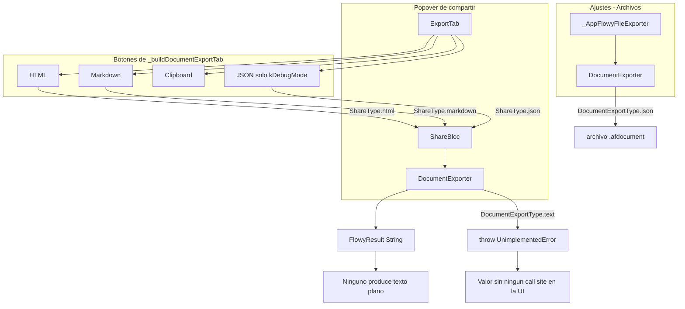
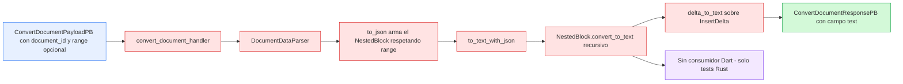
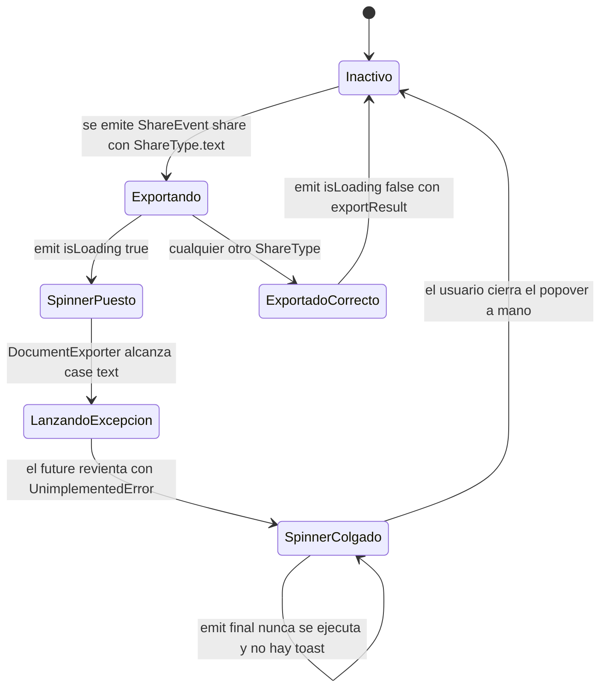
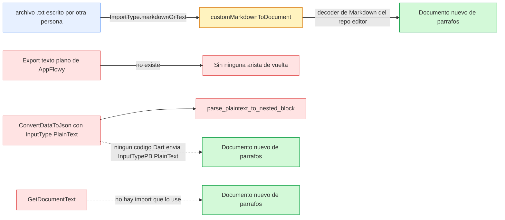

# B4.3 — Export texto plano

**Este documento es una corrección de alcance.** AppFlowy **no tiene exportación a texto plano**: el valor `text` del enum `DocumentExportType` lanza `throw UnimplementedError()` (`appflowy/frontend/appflowy_flutter/lib/workspace/application/export/document_exporter.dart:55–56`) y ningún widget de la UI lo despacha. La asimetría es total y verificable: el importador **sí** acepta `.txt` (`appflowy/frontend/appflowy_flutter/lib/workspace/presentation/home/menu/sidebar/import/import_type.dart:67–68`) mientras que el exportador no produce ningún `.txt`. Lo que sí existe son **tres conversores de texto plano en el producto** —dos en Rust y uno en el portapapeles del editor— que sirven al contexto de la IA, a la búsqueda y al copiado, y ninguno de ellos está conectado al `DocumentExporter`. Las dos unidades asignadas a esta instancia (`markdown_to_document.dart` y `document_markdown.dart`) no contienen ninguna rama de texto plano; se documentan aquí como el molde del que un `.txt` saldría y como control negativo.

## 1. Punto de entrada (UI)

La pestaña de exportación es `ExportTab`, una `StatelessWidget` que decide qué botones mostrar según el layout de la vista (`appflowy/frontend/appflowy_flutter/lib/plugins/shared/share/export_tab.dart:24–32`): si la vista es `ViewLayoutPB.Document` delega en `_buildDocumentExportTab` (`:27–29`). Ese método construye una `Column` con **cuatro** `_ExportButton` y nada más: HTML (`:38–42`), Markdown (`:44–48`), Clipboard (`:50–54`) y JSON, este último dentro de `if (kDebugMode) ...[]` (`:55–62`). **No hay ningún botón de texto plano**, ni condicionado a feature flag, ni a plataforma, ni a idioma. El caso de las bases de datos (`_buildDatabaseExportTab`, `:67–86`) ofrece CSV y "Raw Database Data" solo en debug, tampoco texto plano.

El botón etiquetado `LocaleKeys.shareAction_clipboard` (`:51`), con icono `FlowySvgs.duplicate_s`, **no produce texto plano**: `_exportToClipboard` (`:168–182`) instancia un `DocumentExporter` local y llama a `export(DocumentExportType.markdown)` (`:170`), es decir, escribe Markdown en el portapapeles. Esto es importante para el lector que busque "el export de texto": el único botón cuyo nombre sugiere texto plano invoca el motor de Markdown, y su flavor HTML se descarta (`ClipboardServiceData(plainText: markdown)` en `:173–175`).

El enum `ShareType` de la capa de compartición **sí** declara el valor `text` (`appflowy/frontend/appflowy_flutter/lib/plugins/shared/share/share_bloc.dart:353–363`, `text` en `:357`) y el getter `documentExportType` lo traduce a `DocumentExportType.text` (`:373–374`). Pero ninguna de las cinco construcciones de `ShareEvent.share(...)` del `ExportTab` pasa `ShareType.text` —solo `html`, `markdown`, `json`, `csv` y `rawDatabaseData` (`:97`, `:113`, `:129`, `:145`, `:161`)—, de modo que el valor es **inalcanzable desde la UI**. Para llegar a él habría que emitir el evento a mano. Además, `ShareType.unimplemented` contiene únicamente `[link]` (`:365`), así que el guard de `_share` (`:104–107`, que solo registra `Log.error` y hace `return`) **no** cortaría el camino de `text`: si se emitiera, llegaría hasta el `throw`. En `_handleExportSuccess` el `switch` solo reconoce `markdown`, `html` y `csv` (`appflowy/frontend/appflowy_flutter/lib/plugins/shared/share/share_button.dart:90–101`), de modo que ni siquiera un futuro `text` exportado con éxito mostraría el toast `settings_files_exportFileSuccess`.

La ausencia de botón está respaldada por el catálogo de traducciones: el único bundle i18n presente en el snapshot (`appflowy/frontend/appflowy_flutter/assets/translations/mr-IN.json:111–130`) declara `shareAction.markdown`, `shareAction.html`, `shareAction.clipboard`, `shareAction.csv`, `shareAction.copyLink` y las claves de publicación, pero **ninguna clave de texto plano** (`text`, `txt`, `plainText`) `[VERIFICADO]` por búsqueda de `shareAction` sobre el fichero. En móvil no hay ninguna pestaña de exportación: `rg 'ShareTab|ExportTab|shareAction_markdown|shareAction_html'` sobre `appflowy/frontend/appflowy_flutter/lib/mobile/` no devuelve resultados `[VERIFICADO]`.

Existe un segundo consumidor de `DocumentExporter`, el exportador masivo de Ajustes → Archivos. `_AppFlowyFileExporter.exportToPath` recorre las vistas y, para documentos, llama a `export(DocumentExportType.json)` y escribe con extensión `.afdocument` (`appflowy/frontend/appflowy_flutter/lib/workspace/presentation/settings/widgets/files/settings_file_exporter_widget.dart:239–251`); para el resto llama a `BackendExportService.exportDatabaseAsCSV` con extensión `.csv` (`:252–260`). Tampoco produce texto plano.

El siguiente diagrama inventaría los puntos de entrada de exportación que existen en el código y marca, para cada uno, si su salida es o no texto plano.



*Diagrama: inventario de los caminos de exportación de documentos y su relación con `DocumentExportType`.* Lectura: el único nodo que toca el valor `text` es la arista inferior que muere en `throw UnimplementedError()`; no entra ningún nodo desde la UI. El recuadro de botones confirma que el catálogo de formatos exportables es cerrado y que el "Clipboard" reutiliza `markdown`. El segundo consumidor (Ajustes) sortea por completo `ShareType` y llama a `DocumentExporter` con `json`.

## 2. Lado de conversión

No existe un motor de conversión a texto plano en la capa de exportación, ni en Dart ni en Rust. `DocumentExporter.export` es un `switch` de cuatro ramas (`appflowy/frontend/appflowy_flutter/lib/workspace/application/export/document_exporter.dart:43–62`): `json` serializa el `Document` con `jsonEncode` (`:44–45`), `markdown` delega en `customDocumentToMarkdown` con o sin `path` según haya archivo o portapapeles (`:46–54`), `text` lanza (`:55–56`) y `html` delega en `documentToHTML` (`:57–61`). Las tres ramas que funcionan son formatos **estructurados**; ninguna produce una proyección de texto del documento.

Los dos ficheros asignados a esta unidad confirman ese vacío por la vía del molde. `editor:lib/src/plugins/markdown/document_markdown.dart` expone dos funciones de nivel superior, `markdownToDocument` (`:11–33`) y `documentToMarkdown` (`:38–59`), y una fachada `AppFlowyEditorMarkdownCodec extends Codec<Document, String>` (`:61–85`) cuyo encoder se construye con nueve `NodeParser` por defecto (`:44–56`). Un `.txt` necesitaría un `Codec<Document, String>` equivalente cuyo `NodeParser.transform` ignorase la sintaxis, pero **no existe tal codec en el repositorio editor**: el único `Codec<Document, String>` de `plugins/` es el de Markdown. Del lado AppFlowy, `appflowy/frontend/appflowy_flutter/lib/shared/markdown_to_document.dart` solo declara `customMarkdownToDocument` (`:13–24`) y `customDocumentToMarkdown` (`:26–97`); ninguna de las dos tiene una rama de texto plano, y la segunda construye además el `Archive`/ZIP (`:36–95`), estructura innecesaria para texto plano.

Lo que sí existe son tres conversores de texto plano **fuera** del `DocumentExporter`, y son el objeto real de este documento.

**R1 — `DocumentEvent::GetDocumentText` (evento 20).** Es el único camino de texto plano que consume la aplicación Flutter. Se registra en `appflowy/frontend/rust-lib/flowy-document/src/event_map.rs:21` y se declara con `input = "OpenDocumentPayloadPB", output = "DocumentTextPB"` (`:138–139`). Su handler (`:107–116` en el fichero de handlers) pide el documento al `DocumentManager` y devuelve el `String` ya-flattenizado. La flattening real ocurre en `get_document_text`, que es literalmente un `document.paragraphs().join("\n")` (`appflowy/frontend/rust-lib/flowy-document/src/manager.rs:305–310`). `Document::paragraphs` abre una transacción de solo lectura y delega en `Body::paragraphs` (`collab:collab-document/src/document.rs:411–415`), cuyo algoritmo es un recorrido en profundidad con pila que acumula los deltas de cada bloque en un `current_paragraph` y lo sella en el vector `paragraphs` cuando el bloque tiene hijos o cuando quedan bloques pendientes en la pila (`collab:collab-document/src/document.rs:597–638`). Los deltas se aplanan con `push_deltas_to_str` (`collab:collab-document/src/utils.rs:5–35`), que **recorta el espacio en blanco de los extremos de cada operación de inserción y lo sustituye por un único espacio**, y solo atiende al caso `TextDelta::Inserted` (`:7`): cualquier otro variante del enum —`Deleted` y `Retain`— se ignora (`collab:collab-document/src/blocks/text_entities.rs:19–31`). El texto se obtiene de dos sitios, del `delta` embebido en `block.data` (`collab:collab-document/src/utils.rs:39–46`) o, si no existe, del `yText` externoindexado por `block.external_id` cuando `external_type == "text"` (`collab:collab-document/src/utils.rs:50–62`); en AppFlowy actual la segunda es la vía normal, porque el adaptador de transacciones del editor extrae el delta de los atributos del nodo y lo guarda como texto externo con `externalType = 'text'` (`appflowy/frontend/appflowy_flutter/lib/plugins/document/application/editor_transaction_adapter.dart:14`, `:186–213`, con el `..remove(blockComponentDelta)` de `:212` y la constante `blockComponentDelta = 'delta'` en `editor:lib/src/editor/block_component/base_component_keys.dart:5`). El único consumidor Dart de R1 es el **contexto del chat de IA**: `metadataPBFromMetadata` envía `DocumentEventGetDocumentText` con un `OpenDocumentPayloadPB` y mete el `pb.text` en un `ChatMessageMetaPB` marcado `loaderType: ContextLoaderTypePB.Txt` (`appflowy/frontend/appflowy_flutter/lib/plugins/ai_chat/application/chat_message_service.dart:132–147`); si el evento falla, solo escribe un `Log.error` y sigue (`:146`).

**R2 — `DocumentEvent::ConvertDocument` con `ParseTypePB.text` (evento 12).** Es un conversor de texto plano **por tipo de bloque**, mucho más rico que R1, registrado en `appflowy/frontend/rust-lib/flowy-document/src/event_map.rs:43` y declarado con `input = "ConvertDocumentPayloadPB", output = "ConvertDocumentResponsePB"` (`:109–113`). El handler construye un `DocumentDataParser` sobre el `DocumentData` del documento y, si el flag `text` está activo, devuelve `parser.to_text_with_json(root)` (`appflowy/frontend/rust-lib/flowy-document/src/event_handler.rs:381–411`, rama `text` en `:406–409`); si ningún flag está activo devuelve el `default` vacío (`:391–393`). `to_text_with_json` se limita a delegar en `NestedBlock::convert_to_text` (`appflowy/frontend/rust-lib/flowy-document/src/parser/document_data_parser.rs:37–44`), que es la función que aplica reglas por tipo (`:452–496` en `appflowy/frontend/rust-lib/flowy-document/src/parser/parser_entities.rs`). El delta de cada bloque llega por `get_delta_for_block`, que resuelve el `text_map` del documento a partir de `block.external_id` (`appflowy/frontend/rust-lib/flowy-document/src/parser/utils.rs:9–17`), y se aplana con `delta_to_text` (`appflowy/frontend/rust-lib/flowy-document/src/parser/utils.rs:58–64`) calling `InsertDelta::to_text`, que devuelve exclusivamente el campo `insert` y descarta `attributes` (`appflowy/frontend/rust-lib/flowy-document/src/parser/parser_entities.rs:163–165`). **R2 no tiene consumidor Dart**: `rg 'ConvertDocument'` sobre `SRC/appflowy` solo encuentra la declaración en Rust, los tests de integración (`appflowy/frontend/rust-lib/event-integration-test/src/document/document_event.rs:138–149`) y el test `convert_document_test` (`appflowy/frontend/rust-lib/event-integration-test/tests/document/local_test/edit_test.rs:154–184`) `[VERIFICADO]`. Es decir, es la mitad servidor de un formato que la app nunca pide.

**D1 — portapapeles del editor.** `Ctrl/Cmd+C` sí escribe texto plano, pero solo de la **selección**: `_copyCommandHandler` obtiene el texto con `editorState.getTextInSelection(selection).join('\n')` (`editor:lib/src/editor/editor_component/service/shortcuts/command/copy_command.dart:18–41`, texto en `:25`) y lo manda junto al HTML con `AppFlowyClipboard.setData(text: …, html: …)` (`:35–38`). `getTextInSelection` recorre los nodos seleccionados, corta el delta del primero y del último y llama a `Delta.toPlainText()` (`editor:lib/src/editor/command/text_commands.dart:341–360`, `:357`), que concatena únicamente las operaciones `TextInsert` y descarta el resto (`editor:lib/src/core/document/text_delta.dart:576–580`). No hay ningún atajo de "copiar el documento completo como texto plano".

**Consumidores secundarios de `toPlainText()`**, que no exportan nada pero confirman que la primitiva es la misma: el contador de palabras (`editor:lib/src/plugins/word_count/word_counter_service.dart:266`, `:281`) y el buscador del editor (`editor:lib/src/editor/find_replace_menu/search_service_v3.dart:136`), que indexa `node.delta!.toPlainText()` de cada nodo.

**Correcciones de alcance declaradas por esta unidad:**

- Export Markdown (`customDocumentToMarkdown` + `documentToMarkdown`) → `[[../10-motor-export-import/01-markdown-export.md]]`.
- Export HTML (`documentToHTML` + `AppFlowyEditorHTMLCodec`) → `[[../10-motor-export-import/02-html-export.md]]`.
- Export JSON (`jsonEncode(document)` y el exportador masivo `.afdocument`) → `[[../10-motor-export-import/04-json-documento-export.md]]`.
- Export CSV y raw database data → `[[../10-motor-export-import/05-csv-database-export.md]]` / `[[../10-motor-export-import/06-raw-database-export.md]]`.
- Import de `.txt` y `.md` (`ImportType.markdownOrText` → `customMarkdownToDocument`) → `[[../10-motor-export-import/08-import-markdown-texto.md]]` y `[[../10-motor-export-import/11-import-zip-notion.md]]`.
- Conversión **inversa** texto→documento en Rust (`parse_plaintext_to_nested_block`) → `[[../10-motor-export-import/08-import-markdown-texto.md]]`.
- UI de la pestaña de exportación, `ShareBloc`, `ShareType` y toasts → `[[../09-features/F11-exportacion-ui/F11-exportacion-ui.md]]` / `[[../09-features/F12-compartir-publicar-niveles-de-acceso/1-compartir-share-tab-niveles-de-acceso-y-plugins-shared-share.md]]`.
- Contexto de IA que consume R1 → `[[../09-features/F09-ia/4-ia-editor-plugins-ai.md]]`.
- Copiado/pegado del editor → `[[../09-features/F01-documentos-y-editor/5-bases-de-datos-embebidas-en-documentos.md]]`.
- Búsqueda y contador de palabras → `[[../09-features/F13-ajustes-apariencia-temas-fuentes/1-ajustes-logica-de-aplicacion-cuenta-billing-plan-nube-y-workspace.md]]` y `[[../09-features/F14-internacionalizacion/F14-internacionalizacion.md]]`.

## 3. Pipeline

El diagrama muestra el recorrido de R1 (`GetDocumentText`), el único pipeline de texto plano que hoy atraviesa la FFI y llega a un consumidor real de la app.


*Diagrama: pipeline de `GetDocumentText`, desde el evento Dart hasta el `ChatMessageMetaPB`.* Lectura: el traversal ocurre íntegramente en el lado Rust y opera sobre el árbol de bloques del CRDT, no sobre el `Document` del editor Flutter. La conversión a texto no distingue tipos de bloque: cualquier bloque con delta aporta una línea, y los joins son un `\n` por elemento del vector. El resultado no se escribe en disco en ningún punto; viaja dentro de un protobuf hacia el Rust de IA.

El segundo diagrama muestra R2 (`ConvertDocument`), el conversor por tipo de bloque que el backend ofrece y la app no pide.



*Diagrama: pipeline de `ConvertDocument` con `ParseTypePB.text`.* Lectura: a diferencia de R1, este pipeline reconstruye primero un árbol `NestedBlock` con los datos y deltas de cada bloque —y, si llega un `range`, recorta por bloque inicial y final y por offsets dentro del delta (`appflowy/frontend/rust-lib/flowy-document/src/parser/document_data_parser.rs:73–141`)— y luego lo aplana con reglas por tipo de bloque. El nodo naranja marca el hecho decisivo: la salida nunca se pide desde la UI, de modo que su comportamiento solo está fijado por un test de integración Rust.

## 4. Tabla bloque → salida

No hay una tabla "bloque → texto plano del export" porque no hay export. Lo que sigue es, para cada tipo de bloque del editor, **qué entrega hoy cada uno de los dos conversores existentes** y qué tendría que emitir un `.txt` de exportación. La columna "R1" es `Document::paragraphs` (`collab:collab-document/src/document.rs:597–638`); la columna "R2" es `NestedBlock::convert_to_text` (`appflowy/frontend/rust-lib/flowy-document/src/parser/parser_entities.rs:452–496`); la columna "Export `.txt` hypothetical" es `[NO DETERMINADO]` salvo donde la evidencia permite afirmar qué dato se perdería.

| Tipo de bloque | R1 `paragraphs()` | R2 `convert_to_text()` | Qué habría que implementar para un `.txt` | Evidencia |
|---|---|---|---|---|
| `page` (raíz) | No aporta texto propio; solo se recorre para descender | `delta_text` si no está vacío, y luego recursión sobre los hijos (`:478–486`) | Ninguno: es un contenedor | `appflowy/frontend/rust-lib/flowy-document/src/parser/parser_entities.rs:478–486` |
| `paragraph` | Una cadena por bloque, con los extremos recortados y normalizados a un espacio | `delta_text` + `\n`, luego hijos (`:487–492`) | Idéntico a R1 | `collab:collab-document/src/utils.rs:5–35` |
| `heading` | Igual que párrafo: **se pierde el nivel y el `#`** | Igual que párrafo: **se pierde el nivel** | Prefijar `#` × nivel | `appflowy/frontend/rust-lib/flowy-document/src/parser/parser_entities.rs:487–492` |
| `bulleted_list` | **Sin viñeta y sin indentación** | Sin viñeta | Prefijar `-`/`*` y sangrar por profundidad | `collab:collab-document/src/document.rs:597–638` |
| `numbered_list` | **Sin numeración** | Sin numeración | Emitir `n.` con el número del atributo | `collab:collab-document/src/document.rs:597–638` |
| `todo_list` | **Se pierde `[x]`/`[ ]`** | Se pierde el estado | Prefijar `- [ ]`/`- [x]` | `collab:collab-document/src/document.rs:597–638` |
| `quote` | **Sin `>`** | Sin `>` | Prefijar `> ` | `appflowy/frontend/rust-lib/flowy-document/src/parser/parser_entities.rs:487–492` |
| `code` | Contenido del delta sin vallas ni lenguaje | Contenido del delta sin vallas ni lenguaje | Indentación o vallas con el atributo de lenguaje | `collab:collab-document/src/utils.rs:5–35` |
| `callout` | Texto del delta **sin el icono** | Emoji + texto del delta, y **no recursiona en los hijos** (`:461–473`) | Emoji en línea y recorrer los hijos | `appflowy/frontend/rust-lib/flowy-document/src/parser/parser_entities.rs:461–473` |
| `math_equation` | **Nada**: el bloque no tiene delta | La fórmula del atributo `formula` + `\n`, **sin recorrer los hijos** (`:474–477`) | La fórmula; hoy la línea `math_equation` sí sobrevive en R2 | `appflowy/frontend/rust-lib/flowy-document/src/parser/parser_entities.rs:474–477` |
| `image`, `video`, `file`, `multi_image` | **Nada**: sin delta, se pierde la URL | **Nada**: sin delta, se pierde la URL | `[imagen: alt]` o la URL; decisión de producto `[NO DETERMINADO]` | `appflowy/frontend/rust-lib/flowy-document/src/parser/parser_entities.rs:487–492` |
| `divider` | **Nada** | **Nada** (delta vacío + `\n` → línea en blanco) | Una línea de separación | `appflowy/frontend/rust-lib/flowy-document/src/parser/parser_entities.rs:487–492` |
| `table`, `simple_table` | **Nada**: las celdas viven en `row`/`cells` del Database, no en bloques del documento | **Nada** por el mismo motivo | Recorrer la base de datos y tabular; es otro export (`[[../10-motor-export-import/05-csv-database-export.md]]`) | `appflowy/frontend/appflowy_flutter/lib/workspace/application/export/document_exporter.dart:44–45` |
| `toggle_list` | Solo el texto de cada nodo, sin marca de plegado | Solo el texto | `- ` por nivel | `collab:collab-document/src/document.rs:597–638` |
| `sub_page` | **Nada**: es un `insert` no textual dentro del delta y R1 solo atiende `TextDelta::Inserted` | Se pierde: `InsertDelta::to_text` solo devuelve `insert` | Resolver el `external_id` a nombre de vista | `collab:collab-document/src/utils.rs:7`; `appflowy/frontend/rust-lib/flowy-document/src/parser/parser_entities.rs:163–165` |
| `mention` (fecha, página, usuario) | Se pierde: no hay variante embed en `TextDelta` | Se pierde por la misma razón | Resolver la mención a su etiqueta legible | `collab:collab-document/src/blocks/text_entities.rs:19–31` |
| `columns` / `column` / `column_child` | Cada hijo con delta aporta su texto, sin sangría de columna | Cada hijo con delta aporta su texto | Marcar la pertenencia a columna `[NO DETERMINADO]` | `appflowy/frontend/rust-lib/flowy-document/src/parser/parser_entities.rs:487–492` |
| Estilos inline (`bold`, `italic`, `href`, `code`, `strikethrough`, `underline`) | **Se pierden**: `push_deltas_to_str` concatena solo el `String` de `Inserted` | **Se pierden**: `InsertDelta::to_text` devuelve solo `insert` | Ninguna marca en texto plano; decisión consciente | `collab:collab-document/src/utils.rs:5–35`; `appflowy/frontend/rust-lib/flowy-document/src/parser/parser_entities.rs:163–165` |
| Estilos de página (cover, icono, color de fondo) | Se pierden: R1 solo mira bloques | Se pierden: `to_json` limpia el `data` de la raíz | Ninguno en texto plano | `appflowy/frontend/rust-lib/flowy-document/src/parser/document_data_parser.rs:59–71` |

## 5. Pérdidas

Todo el catálogo anterior son pérdidas respecto de un formato de texto plano "fiel". Las agrupo aquí por mecanismo, con la línea que las provoca:

- **Pérdida de estructura por tipo de bloque.** R1 no tiene ninguna tabla de tipos: su única decisión es "si el bloque tiene delta, se sella una cadena". Los marcadores de heading, viñeta, numeración, casilla de tarea, comilla y plegado desaparecen (`collab:collab-document/src/document.rs:597–638`).
- **Pérdida de estructura por indentación.** El recorrido es una pila en profundidad, pero `paragraphs()` no anida nada: una lista anidada a tres niveles sale como una secuencia plana de cadenas (`collab:collab-document/src/document.rs:608–630`).
- **Pérdida de atributos inline.** `push_deltas_to_str` solo copia el texto de `TextDelta::Inserted` e ignora su campo `Attrs` (`collab:collab-document/src/utils.rs:5–35`); el enum `TextDelta` no tiene ninguna variante que represente estilos, así que el estilo solo existe como metadato del delta y muere aquí. En R2 el mismo descarte ocurre en `InsertDelta::to_text` (`appflowy/frontend/rust-lib/flowy-document/src/parser/parser_entities.rs:163–165`).
- **Pérdida de normalización de espacios, en el sentido contrario al habitual.** R1 no preserva el espaciado: recorta los espacios de los extremos de cada operación y reinserta **un** espacio si los había (`collab:collab-document/src/utils.rs:12–32`). Un párrafo con sangría, código o varias inserciones con espacios cambia de spacing al salir.
- **Pérdida de bloques sin texto.** `divider`, `image`, `video`, `file`, `multi_image`, `math_equation` y las bases de datos no aportan nada en R1; en R2 solo `math_equation` sobrevive, y además **sin sus hijos** porque la rama `MATH_EQUATION` no recursiona (`appflowy/frontend/rust-lib/flowy-document/src/parser/parser_entities.rs:474–477`). La misma omisión afecta a `CALLOUT` (`:461–473`).
- **Pérdida de configuración del documento.** Ni R1 ni R2 leen `cover`, `icon` ni `page_style`; R2 incluso vacía explícitamente el `data` del nodo raíz (`appflowy/frontend/rust-lib/flowy-document/src/parser/document_data_parser.rs:67–70`).
- **Pérdida de identidad.** El texto plano no conserva el `viewId`, el `docId` ni la jerarquía de subpáginas; ninguna de las dos rutas añade un encabezado con el nombre de la vista. R1 solo recibe `OpenDocumentPayloadPB` y no tiene el nombre de la vista (`appflowy/frontend/rust-lib/flowy-document/src/event_map.rs:138–139`).
- **Pérdida de rango en R1.** `GetDocumentText` no acepta `RangePB`, a diferencia de `ConvertDocument`, que sí recorta por bloque inicial/final y por offsets del delta (`appflowy/frontend/rust-lib/flowy-document/src/parser/document_data_parser.rs:131–141`, `:73–129`). El copy del editor sí recorta, pero por selección del `EditorState` (`editor:lib/src/editor/command/text_commands.dart:341–360`).
- **Pérdida total del documento en la UI.** Es la pérdida principal: `DocumentExportType.text` no devuelve nada porque lanza antes de convertir (`appflowy/frontend/appflowy_flutter/lib/workspace/application/export/document_exporter.dart:55–56`).

## 6. Assets

No hay gestión de assets porque no hay archivo: ninguno de los tres conversores copia, descarga ni escribe bytes. Los detalles verificados:

- **R1** no toca el sistema de archivos en ningún punto; `push_deltas_to_str` solo manipula `String` (`collab:collab-document/src/utils.rs:5–35`).
- **R2** tampoco: `get_delta_for_block` lee del `text_map` en memoria del `DocumentData` (`appflowy/frontend/rust-lib/flowy-document/src/parser/utils.rs:9–17`). El `DocumentData` que lo alimenta lo serializa `Document::get_document_data` desde la transacción de yrs, sin E/S (`appflowy/frontend/rust-lib/flowy-document/src/manager.rs:299–304`).
- **D1** (portapapeles) envía solo `text` y `html` al portapapeles del sistema (`editor:lib/src/editor/editor_component/service/shortcuts/command/copy_command.dart:35–38`); la variante `image` de `ClipboardServiceData` existe en el modelo de la app (`appflowy/frontend/appflowy_flutter/lib/plugins/document/presentation/editor_plugins/copy_and_paste/clipboard_service.dart:24–61`) pero el comando de copiado del editor no la rellena.
- **Consecuencia**: un documento con imágenes exportado a texto plano —si existiera— perdería el binario y la URL, porque el `url` del bloque de imagen vive en `block.data` y ni R1 ni R2 leen atributos que no sean el delta o la fórmula. En el caso de R2 el bloque `image` cae en la rama `_` y emite solo `delta_text\n` con `delta_text` vacío (`appflowy/frontend/rust-lib/flowy-document/src/parser/parser_entities.rs:487–492`), es decir, una **línea en blanco** por imagen.
- **El contraste con Markdown** es instructivo: el motor de `[[../10-motor-export-import/01-markdown-export.md]]` sí empaqueta los binarios locales en el ZIP (`appflowy/frontend/appflowy_flutter/lib/shared/markdown_to_document.dart:36–37`, `:67–71`), lo que un `.txt` no podría hacer sin un directorio de recursos que la UI no ofrece.

## 7. Encoding y nombre de archivo

- **No hay artefacto y por tanto no hay encoding de salida.** `[VERIFICADO]`. El único punto donde una cadena habría llegado a disco es `File(path).writeAsStringSync(s)` en la rama de post-proceso de `ShareBloc._export` (`appflowy/frontend/appflowy_flutter/lib/plugins/shared/share/share_bloc.dart:334–338`), y esa rama solo se alcanza para `html`, `csv`, `json` y `rawDatabaseData`; para `markdown` se devuelve el control al motor (`appflowy/frontend/appflowy_flutter/lib/plugins/shared/share/share_bloc.dart:340–341`) y para cualquier otro valor el `switch` cae en `default: break` (`:342–343`) y devuelve `FlowyResult.failure(FlowyError())` (`:346`).
- **Si algún día se implementara**, el nombre seguiría el patrón de los demás formatos: `saveFile(dialogTitle: '', fileName: '${viewName.toFileName()}.txt')` según la forma de `_exportHTML`/`_exportMarkdown` (`appflowy/frontend/appflowy_flutter/lib/plugins/shared/share/export_tab.dart:88–102`, `:104–118`), con `toFileName()` sustituyendo por `_` los caracteres `\/:*?"<>| ` (`appflowy/frontend/appflowy_flutter/lib/util/string_extension.dart:13`, `:17–27`). Esa convención es `[INFERIDO]` por extrapolación, no por evidencia.
- **Encoding de los strings que sí circulan**: las dos rutas Rust devuelven `String` de Rust por protobuf, es decir UTF-8 sin BOM por definición del formato; del lado Dart ambos valores viajan como `String`. No hay ninguna llamada a `utf8.encode` en R1/R2/D1 `[VERIFICADO]` por ausencia en los tres ficheros.
- **BOM y fin de línea**: `GetDocumentText` usa `join("\n")` explícitamente (`appflowy/frontend/rust-lib/flowy-document/src/manager.rs:308`) — siempre LF, nunca CRLF, incluso en Windows; R2 emite `\n` por bloque en la rama por defecto (`appflowy/frontend/rust-lib/flowy-document/src/parser/parser_entities.rs:488`) y también en `callout` y `math_equation` (`:462–477`). El copy del editor une con `'\n'` (`editor:lib/src/editor/editor_component/service/shortcuts/command/copy_command.dart:25`).

## 8. Errores

- **`UnimplementedError` no capturado.** Es el error del formato. Se lanza dentro de la rama asíncrona del `fold` de `DocumentExporter.export` (`appflowy/frontend/appflowy_flutter/lib/workspace/application/export/document_exporter.dart:55–56`), es decir, se convierte en el error del `Future` devuelto. Ni `ShareBloc._export` ni `_share` lo capturan (`appflowy/frontend/appflowy_flutter/lib/plugins/shared/share/share_bloc.dart:305–350`, `:98–118`), de modo que el `emit` final que baja `isLoading` a `false` (`:113–118`) **nunca se ejecuta**. El diagrama de estados siguiente describe el recorrido hypothetical si alguien despachara `ShareType.text`.
- **Sin toast ni `FlowyError`.** `_handleExportError` solo se invoca desde el `BlocListener` cuando `exportResult` es un `FlowyResult` de fallo (`appflowy/frontend/appflowy_flutter/lib/plugins/shared/share/share_button.dart:103–110`); una excepción no llega a ese camino, así que el usuario no ve ningún mensaje.
- **Fallo de R1 durante el contexto de IA.** Es el único error manejado de verdad: si `DocumentEventGetDocumentText` falla, se registra `Log.error('Failed to get document text: $err')` y el documento simplemente **no se adjunta** al prompt, sin retrofit al usuario (`appflowy/frontend/appflowy_flutter/lib/plugins/ai_chat/application/chat_message_service.dart:146`).
- **Documento inexistente o sin `PAGE_ID`.** `Body::paragraphs` devuelve `Vec::new()` si no puede resolver el `page_id` (`collab:collab-document/src/document.rs:598–601`), y `get_document_text` devolvería `""` con `Ok(Ok(text))`, es decir, **un `DocumentTextPB` con texto vacío en lugar de un error** `[INFERIDO]` de la firma `appflowy/frontend/rust-lib/flowy-document/src/manager.rs:305–310`.
- **`R2` sin tipo de parseo activo.** Si `ParseTypePB` no habilita ningún flag, el handler devuelve `ConvertDocumentResponsePB::default()` (`appflowy/frontend/rust-lib/flowy-document/src/event_handler.rs:391–393`), es decir, un éxito con `text: None`; el consumidor tendría que distinguir "vacío" de "no pedido".
- **Delta ausente o corrupto.** Si `text_map` no resuelve el `external_id`, `get_delta_for_block` devuelve `None` (`appflowy/frontend/rust-lib/flowy-document/src/parser/utils.rs:9–17`) y el bloque se emite como línea vacía sin ningún aviso; en R1 el bloque se salta en silencio (`collab:collab-document/src/utils.rs:39–46`).



*Diagrama: ciclo de vida del intento de exportar a texto plano.* Lectura: el único desenlace real es `SpinnerColgado`. El `throw` se propaga como error del `Future` y atraviesa `_export` y `_share` sin que ninguna de las dos funciones lo capture, de modo que el `emit` que restaura `isLoading: false` no llega a ejecutarse y el `BlocListener` que pinta toasts sigue esperando un `ShareState.exportResult` que jamás se emite. La recuperación depende de que el usuario cierre el popover. La rama inferior es el contraste: cualquier otro `ShareType` sí completa el ciclo con un `exportResult` que el listener sabe pintar (`appflowy/frontend/appflowy_flutter/lib/plugins/shared/share/share_button.dart:90–110`).

## 9. Round-trip

El round-trip de texto plano está **cerrado solo en la mitad de importación**, y por un camino distinto del que el export usaría. El diagrama muestra qué lado existe y qué lado falta.



*Diagrama: lados del round-trip de texto plano.* Lectura: la única arista sólida entra desde fuera —un `.txt` ajeno se importa— y **sale de ella el texto plano de la aplicación no vuelve nunca**. Los dos conversores invertidos que existen (el decoder de Markdown y `parse_plaintext_to_nested_block`) son estructuralmente compatibles con los dos conversores directos (`paragraphs()` y `convert_to_text`): ambos parten de "una línea no vacía → un párrafo", lo que implica que un texto plano de ida y vuelta conservaría el contenido pero perdería todos los tipos de bloque no textuales `[INFERIDO]`.

Los hechos verificables del lado de importación:

- El panel de importación declara `ImportType.markdownOrText` con extensiones `['md', 'txt']` (`appflowy/frontend/appflowy_flutter/lib/workspace/presentation/home/menu/sidebar/import/import_type.dart:7–12`, `:60–72`, `:67–68`) y etiqueta el botón con `LocaleKeys.importPanel_textAndMarkdown` (`:21–22`).
- Al elegir esa opción, el panel lee el archivo con `File(path).readAsString()` y lo convierte con `_documentDataFrom`, que llama a `customMarkdownToDocument(data)` y serializa el `DocumentDataPB` resultante (`appflowy/frontend/appflowy_flutter/lib/workspace/presentation/home/menu/sidebar/import/import_panel.dart:173–186`, `:222–229`). El `ImportTypePB` enviado es `Markdown` también para `.txt` (`appflowy/frontend/appflowy_flutter/lib/workspace/presentation/home/menu/sidebar/import/import_panel.dart:183`): **el importador no distingue `.md` de `.txt` y usa el decoder de Markdown para ambos**, lo que implica que un `.txt` con caracteres de Markdown se interpreta como Markdown.
- Existe un conversor inverso nativo en Rust, `parse_plaintext_to_nested_block`, que crea un bloque `paragraph` por línea no vacía (`appflowy/frontend/rust-lib/flowy-document/src/parser/external/utils.rs:83–110`), alcanzable solo con `InputType::PlainText` (`appflowy/frontend/rust-lib/flowy-document/src/parser/external/parser.rs:37`, variante declarada en `appflowy/frontend/rust-lib/flowy-document/src/parser/parser_entities.rs:504–508`). **Ningún código Dart construye `InputTypePB.PlainText`** `[VERIFICADO]` por búsqueda de `InputTypePB` en `appflowy/frontend/appflowy_flutter/lib/`, que no devuelve resultados; solo se usa en el test de integración (`appflowy/frontend/rust-lib/event-integration-test/tests/document/local_test/edit_test.rs:227`). Es, por tanto, functionality de servidor disponible pero no cableada.

La tabla de equivalencias por bloque la completa `[[../10-motor-export-import/13-matriz-round-trip.md]]`; esta unidad aporta la conclusión estructural: **no hay fila de round-trip que rellenar porque no hay export**.

## 10. Extensión y firma

- **Extensión de exportación: ninguna.** No hay `.txt` en ningún `saveFile` de la app; el catálogo real de extensiones es `.html`, `.zip`, `.json` y `.csv` (`appflowy/frontend/appflowy_flutter/lib/plugins/shared/share/export_tab.dart:92`, `:108`, `:124`, `:140`) más `.afdocument` en el exportador de Ajustes (`appflowy/frontend/appflowy_flutter/lib/workspace/presentation/settings/widgets/files/settings_file_exporter_widget.dart:250`).
- **Extensión de importación: `.txt`** (`appflowy/frontend/appflowy_flutter/lib/workspace/presentation/home/menu/sidebar/import/import_type.dart:67–68`).
- **MIME type**: no hay ninguna declaración `text/plain` en el código Flutter (`rg 'text/plain'` sobre `appflowy/frontend/appflowy_flutter/lib/` no devuelve resultados) `[VERIFICADO]`. El import no valida MIME: decide por extensión en `allowedExtensions` (`:60–72`) y el exporto no genera archivo, luego que lo genere otro podría apoyarse en la extensión.
- **Firma / magic bytes**: no aplica. La salida de R1 y R2 es un `String` transported en `DocumentTextPB.text` (`appflowy/frontend/rust-lib/flowy-document/src/event_handler.rs:115`) o en `ConvertDocumentResponsePB.text` (`:406–409`); nunca se escribe en disco por ninguna de las dos rutas.
- **Content-Type del portapapeles**: D1 escribe los flavors `text` y `html` con `AppFlowyClipboard.setData` (`editor:lib/src/editor/editor_component/service/shortcuts/command/copy_command.dart:35–38`); el `text` es `text/plain` según la plataforma, pero eso lo decide el SO, no el código `[INFERIDO]`.
- **Firma conceptual del formato que el producto sí produce en la práctica**: cuando el usuario "exporta texto plano", lo que obtiene hoy es Markdown por el botón de Clipboard (`appflowy/frontend/appflowy_flutter/lib/plugins/shared/share/export_tab.dart:168–182`) o texto plano por rango cuando copia (`editor:lib/src/editor/editor_component/service/shortcuts/command/copy_command.dart:25`). Ambos casos están documentados en `[[../10-motor-export-import/01-markdown-export.md]]` y `[[../09-features/F01-documentos-y-editor/5-bases-de-datos-embebidas-en-documentos.md]]` respectivamente.

## 11. Ejemplos

### 11.1 El enum y la rama que lanza

```dart
// appflowy/frontend/appflowy_flutter/lib/workspace/application/export/document_exporter.dart:43–62
        switch (type) {
          case DocumentExportType.json:
            return FlowyResult.success(jsonEncode(document));
          case DocumentExportType.markdown:
            if (path != null) {
              await customDocumentToMarkdown(document, path: path);
              return FlowyResult.success('');
            } else {
              return FlowyResult.success(
                await customDocumentToMarkdown(document),
              );
            }
          case DocumentExportType.text:
            throw UnimplementedError();
          case DocumentExportType.html:
            final html = documentToHTML(
              document,
            );
            return FlowyResult.success(html);
        }
```

Las cuatro ramas vivas confirman que `text` es la única que no devuelve un `FlowyResult`: es un `throw` puro, no un `FlowyResult.failure`, lo que impide que el caller lo distinga de un fallo de negocio.

### 11.2 El R1 completo, Rust

```rust
// appflowy/frontend/rust-lib/flowy-document/src/manager.rs:305–310
  pub async fn get_document_text(&self, doc_id: &Uuid) -> FlowyResult<String> {
    let document = self.get_document(doc_id).await?;
    let document = document.read().await;
    let text = document.paragraphs().join("\n");
    Ok(text)
  }
```

Cuatro líneas que son todo el "exportador de texto plano" del producto. El `\n` es el único separador y no hay marca de fin de bloque más allá del propio salto.

### 11.3 El aplanado por bloque, Rust

```rust
// collab:collab-document/src/utils.rs:5–18 (extracto)
pub(crate) fn push_deltas_to_str(buf: &mut String, deltas: Vec<TextDelta>) {
  for delta in deltas {
    if let TextDelta::Inserted(text, _) = delta {
      // trim all whitespace characters from start and end of the text
      let mut start = 0;
      let mut end = 0;
      let mut i = 0;
      for c in text.chars() {
        i += c.len_utf8();
        if char::is_whitespace(c) {
          if end == 0 {
            start += c.len_utf8();
          }
        } else {
          end = i;
        }
      }
```

El `if let TextDelta::Inserted(text, _)` de la segunda línea es la prueba de que R1 no puede emitir nada que no sea texto: los otros dos variants del enum se descartan y el `_` tira los atributos.

### 11.4 Ejemplo ejecutable del comportamiento de R1

El test del repo Collab fija la semántica de `paragraphs()` con ocho párrafos consecutivos y demuestra que **cada bloque con delta produce su propia cadena**, sin fusionarse:

```rust
// collab:collab-document/tests/conversions/plain_text_test.rs:11–30 (extracto)
  let paragraphs = vec![
    "Welcome to AppFlowy!".to_string(),
    "Here are the basics".to_string(),
    "Click anywhere and just start typing.".to_string(),
    "Highlight any text, and use the editing menu to _style_ **your** <u>writing</u> `however` you ~~like.~~".to_string(),
    "As soon as you type `/` a menu will pop up. Select different types of content blocks you can add.".to_string(),
    "Type `/` followed by `/bullet` or `/num` to create a list.".to_string(),
    "Click `+ New Page `button at the bottom of your sidebar to add a new page.".to_string(),
    "Click `+` next to any page title in the sidebar to quickly add a new subpage, `Document`, `Grid`, or `Kanban Board.".to_string(),
  ];
  // ...
  assert_eq!(splitted.len(), 8);
```

El cuarto caso es la demostración más clara de las pérdidas de la tabla de §4: el texto de entrada contiene `_style_`, `**your**`, `<u>writing</u>`, `` `however` `` y `~~like.~~` — Markdown plano, no sintaxis AppFlowy — y el test solo exige que las cadenas **coincidan exactamente** con la entrada, porque R1 no interpreta nada. La aserción final (`splitted[i] == paragraphs[i]`) prueba además que el recorte de espacios de `push_deltas_to_str` es transparente cuando no hay espacios en los extremos.

### 11.5 El R2 por tipo de bloque, Rust

```rust
// appflowy/frontend/rust-lib/flowy-document/src/parser/parser_entities.rs:461–477 (extracto)
      CALLOUT => {
        text.push_str(&format!(
          "{}{}\n",
          self
            .data
            .get(ICON)
            .unwrap_or(&Value::Null)
            .to_string()
            .trim_matches('\"'),
          delta_text
        ));
      },
      MATH_EQUATION => {
        let formula = self.data.get(FORMULA).unwrap_or(&Value::Null);
        text.push_str(&format!("{}\n", formula.to_string().trim_matches('\"')));
      },
```

Ambas ramas escriben una línea y **ninguna recorre `self.children`**, a diferencia de la rama por defecto (`:487–492`) y de la de `page` (`:478–486`). Es una pérdida silenciosa y demostrable con la propia estructura del `match`.

### 11.6 El ejemplo oficial de R2, tomado del doc-comment del handler

```rust
// appflowy/frontend/rust-lib/flowy-document/src/event_handler.rs:376–378 (extracto)
/// assert_eq!(result.json, Some("[{ \"block_id\": \"1\", \"type\": \"paragraph\", \"data\": {\"delta\": [{ \"insert\": \"Hello\" }] } }, ...
/// assert_eq!(result.text, Some("Hello\n World!".to_string()));
/// assert_eq!(result.html, Some("<p>Hello</p><p> World!</p>".to_string()));
```

Es la especificación más precisa que existe del formato de texto plano de R2, y está escrita por los autores del propio handler: dos párrafos `"Hello"` y `" World!"` salen como `"Hello\n World!"`, con el salto y el espacio original del segundo párrafo **intactos** (aquí no hay recorte, porque R2 no pasa por `push_deltas_to_str`). La diferencia de espaciado entre R1 y R2 es, por tanto, observable: R2 preserva el texto exacto del delta; R1 lo normaliza.

**Preguntas abiertas (el orquestador las copiará a `OUT/22-preguntas-abiertas.md`):**

1. `[NO DETERMINADO]` ¿Se exportó alguna vez texto plano en AppFlowy y se retiró la UI, o nunca existió? El `enum ShareType` conserva `text` (`appflowy/frontend/appflowy_flutter/lib/plugins/shared/share/share_bloc.dart:357`) y `ShareType.unimplemented` solo lista `link` (`:365`), lo que sugiere que `text` estuvo en producción y se degradó sin limpiar la enumeración, pero **no hay evidencia en el snapshot** (ni test, ni string de traducción, ni llamada) que lo confirme.
2. `[NO DETERMINADO]` Si se implementara, ¿qué variantes? Las tres funciones de conversión disponibles dan resultados distintos para el mismo documento (R1 normaliza espacios, R2 no; R2 conoce `callout` y `math_equation`, R1 no; R1 soporta documento completo, R2 también pero con `range`). No hay ninguna pista en el código sobre cuál es la canónica.
3. `[NO DETERMINADO]` ¿Debería un `.txt` incluir el nombre de la vista como encabezado? `GetDocumentText` solo recibe `OpenDocumentPayloadPB` (`appflowy/frontend/rust-lib/flowy-document/src/event_map.rs:138–139`) y por tanto no puede; el nombre vive en la vista (`ViewPB`), que el `DocumentExporter` sí recibe (`appflowy/frontend/appflowy_flutter/lib/workspace/application/export/document_exporter.dart:25`). La decisión de producto no es deducible del código.
4. `[NO DETERMINADO]` ¿Debe `.txt` participating del round-trip conservar los bloques no textuales mediante marcadores textuales (por ejemplo `[imagen: url]`) o es aceptable perderlos? El importador actual no acepta ningún marcador de ese tipo: `parse_plaintext_to_nested_block` crea un `paragraph` por línea (`appflowy/frontend/rust-lib/flowy-document/src/parser/external/utils.rs:83–110`).

**Relacionado con:**

- `[[../10-motor-export-import/01-markdown-export.md]]` Export Markdown — el motor al que realmente apunta el botón "Clipboard", y el molde (`Codec<Document, String>` + lista de `NodeParser`) que un `.txt` debería seguir.
- `[[../10-motor-export-import/02-html-export.md]]` Export HTML — el otro `Codec<Document, String>` del repo editor y su `HTMLNodeParser`, comparables a los `NodeParser` de Markdown.
- `[[../10-motor-export-import/04-json-documento-export.md]]` Export JSON — `jsonEncode(document)`, la rama que sí funciona en el `switch` junto a la que lanza.
- `[[../10-motor-export-import/05-csv-database-export.md]]` / `[[../10-motor-export-import/06-raw-database-export.md]]` Export CSV y raw database data — el otro par de formatos con su propio camino (`BackendExportService`), y el precedente de "formato que no pasa por `DocumentExporter`".
- `[[../10-motor-export-import/08-import-markdown-texto.md]]` / `[[../10-motor-export-import/11-import-zip-notion.md]]` Import — la mitad que sí existe: `ImportType.markdownOrText` y el helper Dart `customMarkdownToDocument`.
- `[[../10-motor-export-import/13-matriz-round-trip.md]]` Matriz round-trip — esta unidad deja la celda de texto plano vacía por inexistencia del lado export.
- `[[../09-features/F11-exportacion-ui/F11-exportacion-ui.md]]` Exportación (UI y orquestación Dart) — `ExportTab`, `ShareBloc`, `ShareType` y los toasts; la UI que hoy no ofrece el botón.
- `[[../09-features/F12-compartir-publicar-niveles-de-acceso/1-compartir-share-tab-niveles-de-acceso-y-plugins-shared-share.md]]` `ShareBloc`, `ShareType`, `plugins/shared/share/`.
- `[[../09-features/F09-ia/4-ia-editor-plugins-ai.md]]` Contexto de IA — el único consumidor real de `GetDocumentText` en la app.
- `[[../09-features/F01-documentos-y-editor/5-bases-de-datos-embebidas-en-documentos.md]]` Copiado y pegado del editor — `copy_command.dart` y `getTextInSelection`, la otra fuente de texto plano.
- `[[../09-features/F01-documentos-y-editor/8-infraestructura-del-editor-transaction-handler-block-transaction-handler-migrati.md]]` `editor_plugins/parsers/` — los `NodeParser` de AppFlowy que un `.txt` tendría que replicar.
- `[[../09-features/F13-ajustes-apariencia-temas-fuentes/1-ajustes-logica-de-aplicacion-cuenta-billing-plan-nube-y-workspace.md]]` / `[[../09-features/F14-internacionalizacion/F14-internacionalizacion.md]]` Búsqueda y contador de palabras — los consumidores menores de `toPlainText()`.