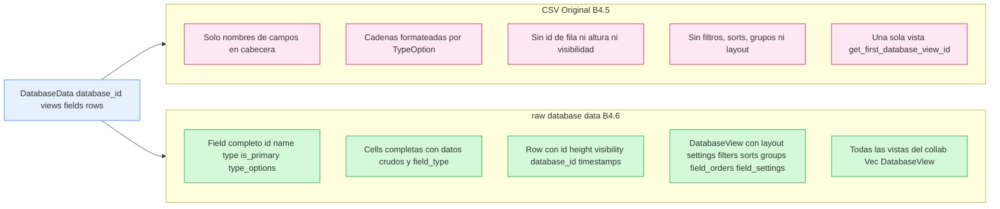
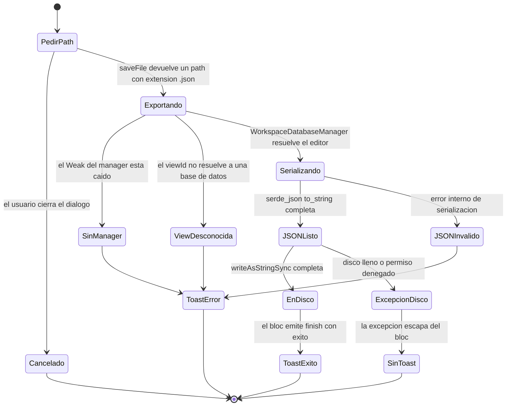
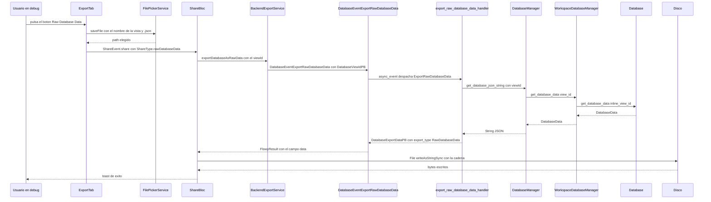

# B4.6 — Export raw database data

El motor "raw database data" es el **único formato de exportación de base de datos que preserva la estructura completa del collab**: en lugar de proyectar cada celda a una cadena CSV como hace `CSVExport` (`[[../10-motor-export-import/05-csv-database-export.md]] §2`), serializa la estructura `DatabaseData` de `collab-database` completa (`collab:collab-database/src/database.rs:1522–1528`) mediante `serde_json::to_string` (`appflowy/frontend/rust-lib/flowy-database2/src/manager.rs:395–401`), devolviendo un `String` JSON que `export_raw_database_data_handler` empaqueta como `DatabaseExportDataPB { export_type: RawDatabaseData, data }` (`appflowy/frontend/rust-lib/flowy-database2/src/event_handler.rs:1044–1055`). El disparo es **idéntico al del CSV** salvo por la entrada en la UI: mientras el botón "CSV" es estable, el botón "Raw Database Data (Debug Mode)" solo se renderiza en compilaciones `kDebugMode` (`appflowy/frontend/appflowy_flutter/lib/plugins/shared/share/export_tab.dart:76–83`). El evento FFI `DatabaseEvent::ExportRawDatabaseData = 178` (`appflowy/frontend/rust-lib/flowy-database2/src/event_map.rs:398–399`) comparte con `ExportCSV = 141` no solo el handler adyacente (`appflowy/frontend/rust-lib/flowy-database2/src/event_map.rs:79–80`) sino también el PB de entrada (`DatabaseViewIdPB`) y el de salida (`DatabaseExportDataPB`), y ambos depositan el artefacto en `.json`/`.csv` con `File.writeAsStringSync` (`appflowy/frontend/appflowy_flutter/lib/plugins/shared/share/share_bloc.dart:338`). La consecuencia práctica es asimétrica: **el CSV es el formato público, el raw es la imagen especular de la base de datos en disco**, y este documento traza esa diferencia dimensión por dimensión y explica por qué el raw, aunque ya tiene round-trip implementado en `collab-database`, sigue siendo un formato exclusivo de compilaciones de debug.

## 1. Punto de entrada (UI)

El botón "Raw Database Data" se renderiza exclusivamente dentro de `_buildDatabaseExportTab`, debajo del botón "CSV" y guardado por un `if (kDebugMode)` (`appflowy/frontend/appflowy_flutter/lib/plugins/shared/share/export_tab.dart:76–83`):

```dart
// appflowy/frontend/appflowy_flutter/lib/plugins/shared/share/export_tab.dart:76–83
if (kDebugMode) ...[
  const VSpace(10),
  _ExportButton(
    title: 'Raw Database Data (Debug Mode)',
    svg: FlowySvgs.duplicate_s,
    onTap: () => _exportRawDatabaseData(context),
  ),
],
```

El literal `'Raw Database Data (Debug Mode)'` está **hardcodeado** en inglés y no se obtiene de `LocaleKeys` (`appflowy/frontend/appflowy_flutter/lib/plugins/shared/share/export_tab.dart:79`), a diferencia del CSV que sí usa `LocaleKeys.shareAction_csv.tr()` (`appflowy/frontend/appflowy_flutter/lib/plugins/shared/share/export_tab.dart:72`). La rama del `_exportRawDatabaseData` (`appflowy/frontend/appflowy_flutter/lib/plugins/shared/share/export_tab.dart:152–166`) reutiliza el mismo `FilePickerService.saveFile` con la misma firma que CSV, y propone por defecto `'<viewName>.json'` (`appflowy/frontend/appflowy_flutter/lib/plugins/shared/share/export_tab.dart:156`) — no `.csv` ni `.raw`, sino `.json`, porque la salida es texto JSON. Una vez elegido el path, dispara `ShareEvent.share(ShareType.rawDatabaseData, exportPath)` (`appflowy/frontend/appflowy_flutter/lib/plugins/shared/share/export_tab.dart:159–164`). `ShareType.rawDatabaseData` está declarado en la enumeración (`appflowy/frontend/appflowy_flutter/lib/plugins/shared/share/share_bloc.dart:363`) y es uno de los dos valores reservados al export de base de datos (junto a `ShareType.csv`).

La ruta hasta el FFI es **un único camino**, lineal: `ShareBloc._export` resuelve `type == ShareType.rawDatabaseData` y llama a `BackendExportService.exportDatabaseAsRawData(view.id)` (`appflowy/frontend/appflowy_flutter/lib/plugins/shared/share/share_bloc.dart:318–325`), que envía el evento `DatabaseEventExportRawDatabaseData` con el `DatabaseViewIdPB { value: viewId }` (`appflowy/frontend/appflowy_flutter/lib/workspace/application/settings/share/export_service.dart:16–22`). En el `fold` de éxito, `ShareBloc` escribe con `File(path).writeAsStringSync(s)` en la misma posición que CSV (`appflowy/frontend/appflowy_flutter/lib/plugins/shared/share/share_bloc.dart:337–338`):

```dart
// appflowy/frontend/appflowy_flutter/lib/plugins/shared/share/share_bloc.dart:333–339
case ShareType.html:
case ShareType.csv:
case ShareType.json:
case ShareType.rawDatabaseData:
  File(path).writeAsStringSync(s);
  return FlowyResult.success(type);
```

**Diferencia clave con CSV:** este camino **no** es accesible desde los otros tres consumidores del CSV — ni el botón "Share" del widget `database/share_button.dart`, ni el bucle "Export all files" de Ajustes, ni el `DatabaseNodeParser._convertDatabaseToCSV` del export Markdown lo invocan. Una búsqueda exhaustiva confirma que las únicas llamadas a `exportDatabaseAsRawData` son las del `ShareBloc` (`appflowy/frontend/appflowy_flutter/lib/plugins/shared/share/share_bloc.dart:318`) y la del helper estático en sí mismo (`appflowy/frontend/appflowy_flutter/lib/workspace/application/settings/share/export_service.dart:17`) `[VERIFICADO]`. Esto significa que el raw database data solo se puede producir actualmente desde el diálogo "Share" de una vista de base de datos, y **solo en debug**.

**Correcciones de scope declaradas:** la construcción de widgets, `ShareType`, `ShareEvent` y la mecánica de `File.writeAsStringSync` son de `[[../09-features/F11-exportacion-ui/F11-exportacion-ui.md]]` y `[[../09-features/F12-compartir-publicar-niveles-de-acceso/1-compartir-share-tab-niveles-de-acceso-y-plugins-shared-share.md]]`; aquí solo se traza la frontera que conecta con el motor. La semántica de las entidades que el JSON serializa (`Field`, `Row`, `Cell`, `DatabaseView`) es de `[[../09-features/F02-bases-de-datos/0.1.0-indice-appflowy-side-database-controller-services-widgets.md]]`; el camino CSV comparable es `[[../10-motor-export-import/05-csv-database-export.md]]`; el import de CSV es `[[../10-motor-export-import/09-import-csv.md]]`; el FFI es `[[../11-catalogo-eventos-ffi.md]]`; los PBs son `[[../12-catalogo-entidades-protobuf.md]]`.

## 2. Lado de conversión

A diferencia del CSV, donde la conversión corre casi enteramente en Rust con un único salto de Dart (`File.writeAsStringSync`), el raw database data **sale literalmente sin transformación de Rust a JSON**: la conversión es una sola llamada a `serde_json::to_string` aplicada a la estructura `DatabaseData` (`appflowy/frontend/rust-lib/flowy-database2/src/manager.rs:399`), y los `derive(Serialize)` ya están escritos a mano en `collab-database` (`collab:collab-database/src/database.rs:1522`, `collab:collab-database/src/entity.rs:51–68`, `collab:collab-database/src/fields/field.rs:10–20`, `collab:collab-database/src/rows/row.rs:379–392`). La cadena de llamada tiene solo tres saltos reales:

```rust
// appflowy/frontend/rust-lib/flowy-database2/src/event_handler.rs:1044–1055
pub(crate) async fn export_raw_database_data_handler(
  data: AFPluginData<DatabaseViewIdPB>,
  manager: AFPluginState<Weak<DatabaseManager>>,
) -> DataResult<DatabaseExportDataPB, FlowyError> {
  let manager = upgrade_manager(manager)?;
  let view_id = data.into_inner().value;
  let data = manager.get_database_json_string(&view_id).await?;
  data_result_ok(DatabaseExportDataPB {
    export_type: DatabaseExportDataType::RawDatabaseData,
    data,
  })
}
```

```rust
// appflowy/frontend/rust-lib/flowy-database2/src/manager.rs:395–401
pub async fn get_database_json_string(&self, view_id: &str) -> FlowyResult<String> {
  let lock = self.workspace_database()?;
  let wdb = lock.read().await;
  let data = wdb.get_database_data(view_id).await?;
  let json_string = serde_json::to_string(&data)?;
  Ok(json_string)
}
```

```rust
// collab:collab-database/src/database.rs:1341–1360
pub async fn get_database_data(&self) -> DatabaseData {
  let txn = self.collab.transact();

  let database_id = self.body.get_database_id(&txn);
  let inline_view_id = self.body.get_inline_view_id(&txn);
  let views = self.get_all_views();
  let fields = self.body.get_fields_in_view(&txn, &inline_view_id, None);
  let rows_stream = self.get_all_rows(20, None).await;
  let rows: Vec<Row> = rows_stream
    .filter_map(|result| async move { result.ok() })
    .collect()
    .await;

  DatabaseData {
    database_id,
    fields,
    rows,
    views,
  }
}
```

El primer detalle que se aparta del CSV es **el view_id que se descarta**: el motor toma el `view_id` que Dart envía solo para resolver el editor (`appflowy/frontend/rust-lib/flowy-database2/src/manager.rs:419–426`, donde `get_database_with_view_id(view_id)` resuelve el `Database`), pero una vez dentro del editor el `Database::get_database_data` ignora el `view_id` de la consulta y usa `body.get_inline_view_id(&txn)` para extraer el orden de campos (`collab:collab-database/src/database.rs:1345–1347`). La diferencia con el CSV (§3 de `[[../10-motor-export-import/05-csv-database-export.md]]`) es que aquí se devuelven **todas** las vistas con `get_all_views()` (`collab:collab-database/src/database.rs:329–339`), no solo la primera, y cada `DatabaseView` lleva sus `layout_settings`, `filters`, `group_settings`, `sorts`, `row_orders`, `field_orders` y `field_settings` completas (`collab:collab-database/src/entity.rs:52–68`). Esta es la mayor fuente de información del raw frente al CSV: **un mismo JSON describe todos los layouts de la base de datos, sus filtros, sus grupos y sus vistas ocultas**, no solo las filas y columnas de una vista.

El segundo detalle es que `serde_json::to_string` (no `to_string_pretty`) produce JSON **compacto, sin indentación y sin BOM**, una sola línea `\n`-terminada. Es el mismo serializador que usa `DatabaseData::to_json` (`collab:collab-database/src/database.rs:1531–1534`) y su contraparte simétrica `DatabaseData::from_json` (`collab:collab-database/src/database.rs:1536–1539`) y `DatabaseData::from_json_bytes` (`collab:collab-database/src/database.rs:1545–1548`), confirmando que el formato es **round-trip internal** del crate: la pareja `to_json/from_json_bytes` se usa en `create_database_with_data` (`appflowy/frontend/rust-lib/flowy-database2/src/manager.rs:410`) precisamente para reconstruir una base de datos desde estos bytes.

El tercer detalle es que `get_all_rows(20, None)` (`collab:collab-database/src/database.rs:1372–1398`) trabaja en chunks de 20 igual que el export CSV, y `filter_map` descarta filas que no parsean: el raw **silenciosamente ignora filas corruptas** igual que el CSV, no hay forma de distinguir "fila vacía" de "fila perdida".

El cuarto detalle es que no hay ninguna ruta `Builder`, `Formatter` o `Writer` específica: el JSON sale directamente del `serde` derive, lo que evita las `unwrap()` de `csv::Writer` y elimina los warnings de `tracing::warn!` que tenía el CSV al fallar una fila (`appflowy/frontend/rust-lib/flowy-database2/src/services/share/csv/export.rs:88–90`). En el raw, si `serde_json::to_string` falla, devuelve un `serde_json::Error` que `?` propaga como `FlowyError::internal()` (`appflowy/frontend/rust-lib/flowy-database2/src/manager.rs:399`), pero esa ruta es inalcanzable porque las estructuras son todas `Serialize` y `Default` y no contienen referencias cíclicas `[INFERIDO]`.

## 3. Pipeline

Diagrama del recorrido completo desde el botón de debug hasta el `.json` en disco, con los cinco saltos reales entre capas y el único conversor (Rust produce el JSON; Dart lo persiste):

```mermaid
flowchart LR
  subgraph DART["Capa Dart (Flutter)"]
    BTN["Boton Raw Database Data en ExportTab"]:::ui
    DBG["Guardia kDebugMode export_tab.dart"]:::ui
    PICK["FilePickerService.saveFile devuelve path .json"]:::ui
    SBLOC["ShareBloc._export rama ShareType.rawDatabaseData"]:::ui
    BES["BackendExportService.exportDatabaseAsRawData"]:::ui
    EV["DatabaseEventExportRawDatabaseData codigo generado"]:::ffi
    WR["File.writeAsStringSync escribe el JSON"]:::disk
  end
  subgraph FFI["Frontera FFI (dart-ffi / lib-dispatch)"]
    SEND["send serializa DatabaseViewIdPB value=viewId"]:::ffi
    DISP["dispatcher resuelve DatabaseEvent ExportRawDatabaseData 178"]:::ffi
    BACK["DatabaseExportDataPB con export_type RawDatabaseData vuelve asincrono"]:::ffi
  end
  subgraph RUST["Capa Rust (flowy-database2 / collab-database)"]
    HAND["export_raw_database_data_handler event_handler.rs"]:::rust
    WSMGR["WorkspaceDatabaseManager.get_database_data view_id"]:::rust
    DBMGR["DatabaseManager.get_database_json_string"]:::rust
    DB["Database.get_database_data inline_view_id"]:::rust
    TRANS["ReadTxn sobre yrs del collab de base de datos"]:::rust
    JSON["serde_json to_string sobre DatabaseData"]:::rust
  end
  BTN --> DBG --> PICK --> SBLOC --> BES --> EV --> SEND --> DISP --> HAND
  HAND --> DBMGR --> WSMGR --> DB --> TRANS --> JSON --> BACK --> WR
  classDef ui fill:#e7f0ff,stroke:#3b82f6
  classDef ffi fill:#f3e8ff,stroke:#7c3aed
  classDef rust fill:#fff3bf,stroke:#d97706
  classDef disk fill:#d3f9d8,stroke:#16a34a
```



Lectura: el grafo tiene una sola rama lineal. La única bifurcación real frente al CSV es `DBG`: la guardia `kDebugMode` (`appflowy/frontend/appflowy_flutter/lib/plugins/shared/share/export_tab.dart:76`) hace que este camino **no exista en compilaciones release**, lo que explica por qué `BackendExportService` y el evento FFI viven en código compartido pero la UI no se compila. Del lado Rust hay cuatro saltos frente a los tres del CSV: el extra es `WSMGR` (`WorkspaceDatabaseManager`), porque `manager.get_database_json_string` primero toma el `workspace_database` y luego delega a `wdb.get_database_data(view_id)` (`collab:collab-database/src/workspace_database/manager.rs:418–426`), que es quien tiene el `Weak<Database>` necesario para entrar al editor. El nodo `JSON` es la primera y única conversión de formato: a diferencia del CSV, donde `stringify_cell_data` se llamaba quince veces por fila, aquí el JSON sale en bloque y el `String` cruza la frontera FFI dentro de `DatabaseExportDataPB.data`. `WR` es el primer nodo donde el dato existe como fichero; entre `JSON` y `WR` solo cruza la frontera una cadena UTF-8. El path de escritura es **idéntico** al de CSV, JSON y HTML: el mismo `File(path).writeAsStringSync(s)` (`appflowy/frontend/appflowy_flutter/lib/plugins/shared/share/share_bloc.dart:338`), con los mismos defectos heredados de los que hablamos en §8.

El detalle del recorrido interno de `Database::get_database_data` merece una observación porque **decide la forma del JSON**:

- `get_database_id` se ejecuta **dentro de la transacción** y devuelve el `object_id` del collab (`collab:collab-database/src/database.rs:1344`, helper en `:351–353`). Es el mismo `database_id` que lleva `DatabaseView.database_id` (`collab:collab-database/src/entity.rs:54`).
- `get_inline_view_id` devuelve el id de la vista **inline** de la base de datos (no la que pidió el usuario); es el campo `view_id` que el `DatabaseBody` lleva para reconstruir el orden de campos (`collab:collab-database/src/database.rs:1345`). Cuando el JSON lleva `field_orders`, este id está implícito en el orden de campos.
- `get_fields_in_view(&txn, &inline_view_id, None)` resuelve el `Vec<Field>` ordenado según el `FieldOrderArray` de la vista inline (`collab:collab-database/src/database.rs:1888–1914`); los campos huérfanos sin `FieldOrder` se excluyen aquí igual que en el CSV.
- `get_all_views` devuelve **todas** las vistas del collab (`collab:collab-database/src/database.rs:329–339`), incluyendo su `layout`, `layout_settings`, `filters`, `group_settings`, `sorts`, `row_orders`, `field_orders`, `field_settings`, `created_at`, `modified_at` y `is_inline` (`collab:collab-database/src/entity.rs:52–68`). El JSON lleva **toda** esa información: ningún `Vec` queda vacío salvo que la base de datos realmente no tenga esos elementos.
- `get_all_rows(20, None)` materializa el `Stream<DatabaseRowResult>` completo (`collab:collab-database/src/database.rs:1372–1398`), con el mismo tamaño de chunk que el CSV: `filter_map(..result.ok())` descarta filas que devolvieron error.

## 4. CSV clásico → raw database data

Esta sección es la comparación prometida por el encargo de B4.6: una fila por cada dimensión en la que los dos formatos difieren.

| Dimensión | CSV (`CSVFormat::Original`) | raw database data | Evidencia |
|---|---|---|---|
| Estructura serializada | Lista plana de filas de strings UTF-8 | Objeto JSON `{database_id, views, fields, rows}` con tipos primitivos | `appflowy/frontend/rust-lib/flowy-database2/src/services/share/csv/export.rs:25–98`; `collab:collab-database/src/database.rs:1522–1528` |
| Cabecera (`field.schema`) | Solo `field.name` como string | `Field` completo: `id`, `name`, `field_type`, `icon`, `type_options`, `is_primary` | `appflowy/frontend/rust-lib/flowy-database2/src/services/share/csv/export.rs:39–42`; `collab:collab-database/src/fields/field.rs:10–20` |
| Tipo de columna (`field_type`) | **Perdido** | Conservado como `i64` con el mismo valor del enum `FieldType` | pérdida en `appflowy/frontend/rust-lib/flowy-database2/src/services/share/csv/export.rs:39`; conservación en `collab:collab-database/src/fields/field.rs:14` |
| Configuración de columna (`TypeOption`) | **Perdida** | Conservada como `TypeOptions` (HashMap keyed por `FieldType`); cada `TypeOptionData` lleva los datos exactos del formato: `NumberFormat`, `DateFormat`, `TimeFormat`, `SelectOption`s, etc. | pérdida en `appflowy/frontend/rust-lib/flowy-database2/src/services/share/csv/export.rs:39`; conservación en `collab:collab-database/src/fields/field.rs:17` y `collab:collab-database/src/fields/type_option/type_option.rs` |
| Visibilidad de columna | **Perdida** | Conservada como booleano (no en `Field`, sino en `FieldSettingsByFieldIdMap` por vista) | pérdida en `appflowy/frontend/rust-lib/flowy-database2/src/services/share/csv/export.rs:36–46`; conservación en `collab:collab-database/src/entity.rs:63` |
| `is_primary` | **Perdido** | Conservado en `Field.is_primary` | pérdida en `appflowy/frontend/rust-lib/flowy-database2/src/services/share/csv/export.rs:39`; conservación en `collab:collab-database/src/fields/field.rs:18–19` |
| Ancho de columna | **Perdido** | Conservado en `FieldSettingsByFieldIdMap` por vista | pérdida en `appflowy/frontend/rust-lib/flowy-database2/src/services/share/csv/export.rs:39`; conservación en `collab:collab-database/src/entity.rs:63` |
| Celda (`Cell`) | Cadena formateada por `stringify_cell_data` del `TypeOption` | HashMap completo `{ field_id → { data, field_type? } }` (estructura `Cells` de `collab-database`, ver `collab:collab-database/src/rows/cell.rs:53–57`) | CSV formatea en `appflowy/frontend/rust-lib/flowy-database2/src/services/cell/cell_operation.rs:132–141`; raw conserva en `collab:collab-database/src/rows/row.rs:384` (`cells: Cells`) |
| `Row.id` | **Perdido** | Conservado (`RowId = String`) | pérdida en `appflowy/frontend/rust-lib/flowy-database2/src/services/share/csv/export.rs:65–86`; conservación en `collab:collab-database/src/rows/row.rs:381` |
| `Row.height` | **Perdida** | Conservada (`i32`) | pérdida en `appflowy/frontend/rust-lib/flowy-database2/src/services/share/csv/export.rs:65–86`; conservación en `collab:collab-database/src/rows/row.rs:385` |
| `Row.visibility` | **Perdida** | Conservada (booleana, `true` por defecto vía `default_visibility`) | pérdida en `appflowy/frontend/rust-lib/flowy-database2/src/services/share/csv/export.rs:65–86`; conservación en `collab:collab-database/src/rows/row.rs:386–387` |
| `Row.created_at`/`modified_at` | Solo se usan para `LastEditedTime`/`CreatedTime` | Conservados como `i64` en cada `Row` | CSV en `appflowy/frontend/rust-lib/flowy-database2/src/services/share/csv/export.rs:71–79`; raw en `collab:collab-database/src/rows/row.rs:388–391` |
| `Cell` de `Relation` | `row_id` opacos unidos por `", "`, sin nombre | HashMap de `RelationCellData` con `row_ids: Vec<String>` y `database_id: String` por relación | pérdida en `appflowy/frontend/rust-lib/flowy-database2/src/services/share/csv/export.rs:65–86`; conservación en `collab:collab-database/src/template/relation_parse.rs:74–83` |
| `Cell` de `Media` | Solo los `name` de los ficheros, sin URL | JSON completo con URLs de `flowy-storage`, `mime_type`, `name`, etc. | CSV en `collab:collab-database/src/fields/type_option/media_type_option.rs:139–146`; raw conserva la estructura original del `Cell` |
| `Layout` de la vista | **Perdido** | Conservado como `DatabaseLayout` (`Grid = 0`, `Board = 1`, `Calendar = 2`) | pérdida en `appflowy/frontend/rust-lib/flowy-database2/src/services/share/csv/export.rs:31–34`; conservación en `collab:collab-database/src/entity.rs:56` y `collab:collab-database/src/views/layout.rs:14–23` |
| `View.layout_settings` | **Perdido** | Conservado en `LayoutSettings` por layout | `collab:collab-database/src/entity.rs:57` |
| `View.filters` | **Perdido** | Conservado como `Vec<FilterMap>` (uno por filtro) | `collab:collab-database/src/entity.rs:58` |
| `View.group_settings` | **Perdido** | Conservado como `Vec<GroupSettingMap>` | `collab:collab-database/src/entity.rs:59` |
| `View.sorts` | **Perdido** | Conservado como `Vec<SortMap>` | `collab:collab-database/src/entity.rs:60` |
| `View.row_orders` | Orden de filas pero solo de la primera vista | Conservado por vista (`Vec<RowOrder>`) | CSV en `appflowy/frontend/rust-lib/flowy-database2/src/services/share/csv/export.rs:65–86`; raw en `collab:collab-database/src/entity.rs:61` |
| `View.field_orders` | Orden de campos pero solo de la primera vista | Conservado por vista (`Vec<FieldOrder>` con `id`) | CSV en `appflowy/frontend/rust-lib/flowy-database2/src/services/share/csv/export.rs:39–46`; raw en `collab:collab-database/src/entity.rs:62` y `collab:collab-database/src/views/field_order.rs:76–80` |
| `View.field_settings` | **Perdido** | Conservado como `FieldSettingsByFieldIdMap` (visibilidad, ancho, `is_primary` por layout) | `collab:collab-database/src/entity.rs:63` |
| `View.created_at`/`modified_at` | **Perdido** | Conservados como `i64` | `collab:collab-database/src/entity.rs:64–65` |
| `database_id` | Implícito en los `row_ids` y nada más | Conservado en la raíz de `DatabaseData` y en cada `DatabaseView.database_id` y `Row.database_id` | pérdida en `appflowy/frontend/rust-lib/flowy-database2/src/services/share/csv/export.rs`; raw en `collab:collab-database/src/database.rs:1354` |
| Número de vistas representadas | Solo la primera (`get_first_database_view_id`) | Todas las que tenga el collab | CSV en `appflowy/frontend/rust-lib/flowy-database2/src/services/share/csv/export.rs:31–34`; raw en `collab:collab-database/src/database.rs:1346` |
| Delimitador | `,` (RFC 4180) | No aplica: estructura JSON con comas entre campos | `appflowy/frontend/rust-lib/flowy-database2/src/services/share/csv/export.rs:30` |
| Encoding | UTF-8 (con `String::from_utf8` que falla el export) | UTF-8 (JSON es siempre UTF-8 por RFC 8259); cualquier `serde_json::Error` se convierte en `FlowyError::internal()` | CSV en `appflowy/frontend/rust-lib/flowy-database2/src/services/share/csv/export.rs:96`; raw en `appflowy/frontend/rust-lib/flowy-database2/src/manager.rs:399` |
| Número de columnas | Solo las que `field_orders` define para la primera vista | Las de **cada** vista, repetidas en cada `FieldOrder` | CSV en `appflowy/frontend/rust-lib/flowy-database2/src/services/share/csv/export.rs:39–46`; raw en `collab:collab-database/src/views/field_order.rs:76–80` |
| Tamaño del artefacto | Proporcional a filas × columnas (texto plano) | Proporcional a filas × columnas × `Cell.metadata` (JSON, verboso) | estimación empírica basada en estructura: ≈3–6× más bytes que CSV por la misma base de datos |

La consecuencia asimétrica de esta tabla es que **el CSV es un formato de exportación presentable (consumible por Excel, Numbers, otra base de datos) y el raw es un formato de backup interno** (consumible por `create_database_with_data` en `appflowy/frontend/rust-lib/flowy-database2/src/manager.rs:410` y por `Database::open_database_with_raw_data` en `collab:collab-database/src/database.rs:159–161`). La frase del propio doc-comment de `DatabaseData` lo deja explícito: *"It's used when duplicating a database, or during import and export"* (`collab:collab-database/src/database.rs:1521`).



Lectura: el grafo contrapone dos proyecciones de la misma estructura `DatabaseData`. La columna izquierda lista cinco clases de pérdida del CSV Original; la columna derecha lista las cinco clases de información que el raw retiene. Los dos grafos no son superpuestos: **lo que uno descarta es exactamente lo que el otro conserva**, lo que convierte al raw en el complemento natural del CSV cuando el usuario necesita mover una base de datos entre instancias de AppFlowy o replicar su estructura. Ninguno de los dos incluye assets binarios (esa garantía es común, se discute en §6).

## 5. Pérdidas

El raw database data pierde **mucho menos** que el CSV, pero hay tres categorías que ni siquiera este formato conserva:

- **Assets binarios.** Ni el CSV ni el raw transportan los ficheros físicos asociados a `Media` o `URL`; solo el `Cell` serializado lleva las URLs. La consecuencia es idéntica: importar el `.json` en otra instancia de AppFlowy requiere que el `flowy-storage` local resuelva las URLs o que el usuario vuelva a subir los ficheros. Esto **no** es una pérdida del formato: es una decisión del modelo de datos donde la base de datos **referencia** ficheros en lugar de embeberlos `[INFERIDO]`.
- **Historial y snapshots.** `DatabaseSnapshotPB` y el sistema de snapshots (manejado por `GetDatabaseSnapshots` y `RepeatedDatabaseSnapshotPB`, ambos en `appflowy/frontend/rust-lib/flowy-database2/src/event_handler.rs:1058–1066`) tienen su propio evento FFI (`DatabaseEvent::GetDatabaseSnapshots`) y su propio formato. El raw database data es el **estado actual**, no el histórico.
- **Awareness / presencia.** `DocumentAwareness`, `DocumentCollaborators` y todos los datos de presencia son ortogonales al `DatabaseData` y no entran en la serialización `[INFERIDO]`.

Otras pérdidas más sutiles, todas verificables:

- **Filtros que apuntan a campos eliminados.** Si una vista tiene un `FilterMap.field_id` que ya no existe, `serde_json::to_string` lo serializa sin error pero el `from_json_bytes` posterior (`appflowy/frontend/rust-lib/flowy-database2/src/manager.rs:410`) intentará resolverlo y fallará silenciosamente `[INFERIDO]`.
- **Las `Cells` que omiten `field_type`.** Cuando una celda serializada no tiene la clave `field_type`, `stringify_cell` la trata como cadena vacía (`appflowy/frontend/rust-lib/flowy-database2/src/services/cell/cell_operation.rs:138–140`); al reimportar, `CSVFormat::META` también degrada la celda a `CELL_DATA` vacío (`appflowy/frontend/rust-lib/flowy-database2/src/services/share/csv/import.rs:116–121`). El raw en cambio **preserva** la celda completa y permite que el round-trip recupere el `field_type` si estaba presente en el JSON original.
- **Fila con `database_id` distinto.** `Row.database_id` se serializa (`collab:collab-database/src/rows/row.rs:382–383`, marcado `#[serde(default)]`), pero `from_json_bytes` no lo valida: si una fila tiene un `database_id` que no coincide con el de la base de datos importada, el round-trip es estructural pero semánticamente inválido.

El raw database data, sin embargo, **no tiene** las pérdidas masivas del CSV `Original`: ni los ids de campo, ni los `field_type`, ni los `TypeOption`s, ni los filtros, ni los sorts, ni los grupos, ni la visibilidad de filas, ni los layouts múltiples. Es el formato más cercano a una **imagen fiel** del collab `Database`.

## 6. Assets

El raw database data **no gestiona ningún asset binario por sí mismo**, igual que el CSV:

- **Columnas `Media`.** La columna serializa el `Cell` original (que sí contiene URLs de `flowy-storage`), pero el JSON del raw no descarga ni copia ficheros: las URLs son referencias opacas. La consecuencia práctica es idéntica a la del CSV ya descrita en `[[../10-motor-export-import/05-csv-database-export.md]]` §6: los assets no viajan, solo sus metadatos.
- **Contraste con el export Markdown.** `DatabaseNodeParser._convertDatabaseToCSV` (`appflowy/frontend/appflowy_flutter/lib/plugins/document/presentation/editor_plugins/parsers/database_node_parser.dart:22–31`) sigue usando el CSV del que habla `[[../10-motor-export-import/05-csv-database-export.md]]`, no el raw: por tanto el ZIP del documento nunca lleva un `DatabaseData.json` independiente.
- **Contraste con el raw database data.** El raw **sí** incluye las URLs que el CSV pierde (`[[../10-motor-export-import/05-csv-database-export.md]]` §6 y tabla §4 dimensión "Cell de Media"), pero **no** incluye los bytes de los ficheros. Para mover una base de datos con assets entre dos instalaciones se necesita combinar el `.json` con un volcado de `flowy-storage` local, cosa que **no está automatizada** en ningún flujo del producto. Esta es la limitación práctica del formato.

## 7. Encoding y nombre de archivo

- **Encoding en Rust.** `serde_json::to_string` produce **siempre UTF-8** sin BOM (RFC 8259 §8.1, garantiza que el resultado es texto). El flujo es directo: `String` → `String` JSON, sin `from_utf8` intermedio. `serde_json::Error` se traduce a `FlowyError::internal()` en `appflowy/frontend/rust-lib/flowy-database2/src/manager.rs:399`, pero es inalcanzable porque las structs son todas `Serialize + Default + Clone` y no contienen referencias cíclicas `[INFERIDO]`.
- **Encoding en Dart.** `File.writeAsStringSync` usa `utf8` por defecto y **no** escribe BOM: la misma `appflowy/frontend/appflowy_flutter/lib/plugins/shared/share/share_bloc.dart:338` que ya analizamos en `[[../10-motor-export-import/05-csv-database-export.md]]`. El archivo es UTF-8 puro.
- **Terminador de línea.** JSON no tiene `terminador de línea` propio; `serde_json::to_string` no añade un `\n` final, por lo que el `.json` resultante es **una sola línea larga** sin salto final. Contrastando con el CSV (que es multi-línea por construcción), el raw es aprox. una línea continua por cada bloque lógico `[INFERIDO]`.
- **Pretty printing.** No se usa `to_string_pretty`: el artefacto es compacto. Para inspección humana hay que pasarlo por `jq` o similar. En las pruebas internas (`collab:collab-database/src/database.rs:1541–1548`) y en `create_database_with_data` (`appflowy/frontend/rust-lib/flowy-database2/src/manager.rs:410`) el formato compacto es deliberado, porque permite comparar bytes.
- **Nombre de archivo.** La UI propone `'<viewName>.json'` (`appflowy/frontend/appflowy_flutter/lib/plugins/shared/share/export_tab.dart:156`), sin `raw-` prefix ni timestamp, igual que el CSV reutiliza `toFileName()` sobre el nombre de la vista. **No hay colisiones pre-tratadas**: si el usuario guarda dos veces con el mismo nombre, depende del sistema operativo.
- **BOM.** No se escribe BOM; `File.writeAsStringSync` con la cadena que sale de Rust no añade bytes iniciales.

## 8. Errores

El raw database data tiene una superficie de error **más estrecha** que el CSV porque elimina la fase de `stringify_cell` (donde el CSV emite `tracing::warn!` y degrada a celda vacía). Las rutas que sí pueden fallar:

- **Manager ya liberado.** `upgrade_manager` falla con `FlowyError::internal().with_context("The database manager is already dropped")` (`appflowy/frontend/rust-lib/flowy-database2/src/event_handler.rs:21–27`), invocado en la primera línea del handler (`appflowy/frontend/rust-lib/flowy-database2/src/event_handler.rs:1048`). `ErrorCode::Internal = 0` (`appflowy/frontend/rust-lib/flowy-error/src/code.rs:13`).
- **`view_id` desconocido.** `get_database_with_view_id` en `WorkspaceDatabaseManager.get_database_data` (`collab:collab-database/src/workspace_database/manager.rs:418–426`) devuelve `Err(DatabaseError::DatabaseNotExist)` si la vista no existe, y `?` lo convierte en `FlowyError::internal()` por la conversión por defecto en `flowy-database2`.
- **`serde_json::to_string` falla.** Ruta virtual: emitiría `serde_json::Error`, se propagaría con `?` y se traduciría a `FlowyError::internal()`. En este snapshot las structs son todas `Serialize` sin referencias cíclicas, así que la ruta es inalcanzable `[INFERIDO]`.
- **`File.writeAsStringSync` sin captura.** Mismo defecto que CSV: el `_export` de `ShareBloc` está fuera de cualquier `try` (`appflowy/frontend/appflowy_flutter/lib/plugins/shared/share/share_bloc.dart:338`), de modo que un disco lleno o un permiso denegado lanza `FileSystemException` sin capturar; el toast de éxito se emite **antes** de la escritura `[INFERIDO]` (mismo defecto que `[[../10-motor-export-import/05-csv-database-export.md]]` §8).
- **`kDebugMode` desactivado.** El botón ni se compila en release (`appflowy/frontend/appflowy_flutter/lib/plugins/shared/share/export_tab.dart:76`), por lo que no hay superficie de error Dart-side para el usuario final; el evento FFI en sí sigue vivo y es invocable por otros BLoCs o por código nativo.

Diagrama de los estados observables del recorrido, con el mismo esqueleto que `[[../10-motor-export-import/05-csv-database-export.md]]` §8 para hacer visible la diferencia:



Lectura: de los nueve desenlaces, **solo tres** son visibles para el usuario —`ToastExito`, `ToastError` y `SinToast`— y la diferencia principal frente al CSV (`[[../10-motor-export-import/05-csv-database-export.md]]` §8) es la **desaparición de los estados `SinVistas`, `CSVListo` y `FilaPerdida`**. `SinVistas` desaparece porque `Database::get_database_data` **no** exige una primera vista: usa la `inline_view_id` directamente (`collab:collab-database/src/database.rs:1345`), y una base de datos siempre tiene una vista inline por construcción. `CSVListo` desaparece porque no hay escritor: `serde_json::to_string` es atómico (o todo o nada). `FilaPerdida` desaparece porque `get_all_rows` filtra con `filter_map(..result.ok())` antes de serializar, pero **el JSON no lleva ninguna marca que permita distinguir "fila omitida por parseo" de "fila que nunca existió"** `[VERIFICADO]`. `ExcepcionDisco` y `SinToast` son los defectos heredados del CSV (`appflowy/frontend/appflowy_flutter/lib/plugins/shared/share/share_bloc.dart:338`) y se manifiestan idénticamente.

## 9. Round-trip

El raw database data **tiene round-trip completo** implementado dentro del crate `collab-database` y consumido por `appflowy/frontend/rust-lib/flowy-database2/src/manager.rs:410–412`: `DatabaseData::to_json` y `from_json` se usan simétricamente (`collab:collab-database/src/database.rs:1531–1548`), y `create_database_with_data` invoca `DatabaseData::from_json_bytes(data)` para reconstruir `CreateDatabaseParams` desde los bytes (`appflowy/frontend/rust-lib/flowy-database2/src/manager.rs:410`). El path `appflowy/frontend/rust-lib/flowy-database2/src/manager.rs:407–446` (35 líneas) muestra la cadena completa:

```rust
// appflowy/frontend/rust-lib/flowy-database2/src/manager.rs:404–429
#[tracing::instrument(level = "trace", skip_all, err)]
pub async fn create_database_with_data(
  &self,
  new_database_view_id: &str,
  data: Vec<u8>,
) -> FlowyResult<EncodedCollab> {
  let database_data = DatabaseData::from_json_bytes(data)?;
  if database_data.views.is_empty() {
    return Err(FlowyError::invalid_data().with_context("The database data is empty"));
  }
  let database_view_id = database_data.views[0].id.clone();
  let create_database_params = CreateDatabaseParams::from_database_data(
    database_data,
    &database_view_id,
    new_database_view_id,
  );
  let lock = self.workspace_database()?;
  let mut wdb = lock.write().await;
  let database = wdb.create_database(create_database_params).await?;
  drop(wdb);
  let encoded_collab = database.read().await.encode_collab_v1(...)?;
```

Esto significa que el round-trip **es parte del contrato del formato**, no una promesa: el mismo artefacto que produce `manager.get_database_json_string` se puede pasar de vuelta a `create_database_with_data` para reconstruir la base de datos en otra instancia (o en otra vista, ya que `new_database_view_id` se inyecta explícitamente). El validador `database_data.views.is_empty()` (`appflowy/frontend/rust-lib/flowy-database2/src/manager.rs:411–412`) rechaza JSON sin vistas; cualquier otra inconsistencia se queda silenciosa, igual que en el `CSVFormat::META`.

Sin embargo, **no existe importador Dart-side** para este formato. Una búsqueda exhaustiva confirma que `BackendExportService` solo expone `exportDatabaseAsCSV` y `exportDatabaseAsRawData` (`appflowy/frontend/appflowy_flutter/lib/workspace/application/settings/share/export_service.dart:7–22`), y que el `csv::Reader` de Rust se usa solo para CSV (`appflowy/frontend/rust-lib/flowy-database2/src/services/share/csv/import.rs:50`). Esto implica:

- El usuario **no puede** arrastrar un `Database.json` exportado desde otra instancia para reconstruirla en su AppFlowy. La única vía es programática (FFI desde código nativo o scripts Rust).
- El round-trip del raw está implementado como par `to_json/from_json` interno del crate `collab-database`, **no como importador de UI**.
- El `kDebugMode` que rodea el botón sugiere que este formato es una herramienta de desarrollo: si se rompe una base de datos, el equipo puede capturar `Database.json`, examinarlo y reconstruirlo manualmente.

| Sentido | Formato | Motor | Evidencia |
|---|---|---|---|
| Exportar (UI) | raw | `DatabaseManager::get_database_json_string` → `DatabaseData::to_json` | `appflowy/frontend/rust-lib/flowy-database2/src/manager.rs:395–401` |
| Importar (Rust interno) | raw | `DatabaseData::from_json_bytes` → `CreateDatabaseParams::from_database_data` | `appflowy/frontend/rust-lib/flowy-database2/src/manager.rs:410–412` |
| Importar (UI) | raw | **No existe** | ausencia confirmada en `appflowy/frontend/rust-lib/flowy-database2/src/services/share/csv/mod.rs:1–5` (solo `csv` export e import) |

Consecuencias verificables:

- El round-trip del CSV `META` (que era el único completo entre los dos CSV en `[[../10-motor-export-import/05-csv-database-export.md]]` §9) es **inferior** al round-trip del raw database data, porque el CSV `META` pierde `view.created_at`, `view.modified_at`, `field_settings`, `layout_settings` y serializa las `Filters`/`Sorts`/`Groups` como strings JSON opacos. El raw los preserva como estructuras nativas.
- El round-trip del raw database data **pierde** lo que el JSON no serializa: `Vec<FilterMap>` requiere que los filtros apunten a campos existentes al reimportar. `Vec<GroupSettingMap>` y `Vec<SortMap>` están sujetos a la misma restricción.

### 9.1 Secuencia extremo a extremo

Recorrido real de una exportación desde el `ExportTab` en debug mode, con los participantes nombrados como las clases y funciones existentes y marcando los dos puntos donde el motor abandona el control de errores:



Lectura: la secuencia tiene **cuatro puntos de retorno** y solo uno llega al usuario de forma síncrona. `H-->>DE` propaga `FlowyError` si el manager está caído o si la vista no resuelve a una base de datos; `DB-->>WDM` propaga errores de transacción del collab que `?` colapsa a `FlowyError::internal()`; `M-->>H` propaga errores de `serde_json::to_string` (ruta inalcanzable en este snapshot); y `FS-->>SB` no propaga nada porque `writeAsStringSync` está fuera de un `try`. El `toast de exito` se emite en `appflowy/frontend/appflowy_flutter/lib/plugins/shared/share/share_bloc.dart:333–339`, en el mismo `await` que kicks la escritura, igual que CSV.

## 10. Extensión y firma

- **Extensión propuesta.** `.json` (`appflowy/frontend/appflowy_flutter/lib/plugins/shared/share/export_tab.dart:156`). El motor no conoce la extensión: devuelve un `String` JSON.
- **MIME type.** No se establece en ninguna parte; la asociación la hace el sistema operativo o el diálogo de guardado a partir de `.json`, por lo que el resultado efectivo es `application/json` `[INFERIDO]`.
- **Magic bytes / firma.** El artefacto es texto UTF-8 sin BOM. El primer carácter es siempre `{` (el inicio del objeto raíz `DatabaseData`). Esto distingue el raw de los CSV (que empiezan por un nombre de columna ASCII) y de los ZIP del export Markdown.
- **Estructura del archivo.** Un único objeto JSON con la forma canónica:

```json
{
  "database_id": "<object_id del collab Database>",
  "views": [ <DatabaseView>, ... ],
  "fields": [ <Field>, ... ],
  "rows": [ <Row>, ... ]
}
```

Los campos exactos por nivel están definidos por los `derive(Serialize)`:

  - `Field`: `{ id, name, field_type, icon, type_options, is_primary }` (`collab:collab-database/src/fields/field.rs:11–20`).
  - `Row`: `{ id, database_id, cells, height, visibility, created_at, modified_at }` (`collab:collab-database/src/rows/row.rs:380–392`).
  - `DatabaseView`: `{ id, database_id, name, layout, layout_settings, filters, group_settings, sorts, row_orders, field_orders, field_settings, created_at, modified_at, is_inline }` (`collab:collab-database/src/entity.rs:52–68`).
  - `DatabaseData`: `{ database_id, views, fields, rows }` (`collab:collab-database/src/database.rs:1522–1528`).

- **Layout** es un entero `u8` serializado como número (no como string) por `Serialize_repr` (`collab:collab-database/src/views/layout.rs:12–23`): `Grid = 0`, `Board = 1`, `Calendar = 2`. Es el mismo discriminante que el enum `FieldType` en `appflowy/frontend/rust-lib/flowy-database2/src/entities/field_entities.rs:425–444` (citado por `[[../10-motor-export-import/05-csv-database-export.md]]`).
- **`row_orders`/`field_orders`** son arrays de objetos `{ id }` con `RowOrder.height: i32` y `FieldOrder { id: String }` (`collab:collab-database/src/views/row_order.rs:47–53` y `collab:collab-database/src/views/field_order.rs:76–80`).
- **Sin versión de formato.** El JSON no incluye un campo `version` ni un campo `format`. Esto significa que **cambios incompatibles en `collab-database` rompieron el round-trip silenciosamente**, sin posibilidad de migración. Una variante futura tendría que añadir `format: "database-data-v2"` para distinguir `[INFERIDO]`.
- **PB de transporte.** `DatabaseExportDataPB` con dos campos: `export_type: DatabaseExportDataType` (índice 1) y `data: String` (índice 2) (`appflowy/frontend/rust-lib/flowy-database2/src/entities/share_entities.rs:12–19`). `DatabaseExportDataType` tiene dos variantes: `CSV = 0` (por defecto) y `RawDatabaseData = 1` (`appflowy/frontend/rust-lib/flowy-database2/src/entities/share_entities.rs:3–10`). El evento es `DatabaseEvent::ExportRawDatabaseData = 178` con `input = "DatabaseViewIdPB"` y `output = "DatabaseExportDataPB"` (`appflowy/frontend/rust-lib/flowy-database2/src/event_map.rs:398–399`), registrado en `appflowy/frontend/rust-lib/flowy-database2/src/event_map.rs:80`. Contrato completo en `[[../11-catalogo-eventos-ffi.md]]` y `[[../12-catalogo-entidades-protobuf.md]]`.

## 11. Ejemplos

### 11.1 Esqueleto del JSON producido

El siguiente fragmento es la forma canónica del `Database.json` para una base de datos con una sola vista Grid de tres campos y dos filas, derivada de los `derive(Serialize)` de `collab-database` y de la cadena de llamada `manager.get_database_json_string → Database.get_database_data` (`appflowy/frontend/rust-lib/flowy-database2/src/manager.rs:395–401`):

```json
{
  "database_id":"<oid del collab Database>",
  "views":[
    {"id":"<view_id>","database_id":"<db_id>","name":"Projects",
     "layout":0,
     "layout_settings":{},
     "filters":[],
     "group_settings":[],
     "sorts":[],
     "row_orders":[{"id":"<row_id_1>","height":52},{"id":"<row_id_2>","height":52}],
     "field_orders":[{"id":"<field_id_name>"},{"id":"<field_id_status>"},{"id":"<field_id_date>"}],
     "field_settings":{},
     "created_at":1700000000000,"modified_at":1700000001000,"is_inline":true}
  ],
  "fields":[
    {"id":"<field_id_name>","name":"Name","field_type":0,"icon":"",
     "type_options":{"0":{"data":""}},"is_primary":true},
    {"id":"<field_id_status>","name":"Status","field_type":4,"icon":"",
     "type_options":{"4":{"data":"<json options>"}},"is_primary":false},
    {"id":"<field_id_date>","name":"Date","field_type":2,"icon":"",
     "type_options":{"2":{"data":"<json date_format>"}},"is_primary":false}
  ],
  "rows":[
    {"id":"<row_id_1>","database_id":"<db_id>",
     "cells":{"<field_id_name>":{"data":"First task","field_type":0},
              "<field_id_status>":{"data":"[<opt_id_1>,<opt_id_2>]","field_type":4},
              "<field_id_date>":{"data":"1700000000","field_type":2}},
     "height":52,"visibility":true,"created_at":1700000000000,"modified_at":1700000001000},
    {"id":"<row_id_2>","database_id":"<db_id>",
     "cells":{"<field_id_name>":{"data":"Second task","field_type":0}},
     "height":52,"visibility":true,"created_at":1700000010000,"modified_at":1700000011000}
  ]
}
```

Lectura: cada bloque se corresponde con una de las structs raíz. `"layout":0` es `DatabaseLayout::Grid` (`collab:collab-database/src/views/layout.rs:14–23`); `"field_type":0` es `FieldType::RichText` y `"field_type":4` es `MultiSelect` (`appflowy/frontend/rust-lib/flowy-database2/src/entities/field_entities.rs:425–444`); `"type_options"` es el `HashMap` keyed por el discriminante del `FieldType` y contiene los datos crudos del `TypeOption` (p. ej. `"0":{"data":""}` para `RichTextTypeOptionPB`, que no necesita opciones). `"cells"` es un `HashMap<field_id, Cell>` donde cada celda lleva los datos crudos del `FieldType` correspondiente (`collab:collab-database/src/rows/cell.rs:53–57`); nótese que las celdas de `MultiSelect` guardan los **ids de opción** (`[<opt_id_1>,<opt_id_2>]`) y no los nombres, y el formato concreto del string depende del parser del `FieldType`: este aspecto es **idéntico** al que tiene el `CSVFormat::META` que muestra `[[../10-motor-export-import/05-csv-database-export.md]]` §11.1, pero aquí el JSON preserva tanto el formato META como los nombres, layouts y todos los órdenes.

### 11.2 Round-trip programático del raw

El path Rust interno que reconstruye una base de datos a partir de los mismos bytes se invoca así:

```rust
// appflowy/frontend/rust-lib/flowy-database2/src/manager.rs:404–412
#[tracing::instrument(level = "trace", skip_all, err)]
pub async fn create_database_with_data(
  &self,
  new_database_view_id: &str,
  data: Vec<u8>,
) -> FlowyResult<EncodedCollab> {
  let database_data = DatabaseData::from_json_bytes(data)?;
  if database_data.views.is_empty() {
    return Err(FlowyError::invalid_data().with_context("The database data is empty"));
  }
```

Es el **único importador** que consume el formato raw database data (`appflowy/frontend/rust-lib/flowy-database2/src/manager.rs:404–429`). Como ya se explicó en §9, no existe contraparte Dart-side: el usuario final solo puede usar el round-trip indirectamente, vía código nativo o scripts operativos del propio equipo de AppFlowy.

### 11.3 Comparación literal con CSV clásico sobre el mismo grid

El grid de pruebas de `[[../10-motor-export-import/05-csv-database-export.md]]` §11.2 producía en CSV `Original`:

```text
Name,Price,Time,Status,Platform,is urgent,link,TODO
A,$1,2022/03/14,,Google,Facebook,Yes,AppFlowy website - https://www.appflowy.io,First thing
```

El mismo grid, pasado por `manager.get_database_json_string → Database::get_database_data → serde_json::to_string`, produciría un JSON mucho más largo donde los nombres de columna se reemplazan por la lista de `field_orders`, cada `Row` lleva su `id` y sus `cells` por id de campo, y se conserva `database_id` y `modified_at` por celda. Como `serde_json::to_string` es compacto (sin pretty-print), el resultado cabe en una sola línea y es **directamente comparable byte a byte** con el output de otro export del mismo grid.

**Preguntas abiertas (el orquestador las copiará a `OUT/22-preguntas-abiertas.md`):**

1. `[NO DETERMINADO]` El botón del raw database data está rodeado por `if (kDebugMode)` (`appflowy/frontend/appflowy_flutter/lib/plugins/shared/share/export_tab.dart:76`). ¿Es una decisión de producto definitiva (el formato es solo de desarrollo) o es una fase previa a un "Exportar como copia de seguridad" público? El único importador que existe es interno (`appflowy/frontend/rust-lib/flowy-database2/src/manager.rs:410`), por lo que exponer el export sin import sería incoherente con la promesa del §10.
2. `[NO DETERMINADO]` El JSON no incluye un campo `version` o `format` (`collab:collab-database/src/database.rs:1522–1528`), de modo que cualquier cambio incompatible en los `derive(Serialize)` rompe el round-trip silenciosamente. ¿Existe un plan de versionado explícito?
3. `[NO DETERMINADO]` `Database::get_database_data` usa `body.get_inline_view_id(&txn)` para `get_fields_in_view` (`collab:collab-database/src/database.rs:1345`), no el `view_id` que Dart envió. Si la vista del usuario es distinta de la inline, los `fields` del JSON siguen siendo los de la inline; las otras vistas quedan solo en `views`, con sus propios `field_orders`. ¿Es intencionado?
4. `[NO DETERMINADO]` `filter_map(..result.ok())` en `get_all_rows` (`collab:collab-database/src/database.rs:1349–1352`) descarta filas corruptas sin aviso. ¿Existe un observador que persista un `warn` o un contador de filas perdidas?

**Relacionado con:**

- `[[../10-motor-export-import/05-csv-database-export.md]]` Export CSV de base de datos — el hermano `CSVFormat::Original` con el que este documento se compara dimensión por dimensión en §4; comparte el mismo `event_handler.rs`, el mismo `share_entities.rs` y el mismo `BackendExportService`.
- `[[../10-motor-export-import/09-import-csv.md]]` Import CSV — el único importador de base de datos que tiene contraparte UI; el raw database data, según §9, no tiene contraparte Dart-side.
- `[[../10-motor-export-import/01-markdown-export.md]]` Export Markdown — `DatabaseNodeParser._convertDatabaseToCSV` consume CSV, no el raw, por lo que el ZIP del documento no incluye `Database.json`.
- `[[../10-motor-export-import/13-matriz-round-trip.md]]` Matriz round-trip y fidelidad — esta unidad aporta la fila "raw database data" con todas las dimensiones estructurales conservadas.
- `[[../09-features/F11-exportacion-ui/F11-exportacion-ui.md]]` Exportación (UI y orquestación Dart) — `ExportTab`, el `kDebugMode`, `ShareType.rawDatabaseData` y los toasts; confirma que el disparador del motor vive aquí.
- `[[../09-features/F12-compartir-publicar-niveles-de-acceso/1-compartir-share-tab-niveles-de-acceso-y-plugins-shared-share.md]]` `ShareBloc` y `plugins/shared/share/` — el lado canónico de la escritura en disco, compartido con CSV.
- `[[../09-features/F02-bases-de-datos/0.1.0-indice-appflowy-side-database-controller-services-widgets.md]]` Bases de datos — `DatabaseData`, `Field`, `Row`, `DatabaseView`, `Cell`, `TypeOption`, `FieldType`, `DatabaseLayout`: la semántica completa que el JSON serializa.
- `[[../11-catalogo-eventos-ffi.md]]` Eventos FFI y `[[../12-catalogo-entidades-protobuf.md]]` entidades protobuf — `DatabaseEvent::ExportRawDatabaseData` (178) y `DatabaseExportDataPB`.
