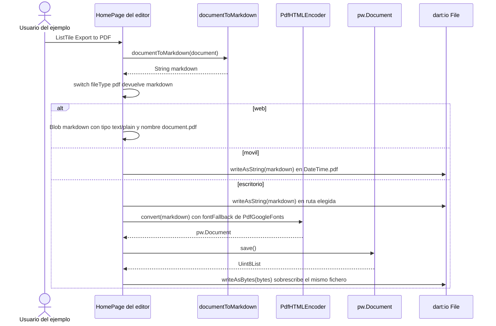
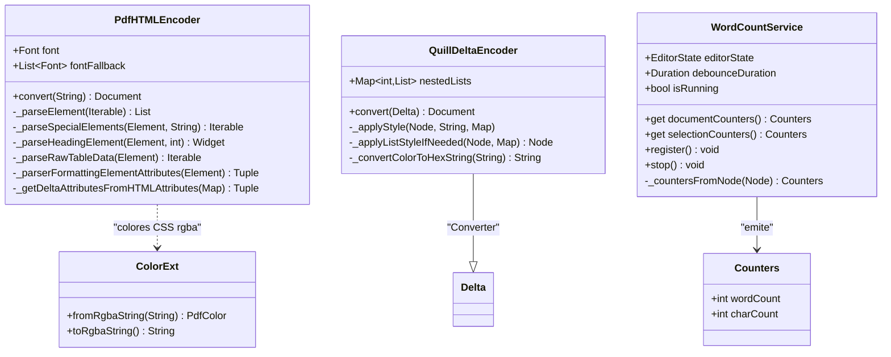
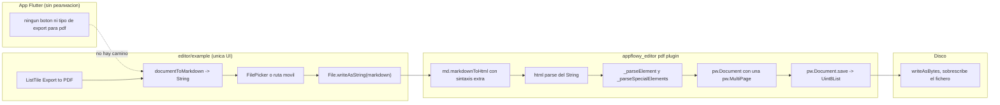
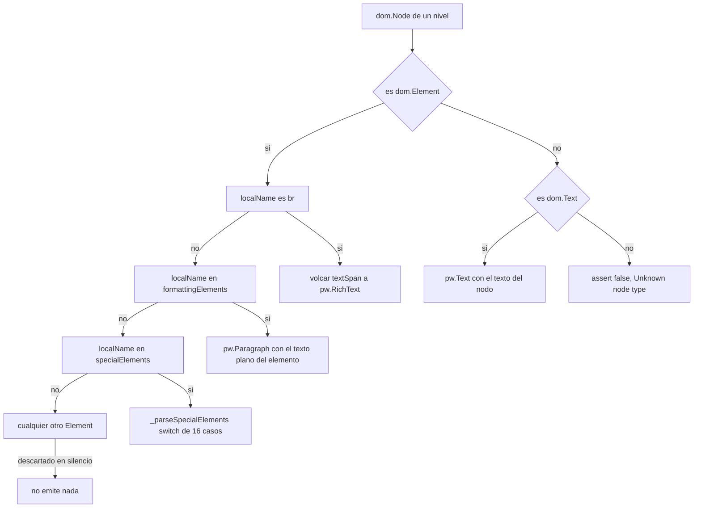

# B4.7 — Otros formatos: PDF, quill delta y recuento de palabras

Esta unidad cierra el inventario de formatos del motor de exportación con los tres plugins del repositorio `appflowy-editor` que no son Markdown, HTML, texto plano ni JSON: el **encoder a PDF** (`PdfHTMLEncoder`), el **importador de Quill Delta** (`QuillDeltaEncoder`) y el **servicio de recuento de palabras** (`WordCountService`). El hallazgo estructural de la unidad es negativo y verificable: **de los tres, ninguno es un formato de exportación alcanzable desde la aplicación AppFlowy**. PDF está implementado en la biblioteca pero solo lo invoca la app de ejemplo del editor; Quill Delta es un `Converter<Delta, Document>`, es decir un importador, y su caso de exportación lanza `UnimplementedError`; y el recuento de palabras no serializa nada: es una estadística en memoria que la app muestra en el panel «más acciones». El enum `DocumentExportType` de la app tiene exactamente cuatro valores —`json`, `markdown`, `text`, `html`— (`appflowy:frontend/appflowy_flutter/lib/workspace/application/export/document_exporter.dart:13–18`) y no hay ninguna referencia a `package:pdf`, `package:printing` ni `syncfusion` en todo el repositorio de la aplicación.

## 1. Punto de entrada (UI)

**En la aplicación AppFlowy no existe ningún punto de entrada para PDF.** La cadena de exportación de documentos es `ExportTab` → `ShareBloc` → `DocumentExporter`, y su tipo de entrada es el enum de cuatro valores citado arriba, cuyo `switch` cubre `json`, `markdown`, `text` (que lanza `UnimplementedError`) y `html` (`appflowy:frontend/appflowy_flutter/lib/workspace/application/export/document_exporter.dart:43–62`). La pestaña de exportar solo ofrece Markdown y HTML para vistas de documento (`appflowy:frontend/appflowy_flutter/lib/plugins/shared/share/export_tab.dart:24–32`), y el bloque B4 completo (`[[../10-motor-export-import/01-markdown-export.md]]`, `[[../10-motor-export-import/02-html-export.md]]`, `[[../10-motor-export-import/03-texto-plano-export.md]]`, `[[../10-motor-export-import/04-json-documento-export.md]]`) cubre los formatos que sí tienen botón.

La ausencia de PDF se corrobora por el lado de las dependencias. `appflowy_editor` se consume como dependencia git con `ref: "470c4e7"` (`appflowy:frontend/appflowy_flutter/pubspec.yaml:185–188`) y el paquete `pdf` sí es dependencia directa de ese editor (`editor:pubspec.yaml:30`), de modo que el paquete llega **transitivamente** al grafo de dependencias de la app: el código de `PdfHTMLEncoder` compila dentro del binario. Lo que no existe es cualquier *import* de `package:pdf`, `package:printing` o `syncfusion_flutter_pdfviewer` en el código de la aplicación, ni ninguna entrada de menú, ni ningún servicio de impresión; una búsqueda de `package:pdf/`, `package:printing/` y `syncfusion` sobre el árbol `lib/` de la app no devuelve ni un resultado. Las únicas apariciones de «pdf» en el código Flutter son de **entrada**, no de salida: la carga de adjuntos PDF en el chat de IA (`appflowy:frontend/appflowy_flutter/lib/plugins/ai_chat/application/chat_entity.dart:84–85`), el patrón de extensiones de documentos adjuntos (`appflowy:frontend/appflowy_flutter/lib/shared/patterns/file_type_patterns.dart:18`) y la lista de tipos de archivo del menú slash (`appflowy:frontend/appflowy_flutter/lib/plugins/document/presentation/editor_plugins/slash_menu/slash_menu_items/file_item.dart:13`). En Rust, `pdf` aparece solo como parser de adjuntos del módulo de IA, vía `lopdf` (`appflowy:frontend/rust-lib/flowy-ai/src/ai_tool/pdf.rs:1`, `appflowy:frontend/rust-lib/flowy-ai/Cargo.toml:55`).

**El único punto de entrada real está en la app de ejemplo del editor**, que sí tiene un `ListTile` titled `Export to PDF` (`editor:example/lib/home_page.dart:284–286`) que llama a `_exportFile(_editorState, ExportFileType.pdf)`. El enum `ExportFileType` de ese ejemplo tiene cuatro miembros —`documentJson`, `markdown`, `pdf`, `delta`— y su getter `extension` mapea a `json`, `md` y `pdf` (`editor:example/lib/home_page.dart:28–33`, `:35–46`). La verificación del aviso heredado de `[[../09-features/F19-editor-tests-ejemplos-l10n-configuracion/3-ejemplos-del-editor-example.md]]` es correcta en lo esencial y hay que corregirla en un detalle: la rama `pdf` **no** produce PDF, produce Markdown.

```dart
// editor:example/lib/home_page.dart:371–382
    switch (fileType) {
      case ExportFileType.documentJson:
        result = jsonEncode(editorState.document.toJson());
        break;
      case ExportFileType.markdown:
        result = documentToMarkdown(editorState.document);
        break;
      case ExportFileType.pdf:
        result = documentToMarkdown(editorState.document);
        break;

      case ExportFileType.delta:
        throw UnimplementedError();
    }
```

Es decir, el `ExportFileType.pdf` es un alias de `documentToMarkdown` (`:378`); el `documentToMarkdown` de `:375` es el motor documentado en `[[../10-motor-export-import/01-markdown-export.md]]`. La conversión real a PDF ocurre **después**, solo en la rama de escritorio, y sobrescribe el mismo fichero: primero escribe el Markdown con `writeAsString` (`editor:example/lib/home_page.dart:414`), y a continuación construye el `PdfHTMLEncoder` y lo reescribe como binario (`:416–423`). En web y móvil no hay segunda fase: el Markdown se descarga tal cual con nombre `document.pdf` (`:385–393`) o se escribe en `${DateTime.now()}.pdf` (`:394–398`), produciendo en ambos casos un fichero con extensión `.pdf` cuyo contenido es Markdown `[VERIFICADO]`.

El siguiente diagrama muestra la secuencia real del camino PDF completo, incluido el punto en que se bifurca por plataforma.



*Diagrama: secuencia del único camino PDF existente.* Lectura: el nombre del fichero y su extensión los decide la app de ejemplo, no el motor, y el motor solo interviene en la tercera rama. Obsérvese que las ramas web y móvil comparten el `result` con la de escritorio pero se saltan el bloque `if (fileType == ExportFileType.pdf)`, que está **dentro** de la rama de escritorio (`editor:example/lib/home_page.dart:407–423`); por eso el mismo botón produce tres artefactos distintos según plataforma.

## 2. Lado de conversión

Los tres plugins son **Dart puro del repositorio `editor`**. No hay FFI, no hay Rust, no hay `FlowyResult` y no hay `ErrorCode`: nada de lo que hay en `editor/lib/src/plugins/pdf/`, `.../quill_delta/` y `.../word_count/` cruza la frontera `async_event` que gobierna el resto del motor documentado en `[[../10-motor-export-import/00-indice-motor-export-import.md]]`.

### 2.1 `PdfHTMLEncoder`: de Markdown a `pw.Document`

La clase tiene exactamente dos campos de fuente tipográfica —`pw.Font? font` y `List<pw.Font> fontFallback`, el segundo obligatorio— (`editor:lib/src/plugins/pdf/html_to_pdf_encoder.dart:15–22`) y una única API pública: `Future<pw.Document> convert(String input)` (`:24`). El nombre de la clase y su comentario de documentación («This class handles conversion from html to pdf», `:14`) son **inexactos**: lo que recibe es Markdown, no HTML. El propio cuerpo lo demuestra: la primera operación es `md.markdownToHtml(input, blockSyntaxes: [TableSyntax()], inlineSyntaxes: [InlineHtmlSyntax(), ImageSyntax(), StrikethroughSyntax()])` (`:25–35`) y solo después se aplica `parse(htmlx)` del paquete `html` (`:36`). El pipeline real es por tanto `Markdown → HTML → pw.Document`, con un `Document` de `package:pdf` que todavía **no** es un fichero: el caller decide qué hacer con los bytes.

El resultado es un `pw.Document()` construido sin argumentos (`:50`) al que se le añade **una única** `pw.MultiPage` con todos los widgets del documento (`:51–53`). No se fija `pageFormat`, `margin`, `theme` ni `pageTheme`: todo eso queda en los valores por defecto del paquete `pdf` (`[VERIFICADO]` para la llamada sin argumentos; los valores concretos son `[NO DETERMINADO]` porque `package:pdf` no está entre las tres fuentes de esta skill). La rama `body == null` construye un documento degenerado de una sola página con un `pw.SizedBox.shrink()` (`:37–48`).

### 2.2 `QuillDeltaEncoder`: un importador, no un exportador

`QuillDeltaEncoder` extiende `Converter<Delta, Document>` (`editor:lib/src/plugins/quill_delta/quill_delta_encoder.dart:18`): **entrada Delta, salida Document**. Es exactamente el contrato inverso del que tendría un exportador, y existe un singleton global `final quillDeltaEncoder = QuillDeltaEncoder()` (`:6`) porque la documentación oficial del editor lo usa como punto de entrada de importación (`editor:documentation/importing.md:37–44`). Su simétrico —un `Document → Delta`— **no existe en el repositorio**: no hay ninguna función ni método que convierta un `Document` en un Delta de Quill. La única manera de producir un Delta de Quill desde AppFlowy es serializar el `delta` de cada nodo a JSON a mano.

### 2.3 `WordCountService`: una utilidad de métrica

`WordCountService` es un `ChangeNotifier` (`editor:lib/src/plugins/word_count/word_counter_service.dart:64`) que observa un `EditorState` y publica un valor inmutable `Counters` con dos enteros, `wordCount` y `charCount` (`:28–49`). No produce String, ni bytes, ni ningún tipo de salida serializable; su «formato» es un par de `int` en memoria. El recuento se hace sobre el texto plano de cada nodo (`node.delta?.toPlainText()`, `:281`) con la expresión regular `\S+` (`:22`) y los caracteres se cuentan como *code points* (`plain.runes.length`, `:268`), no como *grapheme clusters*. La app lo consume en `ViewInfoBloc`, que crea un servicio por documento, se suscribe a sus cambios y lo inyecta en el estado (`:31–32`, `:37`, `:44`); la UI lo muestra en el panel de más acciones sumando documento y título (`appflowy:frontend/appflowy_flutter/lib/workspace/presentation/widgets/more_view_actions/widgets/view_meta_info.dart:22–23`, `:42`, `:56`).

Los tres artefactos, su dirección real y su estado se resumen en el siguiente diagrama de clases.



*Diagrama: los tres artefactos y sus dependencias internas.* Lectura: solo `PdfHTMLEncoder` tiene una flecha de dependencia real con la extensión de color (`ColorExt`, definida en `editor:lib/src/plugins/pdf/extension/color_ext.dart:3`), y solo `WordCountService` declara estado observable (`ChangeNotifier`). `QuillDeltaEncoder` no depende de nada más que de las fábricas de nodos del propio editor, lo que explica que su lógica entera quepa en 225 líneas.

## 3. Pipeline

El diagrama siguiente muestra el camino completo del único artefacto con formato de salida real de esta unidad, desde el documento del editor hasta los bytes del fichero, con la rama de la app de ejemplo como frontera de la biblioteca.



*Diagrama: pipeline del export a PDF.* Lectura: la flecha punteada entre `NOUI` y `MD` marca el hueco estructural de la unidad — la app no puede ejecutar este pipeline porque no tiene forma de pedirlo. Dentro de la biblioteca el pipeline es lineal y sin realimentación: `convert` no acepta callbacks ni opciones, no devuelve progreso y no escribe nada; su único resultado es un `pw.Document` en memoria (`editor:lib/src/plugins/pdf/html_to_pdf_encoder.dart:24–55`).

La segunda fase, la traducción de nodos DOM a widgets, es un doble bucle recursivo. `_parseElement` recorre los nodos de un nivel y clasifica cada uno por su `localName`; si el nombre está en `HTMLTags.formattingElements` emite un `pw.Paragraph` y si está en `HTMLTags.specialElements` delega recursivamente en `_parseSpecialElements`, que a su vez tiene un `switch` sobre dieciséis etiquetas (`editor:lib/src/plugins/pdf/html_to_pdf_encoder.dart:57–186`). El segundo bucle vive en `_parseDeltaElement`, que recorre los hijos de un párrafo separando spans de formato de sub-bloques (`:443–509`).



*Diagrama: decisión de `_parseElement` por etiqueta.* Lectura: el `switch` de `_parseSpecialElements` tiene `default` y trata cualquier etiqueta desconocida como párrafo (`editor:lib/src/plugins/pdf/html_to_pdf_encoder.dart:183–184`), pero el nivel superior **no** tiene rama `else` para elementos: un `dom.Element` cuyo nombre no esté en ninguna de las dos listas se descarta sin más (`:64–101`, sin `else` tras la rama de `specialElements`). El único `assert` del recorrido se reserva para nodos que no son ni elemento ni texto, tipicamente comentarios (`assert(false, 'Unknown node type: $domNode')`, `:126–128`).

## 4. Tabla bloque → salida

Como esta unidad documenta **formatos descubiertos**, la tabla principal no mapea bloques sino formatos, con su estado real verificado. La segunda tabla sí traduce bloque a salida, y corresponde únicamente a PDF, que es el único con gramática de bloque de salida.

### 4.1 Formatos y su estado real

| Formato / artefacto | Clase o servicio | Dirección | Estado real | Evidencia del estado |
|---|---|---|---|---|
| PDF (`.pdf`) | `PdfHTMLEncoder` | `String` (Markdown) → `pw.Document` | **implementado pero sin camino UI en la app**; solo lo invoca `editor/example/` | `editor:lib/src/plugins/pdf/html_to_pdf_encoder.dart:24`; único call site en `editor:example/lib/home_page.dart:416`; `pdf` ausente del `pubspec.yaml` de la app (`appflowy:frontend/appflowy_flutter/pubspec.yaml:13`) |
| Quill Delta (`.json`) | `QuillDeltaEncoder` | `Delta` → `Document` | **no es un export**: es un importador; el caso de exportación lanza `UnimplementedError` | `editor:lib/src/plugins/quill_delta/quill_delta_encoder.dart:18`, `:62`; `editor:example/lib/home_page.dart:381–382` |
| Recuento de palabras | `WordCountService` + `Counters` | `EditorState` → dos `int` | **no es un export sino una utilidad**: no serializa nada | `editor:lib/src/plugins/word_count/word_counter_service.dart:28–49`, `:260–277` |
| JSON del documento | `document.toJson()` del editor | `Document` → JSON | implementado y alcanzable, pero es el caso `json` ya cubierto por el motor de la app | `editor:example/lib/home_page.dart:371–372`; `appflowy:frontend/appflowy_flutter/lib/workspace/application/export/document_exporter.dart:44–45`, y `[[../10-motor-export-import/04-json-documento-export.md]]` |

### 4.2 Traducción de bloque a salida en PDF

La entrada de `PdfHTMLEncoder` es Markdown, de modo que el punto de comparación correcto es la pareja `Markdown → HTML (paquete markdown) → widget pdf`. La columna «HTML intermedio» refleja el subconjunto que el `switch` de `_parseSpecialElements` reconoce (`editor:lib/src/plugins/pdf/html_to_pdf_encoder.dart:153–185`), no el HTML que produce `[[../10-motor-export-import/02-html-export.md]]`.

| Bloque de Markdown | HTML intermedio | Widget `pdf` emitido | Referencia |
|---|---|---|---|
| `#` … `######` | `h1`…`h6` | `pw.Header` con `pw.RichText`, tamaño `level.getHeadingSize` (32/28/20/17/14/10) y negrita | `editor:lib/src/plugins/pdf/html_to_pdf_encoder.dart:154–165`, `:301–342`, `:624–643` |
| párrafo | `p` | `pw.Wrap` con `pw.RichText`; los hijos con formato se convierten en `pw.TextSpan` | `editor:lib/src/plugins/pdf/html_to_pdf_encoder.dart:179–180`, `:443–509` |
| viñeta `- ` | `ul` > `li` | `pw.Bullet` con el texto plano del `li` | `editor:lib/src/plugins/pdf/html_to_pdf_encoder.dart:166–167`, `:344–363`, `:404–407` |
| numerada `1. ` | `ol` > `li` | `pw.Bullet` **también**: no hay viñeta numérica | `editor:lib/src/plugins/pdf/html_to_pdf_encoder.dart:168–169`, `:365–374`, `:403–408` |
| tarea `- [x]` / `- [ ]` | `ul` > `li` cuyo texto contiene `[` | `pw.Row` con `pw.Checkbox` (10×10) y `pw.Text` con el texto sin el marcador | `editor:lib/src/plugins/pdf/html_to_pdf_encoder.dart:344–352`, `:381–402` |
| cita `> ` | `blockquote` | párrafo vía `_parseParagraphElement` (rama `default`) | `editor:lib/src/plugins/pdf/html_to_pdf_encoder.dart:183–184` |
| tabla pipe | `table` > `tr` > `td` | `pw.Table` con `pw.TableRow` y `pw.Wrap` por celda, borde negro uniforme | `editor:lib/src/plugins/pdf/html_to_pdf_encoder.dart:170–171`, `:188–236` |
| imagen `` | `img` | `pw.Image(pw.MemoryImage(bytes))`, descargada o leída de disco | `editor:lib/src/plugins/pdf/html_to_pdf_encoder.dart:181–182`, `:415–432` |
| regla horizontal `---` | `hr` | **nada**: `hr` no está en `formattingElements` ni en `specialElements` | `editor:lib/src/plugins/html/html_document_decoder.dart:530`, `:539–552`, `:554–571` |
| código `` `x` `` / ```` ``` ```` | `code` | `pw.Paragraph` con fondo gris `pdf.PdfColors.grey` | `editor:lib/src/plugins/pdf/html_to_pdf_encoder.dart:279–283` |
| negrita / cursiva / subrayado / tachado | `b`/`strong`, `i`/`em`, `u`, `del` | `FontWeight.bold`, `FontStyle.italic`, `TextDecoration.underline`, `TextDecoration.lineThrough` | `editor:lib/src/plugins/pdf/html_to_pdf_encoder.dart:248–262` |
| enlace `[t](url)` | `a` | subrayado + `pdf.PdfColors.blue`; la URL **no** se escribe en ningún sitio | `editor:lib/src/plugins/pdf/html_to_pdf_encoder.dart:272–278` |
| `~~t~~` | `s` o `del` | `del` → `lineThrough`; `s` no tiene caso propio | `editor:lib/src/plugins/pdf/html_to_pdf_encoder.dart:259–262` |

La distinción entre los dos listados de `HTMLTags` es la columna vertebral del motor: `formattingElements` tiene doce entradas —`a`, `i`, `em`, `b`, `u`, `del`, `strong`, `span`, `code`, `s`, `font`, `mark`— (`editor:lib/src/plugins/html/html_document_decoder.dart:539–552`) y `specialElements` dieciséis —los seis `h`, `ul`, `ol`, `div`, `li`, `table`, `p`, `blockquote`, `input`, `img`, `section`— (`:554–571`). Obsérvese que `span` está en la primera lista y que su rama en `_parserFormattingElementAttributes` está **comentada** (`editor:lib/src/plugins/pdf/html_to_pdf_encoder.dart:263–271`), de modo que un `<span style="color: …">` se procesa pero con el estilo por defecto.

## 5. Pérdidas

Todas las pérdidas siguientes ocurren **dentro** del encoder, antes de que exista el fichero, y todas están ancladas a la línea que las produce.

1. **Reglas horizontales eliminadas.** El Markdown `---` se convierte en `<hr>`, y `HTMLTags.divider = 'hr'` (`editor:lib/src/plugins/html/html_document_decoder.dart:530`) no aparece ni en `formattingElements` (`:539–552`) ni en `specialElements` (`:554–571`). El recorrido de `_parseElement` no tiene `else` para elementos (`editor:lib/src/plugins/pdf/html_to_pdf_encoder.dart:64–101`), así que el nodo desaparece sin marca `[VERIFICADO]`.
2. **Listas numeradas se dibujan como viñetas.** `_parseOrderListElement` sí clasifica los hijos como `NumberedListBlockKeys.type` (`editor:lib/src/plugins/pdf/html_to_pdf_encoder.dart:365–374`), pero `_parseListElement` solo distingue dos casos: si es `todo_list` dibuja un `pw.Row` con checkbox, y en el `else` dibuja siempre `pw.Bullet` (`:403–408`). El número de orden no se emite en ningún punto, y el propio código lo admite con el comentario `//TODO: Handle Numbered Lists & Handle nested lists` (`:380`).
3. **El `type` de lista es inerte dentro de las celdas.** `_parseRawTableData` pasa `type: BuiltInAttributeKey.bulletedList` (`editor:lib/src/plugins/pdf/html_to_pdf_encoder.dart:210–214`), cuyo valor es la cadena `'bulleted-list'` (`editor:lib/src/core/legacy/built_in_attribute_keys.dart:34`), y lo único que `_parseListElement` compara con ese `type` es `TodoListBlockKeys.type` (`editor:lib/src/plugins/pdf/html_to_pdf_encoder.dart:381`). Una tabla con listas se dibuja siempre con viñetas, nunca con casillas `[VERIFICADO]`.
4. **El buffer `textSpan` de `_parseElement` está muerto.** La única línea que añade un `TextSpan` a esa lista es la del salto de línea `br` (`:67–68`); los tres bloques que la vacían —dos dentro del bucle y uno al salir— (`:78–94`, `:103–119`, `:130–144`) solo se ejecutan por tanto si el Markdown traía un `<br>`. El efecto practical es que un párrafo se emite como `pw.Text` plano, sin `pw.RichText`, con lo que se pierde el composición de estilos inline a nivel de párrafo `[VERIFICADO]`.
5. **La alineación se lee y se tira.** `_parserFormattingElementAttributes` devuelve la tupla `(textAlign, style)` y quien la consume en la rama de `formattingElements` solo usa `attributes.$2`, ignorando `attributes.$1` (`editor:lib/src/plugins/pdf/html_to_pdf_encoder.dart:70–76`). Además, `textAlign` solo se puede poblar desde la recursión sobre hijos (`:287–294`) o desde `_getDeltaAttributesFromHTMLAttributes` (`:584–587`), que a su vez solo se invoca cuando un hijo de párrafo **no** es un elemento (`:482–491`) `[VERIFICADO]`.
6. **Las imágenes pierden tamaño y alineación.** `_parseImageElement` solo lee `src` (`editor:lib/src/plugins/pdf/html_to_pdf_encoder.dart:416`); los atributos `width`, `height` y `align` que emite el exportador HTML (`[[../10-motor-export-import/02-html-export.md]]`) no se leen, y el `pw.Image` se inserta sin restricción de tamaño, de modo que se escala al ancho de página o se desborda `[VERIFICADO para lo no leído; INFERIDO para el comportamiento de escalado]`.
7. **El color en CSS no se puede convertir.** Es el punto más grave y merece el detalle. `ColorExt.fromRgbaString` analiza el `rgba(r,g,b,a)` con una expresión regular y devuelve `PdfColor.fromInt(rgbaToHex(...))` (`editor:lib/src/plugins/pdf/extension/color_ext.dart:4–33`). Pero `rgbaToHex` calcula la componente alfa con `opacity = (opacity > 0) ? -255 : opacity * 255;` (`editor:lib/src/plugins/pdf/extension/color_ext.dart:45`), es decir **siempre −255** cuando la opacidad es positiva, y luego concatena ese valor en hexadecimal dentro del literal que pasa a `int.parse('0x…')` (`:49–53`). Con un alfa negativo, `toRadixString(16)` produce una cadena con signo menos, de modo que el literal deja de ser hexadecimal válido `[VERIFICADO para el código; INFERIDO para el resultado de `int.parse`]`. Consecuencia: cualquier CSS `rgba(...)` que llegue a `_getDeltaAttributesFromHTMLAttributes` (`editor:lib/src/plugins/pdf/html_to_pdf_encoder.dart:559–575`) no produce un color, sino una excepción que sube hasta el caller sin ser capturada.
8. **Colores con nombre o hex de tres dígitos.** `fromRgbaString` solo reconoce la forma `rgba(r,g,b,a)` con cuatro enteros (`editor:lib/src/plugins/pdf/extension/color_ext.dart:5–6`); `#rrggbb`, `red` o `transparent` devuelven `null` y el estilo se pierde sin más (`editor:lib/src/plugins/pdf/html_to_pdf_encoder.dart:559–575`).
9. **Sin tipografía base.** `pw.Document()` se construye sin `theme` ni `pageTheme` (`editor:lib/src/plugins/pdf/html_to_pdf_encoder.dart:50`) y `font` es un campo opcional cuyo valor por defecto es `null` (`:16`). Sin fuente explícita, los caracteres fuera del repertoire de la fuente por defecto del paquete `pdf` no se renderizan: el emoji solo funciona porque la app de ejemplo inyecta `PdfGoogleFonts.notoColorEmoji()` como fallback (`editor:example/lib/home_page.dart:416–421`), algo que ningún consumidor de la app hace porque no hay consumidor.
10. **Pérdidas específicas de Quill Delta.** El encoder solo reconoce `TextInsert` y lanza `UnsupportedError('only support text insert operation')` para cualquier otra operación (`editor:lib/src/plugins/quill_delta/quill_delta_encoder.dart:32`, `:61–63`), lo que descarta imágenes y embeds incrustados. De los atributos de estilo solo se mapean `strike`, `underline`, `bold`, `italic`, `link`, `color` y `background` (`:73–100`): se pierden `font`, `size`, `align`, `token`, `code_block` y cualquier otro, como reconoce la propia documentación del editor (`editor:documentation/importing.md:46`). `_convertColorToHexString` solo entiende `#hex` y `rgba(...)` (`:208–224`), de modo que los colores con nombre que Quill emite (`black`, `transparent`) se descartan silenciosamente.
11. **El recuento no persiste nada.** `Counters` es un objeto de dos enteros inmutables (`editor:lib/src/plugins/word_count/word_counter_service.dart:28–49`) que la app mantiene en memoria dentro de `ViewInfoBloc` (`appflowy:frontend/appflowy_flutter/lib/workspace/application/view_info/view_info_bloc.dart:37`, `:44`) y descarta al cerrar la vista (`:81–92`); no hay campo en el protobuf de la vista ni entrada en la base de datos local que los conserve.

## 6. Assets

El único tratamiento de assets de la unidad está en `_parseImageElement` (`editor:lib/src/plugins/pdf/html_to_pdf_encoder.dart:415–432`), y tiene tres ramas bien definidas. Si el `src` empieza por `https` se descarga el binario con el paquete `http` mediante un `get` simple (`_fetchImage`, `:434–441`) y se envuelve en `pw.MemoryImage` (`:420–421`). En cualquier otro caso se trata como **ruta de sistema de ficheros** y se lee con `File(src).readAsBytes()` (`:423–424`). Si no hay `src`, se emite un `pw.Text('')` vacío (`:426–428`).

Las consecuencias son tres y todas verificables. La descarga es **bloqueante y secuencial**: `convert` es `async` y `_parseElement` espera cada `await _parseImageElement` en serie, así que un documento con treinta imágenes remotas tarda treinta viajes de red antes de emitir la primera página. **No hay caché, ni deduplicación, ni límite de tamaño**: cada referencia a la misma URL vuelve a descargarla, porque el `pw.Image` se construye inline en el flujo sin ninguna estructura intermedia. Y **no hay gestión de fallo silencioso**: el `catch` devuelve `pw.Text(e.toString())`, es decir **el mensaje de error de la descarga queda impreso dentro del PDF** (`editor:lib/src/plugins/pdf/html_to_pdf_encoder.dart:429–431`).

Esto contrasta con los dos motores hermanos de forma notable: la exportación HTML deja la imagen como referencia `src` y el documento resultante depende de la red para visualizarse (`[[../10-motor-export-import/02-html-export.md]]`), mientras que la exportación Markdown empaqueta los recursos en un ZIP (`[[../10-motor-export-import/01-markdown-export.md]]`). El motor PDF es el único de los tres que **materializa los bytes**, pero lo hace sin ningún control de red ni de disco. Las incrustaciones de Quill Delta, por su parte, no llegan a tocarse: se descartan por el `UnsupportedError` descrito en §5, punto 10.

## 7. Encoding y nombre de archivo

**Nombre.** Ni `PdfHTMLEncoder` ni `QuillDeltaEncoder` escriben ficheros ni proponen nombres: ambos devuelven objetos en memoria. El nombre lo decide íntegramente el caller. En la app de ejemplo es `document.${fileType.extension}` con el `FilePicker` de escritorio (`editor:example/lib/home_page.dart:410–412`), `${DateTime.now()}.pdf` en la rama móvil (`:394–397`) y el atributo `download` del `Blob` en web (`:390`). Obsérvese que el nombre móvil **incorpora la marca temporal completa**, con dos puntos en la hora, lo que es un nombre de fichero inválido en Windows `[INFERIDO]`.

**Encoding.** El motor no toca bytes en ningún punto: `convert` devuelve un `pw.Document` (`editor:lib/src/plugins/pdf/html_to_pdf_encoder.dart:24`) y la serialización ocurre fuera, con `pdf.save()` seguido de `File(path).writeAsBytes(...)` (`editor:example/lib/home_page.dart:422–423`). Por tanto el PDF no tiene problema de codificación de texto: la fuente decide el mapeo de glifos y el contenido es Unicode. Quill Delta no escribe nada y su entrada es JSON decodificado con `Delta.fromJson(jsonDecode(plainText))` (`editor:example/lib/home_page.dart:466–468`), lo que implica UTF-8 en el archivo de origen por ser `readAsString` con el valor por defecto.

El punto débil de esta sección es la **rama web y la rama móvil del ejemplo**, que escriben el Markdown con `writeAsString` (`editor:example/lib/home_page.dart:398`, `:414`) y con un `Blob` de tipo MIME `'text/plain'` (`:386`) bajo una extensión `.pdf`. El fichero resultante no es un PDF: es texto Markdown con nombre engañoso, y no hay ninguna comprobación que lo detecte `[VERIFICADO]`.

## 8. Errores

Ninguno de los tres plugins define un tipo de error propio, ni traduce a `FlowyError`, ni registra en el log de la app: son librerías de escritorio con semántica de excepción de Dart.

| Fallo | Dónde | Comportamiento observado |
|---|---|---|
| `UnsupportedError` en Quill Delta | `editor:lib/src/plugins/quill_delta/quill_delta_encoder.dart:62` | Excepción no capturada para cualquier op que no sea `TextInsert`; el caller del ejemplo no la captura (`editor:example/lib/home_page.dart:467–469`) |
| Error al descargar una imagen | `editor:lib/src/plugins/pdf/html_to_pdf_encoder.dart:438–439` | `_fetchImage` envuelve en `Exception(e)` y propaga; el `catch` del caller la convierte en `pw.Text(e.toString())`, es decir **texto visible en el PDF** (`:429–431`) |
| `FormatException` al convertir un color rgba | `editor:lib/src/plugins/pdf/extension/color_ext.dart:45`, `:49–53` | Se propaga fuera de `convert`; no hay ningún `try` en el recorrido de color (`editor:lib/src/plugins/pdf/html_to_pdf_encoder.dart:559–575`) |
| Nodo DOM desconocido | `editor:lib/src/plugins/pdf/html_to_pdf_encoder.dart:126–128` | `assert(false, …)`: `AssertionError` en depuración, código muerto en release |
| Lista con salto de nivel de sangría | `editor:lib/src/plugins/quill_delta/quill_delta_encoder.dart:43–45` | `nestedLists[level - 1]!` y `nestedLists[level]!` usan aserción de nulidad sobre un mapa que solo se rellena al visitar niveles en orden ascendente; un Delta que empiece por `indent: 2` sin haber pasado por `indent: 1` no tiene entrada para el nivel 1 `[VERIFICADO para la aserción; INFERIDO para el fallo]` |
| Exportar Delta a Quill | `editor:example/lib/home_page.dart:381–382` | `UnimplementedError` inmediato |
| Importar un PDF | `editor:example/lib/home_page.dart:471–472` | `UnimplementedError` inmediato: **no existe importador de PDF** |

En la aplicación, ninguno de estos fallos es alcanzable porque no hay caller; en la app de ejemplo, ninguno está envuelto en `try`/`catch` ni notificado al usuario: el `_exportFile` del ejemplo no tiene manejo de errores (`:365–434`), de modo que cualquier excepción se manifiesta como un error no gestionado de Flutter.

## 9. Round-trip

**PDF: no hay vuelta.** El `switch` de importación del ejemplo lanza `UnimplementedError` para `ExportFileType.pdf` (`editor:example/lib/home_page.dart:471–472`) y el repositorio `editor` no contiene ningún decoder de PDF: el directorio `lib/src/plugins/pdf/` tiene exactamente dos ficheros (`html_to_pdf_encoder.dart` y `extension/color_ext.dart`), ninguno de ellos con lectura. El `ImportType` de la app tampoco contempla la extensión `pdf` para documentos. Un PDF producido por esta biblioteca es, por definición, un callejón sin salida.

**Quill Delta: la vuelta está implementada a medias, y es el caso interesante.** El encoder es exactamente el importador, así que el ciclo es `Delta → Document` y termina ahí: **no existe `Document → Delta`**, ni en el plugin ni en ninguna otra parte del repositorio `editor`. La consecuencia práctica es que AppFlowy puede **consumir** un Delta exportado desde Quill pero no puede **emitirlo**; si un usuario quiere llevar su contenido a Quill, no hay botón ni función que lo haga. En el lado de la app, el importador oficial tampoco incluye Delta entre sus cinco tipos de archivo (`[[../10-motor-export-import/11-import-zip-notion.md]]` cubre el resto), de modo que el round-trip completo es una capacidad de biblioteca documentada en `editor:documentation/importing.md:37–44` y usada por la app de ejemplo, no un flujo de usuario.

**Recuento de palabras: no aplica.** No hay entrada ni salida; `getDocumentCounters()` y `getSelectionCounters()` calculan sobre la marcha y devuelven un `Counters` en memoria (`editor:lib/src/plugins/word_count/word_counter_service.dart:111–123`), cuyo único consumidor es la UI de más acciones.

## 10. Extensión y firma

| Formato | Extensión | MIME | Magic bytes | Fuente de la afirmación |
|---|---|---|---|---|
| PDF | `.pdf` | `application/pdf` | `%PDF-` | `[INFERIDO]`: la extensión la fija el getter `extension` de la app de ejemplo (`editor:example/lib/home_page.dart:43–45`) y los bytes los produce `pw.Document.save()` (`:423`); el estándar PDF no está en las tres fuentes de esta skill |
| Quill Delta | `.json` | `application/json` | `[` | `[VERIFICADO]` para la extensión, que el getter mapea a `json` (`editor:example/lib/home_page.dart:38–40`), y `[INFERIDO]` para el MIME y el magic, que no se declaran en el código |
| Recuento de palabras | ninguna | ninguno | ninguno | `[VERIFICADO]`: `Counters` no tiene serialización (`editor:lib/src/plugins/word_count/word_counter_service.dart:28–49`) |

Conviene notar una asimetría de contrato: el paquete `printing`, que es quien proporciona `PdfGoogleFonts` y quien sabe presentar y compartir un PDF, es dependencia **exclusiva de la app de ejemplo** (`editor:example/pubspec.yaml:46`) y no aparece en el `pubspec.yaml` de la aplicación (`appflowy:frontend/appflowy_flutter/pubspec.yaml:13`). Incluso si alguien quisiera cablear un botón de PDF en la app, faltaría decidir si se escribe con `pw.Document.save()` —sin dependencias nuevas— o si se usa `printing` para previsualizar, lo que exigiría añadir la dependencia.

## 11. Ejemplos

**Entrada y arranque del encoder PDF.** Todo el pipeline arranca en estas doce líneas; nótese que el argumento es Markdown aunque el nombre de la clase y su comentario digan «html»:

```dart
// editor:lib/src/plugins/pdf/html_to_pdf_encoder.dart:24–36
  Future<pw.Document> convert(String input) async {
    final htmlx = md.markdownToHtml(
      input,
      blockSyntaxes: const [
        md.TableSyntax(),
      ],
      inlineSyntaxes: [
        md.InlineHtmlSyntax(),
        md.ImageSyntax(),
        md.StrikethroughSyntax(),
      ],
    );
    final document = parse(htmlx);
```

**Escritura real del fichero en la app de ejemplo**, que es donde el PDF se materializa por única vez en todo el análisis:

```dart
// editor:example/lib/home_page.dart:414–423
        await File(path).writeAsString(result);
        if (fileType == ExportFileType.pdf) {
          final pdf = await PdfHTMLEncoder(
            fontFallback: [
              await PdfGoogleFonts.notoColorEmoji(),
              await PdfGoogleFonts.notoColorEmojiRegular(),
            ],
          ).convert(result);

          await File(path).writeAsBytes(await pdf.save());
        }
```

Obsérvese la doble escritura sobre la misma ruta: la primera deposita Markdown y la segunda lo sobrescribe con los bytes del PDF. Si el segundo `await` falla, el usuario se queda con un `.pdf` que contiene Markdown y ningún indicador de error.

**Traducción de un párrafo con estilos a `pdf`.** El fragmento muestra la rama de composición inline, que es donde se decide qué sobrevive del `Delta`:

```dart
// editor:lib/src/plugins/pdf/html_to_pdf_encoder.dart:467–479
          } else {
            if (child.localName == HTMLTags.br) {
              textSpan.add(const pw.TextSpan(text: '\n'));
            } else {
              final attributes = _parserFormattingElementAttributes(child);
              textAlign = attributes.$1;
              textSpan.add(
                pw.TextSpan(
                  text: child.text.replaceAll(RegExp(r'\n+$'), ''),
                  style: attributes.$2,
                ),
              );
            }
          }
```

**Conversión de color de Quill a hex**, que es donde se decide si un color sobrevive:

```dart
// editor:lib/src/plugins/quill_delta/quill_delta_encoder.dart:208–216
  String? _convertColorToHexString(String? color) {
    if (color == null) {
      return null;
    }
    if (color.startsWith('#')) {
      return '0xFF${color.substring(1)}';
    } else if (color.startsWith("rgba")) {
      List rgbaList = color.substring(5, color.length - 1).split(',');
```

Un `#e60000` se convierte en `0xFFE60000` y sobrevive; un `black` o un `transparent`, que es lo que Quill emite con frecuencia, cae en el `return null` de la línea siguiente y se pierde sin aviso. Esto es exactamente lo que fija el test del plugin: el Delta de entrada declara `{"insert":"web","attributes":{"strike":true,"color":"black"}}` y el documento esperado solo conserva `{"insert":"web","attributes":{"strikethrough":true}}` (`editor:test/plugins/quill_delta/quill_delta_encoder_test.dart:107–112` frente a `editor:test/plugins/quill_delta/quill_delta_encoder_test.dart:28`).

**Parámetros del servicio de recuento**, que son toda su API pública:

```dart
// editor:lib/src/plugins/word_count/word_counter_service.dart:64–68, :80
class WordCountService with ChangeNotifier {
  WordCountService({
    required this.editorState,
    this.debounceDuration = const Duration(milliseconds: 300),
  });
  ...
  final Duration debounceDuration;
```

El debounce de 300 ms es el que hace que el panel de más acciones no se repinte en cada tecla; sin él, el servicio recorre el documento entero en cada transacción, como advierte su propio comentario de documentación (`editor:lib/src/plugins/word_count/word_counter_service.dart:51–63`). El test verifica el comportamiento en vivo con tres párrafos (`editor:test/plugins/word_count/word_counter_test.dart:25–26`) y, en el caso de la selección, que el recuento bajo demanda funciona sin `register()` (`:128–141`).

**Correcciones de alcance de esta unidad.** Markdown (`.md` y el ZIP con recursos) → `[[../10-motor-export-import/01-markdown-export.md]]`; HTML → `[[../10-motor-export-import/02-html-export.md]]`; texto plano → `[[../10-motor-export-import/03-texto-plano-export.md]]`, hoy `UnimplementedError` (`appflowy:frontend/appflowy_flutter/lib/workspace/application/export/document_exporter.dart:55–56`); JSON del documento → `[[../10-motor-export-import/04-json-documento-export.md]]`; importación de Markdown → `[[../10-motor-export-import/08-import-markdown-texto.md]]`; importación ZIP/Notion → `[[../10-motor-export-import/11-import-zip-notion.md]]`; la app de ejemplo del editor, de la que sale el único call site de PDF, es `[[../09-features/F19-editor-tests-ejemplos-l10n-configuracion/3-ejemplos-del-editor-example.md]]`; y la capa UI que dispara el resto de exportaciones es `[[../09-features/F11-exportacion-ui/F11-exportacion-ui.md]]`. Las cinco tablas de `HTMLTags` y el decoder que las comparte pertenecen a `[[../10-motor-export-import/02-html-export.md]]` y `[[../10-motor-export-import/08-import-markdown-texto.md]]`.

## Relacionado con

- `OUT/10-motor-export-import/01-markdown-export.md` (`[[../10-motor-export-import/01-markdown-export.md]]`) — el motor Markdown, cuyo `documentToMarkdown` es de hecho el primer paso del export a PDF.
- `OUT/10-motor-export-import/02-html-export.md` (`[[../10-motor-export-import/02-html-export.md]]`) — comparte la tabla `HTMLTags` y es la referencia para el HTML intermedio que consume `PdfHTMLEncoder`.
- `OUT/_ledger/units/B4.7.json` — definición de esta unidad y sus cinco archivos.
- `editor/documentation/importing.md` — los tres modos de importación que documenta el propio editor, incluido Quill Delta.
- `editor/test/plugins/quill_delta/quill_delta_encoder_test.dart` y `editor/test/plugins/word_count/word_counter_test.dart` — la especificación ejecutable de los dos plugins no-PDF (`[[../09-features/F19-editor-tests-ejemplos-l10n-configuracion/2.8-tests-del-editor-test-plugins-editor-core-service-extensions-infra-render-legacy.md]]`).