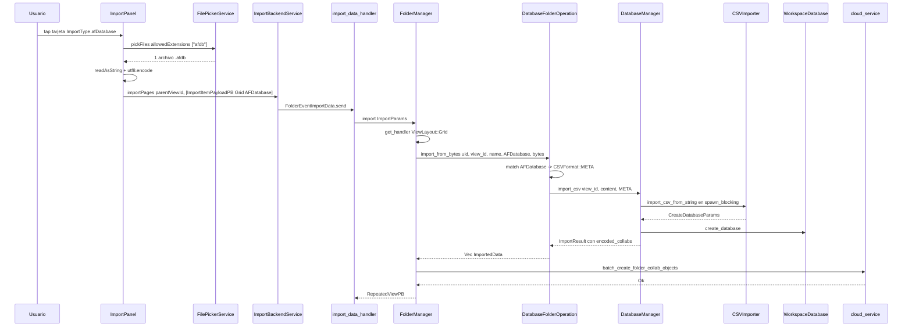
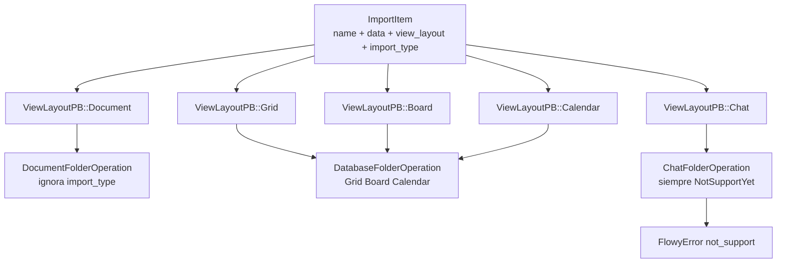
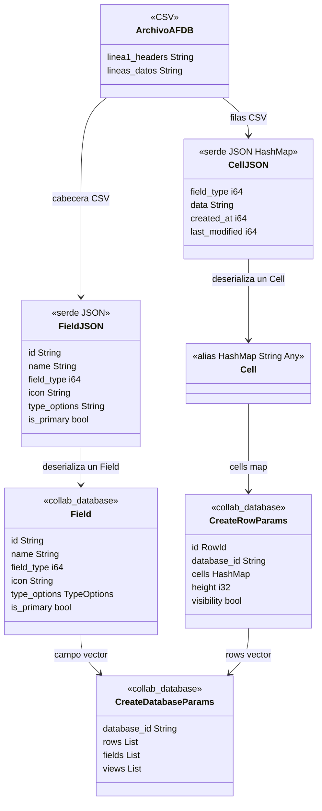

# B4.10 — Import de historial v0.x y de base de datos AF

Este documento cubre los tres formatos de importación que el motor de AppFlowy admite y que **no** describe ninguna otra unidad de la familia: `HistoryDocument` (`.afdoc`, documentos exportados por AppFlowy 0.1.x), `HistoryDatabase` (`.afdb` en su variante CSV plana, heredada de la misma época) y `AFDatabase` (`.afdb` en su variante CSV con metadatos). Los tres comparten un mismo esqueleto de transporte (`ImportPayloadPB` → `FolderManager::import` → `FolderOperationHandler::import_from_bytes`) pero divergen por completo en el lado de la conversión: el primero se transforma **en Dart, antes de cruzar el FFI**, y llega a Rust ya serializado como `DocumentDataPB`; los otros dos llegan como texto crudo y se transforman **en Rust**, dentro de `DatabaseFolderOperation`, eligiendo entre dos parsers de CSV distintos según el discriminante `ImportType`. Un dato estructural condiciona todo el resto del documento: en este snapshot **no existe detección por magic bytes ni por contenido**. El formato lo decide el `ImportTypePB` que viaja dentro del protobuf, y ese valor lo fija la tarjeta del diálogo que el usuario pulsó, que a su vez se corresponde con la extensión filtrada por el `FilePickerService` (`appflowy/frontend/appflowy_flutter/lib/workspace/presentation/home/menu/sidebar/import/import_type.dart:60–72`). El lado Rust nunca ve el nombre del archivo: `import_single_file` recibe solo `name`, `ImportData` y `ViewLayout` (`appflowy/frontend/rust-lib/flowy-folder/src/manager.rs:2049–2077`). Además, los tres formatos están **ocultos en compilaciones release** porque `enableOnRelease` devuelve `kDebugMode` para `historyDocument`, `historyDatabase` y `afDatabase` (`appflowy/frontend/appflowy_flutter/lib/workspace/presentation/home/menu/sidebar/import/import_type.dart:49–58`), lo que los relega a herramientas de recuperación y a fixtures de test.

## 1. Punto de entrada (UI)

Las tres tarjetas se generan en el mismo `GridView.count` que el resto de formatos, filtrando `ImportType.values.where((element) => element.enableOnRelease)` (`appflowy/frontend/appflowy_flutter/lib/workspace/presentation/home/menu/sidebar/import/import_panel.dart:101–123`). En release solo se renderizan `markdownOrText` y `csv`; en debug aparecen además las tres de este documento. Los rótulos salen de `ImportType.toString()` (`appflowy/frontend/appflowy_flutter/lib/workspace/presentation/home/menu/sidebar/import/import_type.dart:14–28`): `importPanel_documentFromV010` para `historyDocument`, `importPanel_databaseFromV010` para `historyDatabase` y `importPanel_database` para `afDatabase`. Las tres comparten el icono `FlowySvgs.board_s` (`appflowy/frontend/appflowy_flutter/lib/workspace/presentation/home/menu/sidebar/import/import_type.dart:30–47`) y `allowMultiSelect == true` (`appflowy/frontend/appflowy_flutter/lib/workspace/presentation/home/menu/sidebar/import/import_type.dart:74–83`), por lo que una sola pulsación puede mezclar archivos `.afdoc` y `.afdb` en el mismo lote.

Las extensiones admitidas son `['afdoc']` para `historyDocument` y `['afdb']` tanto para `historyDatabase` como para `afDatabase` (`appflowy/frontend/appflowy_flutter/lib/workspace/presentation/home/menu/sidebar/import/import_type.dart:60–72`). La duplicación de `.afdb` es la raíz de la ambiguedad central de este documento: **el mismo archivo es válido para dos formatos distintos**, y la tarjeta que el usuario pulse decide, sin ambigüedad, qué parser se aplica. `[VERIFICADO]`

El recorrido completo es `_ImportPanelState._importFile` (`appflowy/frontend/appflowy_flutter/lib/workspace/presentation/home/menu/sidebar/import/import_panel.dart:142–219`): `pickFiles` con `FileType.custom` y `allowedExtensions` por tipo (línea `143–147`), `readAsString()` del archivo (líneas `164`, `175`, `188` y `198` — **los cuatro casos leen como texto UTF-8, nunca como binario**), `name = p.basenameWithoutExtension(path)` (línea `160`) y construcción de un `ImportItemPayloadPB` por archivo. Los `viewLayout` enviados son `ViewLayoutPB.Document` para `historyDocument` (línea `182`) y `ViewLayoutPB.Grid` para los otros dos (líneas `169`, `193` y `203`). El envío es `ImportBackendService.importPages(parentViewId, importValues)` (línea `211`), que serializa `ImportPayloadPB` y dispara `FolderEventImportData(request).send()` (`appflowy/frontend/appflowy_flutter/lib/workspace/application/settings/share/import_service.dart:19–29`). El contexto de UI completo (diálogo, callbacks, estados) está en `[[../09-features/F10-importacion-ui/F10-importacion-ui.md]]`.

El detalle decisivo de este punto de entrada es que la tarjeta `historyDocument` **no envía `ImportTypePB.HistoryDocument`**: el `case` compartido con `markdownOrText` fija `..importType = ImportTypePB.Markdown` para ambos (`appflowy/frontend/appflowy_flutter/lib/workspace/presentation/home/menu/sidebar/import/import_panel.dart:173–186`). Una búsqueda exhaustiva confirma que `ImportTypePB.HistoryDocument` (valor `0`) no lo emite ningún archivo Dart de producción ni de test: solo existen la conversión `From<ImportTypePB> for ImportType` (`appflowy/frontend/rust-lib/flowy-folder/src/entities/import.rs:23`) y la declaración del enum. `[VERIFICADO]` Es decir, la variante `HistoryDocument` del enum Rust es **código muerto en este snapshot**, y el formato "documento histórico" viaja etiquetado como `Markdown` porque, para Rust, ambos son el mismo tipo de entrada: un `DocumentDataPB` ya serializado. `ImportType::HistoryDocument` se conserva en el enum (`appflowy/frontend/rust-lib/flowy-folder/src/share/import.rs:5–12`) por compatibilidad de numbering con el `.proto` generado, no por uso.

## 2. Lado de conversión

La conversión se reparte en dos mitades que no se comunican entre sí más que a través del buffer protobuf.

**HistoryDocument — conversión íntegramente en Dart, antes del FFI.** `_documentDataFrom` (`appflowy/frontend/appflowy_flutter/lib/workspace/presentation/home/menu/sidebar/import/import_panel.dart:222–234`) es el único punto del sistema que ejecuta la migración de esquema de bloques:

```dart
// appflowy/frontend/appflowy_flutter/lib/workspace/presentation/home/menu/sidebar/import/import_panel.dart:222–234
Uint8List? _documentDataFrom(ImportType importType, String data) {
  switch (importType) {
    case ImportType.historyDocument:
      final document = EditorMigration.migrateDocument(data);
      return DocumentDataPBFromTo.fromDocument(document)?.writeToBuffer();
    case ImportType.markdownOrText:
      final document = customMarkdownToDocument(data);
      return DocumentDataPBFromTo.fromDocument(document)?.writeToBuffer();
    default:
      assert(false, 'Unsupported Type $importType');
      return null;
  }
}
```

`EditorMigration.migrateDocument` (`appflowy/frontend/appflowy_flutter/lib/plugins/document/presentation/editor_plugins/migration/editor_migration.dart:31–38`) hace `jsonDecode`, exige la clave `document` con un `assert`, construye el árbol legacy con `NodeV0.fromJson` y lo transforma recursivamente con `migrateNode` (`appflowy/frontend/appflowy_flutter/lib/plugins/document/presentation/editor_plugins/migration/editor_migration.dart:40–141`). La transformación de texto la hacen `migrateDelta` (`:146–157`, que reconstruye el `Delta` descartando toda operación que no sea `TextInsert`) y `migrateAttributes` (`:159–175`, que renombra `backgroundColor` → `AppFlowyRichTextKeys.backgroundColor` y `color` → `AppFlowyRichTextKeys.textColor`). Después, `DocumentDataPBFromTo.fromDocument` (`appflowy/frontend/appflowy_flutter/lib/plugins/document/application/document_data_pb_extension.dart:33–80`) aplana el `Document` a un `Map<String, BlockPB>` con `NodeIterator`, genera un `childrenId = nanoid(10)` por nodo y construye el `MetaPB.childrenMap`. El resultado es un **protobuf binario**, no texto.

**HistoryDatabase y AFDatabase — conversión íntegramente en Rust.** El lado Dart no mira el contenido: se limita a `utf8.encode(readAsString())` y a estampar el discriminante (`appflowy/frontend/appflowy_flutter/lib/workspace/presentation/home/menu/sidebar/import/import_panel.dart:163–172` y `:197–206`). La conversión ocurre en `DatabaseFolderOperation::import_from_bytes` (`appflowy/frontend/rust-lib/flowy-core/src/deps_resolve/folder_deps/folder_deps_database_impl.rs:267–301`), y la única línea que distingue un formato del otro es este `match`:

```rust
// appflowy/frontend/rust-lib/flowy-core/src/deps_resolve/folder_deps/folder_deps_database_impl.rs:275–279
let format = match import_type {
  ImportType::CSV => CSVFormat::Original,
  ImportType::AFDatabase => CSVFormat::META,
  _ => CSVFormat::Original,
};
```

El comodín final es la clave de lectura de todo el documento: **`HistoryDatabase` cae en `_` y se trata exactamente igual que `CSV`**. Para Rust, importar una base de datos histórica de 0.1.x es sintácticamente importar un CSV normal, con la única diferencia de que la tarjeta de UI que lo envió se llama distinto. No hay ninguna aritmética especial de versión, ningún campo de versión en el archivo y ninguna rama de código que distinga el linaje de los datos. `[VERIFICADO]`

El parseo se delega en `DatabaseManager::import_csv` (`appflowy/frontend/rust-lib/flowy-database2/src/manager.rs:510–549`), que sí bifurca por `CSVFormat`: `Original` va a `CSVTemplate` de `collab-database`, `META` va a `CSVImporter` de `flowy-database2` (`appflowy/frontend/rust-lib/flowy-database2/src/manager.rs:517–532`). Ambos convergen en `CreateDatabaseParams`, que es lo único que consume `import_database` (`appflowy/frontend/rust-lib/flowy-database2/src/manager.rs:459–476`).

**El lado Rust del documento, en cambio, ignora por completo el discriminante.** `DocumentFolderOperation::import_from_bytes` declara el parámetro como `_import_type` y no lo usa (`appflowy/frontend/rust-lib/flowy-core/src/deps_resolve/folder_deps/folder_deps_doc_impl.rs:159–177`): hace directamente `DocumentDataPB::try_from(Bytes::from(bytes))` y devuelve un único `ImportedData` de tipo `CollabType::Document`. El `TryFrom<Bytes>` no es un método propio: lo genera la macro `ProtoBuf` (`appflowy/frontend/rust-lib/build-tool/flowy-derive/src/proto_buf/deserialize.rs:26–48`), que parsea con `protobuf::Message::parse_from_bytes`. Consecuencia práctica: si un `.afdoc` llega sin migrar o con JSON en vez de protobuf, el error es un fallo de parseo protobuf genérico, no un mensaje que diga "este archivo es de una versión antigua". `[VERIFICADO]`

## 3. Pipeline

Muestra el recorrido completo desde la tarjeta del diálogo hasta los collabs persistidos, con las tres ramas separadas justo en el punto donde Rust decide qué handler usar.

```mermaid
flowchart LR
  subgraph UI["UI Flutter · _ImportPanelState._importFile"]
    C1["Tarjeta historyDocument"]
    C2["Tarjeta historyDatabase"]
    C3["Tarjeta afDatabase"]
    RD["File.readAsString<br/>UTF-8"]
    NM["name = basenameWithoutExtension"]
  end
  subgraph Conv["Conversión previa · Dart"]
    M1["EditorMigration.migrateDocument<br/>JSON v0.1 -> Document"]
    M2["DocumentDataPBFromTo.fromDocument<br/>Document -> DocumentDataPB"]
    EN["utf8.encode texto"]
  end
  subgraph Ffi["FFI · ImportBackendService"]
    PB["ImportPayloadPB<br/>parentViewId + items"]
  end
  subgraph Rust["Rust · flowy-folder"]
    H1["import_data_handler"]
    M0["FolderManager::import"]
    SM["import_single_file"]
    GH["get_handler por view_layout"]
    FO["FolderOperationHandler<br/>::import_from_bytes"]
  end
  subgraph Doc["Rama Document"]
    D1["DocumentDataPB::try_from Bytes"]
    D2["DocumentManager::create_document"]
  end
  subgraph Db["Rama Grid"]
    B1["match ImportType -> CSVFormat"]
    B2["CSVTemplate Original<br/>auto field type"]
    B3["CSVImporter META<br/>serde Field y Cell"]
    B4["DatabaseManager::import_database"]
  end
  subgraph Pers["Persistencia"]
    P1["get_folder_collab_params"]
    P2["batch_create_folder_collab_objects"]
    P3["notify_parent_view_did_change"]
  end

  C1 --> RD --> M1 --> M2 --> PB
  C2 --> RD --> EN --> PB
  C3 --> RD --> EN --> PB
  RD --> NM
  PB --> H1 --> M0 --> SM --> GH
  GH --> FO
  FO --> D1 --> D2
  FO --> B1
  B1 --> B2 --> B4
  B1 --> B3 --> B4
  D2 --> P1
  B4 --> P1
  P1 --> P2
  P1 --> P3
```



Lectura: el pipeline tiene una bifurcación temprana que ocurre en Dart y otra que ocurre en Rust. La primera (rama izquierda) es semántica: solo `historyDocument` pasa por `EditorMigration`, y el resultado cambia de naturaleza (de texto a protobuf) antes de cruzar el FFI; las otras dos ramas se limitan a `utf8.encode`. La segunda bifurcación es de layout, no de formato: Rust elige handler por `view_layout` (`appflowy/frontend/rust-lib/flowy-folder/src/manager.rs:2054`, `:2195–2203`), de modo que `historyDocument` va a `DocumentFolderOperation` y los otros dos a `DatabaseFolderOperation`, registrados en `appflowy/frontend/rust-lib/flowy-core/src/deps_resolve/folder_deps/mod.rs:64–72`. Dentro de la rama Grid aparece la tercera y última bifurcación, la del `CSVFormat`, que es donde `HistoryDatabase` y `AFDatabase` divergen de verdad. El tramo final es común: `import_single_file` devuelve `(View, Vec<ImportedData>)`, `FolderManager::import` convierte cada `ImportedData` en `FolderCollabParams` (`appflowy/frontend/rust-lib/flowy-folder/src/manager.rs:2121–2131`, `:2205–2219`), los sube con `batch_create_folder_collab_objects` (`:2134–2137`) y notifica al padre (`appflowy/frontend/rust-lib/flowy-folder/src/manager.rs:2140–2143`, implementación en `appflowy/frontend/rust-lib/flowy-folder/src/manager_observer.rs:163–175`).

Muestra ahora el intercambio completo para el caso `afDatabase`, incluyendo el punto exacto en que el contenido del archivo se interpreta.



Lectura: la secuencia enfatiza que el `ImportType` viaja intacto desde Dart hasta `DatabaseFolderOperation` y que la decisión `CSVFormat::META` se toma en el último frame Rust antes de delegar. Todo lo anterior es transporte neutro: `import_single_file` genera el `view_id` (`gen_view_id()`), resuelve el handler y abre la rama `ImportData::Bytes` (`appflowy/frontend/rust-lib/flowy-folder/src/manager.rs:2055`, `:2054`, `:2066–2076`); el layout de la base de datos importada no es el del archivo sino un `DatabaseLayout::Grid` fijo que se crea en el `CreateViewParams` del parser (`appflowy/frontend/rust-lib/flowy-database2/src/services/share/csv/import.rs:136–145`, `collab:collab-database/src/template/builder.rs:109–116`), y el nombre visible de la vista es el `name` que el panel calculó con `basenameWithoutExtension`, no el que trae el archivo.

## 4. Tabla formato → estructura interna

El enrutado de `view_layout` a handler es lo que reparte los tres formatos entre dos implementaciones del mismo trait `FolderOperationHandler` (`appflowy/frontend/rust-lib/flowy-folder/src/view_operation.rs:41–135`, métodos `import_from_bytes` en `:114–121` e `import_from_file_path` en `:124–129`).



Lectura: el registro es uno-a-varios y se hace en la construcción del SDK (`appflowy/frontend/rust-lib/flowy-core/src/deps_resolve/folder_deps/mod.rs:64–72`): un handler de documento, un handler de base de datos reutilizado para Grid, Board y Calendar, y un handler de chat que **rechaza cualquier importación** con `FlowyError::not_support().with_context("import from data")` (`appflowy/frontend/rust-lib/flowy-core/src/deps_resolve/folder_deps/folder_deps_chat_impl.rs:66–74`). `get_handler` devuelve `FlowyError::internal()` si el layout no está registrado (`appflowy/frontend/rust-lib/flowy-folder/src/manager.rs:2195–2203`), aunque con el `From<ViewLayoutPB> for ViewLayout` de `appflowy/frontend/rust-lib/flowy-folder/src/view_operation.rs:140–150` los cinco valores del proto tienen handler.

### 4.1 `HistoryDocument` — `.afdoc` (JSON de AppFlowy 0.1.x)

El archivo es un JSON con una única clave `document` cuyo valor es el árbol de nodos legacy. La forma canónica es exactamente la del fixture `appflowy/frontend/appflowy_flutter/assets/template/readme.afdoc` (2.541 líneas de JSON, 8.541 bytes), cuyo nodo raíz es `{"type": "editor", "children": [...]}`. `NodeV0.fromJson` (`editor:lib/src/core/document/deprecated/node.dart:30–73`) decide la clase concreta por el campo `type`: si es `"text"` construye un `TextNodeV0` leyendo `delta` (`:52–59`), en cualquier otro caso un `NodeV0` genérico. El discriminante semántico no es `type` sino el par `type` + `attributes.subtype`, que `NodeV0.id` compone como `'$type/$subtype'` (`editor:lib/src/core/document/deprecated/node.dart:86–91`, con `subtype` leído de `BuiltInAttributeKey.subtype` en `:93–98`). Sobre ese `id` decide `migrateNode` (`appflowy/frontend/appflowy_flutter/lib/plugins/document/presentation/editor_plugins/migration/editor_migration.dart:40–141`), que recorre los hijos recursivamente en la línea `42` y aplica esta tabla:

| `id` en v0.1 | Se traduce a | Construido en | Pérdida |
|---|---|---|---|
| `editor` | `pageNode(children, attributes)`; si hay un hijo `cover`, sus atributos pasan al page | `appflowy/frontend/appflowy_flutter/lib/plugins/document/presentation/editor_plugins/migration/editor_migration.dart:44–55` | — |
| `cover` | `paragraphNode()` vacío | `appflowy/frontend/appflowy_flutter/lib/plugins/document/presentation/editor_plugins/migration/editor_migration.dart:136–137` | el nodo cover se consume como portador de atributos |
| `callout` | `calloutNode(emoji, delta)` con `📌` y `emoji` por defecto | `appflowy/frontend/appflowy_flutter/lib/plugins/document/presentation/editor_plugins/migration/editor_migration.dart:56–82` | si `FlowyIconType.byName` falla se pierde el icono (`Log.error`, `:73–78`) |
| `divider` | `dividerNode()` | `appflowy/frontend/appflowy_flutter/lib/plugins/document/presentation/editor_plugins/migration/editor_migration.dart:83–85` | — |
| `math_equation` | `mathEquationNode(formula)` leído de `attributes['math_equation']` | `appflowy/frontend/appflowy_flutter/lib/plugins/document/presentation/editor_plugins/migration/editor_migration.dart:86–89` | atributos extra del nodo |
| `text` | `paragraphNode(attributes: {'delta': …})` + hijos | `appflowy/frontend/appflowy_flutter/lib/plugins/document/presentation/editor_plugins/migration/editor_migration.dart:94–99` | — |
| `text/heading` | `headingNode(level)` con `int.tryParse(heading.replaceAll('h',''))`, por defecto `1` | `appflowy/frontend/appflowy_flutter/lib/plugins/document/presentation/editor_plugins/migration/editor_migration.dart:100–107` | si el nivel no parsea cae a `h1` |
| `text/checkbox` | `todoListNode(checked: attributes.check, …)` | `appflowy/frontend/appflowy_flutter/lib/plugins/document/presentation/editor_plugins/migration/editor_migration.dart:108–115` | — |
| `text/quote` | `quoteNode(attributes: …)` — **sin `children`** | `appflowy/frontend/appflowy_flutter/lib/plugins/document/presentation/editor_plugins/migration/editor_migration.dart:116–118` | los hijos del nodo se descartan |
| `text/number-list` | `numberedListNode(...)` | `appflowy/frontend/appflowy_flutter/lib/plugins/document/presentation/editor_plugins/migration/editor_migration.dart:119–124` | — |
| `text/bulleted-list` | `bulletedListNode(...)` | `appflowy/frontend/appflowy_flutter/lib/plugins/document/presentation/editor_plugins/migration/editor_migration.dart:125–130` | — |
| `text/code_block` | `codeBlockNode(delta, language)` | `appflowy/frontend/appflowy_flutter/lib/plugins/document/presentation/editor_plugins/migration/editor_migration.dart:131–135` | — |
| cualquier otro | `paragraphNode(text: jsonEncode(nodeV0.toJson()))` | `appflowy/frontend/appflowy_flutter/lib/plugins/document/presentation/editor_plugins/migration/editor_migration.dart:140` | el nodo se conserva solo como JSON embebido en un párrafo |

El último caso es un hallazgo de diseño importante: un `type` v0.1 desconocido **no se descarta ni aborta la importación**, se degrada a texto legible con el JSON crudo dentro. Es la red de seguridad que hace que una importación de historial nunca falle por unrecognized block, a costa de introducir un párrafo de aspecto inesperado. `[VERIFICADO]` `TextNodeV0.toJson` (`:255–259`) añade `delta` al mapa del padre, lo que hace que el fallback sea un JSON fiel y parseable.

Sobre el árbol migrado, `DocumentDataPBFromTo.fromDocument` produce tres artefactos (`appflowy/frontend/appflowy_flutter/lib/plugins/document/application/document_data_pb_extension.dart:33–80`): un `Map<String, BlockPB>` indexado por id de nodo (líneas `43–58`), un `pageId` tomado de `document.root.id` (línea `39`) y un `MetaPB` con `childrenMap: Map<childrenId, ChildrenPB>` construido recorriendo los bloques con `parentId` no vacío (líneas `66–74`). La estructura destino en Rust es `DocumentDataPB { page_id, blocks, meta }` (`appflowy/frontend/rust-lib/flowy-document/src/entities.rs:201–211`), con `BlockPB { id, ty, data, parent_id, children_id, external_id, external_type }` (`:218–240`) y `MetaPB { children_map, text_map }` (`:260–266`).

**Respuesta directa a la pregunta de si la migración es automática:** no lo es. `EditorMigration.migrateDocument` tiene exactamente dos llamantes en todo el repositorio — la tarjeta `historyDocument` del panel de importación (`appflowy/frontend/appflowy_flutter/lib/workspace/presentation/home/menu/sidebar/import/import_panel.dart:225`) y el test unitario (`appflowy/frontend/appflowy_flutter/test/unit_test/editor/editor_migration_test.dart:11–19`). No hay ninguna llamada desde `DocumentManager::open_document`, desde el `DocumentBloc` ni desde el renderizador del editor, de modo que abrir un documento v0.1 ya presente en la base de datos local **no** dispara la migración: se abriría con los nodos legacy sin convertir. La otra mitad de la migración, `migrateCoverIfNeeded` (`appflowy/frontend/appflowy_flutter/lib/plugins/document/presentation/editor_plugins/migration/editor_migration.dart:179–271`), es un método distinto, de efecto colateral —reescribe `view.extra` vía `ViewBackendService.updateView` (`:261–267`)— y solo se invoca desde el widget de portada (`appflowy/frontend/appflowy_flutter/lib/plugins/document/presentation/editor_plugins/header/document_cover_widget.dart:336–340`), nunca desde el import. `[VERIFICADO]`

### 4.2 `HistoryDatabase` — `.afdb` legado (CSV `Original`)

El contenido es CSV puro: primera línea de cabeceras = nombres de columna, líneas siguientes = valores. El parser es `CSVTemplate::try_from_reader` (`collab:collab-database/src/template/csv.rs:33–77`) invocado con `auto_field_type = true` y `csv_resource = None` desde `DatabaseManager::import_csv` (`appflowy/frontend/rust-lib/flowy-database2/src/manager.rs:517–523`). La estructura interna se construye así:

| Elemento | Origen | Tipo asignado | Referencia |
|---|---|---|---|
| `CSVField` | cada cabecera | `FieldType::RichText` inicial, luego autodetectado | `collab:collab-database/src/template/csv.rs:41–50`, `:149–172` |
| `CSVField.field_type` | heurística sobre las celdas de la columna | ver tabla siguiente | `collab:collab-database/src/template/csv.rs:179–221` |
| `CSVTemplate.database_id` | generado | `gen_database_id()` | `collab:collab-database/src/template/csv.rs:74` |
| `CSVTemplate.view_id` | generado y luego sobrescrito | `gen_database_view_id()` → `reset_view_id(view_id)` | `collab:collab-database/src/template/csv.rs:75`, `:79–81` |
| `DatabaseTemplate.fields` | uno por columna | `FieldTemplate { field_id, name, field_type, is_primary, type_options }` | `collab:collab-database/src/template/builder.rs:60–79` |
| `DatabaseTemplate.rows` | `num_rows = max(columnas.len())`, `height: 60`, `visibility: true`, `row_id: gen_row_id()` | `RowTemplate` | `collab:collab-database/src/template/builder.rs:81–107` |
| `DatabaseTemplate.views` | una sola, `layout: Grid`, `name: ""`, sin filtros ni sorts | `DatabaseViewTemplate` | `collab:collab-database/src/template/builder.rs:109–116` |
| `CreateDatabaseParams` | `DatabaseTemplate::into_params()` | params de creación | `collab:collab-database/src/template/entity.rs:17–21`, `collab:collab-database/src/template/util.rs:45–90` |

La autodetección de tipo de columna (`collab:collab-database/src/template/csv.rs:179–221`) aplica, **en este orden y sin reintentos**, las reglas `is_number_cell` (todas las celdas no vacías parsean como `f64` → `Number`), `is_media_cell` (descartada aquí porque `csv_resource` es `None`), `is_link_field` (todas empiezan por `http://` o `https://` → `URL`), `is_checkbox_cell` (todas ∈ {yes, no, 1, 0, true, false} → `Checkbox`), `is_date_cell` (≥50 % parsean como timestamp → `DateTime`), `is_single_select_field` (algún valor repetido y sin comas → `SingleSelect`), `is_multi_select_field` (algún valor repetido tras split por comas → `MultiSelect`), y `RichText` como residuo. Cada regla exige "al menos la mitad de las celdas no vacías" salvo `is_number_cell`, que exige el 100 % (`collab:collab-database/src/template/csv.rs:334–346`). Solo se inspeccionan las 10 primeras celdas no vacías de cada columna (`:183–188`). Las celdas se decodifican con `percent_decode_str` (`:58`), lo que hace tolerante el formato a `%2C` en lugar de comas.

El `FieldTemplateBuilder` añade una transformación no trivial para `SingleSelect` y `MultiSelect`: construye un `SelectTypeOption` a partir de las celdas y **sustituye el texto de cada celda por el id de la opción creada** (`collab:collab-database/src/template/builder.rs:188–196`), lo que es la razón de que las columnas de selección no conserven el texto original.

### 4.3 `AFDatabase` — `.afdb` con metadatos (CSV `META`)

Aquí el CSV es el mismo contenedor, pero **cada celda del CSV es un JSON serializado con `serde`**. La primera línea contiene un `Field` serializado por columna; cada línea de datos contiene un `Cell`, que en `collab-database` es un `HashMap<String, Any>` (`collab:collab-database/src/rows/cell.rs:49`). El lector es `CSVImporter::get_fields_and_rows` (`appflowy/frontend/rust-lib/flowy-database2/src/services/share/csv/import.rs:44–71`), común a ambos formatos, y la diferenciación ocurre en `database_from_fields_and_rows` (`appflowy/frontend/rust-lib/flowy-database2/src/services/share/csv/import.rs:74–147`):

- **Cabecera**: `serde_json::from_str(&field_meta)` deserializa directamente a `Field`; si falla se cae a `default_field(field_meta, index == 0)` con `dbg!(e)` y `FieldType::RichText` (`appflowy/frontend/rust-lib/flowy-database2/src/services/share/csv/import.rs:85–97`).
- **Celdas**: `serde_json::from_str::<Cell>(cell_content)` reconstituye el mapa completo; si falla se inserta una celda vacía `""` sin tipo (`:116–121`).
- **FieldSettings**: `default_field_settings_for_fields(&fields, DatabaseLayout::Grid)` (`:100`).
- **Vista**: un único `CreateViewParams` con `layout: DatabaseLayout::Grid`, `name: ""` y `created_at == modified_at == timestamp()` (`:130–146`).

Muestra la estructura interna de un `.afdb` con metadatos tal como se ve en disco y tal como la reconstruye el parser.



Lectura: el `.afdb` es un CSV de dos niveles donde la primera fila declara el esquema completo (`Field` con su `type_options`) y cada celda de datos autocontiene su tipo (`field_type` repetido en cada `CellJSON`) y sus marcas temporales. Esa redundancia es precisamente lo que hace el formato "restaurable" frente al CSV plano: al importar, el `field_type` de la cabecera y el de la celda son fuentes **independientes**, y el código de `flowy-database2` no las cruza ni las valida entre sí. El destino es `CreateDatabaseParams { database_id, rows, fields, views }`, la misma estructura que produce la rama `Original` —solo cambia quién la rellena. La forma de `Field` que se serializa es la de `collab-database` (`collab:collab-database/src/fields/field.rs:11–20`) con `#[serde(default)]` en `icon` e `is_primary`, lo que permite que ficheros antiguos sin esos campos se deserialicen.

La comprobación práctica de esta estructura la dan los fixtures versionados que la app carga como assets de test: `appflowy/frontend/appflowy_flutter/assets/test/workspaces/database/v069.afdb` son 18.750 bytes y 14 líneas, con 12 columnas de cabeceras JSON como `{"id":"RGmzka","name":"Name","field_type":0,"type_options":{"0":{"data":""}},"is_primary":true}`; su primera fila de datos empieza con celdas como `{"data":"Olaf","created_at":1726063289,"last_modified":1726063289,"field_type":0}`. El hermano `v020.afdb` (8.182 bytes, 11 líneas, 8 columnas) tiene cabeceras con dos claves extra, `visibility` y `width`, que el `Field` actual ya no serializa (`collab:collab-database/src/fields/field.rs:11–20`): son aceptadas silenciosamente porque `serde` ignora campos desconocidos. La consecuencia práctica es que **el importador `.afdb` es retrocompatible hacia delante en el esquema, no hacia atrás**: un `.afdb` exportado por una versión nueva cuyo `Field` ganó campos será legible por esta versión solo si los campos nuevos tienen `#[serde(default)]`. `[VERIFICADO]` con los ficheros reales; `[INFERIDO]` en cuanto a la intención de diseño.

## 5. Preservación

**HistoryDocument.** Se conserva: la jerarquía de anidamiento (`MetaPB.childrenMap`), el texto con sus `TextInsert` y sus atributos de formato tras el renombrado de `backgroundColor`/`color` (`appflowy/frontend/appflowy_flutter/lib/plugins/document/presentation/editor_plugins/migration/editor_migration.dart:159–175`), los niveles de heading, los estados de las checklists, el idioma de los bloques de código, la fórmula de las ecuaciones, el icono de los callouts y los `children` de la mayoría de bloques. Se pierde, de forma verificable: (a) **toda operación de `Delta` que no sea `TextInsert`**, porque `migrateDelta` reconstruye la delta filtrando con `whereType<TextInsert>()` (`:147–156`); (b) los `children` de `text/quote`, porque el `node = quoteNode(attributes: attributes)` no los pasa (`:118`); (c) el icono del callout cuando `FlowyIconType.byName` lanza, ya que la excepción se captura y se registra pero `emojiIconData` se queda en `null` (`:69–78`); (d) los atributos que no sean `icon`/`iconType` en el nodo `callout` y que no sean `math_equation` en el nodo homónimo; (e) todo nodo con `type` no reconocido **no se pierde**, pero se convierte en un párrafo con el JSON crudo dentro (`:140`), lo que es pérdida de semántica aunque no de datos. Los metadatos de la vista (`icon`, `extra`, `cover`) no viajan en el `.afdoc`: el `CreateViewParams` del import los deja en `None`/`Default` (`appflowy/frontend/rust-lib/flowy-folder/src/manager.rs:2079–2091`). `[VERIFICADO]`

**HistoryDatabase (CSV `Original`).** Se conserva el texto de cada celda y la estructura de filas/columnas. No se conserva **ninguna** información de tipo: los tipos se *re-derivan* por heurística, lo que significa que una columna de números con un solo valor no numérico degrada a `RichText` (`collab:collab-database/src/template/csv.rs:334–346`). Tampoco se conservan ids previos de fila ni de campo (`gen_row_id()`/`gen_field_id()`), altura de fila (fijada a 60), visibilidad (fijada a `true`), `created_at`/`modified_at` (ambos fijados a `timestamp()` en `collab:collab-database/src/template/util.rs:74–75`), ni la vista (siempre `Grid`, `name: ""`, sin filtros, groups ni sorts). Para `SingleSelect` y `MultiSelect` el texto se sustituye por ids de opción autogenerados (`collab:collab-database/src/template/builder.rs:188–196`). Todas estas pérdidas son consecuencia directa del diseño del parser y no de un recorte del importador. `[VERIFICADO]`

**AFDatabase (CSV `META`).** Es el único de los tres que preserva el tipo de campo **declarado**, sus `type_options` (formato de número, moneda, opciones de selección con sus ids y colores, formatos de fecha, timezone), su `is_primary`, y el tipo y las marcas temporales de **cada** celda. Sigue sin preservar: los ids originales de fila (se regeneran con `gen_row_id()`, `appflowy/frontend/rust-lib/flowy-database2/src/services/share/csv/import.rs:105`), los nombres de las vistas, la altura y visibilidad de fila (`CreateRowParams::new` usa los valores por defecto), y las filas de documento asociadas a celdas de tipo documento, porque el `create_database` solo genera collabs de base de datos y de fila (`appflowy/frontend/rust-lib/flowy-database2/src/manager.rs:537–540`) y nunca `database_row_document_encoded_collabs`, que sí se sabe producir en el camino de publish (`appflowy/frontend/rust-lib/flowy-core/src/deps_resolve/folder_deps/folder_deps_database_impl.rs:144–157`) pero que `import_from_bytes` no solicita. `[VERIFICADO]`

**Límite transversal.** `DatabaseManager::import_database` rechaza cualquier base de datos con más de 500 filas con `FlowyError::invalid_data().with_context("Only support importing csv with less than 500 rows")` (`appflowy/frontend/rust-lib/flowy-database2/src/manager.rs:463–468`). El límite es igual para los tres formatos porque los tres acaban aquí.

## 6. Assets

Ninguno de los tres formatos transporta archivos binarios. Los tres leen su entrada con `File(path).readAsString()` en Dart (`appflowy/frontend/appflowy_flutter/lib/workspace/presentation/home/menu/sidebar/import/import_panel.dart:164`, `:175`, `:188`, `:198`), de modo que un archivo con bytes no UTF-8 falla ya en Dart, antes de cruzar el FFI.

`HistoryDocument` no tiene noción de asset: los nodos v0.1 de tipo imagen/video no están en la tabla de `migrateNode` y caen en el fallback `paragraphNode(text: jsonEncode(nodeV0.toJson()))` (`appflowy/frontend/appflowy_flutter/lib/plugins/document/presentation/editor_plugins/migration/editor_migration.dart:140`), es decir, una imagen v0.1 importada se convierte en un párrafo con el JSON de la imagen dentro, no en un `imageNode`. La única referencia a media que sobrevive de verdad es el cover del `page`, que `migrateNode` absorbe como `attributes` del nodo raíz (`appflowy/frontend/appflowy_flutter/lib/plugins/document/presentation/editor_plugins/migration/editor_migration.dart:45–54`); su traslación a `view.extra` es trabajo de `migrateCoverIfNeeded` (`:179–271`), que —como se detalla en §4.1— **no lo ejecuta el importador**. `[VERIFICADO]`

`HistoryDatabase` contempla assets en el diseño pero no en la práctica: `CSVTemplate` tiene un campo `resource: Option<CSVResource>` con `server_url`, `workspace_id` y `files` (`collab:collab-database/src/template/csv.rs:26–30`), `filter_out_resources` depura esa lista contra las celdas de columnas `Media` (`:121–147`) e `is_media_cell` decide el tipo de columna en función de esos recursos (`:223–238`) —pero `DatabaseManager::import_csv` invoca `CSVTemplate::try_from_reader(content.as_bytes(), true, None)` con `None` fijo (`appflowy/frontend/rust-lib/flowy-database2/src/manager.rs:518`), así que en el camino de importación **la detección de media nunca puede activarse** y ninguna columna se tipará como `Media`. El `file_url_builder` que `try_into_database_template` acepta también es `None` (`appflowy/frontend/rust-lib/flowy-database2/src/manager.rs:521`). `[VERIFICADO]` La rama de assets existe para otro consumidor (el import de plantillas), no para este.

`AFDatabase` sí puede contener referencias a archivos dentro de las `type_options` de un `Field` de tipo `Media`, porque el `Field` completo se deserializa desde JSON sin filtro (`appflowy/frontend/rust-lib/flowy-database2/src/services/share/csv/import.rs:87–96`), pero **los archivos no se transfieren**: el importador solo sube al servicio las url firmadas de Nothing (`batch_create_folder_collab_objects`), no binarios, y no hay ninguna llamada a `flowy-storage` en el camino. Un `.afdb` con columna Media se restaura con las rutas grabadas en el fichero de origen, que apuntarán al bucket de la cuenta que lo exportó. `[INFERIDO]` a partir de la ausencia de cualquier llamada al gestor de archivos en `appflowy/frontend/rust-lib/flowy-folder/src/manager.rs:2049–2146` y `appflowy/frontend/rust-lib/flowy-database2/src/manager.rs:459–549`.

## 7. Encoding y nombre de archivo

**Encoding.** La cadena es simétrica y estrictamente UTF-8: `readAsString()` decodifica UTF-8 en Dart, `utf8.encode(data)` re-codifica UTF-8, y Rust valida con `String::from_utf8(bytes)` dentro de un `spawn_blocking` que devuelve `FlowyError::internal()` si los bytes no son UTF-8 válido (`appflowy/frontend/rust-lib/flowy-core/src/deps_resolve/folder_deps/folder_deps_database_impl.rs:280–283`). No hay BOM: `csv::Reader::from_reader(content.as_bytes())` (`appflowy/frontend/rust-lib/flowy-database2/src/services/share/csv/import.rs:50`, `collab:collab-database/src/template/csv.rs:40`) no lo detecta ni lo strip, de modo que un `.afdb` guardado con BOM de Excel treatise el BOM como parte del primer nombre de columna. `[INFERIDO]` a partir de la ausencia de código de stripping en ambos lectores. Para `HistoryDocument` el buffer no es texto sino protobuf binario (`writeToBuffer()`), y la validación del lado Rust es un parseo protobuf, no una comprobación de UTF-8 (`appflowy/frontend/rust-lib/flowy-core/src/deps_resolve/folder_deps/folder_deps_doc_impl.rs:167`).

**Nombre.** El nombre visible de la vista importada es `p.basenameWithoutExtension(path)` calculado en Dart (`appflowy/frontend/appflowy_flutter/lib/workspace/presentation/home/menu/sidebar/import/import_panel.dart:160`), es decir, el nombre del fichero local sin extensión, **no** el nombre que el formato pudiera llevar dentro. Si ese nombre llega vacío al payload —porque el caller externo lo deje en blanco— Rust lo sustituye por la cadena literal `"Untitled"` (`appflowy/frontend/rust-lib/flowy-folder/src/entities/import.rs:87–91`). Ese `name` acaba en `CreateViewParams.name` (`appflowy/frontend/rust-lib/flowy-folder/src/manager.rs:2079–2091`) y por tanto en `View.name` (`appflowy/frontend/rust-lib/flowy-folder/src/view_operation.rs:152–169`); el `view_id` es un UUID nuevo generado con `gen_view_id()` en cada importación (`appflowy/frontend/rust-lib/flowy-folder/src/manager.rs:2055`), de modo que **importar dos veces el mismo archivo produce dos vistas distintas**, sin deduplicación por nombre ni por contenido. `created_at` se fija con `timestamp()` en `create_view` (`appflowy/frontend/rust-lib/flowy-folder/src/view_operation.rs:153`) y `last_edited_time` a `0` (`:163`); `is_favorite` y `extra` se quedan en sus valores por defecto.

Colisiones de nombre en el mismo lote: no hay resolución. El contador `names` que desambigua duplicados (`view.name`, `view.name(1)`, …) solo existe en el exportador de archivos (`appflowy/frontend/appflowy_flutter/lib/workspace/presentation/settings/widgets/files/settings_file_exporter_widget.dart:262–265`), no en el importador, que inserta cada `View` sin comprobar unicidad (`appflowy/frontend/rust-lib/flowy-folder/src/manager.rs:2096–2099`). `[VERIFICADO]`

## 8. Errores

El tabla siguiente recoge los fallos alcanzables en el camino de estos tres formatos, con su `ErrorCode` y el punto exacto que los origina.

| Escenario | `ErrorCode` | Valor | Origen | Se propaga a Dart |
|---|---|---|---|---|
| `parent_view_id` vacío o no UUID | `ViewIdIsInvalid` / error de `Uuid::from_str` | ver `code.rs` | `appflowy/frontend/rust-lib/flowy-folder/src/entities/import.rs:77–81` | sí, vía `FlowyResult` |
| `name` vacío | — | — | sustituido por `"Untitled"`, no es error | no |
| `data` y `file_path` ambos `None` | `InvalidParams` (`49`) | contexto `"The import data is empty"` | `appflowy/frontend/rust-lib/flowy-folder/src/entities/import.rs:96–98` | sí |
| `data` y `file_path` ambos `Some` | `InvalidParams` (`49`) | contexto `"The import data is ambiguous"` | `appflowy/frontend/rust-lib/flowy-folder/src/entities/import.rs:99–101` | sí |
| layout sin handler registrado | `Internal` (`0`) | `"Get data processor failed. Unknown layout type"` | `appflowy/frontend/rust-lib/flowy-folder/src/manager.rs:2196–2200` | sí |
| import hacia layout `Chat` | `NotSupportYet` (`85`) | `"import from data"` | `appflowy/frontend/rust-lib/flowy-core/src/deps_resolve/folder_deps/folder_deps_chat_impl.rs:73–74` | sí |
| bytes no UTF-8 (rama DB) | `Internal` (`0`) | contexto del `FromUtf8Error` | `appflowy/frontend/rust-lib/flowy-core/src/deps_resolve/folder_deps/folder_deps_database_impl.rs:280–283` | sí |
| bytes no protobuf (rama Document) | `Internal` (`0`) | conversión `From<ProtobufError> for FlowyError` | `appflowy/frontend/rust-lib/flowy-error/src/errors.rs:192–195`, invocada desde `appflowy/frontend/rust-lib/flowy-core/src/deps_resolve/folder_deps/folder_deps_doc_impl.rs:167` | sí |
| `.afdoc` sin clave `document` | `assert` en Dart | `FormatException` de `jsonDecode` en release | `appflowy/frontend/appflowy_flutter/lib/plugins/document/presentation/editor_plugins/migration/editor_migration.dart:32–33` | **no**: lanza antes del FFI |
| CSV vacío o sin cabecera | `InvalidParams` (`49`) | `"Import content is empty"` / `"Header not found"` | `appflowy/frontend/rust-lib/flowy-database2/src/services/share/csv/import.rs:46–57` | sí |
| cabecera `.afdb` no parseable como `Field` | — | — | degradada a `default_field` con `dbg!(e)` | no |
| celda `.afdb` no parseable como `Cell` | — | — | degradada a celda vacía | no |
| más de 500 filas | `InvalidParams` (`49`) | `"Only support importing csv with less than 500 rows"` | `appflowy/frontend/rust-lib/flowy-database2/src/manager.rs:463–468` | sí |
| `DocumentDataPB` con id ya existente | `RecordAlreadyExists` | `format!("document {} already exists", doc_id)` | `appflowy/frontend/rust-lib/flowy-document/src/manager.rs:169–173` | sí |
| fallo al codificar un collab a bytes | `Internal` (`0`) | logged y **descartado**, no aborta el lote | `appflowy/frontend/rust-lib/flowy-folder/src/manager.rs:2123–2128` | no |
| fallo de `batch_create_folder_collab_objects` | el que devuelva el servicio | — | `appflowy/frontend/rust-lib/flowy-folder/src/manager.rs:2134–2137` | sí |

Los valores numéricos de los códigos citados salen de `appflowy/frontend/rust-lib/flowy-error/src/code.rs` (`Internal = 0` línea `13`, `RecordNotFound = 3` línea `19`, `InvalidParams = 49` línea `138`, `NotSupportYet = 85` línea `246`) y de los constructores de `appflowy/frontend/rust-lib/flowy-error/src/errors.rs` (`internal` línea `110`, `record_not_found` línea `111`, `invalid_view_id` línea `118`, `invalid_data` línea `137`, `not_support` línea `149`). `[VERIFICADO]`

Dos comportamientos merecedestacar porque no son obvios. El primero es que un fallo de codificación de **un** objeto no aborta el resto del lote: el `error!` en `appflowy/frontend/rust-lib/flowy-folder/src/manager.rs:2126` continúa el bucle, de modo que un import de N archivos puede terminar con `Ok` habiendo creado N vistas pero persistido solo N−1 collabs, con un documento que se ve en el árbol y está vacío al abrirlo. El segundo es que la aserción de `migrateDocument` (`appflowy/frontend/appflowy_flutter/lib/plugins/document/presentation/editor_plugins/migration/editor_migration.dart:33`) solo existe en debug: en release, un `.afdoc` malformado lanza `FormatException` desde `jsonDecode` en el hilo de la UI, fuera de cualquier `try`/`catch` en `_importFile`, de modo que el `CircularProgressIndicator` de `showLoading` se queda activo. `[INFERIDO]` sobre la consecuencia de UI; `[VERIFICADO]` sobre la ausencia de `try`/`catch` en `appflowy/frontend/appflowy_flutter/lib/workspace/presentation/home/menu/sidebar/import/import_panel.dart:155–208`.

El test de integración `import_10240_row_csv_file_test` fija el comportamiento del límite de filas: 10.240 filas producen `ErrorCode::InvalidParams` (`appflowy/frontend/rust-lib/event-integration-test/tests/folder/local_test/import_test.rs:26–41`), mientras que 492 filas se importan correctamente (`:7–24`). Como el límite está en `import_database`, que es común, aplica igual a `HistoryDatabase` y a `AFDatabase` aunque solo se exercite vía `ImportTypePB::CSV`. `[VERIFICADO]`

## 9. Round-trip

| Dimensión | `HistoryDocument` | `HistoryDatabase` | `AFDatabase` |
|---|---|---|---|
| Productor actual | ninguno en el código: solo el exportador legacy `DocumentExportType.json` con extensión `.afdocument` (`appflowy/frontend/appflowy_flutter/lib/workspace/presentation/settings/widgets/files/settings_file_exporter_widget.dart:240–250`) | el exportador CSV, con `CSVFormat::Original` (`appflowy/frontend/rust-lib/flowy-database2/src/event_handler.rs:1029–1036`) | **ninguno**: `CSVFormat::META` solo se usa en tests Rust |
| Extensión del productor | `.afdocument` ≠ `.afdoc` | `.csv` | n/a |
| Tipo de columna recuperado | no aplica | por heurística, no por dato | exacto (`field_type` del JSON) |
| `type_options` recuperado | no aplica | solo para select, reconstruidos | exacto |
| `is_primary` recuperado | no aplica | `index == 0` siempre | exacto |
| Marcas de tiempo de celda | no aplica | no (todas a `timestamp()`) | exacto (`created_at`, `last_modified` del JSON) |
| Ids de fila/columna | los del documento (nanoid) | regenerados | regenerados |
| Jerarquía del documento | preservada vía `MetaPB.childrenMap` | no aplica | no aplica |
| Filas de documento (celdas tipo Document) | no aplica | no | **no** (`encoded_row_collabs` solo, `appflowy/frontend/rust-lib/flowy-database2/src/manager.rs:537–540`) |
| Prueba de round-trip existente | `appflowy/frontend/appflowy_flutter/test/unit_test/editor/editor_migration_test.dart:11–19` (solo verifica `root.type == 'page'`) | `appflowy/frontend/rust-lib/event-integration-test/tests/folder/local_test/import_test.rs:7–24` (solo conteo de filas) | `appflowy/frontend/rust-lib/flowy-database2/tests/database/share_test/export_test.rs:27–60` (idéntico para los diez `FieldType`) |

La fila más importante de la tabla es la tercera: **`AFDatabase` no tiene productor vivo en este snapshot**. `CSVExport::export_database` sí sabe escribir el formato META —serializa cada `Field` con `serde_json::to_string` y cada `Cell` con `serde_json::to_string` (`appflowy/frontend/rust-lib/flowy-database2/src/services/share/csv/export.rs:41`, `:62`)— pero el único llamador desde el evento FFI pasa `CSVFormat::Original` hardcodeado (`appflowy/frontend/rust-lib/flowy-database2/src/event_handler.rs:1036`), y las demás llamadas a `export_csv` están en `event-integration-test` con `Original` también (`appflowy/frontend/rust-lib/event-integration-test/src/database_event.rs:31`). `CSVFormat::META` solo aparece en el test de round-trip (`appflowy/frontend/rust-lib/flowy-database2/tests/database/share_test/export_test.rs:12`, `:29–30`, `:102`) y en el importador. `[VERIFICADO]` La consecuencia es que el round-trip completo de `.afdb` solo es demostrable desde un test Rust, no desde la aplicación, y que un usuario no puede producir un `.afdb` que luego pueda importar salvo compilando la suite de tests.

Para `HistoryDocument` el round-trip está roto por construcción en un punto verificable: el productor escribe extensión `afdocument` (`appflowy/frontend/appflowy_flutter/lib/workspace/presentation/settings/widgets/files/settings_file_exporter_widget.dart:250`) mientras el consumidor acepta `afdoc` (`appflowy/frontend/appflowy_flutter/lib/workspace/presentation/home/menu/sidebar/import/import_type.dart:63`), así que **el archivo que produce el exportador de hoy no se puede seleccionar en el importador**. Y aunque se renombrase, el exportador emite el formato JSON actual (`DocumentExportType.json`, ya con `page` como nodo raíz y `delta` dentro de `attributes`), mientras que `EditorMigration.migrateDocument` espera el `type: "editor"` legacy; un `page` raíz caería en el fallback de `appflowy/frontend/appflowy_flutter/lib/plugins/document/presentation/editor_plugins/migration/editor_migration.dart:140` y el documento entero se importaría como un párrafo con el JSON dentro. `[INFERIDO]` por composición de los dos hechos verificados; el fallback de la línea `140` está verificado y el shape del export actual está verificado en `document_data_pb_extension.dart`, pero no se ha ejecutado la composición.

El único artefacto histórico que sí funciona como fixture de ida y vuelta es `appflowy/frontend/appflowy_flutter/assets/template/readme.afdoc`, que es el `readme.json` v0.1 con dos diferencias de espaciado en el interior de dos deltas (comparado byte a byte con `appflowy/frontend/appflowy_flutter/assets/template/readme.json`: differences en las líneas 76 y 78). Está declarado en `pubspec.yaml` dentro del bloque `# BEGIN: EXCLUDE_IN_RELEASE` / `# END: EXCLUDE_IN_RELEASE` (`appflowy/frontend/appflowy_flutter/pubspec.yaml:310–316`), junto con `assets/test/workspaces/database/`, de modo que **no se empaqueta en release** — lo que confirma que tanto `.afdoc` como `.afdb` son, hoy, formatos de depuración y de test.

## 10. Extensión y firma

| Formato | Extensión que acepta el importador | Extensión que emite el exportador | MIME registrado | Magic bytes |
|---|---|---|---|---|
| `HistoryDocument` | `afdoc` (`appflowy/frontend/appflowy_flutter/lib/workspace/presentation/home/menu/sidebar/import/import_type.dart:62–63`) | `afdocument` (`appflowy/frontend/appflowy_flutter/lib/workspace/presentation/settings/widgets/files/settings_file_exporter_widget.dart:250`) | ninguno en el repo | ninguno |
| `HistoryDatabase` | `afdb` (`appflowy/frontend/appflowy_flutter/lib/workspace/presentation/home/menu/sidebar/import/import_type.dart:64–66`) | `csv` (`appflowy/frontend/appflowy_flutter/lib/workspace/presentation/settings/widgets/files/settings_file_exporter_widget.dart:258`) | ninguno en el repo | ninguno |
| `AFDatabase` | `afdb` (`appflowy/frontend/appflowy_flutter/lib/workspace/presentation/home/menu/sidebar/import/import_type.dart:64–66`) | **ninguno** | ninguno en el repo | ninguno |

No hay ni una sola coincidencia de bytes en el camino de importación. La búsqueda de literales `afdb` en todo el árbol de fuentes devuelve solo tres sitios útiles: la lista de extensiones del enum Dart (`appflowy/frontend/appflowy_flutter/lib/workspace/presentation/home/menu/sidebar/import/import_type.dart:66`), el `import_type` del helper de tests Dart (`appflowy/frontend/appflowy_flutter/test/bloc_test/grid_test/util.dart:19–20`, `:128`) y las constantes de nombre de los fixtures de integración (`appflowy/frontend/appflowy_flutter/integration_test/shared/database_test_op.dart:104–105`). En Rust, el literal no aparece en ninguna parte del importador: la crate `flowy-folder` no conoce la extensión. `[VERIFICADO]`

La consecuencia es una regla de diseño con dos caras. A favor: no hay ambigüedad de sniffing, y un `.afdb` con cabeceras no-JSON falla de forma ruidosa en la rama `HistoryDatabase` (cada cabecera se trataría como texto y produciría columnas `RichText` con nombres larguísimos), mientras que en la rama `AFDatabase` el `dbg!` de `appflowy/frontend/rust-lib/flowy-database2/src/services/share/csv/import.rs:92` es la única señal. En contra: el sistema depende por completo de que el usuario pulse la tarjeta correcta, y las dos tarjetas que comparten extensión `.afdb` son indistinguibles salvo por su etiqueta (`importPanel_databaseFromV010` vs `importPanel_database`), lo que es una invitación permanente a equivocarse. Como el fallo en la tarjeta equivocada es **silencioso** (una cabecera JSON se convierte en el nombre de una columna de texto), el usuario puede no detectarlo nunca. `[VERIFICADO]` el silencio; `[INFERIDO]` la Inviteación al error.

Firma del lado del transporte: el `ImportPayloadPB` es un protobuf con `parent_view_id: String` validado como no vacío e items indexados (`appflowy/frontend/rust-lib/flowy-folder/src/entities/import.rs:63–71`), y cada `ImportItemPayloadPB` tiene `data` y `file_path` declarados `one_of` (`:46`, `:51`) aunque la validación real de la mutualidad se hace a mano en el `TryInto` (`:93–102`). El valor por defecto de `ImportTypePB` es `Markdown` (`:32–36`), lo que significa que un `ImportItemPayloadPB` construido sin `import_type` explícito se importa como si fuera un documento markdown ya serializado. `[VERIFICADO]`

## 11. Ejemplos

**Ejemplo 1 — `HistoryDocument`: la forma del `.afdoc` y su destino.** Fragmento del fixture real `appflowy/frontend/appflowy_flutter/assets/template/readme.afdoc` (líneas 1–12), con el `id` compuesto que `migrateNode` usa para decidir:

```json
{
    "document": {
      "type": "editor",
      "children": [
        { "type": "cover" },
        {
          "type": "text",
          "attributes": { "subtype": "heading", "heading": "h1" },
          "delta": [{ "insert": "Welcome to AppFlowy!" }]
        },
        {
          "type": "text",
          "attributes": { "subtype": "checkbox", "checkbox": null },
          "delta": [{ "insert": "Click anywhere and just start typing." }]
        }
```

El `cover` se consume como portador de atributos del `page` (`appflowy/frontend/appflowy_flutter/lib/plugins/document/presentation/editor_plugins/migration/editor_migration.dart:44–55`); el heading `h1` se convierte en `headingNode(level: 1)` (`:100–107`); el checkbox `null` se convierte en `todoListNode(checked: null)` (`:108–115`). El recuento de tipos en ese fixture es: 1 `editor`, 1 `cover`, 8 `text` sin subtipo, 5 `text/heading`, 6 `text/checkbox`, 3 `text/number-list`, 3 `text/bulleted-list`, 1 `text/code_block`, 1 `text/quote`, 1 `callout`, 1 `divider`.

**Ejemplo 2 — `HistoryDocument`: la prueba ejecutable.** El único test del migrador verifica solo el tipo de raíz, no la fidelidad del contenido:

```dart
// appflowy/frontend/appflowy_flutter/test/unit_test/editor/editor_migration_test.dart:11–19
group('editor migration, from v0.1.x to 0.2', () {
  test('migrate readme', () async {
    final readme = await rootBundle.loadString('assets/template/readme.json');
    final oldDocument = DocumentV0.fromJson(json.decode(readme));
    final document = EditorMigration.migrateDocument(readme);
    expect(document.root.type, 'page');
    expect(oldDocument.root.children.length, document.root.children.length);
  });
});
```

El test lee `assets/template/readme.json`, no `readme.afdoc`, aunque ambos son el mismo formato y difieren solo en dos espacios (`appflowy/frontend/appflowy_flutter/test/unit_test/editor/editor_migration_test.dart:13`). La comprobación fuerte —que el número de hijos se conserva— no detecta pérdida de contenido dentro de los hijos, que es exactamente lo que §5 documenta para `text/quote` y para las operaciones de delta no-`TextInsert`.

**Ejemplo 3 — `AFDatabase`: las tres primeras cabeceras de `v069.afdb` tal cual están en disco** (18.750 bytes, 14 líneas, 12 columnas). Se muestran recortadas para respetar el límite de 25 líneas de fragmento:

```
{"id":"RGmzka","name":"Name","field_type":0,"type_options":{"0":{"data":""}},"is_primary":true}
{"id":"oYoH-q","name":"Time Slot","field_type":2,"type_options":{"0":{"date_format":3,"data":"","time_format":1,"timezone_id":""},"2":{"date_format":3,"time_format":1,"timezone_id":""}},"is_primary":false}
{"id":"zVrp17","name":"Amount","field_type":1,"type_options":{"1":{"scale":0,"format":4,"name":"Number","symbol":"RUB"},"0":{"data":"","symbol":"RUB","name":"Number","format":0,"scale":0}},"is_primary":false}
```

Cada línea es un `Field` deserializado directamente por `serde_json::from_str` en `appflowy/frontend/rust-lib/flowy-database2/src/services/share/csv/import.rs:87–96`; `field_type: 0` es `RichText`, `2` es `DateTime` y `1` es `Number` con su moneda y su número de decimales en `type_options`. La primera celda de datos del mismo fichero es `{"data":"Olaf","created_at":1726063289,"last_modified":1726063289,"field_type":0}`, que se reconstituye como `Cell` completa (`appflowy/frontend/rust-lib/flowy-database2/src/services/share/csv/import.rs:116–121`). Para contraste, `v020.afdb` usa la misma estructura más `visibility` y `width` por cabecera (`{"id":"2_OVWb","name":"Name","field_type":0,"visibility":true,"width":150,...}`), campos que el `Field` actual ya no emite y que `serde` descarta sin error.

**Ejemplo 4 — `HistoryDatabase`: la carga en un test Dart.** El helper que los tests de grid usan para materializar un `.afdb` empaquetado como asset:

```dart
// appflowy/frontend/appflowy_flutter/test/bloc_test/grid_test/util.dart:118–129
final data = await rootBundle
    .loadString("assets/test/workspaces/database/$fileName");

final context = await ImportBackendService.importPages(
  workspace.id,
  [
    ImportItemPayloadPB()
      ..name = fileName
      ..data = utf8.encode(data)
      ..viewLayout = ViewLayoutPB.Grid
      ..importType = ImportTypePB.AFDatabase,
  ],
)
```

Nótese que `name` es `v069.afdb` **con extensión**, a diferencia del panel real que la quita (`appflowy/frontend/appflowy_flutter/lib/workspace/presentation/home/menu/sidebar/import/import_panel.dart:160`); y que `loadString` exige que el CSV sea UTF-8 válido antes de que nada llegue al FFI. `makeTestGridFromImportedData` es la ruta por la que los tests de integración (`appflowy/frontend/appflowy_flutter/integration_test/desktop/grid/grid_reopen_test.dart` y hermanos) consumen estos dos ficheros.

**Ejemplo 5 — el lado inverso que no existe.** El único round-trip completo de `.afdb` vive en Rust y es explícito sobre su alcance:

```rust
// appflowy/frontend/rust-lib/flowy-database2/tests/database/share_test/export_test.rs:27–38
async fn export_and_then_import_meta_csv_test() {
  let test = DatabaseEditorTest::new_grid().await;
  let database = test.editor.clone();
  let format = CSVFormat::META;
  let csv_1 = database.export_csv(format).await.unwrap();

  let result = test.import(csv_1.clone(), format).await;
  let database = test.get_database(&result.database_id).await.unwrap();

  let fields = database.get_fields(&result.view_id, None).await;
  let rows = database.get_all_rows(&result.view_id).await.unwrap();
  assert_eq!(fields[0].field_type, 0);
```

El test usa el **mismo `format` en ambos extremos**, es decir, verifica `META → META` en memoria, sin pasar por disco ni por el FFI. Eso es lo que hace que el round-trip de `.afdb` sea una propiedad del código Rust pero no una garantía del producto.

**Preguntas abiertas (el orquestador las copiará a `OUT/22-preguntas-abiertas.md`):**

1. `[NO DETERMINADO]` `ImportType::HistoryDocument` / `ImportTypePB::HistoryDocument` (`= 0`) no lo emite ningún llamador en el snapshot, y `DocumentFolderOperation::import_from_bytes` descarta el discriminante (`appflowy/frontend/rust-lib/flowy-core/src/deps_resolve/folder_deps/folder_deps_doc_impl.rs:164`). ¿Se piensa reintroducir el discriminante para que el backend pueda distinguir un documento migrado de uno nativo (por ejemplo, para statistics o para un flag de migración pendiente), o es residuo muerto de una versión anterior del protocolo?
2. `[NO DETERMINADO]` `ImportType::HistoryDatabase` cae en el comodín `_` de `appflowy/frontend/rust-lib/flowy-core/src/deps_resolve/folder_deps/folder_deps_database_impl.rs:278` y se trata como CSV. ¿Fue deliberado (el formato histórico de base de datos *era* un CSV plano) o es un forgot de no haber filled la rama? La respuesta cambia por completo la §4.2 y la §5: si fue intencional, la tarjeta "database from v0.1.0" es redundante con "CSV" y solo cambia la etiqueta y la extensión filtrada.
3. `[NO DETERMINADO]` El `.afdoc` que produce el exportador actual (`afdocument`, `appflowy/frontend/appflowy_flutter/lib/workspace/presentation/settings/widgets/files/settings_file_exporter_widget.dart:250`) no es importable (`afdoc`). ¿Hay intención de cerrar ese ciclo, o `afdoc` es ya un formato muerto cuyo único consumidor son fixtures de test?
4. `[NO DETERMINADO]` `CSVFormat::META` no tiene productor alcanzable desde la app (`appflowy/frontend/rust-lib/flowy-database2/src/event_handler.rs:1036` fija `Original`). ¿Se eliminó el botón de export `.afdb` por decisión de producto, o es una funcionalidad pendiente de exponer junto con su importador, que ya está completo?
5. `[NO DETERMINADO]` `CSVTemplate` acepta `Option<CSVResource>` y `FileUrlBuilder` (`collab:collab-database/src/template/csv.rs:26–30`, `:83–118`), pero `import_csv` pasa siempre `None` (`appflowy/frontend/rust-lib/flowy-database2/src/manager.rs:518`, `:521`). ¿Quién es el consumidor previsto que sí los supply —el import de plantillas, el Notion ZIP, o un importador de adjuntos que aún no existe?

**Relacionado con:**

- `[[../09-features/F10-importacion-ui/F10-importacion-ui.md]]` Importación (UI y orquestación Dart) — el `ImportPanel`, el `enum ImportType`, el `ImportCallback` y el widget de Notion que inician todo lo descrito aquí.
- `[[../09-features/F01-documentos-y-editor/1-bloques-de-texto-heading-bulleted-numbered-list-todo-list-quote-toggle-callout-h.md]]` (F01.8 en disco) Infraestructura del editor: `migration/` — el análisis completo de `EditorMigration.migrateNode`, `migrateDelta` y `migrateAttributes` y del árbol `NodeV0`. Nota de scope: aquel documento afirma en su §3.6 que `EditorMigration.migrateDocument` se invoca "desde `DocumentImporter` (F02/B4.11)"; la búsqueda exhaustiva en este snapshot solo encuentra dos llamantes, el panel de importación (`:225`) y el test unitario (`:11–19`), por lo que la afirmación debe corregirse a "invocado únicamente por la tarjeta `historyDocument` del panel de importación".
- `[[../09-features/F02-bases-de-datos/0.1.0-indice-appflowy-side-database-controller-services-widgets.md]]` Bases de datos — `CreateDatabaseParams`, `Field`, `Cell`, `FieldType`, `DatabaseLayout`: la semántica que los tres formatos materializan.
- `[[../10-motor-export-import/05-csv-database-export.md]]` Export CSV de base de datos y `[[../10-motor-export-import/09-import-csv.md]]` Import CSV — el par `CSVFormat::Original` con el que `HistoryDatabase` se solapa por completo (§4.2) y con el que comparte límite de filas, autodetección y `CreateDatabaseParams`.
- `[[../10-motor-export-import/06-raw-database-export.md]]` Export raw database data — el tercer formato de base de datos, útil como contraste: el raw sí conserva `created_at`/`modified_at` por celda y la lista de `field_orders`, mientras que `.afdb` conserva tipos pero regenera ids.
- `[[../10-motor-export-import/11-import-zip-notion.md]]` Motor de importación en Rust (`flowy-folder/src/share/import.rs`, `event_handler.rs`, `manager.rs`) — los tipos `ImportType`, `ImportItem`, `ImportData`, `ImportParams` y el `TryInto` que aquí se consumen; este documento no los re-declara, solo traza su uso por formato.
- `[[../10-motor-export-import/13-matriz-round-trip.md]]` Matriz round-trip y fidelidad — fila "`.afdoc`", fila "`.afdb` (`CSVFormat::META`)" y fila "`.afdb` histórico (`CSVFormat::Original`)" con las dimensiones de §9.
- `[[../06-puente-flutter-rust/00-indice.md]]` `lib-dispatch` — el dispatcher que enruta `FolderEvent::ImportData` desde el FFI hasta `import_data_handler`.
- `[[../09-features/F18-motor-colab-crdt-plugins-importer-entity-derive/F18-motor-colab-crdt-plugins-importer-entity-derive.md]]` `collab-importer` — la materialización de los `Collab`s resultantes; en esta unidad solo interviene `collab-database`'s `CSVTemplate`, no `collab-importer`, que queda reservada para el ZIP de Notion (`[[../10-motor-export-import/11-import-zip-notion.md]]`).