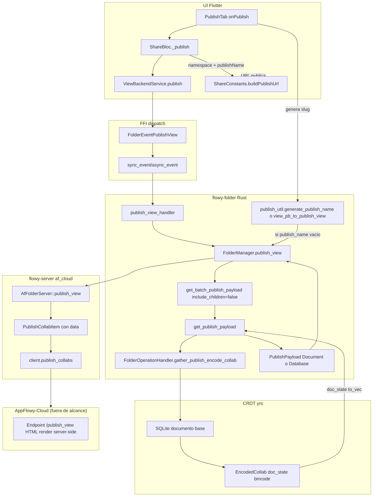
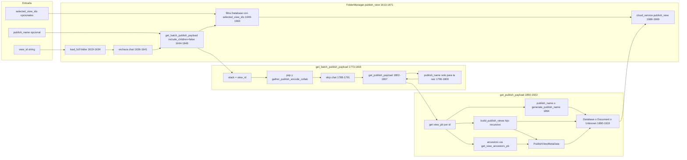
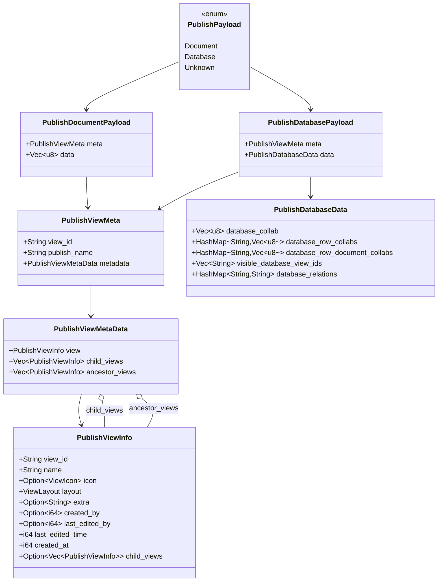
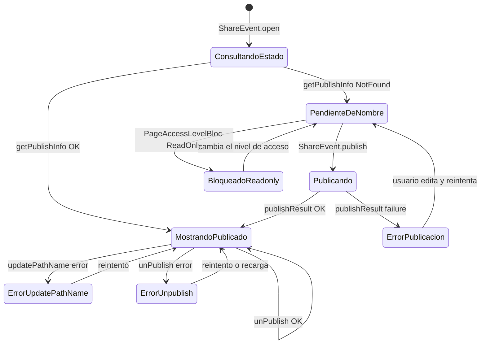

# B4.12 — Publicación web

La publicación web ("Publish to the web") de AppFlowy **no serializa el documento a HTML en el cliente**: recoge el `EncodedCollab` del CRDT del documento (bytes binarios `bincode` del estado `yrs` materializado a disco) y lo envía al servicio de nube junto con metadatos (`view_id`, `publish_name`, jerarquía de vistas y ancestros). El render a HTML vive en AppFlowy-Cloud y queda fuera del alcance de este repo; el contrato cliente documenta los bytes, las claves y los códigos de error que cruzan la frontera. La URL pública se compone como `baseWebDomain/namespace/publishName` y el `publishName` se genera cliente a cliente con un algoritmo de slug determinista documentado en §7.

## 1. Punto de entrada (UI)

El único disparador de publicación es la pestaña **Publish** del popover Compartir, accesible cuando la pestaña Share decide mostrar `_PublishWidget` (`appflowy/frontend/appflowy_flutter/lib/plugins/shared/share/share_tab.dart:14–26` documentado en `[[../09-features/F12-compartir-publicar-niveles-de-acceso/1-compartir-share-tab-niveles-de-acceso-y-plugins-shared-share.md]]`). `PublishTab` decide qué variante pintar leyendo `state.isPublished`: si la vista ya está publicada renderiza `_PublishedWidget` con la URL pública, copia y edición del `pathName`; si no, renderiza `_PublishWidget` con el botón primario `PublishButton` (`appflowy/frontend/appflowy_flutter/lib/plugins/shared/share/publish_tab.dart:37–83`).

Cuando el usuario toca `PublishButton` y la vista es de tipo documento, la UI salta al callback `onPublish` sin más precondiciones; cuando es de tipo database, exige al menos una base de datos seleccionada en `_PublishDatabaseSelector`, so pena de mostrar un toast `publish_noDatabaseSelected` (`appflowy/frontend/appflowy_flutter/lib/plugins/shared/share/publish_tab.dart:269–283`). El `_PublishWidgetState` mantiene el estado `_selectedViews` como `List<ViewPB>` y se hidrata desde `DatabaseTabBarBloc.state.tabBars` marcándolas todas como seleccionadas por defecto, salvo que se desactiven individualmente (`appflowy/frontend/appflowy_flutter/lib/plugins/shared/share/publish_tab.dart:516–540`). La base de datos primaria no se puede desmarcar: `isPrimaryDatabase` muestra el icono `unable_select_s` y un tooltip `publish_mustSelectPrimaryDatabase` (`appflowy/frontend/appflowy_flutter/lib/plugins/shared/share/publish_tab.dart:618–675`).

El callback `onPublish` invoca `generatePublishName` (versión Dart, §7.1) con `id` y `viewName`, y si la vista ya tuvo un `pathName` previo cacheado en el `ShareState`, lo reutiliza mediante la extensión `lastPublishName.orDefault(...)` (`appflowy/frontend/appflowy_flutter/lib/plugins/shared/share/publish_tab.dart:55–62`, definición del getter en el mismo fichero en `lib/util/string_extension.dart`, ya documentado). Después despacha `ShareEvent.publish(namespaceVacio, publishName, selectedViewIds.map((e) => e.id).toList())` (`appflowy/frontend/appflowy_flutter/lib/plugins/shared/share/publish_tab.dart:70–79`). El namespace se envía como string vacío: `ShareBloc._publish` lo rellena leyendo primero `ViewBackendService.getPublishNameSpace()` (`appflowy/frontend/appflowy_flutter/lib/plugins/shared/share/share_bloc.dart:121–152`) — ver §2.

```dart
// appflowy/frontend/appflowy_flutter/lib/plugins/shared/share/publish_tab.dart:70–79
if (context.mounted) {
  context.read<ShareBloc>().add(
        ShareEvent.publish(
          '',
          publishName,
          selectedViews.map((e) => e.id).toList(),
        ),
      );
}
```

Los toasts de éxito/fallo se renderizan en `_showToast` leyendo `publishResult`/`unpublishResult`/`updatePathNameResult` del estado (`appflowy/frontend/appflowy_flutter/lib/plugins/shared/share/publish_tab.dart:86–124`); el código de error del servidor se traduce al texto localizado con la extensión `PublishNameErrorCodeMap` (`appflowy/frontend/appflowy_flutter/lib/shared/error_code/error_code_map.dart:5–22`), que mapea `ErrorCode.PublishNameAlreadyExists`, `PublishNameInvalidCharacter`, `PublishNameTooLong`, `UserUnauthorized` y `ViewNameInvalid` a sus respectivas claves i18n (`settings_sites_error_*`). `_PublishedWidget` además expone el botón `Visit site` (`RoundedTextButton` con `shareAction_visitSite`) que lanza la URL pública con `afLaunchUrlString` y `UnPublishButton` que dispara `ShareEvent.unPublish()` (`appflowy/frontend/appflowy_flutter/lib/plugins/shared/share/publish_tab.dart:184–249`).

> **Corrección de scope.** El botón moderno que abre el popover con esta pestaña vive en `share_menu_button.dart` y el `ShareBloc` completo está documentado en `[[../09-features/F12-compartir-publicar-niveles-de-acceso/1-compartir-share-tab-niveles-de-acceso-y-plugins-shared-share.md]]`; aquí se documenta sólo el fragmento del BLoC que produce `publishResult`.

## 2. Lado de conversión

No hay conversión a HTML en el cliente. La conversión CRDT → HTML la realiza **AppFlowy-Cloud** (fuera de alcance). El lado cliente produce un `Vec<u8>` con el estado binario del collab: el `FolderManager` solicita el `EncodedCollab` con `gather_publish_encode_collab` y lo empaqueta en `PublishPayload::Document { meta, data }` o `PublishPayload::Database { meta, data }`. La serialización intermedia es **bincode** (via `EncodedCollab::encode_to_bytes` implícito al tomar `doc_state: Vec<u8>`).

El flujo completo, desde la pestaña hasta el cliente HTTP, es:



*Diagrama: pipeline de publicación de extremo a extremo.* Lectura: el cliente Flutter no toca el HTML; el único consumidor real de `documentToHTML` de `[[../10-motor-export-import/02-html-export.md]]` es el export a fichero local de `[[../10-motor-export-import/02-html-export.md]]` y el portapapeles (`[[../09-features/F01-documentos-y-editor/8-infraestructura-del-editor-transaction-handler-block-transaction-handler-migrati.md]]`). Para publicar, la UI entrega el slug generado a `ShareBloc._publish`, que llama a `ViewBackendService.publish` (que rellena `PublishViewParamsPB` con `viewId`, `publishName` opcional y `selectedViewIds` opcional, `appflowy/frontend/appflowy_flutter/lib/workspace/application/view/view_service.dart:345–361`) y dispara el evento FFI `FolderEventPublishView`. En Rust, `publish_view_handler` (`appflowy/frontend/rust-lib/flowy-folder/src/event_handler.rs:402–417`) reenvía al manager; éste descarta chats de raíz (`appflowy/frontend/rust-lib/flowy-folder/src/manager.rs:1636–1641`), invoca `get_batch_publish_payload(view_id, publish_name, false)` (`appflowy/frontend/rust-lib/flowy-folder/src/manager.rs:1644–1646`) —el `false` significa que las hijas no se incluyen en el recorrido automático; las databases hijas sí se reciben a través del array `selected_view_ids` que la UI envió— y termina llamando a `self.cloud_service()?.publish_view(&workspace_id, payload)` (`appflowy/frontend/rust-lib/flowy-folder/src/manager.rs:1666–1669`). La función `get_batch_publish_payload` (`appflowy/frontend/rust-lib/flowy-folder/src/manager.rs:1773–1816`) recolecta únicamente la vista raíz pasada, ya que `include_children=false`; los hijos los aplica el manager en una segunda iteración para `PublishPayload::Database` (`appflowy/frontend/rust-lib/flowy-folder/src/manager.rs:1649–1663`). El handler `gather_publish_encode_collab` (`appflowy/frontend/rust-lib/flowy-folder/src/view_operation.rs:67–73`) extrae el `EncodedCollab` desde disco (`get_encoded_collab_v1_from_disk`, `appflowy/frontend/rust-lib/flowy-core/src/deps_resolve/folder_deps/folder_deps_doc_impl.rs:104–113`) y `get_publish_payload` (`appflowy/frontend/rust-lib/flowy-folder/src/manager.rs:1850–1922`) lo envuelve en `PublishDocumentPayload { meta: PublishViewMeta { view_id, publish_name, metadata }, data: Vec<u8> }` o `PublishDatabasePayload` con sus cinco colecciones de collabs.

El handshake cliente↔backend termina cuando `AfFolderServer::publish_view` (`appflowy/frontend/rust-lib/flowy-server/src/af_cloud/impls/folder.rs:114–146`) convierte cada `PublishPayload` en un `PublishCollabItem` con `meta`, `data`, `comments_enabled: true` y `duplicate_enabled: true`, los agrupa y llama a `client.publish_collabs(workspace_id, params)`. A partir de ahí la responsabilidad es del backend: **renderiza el HTML, lo sirve y gestiona el slug público** —no hay otro consumidor de los bytes en el repo.

## 3. Pipeline

Diagrama específico del motor de recolección de payloads, marcando el único punto donde se decide el `publish_name`:



*Diagrama: pipeline interno Rust de la publicación.* Lectura: el slug nace **una sola vez** y solo para la vista raíz —la guarda comentada en `appflowy/frontend/rust-lib/flowy-folder/src/manager.rs:1795–1800` es inequívoca: "Only support set the publish_name for the current view, not for the child views"`. Para cada hija se invoca de nuevo `generate_publish_name(&child.id, &child.name)` con los de la hija. Si el handler de layout devuelve `GatherEncodedCollab::Unknown`, la rama `match` lo descarta con `PublishPayload::Unknown` (`appflowy/frontend/rust-lib/flowy-folder/src/manager.rs:1918`) y el cliente HTTP lo filtra con `filter_map(... return None)` (`appflowy/frontend/rust-lib/flowy-server/src/af_cloud/impls/folder.rs:122–129`).

## 4. Tabla bloque → salida

La publicación no tiene una tabla bloque → etiqueta: cada vista genera **un único `PublishPayload` con el binario del collab completo**. La "tabla" útil aquí es qué metadata se añade al binario. La definición de tipos vive en `appflowy/frontend/rust-lib/flowy-folder-pub/src/entities.rs:52–117`:

| Campo | Tipo | Origen | Ruta:línea |
|---|---|---|---|
| `view_id` | `String` | `view.id` | `appflowy/frontend/rust-lib/flowy-folder-pub/src/entities.rs:74–77` (definición) |
| `publish_name` | `String` | `publish_name` o `generate_publish_name(&view.id, &view.name)` | `appflowy/frontend/rust-lib/flowy-folder/src/manager.rs:1864` |
| `metadata.view` | `PublishViewInfo` | `view_pb_to_publish_view(&view)` con `view_id`, `name`, `icon`, `layout`, `extra`, `created_by`, `last_edited_by`, `last_edited_time`, `created_at`, `child_views: None` | `appflowy/frontend/rust-lib/flowy-folder/src/publish_util.rs:24–37`, mutación en `appflowy/frontend/rust-lib/flowy-folder/src/manager.rs:1842–1847` |
| `metadata.child_views` | `Vec<PublishViewInfo>` recursivo | `build_publish_views(&view_str_id)` recolecta hijos con `future::join_all` y devuelve `child_views` no vacíos | `appflowy/frontend/rust-lib/flowy-folder/src/manager.rs:1818–1848` |
| `metadata.ancestor_views` | `Vec<PublishViewInfo>` en línea | `get_view_ancestors_pb` mapeado con `view_pb_to_publish_view` | `appflowy/frontend/rust-lib/flowy-folder/src/manager.rs:1872–1877` |
| `data` (Documento) | `Vec<u8>` | `EncodedCollab.doc_state.to_vec()` del CRDT del documento en disco | `appflowy/frontend/rust-lib/flowy-folder/src/manager.rs:1915`, codificación `bincode` en `collab:collab/collab/src/entity.rs:6` |
| `data` (Database) | `PublishDatabaseData { database_collab, database_row_collabs, database_row_document_collabs, visible_database_view_ids, database_relations }` | cada `HashMap` indizado por `row_id`; `visible_database_view_ids` se sobreescribe con `selected_view_ids` de la UI | `appflowy/frontend/rust-lib/flowy-folder-pub/src/entities.rs:80–97`; `appflowy/frontend/rust-lib/flowy-folder/src/manager.rs:1891–1913`; patch en `appflowy/frontend/rust-lib/flowy-folder/src/manager.rs:1653–1658` |

La asimetría clave: **lo que cruza la frontera es el CRDT completo**, no un AST de bloques. El backend es quien decide qué bloques son publicables y cómo se traducen. La consecuencia directa es que:

- **Cualquier bloque soportado por el `Document` CRDT** (incluidos todos los del `appflowy_editor_plugins`) viaja tal cual; los problemas de descarte documentados en `[[../10-motor-export-import/02-html-export.md]]` (toggle, callout, etc.) **no aplican aquí**, porque ese filtrado ocurría en el encoder HTML del editor, no en el envío de bytes.
- Las imágenes insertadas en un bloque `image` lo hacen como una URL o un `data:` URI en el delta del bloque; el `EncodedCollab` los lleva dentro, así que las imágenes **sí viajan al servidor** como parte del binario (§6 analiza las consecuencias).
- Los chats están explícitamente excluidos en dos puntos: `FolderManager::publish_view` lanza `ErrorCode::NotSupportYet` si la raíz es chat (`appflowy/frontend/rust-lib/flowy-folder/src/manager.rs:1636–1641`) y `get_batch_publish_payload` los salta si aparecen como hijos (`appflowy/frontend/rust-lib/flowy-folder/src/manager.rs:1788–1791`). El comentario "The chat view is not supported to publish" lo deja explícito.

### 4.1 Diagrama de clases de los payloads



*Diagrama: la jerarquía de `PublishPayload` en `flowy-folder-pub`.* Lectura: el discriminante `PublishPayload::Unknown` existe porque `FolderOperationHandler::gather_publish_encode_collab` puede no estar implementado para layouts nuevos (devuelve `Err(FlowyError::not_support())` por defecto, `appflowy/frontend/rust-lib/flowy-folder/src/view_operation.rs:67–73`); en ese caso el manager produce `GatherEncodedCollab::Unknown` y el match lo descarta (`appflowy/frontend/rust-lib/flowy-folder/src/manager.rs:1918`). Consecuencia: **no se publica nada** de un layout sin handler registrado —no se publica un fallback. `child_views` y `ancestor_views` viven en `PublishViewMetaData`; el primero captura recursivamente hasta las hojas; el segundo captura la cadena padre-hasta-raíz.

## 5. Pérdidas

Las pérdidas aquí son distintas a las de `[[../10-motor-export-import/02-html-export.md]]` porque el formato intermedio no es HTML sino un binario del CRDT. La información que se descarta en el lado cliente es:

1. **Vistas de tipo chat.** Rechazadas en raíz con `ErrorCode::NotSupportYet` (`appflowy/frontend/rust-lib/flowy-folder/src/manager.rs:1636–1641`) y omitidas en `get_batch_publish_payload` si aparecen como hijas (`appflowy/frontend/rust-lib/flowy-folder/src/manager.rs:1788–1791`). El mensaje de error visible es "The chat view is not supported to publish".
2. **Vistas desconocidas para el manager.** Layouts sin `FolderOperationHandler` registrado producen `GatherEncodedCollab::Unknown` (`appflowy/frontend/rust-lib/flowy-folder/src/view_operation.rs:67–73`) que se filtra sin emitir nada (`appflowy/frontend/rust-lib/flowy-folder/src/manager.rs:1918`). **No hay fallback**: la vista simplemente no se publica.
3. **Bases de datos sin selección.** Si la UI envía `selected_view_ids` no vacíos pero no marca la base primaria, el usuario recibe un toast `publish_noDatabaseSelected` y la acción se cancela en cliente (`appflowy/frontend/appflowy_flutter/lib/plugins/shared/share/publish_tab.dart:269–283`).
4. **`publishName` no enviado.** El cliente Dart casi siempre lo calcula con `generatePublishName(id, viewName)` y lo pasa; si por alguna ruta llega vacío, **no** falla: `FolderManager::publish_view` no lo rechaza, simplemente deja que el backend rechace más tarde con `ErrorCode.ViewNameInvalid` (mapeado en `appflowy/frontend/appflowy_flutter/lib/shared/error_code/error_code_map.dart:17–18` a `settings_sites_error_publishNameCannotBeEmpty`).
5. **Truncado silencioso del slug.** La versión Rust del generador trunca a **50 caracteres totales (incluido el id)**; la versión Dart lo hace a **120** (§7). La divergencia significa que el slug que el usuario ve mientras edita el campo `pathName` puede ser distinto del que finalmente se registra si el backend termina re-generando con el límite menor. No hay comentario que reconcilie la divergencia `[INFERIDO]`.
6. **Sin notificación de progreso.** `ShareBloc._publish` solo emite `publishResult` al final (`appflowy/frontend/appflowy_flutter/lib/plugins/shared/share/share_bloc.dart:138–167`); el usuario no recibe indicación de qué vista se está procesando, ni de si hay fallo parcial dentro de un batch.
7. **Bases de datos sin `selected_view_ids`.** En el recorrido por defecto (`include_children=false`), las databases hijas quedan con `visible_database_view_ids: []` por el `Default::default()` de `PublishDatabaseData` (`appflowy/frontend/rust-lib/flowy-folder-pub/src/entities.rs:81–97`); sólo si la UI las marcó se sobreescriben en `appflowy/frontend/rust-lib/flowy-folder/src/manager.rs:1653–1658`. **No documentado qué hace el backend con `visible_database_view_ids: []`**: probablemente las publica todas pero sin filtro.

## 6. Assets

El envío al servidor **no distingue** imágenes, archivos ni adjestos como entidades separadas: el `EncodedCollab` del documento los lleva serializados dentro como parte del estado `yrs`. Las imágenes que el usuario inserta como bloque `image` con `url` apuntan a URLs o `data:` URIs en el delta del bloque (`editor:lib/src/editor/block_component/image_block_component/image_block_component.dart:14–20`); los archivos subidos a `flowy-storage` se referencian desde el bloque `file` mediante su URL remota. El cliente por tanto **no descarga binarios locales ni los sube por separado al endpoint de publicación** — esa responsabilidad también es del backend.

La consecuencia operativa es que **el peso del payload es proporcional al CRDT completo**, no a la página renderizada. Para un documento grande, esto puede ser cientos de KB de binario aunque la página web rendue sea liviana; para una base de datos con N filas, `PublishDatabaseData.database_row_document_collabs` contiene N+1 collabs (`appflowy/frontend/rust-lib/flowy-folder/src/manager.rs:1894–1903`) y el peso escala linealmente.

Esta unidad no encontró ninguna llamada a `flowy_storage::upload_file` ni a `uploader` desde el camino de publicación; los archivos que el editor mantiene en disco son responsabilidad del plugin de storage local/sync y nada de eso cruza el evento `FolderEvent::PublishView`.

## 7. Encoding y nombre de archivo

La sección §7 de la plantilla pide analizar **cómo se nombra el archivo**; aquí la analogía es **el slug público que aparece en la URL**. El slug se genera **dos veces**, en dos sitios diferentes, con dos algoritmos y dos longitudes distintas:

### 7.1 Versión Dart (`appflowy/frontend/appflowy_flutter/lib/plugins/shared/share/publish_name_generator.dart:14–19`)

```dart
// appflowy/frontend/appflowy_flutter/lib/plugins/shared/share/publish_name_generator.dart:14–19
Future<String> generatePublishName(String id, String name) async {
  if (name.length >= 120 - id.length) {
    name = name.substring(0, 120 - id.length);
  }
  return replaceInvalidChars('$name-$id');
}
```

Donde `replaceInvalidChars` aplica la regex **`[^a-zA-Z0-9-]`** y sustituye cada coincidencia por `-` (`appflowy/frontend/appflowy_flutter/lib/plugins/shared/share/publish_name_generator.dart:1–4`). Es decir:

- **Alfabeto**: letras ASCII (`a-z`, `A-Z`), dígitos (`0-9`) y guion (`-`).
- **Longitud máxima total**: 120 caracteres del slug **incluido el guion separador y el `id`** (comentario del propio fichero, líneas 10–13, y aritmética de la línea 15). El `id` que se concatena es el `viewId` (UUID de 36 caracteres) por lo que en la práctica el componente `name` queda limitado a `120 - 36 - 1 = 83` caracteres.
- **Unicode**: cualquier carácter no ASCII (acentos, cirílico, emojis) cae en la regex y se sustituye por `-`. Un título vacío produce `"-<uuid>"`.
- **Colisiones**: el generador **no las maneja**. La unicidad la garantiza el backend, que responde `ErrorCode.PublishNameAlreadyExists` mapeado a `settings_sites_error_publishNameAlreadyInUse` (`appflowy/frontend/appflowy_flutter/lib/shared/error_code/error_code_map.dart:8–9`). La UI no expone reintentos automáticos; el usuario edita el slug en el `TextEditingController` de `_PublishUrl` (`appflowy/frontend/appflowy_flutter/lib/plugins/shared/share/publish_tab.dart:367–420`) y vuelve a disparar `ShareEvent.updatePathName` (`appflowy/frontend/appflowy_flutter/lib/plugins/shared/share/publish_tab.dart:184–186`).
- **Función `generateNameSpace`**: declarada pero con cuerpo `return ''` (`appflowy/frontend/appflowy_flutter/lib/plugins/shared/share/publish_name_generator.dart:6–8`). Es residuo/dead code; el namespace real lo obtiene `ShareBloc._publish` vía `ViewBackendService.getPublishNameSpace()` (`appflowy/frontend/appflowy_flutter/lib/plugins/shared/share/share_bloc.dart:121–152`).

### 7.2 Versión Rust (`appflowy/frontend/rust-lib/flowy-folder/src/publish_util.rs:11–22`)

```rust
// appflowy/frontend/rust-lib/flowy-folder/src/publish_util.rs:11–22
pub fn generate_publish_name(id: &str, name: &str) -> String {
  let id_len = id.len();
  let name = replace_invalid_url_chars(name);
  let name_len = name.len();
  // The backend limits the publish name to a maximum of 50 characters.
  // If the combined length of the ID and the name exceeds 50 characters,
  // we will truncate the name to ensure the final result is within the limit.
  // The name should only contain alphanumeric characters and hyphens.
  let result = format!("{}-{}", &name[..std::cmp::min(49 - id_len, name_len)], id);
  trace!("generate_publish_name: {}", result);
  result
}
```

Donde `replace_invalid_url_chars` aplica **`[^\w-]`** con la regex `regex::Regex`, y `\w` en Rust/[regex](https://docs.rs/regex) por defecto **incluye letras Unicode** (Unicode letter, Unicode digit y `_`) — diferencia material con la versión Dart. Por tanto:

- **Alfabeto**: letras ASCII + letras Unicode (acentos, ideogramas…), dígitos ASCII + `_`. **No** incluye emojis, espacios, signos de puntuación ni caracteres de control.
- **Longitud máxima total**: 50 caracteres (comentario en `appflowy/frontend/rust-lib/flowy-folder/src/publish_util.rs:15–17`). El cálculo `std::cmp::min(49 - id_len, name_len)` resta 1 para el guion separador y luego trunca el `name` por bytes, **no por caracteres** — un nombre con caracteres multibyte puede cortar a mitad de secuencia UTF-8 y `replace_invalid_url_chars` no normaliza primero; en la práctica es un riesgo teórico porque el upstream es un título Unicode ya saneado.
- **Truncado real**: el `format!` opera sobre `&name[..std::cmp::min(49 - id_len, name_len)]`, donde `name_len` ya viene de `replace_invalid_url_chars(name).len()`, así que el corte es por bytes, no por caracteres. Para un id de 36 bytes queda `name_len = min(13, name.len())`. Un nombre que tras la regex quedara con 13 bytes quedaría completo; uno con caracteres Unicode multibyte podría terminar incompleto `[INFERIDO]`.
- **Unicode**: a diferencia de Dart, los caracteres acentuados **sobreviven** (p.ej. "Página" se queda como "Página"), porque `\w` los acepta. Sin embargo, el límite de 50 bytes es más estricto y los ideogramas CJK consumen 3 bytes cada uno.
- **Colisiones**: mismo enfoque — las maneja el backend.

### 7.3 Quién corre y cuándo

| Quién dispara | Función utilizada | Cuándo | Comentario |
|---|---|---|---|
| UI `PublishTab` (al pulsar `PublishButton`) | `generatePublishName(id, viewName)` (Dart) | **siempre** antes de invocar `ShareBloc` | El slug llega al backend como `PublishViewParamsPB.publish_name` |
| `FolderManager.publish_view` (servidor) | `generate_publish_name(&view.id, &view.name)` (Rust) | sólo si el `publish_name` que vino en el evento es `None` | Tiene fallback por si la UI no manda nombre; en la práctica casi nunca se activa porque la UI siempre lo calcula |

Es decir: en el flujo normal **gana el slug Dart** (120 chars). El Rust solo se usa como defensa para llamadas programáticas que no pasen por la UI — no se documenta ningún call site tal en producción, pero `appflowy/frontend/rust-lib/event-integration-test/tests/folder/local_test/publish_document_test.rs:90` lo ejerce explícitamente.

### 7.4 URL pública

`ShareConstants.buildPublishUrl` compone `'$baseShareDomain/$nameSpace/$publishName'.addSchemaIfNeeded()` (`appflowy/frontend/appflowy_flutter/lib/plugins/shared/share/constants.dart:8–16`). El dominio base lo resuelve `getIt<AppFlowyCloudSharedEnv>().appflowyCloudConfig.base_web_domain` y por defecto vale `https://appflowy.com` (`appflowy/frontend/appflowy_flutter/lib/plugins/shared/share/constants.dart:6`). Si el dominio no incluye esquema, `addSchemaIfNeeded` lo prefijia con `https://` (`appflowy/frontend/appflowy_flutter/lib/plugins/shared/share/constants.dart:46–54`). Para el namespace hay un constructor dedicado `buildNamespaceUrl` con la opción `withHttps` (`appflowy/frontend/appflowy_flutter/lib/plugins/shared/share/constants.dart:18–29`).

```dart
// appflowy/frontend/appflowy_flutter/lib/plugins/shared/share/constants.dart:8–16
static String buildPublishUrl({
  required String nameSpace,
  required String publishName,
}) {
  final baseShareDomain =
      getIt<AppFlowyCloudSharedEnv>().appflowyCloudConfig.base_web_domain;
  final url = '$baseShareDomain/$nameSpace/$publishName'.addSchemaIfNeeded();
  return url;
}
```

## 8. Errores

El camino de publicación tiene tres capas de error, cada una con su contrato:

| Capa | Mecanismo | Códigos relevantes | Visibilidad en UI |
|---|---|---|---|
| Frontend (pre-evento) | Validaciones de `PublishTab` | `publish_noDatabaseSelected`, "You are a readonly user…" | Toast `LocaleKeys.publish_noDatabaseSelected.tr()` (`appflowy/frontend/appflowy_flutter/lib/plugins/shared/share/publish_tab.dart:269–283`) o tooltip bloqueante (`appflowy/frontend/appflowy_flutter/lib/plugins/shared/share/publish_tab.dart:285–292`) |
| Cliente (FFI) | `FlowyError` devuelto por `FolderEventPublishView` | `ErrorCode.NotSupportYet` (chat), `ErrorCode.RecordNotFound` (vista inexistente) | Mapea a `LocaleKeys.publish_publishFailed.tr(): <code>` (`appflowy/frontend/appflowy_flutter/lib/plugins/shared/share/publish_tab.dart:88–96`) |
| Backend | Códigos publicados por AppFlowy-Cloud | `PublishNameAlreadyExists`, `PublishNameInvalidCharacter`, `PublishNameTooLong`, `UserUnauthorized`, `ViewNameInvalid`, `CustomNamespace*` | `PublishNameErrorCodeMap` (`appflowy/frontend/appflowy_flutter/lib/shared/error_code/error_code_map.dart:5–22`) |

Códigos identificados en `appflowy/frontend/appflowy_flutter/lib/shared/error_code/error_code_map.dart:5–22`:

| `ErrorCode` | Mensaje localizado | Origen plausible |
|---|---|---|
| `PublishNameAlreadyExists` | `settings_sites_error_publishNameAlreadyInUse` | Conflicto de slug en backend |
| `PublishNameInvalidCharacter` | `settings_sites_error_publishNameContainsInvalidCharacters` | Caracteres no permitidos por backend |
| `PublishNameTooLong` | `settings_sites_error_publishNameTooLong` | Exceso del límite backend (50 chars según el comentario de `appflowy/frontend/rust-lib/flowy-folder/src/publish_util.rs:15`) |
| `UserUnauthorized` | `settings_sites_error_publishPermissionDenied` | Falta de permisos en workspace |
| `ViewNameInvalid` | `settings_sites_error_publishNameCannotBeEmpty` | Slug vacío |

`ShareBloc._updatePublishStatus` también filtra específicamente `ErrorCode.RecordNotFound` y `ErrorCode.LocalVersionNotSupport` para no mostrarlos como errores al consultar el estado de publicación (`appflowy/frontend/appflowy_flutter/lib/plugins/shared/share/share_bloc.dart:200–217`). El primero aparece cuando la vista aún no está publicada; el segundo cuando el workspace es local.

**Workspaces locales**: la implementación `appflowy/frontend/rust-lib/flowy-server/src/local_server/impls/folder.rs:103–108` devuelve `Err(FlowyError::local_version_not_support())` en `publish_view`, `get_publish_info`, `set_publish_name`, `set_publish_namespace`, `list_published_views`, `get_default_published_view_info`, `set_default_published_view`, `remove_default_published_view` y `get_publish_namespace` (líneas 119–167). `unpublish_views` devuelve `Ok(())` sin hacer nada (líneas 111–117) — la UI cree que despublicó pero el servidor nunca tuvo la publicación. No se documenta ningún caso de uso que desactive la UI cuando el servicio es local.

```rust
// appflowy/frontend/rust-lib/flowy-server/src/local_server/impls/folder.rs:103–117
async fn publish_view(
  &self,
  workspace_id: &Uuid,
  payload: Vec<PublishPayload>,
) -> Result<(), FlowyError> {
  Err(FlowyError::local_version_not_support())
}

async fn unpublish_views(
  &self,
  workspace_id: &Uuid,
  view_ids: Vec<Uuid>,
) -> Result<(), FlowyError> {
  Ok(())
}
```

## 9. Round-trip

**No existe round-trip cliente**. AppFlowy no sabe cómo reimportar una página publicada desde el sitio público; la operación inversa —"añadir a mi espacio la página pública X"— no aparece en ningún menú, diálogo o evento del codebase. Lo que sí existe es:

1. **Re-leer metadatos**: `FolderEventGetPublishInfo` con `ViewIdPB` devuelve `PublishInfoResponsePB` con `view_id`, `publish_name`, `namespace`, `publisher_email`, `publish_timestamp_sec` y opcionalmente `unpublished_at_timestamp_sec` (`appflowy/frontend/rust-lib/flowy-folder/src/entities/publish.rs:66–79` documentado en `[[../09-features/F12-compartir-publicar-niveles-de-acceso/2-shared-section-sitios-publicados-y-publish-util-import-en-rust.md]]:134`). Esto se usa en `_updatePublishStatus` para repoblar el estado de la pestaña (`appflowy/frontend/appflowy_flutter/lib/plugins/shared/share/share_bloc.dart:193–255`) cuando el usuario la abre.
2. **Renombrar path**: `ShareBloc._updatePathName` despacha `FolderEventSetPublishName(SetPublishNamePB { viewId, newName })` (`appflowy/frontend/appflowy_flutter/lib/plugins/shared/share/share_bloc.dart:281–284`), que el handler `set_publish_name_handler` envía al backend vía `patch_published_collabs` (`appflowy/frontend/rust-lib/flowy-server/src/af_cloud/impls/folder.rs:169–188`).
3. **Cambiar namespace**: `FolderEventSetPublishNamespace` y `FolderEventGetPublishNamespace` (ver `[[../09-features/F12-compartir-publicar-niveles-de-acceso/2-shared-section-sitios-publicados-y-publish-util-import-en-rust.md]]:148–149`) operan sobre el workspace.

Ninguno de estos tres es "importar". El importador general de AppFlowy vive en `[[../10-motor-export-import/08-import-markdown-texto.md]]`/`[[../10-motor-export-import/11-import-zip-notion.md]]` y solo acepta: `historyDocument`, `historyDatabase`, `markdownOrText`, `csv`, `afDatabase` (formato interno). **No acepta URL**. Por tanto:

- Publicar → no se puede revertir a un documento importable.
- Visitar la página pública → el visitante (anónimo o autenticado en AppFlowy-Cloud) puede leerla, pero el código cliente no le da un botón "Save to my workspace".

**Round-trip interno (sync push)**: el backend AppFlowy-Cloud sí re-sirve la página si el owner publica de nuevo sobre la misma `view_id`. Eso lo gestiona enteramente el backend (fuera de alcance).

## 10. Extensión y firma

El formato del payload **no tiene archivo**: es un objeto binario enviado por HTTP al backend del workspace. La "extensión" del recurso público es la parte final del path URL: `/{namespace}/{publishName}` sin `.html` explícito — el `Content-Type` lo dicta el servidor web que sirve AppFlowy-Cloud. No hay magic bytes propios; los bytes son un `bincode::serialize(EncodedCollab)` estándar de la lib `collab` (`collab:collab/collab/src/entity.rs:42–62`) y por tanto opacos al cliente. **No hay MIME oficial declarable** en el lado cliente porque nadie serializa a un formato nombrado.

Convenciones para identificar el payload en logs:
- El evento FFI se nombra `PublishView` y se registra en `appflowy/frontend/rust-lib/flowy-folder/src/event_map.rs:45`; el handler se llama `publish_view_handler` (`appflowy/frontend/rust-lib/flowy-folder/src/event_handler.rs:402–417`).
- En el log de Rust el `trace!("generate_publish_name: {}", result);` (`appflowy/frontend/rust-lib/flowy-folder/src/publish_util.rs:20`) deja el slug generado con sufijo `id`.

## 11. Ejemplos

### 11.1 Traza de UI con slug generado para "Página de inicio"

Supongamos vista con `view.id = "8e9f4fc0-cf4d-4d8a-a4b8-2c9b53a10d92"` y `view.name = "Página de inicio"`. Pulsar `PublishButton`:

1. `PublishTab._PublishWidgetState.onPublish` invoca `generatePublishName(view.id, viewName)` con `view.id = "8e9f4fc0-cf4d-4d8a-a4b8-2c9b53a10d92"` y `viewName = "Página de inicio"`.
2. En Dart (`appflowy/frontend/appflowy_flutter/lib/plugins/shared/share/publish_name_generator.dart:14–19`): `120 - id.length = 120 - 36 = 84`, nombre no se trunca. `replaceInvalidChars("Página de inicio-8e9f4fc0-cf4d-4d8a-a4b8-2c9b53a10d92")` aplica la regex `[^a-zA-Z0-9-]` y cada carácter no-ASCII o no-alphanumeric ni guion se sustituye por `-`:

```
P-gina de inicio-8e9f4fc0-cf4d-4d8a-a4b8-2c9b53a10d92
```

(revisar: la `á` se sustituye por `-` y el espacio ` ` también por `-`, dando `P-gina-de-inicio-...` con dos `-` consecutivos por la `á` y el espacio).

3. `ShareEvent.publish('', publishName, selectedViewIds)` se despacha (`appflowy/frontend/appflowy_flutter/lib/plugins/shared/share/publish_tab.dart:70–79`).
4. `ShareBloc._publish` llama `ViewBackendService.publish(view, name: publishName, selectedViewIds: selectedViewIds)` (`appflowy/frontend/appflowy_flutter/lib/workspace/application/view/view_service.dart:345–361`) y construye `PublishViewParamsPB { viewId, publishName, selectedViewIds? }`.
5. `FolderEventPublishView(payload).send()` cruza la FFI; `publish_view_handler` (`appflowy/frontend/rust-lib/flowy-folder/src/event_handler.rs:402–417`) reenvía.
6. `FolderManager.publish_view` carga el folder (`appflowy/frontend/rust-lib/flowy-folder/src/manager.rs:1619–1634`), no es chat (`appflowy/frontend/rust-lib/flowy-folder/src/manager.rs:1636–1641`), invoca `get_batch_publish_payload(view_id, Some(publishName), false)` (`appflowy/frontend/rust-lib/flowy-folder/src/manager.rs:1644–1646`).
7. `get_batch_publish_payload` itera solo la raíz (children no incluidos), llama `get_publish_payload(...)` con `publish_name = Some(publishName)`, así que la línea `publish_name.unwrap_or_else(|| generate_publish_name(&view.id, &view.name))` (`appflowy/frontend/rust-lib/flowy-folder/src/manager.rs:1864`) respeta el valor de la UI y **no** lo regenera.
8. El handler de documento (`appflowy/frontend/rust-lib/flowy-core/src/deps_resolve/folder_deps/folder_deps_doc_impl.rs:104–113`) carga `get_encoded_collab_v1_from_disk` y devuelve `GatherEncodedCollab::Document(encoded_collab)`.
9. `get_publish_payload` (`appflowy/frontend/rust-lib/flowy-folder/src/manager.rs:1850–1922`) toma `encoded_collab.doc_state.to_vec()`, lo envuelve en `PublishPayload::Document(PublishDocumentPayload { meta: PublishViewMeta { view_id, publish_name, metadata: PublishViewMetaData { view: PublishViewInfo, child_views: [], ancestor_views } }, data })`.
10. `cloud_service()?.publish_view(&workspace_id, vec![payload]).await?` (`appflowy/frontend/rust-lib/flowy-folder/src/manager.rs:1666–1669`) llama a `AfFolderServer::publish_view` (`appflowy/frontend/rust-lib/flowy-server/src/af_cloud/impls/folder.rs:114–146`), que arma `PublishCollabItem { meta, data: <binario>, comments_enabled: true, duplicate_enabled: true }` y llama a `client.publish_collabs(workspace_id, params)`.
11. `ShareBloc._publish` recibe `OK`, llama `ViewBackendService.getPublishNameSpace().getOrThrow()` para leer el `namespace`, arma la URL con `ShareConstants.buildPublishUrl(nameSpace: namespace, publishName: publishName)` y emite `state.copyWith(isPublished: true, url: 'https://appflowy.com/<namespace>/<publishName>', ...)` (`appflowy/frontend/appflowy_flutter/lib/plugins/shared/share/share_bloc.dart:138–150`).
12. `PublishTab._showToast` muestra el toast `publish_publishSuccessfully` (`appflowy/frontend/appflowy_flutter/lib/plugins/shared/share/publish_tab.dart:88–92`) y se rerendereiza como `_PublishedWidget` con el `TextEditingController` cuyo texto es `publishName` (`appflowy/frontend/appflowy_flutter/lib/plugins/shared/share/publish_tab.dart:147–153`).

### 11.2 Traza de error — colisión de slug

Misma vista, pero el slug `P-gina-de-inicio-8e9f4fc0-...` ya existe en otro workspace del mismo namespace:

1. … (pasos 1–10 iguales).
2. Backend responde con `ErrorCode.PublishNameAlreadyExists`.
3. `ShareBloc._publish` entra en `catch (e)`, emite `state.copyWith(isPublished: false, publishResult: FlowyResult.failure(FlowyError(msg: 'publish error: $e')), url: '')` (`appflowy/frontend/appflowy_flutter/lib/plugins/shared/share/share_bloc.dart:156–166`).
4. `PublishTab._showToast` muestra `'${LocaleKeys.publish_publishFailed.tr()}: <code>'` con tipo `ToastificationType.error` (`appflowy/frontend/appflowy_flutter/lib/plugins/shared/share/publish_tab.dart:92–96`).
5. **No hay reintento automático** ni sugerencia de slug. El usuario debe editar manualmente `_PublishUrl.controller` y volver a pulsar Save (`appflowy/frontend/appflowy_flutter/lib/plugins/shared/share/publish_tab.dart:184–186`, `ShareEvent.updatePathName`).

### 11.3 Diagrama de estados del ShareBloc para publicar



*Diagrama: ciclo de vida del popover Publish desde la óptica del `ShareBloc`.* Lectura: el estado inicial tras refresco viene determinado por `getPublishInfo`: si el servidor responde `RecordNotFound` o `LocalVersionNotSupport` (que `ShareBloc._updatePublishStatus` filtra explícitamente, `appflowy/frontend/appflowy_flutter/lib/plugins/shared/share/share_bloc.dart:208–212`), la vista se considera no publicada y entra `PendienteDeNombre`; si trae `PublishInfoResponsePB` con `unpublished_at_timestamp_sec == None`, entra `MostrandoPublicado`. Una vez en `MostrandoPublicado`, los tres eventos (`updatePathName`, `unPublish`, `ShareEvent.publish`) son válidos. La rama `BloqueadoReadonly` es declarativa (`appflowy/frontend/appflowy_flutter/lib/plugins/shared/share/publish_tab.dart:285–292`) y se sale de ella sólo si el usuario gana permiso.

## Relacionado con

- `[[../10-motor-export-import/02-html-export.md]]` — Export HTML, que es la exportación local a fichero (no publicación web).
- `[[../10-motor-export-import/08-import-markdown-texto.md]]`, `[[../10-motor-export-import/11-import-zip-notion.md]]` — Importación de formatos (ninguno acepta URL pública, §9).
- `[[../09-features/F12-compartir-publicar-niveles-de-acceso/1-compartir-share-tab-niveles-de-acceso-y-plugins-shared-share.md]]` — `ShareBloc`, `ShareMenuButton` y el popover Compartir (donde vive `PublishTab`).
- `[[../09-features/F12-compartir-publicar-niveles-de-acceso/2-shared-section-sitios-publicados-y-publish-util-import-en-rust.md]]` — Shared section + página de sitios + contrato cliente de `publish_util.rs`/`share/import.rs`.
- `[[../09-features/F06-sync-y-servidores/F06-sync-y-servidores.md]]` — Implementación del servidor de nube (AppFlowy-Cloud), fuera de alcance para esta skill, pero el contrato cliente documentado en `flowy-folder-pub:cloud.rs` describe todas las firmas que este motor invoca.
- `[[../09-features/F07-almacenamiento-de-archivos/F07-almacenamiento-de-archivos.md]]` — Capa CRDT (yrs), responsable del `EncodedCollab` que este motor envía sin transformaciones.
