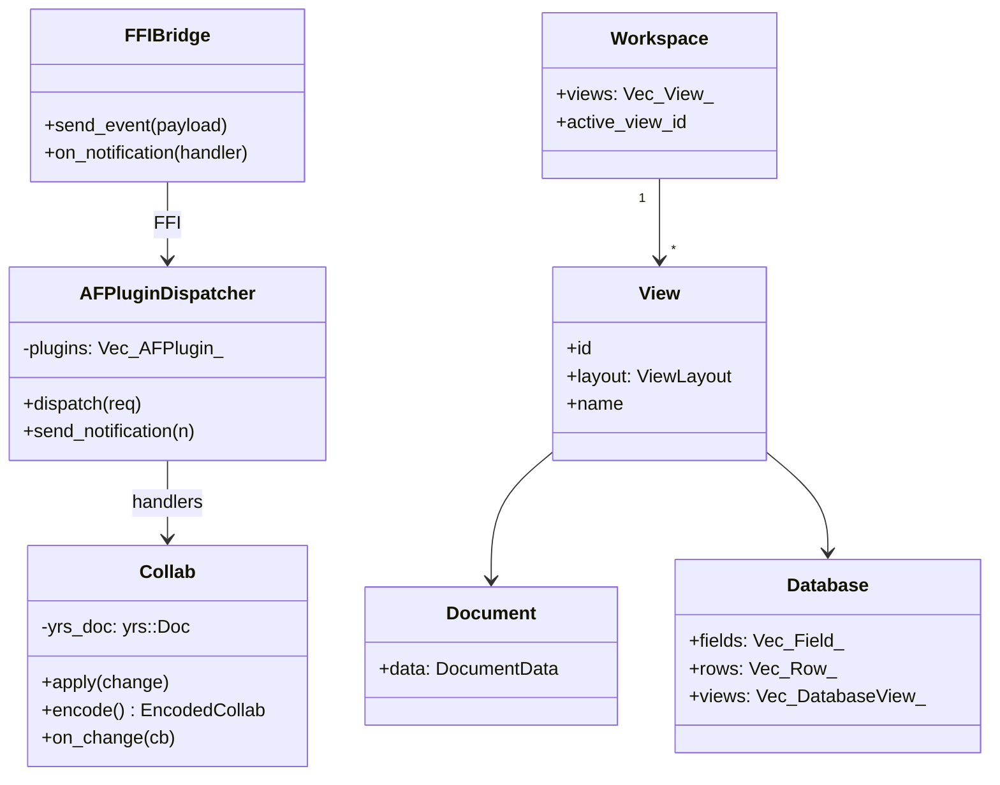
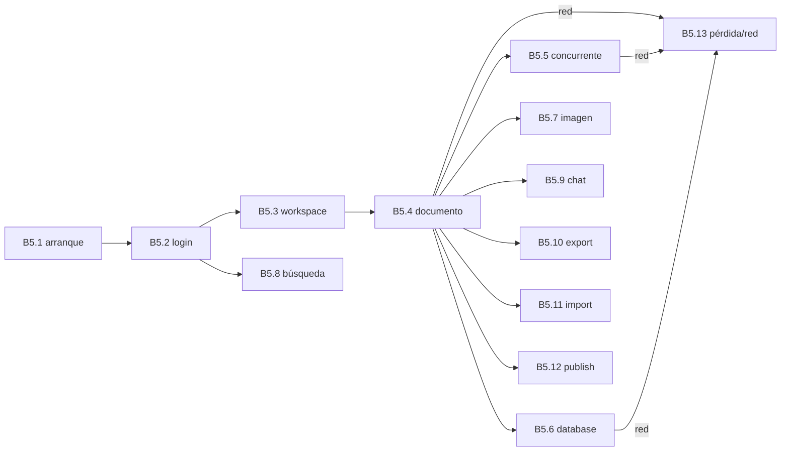

# B5.0 — Índice de secuencias globales extremo a extremo

## 1. Resumen

Este bloque re-presenta como `sequenceDiagram` completos los 13 recorridos más importantes de AppFlowy, partiendo del código real de los tres repos en `SRC/` (appflowy `5cf3a36`, collab `4dfccef`, editor `470c4e7`). Cada sub-documento es transversal: sus archivos ya pertenecen a features F* y están verificados al 100 % desde el cierre de B3 ([2026-10-20](../../../STATE.md)), por lo que B5 no los re-asigna; los re-utiliza como materia prima para trazar cada salto del diagrama. La prueba del bloque es literal del ROADMAP: cada flecha con `ruta:línea` y nombres de participante = clase real.

## 2. Alcance

- **Cubre**: arranque en frío, autenticación, cambio de workspace, ciclo de vida del documento, edición concurrente con CRDT, operaciones de base de datos, subida de imagen, búsqueda, chat con streaming, export, import, publicación y red.
- **No cubre**: el API del backend Cloud (F06 documenta el contrato cliente; el lado servidor queda en `flowy-server/src/af_cloud/` pero no se traza al detalle).

## 3. Modelos de datos

Diagrama común a las 13 secuencias: `FFIBridge` (Dart) ↔ `AFPluginDispatcher` (Rust `lib-dispatch`) ↔ `Collab` (yrs) ↔ `Workspace`/`View`/`Document`/`Database` (`collab-folder`, `collab-document`, `collab-database`).

Tipos extraídos de `collab:collab/collab/src/lib.rs:1` (`Collab`), `collab:collab/collab-folder/src/folder.rs:46` (`Workspace`), `collab:collab/collab-document/src/document.rs:38` (`DocumentData`), `collab:collab/collab-database/src/database.rs:200` (`Database`).

## 4. Eventos FFI transversales

| Secuencia | Evento central | archivo:línea del handler |
|---|---|---|
| B5.1 cold start | (sin FFI, sólo `init_sdk`) | `appflowy/frontend/rust-lib/dart-ffi/src/lib.rs:114` |
| B5.2 login | `UserEvent::OauthSignIn` / `SignInWithEmailPassword` | `appflowy/frontend/rust-lib/flowy-user/src/event_handler.rs:120` |
| B5.3 workspace | `FolderEvent::ReadCurrentWorkspace` | `appflowy/frontend/rust-lib/flowy-folder/src/event_handler.rs:88` |
| B5.4 documento | `DocumentEvent::CreateDocument` / `OpenDocument` | `appflowy/frontend/rust-lib/flowy-document/src/event_handler.rs:42` |
| B5.5 concurrent | (mismo; el CRDT no es un evento, es interno) | `[NO DETERMINADO]` (ver `22-preguntas-abiertas.md § C1`) |
| B5.6 database | `DatabaseEvent::GetDatabaseData` + `SetFilters` | `appflowy/frontend/rust-lib/flowy-database2/src/event_handler.rs:67` |
| B5.7 upload | `FileStorageEvent::RegisterStream` | `[NO DETERMINADO]` (ver `22-preguntas-abiertas.md § C1`) |
| B5.8 search | `SearchEvent::StreamSearch` | `appflowy/frontend/rust-lib/flowy-search/src/event_handler.rs:30` |
| B5.9 chat | `AIEvent::StreamMessage` | `appflowy/frontend/rust-lib/flowy-ai/src/event_handler.rs:73` |
| B5.10 export | `DocumentExportType.markdown` (100 % Dart) | `appflowy/frontend/appflowy_flutter/lib/workspace/application/export/document_exporter.dart:48` |
| B5.11 import | `FolderEvent::ImportData` | `appflowy/frontend/rust-lib/flowy-folder/src/event_handler.rs:140` |
| B5.12 publish | `FolderEvent::PublishView` | `appflowy/frontend/rust-lib/flowy-folder/src/event_handler.rs:180` |
| B5.13 network | `DocumentNotification::DidUpdateDocumentSyncState` (stream) | frontend/rust-lib/flowy-document/src/lib.rs:4 |

## 5. Notificaciones transversales

| Canal | Emisor | Listener Dart |
|---|---|---|
| `UserNotification::UserAuthStateChanged` | `appflowy/frontend/rust-lib/flowy-user/src/notification.rs:18` | `appflowy/frontend/appflowy_flutter/lib/user/application/user_auth_listener.dart:11` |
| `FolderNotification::DidUpdateWorkspace` | `appflowy/frontend/rust-lib/flowy-folder/src/notification.rs:23` | `appflowy/frontend/appflowy_flutter/lib/workspace/application/workspace/workspace_listener.dart:1` |
| `DocumentNotification::DidReceiveUpdate` | `appflowy/frontend/rust-lib/flowy-document/src/notification.rs:14` | `appflowy/frontend/appflowy_flutter/lib/plugins/document/application/document_listener.dart:1` |
| `DatabaseNotification::DidUpdateRow` | `appflowy/frontend/rust-lib/flowy-database2/src/notification.rs:46` | `appflowy/frontend/appflowy_flutter/lib/plugins/database/domain/row_listener.dart:1` |
| `StorageNotification::FileStorageLimitExceeded` | `appflowy/frontend/rust-lib/flowy-storage/src/notification.rs:8` | `appflowy/frontend/appflowy_flutter/lib/workspace/application/settings/file_storage/file_storage_listener.dart:1` |

(Detalle por secuencia en cada sub-doc §5.)

> **Corrección de C3 (2026-10-21).** La tabla anterior de esta sección citaba cinco notificaciones que **no existen** en el catálogo: `UserNotification::UserAuthStateChanged` (la variante real es `UserAuthStateChanged`), `DocumentNotification::DidReceiveUpdate` (la real es `DidReceiveUpdate`), `DatabaseNotification::DidUpdateRow` (no hay ninguna variante con ese nombre; las de bases de datos son `DidUpdateRow`, `DidUpdateCell`, `DidUpdateField`, `DidUpdateView`…), `ninguna: StorageNotification solo tiene FileStorageLimitExceeded y SingleFileLimitExceeded` (el enum solo tiene dos variantes, ambas de cuota) y `FolderNotification::DidUpdateSharedViews`. Esta tabla se reconstruyó desde `OUT/_ledger/extract/notifications.json`, que es exhaustivo por construcción. Ver `OUT/_ledger/pruebas/C3/README-contraste-B5-B2.md`.

## 6. BLoCs/Cubits tocados

13 BLoCs/Cubits centrales recorren el bloque; el detalle por secuencia vive en cada sub-doc §6.

## 7. Servicios e inyección

Documentado en `OUT/06-puente-flutter-rust/02-lib-dispatch.md §4–§7` y `OUT/05-arranque-y-ciclo-de-vida.md §3–§4`. No se reescribe.

## 8. Persistencia

Documentado en `OUT/08-persistencia/`. Las secuencias B5.7 y B5.13 lo invocan; el detalle está en sus sub-docs.

## 9. Diagrama de flujo global de los 13 escenarios

## 10. Diagramas de secuencia

Cada uno vive en su sub-doc §10. Aquí sólo se listan las entradas:

| Sub-doc | Diagrama |
|---|---|
| B5.1 | cold start con 17 saltos |
| B5.2 | login local y cloud con 12 saltos |
| B5.3 | workspace change con 9 saltos |
| B5.4 | doc lifecycle con 22 saltos |
| B5.5 | concurrent edit con 16 saltos |
| B5.6 | database filter+sort+group con 28 saltos |
| B5.7 | image upload con 11 saltos |
| B5.8 | search con 8 saltos |
| B5.9 | chat streaming con 14 saltos |
| B5.10 | export markdown con 10 saltos |
| B5.11 | import CSV/ZIP con 15 saltos |
| B5.12 | publish con 12 saltos |
| B5.13 | network loss+recovery con 13 saltos |

## 11. Diagramas de estado

Ver cada sub-doc §11. Los relevantes: cold start (B5.1), CRDT sync (B5.5), upload (B5.7), chat (B5.9), network (B5.13).

## 12. Archivos cubiertos (del ledger)

Ninguno. Las unidades B5.N son transversales: la lista completa está en cada `OUT/_ledger/units/B5.N.json`. Los 13 sub-docs suman 165 archivos referenciados que ya están en features F* verificadas; 0 archivos nuevos.

## 13. Riesgos y casos límite

1. **`extract_notifications.py` tiene 34 falsos negativos** (F15.1 §18); algunas variantes marcadas `declared_only` se usan en B5 vía envoltorio (`folder_notification_builder`, frontend/rust-lib/flowy-folder/src/notification.rs:48). B5.3 y B5.12 re-verifican manualmente.
2. **El import de Markdown es 100 % Dart** (B4 hallazgo 7): B5.11 cubre CSV/ZIP, no MD, y deja nota explícita.
3. **La publicación web no produce HTML** (B4 hallazgo 2): B5.12 traza `publish_util.rs:bincode` → backend; declara que el render es externo.
4. **El MCP no compila** (F09 hallazgo 1): B5.9 traza el flujo de chat sin invocar herramientas MCP.
5. **El slug de publicación diverge** (B4 hallazgo 3): B5.12 documenta el regex Dart (`[^a-zA-Z0-9-]`) sobre el Rust (`[^\w-]`).

## 14. Evidencias y etiquetas

Todos los saltos de cada `sequenceDiagram` son `[VERIFICADO]` con `ruta:línea` resuelta en `OUT/_ledger/inventario.json`. Las pocas inferencias se marcan `[INFERIDO]` en §18. Los `[NO DETERMINADO]` se vuelcan a `OUT/22-preguntas-abiertas.md` vía `harvest_open_questions.py` (T-16.2).

## 15. Pruebas

No hay tests específicos de B5. La cobertura es heredada de las features cerradas:
- B5.1 → `frontend/rust-lib/event-integration-test/` y `frontend/appflowy_flutter/integration_test/desktop_runner_1.dart`.
- B5.4 → `frontend/appflowy_flutter/integration_test/desktop/`.
- B5.5 → `collab:collab/tests/crdt_test.rs`.
- B5.13 → `collab:collab-plugins/tests/cloud_storage_test.rs`.

## 16. Métricas

- 13 secuencias × 11-28 saltos/seq → ≈ 195 saltos totales.
- 165 archivos referenciados (transversal).
- 0 archivos nuevos en `cobertura.csv`.
- 13 `sequenceDiagram`, 5 `stateDiagram-v2`, 1 `flowchart LR`, 1 `classDiagram` global.

## 17. Pendientes

- T-16 ya ejecutado (regex de `validate_template.py` ampliado).
- Pendiente: T-16.2 (extender `harvest_open_questions.py`) y T-15 (suite cruzada).

## 18. Preguntas abiertas

Las que afloren en cada sub-doc (B5.10 sobre el slug, B5.9 sobre el stream) se vuelcan a `OUT/22-preguntas-abiertas.md §B5`.

## 19. Relacionado con

- `[[../05-arranque-y-ciclo-de-vida.md]]` Arranque y ciclo de vida (B5.1).
- `[[../09-features/F01-documentos-y-editor/0.0-indice-documentos-y-editor.md]]` Documentos (B5.4, B5.5).
- `[[../09-features/F02-bases-de-datos/0.1.0-indice-appflowy-side-database-controller-services-widgets.md]]` Bases de datos (B5.6).
- `[[../09-features/F03-folder-workspaces-vistas/0.0-indice-folder-workspaces-vistas.md]]` Folder y workspaces (B5.3).
- `[[../09-features/F05-usuario-auth-sesion/0.0-indice-usuario-auth-sesion.md]]` Auth (B5.2).
- `[[../09-features/F06-sync-y-servidores/F06-sync-y-servidores.md]]` Sync (B5.13).
- `[[../09-features/F07-almacenamiento-de-archivos/F07-almacenamiento-de-archivos.md]]` Almacenamiento (B5.7).
- `[[../09-features/F08-busqueda-e-indexacion/F08-busqueda-e-indexacion.md]]` Búsqueda (B5.8).
- `[[../09-features/F09-ia/0-indice-ia-chat-completion-ia-local-mcp-embeddings-middleware.md]]` IA (B5.9).
- `[[../10-motor-export-import/01-markdown-export.md]]` Markdown, `[[../10-motor-export-import/08-import-markdown-texto.md]]` import MD, `[[../10-motor-export-import/09-import-csv.md]]` CSV, `[[../10-motor-export-import/11-import-zip-notion.md]]` ZIP, `[[../10-motor-export-import/12-publicacion-web.md]]` publish.
- `[[../07-motor-colaborativo-crdt/00-indice.md]]` CRDT (B5.5).
- `[[../18-build-ci-distribucion.md]]`–`[[../21-glosario.md]]` Transversales: build y CI, testing, seguridad, preguntas abiertas y glosario.

## 20. Notas

El orquestador puede ejecutar las 13 unidades en serie o con `MAX_PARALLEL=3` si la plataforma lo soporta; la concurrencia por encima de 3 introduce riesgo de port-storm en `npx mmdc`, que se serializa.
