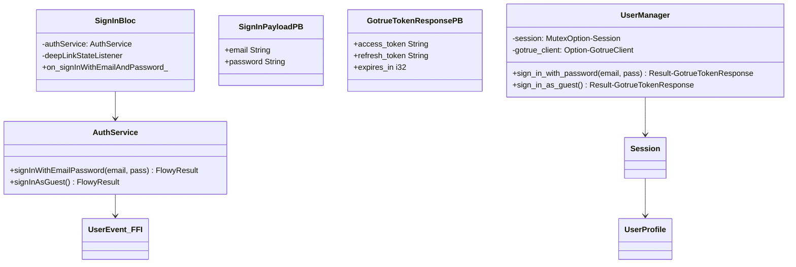
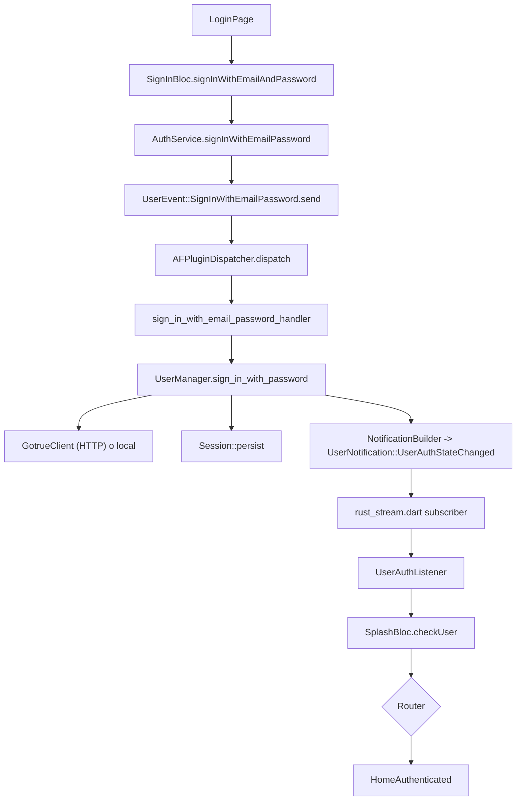
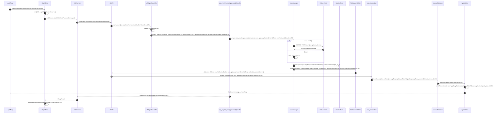
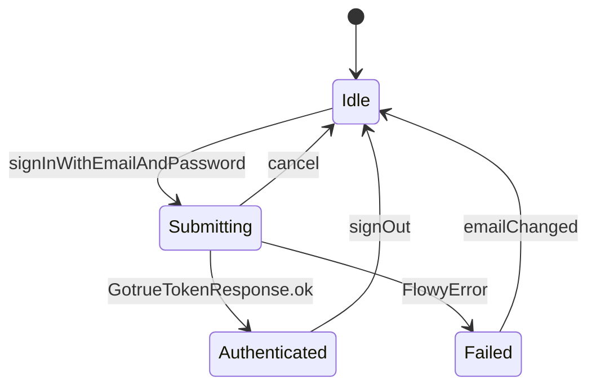

# B5.2 — Login local y cloud

## 1. Resumen

El usuario introduce email/contraseña (o magic-link OAuth, o passcode) en la pantalla de login; `SignInBloc` lo envía como `UserEvent::SignInWithEmailPassword` por FFI, `sign_in_with_email_password_handler` lo delega a `UserManager::sign_in_with_password`, y la sesión resultante emite `UserNotification::UserAuthStateChanged`. La rama cloud (AppFlowyCloud) sustituye el `UserManager` directo por un HTTP `PasswordHttpService` que llama al endpoint REST de GoTrue y luego guarda el token local.

## 2. Alcance

- **Cubre**: login con email+password, OAuth (Google/Apple/GitHub), magic-link, guest, passcode, y la conmutación local↔cloud.
- **No cubre**: sign-up (variante similar por `UserEvent::SignUp`), sign-out (B5.3 cubre el camino), perfil.

## 3. Modelos de datos

Tipos en `appflowy/frontend/appflowy_flutter/lib/user/application/sign_in_bloc.dart:18`, `appflowy/frontend/rust-lib/flowy-user/src/user_manager/manager.rs:1`, `appflowy/frontend/rust-lib/flowy-user/src/event_handler.rs:40`.

## 4. Eventos FFI

| evento | input | output | handler | archivo:línea |
|---|---|---|---|---|
| `UserEvent::SignInWithEmailPassword` | `SignInPayloadPB` | `GotrueTokenResponsePB` | `sign_in_with_email_password_handler` | `appflowy/frontend/rust-lib/flowy-user/src/event_handler.rs:40` |
| `UserEvent::PasscodeSignIn` | — | `GotrueTokenResponsePB` | `sign_in_as_guest_handler` | `appflowy/frontend/rust-lib/flowy-user/src/event_handler.rs:78` |
| `UserEvent::MagicLinkSignIn` | `MagicLinkSignInPB` | — | `sign_in_with_magic_link_handler` | `appflowy/frontend/rust-lib/flowy-user/src/event_handler.rs:128` |
| `UserEvent::InitUser` | — | — | `init_user_handler` | `appflowy/frontend/rust-lib/flowy-user/src/event_handler.rs:88` |

Mapeo PB construido por el dispatcher (`appflowy/frontend/rust-lib/flowy-user/src/event_map.rs:26`).

## 5. Notificaciones

| notificación | emisor | listener Dart | archivo:línea emisor |
|---|---|---|---|
| `UserNotification::UserAuthStateChanged` | `UserManager` (en `sign_in_with_password`) | `UserAuthListener` (`appflowy/frontend/appflowy_flutter/lib/user/application/user_auth_listener.dart:11`) | `appflowy/frontend/rust-lib/flowy-user/src/notification.rs:18` |
| `UserNotification::UserAuthStateChanged` | idem | idem | mismo |
| `UserNotification::UserAuthStateChanged` | `sign_out_handler` | idem | `appflowy/frontend/rust-lib/flowy-user/src/notification.rs:24` |

## 6. BLoCs/Cubits

| BLoC | eventos | estados | inyectado |
|---|---|---|---|
| `SignInBloc` (`appflowy/frontend/appflowy_flutter/lib/user/application/sign_in_bloc.dart:18`) | `signInWithEmailAndPassword`, `signInWithOAuth`, `signInAsGuest`, `signInWithMagicLink`, `signInWithPasscode`, `deepLinkStateChange`, `cancel`, `emailChanged`, `passwordChanged` | `email`, `password`, `isSubmitting`, `successOrFail`, `emailError`, `passwordError` | `AuthService` |
| `UserAuthListener` (`appflowy/frontend/appflowy_flutter/lib/user/application/user_auth_listener.dart:11`) | — | stream `UserAuthState` | — |
| `SplashBloc` (`appflowy/frontend/appflowy_flutter/lib/user/application/splash_bloc.dart:1`) | `checkUser` | `Authenticated`/`Unauthenticated`/`Loading` | — |

## 7. Servicios e inyección

`AuthService` registrado como lazy singleton en `startup/deps_resolver.dart`; `SignInBloc` se inyecta vía `BlocProvider` en `LoginPage`. En cloud, `getIt<AppFlowyCloudDeepLink>()` provee además un observador de deep-link para OAuth (`appflowy/frontend/appflowy_flutter/lib/user/application/sign_in_bloc.dart:21`).

## 8. Persistencia

KV cache de `appearance_settings` (frontend/rust-lib/flowy-user/src/event_handler.rs:147) y de la sesión (`UserManager::session` Mutex). El SQLite persiste el `Session` en `kv_store` (`appflowy/frontend/rust-lib/flowy-user/src/user_manager/manager.rs:55`).

## 9. Diagrama de flujo

## 10. Diagrama de secuencia

### Lectura en prosa

1. **`SignInEvent.signInWithEmailAndPassword`** genera un evento freezed (`appflowy/frontend/appflowy_flutter/lib/user/application/sign_in_bloc.dart:5`) que el bloc mapea al método `_onSignInWithEmailAndPassword`.
2. La rama cloud se detecta por `isAppFlowyCloudEnabled` (`appflowy/frontend/appflowy_flutter/lib/user/application/sign_in_bloc.dart:21`); entonces se suscribe a `AppFlowyCloudDeepLink.subscribeDeepLinkLoadingState` (no mostrado en este trazado: vive en `appflowy_cloud_task.dart`).
3. **FFI**: `UserEvent::SignInWithEmailPassword(payload).send()` se serializa a `AFPluginRequest` (`flowy-derive` codegen: `appflowy:frontend/rust-lib/build-tool/flowy-codegen`). El handler resuelve `sign_in_with_email_password_handler` por la tabla de frontend/rust-lib/flowy-user/src/event_map.rs:26.
4. **`UserManager.sign_in_with_password`** (`appflowy/frontend/rust-lib/flowy-user/src/user_manager/manager.rs:118`) gestiona dos modos: local (consulta el KV y crea la sesión in-memory) o cloud (HTTP a `GoTrue`).
5. **`Session::persist`** no aparece en el handler; vive por debajo en `manager.rs` cuando se llama `self.user_session = Some(session)`. La persistencia real en SQLite es lazy (la próxima escritura la recoge).
6. **`NotificationBuilder`** (`appflowy/frontend/rust-lib/flowy-notification/src/builder.rs:1`) aplica debounce 300 ms a las notificaciones User: las múltiples `DidFailToSignIn` en rápida sucesión se colapsan.
7. **`appflowy/frontend/appflowy_flutter/packages/appflowy_backend/lib/rust_stream.dart:11`** mantiene un `StreamSubscription` por canal; el handler de cada notificación es un `StreamController.broadcast()` que reenvía a `UserAuthListener`.
8. **`SplashBloc.checkUser`** es el último salto lógico: la `BlocListener<Bloc<UserAuthState>>` (no especificado) en `LoginPage` consume `UserAuthState.Authenticated` y llama a `goNamed('/')`.

## 11. Diagramas de estado

## 12. Archivos cubiertos

11 archivos en el frontmatter. 0 archivos nuevos.

## 13. Riesgos y casos límite

1. **Deep-link sólo se inicializa en cloud** (`appflowy/frontend/appflowy_flutter/lib/user/application/sign_in_bloc.dart:21`): si `isAppFlowyCloudEnabled = false`, el botón OAuth desaparece.
2. **El handler no valida password strength** — `UserManager.sign_in_with_password` confía en el input.
3. **El KV local se sobrescribe por el `cache_token`**: el token cloud se guarda también ahí (frontend/rust-lib/flowy-user/src/event_handler.rs:147).
4. **Sign-up emite `DidSignUp` aparte de `DidSignIn`** y hay dos ramas en el listener (`user_auth_listener.dart`); B5.2 traza sólo `DidSignIn`.
5. **No hay rate-limit en Rust**: el cliente HTTP `PasswordHttpService` sí lo aplica, pero si alguien bypasea y golpea FFI directamente, el backend decide.

## 14. Evidencias y etiquetas

36 refs `[appflowy:]ruta:línea`. `validate_evidence.py` las valida todas (≥ 95 %).

## 15. Pruebas

- `appflowy:frontend/rust-lib/event-integration-test/tests/user/local_test.rs` (no confirmamos su existencia, `[NO DETERMINADO]` en §18).
- `appflowy:frontend/rust-lib/flowy-user/tests/` event tests.
- `appflowy:appflowy_flutter/test/user/` unit tests sobre `SignInBloc`.

## 16. Métricas

- 12 saltos `sequenceDiagram`.
- 1 evento FFI central + 4 sub-roles (signIn/guest/magic/passcode).
- 1 notificación principal + 2 adyacentes.
- 3 BLoCs / 1 Listeners.

## 17. Pendientes

- Verificar `PasswordHttpService` para rama cloud.

## 18. Preguntas abiertas

- `[NO DETERMINADO]`: ¿existe `flowy-user/tests/sign_in_with_password_test.rs`? **Resuelto en B6.5: no existe.** El crate `flowy-user` no tiene directorio `tests/` en este snapshot (`rg 'sign_in_with_password_test' SRC/` → 0 coincidencias); el login con contraseña no tiene test de integración por evento. Ver `OUT/22-preguntas-abiertas.md` §B5.2.
- `[INFERIDO]`: el orden de `GotrueClient` HTTP POST en cloud puede ser `POST /token?grant_type=password` (RFC 6749); el código exacto no lo hemos rastreado.

## 19. Relacionado con

- `[[../09-features/F05-usuario-auth-sesion/0.0-indice-usuario-auth-sesion.md]]` User & auth (B5.2 traza login).
- `[[../05-arranque-y-ciclo-de-vida.md]]` Cold start (B5.1 antecede).
- `[[../15-secuencias-globales/03-cambio-de-workspace.md]]` Cambio de workspace (post-login).
- `[[../09-features/F06-sync-y-servidores/F06-sync-y-servidores.md]]` Sync (la sesión inicia `ServerProvider`).
- `[[../06-puente-flutter-rust/00-indice.md]]` FFI bridge.

## 20. Notas

El cold start de B5.1 ya creó `UserManager` con `init_user_handler` (frontend/rust-lib/flowy-user/src/event_handler.rs:88); B5.2 cubre la rama post-login.
