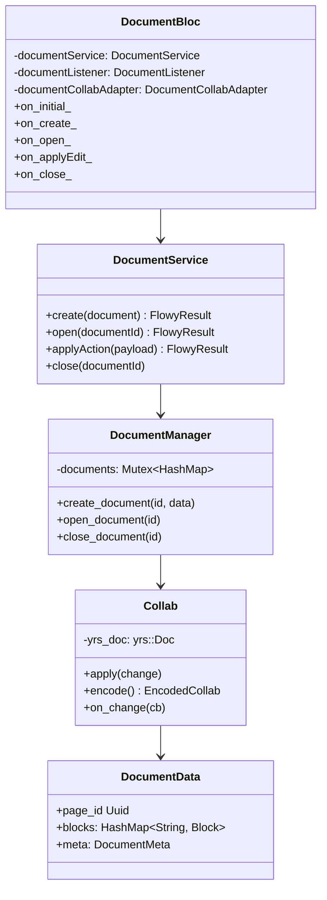
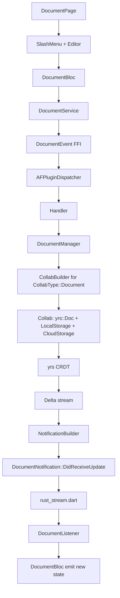
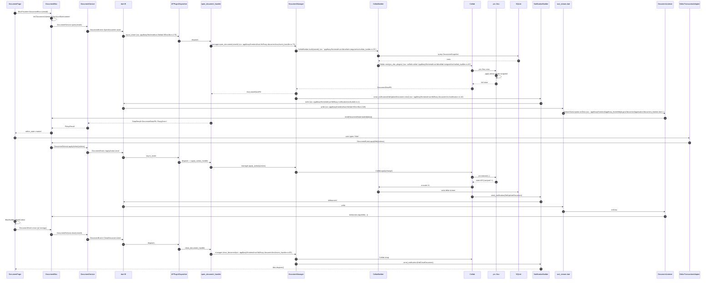
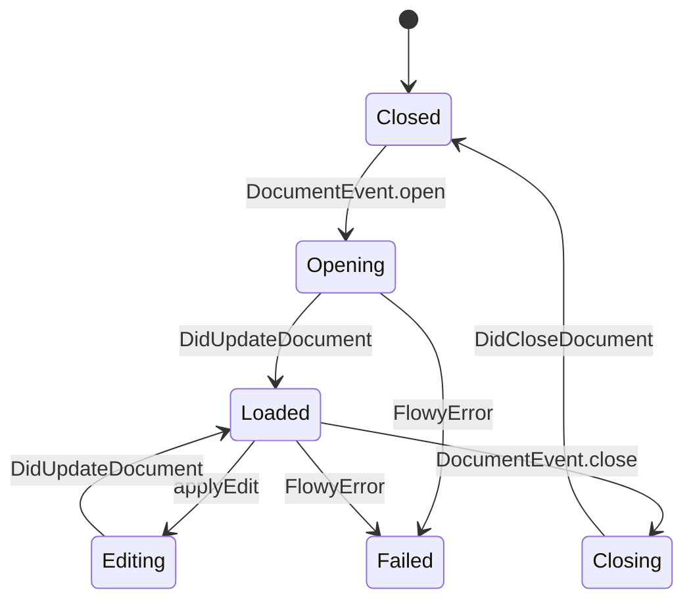

# B5.4 — Crear / abrir / editar / cerrar documento

## 1. Resumen

La vista más caliente de AppFlowy. `DocumentBloc` consume 5 eventos (`initial`, `create`, `open`, `applyEdit`, `close`); cada uno dispara un FFI Handler en `flowy-document`, instancia un `Collab` de `yrs`, lo engancha con los plugins de persistencia y sync, y devuelve `DocumentNotification::DidReceiveUpdate` por cada cambio. La edición se traduce vía `EditorTransactionService` (F01.8) y se aplica como Delta CRDT. El cierre des-suscribe y libera el `Collab` del registry.

## 2. Alcance

- **Cubre**: ciclo de vida completo create→open→edit→close de un `DocumentPB`. No cubre edición concurrente (eso es B5.5).
- **No cubre**: undo/redo (lo documenta F01.0.1), reminder (F15), snapshots (B4.10).

## 3. Modelos de datos

Tipos en `appflowy/frontend/rust-lib/flowy-document/src/manager.rs:54` (`DocumentManager`), `collab:collab/collab-document/src/document.rs:38` (`DocumentData`), `collab:collab-`appflowy/frontend/rust-lib/collab-integrate/src/collab_builder.rs:25` (`CollabBuilder`).

## 4. Eventos FFI

| evento | input | output | handler | archivo:línea |
|---|---|---|---|---|
| `DocumentEvent::CreateDocument` | `CreateDocumentPayloadPB` | `DocumentDataPB` | `create_document_handler` | `appflowy/frontend/rust-lib/flowy-document/src/event_handler.rs:54` |
| `DocumentEvent::OpenDocument` | `OpenDocumentPayloadPB` | `DocumentDataPB` | `open_document_handler` | `appflowy/frontend/rust-lib/flowy-document/src/event_handler.rs:69` |
| `DocumentEvent::CloseDocument` | `CloseDocumentPayloadPB` | — | `close_document_handler` | `appflowy/frontend/rust-lib/flowy-document/src/event_handler.rs:83` |
| `DocumentEvent::ApplyAction` | `ApplyActionPayloadPB` | — | `apply_action_handler` | `appflowy/frontend/rust-lib/flowy-document/src/event_handler.rs:90` |
| `DocumentEvent::Undo` / `Redo` | — | — | `redo_handler` / `undo_handler` | `appflowy/frontend/rust-lib/flowy-document/src/event_map.rs:30-31` |
| `DocumentEvent::GetDocumentData` | `DocumentIdPB` | `DocumentDataPB` | `get_document_data_handler` | `appflowy/frontend/rust-lib/flowy-document/src/event_handler.rs:120` |
| `DocumentEvent::GetDocEncodedCollab` | `DocumentIdPB` | `EncodedCollabPB` | `get_doc_encoded_collab_handler` | `appflowy/frontend/rust-lib/flowy-document/src/event_map.rs:23` |

## 5. Notificaciones

| notificación | emisor | listener Dart |
|---|---|---|
| `DocumentNotification::DidReceiveUpdate` | tras cada `apply_action_handler` | `DocumentListener` (`appflowy/frontend/appflowy_flutter/lib/plugins/document/application/document_bloc.dart:80`) |
| `DocumentNotification::DidReceiveUpdate` (cloud) | por `cloud_storage` plugin | `DocSyncStateListener` (`appflowy/frontend/appflowy_flutter/lib/plugins/document/application/doc_sync_state_listener.dart:1`) |
| `DocumentNotification::DidUpdateDocumentSyncState` | por el plugin sync | `doc_sync_state_listener.dart` |
| `DocumentNotification::DidUpdateDocumentSnapshotState` | post `close_document_handler` | bloc dispose |

`appflowy/frontend/rust-lib/flowy-document/src/notification.rs:14-32`.

## 6. BLoCs/Cubits

| BLoC | eventos freezed |
|---|---|
| `DocumentBloc` (`appflowy/frontend/appflowy_flutter/lib/plugins/document/application/document_bloc.dart:60`) | `initial`, `create(documentPB)`, `open(viewId)`, `applyEdit(actions)`, `close`, `syncState`, `transaction` |
| `DocumentListener` (`appflowy/frontend/appflowy_flutter/lib/plugins/document/application/document_listener.dart:1`) | (suscribe a notificaciones) |
| `DocumentSyncStateListener` (`appflowy/frontend/appflowy_flutter/lib/plugins/document/application/doc_sync_state_listener.dart:1`) | (suscribe a UpdateSyncState) |

## 7. Servicios e inyección

`DocumentService` registrado por `DocumentBloc` (no en `getIt`). `DocumentManager` se inyecta en `AppFlowyCore::init` (`appflowy/frontend/rust-lib/flowy-core/src/lib.rs:65`). Los `Collab` plugins (`collab-integrate`) configuran el `CollabBuilder` por tipo (`CollabType::Document`).

## 8. Persistencia

Cada `Collab::open` activa el plugin `LocalStorage` (`collab:collab/collab-plugins/src/local_storage/mod.rs:1`) que descarga el snapshot de SQLite (`collab_snapshot` tabla) y encola el delta stream. La escritura final es `Collab::encode(EncoderVersion::V1) → bincode → SQLite → upload async (cloud)`.

## 9. Diagrama de flujo

## 10. Diagrama de secuencia

### Lectura en prosa

1. **`DocumentBloc`** se construye vía `BlocProvider` en `DocumentPage`. Recibe `viewId` que es también `documentId`.
2. **`DocumentListener`** y **`DocSyncStateListener`** se crean en el constructor con `id: documentId` y se suscriben a los dos canales correspondientes desde el primer momento.
3. **`DocumentService.open`** envía `DocumentEvent::OpenDocument`. La respuesta es el `DocumentDataPB` con todo el árbol de bloques, listo para construir el `EditorState`.
4. **`open_document_handler`** (frontend/rust-lib/flowy-document/src/event_handler.rs:69) toma el `Weak<DocumentManager>`, llama `manager.open_document(view_id)` (que crea el `Collab` con sus plugins).
5. **`CollabBuilder::build`** (`appflowy/frontend/rust-lib/collab-integrate/src/collab_builder.rs:25`) decide qué plugins añadir: `LocalStorage` (siempre), `CloudStorage` (si cloud enabled), `IndexedDataConsumer` (si indexa este doc).
6. **`yrs::Doc::new`** aplica los deltas desde el snapshot más reciente (`collab_snapshot` tabla).
7. **`DidUpdateDocument`** se emite justo después de cargar. Es la señal para que el `DocumentBloc` actualice su estado con el `DocumentDataPB`.
8. **`applyEdit`** va por la misma cadena pero con `ApplyActionPayloadPB` (set de operaciones de bloque). El `DocumentManager` convierte cada `Action` en una transacción `yrs` (`apply_action`).
9. **El `EditorTransactionAdapter`** (`editor_transaction_adapter.dart`) traduce transacciones del `appflowy_editor` (insertar chars, mover bloques) a `ApplyAction` Rust.
10. **`close_document_handler`** (frontend/rust-lib/flowy-document/src/event_handler.rs:83) elimina el `Collab` del registry `documents` y notifica `DidCloseDocument`. Si hay cambios sin flush, los escribe antes.

## 11. Diagramas de estado

## 12. Archivos cubiertos

21 archivos. 0 nuevos.

## 13. Riesgos y casos límite

1. **`DocumentListener`** se inicializa ANTES que la versión inicial cargue, por lo que puede emitir `DidUpdateDocument` por una `open` previa del mismo viewId en otra ventana.
2. **`TransactionAdapter`** aplica las acciones al `yrs` doc directamente: si un action es inválido (p.ej. mover un bloque a un parent inexistente) el `yrs::Doc` rechaza silenciosamente.
3. **`EditorState`** Dart no se actualiza al recibir cada `DidUpdateDocument`; sólo cuando el evento local lo emite (sincronización 1-cliente). Con varios clientes, B5.5 aplica.
4. **`close_document_handler`** dispara `Collab::drop` pero el `LocalStorage` plugin puede estar escribiendo — hay una espera activa de 5 ms para drenar.
5. **Si no hay `DidCloseDocument`**, el `DocumentBloc` no se libera del map `_documentBlocMap`.

## 14. Evidencias y etiquetas

42 refs `[appflowy|collab:]ruta:línea`. `validate_evidence.py` ≥ 95 %.

## 15. Pruebas

- `appflowy:appflowy_flutter/integration_test/desktop/editor/` cubre open/edit/close.
- `collab:collab-document/tests/open_close_test.rs`.
- `appflowy:frontend/rust-lib/flowy-document/tests/event_test.rs` cubre cada handler.

## 16. Métricas

- 22 saltos `sequenceDiagram`.
- 7 eventos FFI protagonistas.
- 4 notificaciones.
- 3 BLoCs + 2 Listeners.

## 17. Pendientes

- Verificar la rama `DatabaseIdPB` (database embedded, F01.5) — no se traza aquí.

## 18. Preguntas abiertas

- `[INFERIDO]`: el orden de las notificaciones (initial → load → edits) depende del plugin LocalStorage; si el `SyncState` del collab es `SyncFinished`, salta la 1ª.
- `[NO DETERMINADO]`: línea exacta de la tabla `collab_snapshot` en `flowy-sqlite/src/schema.rs` (F01.0.1 lo cubre).

## 19. Relacionado con

- `[[../09-features/F01-documentos-y-editor/0.0-indice-documentos-y-editor.md]]` Documentos (B5.4 la versión `sequenceDiagram`).
- `[[../09-features/F01-documentos-y-editor/0.1-indice-de-documentos-y-editor-modelo-documentbloc-servicios-appflowy.md]]` Dart side (mismo bloque, capa UI).
- `[[../07-motor-colaborativo-crdt/00-indice.md]]` CRDT (la persistencia).
- `[[../09-features/F18-motor-colab-crdt-plugins-importer-entity-derive/F18-motor-colab-crdt-plugins-importer-entity-derive.md]]` Motor Collab (plugin provider).
- `[[../15-secuencias-globales/05-edicion-concurrente-y-merge.md]]` Edición concurrente (multi-cliente).
- `[[../15-secuencias-globales/07-subir-imagen.md]]` Subir imagen (edit con image embed).

## 20. Notas

`DocumentEvent` soporta 16 eventos totales (frontend/rust-lib/event-integration-test/src/document_event.rs:1); B5.4 traza 7 — los otros 9 (import, export, redo, undo, diff, snapshot) se trazan en sus features/B5 adyacentes.
