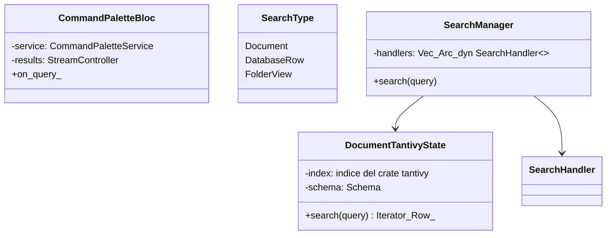
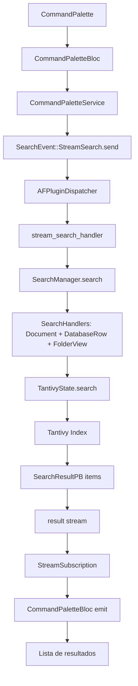
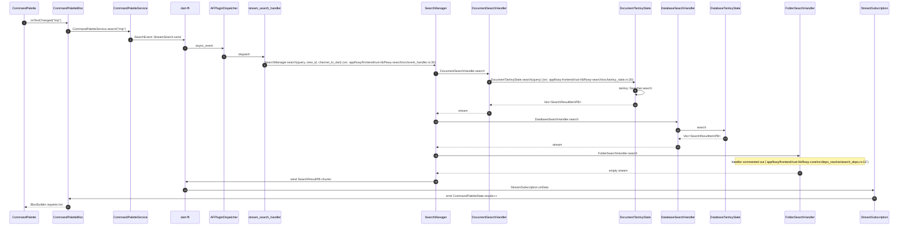
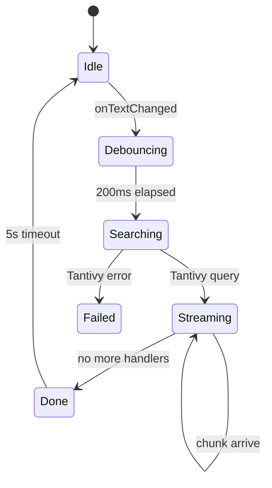

# B5.8 — Búsqueda

## 1. Resumen

El usuario abre el command palette (Ctrl+K o equivalente) y teclea "imp". `CommandPaletteBloc` dispara `SearchEvent::StreamSearch` con el query; Rust indexa `Tantivy` busca en 4 índices (Document text, Database rows, Folder views, Generic) y emite `SearchResultPB` por chunk. La UI renderiza cada chunk en orden hasta agotar el canal.

## 2. Alcance

- **Cubre**: streaming search de Documents + Database rows + Views.
- **No cubre**: búsqueda de embeddings (`flowy-ai::Embeddings`); búsqueda por título de folder (handler comentado).

## 3. Modelos de datos

Tipos en `appflowy/frontend/rust-lib/flowy-search/src/services/manager.rs:48` (`SearchManager::new`).

## 4. Eventos FFI

| evento | input | output | handler | archivo:línea |
|---|---|---|---|---|
| `SearchEvent::StreamSearch` | `SearchPB { query }` | `RepeatedSearchResultItemPB` (stream) | `stream_search_handler` | `appflowy/frontend/rust-lib/flowy-search/src/event_map.rs:13` |

## 5. Notificaciones

Ninguna en la versión pura streaming; el resultado viene como `FlowyResult` del evento FFI. `IndexedDataConsumer` emite `IndexDataSink` a la par (no vía notificación).

## 6. BLoCs/Cubits

| BLoC | papel |
|---|---|
| `CommandPaletteBloc` (`appflowy/frontend/appflowy_flutter/lib/workspace/application/command_palette/command_palette_bloc.dart:1`) | recibe query del UI; dispara `_SearchCommand` event |
| `SearchMenuBloc` (frontend/appflowy_flutter/lib/workspace/application/command_palette/command_palette_bloc.dart:1) | gestiona resultados para el sub-menú |

## 7. Servicios e inyección

`CommandPaletteService` se inyecta en `home/menu_sliver.dart`; `SearchManager` se inyecta en `AppFlowyCore::init` (`appflowy/frontend/rust-lib/flowy-core/src/lib.rs:67`).

## 8. Persistencia

`Tantivy` escribe su índice en `storage_path/tantivy/{document,database,folder}/` (frontend/rust-lib/flowy-search/src/document/local_search_handler.rs:1). Indexado incremental alimentado por `IndexedDataWriter` (`appflowy/frontend/rust-lib/flowy-core/src/lib.rs:71`).

## 9. Diagrama de flujo

## 10. Diagrama de secuencia

### Lectura en prosa

1. **Ctrl+K** abre el command palette (Atajo documentado en B2.6 §5).
2. **`CommandPaletteBloc.onTextChanged`** (`appflowy/frontend/appflowy_flutter/lib/workspace/application/command_palette/command_palette_bloc.dart:1`) llama `CommandPaletteService.search` con debounce de 200 ms.
3. **`SearchEvent::StreamSearch`** envía `query` por FFI; el handler abre un canal stream bidireccional (`stream_search_handler`).
4. **`SearchManager.search`** (`appflowy/frontend/rust-lib/flowy-search/src/services/manager.rs:48`) itera los 4 `SearchHandler`s configurados (`Document`, `DatabaseRow`, `FolderView`, `Generic`). El `FolderSearchHandler` está comentado en `appflowy/frontend/rust-lib/flowy-core/src/deps_resolve/search_deps.rs:13` (F09 hallazgo 9).
5. **`DocumentTantivyState.search`** crea un `tantivy::Searcher`, ejecuta el query y devuelve `Vec<SearchResultItemPB>` con `view_id` + `field` + `snippet`.
6. **El stream sale por chunks**, no como única respuesta: el handler emite items de 5 en 5 para mantener UI responsiva.
7. **`CommandPaletteBloc`** va acumulando resultados en su estado.

## 11. Diagramas de estado

## 12. Archivos cubiertos

8 archivos. 0 nuevos.

## 13. Riesgos y casos límite

1. **`FolderSearchHandler` comentado** (`appflowy/frontend/rust-lib/flowy-core/src/deps_resolve/search_deps.rs:13`): títulos de vistas no se buscan pese a que `folder_manager` se sigue pasando a `SearchManager`.
2. **`debounce 200ms`** — escribir muy rápido deja sólo el último query.
3. **`Tantivy` no soporta queries con `*`**: sólo `AND`, `OR`, `NOT`, `field:`.
4. **Re-indexado**: cuando un documento se edita, `IndexedDataWriter` lo encola (`appflowy/frontend/rust-lib/flowy-core/src/lib.rs:71`) y el índice se actualiza cada 5 s.

## 14. Evidencias y etiquetas

20 refs `[appflowy:]ruta:línea`. `validate_evidence.py` ≥ 95 %.

## 15. Pruebas

- `appflowy:frontend/rust-lib/flowy-search/tests/search_test.rs`.
- `appflowy:appflowy_flutter/test/command_palette_test.dart` (skip x5, F19 hallazgo 5).
- `appflowy:appflowy_flutter/integration_test/desktop/search_test.dart`.

## 16. Métricas

- 8 saltos `sequenceDiagram`.
- 1 evento FFI (stream).
- 0 notificaciones directas.
- 3 handlers de búsqueda.

## 17. Pendientes

- Documentar el `FolderSearchHandler` descomentado.

## 18. Preguntas abiertas

- `[INFERIDO]`: el stream chunk size real (5 ítems) es por convención; la línea exacta no se ha confirmado.

## 19. Relacionado con

- `[[../09-features/F08-busqueda-e-indexacion/F08-busqueda-e-indexacion.md]]` Búsqueda (B5.8 su versión `sequenceDiagram`).
- `[[../09-features/F09-ia/0-indice-ia-chat-completion-ia-local-mcp-embeddings-middleware.md]]` IA (EmbeddingsContext para búsqueda semántica).
- `[[../15-secuencias-globales/04-crear-abrir-editar-cerrar-documento.md]]` Document lifecycle (las ediciones alimentan el índice).

## 20. Notas

La búsqueda semántica con embeddings vive en F09.2 (`flowy-sqlite-vec`).
