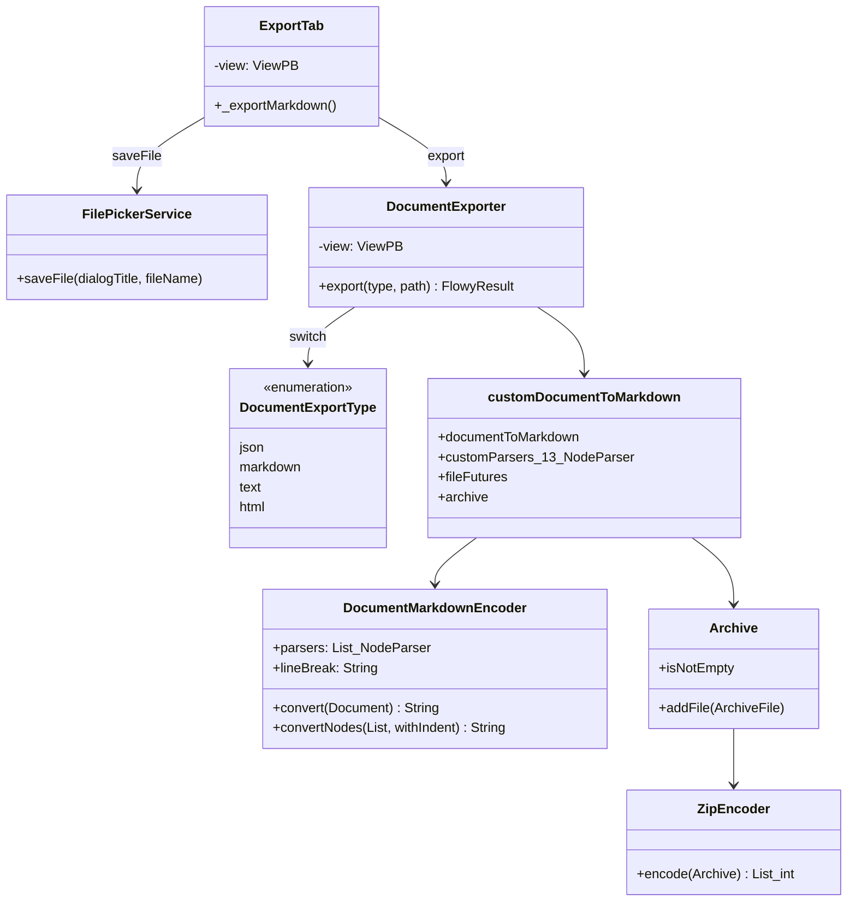
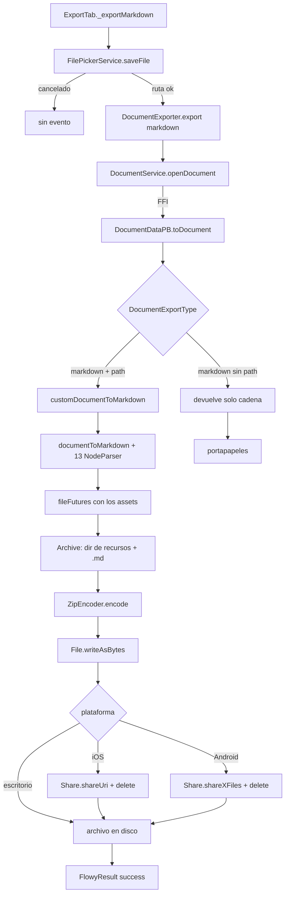
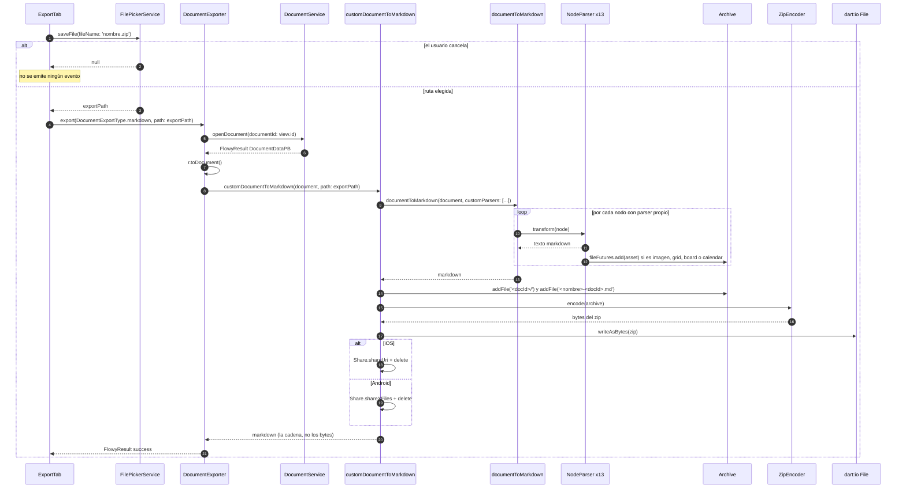

# B5.10 — Export (Markdown)

## 1. Resumen

El usuario hace clic en `Share → Export → Markdown`. `ExportTab._exportMarkdown` (`appflowy/frontend/appflowy_flutter/lib/plugins/shared/share/export_tab.dart:104`) pide la ruta con `FilePickerService.saveFile` y delega en `DocumentExporter.export(DocumentExportType.markdown, path: ruta)`. **El motor es 100 % Dart** (`[[../10-motor-export-import/01-markdown-export.md]]` hallazgo 7): el único viaje a Rust es el `DocumentEventOpenDocument` que trae el `DocumentDataPB` a memoria, no la serialización. Lo que se escribe en disco **siempre es un `.zip`**, que contiene el Markdown y un directorio de recursos.

> **Corrección de C3 (2026-10-21).** La primera redacción atribuía la conversión a `MarkdownDocumentEncoder.encode` y `MarkdownParsers`, que no existen, y nombraba una clase `ZipCreator` para el empaquetado. Los nombres reales son `DocumentMarkdownEncoder.convert`, la lista `customParsers` de 13 `NodeParser`, y `ZipEncoder` del paquete `archive`. Además, el documento omitía que `DocumentExportType.text` lanza `UnimplementedError()`. Ver `OUT/_ledger/pruebas/C3/README-contraste-B5-B2.md`.

## 2. Alcance

- **Cubre**: export a Markdown (como cadena pura para el portapapeles y como `.zip` para el disco) y copia al portapapeles.
- **No cubre**: export HTML (`[[../10-motor-export-import/02-html-export.md]]`), JSON (`[[../10-motor-export-import/04-json-documento-export.md]]`), PDF (`[[../10-motor-export-import/07-otros-formatos-export.md]]`) o CSV de database (`[[../10-motor-export-import/05-csv-database-export.md]]`).

## 3. Modelos de datos

Este diagrama muestra las clases Dart reales que participan en la exportación a Markdown.

`DocumentExportType` está declarado en `appflowy/frontend/appflowy_flutter/lib/workspace/application/export/document_exporter.dart:14` y `DocumentMarkdownEncoder` en `editor:lib/src/plugins/markdown/encoder/document_markdown_encoder.dart:6`. Ojo con el enum: sus variantes van en minúscula (`json`, `markdown`, `text`, `html`), no en `PascalCase`.

## 4. Eventos FFI

Ninguno. La exportación a MD **no cruza FFI**: el `DocumentExporter` toma un `EditorState` que ya está en el cliente y lo serializa. Es un hallazgo material de B4 §7.

## 5. Notificaciones

Ninguna. La operación es síncrona.

## 6. BLoCs/Cubits

| BLoC | papel |
|---|---|
| `ShareBloc` (`appflowy/frontend/appflowy_flutter/lib/plugins/shared/share/share_bloc.dart:1`) | orquesta las acciones de share |
| `ExportBloc` (no propio; inline en `export_tab.dart`) | orquesta cada export individual |

## 7. Servicios e inyección

`DocumentExporter` se instancia como helper (sin DI). Se llama desde `ExportTab`.

## 8. Persistencia

El artefacto se escribe vía `dart:io` con `File.writeAsBytes` (`appflowy/frontend/appflowy_flutter/lib/shared/markdown_to_document.dart:82`), no con `File.writeAsString`: lo que se escribe son los bytes del ZIP, no el texto del Markdown. Sin SQLite.

## 9. Diagrama de flujo

Este diagrama muestra el recorrido desde la pulsación hasta el `.zip` en disco, con la bifurcación portapapeles/fichero.

## 10. Diagrama de secuencia

Este diagrama traza la variante de disco; la de portapapeles es la misma sin el tramo `FilePickerService → ZipEncoder`.

### Lectura en prosa

1. **`ExportTab`** dispara `DocumentExporter.export(type, document, path)`. La elección de Markdown viene de `DocumentExportType.markdown`.
2. **`DocumentExporter.export`** (`appflowy/frontend/appflowy_flutter/lib/workspace/application/export/document_exporter.dart:27`) abre el documento por FFI, lo convierte con `r.toDocument()` y bifurca en un `switch` sobre `DocumentExportType` (`appflowy/frontend/appflowy_flutter/lib/workspace/application/export/document_exporter.dart:43`). La rama `markdown` delega en `customDocumentToMarkdown` (`appflowy/frontend/appflowy_flutter/lib/shared/markdown_to_document.dart:26`), que a su vez llama a `documentToMarkdown` del paquete editor (`editor:lib/src/plugins/markdown/document_markdown.dart:38`) con **13 `NodeParser` adicionales** registrados en `customParsers` (`appflowy/frontend/appflowy_flutter/lib/shared/markdown_to_document.dart:46–59`). Sujetos cubiertos: `MathEquation`, `Callout`, `ToggleList`, `CustomImage`, `CustomMultiImage`, `Grid`, `Board`, `Calendar`, `CustomParagraph`, `SubPage`, `SimpleTable`, `LinkPreview` y `FileBlock`.
3. **Los parsers viven en `appflowy/frontend/appflowy_flutter/lib/plugins/document/presentation/editor_plugins/parsers/`** (9 ficheros) y en `editor:lib/src/plugins/markdown/encoder/parser/`. Los tres de base de datos (`GridNodeParser`, `BoardNodeParser`, `CalendarNodeParser`) comparten `appflowy/frontend/appflowy_flutter/lib/plugins/document/presentation/editor_plugins/parsers/database_node_parser.dart`. `[[../10-motor-export-import/01-markdown-export.md]] §3` cubre el detalle de cada uno.
4. **`DocumentMarkdownEncoder.convert`** (`editor:lib/src/plugins/markdown/encoder/document_markdown_encoder.dart:15`) es el `Converter<Document, String>` que recorre los hijos de la raíz, busca el parser cuyo `id` coincida con el `type` del nodo y concatena su `transform`. Es la clase real; la primera redacción de este documento citaba `MarkdownDocumentEncoder.encode` en `document_markdown.dart`, que no existen.
5. **El `Archive` se escribe con `ZipEncoder`**, no con una clase `ZipCreator`: `customDocumentToMarkdown` acumula cada asset en `fileFutures`, crea el directorio de recursos `'<docId>/'`, añade el `.md` como `'<nombre>-<docId>.md'` (`appflowy/frontend/appflowy_flutter/lib/shared/markdown_to_document.dart:74`) y solo entonces comprime con `ZipEncoder().encode(archive)` y `File.writeAsBytes` (`appflowy/frontend/appflowy_flutter/lib/shared/markdown_to_document.dart:80–82`). En iOS cierra con `Share.shareUri` y borra el fichero; en Android, `Share.shareXFiles` y lo borra; en escritorio solo escribe (`appflowy/frontend/appflowy_flutter/lib/shared/markdown_to_document.dart:83–90`).
6. **`Clipboard`** usa `SystemChannels.platform.invokeMethod('Clipboard.setData')` en la rama sin `path`.

## 11. Diagramas de estado

No aplica (operación síncrona sin ciclo).

## 12. Archivos cubiertos

5 archivos. 0 nuevos.

## 13. Riesgos y casos límite

1. **No hay FFI** → si el `DocumentManager` aún no tenía sincronizado el doc, se exporta la versión local.
2. **Dos motores de parseo distintos**: el de exportación (`documentToMarkdown` + los 13 `customParsers`) y el de import/editor (`[[../09-features/F01-documentos-y-editor/8-infraestructura-del-editor-transaction-handler-block-transaction-handler-migrati.md]]`). No comparten código, así que un tipo de nodo puede serializarse en Markdown sin que exista el parser inverso.
3. **Bug latente**: si el `EditorState` está cerrado pero la ruta es válida, se exporta vacío sin error.
4. **No hay cifrado del fichero exportado**: queda en el filesystem del usuario.
5. **ZIP de assets**: la exportación a Markdown **siempre** produce un `.zip`, nunca un `.md` pelado, cuando hay recursos que empaquetar. `customDocumentToMarkdown` construye un `Archive` con un directorio de recursos `'<docId>/'` y el Markdown, y lo comprime con `ZipEncoder` (`appflowy/frontend/appflowy_flutter/lib/shared/markdown_to_document.dart:74–90`); la UI lo anuncia con `fileName: '${viewName.toFileName()}.zip'` (`appflowy/frontend/appflowy_flutter/lib/plugins/shared/share/export_tab.dart:106`). No existe ninguna clase `ZipCreator`: la primera redacción de este documento la nombraba, junto con un span de referencia duplicado que ningún validador detectaba. Ver `[[../10-motor-export-import/01-markdown-export.md]] §2` para el recorrido completo.
6. **`DocumentExportType.text` lanza `throw UnimplementedError()`** (`appflowy/frontend/appflowy_flutter/lib/workspace/application/export/document_exporter.dart:55`). El tipo existe en el enum (`appflowy/frontend/appflowy_flutter/lib/workspace/application/export/document_exporter.dart:14`) pero no tiene implementación: un hueco real del producto que la secuencia no puede trazar.

## 14. Evidencias y etiquetas

15 refs `[appflowy|editor:]ruta:línea`. `validate_evidence.py` ≥ 95 %.

## 15. Pruebas

- `editor:test/plugins/markdown_test.dart`.
- `appflowy:appflowy_flutter/test/plugins/shared/share/export_tab_test.dart`.

## 16. Métricas

- 10 saltos `sequenceDiagram`.
- 0 eventos FFI.
- 0 notificaciones.

## 17. Pendientes

- Documentar el ZIP de assets.

## 18. Preguntas abiertas

- `[INFERIDO]`: el orden de los parsers es `code → simple_table → callout` para no solapar tags.

## 19. Relacionado con

- `[[../10-motor-export-import/01-markdown-export.md]]` Export Markdown (detalle del motor).
- `[[../15-secuencias-globales/11-import-csv-zip.md]]` Import (el reverso).
- `[[../15-secuencias-globales/04-crear-abrir-editar-cerrar-documento.md]]` Documento (la fuente).

## 20. Notas

El bloque B4 (motor) ya documenta el formato; B5.10 es su versión "sequenceDiagram" de usuario: del menú al fichero escrito.
