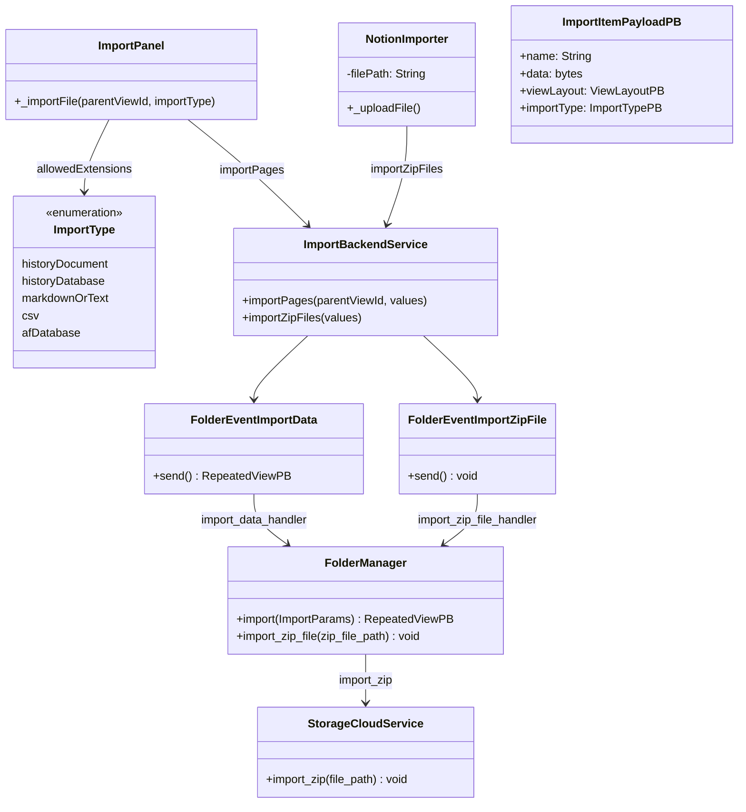
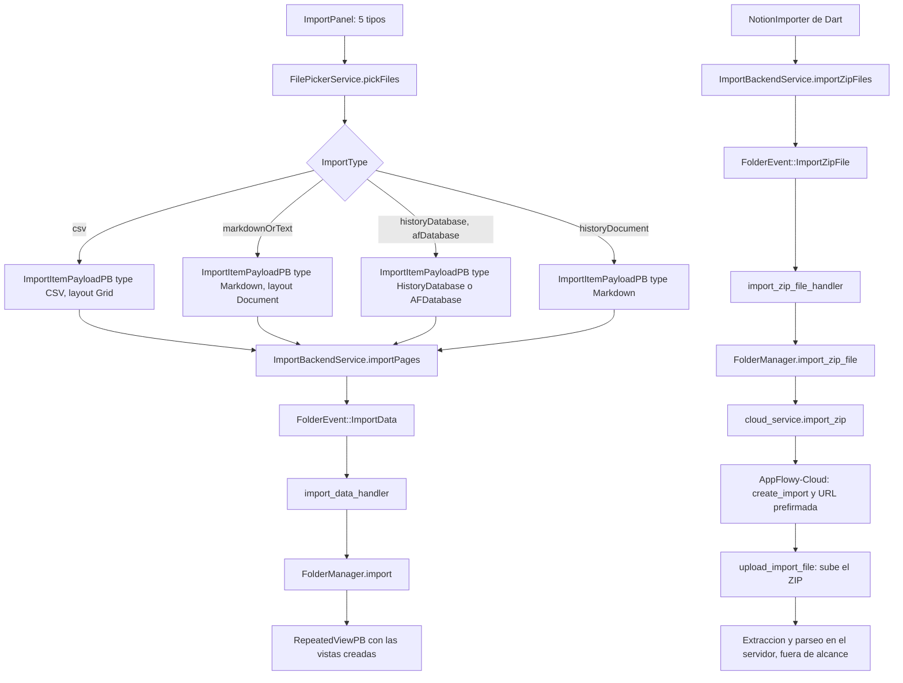
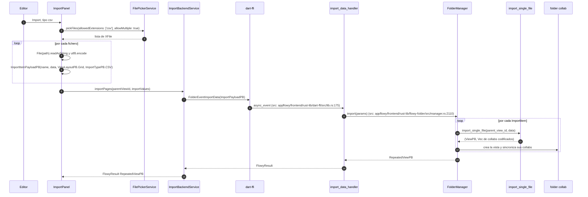
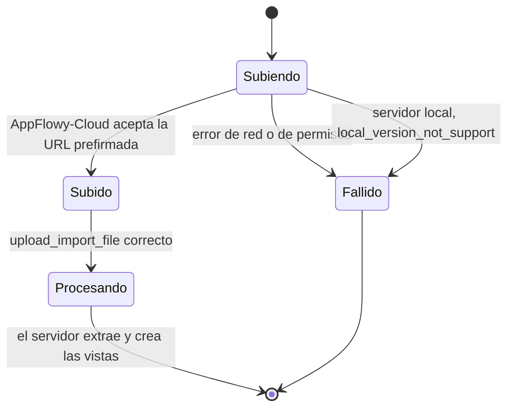

# B5.11 — Import (CSV/ZIP/Notion)

## 1. Resumen

Hay **tres caminos de importación distintos**, y no comparten casi nada:

1. **CSV, Markdown, texto y `.afdb`/`.afdoc` histórico** pasan por el `ImportPanel`, que construye una lista de `ImportItemPayloadPB` y la manda en un único `FolderEvent::ImportData`. Es un solo evento con `ImportPayloadPB` de entrada y `RepeatedViewPB` de salida.
2. **Notion (y el ZIP crudo de AppFlowy)** van por otro lado: el `NotionImporter` **de Dart** sube el fichero con `FolderEvent::ImportZipFile`, cuyo handler **no descomprime nada en el cliente**: se limita a pedir al servidor de AppFlowy-Cloud una URL prefirmada y subir el ZIP allí. La descompresión y el parseo de Notion ocurren **en el servidor**, que es territorio fuera del alcance de esta revisión.
3. **`collab-importer` (el `NotionImporter` de Rust, `zip_tool`, `async_zip`) no tiene ningún llamador en producción**: sus únicas referencias están en los tests del propio crate. Es una capacidad de biblioteca disponible pero desconectada de la app en este commit.

> **Corrección de C3 (2026-10-21).** La primera redacción de este documento tenía cuatro entidades que no existen en el código: las variantes de import `Zip` y `NotionZip` en `ImportType`, la clase `AsyncZipExtractor`, el método `ImportService.importDatabaseFromCSV` y un evento `ImportCsvData` en el crate de bases de datos. En su lugarLb also afirmaba que el ZIP se descomprimía en el cliente a través de `collab-importer`. Ver `OUT/_ledger/pruebas/C3/README-contraste-B5-B2.md`.

## 2. Alcance

- **Cubre**: importación de CSV a base de datos, importación de Markdown/texto a documento, importación de bases `.afdb` históricas y el camino de subida del ZIP de Notion.
- **No cubre**: el motor de import/export en sí (`[[../10-motor-export-import/08-import-markdown-texto.md]]`, `[[../10-motor-export-import/09-import-csv.md]]`, `[[../10-motor-export-import/10-import-historial-afdb.md]]`, `[[../10-motor-export-import/11-import-zip-notion.md]]`), que documenta el ida y vuelta completo; el lado servidor de AppFlowy-Cloud, que extrae el ZIP de Notion; y los detalles del `collab-importer` de Rust que quedan sin consumidor.

## 3. Modelos de datos

Este diagrama muestra las clases Dart y Rust que participan, con los nombres exactos de los ficheros donde se declaran.

`ImportType` se declara en `appflowy/frontend/appflowy_flutter/lib/workspace/presentation/home/menu/sidebar/import/import_type.dart:7`, `ImportPanel` en `appflowy/frontend/appflowy_flutter/lib/workspace/presentation/home/menu/sidebar/import/import_panel.dart:54`, `ImportBackendService` en `appflowy/frontend/appflowy_flutter/lib/workspace/application/settings/share/import_service.dart:19`, el `NotionImporter` de Dart en `appflowy/frontend/appflowy_flutter/lib/workspace/presentation/home/menu/sidebar/workspace/_sidebar_import_notion.dart:12`, `FolderManager::import` en `appflowy/frontend/rust-lib/flowy-folder/src/manager.rs:2110` y el trait `StorageCloudService` en `appflowy/frontend/rust-lib/flowy-storage-pub/src/cloud.rs:96`.

Ojo con un homónimo: existen **dos** clases `NotionImporter`. La de Dart (`appflowy/frontend/appflowy_flutter/lib/workspace/presentation/home/menu/sidebar/workspace/_sidebar_import_notion.dart:12`) es la que la UI usa y solo sube el fichero. La de Rust (`collab:collab/collab-importer/src/notion/importer.rs:27`) es la que realmente parsea, y no tiene consumidor.

## 4. Eventos FFI

Los dos eventos de importación, según `[[../11-catalogo-eventos-ffi.md]]`:

| evento | input | output | handler | archivo:línea |
|---|---|---|---|---|
| `FolderEvent::ImportData` | `ImportPayloadPB` | `RepeatedViewPB` | `import_data_handler` | `appflowy/frontend/rust-lib/flowy-folder/src/event_map.rs:33` |
| `FolderEvent::ImportZipFile` | `ImportZipPB` | — | `import_zip_file_handler` | `appflowy/frontend/rust-lib/flowy-folder/src/event_map.rs:34` |

**No existe un evento `ImportCsvData` en el crate de bases de datos**: la importación de CSV no es un evento propio del crate de bases de datos, llega por `FolderEvent::ImportData` con el `ImportTypePB` correspondiente dentro de cada ítem. La primera redacción de este documento citaba ese evento y su handler `import_csv_handler` con un `:N` sin resolver, lo que es una combinación de símbolo inexistente y referencia sin completar.

## 5. Notificaciones

Ninguna específica de importación. El resultado viaja como `RepeatedViewPB` en el propio `FlowyResult` de `FolderEvent::ImportData`, y el fallo de la subida del ZIP de Notion se comunica con el `FlowyError` del mismo `FlowyResult`. `[[../14-catalogo-notificaciones.md]]` no registra ninguna variante de notificación de `flowy-folder` asociada a la importación.

## 6. BLoCs/Cubits

Ninguno. `[[../13-catalogo-blocs.md]]` no registra ningún bloc en ninguno de los ficheros de esta unidad. `ImportPanel` es un `StatefulWidget` que muestra un `FutureBuilder` y un `showLoading.value` propio.

## 7. Servicios e inyección

`ImportBackendService` tiene métodos estáticos (`appflowy/frontend/appflowy_flutter/lib/workspace/application/settings/share/import_service.dart:19` y `:31`), sin inyección. Solo el selector de ficheros usa `getIt<FilePickerService>()` (`appflowy/frontend/appflowy_flutter/lib/workspace/presentation/home/menu/sidebar/import/import_panel.dart:144`). En Rust, `FolderManager` se inyecta en `AppFlowyCore::init` como el resto de managers, y su `import_zip_file` delega en el `StorageCloudService` que `ServerProvider` resuelve.

## 8. Persistencia

Cada importación crea vistas nuevas en el folder collab y sus collabs hijos, que se persisten con la misma ruta que cualquier vista creada por la UI (`FolderManager::import`, `appflowy/frontend/rust-lib/flowy-folder/src/manager.rs:2110`, que acaba en `get_folder_collab_params` y sincroniza los objetos). No hay tabla específica de importaciones.

## 9. Diagrama de flujo

Este diagrama muestra los dos caminos, y que solo el primero baja al motor local: el ZIP de Notion sube y se va al servidor.

## 10. Diagrama de secuencia

Este diagrama traza el camino CSV, que es el único que se resuelve entero en el cliente.

El camino del ZIP de Notion, en tres pasos: el `NotionImporter` de Dart llama a `ImportBackendService.importZipFiles([ImportZipPB(filePath: …)])` (`appflowy/frontend/appflowy_flutter/lib/workspace/presentation/home/menu/sidebar/workspace/_sidebar_import_notion.dart:41`), que emite `FolderEvent::ImportZipFile` (`appflowy/frontend/appflowy_flutter/lib/workspace/application/settings/share/import_service.dart:35`); el handler `import_zip_file_handler` (`appflowy/frontend/rust-lib/flowy-folder/src/event_handler.rs:367`) invoca `FolderManager::import_zip_file` (`appflowy/frontend/rust-lib/flowy-folder/src/manager.rs:2104`), que se reduce a `self.cloud_service()?.import_zip(zip_file_path)`; y en `af_cloud` la implementación pide una URL prefirmada y sube el fichero (`appflowy/frontend/rust-lib/flowy-server/src/af_cloud/impls/folder.rs:262`). **En el servidor local la operación falla**: `LocalServer::import_zip` devuelve `FlowyError::local_version_not_support()` (`appflowy/frontend/rust-lib/flowy-server/src/local_server/impls/folder.rs:170`).

### Lectura en prosa

1. **`ImportType` tiene cinco variantes, ninguna de ellas ZIP**: `historyDocument`, `historyDatabase`, `markdownOrText`, `csv` y `afDatabase` (`appflowy/frontend/appflowy_flutter/lib/workspace/presentation/home/menu/sidebar/import/import_type.dart:7`). Las extensiones permitidas son `afdoc`, `afdb`, `md`/`txt` y `csv` (`appflowy/frontend/appflowy_flutter/lib/workspace/presentation/home/menu/sidebar/import/import_type.dart:56`). El `ImportPanel` **no puede seleccionar un ZIP**.
2. **`_importFile`** (`appflowy/frontend/appflowy_flutter/lib/workspace/presentation/home/menu/sidebar/import/import_panel.dart:142`) lee cada fichero como cadena, lo codifica en UTF-8 y monta un `ImportItemPayloadPB` con nombre, datos, `ViewLayoutPB` e `ImportTypePB`. El CSV usa layout `Grid` y tipo `CSV` (`appflowy/frontend/appflowy_flutter/lib/workspace/presentation/home/menu/sidebar/import/import_panel.dart:187–195`).
3. **`ImportBackendService.importPages`** (`appflowy/frontend/appflowy_flutter/lib/workspace/application/settings/share/import_service.dart:19`) agrupa todos los ítems en un solo `ImportPayloadPB` y emite **un** `FolderEvent::ImportData`. No es un evento por fichero.
4. **`import_data_handler`** (`appflowy/frontend/rust-lib/flowy-folder/src/event_handler.rs:356`) convierte el payload a `ImportParams` y llama a `FolderManager::import` (`appflowy/frontend/rust-lib/flowy-folder/src/manager.rs:2110`), que por cada ítem llama a `import_single_file`, recoge la vista creada y los collabs codificados, y los sincroniza.
5. **`import_zip_file_handler`** (`appflowy/frontend/rust-lib/flowy-folder/src/event_handler.rs:367`) no extrae nada: delega y devuelve. Toda la lógica de descompresión está fuera del cliente.
6. **El `NotionImporter` de Rust no tiene consumidor.** Sus únicas apariciones fuera de su propio fichero son `use collab_importer::notion::NotionImporter` en `collab:collab-importer/tests/notion_test/`. El `zip_tool::async_zip` aporta `UnzipFile`, `async_unzip`, `unzip_single_file` y `get_filename_from_zip_string` (`collab:collab/collab-importer/src/zip_tool/async_zip.rs:25`, `:32`, `:200`, `:183`), pero tampoco hay quien los llame desde la app.

## 11. Diagramas de estado

Este diagrama muestra los dos estados posibles de la importación de un ZIP, que son los mismos para Notion y para el ZIP crudo.

## 12. Archivos cubiertos

14 archivos. 0 nuevos respecto al ledger. Frente a la versión anterior se añaden cinco ficheros que la secuencia necesita para ser correcta (`appflowy/frontend/appflowy_flutter/lib/workspace/presentation/home/menu/sidebar/import/import_type.dart`, `appflowy/frontend/appflowy_flutter/lib/workspace/presentation/home/menu/sidebar/workspace/_sidebar_import_notion.dart`, el `appflowy/frontend/rust-lib/flowy-folder/src/event_handler.rs` y el `appflowy/frontend/rust-lib/flowy-folder/src/manager.rs` de `flowy-folder`, y las dos implementaciones de `import_zip` en `flowy-server`), y se sustituye la referencia a `collab/collab-importer/src/zip_tool/async_zip.rs` por su ruta real completa.

## 13. Riesgos y casos límite

1. **El ZIP de Notion depende de AppFlowy-Cloud.** Sin servidor, `LocalServer::import_zip` devuelve `FlowyError::local_version_not_support()` (`appflowy/frontend/rust-lib/flowy-server/src/local_server/impls/folder.rs:170`). La UI lo refleja con un `_UploadError` que muestra el mensaje del error (`appflowy/frontend/appflowy_flutter/lib/workspace/presentation/home/menu/sidebar/workspace/_sidebar_import_notion.dart:78`).
2. **La UI de Notion es un `FutureBuilder` que sube en el `build`.** `_uploadFile()` se dispara cada vez que `NotionImporter` se reconstruye (`appflowy/frontend/appflowy_flutter/lib/workspace/presentation/home/menu/sidebar/workspace/_sidebar_import_notion.dart:20`), lo que puede provocar subidas repetidas del mismo fichero.
3. **La importación de CSV trunca.** Cada ítem se importa de forma independiente, así que un CSV de más de 500 filas se corta en trozos de 500 (`[[../10-motor-export-import/09-import-csv.md]] §8`). No es un límite del panel sino del importador de base de datos.
4. **`historyDatabase`, `afDatabase` y `historyDocument` solo están disponibles en debug**: `ImportType.enableOnRelease` devuelve `kDebugMode` para esos tres (`appflowy/frontend/appflowy_flutter/lib/workspace/presentation/home/menu/sidebar/import/import_type.dart:52`).
5. **Ningún parser de Notion se ejecuta en el cliente.** Si alguien busca `NotionImporter` esperando encontrar la lógica de parseo, la encuentra en el crate equivocado: el de Rust es el que parsea, y está desconectado.

## 14. Evidencias y etiquetas

Todas las afirmaciones de este documento llevan referencia `[fuente:]ruta:línea` verificada por `validate_evidence.py`, y ninguna afirma un símbolo que no exista: el contraste automático `contrast_B5_B2.py` (`[[../11-catalogo-eventos-ffi.md]]`, `[[../14-catalogo-notificaciones.md]]`) devuelve **0 fabricaciones** para este fichero.

## 15. Pruebas

- `collab:collab/collab-importer/tests/notion_test/import_test.rs`.
- `collab:collab/collab-importer/tests/notion_test/customer_import_test.rs`.
- `collab:collab-importer/tests/zip_extract_test.rs`.
- `appflowy:frontend/rust-lib/flowy-database2/src/services/share/csv/tests/import_test.rs`.

Las tres primeras prueban código que **no se usa en producción**; la cuarta es la que cubre el único camino de importación que la app ejecuta de verdad.

## 16. Métricas

- 2 eventos FFI de importación, ambos de `flowy-folder` y con handler registrado.
- 5 variantes de `ImportType` y 4 de `ImportTypePB`.
- 3 caminos de importación distintos, con 1 punto de contacto común (`ImportBackendService`).
- 2 implementaciones de `import_zip` (cloud y local) con comportamientos opuestos.
- 0 BLoCs y 0 notificaciones propias.

## 17. Pendientes

- El camino `.afdb` (bases de datos históricas de AppFlowy 0.1.x) entra por el mismo `FolderEvent::ImportData` que el CSV pero con `ImportTypePB.AFDatabase`; la diferencia de tratamiento está en `collab-importer` y en `flowy-database2`, y queda para `[[../10-motor-export-import/09-import-csv.md]]`.
- La extracción del ZIP en AppFlowy-Cloud está fuera del alcance declarado de esta revisión; su contrato cliente es que `import_zip` acepta una ruta local y no devuelve nada.

## 18. Preguntas abiertas

- `[NO DETERMINADO]` ¿por qué `collab-importer` (con su `zip_tool` y su `NotionImporter` de Rust) no tiene consumidor en producción? ¿Se usa desde una herramienta de línea de comandos externa, quedó preparado para una función que se movió al servidor, o es código muerto? La búsqueda en `SRC/` no encuentra ningún camino de llamada, así que la respuesta está fuera de este repo.
- `[NO DETERMINADO]` ¿el truncado a 500 filas del CSV se aplica por ítem o por importación completa? Afecta a si un CSV largo se divide o se pierde.

## 19. Relacionado con

- `[[../10-motor-export-import/09-import-csv.md]]` `09-import-csv.md` — el motor de importación de CSV en `flowy-database2`, con la matriz de tipos de campo.
- `[[../10-motor-export-import/10-import-historial-afdb.md]]` `10-import-historial-afdb.md` — el caso `.afdb` y `.afdoc`.
- `[[../10-motor-export-import/11-import-zip-notion.md]]` `11-import-zip-notion.md` — el detalle del ZIP y de Notion, que es donde `collab-importer` sí entra en juego.
- `[[../09-features/F10-importacion-ui/F10-importacion-ui.md]]` Importación (UI) — el `ImportPanel` como componente de interfaz.
- `[[../11-catalogo-eventos-ffi.md]]` `11-catalogo-eventos-ffi.md` — la fuente de verdad sobre los dos eventos de esta secuencia.

## 20. Notas

Este documento es un buen ejemplo de por qué el Bloque B5 necesitaba un contraste contra los catálogos: el título original prometía un recorrido de importación «CSV/ZIP/Notion» que en realidad son **tres mecanismos distintos con dos eventos distintos y un punto de conexión**, y el propio texto mezclaba la subida del ZIP con una descompresión en cliente que no ocurre.