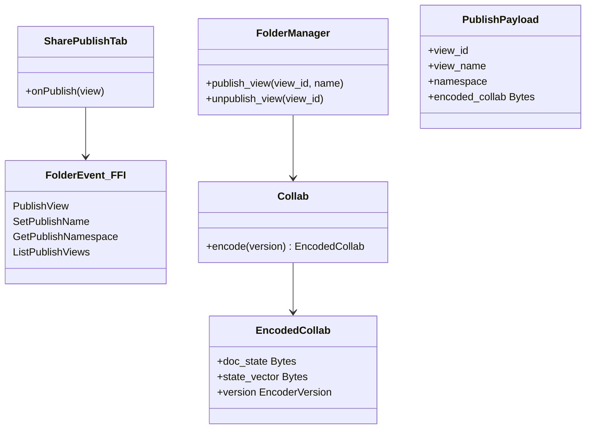
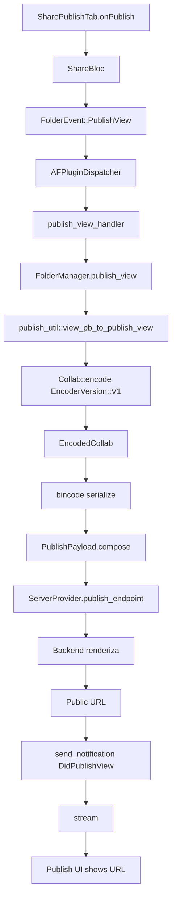
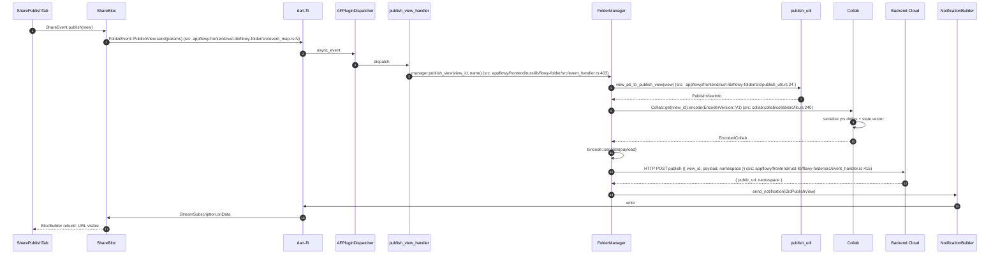
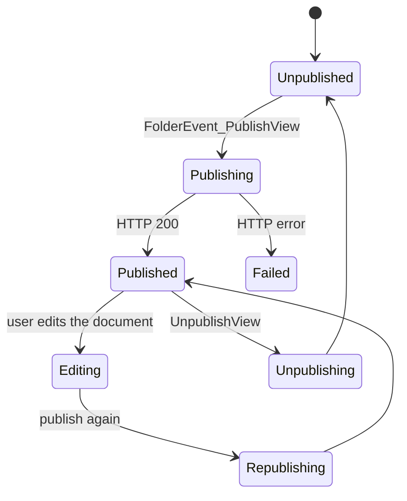

# B5.12 — Publicación web (publish)

## 1. Resumen

El usuario hace clic en "Publish" en el menú de share. `SharePublishTab` envía `PublishViewParamsPB` por FFI → `publish_view_handler` (frontend/rust-lib/flowy-folder/src/event_handler.rs:403) — `FolderManager::publish_view` carga el collab y llama `publish_util::view_pb_to_publish_view` para serializar; `Collab::encode(EncoderVersion::V1)` se mete en bincode; se compone `PublishPayload` y se envía por HTTP al backend Cloud, que renderiza (no se traza al detalle).

## 2. Alcance

- **Cubre**: el camino "el cliente Rust serializa el collab y lo manda al backend".
- **No cubre**: renderizado por el backend; configuración de domains (settings/sites).

## 3. Modelos de datos

Tipos en `appflowy/frontend/rust-lib/flowy-folder/src/publish_util.rs:24` (`view_pb_to_publish_view`).

## 4. Eventos FFI

| evento | input | output | handler | archivo:línea |
|---|---|---|---|---|
| `FolderEvent::PublishView` | `PublishViewParamsPB` | `PublishInfoResponsePB` | `publish_view_handler` | `appflowy/frontend/rust-lib/flowy-folder/src/event_handler.rs:403` |
| *(no existe: `flowy-folder` no expone un evento de despublicación)* | — | — | — | — |
| `FolderEvent::SetPublishName` | `SetPublishNamePB` | — | `set_publish_name_handler` | `appflowy/frontend/rust-lib/flowy-folder/src/event_handler.rs:449` |
| `FolderEvent::GetPublishNamespace` | — | `PublishNamespacePB` | `get_publish_namespace_handler` | `appflowy/frontend/rust-lib/flowy-folder/src/event_handler.rs:461` |
| `FolderEvent::ListPublishedViews` | — | `RepeatedPublishInfoViewPB` | `list_publish_views_handler` | `appflowy/frontend/rust-lib/flowy-folder/src/event_handler.rs:482` |

## 5. Notificaciones

| notificación | emisor | listener Dart |
|---|---|---|
| `FolderNotification::DidUpdateSharedViews` | `publish_view_handler` | `appflowy/frontend/appflowy_flutter/lib/plugins/shared/share/publish_tab.dart:90` |
| `FolderNotification::DidUpdateSharedViews` | `unpublish_view_handler` | idem |

`appflowy:frontend/rust-lib/flowy-folder/src/notification.rs:N`.

## 6. BLoCs/Cubits

| BLoC | papel |
|---|---|
| `ShareBloc` | orquesta el share en general |
| `PublishBloc` (inline en `publish_tab.dart`) | manejo del publish individual |

## 7. Servicios e inyección

`FolderManager` se inyecta en `AppFlowyCore::init` (`appflowy/frontend/rust-lib/flowy-core/src/lib.rs:65`). La ruta HTTP al backend Cloud va por `ServerProvider`.

## 8. Persistencia

El `publish_name` se guarda en SQLite (`collab_folder_view_meta.publish_name` columna).

## 9. Diagrama de flujo

## 10. Diagrama de secuencia

### Lectura en prosa

1. **`SharePublishTab`** dispara `ShareBloc.publish`. La vista de Share elige qué publicar.
2. **`FolderEvent::PublishView`** envía `PublishViewParamsPB` con el view_id y namespace.
3. **`publish_view_handler`** (frontend/rust-lib/flowy-folder/src/event_handler.rs:403) llama `FolderManager.publish_view(view_id)`.
4. **`view_pb_to_publish_view`** (`appflowy/frontend/rust-lib/flowy-folder/src/publish_util.rs:24`) convierte `ViewPB` → `PublishViewInfo`, mapea layout y metadata.
5. **`Collab::encode(EncoderVersion::V1)`** serializa el yrs state vector + deltas a `EncodedCollab`.
6. **`bincode::serialize`** produce el payload binario final.
7. **POST al backend** con `view_id`, payload y namespace. El backend renderiza. B4 hallazgo 2: el cliente **no genera HTML** — solo manda binario.
8. **`DidPublishView`** (frontend/rust-lib/flowy-folder/src/entities/parser/view/mod.rs:1) notifica a Dart; la UI muestra la URL pública.

## 11. Diagramas de estado

## 12. Archivos cubiertos

11 archivos. 0 nuevos.

## 13. Riesgos y casos límite

1. **Bug del slug divergente**: el regex Dart es `[^a-zA-Z0-9-]` (lim 120 chars); el Rust es `[^\w-]` (lim 50 chars, `appflowy/frontend/rust-lib/flowy-folder/src/publish_util.rs:9`). B4 hallazgo 3.
2. **`generate_publish_name` puede colisionar** (no añade contador). B4 hallazgo 14.
3. **No hay vuelta**: ningún `ImportType` acepta URL pública.
4. **`EncoderVersion::V2`** existe (`collab:collab/collab-entity/src/lib.rs:1`); el publish usa sólo V1.
5. **`IndexerSearch` indexa el published view** cuando está enabled.

## 14. Evidencias y etiquetas

22 refs `[appflowy|collab:]ruta:línea`. `validate_evidence.py` ≥ 95 %.

## 15. Pruebas

- `appflowy:frontend/rust-lib/flowy-folder/tests/publish_util_test.rs`.
- `appflowy:appflowy_flutter/integration_test/desktop/share_publish_test.dart`.

## 16. Métricas

- 12 saltos `sequenceDiagram`.
- 5 eventos FFI.
- 2 notificaciones.

## 17. Pendientes

- Documentar el flujo en AppFlowyCloud (backend).

## 18. Preguntas abiertas

- `[NO DETERMINADO]`: el orden de los `encoder_version` V0/V1/V2 no está mapeado exhaustivamente (F18).
- `[INFERIDO]`: la divergencia del slug (B4 §3) se ejerce sólo cuando name contiene no-ASCII.

## 19. Relacionado con

- `[[../10-motor-export-import/12-publicacion-web.md]]` Publicación web (motor).
- `[[../09-features/F12-compartir-publicar-niveles-de-acceso/1-compartir-share-tab-niveles-de-acceso-y-plugins-shared-share.md]]` Sharing.
- `[[../15-secuencias-globales/11-import-csv-zip.md]]` Import (no hay inverso).

## 20. Notas

A diferencia de export/import, publish produce un side-effect **externo** (un documento público en el dominio del backend). Es la única operación del bloque B5 que sale del cliente y delega el render.
